<div align="center">

# Astra CMS

### Software After Software. Software that evolves with its users.

<p><b>English</b> · <a href="README.vi.md">Tiếng Việt</a></p>

<a href="docs/architecture/astra-architecture.en.html" title="Astra CMS architecture">
  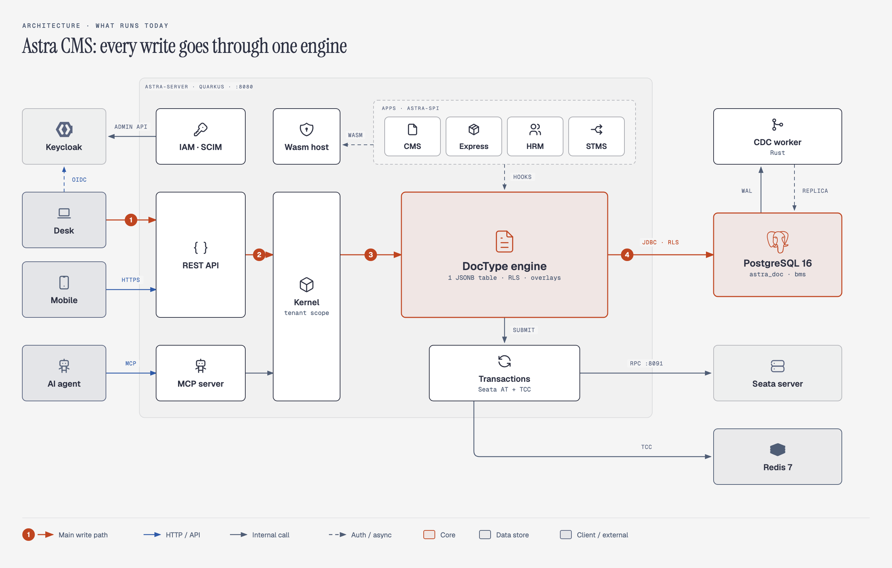
</a>

<a href="https://media.zerohostcms.com/astra-cms/astra-intro.en.mp4" title="Watch: Astra in 5 minutes">
  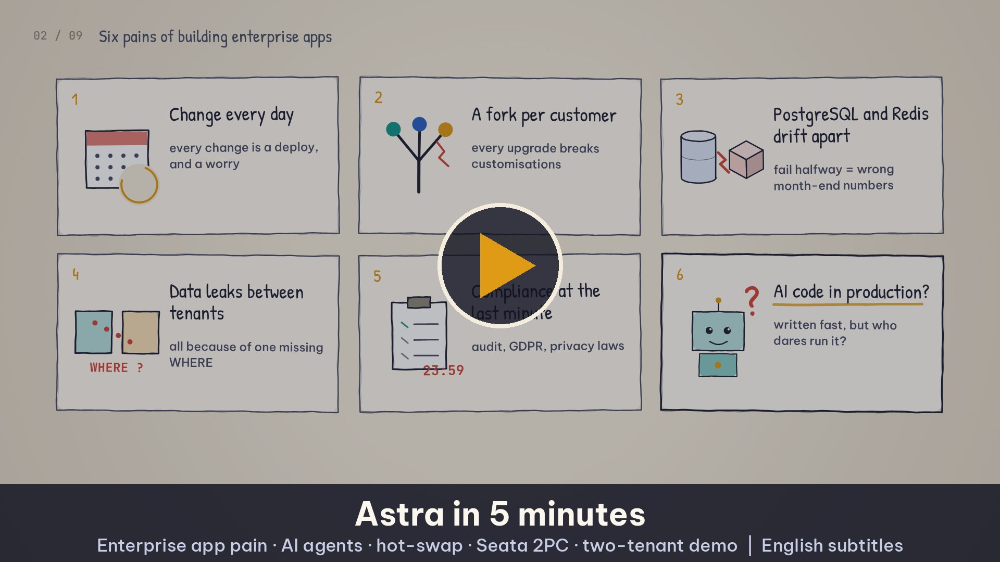
</a>

**A metadata-driven, plugin-first application platform for enterprises that change constantly and cannot afford downtime.**

<div align="left">

Inspired by Frappe / ERPNext, rebuilt from scratch on Java 25 and Quarkus.<br>
◐&nbsp; **DocTypes** define schema, form, API, permissions, workflow and compliance metadata as data.<br>
◐&nbsp; **Plugins** run in three isolation tiers: shared, isolated JVM, or WebAssembly.<br>
○&nbsp; **Versioned apps** run side by side, with canary rollout and automatic rollback.<br>
●&nbsp; **Distributed transactions** are built into the platform.<br>
●&nbsp; **AI-native:** every DocType and extension point is a tool for agents.<br>
◐&nbsp; **Compliance** is part of the data model, so the audit evidence for SOC 2, ISO 27001, GDPR and regional privacy laws is generated instead of assembled later.<br>
First apps: Astra CMS, then Astra ERP.

<sub>● running in the demo &nbsp;·&nbsp; ◐ partly running &nbsp;·&nbsp; ○ roadmap &nbsp;·&nbsp; details in <a href="#project-status">Project status</a></sub>

</div>

[](#project-status)
[](LICENSE)

</div>

---

## Vision: Software After Software

> **Shorten the journey from an idea to a production-ready capability from months to days, or even hours, while keeping humans in control of critical decisions.**

**How the architecture serves the vision.** Each step of the loop from need to capability maps to a concrete part of the platform:

| Step | What makes it possible in Astra |
| --- | --- |
| **Understand the need** | Every DocType, event and job is an MCP tool, scoped by role and tenant, so an agent reads the same business data a user sees and nothing more. |
| **Create the capability** | A capability is metadata: a new DocType is one YAML file, a business rule is one hook class, a script is one Wasm function. Each task is narrow enough for an agent to finish. |
| **Test the change** | `astra-plugin-testkit` contract, capability and budget assertions give a pass/fail loop. AI-generated code defaults to the Tier 2 Wasm sandbox and records its `provenance.generator`. |
| **Ship without breaking** | Zero-DDL schema changes, side-by-side app versions, per-tenant pinning, canary rollout and automatic rollback. Tenant customisations live in overlays that survive upgrades. |
| **Keep humans in control** | Workflow approvals, Submit/Cancel/Amend on documents, an append-only ledger, full audit, and environment policy that decides which tier agent-written code may run in. |

**Astra CMS is building toward Software After Software.** The parts that run today are listed in [Project Status](#project-status); the agent-driven loop end to end is on the [Roadmap](#roadmap).

---

## Demo videos

Recorded from the running demo: real Desk screens and terminal output. Videos 8 to 17 and 19 to 21 each end with a "To be accurate" note on what is not built yet. Script: [docs/demo-video-series.en.md](docs/demo-video-series.en.md). Each video has a deep-dive article for developers and technical leaders, with code, a real-world example and figure prompts: [all articles](docs/articles/README.md).

<table>
<tr><th colspan="2" align="left">Teaser: One platform, every business process <sub>(1:30)</sub></th></tr>
<tr>
<td width="330"><a target="_blank" rel="noopener noreferrer" href="https://media.zerohostcms.com/astra-cms/astra-video-0-teaser-en.mp4">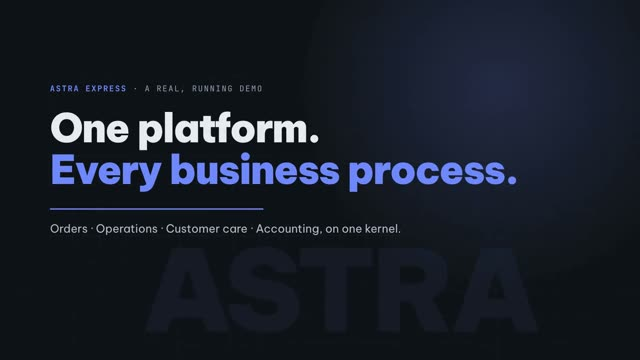</a></td>
<td>Cut from real scenes of the demo: a DocType becomes the Desk, Submit creates a waybill and a journal entry, per-tenant overlays, the Wasm sandbox, MCP masking PII, Rust CDC and a Seata rollback.<br><a target="_blank" rel="noopener noreferrer" href="https://media.zerohostcms.com/astra-cms/astra-video-0-teaser-en.mp4">▶ Watch</a></td>
</tr>
</table>

<details>
<summary><b>20 more videos</b>: the platform mechanisms, then the HRM, STMS and SSO apps</summary>

<table>
<tr><th colspan="2" align="left">Video 1 · What is Astra &amp; running it locally <sub>(2:32)</sub></th></tr>
<tr>
<td width="330"><a target="_blank" rel="noopener noreferrer" href="https://media.zerohostcms.com/astra-cms/astra-video-1-quickstart-en.mp4">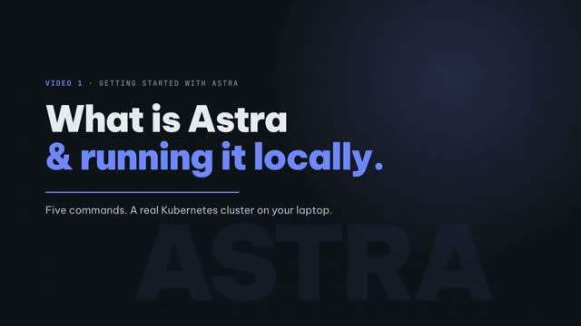</a></td>
<td>Kernel + DocType engine + plugin host, then the whole k3d cluster with <code>make k3d-up</code>, data seeded through the REST API, and a Desk login.<br><a target="_blank" rel="noopener noreferrer" href="https://media.zerohostcms.com/astra-cms/astra-video-1-quickstart-en.mp4">▶ Watch</a> · <a href="docs/articles/01-quickstart.md">Read the article</a></td>
</tr>
<tr><th colspan="2" align="left">Video 2 · DocType: from one YAML file to API, UI and indexes <sub>(2:38)</sub></th></tr>
<tr>
<td width="330"><a target="_blank" rel="noopener noreferrer" href="https://media.zerohostcms.com/astra-cms/astra-video-2-doctype-en.mp4"></a></td>
<td>One YAML file generates the form, REST API, validation and an online expression index; every DocType shares one JSONB table, no ALTER TABLE.<br><a target="_blank" rel="noopener noreferrer" href="https://media.zerohostcms.com/astra-cms/astra-video-2-doctype-en.mp4">▶ Watch</a> · <a href="docs/articles/02-doctype.md">Read the article</a></td>
</tr>
<tr><th colspan="2" align="left">Video 3 · Business rules: hooks &amp; validation <sub>(2:53)</sub></th></tr>
<tr>
<td width="330"><a target="_blank" rel="noopener noreferrer" href="https://media.zerohostcms.com/astra-cms/astra-video-3-hooks-en.mp4"></a></td>
<td>A 73,000 ₫ shipping fee computed by a hook, all validation errors returned at once, Links checked inside the tenant; the Desk and the API hit the same rules.<br><a target="_blank" rel="noopener noreferrer" href="https://media.zerohostcms.com/astra-cms/astra-video-3-hooks-en.mp4">▶ Watch</a> · <a href="docs/articles/03-hooks.md">Read the article</a></td>
</tr>
<tr><th colspan="2" align="left">Video 4 · Document lifecycle: Submit, Cancel, Amend <sub>(3:10)</sub></th></tr>
<tr>
<td width="330"><a target="_blank" rel="noopener noreferrer" href="https://media.zerohostcms.com/astra-cms/astra-video-4-lifecycle-en.mp4">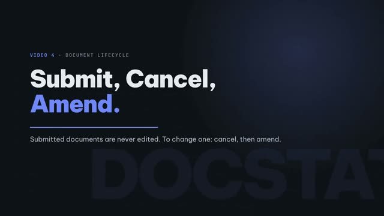</a></td>
<td>Submit creates the waybill and the journal entry in one transaction; submitted documents are immutable; cancel posts a reversing entry; amend creates a new revision.<br><a target="_blank" rel="noopener noreferrer" href="https://media.zerohostcms.com/astra-cms/astra-video-4-lifecycle-en.mp4">▶ Watch</a> · <a href="docs/articles/04-lifecycle.md">Read the article</a></td>
</tr>
<tr><th colspan="2" align="left">Video 5 · Operations: the parcel state machine <sub>(3:00)</sub></th></tr>
<tr>
<td width="330"><a target="_blank" rel="noopener noreferrer" href="https://media.zerohostcms.com/astra-cms/astra-video-5-ops-en.mp4">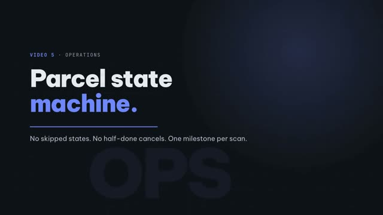</a></td>
<td>Filtering on a projected field, the scan timeline, no skipped states, an error then a success on the same form, and no cancelling a delivered order.<br><a target="_blank" rel="noopener noreferrer" href="https://media.zerohostcms.com/astra-cms/astra-video-5-ops-en.mp4">▶ Watch</a> · <a href="docs/articles/05-ops.md">Read the article</a></td>
</tr>
<tr><th colspan="2" align="left">Video 6 · Customer care sees operations <sub>(2:30)</sub></th></tr>
<tr>
<td width="330"><a target="_blank" rel="noopener noreferrer" href="https://media.zerohostcms.com/astra-cms/astra-video-6-care-en.mp4">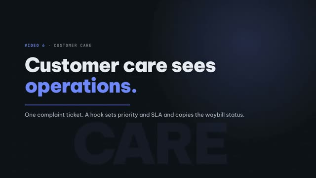</a></td>
<td>Tickets jump to High with a +24h SLA based on keywords; the CARE replica card reads a copy kept by the CDC worker.<br><a target="_blank" rel="noopener noreferrer" href="https://media.zerohostcms.com/astra-cms/astra-video-6-care-en.mp4">▶ Watch</a> · <a href="docs/articles/06-care.md">Read the article</a></td>
</tr>
<tr><th colspan="2" align="left">Video 7 · Multi-tenancy <sub>(2:28)</sub></th></tr>
<tr>
<td width="330"><a target="_blank" rel="noopener noreferrer" href="https://media.zerohostcms.com/astra-cms/astra-video-7-tenants-en.mp4"></a></td>
<td>Two companies on one server: same URL, different data; Links never cross tenants, 403/400 when the tenant is unclear, RLS returns 0 rows.<br><a target="_blank" rel="noopener noreferrer" href="https://media.zerohostcms.com/astra-cms/astra-video-7-tenants-en.mp4">▶ Watch</a> · <a href="docs/articles/07-tenants.md">Read the article</a></td>
</tr>
<tr><th colspan="2" align="left">Video 8 · Fail-closed security <sub>(2:02)</sub></th></tr>
<tr>
<td width="330"><a target="_blank" rel="noopener noreferrer" href="https://media.zerohostcms.com/astra-cms/astra-video-8-failclosed-en.mp4">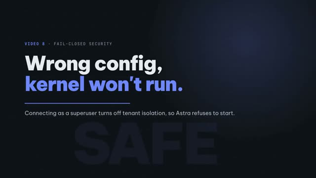</a></td>
<td>Connect as a superuser and the kernel refuses to start, before Flyway runs any migration; the application role is NOSUPERUSER NOBYPASSRLS.<br><a target="_blank" rel="noopener noreferrer" href="https://media.zerohostcms.com/astra-cms/astra-video-8-failclosed-en.mp4">▶ Watch</a> · <a href="docs/articles/08-failclosed.md">Read the article</a></td>
</tr>
<tr><th colspan="2" align="left">Video 9 · For developers: writing an Astra app <sub>(2:22)</sub></th></tr>
<tr>
<td width="330"><a target="_blank" rel="noopener noreferrer" href="https://media.zerohostcms.com/astra-cms/astra-video-9-developer-en.mp4"></a></td>
<td>An app is plain Java + YAML on astra-spi; dev-mode live reload adds a new column in 0.73 s; 44 integration tests against real PostgreSQL, Seata and Redis.<br><a target="_blank" rel="noopener noreferrer" href="https://media.zerohostcms.com/astra-cms/astra-video-9-developer-en.mp4">▶ Watch</a> · <a href="docs/articles/09-developer.md">Read the article</a></td>
</tr>
<tr><th colspan="2" align="left">Video 10 · Running on Kubernetes <sub>(2:06)</sub></th></tr>
<tr>
<td width="330"><a target="_blank" rel="noopener noreferrer" href="https://media.zerohostcms.com/astra-cms/astra-video-10-k8s-en.mp4"></a></td>
<td>Two kernel pods write in parallel with no duplicate and no gap in the numbering; a rolling restart under load, and what is still missing (no drain yet).<br><a target="_blank" rel="noopener noreferrer" href="https://media.zerohostcms.com/astra-cms/astra-video-10-k8s-en.mp4">▶ Watch</a> · <a href="docs/articles/10-k8s.md">Read the article</a></td>
</tr>
<tr><th colspan="2" align="left">Video 11 · Keycloak: one identity, roles per tenant, permissions per DocType <sub>(2:18)</sub></th></tr>
<tr>
<td width="330"><a target="_blank" rel="noopener noreferrer" href="https://media.zerohostcms.com/astra-cms/astra-video-11-keycloak-en.mp4">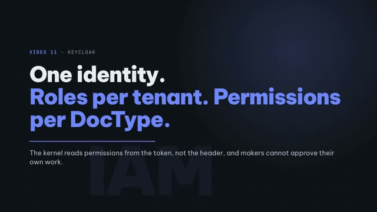</a></td>
<td>PKCE login with the Astra theme, roles as Keycloak groups, permissions declared on the DocType; the maker of a payment voucher cannot approve it (403).<br><a target="_blank" rel="noopener noreferrer" href="https://media.zerohostcms.com/astra-cms/astra-video-11-keycloak-en.mp4">▶ Watch</a> · <a href="docs/articles/11-keycloak.md">Read the article</a></td>
</tr>
<tr><th colspan="2" align="left">Video 12 · Append-only ledger <sub>(2:32)</sub></th></tr>
<tr>
<td width="330"><a target="_blank" rel="noopener noreferrer" href="https://media.zerohostcms.com/astra-cms/astra-video-12-ledger-en.mp4">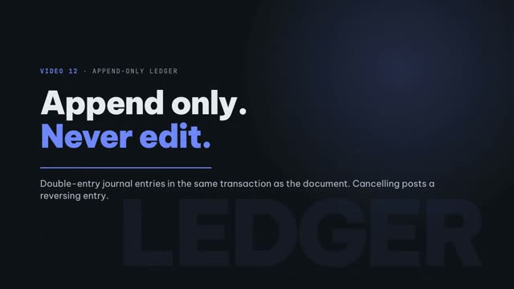</a></td>
<td>Double-entry postings ride the document's transaction, cancel reverses, a trigger blocks UPDATE even for the table owner, monthly partitions.<br><a target="_blank" rel="noopener noreferrer" href="https://media.zerohostcms.com/astra-cms/astra-video-12-ledger-en.mp4">▶ Watch</a> · <a href="docs/articles/12-ledger.md">Read the article</a></td>
</tr>
<tr><th colspan="2" align="left">Video 13 · Tenant overlays <sub>(2:24)</sub></th></tr>
<tr>
<td width="330"><a target="_blank" rel="noopener noreferrer" href="https://media.zerohostcms.com/astra-cms/astra-video-13-overlay-en.mp4">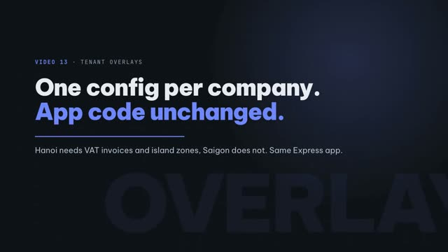</a></td>
<td>Hanoi adds VAT fields and an island zone with one YAML file, live immediately; the Express app does not change a line.<br><a target="_blank" rel="noopener noreferrer" href="https://media.zerohostcms.com/astra-cms/astra-video-13-overlay-en.mp4">▶ Watch</a> · <a href="docs/articles/13-overlay.md">Read the article</a></td>
</tr>
<tr><th colspan="2" align="left">Video 14 · Tier 2 Wasm: each tenant's own shipping formula <sub>(2:20)</sub></th></tr>
<tr>
<td width="330"><a target="_blank" rel="noopener noreferrer" href="https://media.zerohostcms.com/astra-cms/astra-video-14-wasm-en.mp4"></a></td>
<td>A Tết promotion written in Rust (421 bytes) switches the fee from 73,000 to 51,000; an infinite loop is stopped at 50 ms.<br><a target="_blank" rel="noopener noreferrer" href="https://media.zerohostcms.com/astra-cms/astra-video-14-wasm-en.mp4">▶ Watch</a> · <a href="docs/articles/14-wasm.md">Read the article</a></td>
</tr>
<tr><th colspan="2" align="left">Video 15 · MCP: AI agents use Astra with the user's permissions <sub>(2:24)</sub></th></tr>
<tr>
<td width="330"><a target="_blank" rel="noopener noreferrer" href="https://media.zerohostcms.com/astra-cms/astra-video-15-mcp-en.mp4">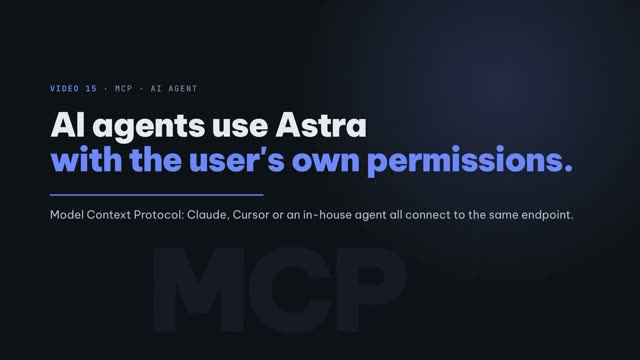</a></td>
<td>Real Claude calls tools over MCP: PII is masked, the customer care agent cannot create orders, and the accountant's COD question is answered from the ledger.<br><a target="_blank" rel="noopener noreferrer" href="https://media.zerohostcms.com/astra-cms/astra-video-15-mcp-en.mp4">▶ Watch</a> · <a href="docs/articles/15-mcp.md">Read the article</a></td>
</tr>
<tr><th colspan="2" align="left">Video 16 · Rust CDC + Sync-Aware LSN <sub>(2:36)</sub></th></tr>
<tr>
<td width="330"><a target="_blank" rel="noopener noreferrer" href="https://media.zerohostcms.com/astra-cms/astra-video-16-cdc-en.mp4">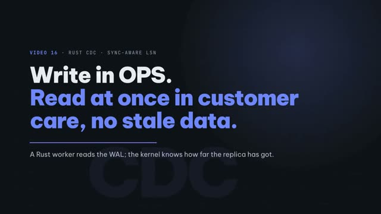</a></td>
<td>A Rust worker reads the WAL, writes return X-Tx-LSN, and a read from a replica that has not caught up gets 202 Sync Pending instead of stale data.<br><a target="_blank" rel="noopener noreferrer" href="https://media.zerohostcms.com/astra-cms/astra-video-16-cdc-en.mp4">▶ Watch</a> · <a href="docs/articles/16-cdc.md">Read the article</a></td>
</tr>
<tr><th colspan="2" align="left">Video 17 · Seata: one submit, three resources <sub>(2:26)</sub></th></tr>
<tr>
<td width="330"><a target="_blank" rel="noopener noreferrer" href="https://media.zerohostcms.com/astra-cms/astra-video-17-seata-en.mp4">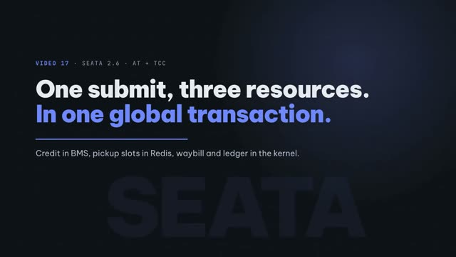</a></td>
<td>The AT branch charges the BMS credit limit, the TCC branch holds a slot in Redis, the kernel commits last; one branch refusing rolls everything back.<br><a target="_blank" rel="noopener noreferrer" href="https://media.zerohostcms.com/astra-cms/astra-video-17-seata-en.mp4">▶ Watch</a> · <a href="docs/articles/17-seata.md">Read the article</a></td>
</tr>
<tr><th colspan="2" align="left">Video 19 · HRM: attendance and payroll <sub>(2:40)</sub></th></tr>
<tr>
<td width="330"><a target="_blank" rel="noopener noreferrer" href="https://media.zerohostcms.com/astra-cms/astra-video-19-hrm-en.mp4">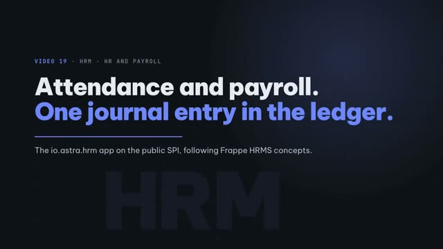</a></td>
<td>Following Frappe HRMS concepts: attendance sets working days, Payroll Entry computes salary slips in parallel, a courier bonus in Wasm, one accrual journal entry for the period, cancel reverses; the AI agent only sees masked names.<br><a target="_blank" rel="noopener noreferrer" href="https://media.zerohostcms.com/astra-cms/astra-video-19-hrm-en.mp4">▶ Watch</a> · <a href="docs/articles/19-hrm.md">Read the article</a></td>
</tr>
<tr><th colspan="2" align="left">Video 20 · STMS: vehicle dispatch with Timefold + AI copilot <sub>(2:58)</sub></th></tr>
<tr>
<td width="330"><a target="_blank" rel="noopener noreferrer" href="https://media.zerohostcms.com/astra-cms/astra-video-20-stms-en.mp4">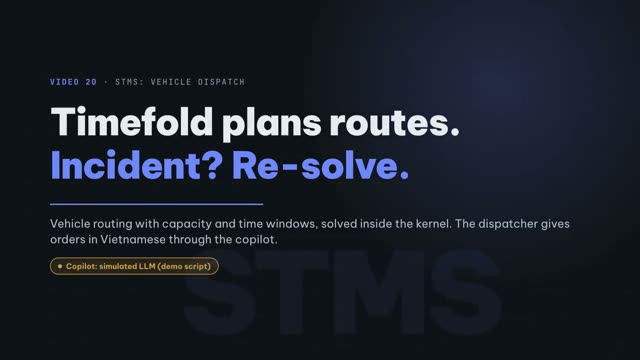</a></td>
<td>Timefold plans routes by capacity and time window and re-plans on a breakdown, an urgent order or a traffic jam; the copilot takes Vietnamese commands and calls real tools. The copilot's LLM is simulated from the demo script, labelled on every frame.<br><a target="_blank" rel="noopener noreferrer" href="https://media.zerohostcms.com/astra-cms/astra-video-20-stms-en.mp4">▶ Watch</a> · <a href="docs/articles/20-stms.md">Read the article</a></td>
</tr>
<tr><th colspan="2" align="left">Video 21 · SAML SSO and SCIM <sub>(2:32)</sub></th></tr>
<tr>
<td width="330"><a target="_blank" rel="noopener noreferrer" href="https://media.zerohostcms.com/astra-cms/astra-video-21-sso-en.mp4"></a></td>
<td>Login through a signed SAML IdP, IdP groups become tenant roles; SCIM 2.0 creates, regroups, deactivates and deletes users per tenant, and another tenant's token is blocked.<br><a target="_blank" rel="noopener noreferrer" href="https://media.zerohostcms.com/astra-cms/astra-video-21-sso-en.mp4">▶ Watch</a> · <a href="docs/articles/21-sso.md">Read the article</a></td>
</tr>
</table>

</details>

---

## Project Status

> **Runs today:** a Maven multi-module build, tenancy by `ScopedValue` and PostgreSQL row-level security
> (the kernel refuses to start as a superuser), a zero-DDL JSONB DocType store with generated REST, the
> submit/cancel/amend lifecycle, an append-only ledger, per-tenant overlays, a WebAssembly sandbox, an MCP server,
> a Rust CDC worker, Seata AT/TCC, Keycloak sign-in, a metadata-driven Desk, and a k3d deployment with two kernel
> pods. See [Run the thin slice today](#run-the-thin-slice-today) and the [Demo videos](#demo-videos).
>
> **Not yet:** everything else below describes the **target architecture and the intended public API**; those
> code samples do not compile yet. Performance figures are **design targets** to be validated by public
> benchmarks, not measurements.
>
> **Clean-room notice.** Astra is inspired by the architecture of Frappe Framework (MIT) and ERPNext (GPL-3.0).
> It shares **no code, schema, or assets** with either. Concepts such as "DocType" are used as common vocabulary;
> every implementation is original, in Java, under MIT. Nothing from ERPNext may be copied into this repository.

The reasoning behind each design choice: [docs/explain.en.md](docs/explain.en.md).

---

## Why Astra Exists

ERPNext proved something the enterprise software industry had mostly given up on: one open platform can run a company's content, commerce, accounting, inventory, manufacturing, HR and projects, and small teams can customise it without forking it. The reason is Frappe's core idea, not any single module: **the application is metadata**. A DocType defines a document's fields, validation, permissions, form, list, API and workflow as data, and everything else (REST, UI, reports, print, notifications) is generated from it.

Astra takes that idea and rebuilds it for four constraints Frappe was never designed for:

1. **Throughput and latency at cluster scale.** Java 25 virtual threads, Generational ZGC, Quarkus build-time wiring, in-process plugin isolation. High tenant density per pod instead of per-site processes, a goal to be proven by benchmark rather than assumed.
2. **Change every day without breaking yesterday.** Zero-DDL DocTypes (customising a form never locks a table), side-by-side app versions, per-tenant pinning, canary rollout with auto-rollback, a versioned SPI with a written deprecation policy, and tenant customisations stored as overlays that survive every upgrade.
3. **Agents as authors and users.** Agents build apps against typed extension points with a sandbox and a test kit; agents use the platform through an MCP tool surface generated from the same DocTypes, under the same permissions and audit.
4. **Compliance as a property of the metadata.** Every DocType field carries classification, retention, legal basis and residency. Records of processing, data-subject requests, retention schedules, audit trails and access reviews are generated from that metadata, so an operator can reach SOC 2 Type II, ISO 27001 and GDPR readiness without reworking the data model later.

An Astra application is a kernel plus a declared set of plugins ("apps") whose DocTypes compose into one system. `astra build` turns that declaration into an immutable image. Astra CMS is the first app. Astra ERP (accounts, stock, selling, buying, manufacturing, HR, projects, CRM) is the second, built on the same platform in the way ERPNext is built on Frappe, with no shared code between the two.

---

## Design References

| Platform | What they do | What Astra borrows |
| --- | --- | --- |
| **Frappe / ERPNext** | DocType metadata drives schema, form, API, permissions, workflow. Apps are installable units with hooks. Custom Fields and Property Setters let a site customise core DocTypes without forking, and survive upgrades. Submittable documents (draft → submitted → cancelled, amend creates a new revision) give accounting-grade immutability. Bench runs many sites. | The DocType model, the app-as-plugin model, customisation-as-overlay, the submittable lifecycle, and the "everything generated from metadata" discipline. Rebuilt in Java with zero-DDL storage, cluster rollout, and tiers of isolation Frappe does not have. |
| **Linux kernel** | Never break userspace. | `astra-spi` is the userspace ABI. |
| **Kubernetes** | Alpha → beta → GA APIs; deprecated GA APIs keep working 12 months or 3 releases; rolling updates under PodDisruptionBudgets. | SPI maturity levels, the same deprecation window, kernel rolling upgrades that drain global transactions. |
| **Stripe** | Dated API versions pinned per account. | App versions and public API versions pinned per tenant. |
| **Erlang / OTP** | Old and new code coexist; running calls finish on old code. | Side-by-side plugin versions, drain before release. |
| **Shopify Functions** | Merchant logic as Wasm with deterministic, per-run instruction limits. | Tier 2 Wasm sandbox with budgets and per-invocation metrics. |
| **Cloudflare Workers** | In-process isolates instead of containers. | In-process plugin isolation instead of a microservice per customisation. |
| **Envoy / Proxy-Wasm** | Control plane distributes Wasm filters to every proxy. | Plugin control plane delivering the same version to every pod, including late joiners. |
| **VS Code** | Extensions in a separate host against a stable typed API. | Typed extension points + isolation = a large but not fragile ecosystem. |
| **Google SRE / Netflix** | Canary, error budgets, automated rollback. | Health-gated rollout steps, auto-rollback, DORA metrics per plugin. |
| **Alibaba → Apache Seata** | Distributed transaction coordination (AT and TCC modes). | AT on PostgreSQL, TCC on Redis Cluster, smart bypass when not transactional. |
| **Model Context Protocol (Linux Foundation / AAIF)** | Open standard for exposing tools to AI agents. | DocTypes and extension points projected as MCP tools under the same permissions. |

---

## Architecture

The diagram at the top of this page shows what runs today. This is the target architecture.

```text
+-----------------------------------------------------------------------------------------+
|           KUBERNETES INGRESS / API GATEWAY  •  MCP ENDPOINT (agents)  •  DESK UI        |
|   REST /api/doc/<DocType>  |  /api/method/<app>.<fn>  |  GraphQL  |  gRPC  |  MCP       |
+-----------------------------------------------------------------------------------------+
                                              |
+-----------------------------------------------------------------------------------------+
|                    ASTRA KERNEL PODS  (K8s HPA • JDK 25 Gen-ZGC • Virtual Threads)      |
|                                                                                         |
|   DOCTYPE ENGINE  (metadata registry, zero-DDL JSONB + relational projections +        |
|                    append-only ledgers, naming, links, child tables, permissions,        |
|                    submittable lifecycle, versions, overlays per tenant, upcasters)      |
|                                                                                         |
|   EXTENSION POINT REGISTRY  (typed, versioned, side-by-side versions, tenant pins,       |
|                              precomputed dispatch chains, MCP tool projection)          |
|   +----------------+ +----------------+ +----------------+ +--------------------------+ |
|   | doc hooks      | | routes / gql   | | events / jobs  | | tx participants (AT/TCC) | |
|   | workflow/print | | reports / desk | | auth / policy  | | agents / tools / models  | |
|   +----------------+ +----------------+ +----------------+ +--------------------------+ |
|                                                                                         |
|   PLUGIN HOST ("APPS")                                                                  |
|   +---------------------------+ +----------------------------+ +----------------------+ |
|   | Tier 0  Shared            | | Tier 1  Isolated JVM       | | Tier 2  Wasm Sandbox | |
|   | build-time, Jandex, CDI   | | PF4J-style ClassLoader,    | | Chicory, Extism ABI, | |
|   | direct calls, zero copy   | | MethodHandle dispatch,     | | server scripts,      | |
|   | restart to change         | | hot-swap, leak tracking    | | AI-generated code    | |
|   +---------------------------+ +----------------------------+ +----------------------+ |
|                                                                                         |
|   KERNEL SERVICES                                                                       |
|   Seata TX (smart bypass) • L1 Caffeine + L2 Redis • OIDC / RBAC / Tenancy • Event Bus  |
|   Jobs • Storage • Search + pgvector • Print/PDF • Notifications • OTel • LLM Gateway   |
+-----------------------------------------------------------------------------------------+
            |                              |                               |
+-------------------------+  +---------------------------+  +------------------------------+
| PLUGIN CONTROL PLANE    |  | ASTRA TRANSACTION MANAGER |  | DATA & STORAGE (HA)          |
| Registry: S3/MinIO or   |  | Apache Seata 2.6 Raft TC  |  | PostgreSQL 16+ (JSONB,       |
| OCI; signed, SBOM       |  | AT: Postgres undo_log     |  |   ledgers, pgvector, RLS)    |
| Rollout records, canary |  | TCC: Redis hash-tag Lua   |  | Redis Cluster (L2 + TCC)     |
| Redis Pub/Sub, pod join |  | ScopedValue XID bridge    |  | S3 / MinIO                   |
+-------------------------+  +---------------------------+  +------------------------------+
```

---

## The DocType Engine

The DocType engine is what makes Astra a Frappe-class platform rather than a CMS with plugins. A **DocType** is a metadata document that fully describes a kind of business record. Everything a user or an agent touches is a DocType: a blog post, a customer, a sales invoice, a stock ledger entry, a workflow definition, even a DocType itself.

### 1. What a DocType declares

```yaml
# apps/astra-erp/accounts/doctypes/sales-invoice.doctype.yaml
name: Sales Invoice
module: accounts
kind: transaction                 # master | transaction | child | setup | ledger | virtual
storage: jsonb                    # jsonb (default) | ledger (append-only relational) | virtual (adapter)
submittable: true                 # draft(0) -> submitted(1) -> cancelled(2); amend creates INV-0001-1
naming: { series: "ACC-SINV-.YYYY.-.#####" }
track-changes: true               # version history on every save
track-views: false

compliance:                       # doc-level; inherited by fields unless overridden
  classification: confidential    # public | internal | confidential | restricted
  legal-basis: contract           # GDPR Art. 6: consent | contract | legal-obligation | legitimate-interest | ...
  retention: { period: 10y, from: fiscal-year-end, reason: "tax law", then: archive }
  residency: tenant-region        # data stays in the tenant's pinned region
  controller: tenant              # tenant is controller; operator is processor

fields:
  - { name: customer,        type: Link,     options: Customer, required: true, in-list: true }
  - { name: posting_date,    type: Date,     required: true, default: today }
  - { name: currency,        type: Link,     options: Currency, fetch-from: customer.default_currency }
  - { name: items,           type: Table,    options: Sales Invoice Item }
  - { name: taxes,           type: Table,    options: Sales Taxes and Charges }
  - { name: grand_total,     type: Currency, read-only: true, in-list: true, projected: true }
  - { name: outstanding,     type: Currency, read-only: true, projected: true, allow-on-submit: true }
  - { name: status,          type: Select,   options: [Draft, Unpaid, Paid, Overdue, Cancelled], projected: true }
  - { name: customer_tax_id, type: Data,     pii: true, encrypt: field, mask: "***last4", dsar: export }
  - { name: remarks,         type: Text,     pii: possible, dsar: redact }

indexes:
  - { fields: [customer, posting_date] }       # built on projected columns, created online

permissions:
  - { role: Accounts User,    read: true, write: true, create: true, submit: true, cancel: false, amend: true }
  - { role: Accounts Manager, read: true, write: true, create: true, submit: true, cancel: true,  amend: true, perm-level: 1 }
  - { role: Sales User,       read: true, if: "owner == user OR customer IN user.customers" }   # row-level

lifecycle:                       # server-side hooks, implemented in the app (Tier 0/1) or as Wasm scripts (Tier 2)
  validate:   accounts.sales_invoice.validate
  on_submit:  accounts.sales_invoice.post_gl_and_stock     # @AstraGlobalTransactional
  on_cancel:  accounts.sales_invoice.reverse_gl_and_stock

workflow: Sales Invoice Approval  # optional state machine with roles and transitions

api:
  rest: true                      # /api/doc/Sales Invoice   (list, get, create, update, submit, cancel, amend)
  graphql: true
  mcp: { tools: [search, get, create, submit], scope: role }
  version: "2026-03-01"           # date-versioned contract, served side by side with older ones
```

### 2. Storage strategy: zero-DDL by default, ledgers where it matters

Frappe creates one table per DocType and runs DDL when you add a Custom Field. Astra never runs DDL for a form change in production, and still gives accounting-grade storage where ERP needs it.

| `storage` | Used for | How it works | DDL in production |
| --- | --- | --- | --- |
| `jsonb` (default) | Masters, transactions, settings, content | Core metadata (`id`, `tenant_id`, `doctype`, `docstatus`, `owner`, timestamps, `version`) in indexed relational columns; fields in `JSONB`. Fields marked `projected: true` get a partial **expression index** on `astra_ext.astra_field(data, 'field')`, a LEAKPROOF accessor (under row-level security PostgreSQL never uses an index on `data->>'field'`), ending in `modified_at DESC` and built `CONCURRENTLY`; generated queries use the same expression so the planner picks it up. For range filters (`field__gt`, `__lt`, ...) a field can be `projected: materialised`: a typed column (Currency as bigint hundredths) added as a metadata-only change, kept in sync by a trigger, backfilled in batches in the background, then indexed `CONCURRENTLY`. High-volume transaction DocTypes can opt into `partition: month`. Stored generated columns are **not** used on existing tables because PostgreSQL rewrites the table to add them. | Never for fields. Expression indexes are online, additive, and reversible (`DROP INDEX CONCURRENTLY`); materialised projections are online but take time to backfill |
| `ledger` | General Ledger entries, Stock Ledger entries, payroll postings, audit trails | Append-only, partitioned relational tables with fixed columns. Rows are never updated; corrections are reversing entries. Written only inside `@AstraGlobalTransactional` by the owning app. Partition by period for closing and archival. | Schema owned by the app, evolved with expand/contract |
| `virtual` | External systems | A `DocTypeAdapter` maps the DocType onto an ERP, CRM, or legacy database. Same API, permissions, and tools. | n/a |

**Measured, not assumed.** [docs/benchmark-doctype-jsonb-the-right-way.md](docs/benchmark-doctype-jsonb-the-right-way.md) benchmarks this storage on 5 million orders under row-level security against a traditional column table: why `->>` and GIN indexes are unusable under RLS and how the leakproof accessor fixes it (list by customer 867 ms to 0.29 ms), the gap-free naming series that capped order creation at about 300 per second per tenant, what month partitioning costs (half the OLTP throughput), materialised range filters, and the whole kernel over HTTP with real tokens (400 orders per second clean on one machine, about twice the peak of 2 million orders a day). The harnesses re-run it on any Linux server: [scripts/bench/doctype-jsonb](scripts/bench/doctype-jsonb/README.md) for PostgreSQL, [scripts/bench/http](scripts/bench/http/README.md) for the full stack.

**Projection budgets.** Flexibility must not cost performance. Each DocType has a projection and index quota (default 8 projections, 12 indexes), each tenant has an overlay projection quota, and materialised projections on DocTypes above a row threshold require an approval step. Over-quota requests fail during metadata validation, before they reach a production database.

**Hot DocTypes need materialised columns.** A PostgreSQL `UPDATE` rewrites the whole row, so a DocType whose few fields change many times a day (stock levels, outstanding amounts, counters, status churn) bloats and churns vacuum if every field lives in JSONB. Rules the kernel enforces and the DocType linter reports: keep hot fields as materialised columns so the large JSONB stays TOASTed and untouched; leave hot fields unindexed where possible so updates stay heap-only (HOT) and set `fillfactor` below 100; put counters and balances in `ledger` storage or Redis; and split a hot status field into a narrow side DocType when churn is extreme. `jsonb` is the flexible default, not a universal choice.

### 3. Document lifecycle, versions, and amendments

* **Submittable DocTypes** carry `docstatus`: draft, submitted, cancelled. Submitted documents are immutable except for fields marked `allow-on-submit`. Cancelling reverses postings; **amend** creates a new revision (`INV-0001-1`) linked to the original. That is why an invoice is handled as a financial record rather than a content item.
* **Track changes** stores a diff per save; **versions** are queryable.
* **Links** are validated on write and protect referential integrity across JSONB and ledger storage; `fetch-from` copies denormalised values at write time, the way ERP documents expect.
* **Child tables** are ordered sub-documents stored inline (JSONB) or projected (ledger) by the parent's strategy.
* **Naming series** are cluster-safe: gap-free by default (the counter row is locked until the document commits, as fiscal documents need), or `gapless: false` for high-volume documents, where each instance takes numbers from a block it reserved, about 20 times faster under concurrency.

### 4. Customisation as overlays that survive upgrades

A tenant customises an app's DocType without forking it, and the customisation **survives every app upgrade**:

```yaml
# tenants/acme-vn/overlays/sales-invoice.overlay.yaml
doctype: Sales Invoice
app-version: ">=1.2"                       # overlay applies across upgrades within this range
add-fields:
  - { name: e_invoice_code, type: Data, label: "Mã hoá đơn điện tử", insert-after: posting_date, projected: true }
set-properties:
  - { field: remarks, required: true }
  - { field: posting_date, read-only-on-submit: true }
add-permissions:
  - { role: Tax Officer, read: true }
scripts:
  validate: com.acme.e-invoice-check        # Tier 2 Wasm server script, sandboxed
client:
  form: acme-vn/sales-invoice.form.js       # sandboxed client script for Desk
```

Overlays are data, versioned, pinned per tenant, and applied at metadata-load time. An app upgrade that removes a field an overlay depends on is caught by the **conformance check** before rollout.

### 5. Everything generated from metadata

| Generated surface | From |
| --- | --- |
| REST `/api/doc/<DocType>` (list, get, create, update, submit, cancel, amend, bulk) | DocType + permissions, date-versioned |
| GraphQL types, queries, mutations | DocType + links |
| MCP tools (`doc.search`, `doc.get`, `doc.create`, `doc.submit`, app tools) | DocType `api.mcp` + role scope |
| Desk UI: form, list, kanban, calendar, tree, report builder, dashboards, workspaces | DocType fields, `in-list`, links, child tables |
| Print formats and PDF | DocType + templates |
| Notifications, email, webhooks | DocType events |
| Search and vector index | Fields marked searchable; pgvector embeddings |
| OpenAPI, JSON Schema, TypeScript and Java client types | DocType |

### 6. Reports and scripts

* **Report Builder** (saved filters, group-by, charts) runs on projections.
* **Query reports** are parameterised SQL over projections and ledgers, reviewed and versioned like code.
* **Script reports** and **server scripts** run as Tier 2 Wasm with budgets, or Tier 1 Java for trusted apps. This is Frappe's Server Script idea with a real sandbox instead of a restricted interpreter.

---

## The Plugin System ("Apps")

An **app** is a plugin that ships DocTypes, lifecycle hooks, extension-point implementations, fixtures, patches, and Desk assets. Astra CMS and Astra ERP modules are apps; so is a tenant's custom module.

### 1. Typed extension points

Typed Java interfaces in `astra-spi` with JSON Schema projections, validated at load, dispatched without reflection.

| Extension point | What an app contributes | Tier | MCP tool |
| --- | --- | --- | --- |
| `DocTypeContributor` | DocType definitions, fixtures, patches | 0, 1 | n/a |
| `DocLifecycleHook` | `validate`, `before_save`, `after_insert`, `on_update`, `on_submit`, `on_cancel`, `on_trash`, enrichers | 0, 1, 2 | No |
| `WorkflowContributor` | State machines with roles and transitions | 0, 1 | No |
| `ReportContributor` / `PrintFormatContributor` | Reports, print templates | 0, 1, 2 (script reports) | Optional |
| `DeskContributor` | Workspaces, dashboards, form/list customisations, client scripts | 0, 1 | No |
| `RouteContributor` / `GraphQlContributor` | Custom endpoints (`/api/method/<app>.<fn>`), schema stitching | 0, 1, 2 | Optional |
| `EventConsumer` / `JobContributor` | Event handlers, scheduled and queued jobs with leader election | 0, 1, 2 / 0, 1 | Yes (trigger) |
| `TccParticipant` / `@AstraTccAction` | Try-Confirm-Cancel branches in a Seata global transaction | 0, 1 | No |
| `LedgerContributor` + migrations | Append-only ledger tables with expand/contract migrations | 0 | No |
| `DocTypeAdapter` | Virtual DocTypes over external systems | 0, 1 | No |
| `AuthProvider` / `PolicyContributor` | Identity providers, RBAC and attribute-based policies | 0, 1 | No |
| `StorageAdapter` / `SearchAdapter` | Object storage, search and vector backends | 0, 1 | No |
| `ToolContributor` / `AgentContributor` | Capability-scoped tools and budgeted agents | 0, 1, 2 / 0, 1 | **Yes** |
| `ModelProvider` / `PromptContributor` | LLM providers behind the gateway; versioned prompts and evals | 0, 1 | No |
| `AuditSink` / `KeyProvider` / `ResidencyPolicy` | SIEM exporters, KMS/HSM key providers (BYOK), region and sovereignty rules | 0, 1 | No |
| `ConsentProvider` / `DsarHandler` / `RetentionPolicy` | Consent sources, data-subject request fulfilment for app-specific data, retention overrides | 0, 1 | No |
| `CliCommand` | `astra <app> <command>` | 0 | No |
| `ExtensionPointContributor` | New extension points, so apps are platforms for other apps | 0 | n/a |

### 2. Three isolation tiers

| | **Tier 0: Shared (build-time)** | **Tier 1: Isolated JVM (runtime)** | **Tier 2: Wasm sandbox (runtime)** |
| --- | --- | --- | --- |
| **Loading** | Compiled into the image by `astra build`; Quarkus `@BuildStep` + Jandex | Isolated `PluginClassLoader` per app version | Chicory module, pooled; Extism-compatible ABI |
| **Dispatch cost** | Direct call | `MethodHandle` bound at load | Compiled Wasm→bytecode on JVM; interpreter on native image |
| **Change requires** | Image rebuild + rolling deploy | Hot-swap | Hot-swap |
| **Capabilities** | Everything, including ledgers and new extension points | DocTypes, hooks, workflows, reports, routes, events, jobs, TCC, tools, agents | Server scripts, script reports, enrichers, validators, tools, pure functions over granted host calls |
| **Failure blast radius** | Pod | Bulkhead: timeout, concurrency limit, circuit breaker | Hard sandbox: memory pages, deadline, interrupt, no ungranted host access |
| **Languages** | Java / Kotlin | Java / Kotlin | Rust, Go, C/C++, C#, Zig, AssemblyScript, JavaScript, Python (Extism PDKs) |
| **GraalVM native** | Yes | No | Yes, interpreted |
| **Default for** | Core apps (accounts, stock), anything on every request | Tenant modules, integrations | Tenant scripts, marketplace, **AI-generated code** |

### 3. The app manifest

```yaml
# astra-app.yaml
id: com.acme.vn-localisation
version: 2.3.1
spi: ">=1.2 <2"
tier: isolated-jvm
entrypoint: com.acme.vnloc.VnLocalisationApp
provenance: { author: team-finance, generator: claude-code, signed-by: acme-release-key }
depends: [ { id: io.astra.erp.accounts, version: ">=1.0" } ]
doctypes: [ doctypes/*.doctype.yaml ]
overlays: [ overlays/*.overlay.yaml ]            # customisations of other apps' DocTypes
fixtures: [ fixtures/vn-chart-of-accounts.json ]
patches:  [ patches/v2_3_0_backfill_tax_codes ]   # data patches, idempotent, versioned
capabilities:
  network: [ "https://api.einvoice.gov.vn" ]
  secrets: [ "acme/einvoice-cert" ]
  doctypes: [ Sales Invoice, Purchase Invoice, Company ]
  ledgers: [ GL Entry ]                           # read only unless tier 0
  llm: { provider: gateway, monthly-budget-usd: 100 }
tenancy: { scope: per-tenant, config-schema: config.schema.json }
runtime: { timeout: 50ms, max-concurrency: 256, circuit-breaker: { failure-rate: 0.5, window: 30s } }
compat: { keep-previous: 2, schema-upcasters: [ "v1->v2: com.acme.vnloc.upcast.V1ToV2" ] }
rollout: { strategy: canary, steps: [ 10%, 50%, 100% ], health: { error-budget: 1%, p99-ms: 20 }, auto-rollback: true }
```

### 4. Cluster rollout

Publish (artifact + manifest + Sigstore signature + SBOM to S3/MinIO or OCI) → verify (signature, SPI range, provenance policy) → announce (Redis Pub/Sub) → canary by pod percentage with health gates → side-by-side load, warm-up, atomic dispatch re-point, drain, leak check → automatic cluster-wide rollback on health failure → late-joining HPA pods pull current state at boot.

### 5. Security

Capabilities over permissions (Wasm links only granted host functions; isolated JVM checked at the kernel boundary with plugin identity in `ScopedValue`). Signed artifacts, SBOM, publisher allow-lists, recorded `generator`. Apps never touch kernel tables; DocType access only when declared; ledgers writable only by the owning Tier 0 app; `tenant_id` plus PostgreSQL row-level security. Every load, swap, rollback, grant, tool call and agent action is audited.

---

## Continuous Change Without Breaking: The Compatibility Contract

### 1. The SPI is the ABI

* Apps depend only on `astra-spi`. Extension points carry `alpha` / `beta` / `stable` maturity.
* **Deprecation policy:** a deprecated `stable` element keeps working at least **12 months or 3 minor releases**, with a structured warning naming the replacement.
* **Kernel N runs apps built for SPI N-1** through a compatibility shim.
* **Conformance suite:** golden apps from every supported SPI version, plus every registered tenant overlay, run in CI. A change that breaks one does not ship.

### 2. Versions coexist; tenants pin

* N app versions side by side; old versions stay until no tenant pins them and no call is in flight.
* Per-tenant pins for app versions and API versions. Upgrading one tenant does not touch another.
* Generated APIs are date-versioned and served side by side.

### 3. Data evolves without locks

| Data | Mechanism | DDL in production | Rollback |
| --- | --- | --- | --- |
| DocType fields, overlays | Zero-DDL JSONB; schema versions with upcasters on read, lazy rewrite on write; online projections | Never for fields | Instant |
| Ledgers | Expand / contract enforced by CI; append-only rows never rewritten | Additive, online | Previous version reads expanded schema |
| Data patches | Idempotent, versioned, run per tenant on rollout, resumable | n/a | Compensating patch |
| Events | `schemaVersion` on every event; consumers declare ranges; upcasters | n/a | Old consumers keep working |
| Cache | Keys include app and schema version; cluster-wide invalidation | n/a | No stale reads across versions |

### 4. Zero-downtime matrix

| Change | Mechanism | Downtime | Time to rollback |
| --- | --- | --- | --- |
| Tier 1 / Tier 2 app, overlay, server script | Hot-swap, canary, drain | 0 | Seconds, cluster-wide, automatic |
| Tier 0 app | New image, rolling update under PodDisruptionBudget, global transactions drained | 0 | Minutes |
| DocType field, form, permission, workflow | Metadata version, zero-DDL | 0 | Instant |
| Ledger schema | Expand / contract | 0 | Previous app still runs |
| Prompt, model, agent policy | Versioned artifacts on the same rollout path | 0 | Seconds |
| Kernel minor / major | Rolling with SPI N-1 shim / blue-green, tenants migrate by pin | 0 | Minutes / switch traffic back |
| PostgreSQL / Redis / Seata TC | Standard HA; kernel retries with idempotent TCC | 0 for reads, sub-second failover for writes | n/a |

### 5. Change is observable

Every rollout is an event correlated with metrics. **DORA metrics per app** (deployment frequency, lead time, change failure rate, time to restore) are built in.

---

## Multi-Tenancy

Multi-tenancy is a kernel property, not an app feature. Every kernel service applies the tenant boundary itself, so an app or agent cannot cross it.

### 1. Tenant model

`Tenant` is a `setup` DocType owned by the kernel, so onboarding, suspension and offboarding are ordinary, audited document lifecycles.

```yaml
# Tenant document (kernel DocType)
name: acme-vn
status: active                      # provisioning | active | suspended | offboarding | archived
organisation: acme-group            # optional parent for group-wide sharing and reporting
isolation: shared-rls               # shared-rls | database-per-tenant | cluster-per-tenant
region: vn                          # enforced by ResidencyPolicy on storage, cache, backup, search, LLM
identity:
  resolution: [ subdomain, oidc-claim ]     # acme-vn.astra.example | token claim "tid"
  providers: [ { type: oidc, issuer: "https://login.acme.vn" }, { type: saml, metadata: "..." } ]
  scim: enabled
keys: { provider: aws-kms, byok: true, rotation: 90d }
apps:                                # globally installed, enabled here with pins and config
  - { id: io.astra.erp.accounts, pin: "1.x" }
  - { id: com.acme.vn-localisation, pin: "2.3.1", config: config/vn-loc.yaml }
overlays: [ overlays/*.overlay.yaml ]
api-version: "2026-03-01"
plan: enterprise                     # feature flags and quotas come from the plan, overridable per tenant
quotas: { users: 500, storage-gb: 2000, agent-tokens-per-month: 50_000_000, requests-per-sec: 2000 }
features: { ai-agents: true, marketplace: false }
```

### 2. Tenant resolution and context

Requests resolve the tenant in this order: custom domain or subdomain, OIDC token claim, explicit header for service accounts, path prefix for the Desk. The result is bound once per request in a `ScopedValue` and inherited by every virtual thread, structured-concurrency subtask, hook, job and agent call. Kernel services read the tenant from that scope; **no API accepts a tenant as a caller-supplied parameter**.

A user can belong to several tenants. Switching tenant is a new session with a new scope; permissions are evaluated per tenant.

### 3. Isolation profiles

| Profile | Data | Keys | Compute | Use for |
| --- | --- | --- | --- | --- |
| `shared-rls` (default) | One PostgreSQL cluster; `tenant_id` column + row-level security on every table, including ledgers and audit; partitioning by tenant hash for large tables | Per-tenant data keys under the tenant's KMS | Shared pods, bulkheads per tenant and per app | Most tenants; thousands per pod |
| `database-per-tenant` | Own database (same or dedicated PostgreSQL cluster); same schema; RLS still on | BYOK | Shared pods | Regulated customers, strict data separation, large tenants |
| `cluster-per-tenant` | Dedicated PostgreSQL, Redis, storage; dedicated Astra pods | HYOK / HSM | Dedicated | Sovereign or air-gapped deployments |

Tenants move between profiles with `astra tenant migrate --to database-per-tenant`: snapshot, dual-write window, cutover, verify, with no downtime for reads and a sub-second write pause at cutover.

### 4. What is scoped per tenant

| Area | Per-tenant behaviour |
| --- | --- |
| DocType data and ledgers | `tenant_id` + RLS; partitioning for high-volume DocTypes |
| Metadata | Base DocTypes are global; overlays, pins and feature flags are tenant-scoped; the effective metadata is cached per `(tenant, metadata-version)` |
| Apps | Installed globally, enabled per tenant, pinned per tenant, configured per tenant with JSON-Schema validation |
| Cache | L1/L2 keys include tenant and metadata version; invalidation is tenant-aware |
| Events and jobs | Routed with tenant context; scheduled jobs run per tenant with fair scheduling and per-tenant concurrency caps |
| Transactions | Seata resource keys and Redis hash tags include the tenant |
| Search and vectors | Per-tenant indexes or tenant-filtered partitions |
| Object storage | Per-tenant prefix or bucket, per-tenant keys |
| Identity | Per-tenant identity providers, MFA policy, SCIM, session policy |
| AI | Per-tenant model provider, region pin, budgets, PII redaction policy, approval gates, opt-out |
| Compliance | Per-tenant RoPA, DSAR, retention schedules, residency, audit export |
| Observability | Every span, metric and log tagged with tenant; per-tenant dashboards and SLOs |

### 5. Organisations and sharing

An `Organisation` groups tenants (a holding company with subsidiaries, a franchise network, an agency and its clients). Within an organisation, DocTypes can be declared `shareable` with an explicit policy (read-only masters such as Item or Chart of Accounts templates, consolidated reporting across subsidiaries). Sharing is always opt-in, logged, and expressed as metadata; the default remains strict isolation. Multi-company ERP within one tenant is handled by the `Company` DocType and is unrelated to tenancy.

### 6. Fairness, quotas and metering

* **Bulkheads per tenant and per app**: virtual-thread concurrency limits, request rate limits, job concurrency, and agent token budgets. A noisy tenant degrades itself, not its neighbours.
* **Quotas** come from the plan and can be overridden per tenant; breaches produce events and, where configured, soft limits before hard limits. Quotas cover compute and storage **and metadata**: projections and indexes per DocType and per tenant, overlay count, app versions kept warm.
* **Metering** emits usage records (requests, storage, jobs, agent tokens, seats) as a `ledger` DocType for billing integrations. Astra does not ship billing; it ships the meter.

### 7. Tenant lifecycle

| Step | Mechanism |
| --- | --- |
| Provision | `astra tenant create` or Admin API: creates the Tenant document, keys, region placement, enables apps, runs fixtures and patches, verifies with the conformance suite |
| Customise | Overlays, pins, configuration, identity providers; all versioned and audited |
| Suspend | Requests rejected with a tenant-specific status; jobs paused; data retained |
| Export | Full export (DocTypes, files, audit, metadata, overlays) in an open format for portability and DSAR-scale requests |
| Offboard | Retention schedule applied; cryptographic erasure by key destruction; ledgers retained under legal obligation with pseudonymised references; deletion evidence recorded |
| Migrate | Between isolation profiles or regions with the dual-write cutover described above |

### 8. Single-tenant mode

`tenancy.mode: single` keeps every mechanism but fixes one tenant, so a self-hosted deployment for one company pays no tenancy overhead and can later switch to `multi` without a data migration.

---

## Compliance Built Into the Metadata

SOC 2 Type II and ISO 27001 certify an *operator* (the organisation running the service) over an observation period. GDPR and its regional counterparts bind *controllers and processors*. No open-source codebase is "SOC 2 certified". A platform can still make those outcomes cheaper: ship the controls, generate the evidence, and keep the data model compliant by construction. A hosted Astra Cloud would pursue the certifications itself; self-hosting operators inherit the controls and the evidence pipeline.

### 1. Frameworks in scope and how Astra maps to them

| Framework | Scope | What Astra provides |
| --- | --- | --- |
| **SOC 2 Type II** (AICPA Trust Services Criteria) | Security, Availability, Processing Integrity, Confidentiality, Privacy | Control implementations and continuous evidence export for CC-series criteria: logical access (CC6), change management (CC8), monitoring (CC7), availability (A1), processing integrity (PI1), privacy (P-series). Control matrix in `docs/compliance/soc2.md`. |
| **ISO/IEC 27001:2022** + 27017 / 27018 / 27701 | ISMS, cloud controls, PII in cloud, privacy management | Annex A control mapping, asset inventory from DocType metadata, access review workflows, supplier (sub-processor) register, privacy information management hooks. |
| **GDPR / UK GDPR** | EU/UK personal data | Data classification, legal basis, RoPA generation, DSAR automation, retention and erasure, breach workflow (72h), DPIA templates, processor/sub-processor records, EU residency profile. |
| **Vietnam PDPL** (Law 91/2025/QH15, Decree 356/2025, effective 1 Jan 2026; replaces Decree 13/2023) | Personal data of Vietnamese data subjects | Basic vs sensitive data categories, consent records, impact assessment dossiers, cross-border transfer records, request-response timelines, VN residency profile. |
| **CCPA/CPRA**, **LGPD**, **PDPA (SG)**, **APPI**, **PIPL** | Regional privacy laws | Same privacy engine with jurisdiction profiles: rights catalogue, notice requirements, localisation rules (PIPL, VN) enforced by `ResidencyPolicy`. |
| **SOX ITGC** (for ERP customers) | Change management, access, segregation of duties, audit trail | Signed, approved, audited rollouts; SoD rules on DocType actions; immutable ledgers; period locks; access reviews. |
| **PCI DSS 4.0.1** | Card data | Designed to keep cardholder data **out of scope**: tokenisation via payment providers, no PAN storage, network and secrets policies for payment apps. |
| **HIPAA** (optional profile) | US health data | Field-level encryption, access logging, BAA-ready controls for apps that declare PHI. |
| **EU AI Act** (phased 2025-2027; high-risk dates being deferred by the Digital Omnibus) + **ISO/IEC 42001**, **NIST AI RMF** | AI systems and governance | Agent action logging, human-in-the-loop gates, model and prompt versioning, transparency notices, PII redaction before external model calls, tenant opt-out, AI inventory. |
| **EU DORA** (financial entities, since Jan 2025), **NIS2** | Operational resilience, ICT third-party risk | Resilience testing hooks, incident reporting workflow, RTO/RPO evidence, sub-processor register. |
| **EU Cyber Resilience Act** (reporting from Sept 2026, full application Dec 2027) | Products with digital elements | SBOM per release, vulnerability handling process, coordinated disclosure, security update policy; Astra project operates as an open-source steward. |
| **WCAG 2.2 AA**, **EU Accessibility Act** (June 2025), **Section 508** | Accessibility | Desk UI built to WCAG 2.2 AA; automated and manual audits in CI. |
| **OWASP ASVS**, **NIST SSDF**, **SLSA**, **OpenSSF Scorecard**, **CIS Kubernetes Benchmark** | Secure engineering and supply chain | ASVS Level 2 baseline (Level 3 for auth, payments, ledgers); SSDF-aligned SDLC; SLSA Level 3 builds; Scorecard in CI; hardened Helm defaults. |

### 2. Compliance metadata on DocTypes

Compliance is declared where the data is declared. Each field can carry:

| Attribute | Values | Drives |
| --- | --- | --- |
| `classification` | public, internal, confidential, restricted | Default permissions, masking, export rules, log redaction |
| `pii` / `sensitive` | true, possible, special-category (health, biometric, ...) | RoPA, DSAR scope, encryption defaults, AI redaction |
| `legal-basis` | consent, contract, legal-obligation, vital-interest, public-task, legitimate-interest | RoPA, consent checks on write, erasure exemptions |
| `retention` | period, anchor, reason, then: delete / anonymise / archive | Retention jobs, legal holds, deletion evidence |
| `residency` | tenant-region, eu-only, vn-only, any | `ResidencyPolicy` enforcement on storage, cache, backups, LLM calls |
| `encrypt` | none, field, deterministic (searchable) | Field-level encryption with tenant keys |
| `mask` / `dsar` | mask pattern; export / redact / exclude | Desk display, exports, DSAR packages |

From this metadata the platform **generates**: the Record of Processing Activities, a data map per tenant, DSAR packages, retention schedules, DPIA/PDPL impact-assessment skeletons, and the data inventory ISO 27001 asks for.

### 3. Control implementations in the kernel

* **Identity and access (SOC 2 CC6, ISO A.5/A.8).** OIDC and SAML SSO, MFA enforcement, SCIM provisioning and deprovisioning, RBAC plus attribute rules, least-privilege defaults, periodic **access reviews** generated as workflows, break-glass accounts with mandatory justification and auto-expiry, session policies.
* **Segregation of duties (SOX, SOC 2 PI1).** SoD rules are DocType-level policies: the user who creates a Payment Entry cannot submit it; approval chains are workflow states; violations are blocked and logged.
* **Tamper-evident audit trail (CC7, A.8.15, GDPR Art. 30/32).** Every DocType change, permission change, rollout, agent action, admin action and export is written to an append-only `ledger` DocType with a hash chain, exportable to WORM storage and SIEM (`AuditSink`: OpenTelemetry logs, syslog, OCSF). Retention and legal hold apply to audit data too.
* **Encryption and keys (CC6.1, A.8.24).** TLS 1.3 everywhere, encryption at rest, field-level encryption for `encrypt: field`, keys from `KeyProvider` (AWS KMS, GCP KMS, Azure Key Vault, HashiCorp Vault, HSM), **BYOK per tenant**, rotation, and crypto-shredding for erasure where records must otherwise stay immutable.
* **Privacy operations (GDPR Ch. III, PDPL).** DSAR portal and API: access, export (JSON/CSV), rectification, erasure, restriction, portability, objection, with deadlines tracked per jurisdiction. Erasure on ledgers is implemented by pseudonymising the subject reference and shredding the key while preserving the financial record under the legal-obligation basis. Consent is a DocType with versioned purposes. Breach workflow with 72-hour clock, notification templates, and evidence capture.
* **Data residency and sovereignty.** Tenants pin a region; `ResidencyPolicy` enforces it on primary storage, caches, backups, search, object storage, **and LLM providers**. Deployment profiles: `eu`, `us`, `vn`, `sg`, `custom`. No cross-region replication of PII unless the tenant's transfer record permits it.
* **Change management (CC8, SOX).** Signed, SBOM-attached, provenance-recorded artifacts; four-eyes approval for production rollouts; environment separation; every rollout audited; canary and rollback as compensating controls; DORA metrics as evidence.
* **Availability and resilience (A1, DORA).** HA on every tier, encrypted backups with point-in-time recovery, **restore tests as scheduled jobs with evidence**, published RPO/RTO targets, chaos and failover testing hooks, status and incident workflow.
* **Vulnerability and supply chain (CC7.1, CRA).** SCA, SAST, DAST and container scanning in CI; CVE response SLAs; `SECURITY.md` with coordinated disclosure; SBOM (CycloneDX) per release; SLSA Level 3 provenance; OpenSSF Scorecard and Best Practices badge tracked; annual third-party penetration test for the reference deployment.
* **Tenant isolation (CC6.1, 27018).** Row-level security with `tenant_id`, per-tenant keys, bulkheads against noisy neighbours, and optional **database-per-tenant** or **cluster-per-tenant** profiles for regulated customers.
* **Logging and monitoring (CC7.2).** Structured, PII-redacted logs; alerting on auth anomalies, privilege changes, mass exports, agent budget breaches; retention aligned to policy.
* **AI governance (EU AI Act, ISO 42001).** Every agent action logged with model, prompt version, inputs hash and outputs; **human approval gates** for high-impact actions (posting ledgers, changing permissions, bulk operations) configurable per tenant; PII redaction before external model calls; region-pinned or local models for residency; AI system inventory and transparency notices generated from `AgentContributor` and `ModelProvider` metadata.
* **Accessibility.** Desk components built and tested to WCAG 2.2 AA; automated axe checks and manual audit cadence documented.

### 4. Evidence automation

Compliance work is mostly evidence collection. Astra exports it continuously:

* `astra compliance evidence --framework soc2 --period 2026-Q3` produces access-review records, change records with approvals, backup and restore test results, vulnerability SLAs, incident logs, and audit-trail integrity proofs.
* Connectors push the same evidence to compliance automation platforms (Vanta, Drata, Secureframe and similar) through `AuditSink`.
* Control catalogues are maintained in machine-readable form (OSCAL) under `docs/compliance/`, so a control's implementation, owner and evidence source are one lookup.

### 5. Shared-responsibility matrix

| Area | Astra platform | Operator / tenant |
| --- | --- | --- |
| Controls implemented in software (access, audit, encryption, retention, residency, SoD) | Provides and tests | Configures, reviews |
| Evidence generation | Automates and exports | Retains, presents to auditors |
| Policies, risk assessment, training, vendor management | Templates and registers | Owns |
| Certification (SOC 2 report, ISO certificate) | Astra Cloud pursues for itself | Self-hosters pursue for their own scope |
| Legal roles (controller, processor, DPO) | Supports both roles | Decides and documents |

---

## Toward an ERP: Astra ERP on Astra

Astra ERP is the proof that the platform is general. It is built the way ERPNext is built on Frappe: **every module is an app, every record is a DocType, every posting is a ledger entry**. It copies ERPNext's *shape*, not its code.

| Module (app) | Core DocTypes | Ledgers | Notes |
| --- | --- | --- | --- |
| `erp.core` | Company, Fiscal Year, Currency, Exchange Rate, UoM, Address, Contact | | Multi-company and multi-currency in the first release |
| `erp.accounts` | Account (chart tree), Journal Entry, Payment Entry, Sales Invoice, Purchase Invoice, Tax Template, Cost Center, Period Closing | **GL Entry** | Double-entry; postings are reversing, never edited; closing freezes periods |
| `erp.stock` | Item, Warehouse (tree), Stock Entry, Delivery Note, Purchase Receipt, Batch, Serial No, Valuation | **Stock Ledger Entry** | FIFO / moving average, backdated repost as a job, reservation via Redis TCC for flash-sale paths |
| `erp.selling` | Customer, Quotation, Sales Order, Pricing Rule | | Pricing rules are an extension point other apps and tenants implement |
| `erp.buying` | Supplier, RFQ, Purchase Order | | |
| `erp.manufacturing` | BOM, Work Order, Job Card, Routing | | |
| `erp.hr` | Employee, Leave, Attendance, Payroll Entry, Salary Slip | **Payroll Ledger** | |
| `erp.projects` | Project, Task, Timesheet | | |
| `erp.crm` | Lead, Opportunity, Campaign | | |
| `erp.assets` | Asset, Depreciation Schedule | GL via `erp.accounts` | |

Platform features that ERP needs and the kernel already provides:

* **Posting a Sales Invoice** touches GL Entry, Stock Ledger Entry, customer outstanding, and inventory reservations in Redis. That is one `@AstraGlobalTransactional` method: Postgres via Seata AT, Redis via TCC, all-or-nothing.
* **Month-end close** on 50 pods: period locks are DocType state, enforced by the kernel's lifecycle hooks, not by application code remembering to check.
* **Localisation** (Vietnam e-invoice, VAT, chart of accounts) ships as a Tier 1 app with overlays and fixtures, pinned per tenant, upgraded independently of `erp.accounts`.
* **Agents in the back office:** "create a journal entry for this bank statement line", "explain this variance" run as `AgentContributor` with role-scoped MCP tools over DocTypes, budgets, and audit.

---

## Performance: Principles and Targets

* No reflection on the hot path; dispatch chains built once per rollout.
* DocType reads served from L1/L2 cache keyed by metadata version; list and report queries hit expression indexes or materialised projections, never a JSONB scan.
* Bulkheads per app; zero cost when idle; Seata proxy bypassed without an XID.
* In-process isolation. High tenant density per pod is the design goal and a **hypothesis until benchmarked** with real overlay, cache and ClassLoader footprints.
* Structured concurrency for hook fan-out; one failure cancels siblings and triggers global rollback.
* The Seata transaction coordinator is a central component. It is kept off the hot path by smart bypass (most requests never touch it) and is **sharded by transaction service group** (per app or per tenant shard, each a Raft cluster) so coordinator throughput scales with the number of groups, not the number of kernel pods.
* Plugin host memory is budgeted where the JVM allows it: Metaspace per ClassLoader is tracked and capped by `keep-previous`; Wasm linear memory is a hard cap per instance; **JVM heap per Tier 1 app is observable (per-plugin allocation metrics) but not enforceable**, which is one more reason untrusted code belongs in Tier 2.

Every target is stated with the conditions under which it is measured. Measured results so far, with the harnesses to reproduce them: [docs/benchmark-doctype-jsonb-the-right-way.md](docs/benchmark-doctype-jsonb-the-right-way.md).

| Metric | Condition | Target (to be validated by public benchmarks) |
| --- | --- | --- |
| DocType get by id | metadata in L1, document in L2 or PostgreSQL by primary key | p99 < 2 ms |
| DocType list, 1M rows per tenant | equality or range filters on at most 2 indexed projections, no joins, page of 50 | p99 < 20 ms |
| Document save, single store | smart bypass, no global transaction, 1 hook | p99 < 15 ms |
| Sales Invoice submit, global transaction | Seata AT on PostgreSQL + TCC on Redis, Raft coordinator in region, 2 branches | p50 < 40 ms, p99 < 150 ms |
| Tier 1 hook, dispatch only | bound `MethodHandle` vs direct call | < 1 µs |
| Tier 1 hook, end to end | dispatch + capability check + context propagation + audit span | < 50 µs |
| Tier 2 script, warm | pooled, already-compiled module, small input | p99 < 5 ms |
| Tier 2 script, cold compile | Chicory Wasm→bytecode compile, done at rollout warm-up, off the request path | < 500 ms per module |
| App rollout, propagation | announce → every pod has the new version loaded and warmed in standby, 50 pods | < 2 s |
| App rollout, cutover | atomic dispatch re-point on one pod | < 10 ms |
| App rollout, drain | in-flight calls finish on the old version | bounded by request timeout |
| Kernel pod ready, JVM | Tier 0 wired at build time, Flyway no-op, warm registry | < 5 s |
| Kernel pod ready, native | same | < 1 s |

Java 25 runtime: unpinned virtual threads (JEP 491), `ScopedValue` (JEP 506, final), structured concurrency (JEP 505, preview, isolated behind an internal executor), Generational ZGC (JEP 490, `-XX:+UseZGC`; `-XX:+ZGenerational` is obsolete). Quarkus 3.27 LTS / 3.31+ with full JDK 25 support; build-time augmentation is what makes Tier 0 possible.

---

## AI-Native: Built By Agents, Used By Agents

This section is the machinery behind [Software After Software](#vision-software-after-software).

**For agents that build apps.** The SPI is large: twenty-plus extension points, the DocType model, manifests, overlays and compliance metadata. What makes it workable for an agent is that each task is **narrow**: a lifecycle hook touches two interfaces, a DocType is one YAML file, a Wasm script is one exported function. `AGENTS.md` is organised per extension point so an agent loads only the slice it needs, `astra mcp --dev` answers "what exists" from the live kernel, and `astra-plugin-testkit` contract tests, capability assertions and budget assertions give a pass/fail loop. The test kit is what makes agent-written apps trustworthy. AI-generated code defaults to Tier 2 Wasm; `provenance.generator` is recorded and environment policy can require the sandbox tier. Canary and auto-rollback revert a change that passes tests but misbehaves under traffic. The repository ships `AGENTS.md`, `CLAUDE.md` and `llms.txt`.

**For agents that use an Astra application.** Every DocType (search, get, create, submit, cancel), event, job and `ToolContributor` is projected as an MCP tool with the DocType's JSON Schema, scoped by role and tenant, audited like any call. `AgentContributor` runs budgeted agents inside the platform with scoped memory (DocTypes + pgvector). `ModelProvider` abstracts Claude, OpenAI, Gemini and local models behind a gateway with fallback and cost accounting. Prompts and evals are versioned artifacts on the same rollout path as code.

**Tool surface discipline.** Projecting every DocType produces thousands of tools, which no client handles well. Tools are namespaced (`doc.<doctype>.<op>`, `app.<id>.<tool>`), only DocTypes listed in the tenant's `ai.mcp.expose` are published, tool packs group them by role, and `tools/list` is paginated with cursors as the MCP spec allows. **Grounding.** Agent answers about business data must cite the DocType names and ledger entry ids they used; `AgentContributor` responses carry a `sources` list, and an answer without sources is rejected by the gateway for financial DocTypes.

---

## Developer Experience (Target API)

### 1. Compose an application, pin per tenant

```yaml
# astra.yaml
app: acme-erp
kernel: 1.x
apps:
  shared:       [ io.astra.desk:1.x, io.astra.auth-oidc:1.x, io.astra.erp.core:1.x, io.astra.erp.accounts:1.x, io.astra.erp.stock:1.x ]
  isolated-jvm: [ io.astra.erp.selling:1.x, com.acme.vn-localisation:2.x, com.acme.approval-workflow:1.x ]
  wasm:         [ com.acme.credit-check:1.x ]
ai:
  mcp: { enabled: true, expose: [ "doc:Sales Invoice", "doc:Customer", "erp.accounts.explain_variance" ] }
  gateway: { default-provider: claude, fallback: [ openai, local-vllm ] }

# tenants/acme-vn.yaml
pins: { com.acme.vn-localisation: 2.3.1, api-version: "2026-03-01" }
overlays: [ overlays/sales-invoice.overlay.yaml ]
```

### 2. A lifecycle hook that posts to ledgers in one global transaction

```java
package io.astra.erp.accounts;

@ApplicationScoped
public class SalesInvoiceHooks implements DocLifecycleHook<SalesInvoice> {

    @Inject GeneralLedger gl;                 // LedgerContributor-owned, Seata AT on PostgreSQL
    @Inject StockLedger stock;
    @Inject AstraRedisTccTemplate reservations;

    @Override
    @AstraGlobalTransactional(name = "sales-invoice-submit", timeoutMills = 5000)
    public void onSubmit(SalesInvoice inv, DocContext ctx) {
        for (var line : inv.items()) {
            if (!reserve(line.item(), line.qty())) throw new InsufficientStockException(line.item());
            stock.post(StockLedgerEntry.outgoing(inv, line));
        }
        gl.post(GlEntry.debit(inv.debtorAccount(), inv.grandTotal(), inv));
        gl.post(GlEntry.credit(inv.incomeAccount(), inv.netTotal(), inv));
        inv.taxes().forEach(t -> gl.post(GlEntry.credit(t.account(), t.amount(), inv)));
        ctx.setStatus(inv, "Unpaid");
    }

    @AstraTccAction(name = "stockReserve", confirmMethod = "confirmReserve", cancelMethod = "cancelReserve")
    public boolean reserve(String item, int qty) { return reservations.tryFreeze("stock:item:" + item, qty); }
    public boolean confirmReserve(String item, int qty) { return reservations.confirmFreeze("stock:item:" + item, qty); }
    public boolean cancelReserve(String item, int qty)  { return reservations.cancelFreeze("stock:item:" + item, qty); }
}
```

### 3. A tenant server script in Rust (Tier 2), attached by overlay

```rust
use extism_pdk::*;

#[derive(serde::Deserialize)]
struct SalesInvoice { customer: String, grand_total: f64, e_invoice_code: Option<String> }

#[plugin_fn]
pub fn validate(Json(doc): Json<SalesInvoice>) -> FnResult<Json<Vec<String>>> {
    let mut errors = vec![];
    if doc.grand_total >= 20_000_000.0 && doc.e_invoice_code.is_none() {
        errors.push("Hoá đơn từ 20 triệu cần mã hoá đơn điện tử".into());
    }
    Ok(Json(errors))
}
```

### 4. A contract test an agent can iterate against

```java
@AstraAppTest(app = "com.acme.vn-localisation")
class VnLocalisationContractTest {
    @Inject KernelHarness kernel;

    @Test
    void overlayAddsFieldAndScriptBlocksLargeInvoiceWithoutCode() {
        var t = kernel.tenant("acme-vn");
        var inv = t.newDoc("Sales Invoice").set("customer", "CUST-001").set("grand_total", 25_000_000);
        var result = t.validate(inv);
        assertTrue(result.hasError("e_invoice_code"));
        kernel.assertOnlyDeclaredCapabilitiesUsed();
        kernel.assertWithinBudget(Duration.ofMillis(5));
        kernel.assertOverlaySurvivesUpgrade("io.astra.erp.accounts", "1.2", "1.3");
    }
}
```

### 5. An agent over MCP

```json
{ "method": "tools/call", "params": { "name": "doc.search", "arguments": { "doctype": "Sales Invoice", "filters": { "status": "Overdue", "customer": "CUST-001" } } } }
{ "method": "tools/call", "params": { "name": "erp.accounts.explain_variance", "arguments": { "account": "4100", "period": "2026-09" } } }
```

---

## Planned Repository and Module Structure

```text
astra/
├── AGENTS.md  CLAUDE.md  llms.txt
├── astra-bom/                          # Pins Quarkus 3.x, Seata 2.6, Chicory, Vert.x, astra-spi
├── astra-spi/                          # Extension points, DocType model, manifest, maturity levels, JSON Schema projections
├── astra-kernel/                       # Registry, side-by-side versions, dispatch, capability enforcement
├── astra-tenancy/                      # Tenant and Organisation DocTypes, resolution, ScopedValue context, isolation
│                                       #   profiles, quotas, metering, lifecycle, migration between profiles and regions
├── astra-doctype/                      # DocType engine: metadata registry, JSONB + projections + ledgers, lifecycle,
│                                       #   naming, links, child tables, permissions, overlays, upcasters, generated APIs
├── astra-plugin-host/                  # shared-loader (T0) • isolated-jvm-loader (T1) • wasm-host (T2) • control-plane
├── astra-compat/                       # SPI N-1 shims, conformance suite (golden apps + tenant overlays)
├── astra-compliance/                   # Privacy engine (RoPA, DSAR, consent, retention), audit ledger + hash chain,
│                                       #   KeyProvider/BYOK, ResidencyPolicy, SoD rules, access reviews, evidence export
├── astra-tx-seata/                     # Quarkus Seata extension (runtime/ + deployment/)
├── astra-ai/                           # mcp-server • llm-gateway • agent-runtime • prompt-registry
├── astra-desk/                         # Generated UI: forms, lists, report builder, dashboards, workspaces, print
├── astra-apps/                         # First-party apps on the public SPI
│   ├── cms/                            #   content, media, publishing (Astra CMS)
│   └── erp/                            #   core, accounts, stock, selling, buying, manufacturing, hr, projects, crm, assets
├── astra-plugin-testkit/               # In-memory kernel, contract tests, budget and overlay assertions
├── astra-cli/                          # astra build | dev | mcp | app init | app publish | tenant create/pin/migrate | patch run
├── astra-server/                       # Server packaging (JDK 25 Gen-ZGC and GraalVM Native)
├── apps/
│   ├── astra-cms/                      # Composition: kernel + cms apps
│   └── astra-erp/                      # Composition: kernel + erp apps (+ cms for portals)
├── docs/compliance/                    # OSCAL control catalogue, SOC 2 / ISO 27001 / GDPR / PDPL mappings, DPIA templates
├── SECURITY.md                         # Coordinated disclosure, CVE SLAs, supported versions
└── deploy/  docker/  helm/             # Local stack; Helm with CIS-hardened defaults, HPA, PDB, Seata Raft, rollout CRDs
```

---

## Run the Thin Slice Today

Requirements: JDK 25, Docker Desktop, `kubectl`, and `k3d` (k3s in Docker). The Maven wrapper is included.

```bash
# Tests: starts a throwaway PostgreSQL via Dev Services and proves tenant isolation end to end
./mvnw -pl astra-server -am test

# Option A: local dev with live reload (PostgreSQL + Redis + Keycloak on :8180 via Docker Compose)
make infra-up && make dev

# Option B: local Kubernetes (k3d: 2 kernel pods, PostgreSQL, Redis, Keycloak, Seata, Rust CDC worker, Traefik ingress)
make k3d-up          # API on http://localhost:8080/api, login page under /auth (ASTRA_PUBLIC_URL to change)
make demo            # two tenants, hooks, naming series, row-level security, validation
make demo-iam        # sign-in, tenant roles, permissions, member provisioning, self-join
make k3d-down

# Astra Express: the courier demo from docs/use-case-01.md (full feature set on Option B; scripts need Bash 5)
make demo-seed       # two tenants of orders, waybills, tickets, ledger and overlays, through the REST API
open http://localhost:8080/desk/                  # metadata-driven Desk UI (+ /desk/compare.html)
make demo-express    # 15 scenes, one per video; SCENES="4 5" PAUSE=0 to pick and skip pauses
make demo-hrm && make demo-stms && make demo-sso   # HR and payroll, vehicle routing, SAML SSO + SCIM (Videos 19–21)
scripts/mcp-claude.sh tuan saigon-express          # register Astra's MCP server with Claude Code
```

What the demo exercises, all from real code in this repository:

| Mechanism | Where |
| --- | --- |
| Tenant resolved from `X-Astra-Tenant` or subdomain, bound in a `ScopedValue`, never a parameter | `astra-kernel` `TenantResolverFilter`, `astra-spi` `TenantContext` |
| Row-level security on every statement via a transaction-local setting; kernel refuses to start as a superuser or `BYPASSRLS` role | `astra-doctype` `DocumentStore`, `RowLevelSecurityGuard`, Flyway `V1__astra_doc.sql` |
| DocType loaded from app YAML, validated, served at `/api/doc/{doctype}` and `/api/doctype` | `astra-doctype` registry and resources |
| Cluster-safe, per-tenant naming series (`ART-00001`) | `SeriesService` |
| Tier 0 app contributing a DocType and a lifecycle hook through `astra-spi` only | `astra-apps/cms` |
| Virtual threads per request (`@RunOnVirtualThread`), Quarkus 3.39 on JDK 25 | `DocResource`, `astra-server` |
| Sign-in through Keycloak 26 with the Astra login theme (vi/en); bearer tokens verified by the server; tenant roles from Keycloak groups `/tenants/<tenant>/<role>`; tenant admins provision members and public users self-join | `astra-iam`, `deploy/keycloak`, [docs/iam-mobile-integration.md](docs/iam-mobile-integration.md) |
| DocType permission rules per tenant role (`read`, `create`, `write`, `if-owner`), enforced by the generated API | `DocPermissions`, `article.doctype.yaml` |
| Submittable lifecycle (draft → submitted → cancelled → amend) with hooks that write other documents in the same transaction | `DocumentStore.submit/cancel/amend`, `DocumentService`, `astra-apps/express` |
| `projected: true` fields become online expression indexes (`CREATE INDEX CONCURRENTLY`) used by list filters | `ProjectionIndexer`, `GET /api/doctype/{name}/projections` |
| Link fields validated inside the tenant; read-only fields owned by hooks; dated series (`ORD-.YYYYMMDD.-.#####`) | `DocumentStore`, `DocumentValidator`, `SeriesService` |
| Desk UI generated from DocType metadata, with an API inspector and a two-tenant compare view | `astra-server` `META-INF/resources/desk` |
| Append-only ledger (trigger-enforced), monthly partitions, balanced double entry, reversals; maker/checker (segregation of duties) on submit | `V3__ledger.sql`, `LedgerStore`, `GeneralLedger` SPI, `DocPermissions` |
| Per-tenant DocType overlays applied at runtime, without a restart | `Overlays`, `DocTypeOverlays`, `tenants/*/overlays` |
| Tier 2 sandbox: tenant WebAssembly (Rust-built) on Chicory with memory cap and deadline | `astra-plugin-host`, `astra-apps/express/wasm` |
| MCP server (Streamable HTTP) with the caller's token, tenant and permissions; `pii` fields masked; app-contributed tools | `astra-ai`, `McpTool` SPI |
| Rust CDC worker decoding `pgoutput` into replica tables; Sync-Aware LSN (`X-Tx-LSN`, `X-Required-LSN` → `202 Sync Pending`) | `astra-cdc-rust`, `SyncAwareLsnFilter`, `ReplicaResource` |
| Apache Seata 2.6 global transactions: AT branch on a module schema, TCC branch on Redis, kernel commits last | `astra-tx-seata`, `OrderCreditHook`, `PickupCapacity` |
| HRM (HR and payroll) on Frappe HRMS concepts: attendance drives payment days, a Payroll Entry computes salary slips in parallel on virtual threads, the courier KPI bonus is tenant Wasm, and submit posts one accrual voucher through `GeneralLedger` in the same transaction | `astra-apps/hrm`, `PayrollEntryHook`, `SalaryCalculator` |
| STMS: vehicle routing with Timefold Solver (capacity and time windows as hard constraints), re-solving on live events, MCP tools and a dispatch copilot (the language model is a scripted mock for the demo; the solver and tools are real) | `astra-apps/stms`, `RoutePlanner`, `Replanner`, `DispatchCopilot` |
| SAML 2.0 SSO through Keycloak brokering (signed assertions, IdP groups become tenant roles) and per-tenant SCIM 2.0 Users/Groups at `/scim/v2`, with the tenant taken from the token | `deploy/keycloak/realm`, `astra-iam` `ScimResource`, `ScimDirectory` |

Not in the thin slice yet: row-level permission conditions, materialised projections, Tier 1 loader, rollout control plane, audit hash-chain, field encryption, Apache Doris, AI agents beyond MCP tools, and a full Desk (dashboards, reports). The roadmap below sequences them. The video series that walks through the demo is in [docs/demo-video-series.en.md](docs/demo-video-series.en.md).

## Getting Started (Target Workflow)

> Intended workflow once the modules above are published. The commands in this section will not work against the current repository; use the thin-slice commands above.

**Prerequisites.** Java 25 LTS (Mandrel for JDK 25 for native) • Maven 3.9+ • Quarkus 3.27 LTS or 3.31+ • PostgreSQL 16+ with pgvector (partitioned `undo_log` for Seata AT) • Redis 7.2+ (Cluster in production) • S3-compatible storage or OCI registry • Apache Seata Server 2.6+ (Raft; optional for single-store apps).

```bash
git clone https://github.com/ZeroHostCMS/astra-cms.git && cd astra-cms
docker compose -f deploy/docker/docker-compose-infra.yml up -d

./mvnw quarkus:dev                                   # kernel + Tier 0 live coding
astra app init com.acme.vn-localisation --tier isolated-jvm
astra doctype new "E-Invoice Log" --app com.acme.vn-localisation
astra dev --watch apps/                              # live reload of Tier 1/2 apps and overlays
astra mcp --dev                                      # kernel introspection for coding agents

astra build
java -XX:+UseZGC --enable-preview -jar astra-server/target/quarkus-app/quarkus-run.jar

helm upgrade --install acme-erp ./deploy/helm/astra --namespace acme-prod --create-namespace -f values-production.yaml
astra app publish com.acme.vn-localisation-2.3.1.jar --canary 10,50,100
astra tenant pin acme-vn com.acme.vn-localisation 2.3.1
```

```yaml
# application.yml (excerpt)
astra:
  tenancy: { mode: multi }
  doctype: { projections: online, upcasters: lazy-rewrite, naming: { backend: redis, gap-free-for: [ledger, transaction] } }
  plugins:
    registry: s3
    require-signature: true
    policy: { generated-code-tier: wasm }
    wasm: { compile-mode: runtime, default-timeout: 50ms }
  compat: { spi-shims: [ "1.x" ], deprecation-warnings: structured, conformance-on-rollout: true }
  ai: { mcp: { enabled: true, auth: oidc }, gateway: { default-provider: claude, fallback: [ openai ] } }
  seata: { enabled: true, smart-bypass: true, application-id: acme-erp, tx-service-group: astra_tx_raft_group }
```

---

## Roadmap

<table>
<tr><th colspan="2" align="left">Roadmap video: the rest of use-case-01 <sub>(1:36)</sub></th></tr>
<tr>
<td width="330"><a target="_blank" rel="noopener noreferrer" href="https://media.zerohostcms.com/astra-cms/astra-video-18-roadmap-en.mp4">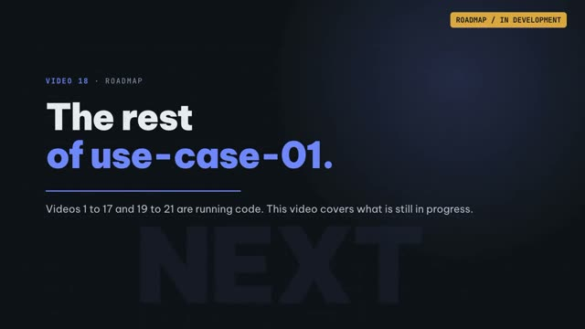</a></td>
<td>What videos 1 to 17 and 19 to 21 already run for real (including HRM, STMS, SAML and SCIM) and what is still in development: multi-schema, Tier 1, streaming CDC, autonomous agents, audit hash-chain, field encryption.<br><a target="_blank" rel="noopener noreferrer" href="https://media.zerohostcms.com/astra-cms/astra-video-18-roadmap-en.mp4">▶ Watch</a> · <a href="docs/articles/18-roadmap.md">Read the article</a></td>
</tr>
</table>

**Done** (see [Run the thin slice today](#run-the-thin-slice-today)): tenancy with row-level security and a fail-closed guard, zero-DDL JSONB storage with generated REST and Desk, the submittable lifecycle, an append-only ledger, per-tenant overlays, a Tier 2 Wasm sandbox, an MCP server, a Rust CDC worker with Sync-Aware LSN, Seata AT + TCC, Keycloak with SAML SSO and SCIM, and two kernel pods on k3d.

**Next:** the Tier 1 isolated-JVM loader, canary rollout across pods, row-level permission conditions, materialised projections, the audit hash-chain, field encryption, streaming CDC and agents beyond MCP tools. The phases below sequence the full platform; the compliance work is a set of **profiles enabled over time**, not a single Phase 5 deliverable.

* [ ] **Phase 1: Architecture & SPI** (in progress). Blueprint (this README). Next: `astra-spi` with extension points, DocType model and YAML schema **including compliance attributes**, manifest schema, maturity levels, deprecation policy, `AGENTS.md` / `llms.txt`, `SECURITY.md`, OSCAL control catalogue skeleton.
* [ ] **Phase 2: Kernel, Plugin Host & DocType Engine core**. Registry with side-by-side versions and tenant pins; **tenancy core** (Tenant DocType, resolution, `ScopedValue` context, RLS, `shared-rls` profile, bulkheads); Tier 0/1/2 loaders **with instruction counting for Tier 2**; DocType metadata registry, JSONB storage, expression-index projections with quotas, naming, links, child tables, permissions, submittable lifecycle, versions; **tamper-evident audit ledger from the first write**; generated REST; **thin MCP server (`doc.search / get / create`)**; **Seata spike** (AT + TCC + virtual threads, go/no-go for Phase 4); `astra-plugin-testkit`; SLSA Level 3 build pipeline; first public benchmarks.
* [ ] **Phase 3: Control Plane & Compatibility**. Registry, signatures, SBOM, provenance policy, four-eyes production approvals, canary rollout, pod join; `astra-compat` shims; conformance suite including tenant overlays; data patches; DORA metrics.
* [ ] **Phase 4: Transactions, Ledgers & Cache**. Quarkus Seata extension (or the fallback chosen by the Phase 2 spike: transactional outbox plus idempotent TCC without a central coordinator); `ledger` storage with expand/contract; materialised projections with backfill jobs; L1/L2 cache bus; upcasters; date-versioned APIs.
* [ ] **Phase 5: Compliance & Tenancy Pack**. Identity (OIDC/SAML, MFA, SCIM per tenant), access reviews, SoD policies, `database-per-tenant` and `cluster-per-tenant` profiles, tenant migration, organisations and sharing policies, quotas and metering, `KeyProvider` with BYOK and field-level encryption, `ResidencyPolicy` and region profiles (eu, us, vn, sg), privacy engine (classification-driven RoPA, DSAR, consent, retention, crypto-shredding, breach workflow), `AuditSink` to SIEM and compliance platforms, evidence export CLI, SOC 2 / ISO 27001 / GDPR / PDPL control mappings published.
* [ ] **Phase 6: Desk, Overlays, Workflow, Reports, Print**. Generated UI to WCAG 2.2 AA, overlays with client scripts, workflow engine, report builder, query and script reports, print/PDF, notifications.
* [ ] **Phase 7: AI Surface & AI Governance**. MCP projection of DocTypes and tools, LLM gateway with PII redaction and region pinning, agent runtime with budgets and human-approval gates, prompt registry, AI inventory and transparency notices, `astra mcp --dev`.
* [ ] **Phase 8: Kubernetes, Observability & Resilience**. CIS-hardened Helm, rollout CRDs/Operator, Seata Raft StatefulSet, OpenTelemetry and Prometheus per app and agent, backup/restore evidence jobs, failover testing, third-party penetration test of the reference deployment.
* [ ] **Phase 9: Astra CMS**. Content, media, publishing apps composed into `apps/astra-cms`; Admin Studio on Desk.
* [ ] **Phase 10: Astra ERP**. `erp.core`, `erp.accounts` (GL), `erp.stock` (SLE), then selling, buying, manufacturing, hr, projects, crm, assets; SOX ITGC evidence; Vietnam localisation (e-invoice, VAT, PDPL dossiers) as the reference Tier 1 app; signed marketplace.

---

## Contributing

The most useful contributions right now are challenges to the DocType model (storage strategies, overlays, submittable lifecycle), the compatibility contract, the three-tier model and the ERP module boundaries. Also useful: prior art and benchmarks on Seata with Quarkus, Chicory sandboxing, JSONB projections at scale, ledger partitioning and MCP server patterns, plus real ERP and back-office use cases that stress continuous change.

**Contributors must not copy code, schema, fixtures, or UI assets from ERPNext (GPL-3.0) or any GPL project.** Frappe concepts may be referenced; implementations must be original.

Development setup and pull request guidelines are in [CONTRIBUTING.md](CONTRIBUTING.md). Report security vulnerabilities privately as described in [SECURITY.md](SECURITY.md), not in public issues. All participants follow the [Code of Conduct](CODE_OF_CONDUCT.md).

---

## License

Released under the **MIT License**. See [LICENSE](LICENSE).
