<div align="center">

# Astra CMS

### Software After Software. Phần mềm tiến hóa cùng người dùng.

<p><a href="README.md">English</a> · <b>Tiếng Việt</b></p>

<a target="_blank" rel="noopener noreferrer" href="https://media.zerohostcms.com/astra-cms/astra-intro.mp4" title="Xem video: Astra trong 5 phút">
  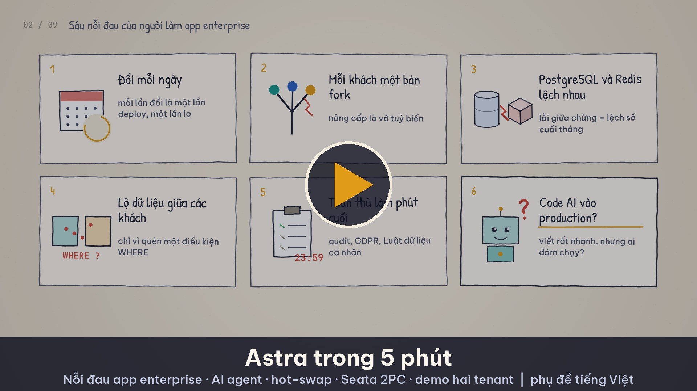
</a>

**Nền tảng ứng dụng metadata-driven, plugin-first cho doanh nghiệp thay đổi liên tục và không chấp nhận downtime.**

<div align="left">

Lấy cảm hứng từ Frappe/ERPNext, viết lại từ đầu bằng Java 25 và Quarkus.<br>
**DocType** mô tả schema, form, API, quyền, workflow và metadata tuân thủ dưới dạng dữ liệu.<br>
**Plugin** chạy ở ba tầng cô lập: dùng chung (shared), JVM riêng, hoặc WebAssembly.<br>
**Phiên bản app** chạy song song, lên dần bằng canary rollout và tự rollback khi lỗi.<br>
**Giao dịch phân tán** có sẵn trong nền tảng.<br>
**AI:** mọi DocType và extension point đều là một tool cho agent.<br>
**Tuân thủ** nằm trong mô hình dữ liệu, nên bằng chứng kiểm toán cho SOC 2, ISO 27001, GDPR và luật bảo vệ dữ liệu khu vực được sinh tự động, không phải gom lại về sau.<br>
App đầu tiên là Astra CMS, tiếp theo là Astra ERP.

</div>

[](#tuân-thủ-tích-hợp-sẵn-trong-metadata)

[-orange.svg)](https://openjdk.org/projects/jdk/25/)
[](https://quarkus.io/)
[](https://kubernetes.io/)
[](https://www.postgresql.org/)
[](https://redis.io/)
[%20Raft%20AT%2FTCC-red.svg)](https://seata.apache.org/)
[](https://chicory.dev/)
[](https://modelcontextprotocol.io/)
[](#trạng-thái-dự-án)
[](LICENSE)

</div>

## Tầm nhìn: Software After Software

> **Rút ngắn hành trình từ một ý tưởng đến một tính năng sẵn sàng cho production, từ vài tháng xuống vài ngày, thậm chí vài giờ, trong khi con người vẫn nắm quyền với các quyết định quan trọng.**

Astra CMS là nền tảng quản lý nội dung **sẵn sàng cho AI**, xây cho thế hệ phần mềm tiếp theo: những hệ thống có thể **hiểu nhu cầu người dùng, tạo ra năng lực mới, kiểm thử thay đổi và tiến hóa liên tục dưới sự phê duyệt của con người**.

Phát triển phần mềm đang vượt qua cách làm thủ công từng tính năng rồi phát hành. Trong kỷ nguyên **Software After Software**, AI agent tham gia trực tiếp vào vòng đời phần mềm, biến nhu cầu thực tế thành tính năng chạy được qua lập kế hoạch, sinh code, kiểm thử và triển khai.

Astra khám phá tương lai đó bằng cách cung cấp nền móng cho các ứng dụng **dễ mở rộng, hướng sự kiện và tích hợp AI**, nơi phần mềm tiến hóa từ **phản hồi của người dùng và tín hiệu vận hành**, thay vì chỉ trông vào chu kỳ phát triển truyền thống.

Phần mềm không nên là một sản phẩm tĩnh chờ bản phát hành kế tiếp. Nó nên là một **hệ thống sống**, liên tục học hỏi, thích nghi và cải thiện.

**Kiến trúc phục vụ tầm nhìn này ra sao.** Mỗi bước trong vòng từ nhu cầu đến tính năng ứng với một phần cụ thể của nền tảng:

| Bước | Điều gì trong Astra làm được việc đó |
| --- | --- |
| **Hiểu nhu cầu** | Mọi DocType, event và job đều là một MCP tool, giới hạn theo role và tenant, nên agent đọc đúng dữ liệu nghiệp vụ mà người dùng thấy, không hơn. |
| **Tạo năng lực mới** | Một tính năng là metadata: DocType mới là một file YAML, một quy tắc nghiệp vụ là một class hook, một script là một hàm Wasm. Mỗi việc đủ hẹp để agent làm trọn. |
| **Kiểm thử thay đổi** | Contract test, assertion capability và assertion ngân sách của `astra-plugin-testkit` cho vòng lặp pass/fail. Code do AI sinh mặc định chạy trong sandbox Wasm Tier 2 và ghi lại `provenance.generator`. |
| **Phát hành không phá vỡ** | Đổi schema không DDL, các phiên bản app chạy song song, ghim phiên bản theo tenant, canary rollout và tự rollback. Tùy biến của tenant nằm trong overlay, sống sót qua mọi lần nâng cấp. |
| **Con người nắm quyền** | Workflow phê duyệt, Submit/Cancel/Amend trên chứng từ, sổ cái append-only, audit đầy đủ, và policy môi trường quyết định code do agent viết được chạy ở tier nào. |

**Astra CMS đang xây dựng hướng tới Software After Software.** Những phần đã chạy được nằm ở [Trạng thái dự án](#trạng-thái-dự-án); vòng lặp do agent dẫn dắt từ đầu đến cuối nằm trong [Lộ trình](#lộ-trình).

---

## Video demo

Một teaser 90 giây và 20 video tiếng Việt, quay từ bản demo đang chạy: màn hình Desk và output terminal thật, không lời thoại, không dựng cảnh. Các video về cơ chế nền tảng và nghiệp vụ (8 đến 17, 19 đến 21) có mục "Nói đúng" ghi rõ phần nào chưa làm. Video về lộ trình nằm ở mục [Lộ trình](#lộ-trình). Kịch bản: [docs/demo-video-series.md](docs/demo-video-series.md).

<table>
<tr><th colspan="2" align="left">Teaser: Một nền tảng, mọi nghiệp vụ <sub>(1:30)</sub></th></tr>
<tr>
<td width="330"><a target="_blank" rel="noopener noreferrer" href="https://media.zerohostcms.com/astra-cms/astra-video-0-teaser-vi.mp4">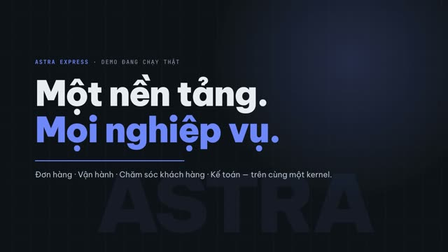</a></td>
<td>Dựng nhanh từ cảnh thật của bản demo: DocType thành Desk, Submit sinh vận đơn và bút toán, overlay theo tenant, sandbox Wasm, MCP che PII, CDC Rust và Seata rollback.<br><a target="_blank" rel="noopener noreferrer" href="https://media.zerohostcms.com/astra-cms/astra-video-0-teaser-vi.mp4">▶ Xem video</a></td>
</tr>
<tr><th colspan="2" align="left">Video 1 · Astra là gì &amp; chạy trong 5 phút <sub>(2:32)</sub></th></tr>
<tr>
<td width="330"><a target="_blank" rel="noopener noreferrer" href="https://media.zerohostcms.com/astra-cms/astra-video-1-quickstart-vi.mp4">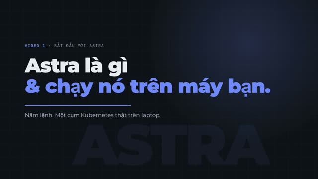</a></td>
<td>Kiến trúc kernel + DocType engine + plugin host, rồi dựng cả cụm k3d bằng <code>make k3d-up</code>, nạp dữ liệu qua REST API và đăng nhập Desk.<br><a target="_blank" rel="noopener noreferrer" href="https://media.zerohostcms.com/astra-cms/astra-video-1-quickstart-vi.mp4">▶ Xem video</a></td>
</tr>
<tr><th colspan="2" align="left">Video 2 · DocType: từ một file YAML đến API, giao diện và index <sub>(2:38)</sub></th></tr>
<tr>
<td width="330"><a target="_blank" rel="noopener noreferrer" href="https://media.zerohostcms.com/astra-cms/astra-video-2-doctype-vi.mp4">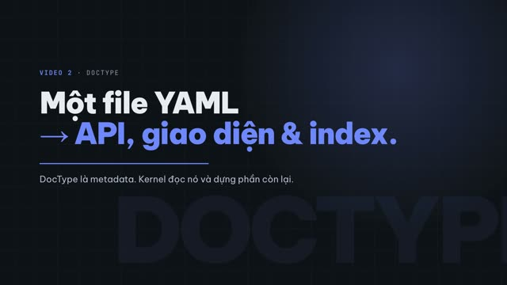</a></td>
<td>Một file YAML sinh ra form, REST API, validation và index biểu thức online; mọi DocType chung một bảng JSONB, không ALTER TABLE.<br><a target="_blank" rel="noopener noreferrer" href="https://media.zerohostcms.com/astra-cms/astra-video-2-doctype-vi.mp4">▶ Xem video</a></td>
</tr>
<tr><th colspan="2" align="left">Video 3 · Quy tắc nghiệp vụ: hook &amp; validation <sub>(2:53)</sub></th></tr>
<tr>
<td width="330"><a target="_blank" rel="noopener noreferrer" href="https://media.zerohostcms.com/astra-cms/astra-video-3-hooks-vi.mp4"></a></td>
<td>Phí ship 73.000 ₫ do hook tính, lỗi validation trả về cùng lúc, Link kiểm tra trong tenant; Desk và API gặp cùng một luật.<br><a target="_blank" rel="noopener noreferrer" href="https://media.zerohostcms.com/astra-cms/astra-video-3-hooks-vi.mp4">▶ Xem video</a></td>
</tr>
<tr><th colspan="2" align="left">Video 4 · Vòng đời chứng từ: Submit, Cancel, Amend <sub>(3:10)</sub></th></tr>
<tr>
<td width="330"><a target="_blank" rel="noopener noreferrer" href="https://media.zerohostcms.com/astra-cms/astra-video-4-lifecycle-vi.mp4"></a></td>
<td>Submit sinh vận đơn và bút toán trong một transaction; chứng từ đã duyệt bất biến; hủy ghi bút toán đảo; amend tạo bản sửa đổi.<br><a target="_blank" rel="noopener noreferrer" href="https://media.zerohostcms.com/astra-cms/astra-video-4-lifecycle-vi.mp4">▶ Xem video</a></td>
</tr>
<tr><th colspan="2" align="left">Video 5 · Vận hành: máy trạng thái bưu kiện <sub>(3:00)</sub></th></tr>
<tr>
<td width="330"><a target="_blank" rel="noopener noreferrer" href="https://media.zerohostcms.com/astra-cms/astra-video-5-ops-vi.mp4"></a></td>
<td>Lọc theo trường projected, timeline quét mã, không nhảy cóc trạng thái, lỗi rồi thành công trên cùng form, không hủy được đơn đã giao.<br><a target="_blank" rel="noopener noreferrer" href="https://media.zerohostcms.com/astra-cms/astra-video-5-ops-vi.mp4">▶ Xem video</a></td>
</tr>
<tr><th colspan="2" align="left">Video 6 · CSKH nhìn thấy vận hành <sub>(2:30)</sub></th></tr>
<tr>
<td width="330"><a target="_blank" rel="noopener noreferrer" href="https://media.zerohostcms.com/astra-cms/astra-video-6-care-vi.mp4"></a></td>
<td>Ticket tự lên mức High và SLA +24h theo từ khoá; thẻ CARE replica đọc bản sao do worker CDC giữ.<br><a target="_blank" rel="noopener noreferrer" href="https://media.zerohostcms.com/astra-cms/astra-video-6-care-vi.mp4">▶ Xem video</a></td>
</tr>
<tr><th colspan="2" align="left">Video 7 · Đa thuê bao <sub>(2:28)</sub></th></tr>
<tr>
<td width="330"><a target="_blank" rel="noopener noreferrer" href="https://media.zerohostcms.com/astra-cms/astra-video-7-tenants-vi.mp4">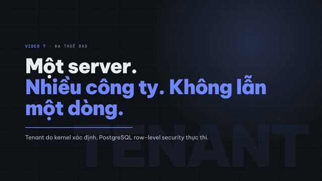</a></td>
<td>Hai công ty trên cùng một server: cùng URL, dữ liệu khác hẳn; Link không vượt tenant, 403/400 khi không rõ tenant, RLS trả 0 dòng.<br><a target="_blank" rel="noopener noreferrer" href="https://media.zerohostcms.com/astra-cms/astra-video-7-tenants-vi.mp4">▶ Xem video</a></td>
</tr>
<tr><th colspan="2" align="left">Video 8 · Bảo mật fail-closed <sub>(2:02)</sub></th></tr>
<tr>
<td width="330"><a target="_blank" rel="noopener noreferrer" href="https://media.zerohostcms.com/astra-cms/astra-video-8-failclosed-vi.mp4">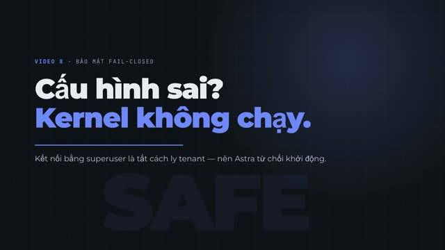</a></td>
<td>Kết nối bằng superuser thì kernel từ chối khởi động, trước cả khi Flyway chạy migration; role ứng dụng NOSUPERUSER NOBYPASSRLS.<br><a target="_blank" rel="noopener noreferrer" href="https://media.zerohostcms.com/astra-cms/astra-video-8-failclosed-vi.mp4">▶ Xem video</a></td>
</tr>
<tr><th colspan="2" align="left">Video 9 · Dành cho developer: viết một app Astra <sub>(2:22)</sub></th></tr>
<tr>
<td width="330"><a target="_blank" rel="noopener noreferrer" href="https://media.zerohostcms.com/astra-cms/astra-video-9-developer-vi.mp4">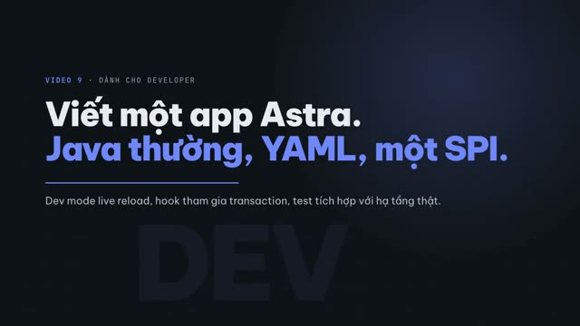</a></td>
<td>App là Java thường + YAML trên astra-spi; dev mode live reload thêm cột mới trong 0,73 s; 44 test tích hợp với PostgreSQL, Seata và Redis thật.<br><a target="_blank" rel="noopener noreferrer" href="https://media.zerohostcms.com/astra-cms/astra-video-9-developer-vi.mp4">▶ Xem video</a></td>
</tr>
<tr><th colspan="2" align="left">Video 10 · Chạy trên Kubernetes <sub>(2:06)</sub></th></tr>
<tr>
<td width="330"><a target="_blank" rel="noopener noreferrer" href="https://media.zerohostcms.com/astra-cms/astra-video-10-k8s-vi.mp4">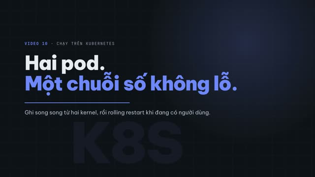</a></td>
<td>Hai pod kernel ghi song song mà chuỗi số không trùng, không lỗ; rolling restart dưới tải và phần còn thiếu (chưa có drain).<br><a target="_blank" rel="noopener noreferrer" href="https://media.zerohostcms.com/astra-cms/astra-video-10-k8s-vi.mp4">▶ Xem video</a></td>
</tr>
<tr><th colspan="2" align="left">Video 11 · Keycloak: một danh tính, role theo tenant, quyền theo DocType <sub>(2:18)</sub></th></tr>
<tr>
<td width="330"><a target="_blank" rel="noopener noreferrer" href="https://media.zerohostcms.com/astra-cms/astra-video-11-keycloak-vi.mp4">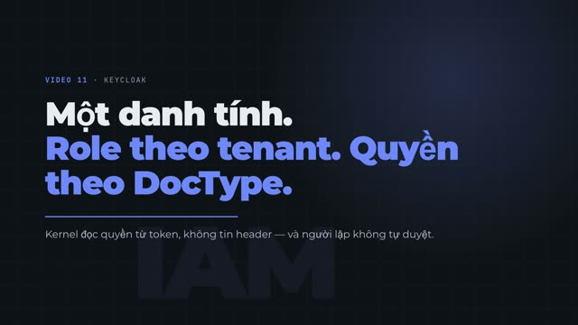</a></td>
<td>Đăng nhập PKCE theme Astra, role là nhóm Keycloak, quyền khai báo trên DocType; người lập phiếu chi không tự duyệt được (403).<br><a target="_blank" rel="noopener noreferrer" href="https://media.zerohostcms.com/astra-cms/astra-video-11-keycloak-vi.mp4">▶ Xem video</a></td>
</tr>
<tr><th colspan="2" align="left">Video 12 · Sổ cái append-only <sub>(2:32)</sub></th></tr>
<tr>
<td width="330"><a target="_blank" rel="noopener noreferrer" href="https://media.zerohostcms.com/astra-cms/astra-video-12-ledger-vi.mp4"></a></td>
<td>Bút toán kép đi cùng transaction của chứng từ, hủy là đảo, trigger chặn UPDATE kể cả chủ bảng, phân vùng theo tháng.<br><a target="_blank" rel="noopener noreferrer" href="https://media.zerohostcms.com/astra-cms/astra-video-12-ledger-vi.mp4">▶ Xem video</a></td>
</tr>
<tr><th colspan="2" align="left">Video 13 · Overlay theo tenant <sub>(2:24)</sub></th></tr>
<tr>
<td width="330"><a target="_blank" rel="noopener noreferrer" href="https://media.zerohostcms.com/astra-cms/astra-video-13-overlay-vi.mp4"></a></td>
<td>Hà Nội thêm trường VAT và vùng đảo bằng một file YAML, có hiệu lực ngay; app Express không đổi một dòng.<br><a target="_blank" rel="noopener noreferrer" href="https://media.zerohostcms.com/astra-cms/astra-video-13-overlay-vi.mp4">▶ Xem video</a></td>
</tr>
<tr><th colspan="2" align="left">Video 14 · Tier 2 Wasm: công thức cước của riêng tenant <sub>(2:20)</sub></th></tr>
<tr>
<td width="330"><a target="_blank" rel="noopener noreferrer" href="https://media.zerohostcms.com/astra-cms/astra-video-14-wasm-vi.mp4">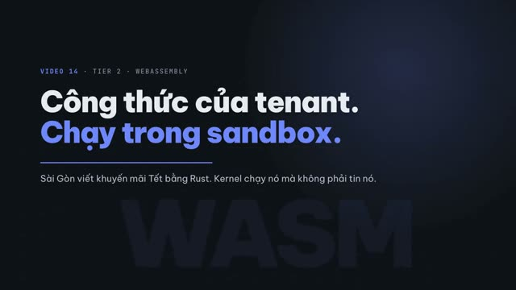</a></td>
<td>Khuyến mãi Tết viết bằng Rust (421 byte), bật lên đổi phí 73.000 → 51.000; vòng lặp vô hạn bị dừng ở 50 ms.<br><a target="_blank" rel="noopener noreferrer" href="https://media.zerohostcms.com/astra-cms/astra-video-14-wasm-vi.mp4">▶ Xem video</a></td>
</tr>
<tr><th colspan="2" align="left">Video 15 · MCP: agent AI dùng Astra bằng quyền của người dùng <sub>(2:24)</sub></th></tr>
<tr>
<td width="330"><a target="_blank" rel="noopener noreferrer" href="https://media.zerohostcms.com/astra-cms/astra-video-15-mcp-vi.mp4">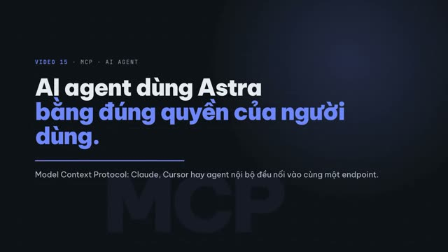</a></td>
<td>Claude thật gọi tool qua MCP: PII bị che, agent của nhân viên CSKH không tạo được đơn, kế toán hỏi COD trả lời từ sổ cái.<br><a target="_blank" rel="noopener noreferrer" href="https://media.zerohostcms.com/astra-cms/astra-video-15-mcp-vi.mp4">▶ Xem video</a></td>
</tr>
<tr><th colspan="2" align="left">Video 16 · Rust CDC + Sync-Aware LSN <sub>(2:36)</sub></th></tr>
<tr>
<td width="330"><a target="_blank" rel="noopener noreferrer" href="https://media.zerohostcms.com/astra-cms/astra-video-16-cdc-vi.mp4"></a></td>
<td>Worker Rust đọc WAL, lệnh ghi trả X-Tx-LSN, đọc replica chưa kịp thì nhận 202 Sync Pending thay vì dữ liệu cũ.<br><a target="_blank" rel="noopener noreferrer" href="https://media.zerohostcms.com/astra-cms/astra-video-16-cdc-vi.mp4">▶ Xem video</a></td>
</tr>
<tr><th colspan="2" align="left">Video 17 · Seata: một lần submit, ba tài nguyên <sub>(2:26)</sub></th></tr>
<tr>
<td width="330"><a target="_blank" rel="noopener noreferrer" href="https://media.zerohostcms.com/astra-cms/astra-video-17-seata-vi.mp4"></a></td>
<td>Nhánh AT trừ hạn mức BMS, nhánh TCC giữ chỗ trên Redis, kernel commit cuối; một nhánh từ chối là tất cả quay lại.<br><a target="_blank" rel="noopener noreferrer" href="https://media.zerohostcms.com/astra-cms/astra-video-17-seata-vi.mp4">▶ Xem video</a></td>
</tr>
<tr><th colspan="2" align="left">Video 19 · HRM: nhân sự và tiền lương <sub>(2:40)</sub></th></tr>
<tr>
<td width="330"><a target="_blank" rel="noopener noreferrer" href="https://media.zerohostcms.com/astra-cms/astra-video-19-hrm-vi.mp4"></a></td>
<td>Theo khái niệm Frappe HRMS: chấm công quyết định ngày công, Payroll Entry tính phiếu lương song song, thưởng bưu tá bằng Wasm, một bút toán dồn tích cho cả kỳ, huỷ là đảo; agent AI chỉ thấy tên đã che.<br><a target="_blank" rel="noopener noreferrer" href="https://media.zerohostcms.com/astra-cms/astra-video-19-hrm-vi.mp4">▶ Xem video</a></td>
</tr>
<tr><th colspan="2" align="left">Video 20 · STMS: điều phối xe với Timefold + AI copilot <sub>(2:58)</sub></th></tr>
<tr>
<td width="330"><a target="_blank" rel="noopener noreferrer" href="https://media.zerohostcms.com/astra-cms/astra-video-20-stms-vi.mp4">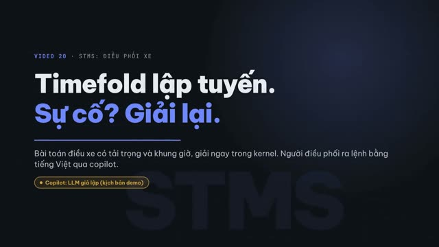</a></td>
<td>Timefold xếp tuyến theo tải trọng và khung giờ, giải lại khi xe hỏng, đơn gấp, kẹt xe; copilot nhận lệnh tiếng Việt và gọi tool thật. LLM của copilot là giả lập theo kịch bản demo, ghi rõ trên mọi khung hình.<br><a target="_blank" rel="noopener noreferrer" href="https://media.zerohostcms.com/astra-cms/astra-video-20-stms-vi.mp4">▶ Xem video</a></td>
</tr>
<tr><th colspan="2" align="left">Video 21 · SAML SSO và SCIM <sub>(2:32)</sub></th></tr>
<tr>
<td width="330"><a target="_blank" rel="noopener noreferrer" href="https://media.zerohostcms.com/astra-cms/astra-video-21-sso-vi.mp4">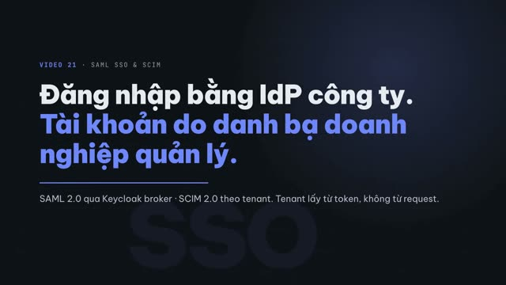</a></td>
<td>Đăng nhập qua IdP SAML có chữ ký, nhóm của IdP thành role của tenant; SCIM 2.0 tạo, đổi nhóm, vô hiệu hoá và xoá user theo từng tenant, token của tenant khác bị chặn.<br><a target="_blank" rel="noopener noreferrer" href="https://media.zerohostcms.com/astra-cms/astra-video-21-sso-vi.mp4">▶ Xem video</a></td>
</tr>
</table>

Nhạc nền: "Corporate Tower" của Mare Production ([freesound.org/s/612264](https://freesound.org/s/612264/)), CC BY 4.0, đã cắt ghép.

---

## Đọc theo vai trò

| Bạn là | Astra cho bạn gì | Bắt đầu từ |
| --- | --- | --- |
| **Developer đang tìm CMS mới** | Một file YAML là có REST API, form, list, quyền và index. Không viết migration khi thêm trường. Hook nghiệp vụ là class Java bình thường. | Video [1](https://media.zerohostcms.com/astra-cms/astra-video-1-quickstart-vi.mp4), [2](https://media.zerohostcms.com/astra-cms/astra-video-2-doctype-vi.mp4), [9](https://media.zerohostcms.com/astra-cms/astra-video-9-developer-vi.mp4) · [Chạy lát cắt mỏng](#chạy-lát-cắt-mỏng-ngay-hôm-nay) · [DocType engine](#doctype-engine) |
| **Nhà đầu tư** | Một nền tảng cho cả CMS lẫn ERP, nhắm doanh nghiệp cần tùy biến liên tục mà không fork. Phần lõi đã chạy được; phần còn lại ghi rõ là lộ trình. | [Teaser](https://media.zerohostcms.com/astra-cms/astra-video-0-teaser-vi.mp4), video nghiệp vụ [19](https://media.zerohostcms.com/astra-cms/astra-video-19-hrm-vi.mp4) và [20](https://media.zerohostcms.com/astra-cms/astra-video-20-stms-vi.mp4), [video lộ trình](https://media.zerohostcms.com/astra-cms/astra-video-18-roadmap-vi.mp4) · [Trạng thái dự án](#trạng-thái-dự-án) · [Lộ trình](#lộ-trình) |
| **Nhà nghiên cứu** | Các lựa chọn thiết kế có thể kiểm chứng: lưu trữ JSONB không DDL kèm index biểu thức, RLS fail-closed, đọc-sau-ghi giữa các module bằng LSN, Seata AT/TCC, sandbox Wasm giới hạn theo thời gian. | [docs/explain.md](docs/explain.md) · [Tham chiếu thiết kế](#tham-chiếu-thiết-kế) · [Hiệu năng](#hiệu-năng-nguyên-tắc-và-mục-tiêu) |
| **Lập trình bằng AI (vibe code)** | Mỗi việc đủ nhỏ để agent làm trọn: một DocType là một file YAML, một hook là một class. 76 test tích hợp cho vòng lặp pass/fail. Agent dùng app qua MCP với đúng quyền của người dùng. | Video [9](https://media.zerohostcms.com/astra-cms/astra-video-9-developer-vi.mp4), [15](https://media.zerohostcms.com/astra-cms/astra-video-15-mcp-vi.mp4) · app mẫu [astra-apps/express](astra-apps/express) · [docs/demo-code-snippets.md](docs/demo-code-snippets.md) |
| **Tech lead doanh nghiệp** | Đa tenant bằng PostgreSQL RLS, Keycloak với role theo tenant và tách nhiệm vụ, sổ cái append-only, giao dịch phân tán, chạy trên Kubernetes. Mỗi giới hạn hiện tại đều được ghi ra. | Video [7](https://media.zerohostcms.com/astra-cms/astra-video-7-tenants-vi.mp4), [8](https://media.zerohostcms.com/astra-cms/astra-video-8-failclosed-vi.mp4), [10](https://media.zerohostcms.com/astra-cms/astra-video-10-k8s-vi.mp4), [11](https://media.zerohostcms.com/astra-cms/astra-video-11-keycloak-vi.mp4), [12](https://media.zerohostcms.com/astra-cms/astra-video-12-ledger-vi.mp4), [17](https://media.zerohostcms.com/astra-cms/astra-video-17-seata-vi.mp4), [21](https://media.zerohostcms.com/astra-cms/astra-video-21-sso-vi.mp4) · [Đa tenant](#đa-tenant-multi-tenancy) |

---

## Trạng thái dự án

> **Đã chạy được:** build Maven nhiều module, tenancy bằng `ScopedValue` và row-level security của PostgreSQL
> (kernel từ chối khởi động nếu kết nối bằng superuser), kho DocType JSONB kèm REST sinh tự động, vòng đời
> submit/cancel/amend, sổ cái append-only, overlay theo tenant, sandbox WebAssembly, MCP server, worker CDC bằng
> Rust, Seata AT/TCC, đăng nhập Keycloak, Desk sinh từ metadata, và bản triển khai k3d hai kernel pod. Xem
> [Chạy lát cắt mỏng ngay hôm nay](#chạy-lát-cắt-mỏng-ngay-hôm-nay) và phần [Video demo](#video-demo).
>
> **Chưa có:** các phần còn lại bên dưới mô tả **kiến trúc mục tiêu và public API dự kiến**; code mẫu ở đó chưa
> compile được. Số liệu hiệu năng là **mục tiêu thiết kế**, chưa phải số đo; chúng sẽ được kiểm chứng bằng
> benchmark công khai.
>
> **Thông báo clean-room.** Astra lấy cảm hứng từ kiến trúc của Frappe Framework (MIT) và ERPNext (GPL-3.0).
> Astra **không dùng chung code, schema hay asset** nào với hai dự án này. Các khái niệm như "DocType" chỉ được dùng như từ vựng chung;
> mọi phần hiện thực đều là bản gốc, viết bằng Java, theo giấy phép MIT. Không được sao chép bất cứ thứ gì từ ERPNext vào repository này.

Muốn hiểu lý do đằng sau từng lựa chọn thiết kế: xem [docs/explain.md](docs/explain.md) (bản tiếng Anh: [docs/explain.en.md](docs/explain.en.md)).

---

## Vì sao có Astra

ERPNext cho thấy một nền tảng mở có thể chạy nội dung, thương mại, kế toán, kho, sản xuất, nhân sự và dự án của cả một công ty, và team nhỏ có thể tùy biến mà không cần fork. Lý do nằm ở ý tưởng lõi của Frappe chứ không ở một module cụ thể nào: **ứng dụng là metadata**. Một DocType định nghĩa field, validation, quyền, form, list, API và workflow của một chứng từ dưới dạng dữ liệu, và mọi thứ còn lại (REST, UI, báo cáo, in ấn, thông báo) được sinh ra từ đó.

Astra lấy ý tưởng đó và xây lại cho bốn ràng buộc mà Frappe chưa từng được thiết kế để giải quyết:

1. **Thông lượng và độ trễ ở quy mô cụm.** Java 25 virtual thread, Generational ZGC, wiring lúc build của Quarkus, cô lập plugin trong tiến trình. Mật độ tenant cao trên mỗi pod thay vì mỗi site một tiến trình. Đây là mục tiêu, cần benchmark để chứng minh.
2. **Thay đổi mỗi ngày mà không phá vỡ hôm qua.** DocType zero-DDL (tùy biến form không bao giờ khóa bảng), các phiên bản app chạy song song, ghim phiên bản theo tenant, canary rollout kèm auto-rollback, SPI có phiên bản với chính sách deprecation thành văn, và tùy biến của tenant được lưu dưới dạng overlay, giữ nguyên qua mọi lần nâng cấp.
3. **Agent vừa là tác giả vừa là người dùng.** Agent xây app trên các extension point có kiểu, với sandbox và bộ test kit; agent sử dụng nền tảng qua bề mặt MCP tool sinh ra từ chính các DocType đó, dưới cùng cơ chế quyền và audit.
4. **Tuân thủ là thuộc tính của metadata.** Mỗi field của DocType mang phân loại dữ liệu, thời hạn lưu giữ, cơ sở pháp lý và nơi lưu trữ dữ liệu (residency). Hồ sơ hoạt động xử lý dữ liệu, yêu cầu của chủ thể dữ liệu, lịch lưu giữ, audit trail và rà soát quyền truy cập đều được sinh ra từ metadata đó, nên đơn vị vận hành có thể đạt mức sẵn sàng SOC 2 Type II, ISO 27001 và GDPR mà không phải làm lại mô hình dữ liệu về sau.

Một ứng dụng Astra gồm một kernel cộng với một tập plugin ("app") được khai báo, có các DocType ghép lại thành một hệ thống. `astra build` biến khai báo đó thành một image bất biến. Astra CMS là app đầu tiên. Astra ERP (kế toán, kho, bán hàng, mua hàng, sản xuất, nhân sự, dự án, CRM) là app thứ hai, xây trên cùng nền tảng theo cách ERPNext được xây trên Frappe, và giữa hai bên không có code dùng chung.

---

## Tham chiếu thiết kế

| Nền tảng | Họ làm gì | Astra mượn gì |
| --- | --- | --- |
| **Frappe / ERPNext** | DocType metadata điều khiển schema, form, API, quyền, workflow. App là đơn vị cài đặt được, có hook. Custom Field và Property Setter cho phép một site tùy biến DocType lõi mà không fork, và giữ nguyên qua nâng cấp. Chứng từ submittable (nháp → đã ghi sổ → hủy; amend tạo bản sửa đổi mới) mang lại tính bất biến cấp kế toán. Bench chạy nhiều site. | Mô hình DocType, mô hình app-là-plugin, tùy-biến-là-overlay, vòng đời submittable và kỷ luật "mọi thứ sinh từ metadata". Xây lại bằng Java với lưu trữ zero-DDL, rollout trên cụm và các tầng cô lập mà Frappe không có. |
| **Linux kernel** | Không bao giờ phá vỡ userspace. | `astra-spi` là userspace ABI. |
| **Kubernetes** | API alpha → beta → GA; API GA đã deprecate vẫn hoạt động 12 tháng hoặc 3 release; rolling update dưới PodDisruptionBudget. | Các mức trưởng thành của SPI, cùng cửa sổ deprecation, nâng cấp kernel kiểu rolling có drain các giao dịch toàn cục. |
| **Stripe** | Phiên bản API theo ngày, ghim theo từng tài khoản. | Phiên bản app và phiên bản public API ghim theo tenant. |
| **Erlang / OTP** | Code cũ và mới cùng tồn tại; lời gọi đang chạy hoàn tất trên code cũ. | Phiên bản plugin chạy song song, drain trước khi giải phóng. |
| **Shopify Functions** | Logic của merchant chạy dưới dạng Wasm với giới hạn lệnh xác định cho mỗi lần chạy. | Wasm sandbox Tier 2 với ngân sách tài nguyên và metric theo từng lần gọi. |
| **Cloudflare Workers** | Isolate trong tiến trình thay vì container; Cloudflare tuyên bố khởi động nhanh hơn ~100 lần. | Cô lập plugin trong tiến trình thay vì mỗi tùy biến một microservice. |
| **Envoy / Proxy-Wasm** | Control plane phân phối Wasm filter tới mọi proxy. | Control plane của plugin đưa cùng một phiên bản tới mọi pod, kể cả pod tham gia muộn. |
| **VS Code** | Extension chạy trong host riêng trên API ổn định, có kiểu; hàng chục nghìn extension. | Extension point có kiểu và cô lập, để nhiều app cùng chạy mà không làm hỏng nhau. |
| **Google SRE / Netflix** | Canary, error budget, rollback tự động. | Các bước rollout có health gate, auto-rollback, DORA metric theo từng plugin. |
| **Alibaba → Apache Seata** | Điều phối giao dịch ở quy mô Singles' Day. | AT trên PostgreSQL, TCC trên Redis Cluster, smart bypass khi không cần giao dịch. |
| **Model Context Protocol (Linux Foundation / AAIF)** | Chuẩn mở để agent gọi tool, được ChatGPT, Gemini, Copilot, Cursor, VS Code áp dụng; 10.000+ server công khai. | DocType và extension point được chiếu (projection) thành MCP tool dưới cùng cơ chế quyền. |

---

## Kiến trúc

```text
+-----------------------------------------------------------------------------------------+
|           KUBERNETES INGRESS / API GATEWAY  •  MCP ENDPOINT (agents)  •  DESK UI        |
|   REST /api/doc/<DocType>  |  /api/method/<app>.<fn>  |  GraphQL  |  gRPC  |  MCP       |
+-----------------------------------------------------------------------------------------+
                                              |
+-----------------------------------------------------------------------------------------+
|                    ASTRA KERNEL PODS  (K8s HPA • JDK 25 Gen-ZGC • Virtual Threads)      |
|                                                                                         |
|   DOCTYPE ENGINE  (metadata registry, zero-DDL JSONB + relational projections +        |
|                    append-only ledgers, naming, links, child tables, permissions,        |
|                    submittable lifecycle, versions, overlays per tenant, upcasters)      |
|                                                                                         |
|   EXTENSION POINT REGISTRY  (typed, versioned, side-by-side versions, tenant pins,       |
|                              precomputed dispatch chains, MCP tool projection)          |
|   +----------------+ +----------------+ +----------------+ +--------------------------+ |
|   | doc hooks      | | routes / gql   | | events / jobs  | | tx participants (AT/TCC) | |
|   | workflow/print | | reports / desk | | auth / policy  | | agents / tools / models  | |
|   +----------------+ +----------------+ +----------------+ +--------------------------+ |
|                                                                                         |
|   PLUGIN HOST ("APPS")                                                                  |
|   +---------------------------+ +----------------------------+ +----------------------+ |
|   | Tier 0  Shared            | | Tier 1  Isolated JVM       | | Tier 2  Wasm Sandbox | |
|   | build-time, Jandex, CDI   | | PF4J-style ClassLoader,    | | Chicory, Extism ABI, | |
|   | direct calls, zero copy   | | MethodHandle dispatch,     | | server scripts,      | |
|   | restart to change         | | hot-swap, leak tracking    | | AI-generated code    | |
|   +---------------------------+ +----------------------------+ +----------------------+ |
|                                                                                         |
|   KERNEL SERVICES                                                                       |
|   Seata TX (smart bypass) • L1 Caffeine + L2 Redis • OIDC / RBAC / Tenancy • Event Bus  |
|   Jobs • Storage • Search + pgvector • Print/PDF • Notifications • OTel • LLM Gateway   |
+-----------------------------------------------------------------------------------------+
            |                              |                               |
+-------------------------+  +---------------------------+  +------------------------------+
| PLUGIN CONTROL PLANE    |  | ASTRA TRANSACTION MANAGER |  | DATA & STORAGE (HA)          |
| Registry: S3/MinIO or   |  | Apache Seata 2.6 Raft TC  |  | PostgreSQL 16+ (JSONB,       |
| OCI; signed, SBOM       |  | AT: Postgres undo_log     |  |   ledgers, pgvector, RLS)    |
| Rollout records, canary |  | TCC: Redis hash-tag Lua   |  | Redis Cluster (L2 + TCC)     |
| Redis Pub/Sub, pod join |  | ScopedValue XID bridge    |  | S3 / MinIO                   |
+-------------------------+  +---------------------------+  +------------------------------+
```

---

## DocType engine

DocType engine là phần lõi của Astra. Một **DocType** là một bản ghi metadata mô tả đầy đủ một loại bản ghi nghiệp vụ. Mọi thứ người dùng hay agent chạm vào đều là DocType: bài viết blog, khách hàng, hoá đơn bán hàng, bút toán sổ kho, định nghĩa workflow, thậm chí chính DocType.

### 1. DocType khai báo gì

```yaml
# apps/astra-erp/accounts/doctypes/sales-invoice.doctype.yaml
name: Sales Invoice
module: accounts
kind: transaction                 # master | transaction | child | setup | ledger | virtual
storage: jsonb                    # jsonb (default) | ledger (append-only relational) | virtual (adapter)
submittable: true                 # draft(0) -> submitted(1) -> cancelled(2); amend creates INV-0001-1
naming: { series: "ACC-SINV-.YYYY.-.#####" }
track-changes: true               # version history on every save
track-views: false

compliance:                       # doc-level; inherited by fields unless overridden
  classification: confidential    # public | internal | confidential | restricted
  legal-basis: contract           # GDPR Art. 6: consent | contract | legal-obligation | legitimate-interest | ...
  retention: { period: 10y, from: fiscal-year-end, reason: "tax law", then: archive }
  residency: tenant-region        # data stays in the tenant's pinned region
  controller: tenant              # tenant is controller; operator is processor

fields:
  - { name: customer,        type: Link,     options: Customer, required: true, in-list: true }
  - { name: posting_date,    type: Date,     required: true, default: today }
  - { name: currency,        type: Link,     options: Currency, fetch-from: customer.default_currency }
  - { name: items,           type: Table,    options: Sales Invoice Item }
  - { name: taxes,           type: Table,    options: Sales Taxes and Charges }
  - { name: grand_total,     type: Currency, read-only: true, in-list: true, projected: true }
  - { name: outstanding,     type: Currency, read-only: true, projected: true, allow-on-submit: true }
  - { name: status,          type: Select,   options: [Draft, Unpaid, Paid, Overdue, Cancelled], projected: true }
  - { name: customer_tax_id, type: Data,     pii: true, encrypt: field, mask: "***last4", dsar: export }
  - { name: remarks,         type: Text,     pii: possible, dsar: redact }

indexes:
  - { fields: [customer, posting_date] }       # built on projected columns, created online

permissions:
  - { role: Accounts User,    read: true, write: true, create: true, submit: true, cancel: false, amend: true }
  - { role: Accounts Manager, read: true, write: true, create: true, submit: true, cancel: true,  amend: true, perm-level: 1 }
  - { role: Sales User,       read: true, if: "owner == user OR customer IN user.customers" }   # row-level

lifecycle:                       # server-side hooks, implemented in the app (Tier 0/1) or as Wasm scripts (Tier 2)
  validate:   accounts.sales_invoice.validate
  on_submit:  accounts.sales_invoice.post_gl_and_stock     # @AstraGlobalTransactional
  on_cancel:  accounts.sales_invoice.reverse_gl_and_stock

workflow: Sales Invoice Approval  # optional state machine with roles and transitions

api:
  rest: true                      # /api/doc/Sales Invoice   (list, get, create, update, submit, cancel, amend)
  graphql: true
  mcp: { tools: [search, get, create, submit], scope: role }
  version: "2026-03-01"           # date-versioned contract, served side by side with older ones
```

### 2. Chiến lược lưu trữ: zero-DDL mặc định, ledger ở nơi cần thiết

Frappe tạo một bảng cho mỗi DocType và chạy DDL khi bạn thêm Custom Field. Astra không bao giờ chạy DDL cho một thay đổi form trong production, nhưng vẫn cung cấp lưu trữ cấp kế toán ở những chỗ ERP cần.

| `storage` | Dùng cho | Cách hoạt động | DDL trong production |
| --- | --- | --- | --- |
| `jsonb` (mặc định) | Master, chứng từ giao dịch, cấu hình, nội dung | Metadata lõi (`id`, `tenant_id`, `doctype`, `docstatus`, `owner`, timestamp, `version`) nằm ở các cột quan hệ có index; field nằm trong `JSONB` với GIN `jsonb_path_ops`. Field đánh dấu `projected: true` được tạo **expression index** (`CREATE INDEX CONCURRENTLY ... ((data->>'field')::type)`), thực sự online; truy vấn sinh ra dùng đúng biểu thức đó nên planner chọn được index. Với workload sort/aggregate nặng, field có thể đặt `projected: materialised`: một cột nullable được thêm dưới dạng thay đổi chỉ metadata, được job backfill theo batch, được kernel đồng bộ khi ghi, rồi index `CONCURRENTLY`. **Không** dùng stored generated column trên bảng đã có dữ liệu vì PostgreSQL phải rewrite cả bảng để thêm chúng. | Không bao giờ cho field. Expression index online, additive và đảo ngược được (`DROP INDEX CONCURRENTLY`); materialised projection online nhưng cần thời gian backfill |
| `ledger` | Bút toán sổ cái, bút toán sổ kho, bút toán lương, audit trail | Bảng quan hệ append-only, phân vùng, cột cố định. Dòng không bao giờ bị update; sửa sai bằng bút toán đảo. Chỉ app sở hữu được ghi, và chỉ bên trong `@AstraGlobalTransactional`. Phân vùng theo kỳ để khóa sổ và lưu trữ. | Schema do app sở hữu, tiến hóa bằng expand/contract |
| `virtual` | Hệ thống bên ngoài | Một `DocTypeAdapter` ánh xạ DocType lên ERP, CRM hoặc database legacy. Cùng API, quyền và tool. | n/a |

**Ngân sách projection.** Linh hoạt không được phép trả giá bằng hiệu năng. Mỗi DocType có quota projection và index (mặc định 8 projection, 12 index), mỗi tenant có quota projection qua overlay, và materialised projection trên DocType vượt ngưỡng số dòng cần qua bước phê duyệt. Yêu cầu vượt quota bị từ chối ngay ở bước kiểm tra metadata, trước khi chạm tới database production.

**DocType "nóng" cần cột materialised.** `UPDATE` trong PostgreSQL ghi lại toàn bộ dòng, nên một DocType có vài field thay đổi nhiều lần mỗi ngày (tồn kho, công nợ, bộ đếm, trạng thái đổi liên tục) sẽ bị phình và làm vacuum quá tải nếu mọi field đều nằm trong JSONB. Các quy tắc kernel cưỡng chế và DocType linter báo cáo: giữ field nóng ở cột materialised để phần JSONB lớn nằm yên trong TOAST; không index field nóng nếu có thể để update vẫn là heap-only (HOT), và đặt `fillfactor` dưới 100; đặt bộ đếm và số dư ở storage `ledger` hoặc Redis; tách field trạng thái nóng thành một DocType phụ hẹp khi mức thay đổi quá cao. `jsonb` là mặc định linh hoạt, không phải lựa chọn cho mọi trường hợp.

### 3. Vòng đời chứng từ, phiên bản và amend

* **DocType submittable** mang `docstatus`: nháp, đã ghi sổ, đã hủy. Chứng từ đã ghi sổ là bất biến, trừ các field đánh dấu `allow-on-submit`. Hủy sẽ đảo các bút toán; **amend** tạo một bản sửa mới (`INV-0001-1`) liên kết với bản gốc. Đó là lý do hoá đơn được xử lý như một chứng từ tài chính chứ không phải một mục nội dung.
* **Track changes** lưu diff cho mỗi lần save; **phiên bản** truy vấn được.
* **Link** được kiểm tra khi ghi và bảo vệ toàn vẹn tham chiếu trên cả JSONB lẫn ledger storage; `fetch-from` sao chép giá trị denormalised tại thời điểm ghi, đúng như chứng từ ERP cần.
* **Child table** là các sub-document có thứ tự, lưu inline (JSONB) hoặc dạng projection (ledger) theo chiến lược của bản ghi cha.
* **Naming series** an toàn trên cụm (bộ đếm dựa trên Redis, có chế độ không hở số cho chứng từ tài chính).

### 4. Tùy biến dạng overlay, sống qua nâng cấp

Tenant tùy biến DocType của một app mà không cần fork, và tùy biến đó **sống qua mọi lần nâng cấp app**:

```yaml
# tenants/acme-vn/overlays/sales-invoice.overlay.yaml
doctype: Sales Invoice
app-version: ">=1.2"                       # overlay applies across upgrades within this range
add-fields:
  - { name: e_invoice_code, type: Data, label: "Mã hoá đơn điện tử", insert-after: posting_date, projected: true }
set-properties:
  - { field: remarks, required: true }
  - { field: posting_date, read-only-on-submit: true }
add-permissions:
  - { role: Tax Officer, read: true }
scripts:
  validate: com.acme.e-invoice-check        # Tier 2 Wasm server script, sandboxed
client:
  form: acme-vn/sales-invoice.form.js       # sandboxed client script for Desk
```

Overlay là dữ liệu, có phiên bản, được ghim theo tenant và áp dụng lúc nạp metadata. Một bản nâng cấp app gỡ bỏ field mà overlay đang phụ thuộc sẽ bị **conformance check** phát hiện trước khi rollout.

### 5. Mọi thứ sinh ra từ metadata

| Bề mặt được sinh ra | Từ |
| --- | --- |
| REST `/api/doc/<DocType>` (list, get, create, update, submit, cancel, amend, bulk) | DocType + quyền, phiên bản theo ngày |
| GraphQL type, query, mutation | DocType + link |
| MCP tool (`doc.search`, `doc.get`, `doc.create`, `doc.submit`, tool của app) | `api.mcp` của DocType + phạm vi role |
| Desk UI: form, list, kanban, calendar, tree, report builder, dashboard, workspace | Field của DocType, `in-list`, link, child table |
| Print format và PDF | DocType + template |
| Notification, email, webhook | Event của DocType |
| Search và vector index | Field đánh dấu searchable; embedding pgvector |
| OpenAPI, JSON Schema, client type cho TypeScript và Java | DocType |

### 6. Báo cáo và script

* **Report Builder** (bộ lọc đã lưu, group-by, biểu đồ) chạy trên projection.
* **Query report** là SQL có tham số trên projection và ledger, được review và quản lý phiên bản như code.
* **Script report** và **server script** chạy dưới dạng Wasm Tier 2 có ngân sách, hoặc Java Tier 1 cho app tin cậy. Đây là ý tưởng Server Script của Frappe, nhưng với sandbox thật thay vì một interpreter bị giới hạn.

---

## Hệ thống plugin ("app")

Một **app** là một plugin mang theo DocType, hook vòng đời, phần cài đặt extension point, fixture, patch và asset Desk. Astra CMS và các module Astra ERP đều là app; module riêng của tenant cũng vậy.

### 1. Extension point có kiểu

Interface Java có kiểu trong `astra-spi` kèm JSON Schema projection, được kiểm tra lúc nạp, dispatch không dùng reflection.

| Extension point | App đóng góp gì | Tier | MCP tool |
| --- | --- | --- | --- |
| `DocTypeContributor` | Định nghĩa DocType, fixture, patch | 0, 1 | n/a |
| `DocLifecycleHook` | `validate`, `before_save`, `after_insert`, `on_update`, `on_submit`, `on_cancel`, `on_trash`, enricher | 0, 1, 2 | Không |
| `WorkflowContributor` | State machine với role và transition | 0, 1 | Không |
| `ReportContributor` / `PrintFormatContributor` | Báo cáo, template in | 0, 1, 2 (script report) | Tùy chọn |
| `DeskContributor` | Workspace, dashboard, tùy biến form/list, client script | 0, 1 | Không |
| `RouteContributor` / `GraphQlContributor` | Endpoint tùy chỉnh (`/api/method/<app>.<fn>`), schema stitching | 0, 1, 2 | Tùy chọn |
| `EventConsumer` / `JobContributor` | Event handler, job định kỳ và job hàng đợi có leader election | 0, 1, 2 / 0, 1 | Có (trigger) |
| `TccParticipant` / `@AstraTccAction` | Nhánh Try-Confirm-Cancel trong một global transaction của Seata | 0, 1 | Không |
| `LedgerContributor` + migration | Bảng ledger append-only với migration expand/contract | 0 | Không |
| `DocTypeAdapter` | Virtual DocType trên hệ thống bên ngoài | 0, 1 | Không |
| `AuthProvider` / `PolicyContributor` | Identity provider, RBAC và policy dựa trên thuộc tính | 0, 1 | Không |
| `StorageAdapter` / `SearchAdapter` | Backend cho object storage, search và vector | 0, 1 | Không |
| `ToolContributor` / `AgentContributor` | Tool giới hạn theo capability (quyền năng lực) và agent có ngân sách | 0, 1, 2 / 0, 1 | **Có** |
| `ModelProvider` / `PromptContributor` | LLM provider đứng sau gateway; prompt và eval có phiên bản | 0, 1 | Không |
| `AuditSink` / `KeyProvider` / `ResidencyPolicy` | Exporter cho SIEM, key provider KMS/HSM (BYOK), quy tắc về vùng và chủ quyền dữ liệu | 0, 1 | Không |
| `ConsentProvider` / `DsarHandler` / `RetentionPolicy` | Nguồn consent, xử lý yêu cầu của chủ thể dữ liệu cho dữ liệu riêng của app, ghi đè chính sách lưu giữ | 0, 1 | Không |
| `CliCommand` | `astra <app> <command>` | 0 | Không |
| `ExtensionPointContributor` | Extension point mới, để app trở thành nền tảng cho các app khác | 0 | n/a |

### 2. Ba tầng cô lập

| | **Tier 0: Shared (build-time)** | **Tier 1: Isolated JVM (runtime)** | **Tier 2: Wasm sandbox (runtime)** |
| --- | --- | --- | --- |
| **Nạp** | Compile vào image bằng `astra build`; Quarkus `@BuildStep` + Jandex | `PluginClassLoader` riêng cho mỗi phiên bản app | Module Chicory, dùng pool; ABI tương thích Extism |
| **Chi phí dispatch** | Gọi trực tiếp | `MethodHandle` bind lúc nạp | Wasm compile sang bytecode trên JVM; interpreter trên native image |
| **Thay đổi cần** | Rebuild image + rolling deploy | Hot-swap | Hot-swap |
| **Capability** | Tất cả, kể cả ledger và extension point mới | DocType, hook, workflow, report, route, event, job, TCC, tool, agent | Server script, script report, enricher, validator, tool, hàm thuần trên các host call được cấp |
| **Bán kính ảnh hưởng khi lỗi** | Pod | Bulkhead: timeout, giới hạn đồng thời, circuit breaker | Sandbox cứng: memory page, deadline, interrupt, không truy cập host khi chưa được cấp |
| **Ngôn ngữ** | Java / Kotlin | Java / Kotlin | Rust, Go, C/C++, C#, Zig, AssemblyScript, JavaScript, Python (Extism PDK) |
| **GraalVM native** | Có | Không | Có, chạy interpreter |
| **Mặc định cho** | App lõi (accounts, stock), mọi thứ chạy trên mỗi request | Module của tenant, tích hợp | Script của tenant, marketplace, **code do AI sinh** |

### 3. Manifest của app

```yaml
# astra-app.yaml
id: com.acme.vn-localisation
version: 2.3.1
spi: ">=1.2 <2"
tier: isolated-jvm
entrypoint: com.acme.vnloc.VnLocalisationApp
provenance: { author: team-finance, generator: claude-code, signed-by: acme-release-key }
depends: [ { id: io.astra.erp.accounts, version: ">=1.0" } ]
doctypes: [ doctypes/*.doctype.yaml ]
overlays: [ overlays/*.overlay.yaml ]            # customisations of other apps' DocTypes
fixtures: [ fixtures/vn-chart-of-accounts.json ]
patches:  [ patches/v2_3_0_backfill_tax_codes ]   # data patches, idempotent, versioned
capabilities:
  network: [ "https://api.einvoice.gov.vn" ]
  secrets: [ "acme/einvoice-cert" ]
  doctypes: [ Sales Invoice, Purchase Invoice, Company ]
  ledgers: [ GL Entry ]                           # read only unless tier 0
  llm: { provider: gateway, monthly-budget-usd: 100 }
tenancy: { scope: per-tenant, config-schema: config.schema.json }
runtime: { timeout: 50ms, max-concurrency: 256, circuit-breaker: { failure-rate: 0.5, window: 30s } }
compat: { keep-previous: 2, schema-upcasters: [ "v1->v2: com.acme.vnloc.upcast.V1ToV2" ] }
rollout: { strategy: canary, steps: [ 10%, 50%, 100% ], health: { error-budget: 1%, p99-ms: 20 }, auto-rollback: true }
```

### 4. Rollout trên cụm

Publish (artifact + manifest + chữ ký Sigstore + SBOM lên S3/MinIO hoặc OCI) → xác minh (chữ ký, khoảng SPI, policy về provenance) → announce (Redis Pub/Sub) → canary theo tỷ lệ pod với health gate → nạp song song, warm-up, trỏ lại dispatch một cách nguyên tử, drain, kiểm tra rò rỉ → tự động rollback toàn cụm khi health check thất bại → pod HPA khởi động sau kéo trạng thái hiện tại lúc boot.

### 5. Bảo mật

Capability thay vì permission (Wasm chỉ link các host function đã được cấp; isolated JVM được kiểm tra tại ranh giới kernel với danh tính plugin nằm trong `ScopedValue`). Artifact được ký, có SBOM, allow-list nhà phát hành, ghi lại `generator`. App không bao giờ chạm vào bảng của kernel; chỉ truy cập DocType khi đã khai báo; ledger chỉ app Tier 0 sở hữu mới ghi được; `tenant_id` kết hợp với row-level security của PostgreSQL. Mọi lần nạp, swap, rollback, cấp quyền, gọi tool và hành động của agent đều được audit.

---

## Thay đổi liên tục mà không phá vỡ: hợp đồng tương thích

### 1. SPI là ABI

* App chỉ phụ thuộc vào `astra-spi`. Extension point mang mức trưởng thành `alpha` / `beta` / `stable`.
* **Chính sách deprecation:** một phần tử `stable` bị deprecate vẫn hoạt động ít nhất **12 tháng hoặc 3 minor release**, kèm cảnh báo có cấu trúc chỉ rõ phần thay thế.
* **Kernel N chạy được app build cho SPI N-1** thông qua compatibility shim.
* **Conformance suite:** golden app từ mọi phiên bản SPI còn được hỗ trợ, cộng với mọi overlay tenant đã đăng ký, chạy trong CI. Thay đổi nào làm hỏng một trong số đó thì không được ship.

### 2. Các phiên bản cùng tồn tại; tenant tự ghim

* N phiên bản app chạy song song; bản cũ được giữ lại cho đến khi không còn tenant nào ghim và không còn lời gọi nào đang xử lý.
* Ghim theo tenant cho phiên bản app và phiên bản API. Nâng cấp một tenant không ảnh hưởng tới tenant khác.
* API sinh ra được đánh phiên bản theo ngày và phục vụ song song.

### 3. Dữ liệu tiến hóa không cần khóa

| Dữ liệu | Cơ chế | DDL trong production | Rollback |
| --- | --- | --- | --- |
| Field DocType, overlay | Zero-DDL JSONB; schema version với upcaster khi đọc, ghi lại dần khi ghi; projection online | Không bao giờ cho field | Tức thì |
| Ledger | Expand / contract do CI cưỡng chế; dòng append-only không bao giờ bị ghi lại | Additive, online | Phiên bản trước đọc được schema đã expand |
| Data patch | Idempotent, có phiên bản, chạy theo từng tenant khi rollout, resume được | n/a | Patch bù trừ |
| Event | `schemaVersion` trên mọi event; consumer khai báo khoảng phiên bản; upcaster | n/a | Consumer cũ vẫn chạy |
| Cache | Key gồm phiên bản app và schema; invalidate toàn cụm | n/a | Không đọc dữ liệu stale giữa các phiên bản |

### 4. Ma trận không downtime

| Thay đổi | Cơ chế | Downtime | Thời gian rollback |
| --- | --- | --- | --- |
| App Tier 1 / Tier 2, overlay, server script | Hot-swap, canary, drain | 0 | Vài giây, toàn cụm, tự động |
| App Tier 0 | Image mới, rolling update dưới PodDisruptionBudget, drain các global transaction | 0 | Vài phút |
| Field, form, quyền, workflow của DocType | Phiên bản metadata, zero-DDL | 0 | Tức thì |
| Schema ledger | Expand / contract | 0 | App bản trước vẫn chạy |
| Prompt, model, policy của agent | Artifact có phiên bản, đi cùng đường rollout | 0 | Vài giây |
| Kernel minor / major | Rolling với shim SPI N-1 / blue-green, tenant chuyển dần bằng cách ghim | 0 | Vài phút / chuyển traffic về |
| PostgreSQL / Redis / Seata TC | HA tiêu chuẩn; kernel retry với TCC idempotent | 0 cho đọc, failover dưới một giây cho ghi | n/a |

### 5. Thay đổi quan sát được

Mỗi rollout là một event được gắn với metric. **DORA metric theo từng app** (tần suất deploy, lead time, tỷ lệ thay đổi gây lỗi, thời gian khôi phục) có sẵn.

---

## Đa tenant (multi-tenancy)

Đa tenant là thuộc tính của kernel, không phải tính năng của app. Mọi dịch vụ kernel tự áp ranh giới tenant, nên app hay agent không thể vượt qua ranh giới đó.

### 1. Mô hình tenant

`Tenant` là một DocType kiểu `setup` do kernel sở hữu, nên onboarding, tạm ngưng và offboarding đều là vòng đời chứng từ bình thường, có audit.

```yaml
# Tenant document (kernel DocType)
name: acme-vn
status: active                      # provisioning | active | suspended | offboarding | archived
organisation: acme-group            # optional parent for group-wide sharing and reporting
isolation: shared-rls               # shared-rls | database-per-tenant | cluster-per-tenant
region: vn                          # enforced by ResidencyPolicy on storage, cache, backup, search, LLM
identity:
  resolution: [ subdomain, oidc-claim ]     # acme-vn.astra.example | token claim "tid"
  providers: [ { type: oidc, issuer: "https://login.acme.vn" }, { type: saml, metadata: "..." } ]
  scim: enabled
keys: { provider: aws-kms, byok: true, rotation: 90d }
apps:                                # globally installed, enabled here with pins and config
  - { id: io.astra.erp.accounts, pin: "1.x" }
  - { id: com.acme.vn-localisation, pin: "2.3.1", config: config/vn-loc.yaml }
overlays: [ overlays/*.overlay.yaml ]
api-version: "2026-03-01"
plan: enterprise                     # feature flags and quotas come from the plan, overridable per tenant
quotas: { users: 500, storage-gb: 2000, agent-tokens-per-month: 50_000_000, requests-per-sec: 2000 }
features: { ai-agents: true, marketplace: false }
```

### 2. Nhận diện tenant và ngữ cảnh

Request nhận diện tenant theo thứ tự: domain riêng hoặc subdomain, claim trong token OIDC, header tường minh cho tài khoản dịch vụ, tiền tố đường dẫn cho Desk. Kết quả được bind một lần cho mỗi request vào một `ScopedValue` và được kế thừa sang mọi virtual thread, subtask structured concurrency, hook, job và lời gọi agent. Các dịch vụ kernel đọc tenant từ scope đó; **không API nào nhận tenant làm tham số do bên gọi truyền vào**.

Một người dùng có thể thuộc nhiều tenant. Đổi tenant là một phiên mới với scope mới; quyền được đánh giá theo từng tenant.

### 3. Các profile cô lập

| Profile | Dữ liệu | Khoá | Compute | Dùng cho |
| --- | --- | --- | --- | --- |
| `shared-rls` (mặc định) | Một cụm PostgreSQL; cột `tenant_id` + row-level security trên mọi bảng, kể cả ledger và audit; partition theo hash tenant cho bảng lớn | Khoá dữ liệu riêng theo tenant dưới KMS của tenant | Pod dùng chung, bulkhead theo tenant và theo app | Phần lớn tenant; hàng nghìn tenant mỗi pod |
| `database-per-tenant` | Database riêng (trên cùng cụm hoặc cụm PostgreSQL riêng); cùng schema; vẫn bật RLS | BYOK | Pod dùng chung | Khách hàng thuộc ngành bị quản lý chặt, yêu cầu tách dữ liệu nghiêm ngặt, tenant lớn |
| `cluster-per-tenant` | PostgreSQL, Redis, storage riêng; pod Astra riêng | HYOK / HSM | Riêng | Triển khai chủ quyền dữ liệu hoặc air-gapped |

Tenant chuyển giữa các profile bằng `astra tenant migrate --to database-per-tenant`: snapshot, giai đoạn ghi kép, cutover, kiểm chứng; đọc không gián đoạn, ghi chỉ dừng dưới một giây lúc cutover.

### 4. Những gì được scope theo tenant

| Lĩnh vực | Hành vi theo tenant |
| --- | --- |
| Dữ liệu DocType và ledger | `tenant_id` + RLS; partition cho DocType có khối lượng lớn |
| Metadata | DocType gốc là toàn cục; overlay, ghim phiên bản và feature flag theo tenant; metadata hiệu lực được cache theo `(tenant, metadata-version)` |
| App | Cài toàn cục, bật theo tenant, ghim theo tenant, cấu hình theo tenant với kiểm tra JSON-Schema |
| Cache | Key L1/L2 gồm tenant và phiên bản metadata; invalidation nhận biết tenant |
| Event và job | Định tuyến kèm ngữ cảnh tenant; job định kỳ chạy theo tenant với fair scheduling và giới hạn đồng thời theo tenant |
| Giao dịch | Resource key của Seata và hash tag Redis gồm tenant |
| Search và vector | Index riêng theo tenant hoặc partition lọc theo tenant |
| Object storage | Prefix hoặc bucket riêng theo tenant, khoá riêng theo tenant |
| Danh tính | Nhà cung cấp danh tính, chính sách MFA, SCIM, chính sách phiên theo tenant |
| AI | Nhà cung cấp model, ghim region, ngân sách, chính sách che PII, cổng phê duyệt, opt-out theo tenant |
| Tuân thủ | RoPA, DSAR, lịch thời hạn lưu (retention), nơi lưu trữ (residency), xuất audit theo tenant |
| Quan sát | Mọi span, metric và log đều gắn tenant; dashboard và SLO theo tenant |

### 5. Organisation và chia sẻ

Một `Organisation` gom nhiều tenant (tập đoàn và các công ty con, chuỗi nhượng quyền, agency và khách hàng của agency). Trong một organisation, DocType có thể được khai báo `shareable` với policy tường minh (master chỉ đọc như Item hay mẫu hệ thống tài khoản, báo cáo hợp nhất giữa các công ty con). Chia sẻ luôn là opt-in, có log, và được biểu diễn bằng metadata; mặc định vẫn là cô lập chặt. ERP đa công ty trong một tenant do DocType `Company` đảm nhận và không liên quan đến tenancy.

### 6. Công bằng, quota và đo đếm (metering)

* **Bulkhead theo tenant và theo app**: giới hạn đồng thời virtual thread, rate limit request, giới hạn đồng thời job, và ngân sách token agent. Tenant ồn ào chỉ tự làm chậm chính mình, không ảnh hưởng hàng xóm.
* **Quota** lấy từ gói dịch vụ và có thể ghi đè theo tenant; vượt quota sinh event và, nếu được cấu hình, áp soft limit trước hard limit. Quota bao gồm compute và storage **và cả metadata**: số projection và index mỗi DocType và mỗi tenant, số overlay, số phiên bản app được giữ ấm.
* **Đo đếm (metering)** phát bản ghi sử dụng (request, dung lượng, job, token agent, seat) dưới dạng DocType `ledger` cho tích hợp tính phí. Astra không ship billing; Astra ship đồng hồ đo.

### 7. Vòng đời tenant

| Bước | Cơ chế |
| --- | --- |
| Provision | `astra tenant create` hoặc Admin API: tạo Tenant document, khoá, đặt region, bật app, chạy fixture và patch, kiểm chứng bằng conformance suite |
| Tùy biến | Overlay, ghim phiên bản, cấu hình, nhà cung cấp danh tính; tất cả có phiên bản và audit |
| Tạm ngưng | Request bị từ chối với trạng thái riêng của tenant; job tạm dừng; dữ liệu được giữ |
| Export | Xuất toàn bộ (DocType, file, audit, metadata, overlay) ở định dạng mở, phục vụ khả năng di chuyển và các yêu cầu cỡ DSAR |
| Offboard | Áp lịch thời hạn lưu (retention); xoá bằng mật mã thông qua huỷ khoá; ledger được giữ theo nghĩa vụ pháp lý với tham chiếu đã ẩn danh hoá (pseudonymised); ghi lại bằng chứng xoá |
| Migrate | Giữa các profile cô lập hoặc giữa các region bằng cơ chế cutover ghi kép đã mô tả ở trên |

### 8. Chế độ một tenant

`tenancy.mode: single` giữ nguyên mọi cơ chế nhưng cố định một tenant, nên một triển khai tự host cho một công ty không phải trả overhead tenancy và sau này có thể chuyển sang `multi` mà không cần migrate dữ liệu.

---

## Tuân thủ tích hợp sẵn trong metadata

SOC 2 Type II và ISO 27001 chứng nhận *nhà vận hành* (tổ chức chạy dịch vụ) qua một kỳ quan sát. GDPR và các luật tương đương ở từng khu vực ràng buộc *bên kiểm soát và bên xử lý*. Không có codebase mã nguồn mở nào "được chứng nhận SOC 2". Dù vậy, một nền tảng vẫn có thể khiến các kết quả đó rẻ hơn: có sẵn control, tự sinh bằng chứng, và giữ mô hình dữ liệu tuân thủ ngay từ cấu trúc. Một Astra Cloud được host sẽ tự theo đuổi các chứng nhận; nhà vận hành tự host thừa hưởng control và đường ống bằng chứng.

### 1. Các khung trong phạm vi và cách Astra ánh xạ

| Khung | Phạm vi | Astra cung cấp |
| --- | --- | --- |
| **SOC 2 Type II** (AICPA Trust Services Criteria) | Security, Availability, Processing Integrity, Confidentiality, Privacy | Hiện thực control và xuất bằng chứng liên tục cho các tiêu chí nhóm CC: truy cập logic (CC6), quản lý thay đổi (CC8), giám sát (CC7), tính sẵn sàng (A1), toàn vẹn xử lý (PI1), quyền riêng tư (P-series). Ma trận control trong `docs/compliance/soc2.md`. |
| **ISO/IEC 27001:2022** + 27017 / 27018 / 27701 | ISMS, control cho cloud, PII trên cloud, quản lý quyền riêng tư | Ánh xạ control Annex A, kiểm kê tài sản từ metadata DocType, workflow rà soát truy cập, sổ đăng ký nhà cung cấp (bên xử lý phụ), hook quản lý thông tin quyền riêng tư. |
| **GDPR / UK GDPR** | Dữ liệu cá nhân EU/UK | Phân loại dữ liệu, cơ sở pháp lý, sinh RoPA, tự động hoá DSAR, thời hạn lưu (retention) và xoá, quy trình xử lý vi phạm (72 giờ), mẫu DPIA, hồ sơ bên xử lý / bên xử lý phụ, profile lưu trữ EU. |
| **Vietnam PDPL** (Luật 91/2025/QH15, Nghị định 356/2025, hiệu lực từ 1 Jan 2026; thay thế Nghị định 13/2023) | Dữ liệu cá nhân của chủ thể dữ liệu Việt Nam | Phân loại dữ liệu cơ bản / nhạy cảm, hồ sơ đồng ý, hồ sơ đánh giá tác động, hồ sơ chuyển dữ liệu xuyên biên giới, thời hạn phản hồi yêu cầu, profile lưu trữ VN. |
| **CCPA/CPRA**, **LGPD**, **PDPA (SG)**, **APPI**, **PIPL** | Luật quyền riêng tư khu vực | Cùng một privacy engine với profile theo khu vực pháp lý: danh mục quyền, yêu cầu thông báo, quy tắc nội địa hoá (PIPL, VN) được cưỡng chế bởi `ResidencyPolicy`. |
| **SOX ITGC** (cho khách hàng ERP) | Quản lý thay đổi, truy cập, phân tách nhiệm vụ (SoD), audit trail | Rollout có ký, có phê duyệt, có audit; quy tắc SoD trên hành động DocType; ledger bất biến; khoá kỳ; rà soát truy cập. |
| **PCI DSS 4.0.1** | Dữ liệu thẻ | Thiết kế để dữ liệu chủ thẻ **nằm ngoài phạm vi**: token hoá qua nhà cung cấp thanh toán, không lưu PAN, chính sách mạng và secret cho app thanh toán. |
| **HIPAA** (profile tuỳ chọn) | Dữ liệu y tế Mỹ | Mã hoá cấp field, log truy cập, control sẵn sàng cho BAA đối với app khai báo PHI. |
| **EU AI Act** (theo giai đoạn 2025-2027; các mốc high-risk đang được lùi theo Digital Omnibus) + **ISO/IEC 42001**, **NIST AI RMF** | Hệ thống AI và quản trị AI | Log hành động agent, cổng phê duyệt của con người (human-in-the-loop), quản lý phiên bản model và prompt, thông báo minh bạch, che PII trước khi gọi model bên ngoài, tenant opt-out, kiểm kê AI. |
| **EU DORA** (tổ chức tài chính, từ Jan 2025), **NIS2** | Khả năng phục hồi vận hành, rủi ro bên thứ ba ICT | Hook kiểm thử khả năng phục hồi, workflow báo cáo sự cố, bằng chứng RTO/RPO, sổ đăng ký bên xử lý phụ. |
| **EU Cyber Resilience Act** (báo cáo từ Sept 2026, áp dụng đầy đủ từ Dec 2027) | Sản phẩm có yếu tố số | SBOM cho mỗi bản phát hành, quy trình xử lý lỗ hổng, công bố có phối hợp, chính sách cập nhật bảo mật; dự án Astra hoạt động với vai trò open-source steward. |
| **WCAG 2.2 AA**, **EU Accessibility Act** (June 2025), **Section 508** | Khả năng tiếp cận | Desk UI xây theo WCAG 2.2 AA; audit tự động và thủ công trong CI. |
| **OWASP ASVS**, **NIST SSDF**, **SLSA**, **OpenSSF Scorecard**, **CIS Kubernetes Benchmark** | Kỹ thuật an toàn và chuỗi cung ứng | Nền ASVS Level 2 (Level 3 cho auth, thanh toán, ledger); SDLC theo SSDF; build SLSA Level 3; Scorecard trong CI; Helm mặc định đã cứng hoá. |

### 2. Metadata tuân thủ trên DocType

Tuân thủ được khai báo ở đúng nơi dữ liệu được khai báo. Mỗi field có thể mang:

| Thuộc tính | Giá trị | Chi phối |
| --- | --- | --- |
| `classification` | public, internal, confidential, restricted | Quyền mặc định, che dữ liệu, quy tắc export, che log |
| `pii` / `sensitive` | true, possible, special-category (health, biometric, ...) | RoPA, phạm vi DSAR, mã hoá mặc định, che dữ liệu cho AI |
| `legal-basis` | consent, contract, legal-obligation, vital-interest, public-task, legitimate-interest | RoPA, kiểm tra đồng ý khi ghi, ngoại lệ khi xoá |
| `retention` | period, anchor, reason, then: delete / anonymise / archive | Job retention, legal hold, bằng chứng xoá |
| `residency` | tenant-region, eu-only, vn-only, any | Cưỡng chế `ResidencyPolicy` trên storage, cache, backup, lời gọi LLM |
| `encrypt` | none, field, deterministic (searchable) | Mã hoá cấp field bằng khoá của tenant |
| `mask` / `dsar` | mask pattern; export / redact / exclude | Hiển thị trên Desk, export, gói DSAR |

Từ metadata này, nền tảng **tự sinh**: Record of Processing Activities, bản đồ dữ liệu theo tenant, gói DSAR, lịch thời hạn lưu (retention), khung DPIA / hồ sơ đánh giá tác động theo PDPL, và bản kiểm kê dữ liệu mà ISO 27001 yêu cầu.

### 3. Hiện thực control trong kernel

* **Danh tính và truy cập (SOC 2 CC6, ISO A.5/A.8).** OIDC và SAML SSO, bắt buộc MFA, SCIM cấp và thu hồi tài khoản, RBAC cộng quy tắc thuộc tính, mặc định ít quyền nhất, **rà soát truy cập** định kỳ sinh thành workflow, tài khoản break-glass có lý do bắt buộc và tự hết hạn, chính sách phiên.
* **Phân tách nhiệm vụ (SOX, SOC 2 PI1).** Quy tắc SoD là policy cấp DocType: người tạo Payment Entry không được submit nó; chuỗi phê duyệt là các trạng thái workflow; vi phạm bị chặn và ghi log.
* **Audit trail chống sửa (CC7, A.8.15, GDPR Art. 30/32).** Mọi thay đổi DocType, thay đổi quyền, rollout, hành động agent, hành động admin và export đều được ghi vào một DocType `ledger` append-only có chuỗi hash, xuất được ra WORM storage và SIEM (`AuditSink`: OpenTelemetry logs, syslog, OCSF). Thời hạn lưu (retention) và legal hold cũng áp dụng cho dữ liệu audit.
* **Mã hoá và khoá (CC6.1, A.8.24).** TLS 1.3 ở mọi nơi, mã hoá at rest, mã hoá cấp field cho `encrypt: field`, khoá từ `KeyProvider` (AWS KMS, GCP KMS, Azure Key Vault, HashiCorp Vault, HSM), **BYOK theo tenant**, xoay khoá, và crypto-shredding để xoá ở nơi bản ghi buộc phải giữ bất biến.
* **Vận hành quyền riêng tư (GDPR Ch. III, PDPL).** Cổng và API DSAR: truy cập, export (JSON/CSV), chỉnh sửa, xoá, hạn chế xử lý, di chuyển dữ liệu, phản đối, với thời hạn được theo dõi theo từng khu vực pháp lý. Xoá trên ledger được hiện thực bằng cách ẩn danh hoá (pseudonymise) tham chiếu chủ thể dữ liệu và huỷ khoá, đồng thời giữ bản ghi tài chính theo cơ sở pháp lý nghĩa vụ pháp lý. Sự đồng ý là một DocType với mục đích có phiên bản. Workflow xử lý vi phạm có đồng hồ 72 giờ, mẫu thông báo và thu thập bằng chứng.
* **Nơi lưu trữ (residency) và chủ quyền dữ liệu.** Tenant ghim một region; `ResidencyPolicy` cưỡng chế trên lưu trữ chính, cache, backup, search, object storage, **và nhà cung cấp LLM**. Profile triển khai: `eu`, `us`, `vn`, `sg`, `custom`. Không nhân bản PII xuyên region trừ khi hồ sơ chuyển dữ liệu của tenant cho phép.
* **Quản lý thay đổi (CC8, SOX).** Artifact có ký, kèm SBOM, ghi nhận xuất xứ; phê duyệt bốn mắt cho rollout production; tách biệt môi trường; mọi rollout đều có audit; canary và rollback là control bù trừ; DORA metrics làm bằng chứng.
* **Tính sẵn sàng và khả năng phục hồi (A1, DORA).** HA ở mọi tầng, backup mã hoá với point-in-time recovery, **kiểm thử restore là job định kỳ có bằng chứng**, công bố mục tiêu RPO/RTO, hook kiểm thử chaos và failover, workflow trạng thái và sự cố.
* **Lỗ hổng và chuỗi cung ứng (CC7.1, CRA).** SCA, SAST, DAST và quét container trong CI; SLA phản hồi CVE; `SECURITY.md` với quy trình công bố có phối hợp; SBOM (CycloneDX) cho mỗi bản phát hành; xuất xứ SLSA Level 3; theo dõi OpenSSF Scorecard và Best Practices badge; pentest bên thứ ba hàng năm cho triển khai tham chiếu.
* **Cô lập tenant (CC6.1, 27018).** Row-level security với `tenant_id`, khoá theo tenant, bulkhead chống tenant ồn ào, và profile tuỳ chọn **database-per-tenant** hoặc **cluster-per-tenant** cho khách hàng thuộc ngành bị quản lý chặt.
* **Log và giám sát (CC7.2).** Log có cấu trúc, đã che PII; cảnh báo khi có bất thường xác thực, thay đổi đặc quyền, export hàng loạt, vượt ngân sách agent; thời hạn lưu log theo chính sách.
* **Quản trị AI (EU AI Act, ISO 42001).** Mọi hành động agent được log kèm model, phiên bản prompt, hash input và output; **cổng phê duyệt của con người** cho hành động tác động lớn (ghi sổ ledger, đổi quyền, thao tác hàng loạt), cấu hình theo tenant; che PII trước khi gọi model bên ngoài; model ghim region hoặc model local để đáp ứng residency; kiểm kê hệ thống AI và thông báo minh bạch được sinh từ metadata của `AgentContributor` và `ModelProvider`.
* **Khả năng tiếp cận.** Các component của Desk được xây và kiểm thử theo WCAG 2.2 AA; kiểm tra axe tự động và lịch audit thủ công được ghi lại trong tài liệu.

### 4. Tự động hoá bằng chứng

Phần lớn công việc tuân thủ là thu thập bằng chứng. Astra xuất bằng chứng liên tục:

* `astra compliance evidence --framework soc2 --period 2026-Q3` xuất hồ sơ rà soát truy cập, hồ sơ thay đổi kèm phê duyệt, kết quả kiểm thử backup và restore, SLA xử lý lỗ hổng, log sự cố, và bằng chứng toàn vẹn của audit trail.
* Connector đẩy cùng bằng chứng đó sang các nền tảng tự động hoá tuân thủ (Vanta, Drata, Secureframe và tương tự) qua `AuditSink`.
* Catalogue control được duy trì ở dạng máy đọc được (OSCAL) trong `docs/compliance/`, nên cách hiện thực, người phụ trách và nguồn bằng chứng của một control chỉ cần một lần tra cứu.

### 5. Ma trận trách nhiệm chia sẻ

| Lĩnh vực | Nền tảng Astra | Nhà vận hành / tenant |
| --- | --- | --- |
| Control hiện thực trong phần mềm (truy cập, audit, mã hoá, retention, residency, SoD) | Cung cấp và kiểm thử | Cấu hình, rà soát |
| Sinh bằng chứng | Tự động hoá và xuất | Lưu giữ, trình cho auditor |
| Chính sách, đánh giá rủi ro, đào tạo, quản lý nhà cung cấp | Mẫu và sổ đăng ký | Sở hữu |
| Chứng nhận (báo cáo SOC 2, chứng chỉ ISO) | Astra Cloud tự theo đuổi cho chính mình | Người tự host theo đuổi cho phạm vi của mình |
| Vai trò pháp lý (bên kiểm soát, bên xử lý, DPO) | Hỗ trợ cả hai vai trò | Quyết định và ghi nhận |

---

## Hướng tới ERP: Astra ERP trên Astra

Astra ERP là bằng chứng cho thấy nền tảng đủ tổng quát. Nó được xây theo đúng cách ERPNext được xây trên Frappe: **mỗi module là một app, mỗi bản ghi là một DocType, mỗi bút toán là một ledger entry**. Astra ERP sao chép *hình dạng* của ERPNext, không sao chép code.

| Module (app) | DocType lõi | Ledger | Ghi chú |
| --- | --- | --- | --- |
| `erp.core` | Company, Fiscal Year, Currency, Exchange Rate, UoM, Address, Contact | | Đa công ty và đa tiền tệ ngay từ bản phát hành đầu tiên |
| `erp.accounts` | Account (cây hệ thống tài khoản), Journal Entry, Payment Entry, Sales Invoice, Purchase Invoice, Tax Template, Cost Center, Period Closing | **GL Entry** | Kế toán kép; bút toán chỉ đảo, không bao giờ sửa; chốt sổ sẽ khoá kỳ |
| `erp.stock` | Item, Warehouse (cây), Stock Entry, Delivery Note, Purchase Receipt, Batch, Serial No, Valuation | **Stock Ledger Entry** | FIFO / bình quân di động, repost lùi ngày chạy dưới dạng job, giữ hàng qua Redis TCC cho luồng flash sale |
| `erp.selling` | Customer, Quotation, Sales Order, Pricing Rule | | Pricing rule là extension point để app khác và tenant hiện thực |
| `erp.buying` | Supplier, RFQ, Purchase Order | | |
| `erp.manufacturing` | BOM, Work Order, Job Card, Routing | | |
| `erp.hr` | Employee, Leave, Attendance, Payroll Entry, Salary Slip | **Payroll Ledger** | |
| `erp.projects` | Project, Task, Timesheet | | |
| `erp.crm` | Lead, Opportunity, Campaign | | |
| `erp.assets` | Asset, Depreciation Schedule | GL qua `erp.accounts` | |

Những tính năng nền tảng mà ERP cần và kernel đã có sẵn:

* **Ghi sổ một Sales Invoice** chạm tới GL Entry (sổ cái), Stock Ledger Entry (sổ kho), công nợ khách hàng, và giữ hàng trong Redis. Tất cả nằm trong một phương thức `@AstraGlobalTransactional`: Postgres qua Seata AT, Redis qua TCC, tất cả hoặc không gì cả.
* **Chốt sổ cuối tháng** trên 50 pod: khoá kỳ là trạng thái DocType, được cưỡng chế bởi lifecycle hook của kernel, không phụ thuộc vào việc code ứng dụng nhớ kiểm tra.
* **Bản địa hoá** (hoá đơn điện tử Việt Nam, VAT, hệ thống tài khoản) được ship như một app Tier 1 với overlay và fixture, ghim theo tenant, nâng cấp độc lập với `erp.accounts`.
* **Agent trong back office:** các yêu cầu như "tạo bút toán cho dòng sao kê ngân hàng này", "giải thích khoản chênh lệch này" chạy dưới dạng `AgentContributor` với MCP tool giới hạn theo role trên DocType, ngân sách và audit.

---

## Hiệu năng: nguyên tắc và mục tiêu

* Không dùng reflection trên đường nóng; chuỗi dispatch được dựng một lần cho mỗi rollout.
* Đọc DocType phục vụ từ cache L1/L2 có key theo phiên bản metadata; truy vấn list và report chạy trên expression index hoặc projection đã materialise, không bao giờ quét JSONB.
* Bulkhead theo app; không tốn chi phí khi rảnh; bỏ qua Seata proxy khi không có XID.
* Cô lập trong tiến trình. Mật độ tenant cao trên mỗi pod là mục tiêu thiết kế và vẫn là **giả thuyết cho đến khi được benchmark** với footprint thật của overlay, cache và ClassLoader.
* Structured concurrency cho fan-out hook; một lỗi sẽ huỷ các nhánh anh em và kích hoạt rollback toàn cục.
* Seata transaction coordinator là thành phần tập trung. Nó được giữ ngoài đường nóng nhờ smart bypass (phần lớn request không bao giờ chạm tới nó) và được **shard theo transaction service group** (theo app hoặc theo shard tenant, mỗi nhóm là một cụm Raft), nên throughput của coordinator tăng theo số nhóm chứ không theo số pod kernel.
* Bộ nhớ của plugin host được cấp ngân sách ở những chỗ JVM cho phép: Metaspace theo từng ClassLoader được theo dõi và giới hạn bởi `keep-previous`; bộ nhớ tuyến tính Wasm là giới hạn cứng cho mỗi instance; **heap JVM theo từng app Tier 1 quan sát được (metric cấp phát theo plugin) nhưng không cưỡng chế được**, thêm một lý do để code không tin cậy thuộc về Tier 2.

Mọi mục tiêu đều được nêu kèm điều kiện đo.

| Chỉ số | Điều kiện | Mục tiêu (sẽ kiểm chứng bằng benchmark công khai) |
| --- | --- | --- |
| Lấy DocType theo id | metadata ở L1, document ở L2 hoặc PostgreSQL theo khoá chính | p99 < 2 ms |
| List DocType, 1 triệu dòng mỗi tenant | lọc bằng hoặc khoảng trên tối đa 2 projection có index, không join, trang 50 dòng | p99 < 20 ms |
| Lưu document, một kho | smart bypass, không giao dịch toàn cục, 1 hook | p99 < 15 ms |
| Submit Sales Invoice, giao dịch toàn cục | Seata AT trên PostgreSQL + TCC trên Redis, coordinator Raft cùng region, 2 nhánh | p50 < 40 ms, p99 < 150 ms |
| Hook Tier 1, chỉ dispatch | `MethodHandle` đã bind so với gọi trực tiếp | < 1 µs |
| Hook Tier 1, đầu cuối | dispatch + kiểm tra capability + truyền ngữ cảnh + span audit | < 50 µs |
| Script Tier 2, ấm | module đã compile, lấy từ pool, input nhỏ | p99 < 5 ms |
| Script Tier 2, compile lạnh | Chicory compile Wasm→bytecode, thực hiện lúc warm-up rollout, ngoài đường request | < 500 ms mỗi module |
| Rollout app, lan truyền | announce → mọi pod đã nạp và warm bản mới ở trạng thái standby, 50 pod | < 2 s |
| Rollout app, cutover | trỏ lại dispatch một cách nguyên tử trên một pod | < 10 ms |
| Rollout app, drain | các lời gọi đang chạy hoàn tất trên bản cũ | giới hạn bởi timeout của request |
| Pod kernel sẵn sàng, JVM | Tier 0 được wire lúc build, Flyway no-op, registry ấm | < 5 s |
| Pod kernel sẵn sàng, native | như trên | < 1 s |

Runtime Java 25: virtual thread không bị pin (JEP 491), `ScopedValue` (JEP 506, final), structured concurrency (JEP 505, preview, được cô lập sau một executor nội bộ), Generational ZGC (JEP 490, `-XX:+UseZGC`; `-XX:+ZGenerational` đã lỗi thời). Quarkus 3.27 LTS / 3.31+ hỗ trợ đầy đủ JDK 25; build-time augmentation là thứ làm Tier 0 khả thi.

> **Ghi chú về sandbox.** Chicory cung cấp giới hạn bộ nhớ và huỷ bằng interrupt nhưng không có sẵn cơ chế đo fuel ở cấp lệnh. Không đếm lệnh thì một vòng lặp CPU sẽ chạy cho tới khi deadline kích hoạt, nên hiện nay Tier 2 là sandbox **giới hạn cứng về bộ nhớ, giới hạn theo thời gian**, chưa phải sandbox đo fuel. Đếm lệnh (instrument bytecode đã compile hoặc vòng lặp interpreter) là yêu cầu của Phase 2 trước khi Tier 2 được gọi là "hard"; cho tới lúc đó, deadline là cơ chế kiểm soát CPU duy nhất và được kiểm chứng ở cả chế độ interpreter lẫn compiled trong test kit.
> **Ghi chú về native image.** Compiler của Chicory phải chạy lúc build dưới GraalVM Native; Wasm hot-swap trên native image sẽ chạy ở chế độ interpreted.

---

## AI: agent viết app và dùng app

Phần này là bộ máy đứng sau [Software After Software](#tầm-nhìn-software-after-software).

**Với agent xây app.** SPI khá lớn: hơn hai mươi extension point, mô hình DocType, manifest, overlay và metadata tuân thủ. Điều khiến agent làm việc được với nó là mỗi tác vụ đều **hẹp**: một lifecycle hook chạm hai interface, một DocType là một file YAML, một script Wasm là một hàm export. `AGENTS.md` được tổ chức theo từng extension point để agent chỉ nạp đúng lát cắt cần thiết, `astra mcp --dev` trả lời câu hỏi "đang có gì" từ kernel đang chạy, và contract test, assertion capability, assertion ngân sách của `astra-plugin-testkit` cho agent một vòng lặp pass/fail. Test kit là cách kiểm tra app do agent viết. Code do AI sinh mặc định chạy ở Tier 2 Wasm; `provenance.generator` được ghi lại và policy môi trường có thể bắt buộc tier sandbox. Canary và auto-rollback hoàn tác thay đổi qua được test nhưng hoạt động sai dưới traffic thật. `AGENTS.md`, `CLAUDE.md` và `llms.txt` sẽ có cùng bộ khung Phase 1.

**Với agent dùng một ứng dụng Astra.** Mọi DocType (search, get, create, submit, cancel), event, job và `ToolContributor` được chiếu thành MCP tool kèm JSON Schema của DocType, giới hạn theo role và tenant, và được audit như mọi lời gọi khác. `AgentContributor` chạy agent có ngân sách ngay trong nền tảng với bộ nhớ có phạm vi (DocType + pgvector). `ModelProvider` trừu tượng hoá Claude, OpenAI, Gemini và model local sau một gateway có fallback và hạch toán chi phí. Prompt và eval là artifact có phiên bản, đi cùng đường rollout với code.

**Kỷ luật bề mặt tool.** Chiếu mọi DocType sẽ sinh ra hàng nghìn tool, điều mà không client nào xử lý tốt. Tool được đặt namespace (`doc.<doctype>.<op>`, `app.<id>.<tool>`), chỉ DocType nằm trong `ai.mcp.expose` của tenant mới được công bố, tool pack gom tool theo role, và `tools/list` được phân trang bằng cursor như spec MCP cho phép. **Grounding.** Câu trả lời của agent về dữ liệu nghiệp vụ phải trích dẫn tên DocType và id ledger entry đã dùng; phản hồi của `AgentContributor` mang theo danh sách `sources`, và với DocType tài chính, gateway từ chối câu trả lời không có nguồn.

---

## Trải nghiệm lập trình viên (API mục tiêu)

### 1. Lắp ráp ứng dụng, ghim phiên bản theo tenant

```yaml
# astra.yaml
app: acme-erp
kernel: 1.x
apps:
  shared:       [ io.astra.desk:1.x, io.astra.auth-oidc:1.x, io.astra.erp.core:1.x, io.astra.erp.accounts:1.x, io.astra.erp.stock:1.x ]
  isolated-jvm: [ io.astra.erp.selling:1.x, com.acme.vn-localisation:2.x, com.acme.approval-workflow:1.x ]
  wasm:         [ com.acme.credit-check:1.x ]
ai:
  mcp: { enabled: true, expose: [ "doc:Sales Invoice", "doc:Customer", "erp.accounts.explain_variance" ] }
  gateway: { default-provider: claude, fallback: [ openai, local-vllm ] }

# tenants/acme-vn.yaml
pins: { com.acme.vn-localisation: 2.3.1, api-version: "2026-03-01" }
overlays: [ overlays/sales-invoice.overlay.yaml ]
```

### 2. Lifecycle hook ghi vào ledger trong một giao dịch toàn cục

```java
package io.astra.erp.accounts;

@ApplicationScoped
public class SalesInvoiceHooks implements DocLifecycleHook<SalesInvoice> {

    @Inject GeneralLedger gl;                 // LedgerContributor-owned, Seata AT on PostgreSQL
    @Inject StockLedger stock;
    @Inject AstraRedisTccTemplate reservations;

    @Override
    @AstraGlobalTransactional(name = "sales-invoice-submit", timeoutMills = 5000)
    public void onSubmit(SalesInvoice inv, DocContext ctx) {
        for (var line : inv.items()) {
            if (!reserve(line.item(), line.qty())) throw new InsufficientStockException(line.item());
            stock.post(StockLedgerEntry.outgoing(inv, line));
        }
        gl.post(GlEntry.debit(inv.debtorAccount(), inv.grandTotal(), inv));
        gl.post(GlEntry.credit(inv.incomeAccount(), inv.netTotal(), inv));
        inv.taxes().forEach(t -> gl.post(GlEntry.credit(t.account(), t.amount(), inv)));
        ctx.setStatus(inv, "Unpaid");
    }

    @AstraTccAction(name = "stockReserve", confirmMethod = "confirmReserve", cancelMethod = "cancelReserve")
    public boolean reserve(String item, int qty) { return reservations.tryFreeze("stock:item:" + item, qty); }
    public boolean confirmReserve(String item, int qty) { return reservations.confirmFreeze("stock:item:" + item, qty); }
    public boolean cancelReserve(String item, int qty)  { return reservations.cancelFreeze("stock:item:" + item, qty); }
}
```

### 3. Server script của tenant viết bằng Rust (Tier 2), gắn qua overlay

```rust
use extism_pdk::*;

#[derive(serde::Deserialize)]
struct SalesInvoice { customer: String, grand_total: f64, e_invoice_code: Option<String> }

#[plugin_fn]
pub fn validate(Json(doc): Json<SalesInvoice>) -> FnResult<Json<Vec<String>>> {
    let mut errors = vec![];
    if doc.grand_total >= 20_000_000.0 && doc.e_invoice_code.is_none() {
        errors.push("Hoá đơn từ 20 triệu cần mã hoá đơn điện tử".into());
    }
    Ok(Json(errors))
}
```

### 4. Contract test để agent lặp lại cho đến khi đạt

```java
@AstraAppTest(app = "com.acme.vn-localisation")
class VnLocalisationContractTest {
    @Inject KernelHarness kernel;

    @Test
    void overlayAddsFieldAndScriptBlocksLargeInvoiceWithoutCode() {
        var t = kernel.tenant("acme-vn");
        var inv = t.newDoc("Sales Invoice").set("customer", "CUST-001").set("grand_total", 25_000_000);
        var result = t.validate(inv);
        assertTrue(result.hasError("e_invoice_code"));
        kernel.assertOnlyDeclaredCapabilitiesUsed();
        kernel.assertWithinBudget(Duration.ofMillis(5));
        kernel.assertOverlaySurvivesUpgrade("io.astra.erp.accounts", "1.2", "1.3");
    }
}
```

### 5. Agent qua MCP

```json
{ "method": "tools/call", "params": { "name": "doc.search", "arguments": { "doctype": "Sales Invoice", "filters": { "status": "Overdue", "customer": "CUST-001" } } } }
{ "method": "tools/call", "params": { "name": "erp.accounts.explain_variance", "arguments": { "account": "4100", "period": "2026-09" } } }
```

---

## Cấu trúc repository và module dự kiến

```text
astra/
├── AGENTS.md  CLAUDE.md  llms.txt
├── astra-bom/                          # Pins Quarkus 3.x, Seata 2.6, Chicory, Vert.x, astra-spi
├── astra-spi/                          # Extension points, DocType model, manifest, maturity levels, JSON Schema projections
├── astra-kernel/                       # Registry, side-by-side versions, dispatch, capability enforcement
├── astra-tenancy/                      # Tenant and Organisation DocTypes, resolution, ScopedValue context, isolation
│                                       #   profiles, quotas, metering, lifecycle, migration between profiles and regions
├── astra-doctype/                      # DocType engine: metadata registry, JSONB + projections + ledgers, lifecycle,
│                                       #   naming, links, child tables, permissions, overlays, upcasters, generated APIs
├── astra-plugin-host/                  # shared-loader (T0) • isolated-jvm-loader (T1) • wasm-host (T2) • control-plane
├── astra-compat/                       # SPI N-1 shims, conformance suite (golden apps + tenant overlays)
├── astra-compliance/                   # Privacy engine (RoPA, DSAR, consent, retention), audit ledger + hash chain,
│                                       #   KeyProvider/BYOK, ResidencyPolicy, SoD rules, access reviews, evidence export
├── astra-tx-seata/                     # Quarkus Seata extension (runtime/ + deployment/)
├── astra-ai/                           # mcp-server • llm-gateway • agent-runtime • prompt-registry
├── astra-desk/                         # Generated UI: forms, lists, report builder, dashboards, workspaces, print
├── astra-apps/                         # First-party apps on the public SPI
│   ├── cms/                            #   content, media, publishing (Astra CMS)
│   └── erp/                            #   core, accounts, stock, selling, buying, manufacturing, hr, projects, crm, assets
├── astra-plugin-testkit/               # In-memory kernel, contract tests, budget and overlay assertions
├── astra-cli/                          # astra build | dev | mcp | app init | app publish | tenant create/pin/migrate | patch run
├── astra-server/                       # Server packaging (JDK 25 Gen-ZGC and GraalVM Native)
├── apps/
│   ├── astra-cms/                      # Composition: kernel + cms apps
│   └── astra-erp/                      # Composition: kernel + erp apps (+ cms for portals)
├── docs/compliance/                    # OSCAL control catalogue, SOC 2 / ISO 27001 / GDPR / PDPL mappings, DPIA templates
├── SECURITY.md                         # Coordinated disclosure, CVE SLAs, supported versions
└── deploy/  docker/  helm/             # Local stack; Helm with CIS-hardened defaults, HPA, PDB, Seata Raft, rollout CRDs
```

---

## Chạy lát cắt mỏng ngay hôm nay

Yêu cầu: JDK 25, Docker Desktop, `kubectl` và `k3d` (k3s trong Docker). Đã kèm sẵn Maven wrapper.

```bash
# Tests: starts a throwaway PostgreSQL via Dev Services and proves tenant isolation end to end
./mvnw -pl astra-server -am test

# Option A: local dev with live reload (PostgreSQL + Redis + Keycloak on :8180 via Docker Compose)
make infra-up && make dev

# Option B: local Kubernetes (k3d: 2 kernel pods, PostgreSQL, Redis, Keycloak, Seata, Rust CDC worker, Traefik ingress)
make k3d-up          # API on http://localhost:8080/api, login page under /auth (ASTRA_PUBLIC_URL to change)
make demo            # two tenants, hooks, naming series, row-level security, validation
make demo-iam        # sign-in, tenant roles, permissions, member provisioning, self-join
make k3d-down

# Astra Express: the courier demo from docs/use-case-01.md (full feature set on Option B; scripts need Bash 5)
make demo-seed       # two tenants of orders, waybills, tickets, ledger and overlays, through the REST API
open http://localhost:8080/desk/                  # metadata-driven Desk UI (+ /desk/compare.html)
make demo-express    # 15 scenes, one per video; SCENES="4 5" PAUSE=0 to pick and skip pauses
make demo-hrm && make demo-stms && make demo-sso   # HR and payroll, vehicle routing, SAML SSO + SCIM (Videos 19–21)
scripts/mcp-claude.sh tuan saigon-express          # register Astra's MCP server with Claude Code
```

Những gì demo kiểm chứng, tất cả từ code thật trong repository này:

| Cơ chế | Vị trí |
| --- | --- |
| Tenant được xác định từ `X-Astra-Tenant` hoặc subdomain, gắn vào `ScopedValue`, không bao giờ truyền qua tham số | `astra-kernel` `TenantResolverFilter`, `astra-spi` `TenantContext` |
| Row-level security trên mọi câu lệnh qua một setting cục bộ theo transaction; kernel từ chối khởi động nếu chạy bằng superuser hoặc role `BYPASSRLS` | `astra-doctype` `DocumentStore`, `RowLevelSecurityGuard`, Flyway `V1__astra_doc.sql` |
| DocType nạp từ YAML của app, được validate, phục vụ tại `/api/doc/{doctype}` và `/api/doctype` | Registry và resource của `astra-doctype` |
| Naming series an toàn trên cụm, theo từng tenant (`ART-00001`) | `SeriesService` |
| App Tier 0 đóng góp một DocType và một lifecycle hook chỉ qua `astra-spi` | `astra-apps/cms` |
| Virtual thread cho mỗi request (`@RunOnVirtualThread`), Quarkus 3.39 trên JDK 25 | `DocResource`, `astra-server` |
| Đăng nhập qua Keycloak 26 với giao diện đăng nhập Astra (vi/en); server xác minh bearer token; vai trò theo tenant lấy từ nhóm Keycloak `/tenants/<tenant>/<role>`; admin tenant cấp tài khoản thành viên, người dùng công khai tự tham gia | `astra-iam`, `deploy/keycloak`, [docs/iam-mobile-integration.md](docs/iam-mobile-integration.md) |
| Quyền DocType theo vai trò trong tenant (`read`, `create`, `write`, `if-owner`), áp dụng trong API sinh tự động | `DocPermissions`, `article.doctype.yaml` |
| Vòng đời submittable (nháp → đã duyệt → đã hủy → sửa đổi) với hook ghi chứng từ khác trong cùng transaction | `DocumentStore.submit/cancel/amend`, `DocumentService`, `astra-apps/express` |
| Trường `projected: true` thành index biểu thức online (`CREATE INDEX CONCURRENTLY`), được filter danh sách sử dụng | `ProjectionIndexer`, `GET /api/doctype/{name}/projections` |
| Trường Link được kiểm tra trong phạm vi tenant; trường read-only thuộc về hook; series theo ngày (`ORD-.YYYYMMDD.-.#####`) | `DocumentStore`, `DocumentValidator`, `SeriesService` |
| Desk UI sinh từ metadata DocType, có API inspector và màn hình so sánh hai tenant | `astra-server` `META-INF/resources/desk` |
| Sổ cái append-only (chặn bằng trigger), phân vùng theo tháng, bút toán kép cân, bút toán đảo; maker/checker (phân tách nhiệm vụ) khi submit | `V3__ledger.sql`, `LedgerStore`, SPI `GeneralLedger`, `DocPermissions` |
| Overlay DocType theo tenant, áp dụng lúc chạy, không cần restart | `Overlays`, `DocTypeOverlays`, `tenants/*/overlays` |
| Sandbox Tier 2: WebAssembly của tenant (viết bằng Rust) chạy trên Chicory, giới hạn bộ nhớ và thời gian | `astra-plugin-host`, `astra-apps/express/wasm` |
| MCP server (Streamable HTTP) dùng token, tenant và quyền của người gọi; che trường `pii`; tool do app đóng góp | `astra-ai`, SPI `McpTool` |
| Worker CDC bằng Rust giải mã `pgoutput` vào bảng replica; Sync-Aware LSN (`X-Tx-LSN`, `X-Required-LSN` → `202 Sync Pending`) | `astra-cdc-rust`, `SyncAwareLsnFilter`, `ReplicaResource` |
| Global transaction Apache Seata 2.6: nhánh AT trên schema của module, nhánh TCC trên Redis, kernel commit cuối | `astra-tx-seata`, `OrderCreditHook`, `PickupCapacity` |
| HRM (nhân sự và tiền lương) theo khái niệm Frappe HRMS: chấm công quyết định ngày công, Payroll Entry tính phiếu lương song song trên virtual thread, thưởng KPI là Wasm của tenant, submit ghi một bút toán dồn tích qua `GeneralLedger` trong cùng transaction | `astra-apps/hrm`, `PayrollEntryHook`, `SalaryCalculator` |
| STMS: định tuyến xe bằng Timefold Solver (tải trọng và khung giờ là ràng buộc cứng), giải lại khi có sự cố, tool MCP và copilot điều phối (mô hình ngôn ngữ là bản giả lập cho demo; solver và tool chạy thật) | `astra-apps/stms`, `RoutePlanner`, `Replanner`, `DispatchCopilot` |
| SAML 2.0 SSO qua Keycloak brokering (assertion có chữ ký, nhóm của IdP thành role của tenant) và SCIM 2.0 Users/Groups theo tenant tại `/scim/v2`, tenant lấy từ token | `deploy/keycloak/realm`, `astra-iam` `ScimResource`, `ScimDirectory` |

Chưa có trong lát cắt mỏng: điều kiện quyền theo dòng, projection materialised, loader Tier 1, rollout control plane, audit hash-chain, mã hoá trường, Apache Doris, AI agent ngoài các tool MCP và Desk đầy đủ (dashboard, báo cáo). Lộ trình bên dưới sắp thứ tự cho các phần này. Bộ kịch bản video đi qua bản demo nằm ở [docs/demo-video-series.md](docs/demo-video-series.md).

## Bắt đầu (quy trình mục tiêu)

> Quy trình dự kiến khi các module ở trên đã được phát hành. Các lệnh trong phần này sẽ không chạy được với repository hiện tại; hãy dùng các lệnh lát cắt mỏng ở trên.

**Yêu cầu.** Java 25 LTS (Mandrel cho JDK 25 nếu build native) • Maven 3.9+ • Quarkus 3.27 LTS hoặc 3.31+ • PostgreSQL 16+ có pgvector (`undo_log` phân vùng cho Seata AT) • Redis 7.2+ (Cluster trên production) • Storage tương thích S3 hoặc OCI registry • Apache Seata Server 2.6+ (Raft; không bắt buộc với app chỉ dùng một store).

```bash
git clone https://github.com/ZeroHostCMS/astra-cms.git && cd astra-cms
docker compose -f deploy/docker/docker-compose-infra.yml up -d

./mvnw quarkus:dev                                   # kernel + Tier 0 live coding
astra app init com.acme.vn-localisation --tier isolated-jvm
astra doctype new "E-Invoice Log" --app com.acme.vn-localisation
astra dev --watch apps/                              # live reload of Tier 1/2 apps and overlays
astra mcp --dev                                      # kernel introspection for coding agents

astra build
java -XX:+UseZGC --enable-preview -jar astra-server/target/quarkus-app/quarkus-run.jar

helm upgrade --install acme-erp ./deploy/helm/astra --namespace acme-prod --create-namespace -f values-production.yaml
astra app publish com.acme.vn-localisation-2.3.1.jar --canary 10,50,100
astra tenant pin acme-vn com.acme.vn-localisation 2.3.1
```

```yaml
# application.yml (excerpt)
astra:
  tenancy: { mode: multi }
  doctype: { projections: online, upcasters: lazy-rewrite, naming: { backend: redis, gap-free-for: [ledger, transaction] } }
  plugins:
    registry: s3
    require-signature: true
    policy: { generated-code-tier: wasm }
    wasm: { compile-mode: runtime, default-timeout: 50ms }
  compat: { spi-shims: [ "1.x" ], deprecation-warnings: structured, conformance-on-rollout: true }
  ai: { mcp: { enabled: true, auth: oidc }, gateway: { default-provider: claude, fallback: [ openai ] } }
  seata: { enabled: true, smart-bypass: true, application-id: acme-erp, tx-service-group: astra_tx_raft_group }
```

---

## Lộ trình

<table>
<tr><th colspan="2" align="left">Video lộ trình: phần còn lại của use-case-01 <sub>(1:36)</sub></th></tr>
<tr>
<td width="330"><a target="_blank" rel="noopener noreferrer" href="https://media.zerohostcms.com/astra-cms/astra-video-18-roadmap-vi.mp4">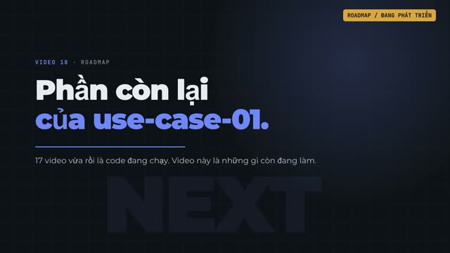</a></td>
<td>Những gì video 1–17 và 19–21 đã chạy thật (gồm HRM, STMS, SAML và SCIM) và những gì còn đang phát triển: multi-schema, Tier 1, streaming CDC, agent tự hành, audit hash-chain, mã hoá trường.<br><a target="_blank" rel="noopener noreferrer" href="https://media.zerohostcms.com/astra-cms/astra-video-18-roadmap-vi.mp4">▶ Xem video</a></td>
</tr>
</table>

Xây lại một nền tảng cỡ Frappe với sandbox ba tầng, giao dịch phân tán, multi-tenancy, engine tuân thủ và bề mặt AI là nhiều năm làm việc của một đội, và một repository không thể hoàn thành trong một năm. Vì vậy lộ trình có hai cách đọc. **Lát cắt mỏng** là thứ được xây và demo trước, đầu cuối. Mọi thứ sau đó được sắp thứ tự sao cho mỗi phase tự nó ship được thứ dùng được. Bảng tuân thủ là catalogue các **profile được bật dần theo thời gian**, không phải một deliverable duy nhất của Phase 5.

**Lát cắt mỏng (đã xong, xem "Chạy lát cắt mỏng ngay hôm nay"):** một app DocType-driven (CMS `Article`), tenancy bằng `ScopedValue` và row-level security với guard fail-closed, lưu trữ JSONB zero-DDL với REST sinh tự động, một hook Tier 0, chạy trên Docker Compose và cụm k3d cục bộ với hai kernel pod. Các bước tiếp theo, theo thứ tự: ledger `GL Entry` tối thiểu với hoá đơn submittable; spike Seata chứng minh AT trên PostgreSQL + TCC trên Redis trên virtual thread; một script Wasm Tier 2; một canary rollout qua hai pod; một MCP server mỏng cung cấp `doc.search / get / create`. Mỗi bước đều kèm benchmark công khai so với các mục tiêu ở trên.

* [ ] **Phase 1: Kiến trúc & SPI** (đang làm). Bản thiết kế (README này). Tiếp theo: khung Maven, `astra-spi` với các extension point, mô hình DocType và YAML schema **kèm thuộc tính tuân thủ**, manifest schema, mức trưởng thành, chính sách deprecation, `AGENTS.md` / `llms.txt`, `SECURITY.md`, khung catalogue control OSCAL.
* [ ] **Phase 2: Kernel, Plugin Host & lõi DocType Engine**. Registry với phiên bản chạy song song và ghim theo tenant; **lõi tenancy** (Tenant DocType, xác định tenant, ngữ cảnh `ScopedValue`, RLS, profile `shared-rls`, bulkhead); loader Tier 0/1/2 **có đếm lệnh cho Tier 2**; registry metadata DocType, lưu trữ JSONB, projection bằng expression index có quota, naming, link, child table, quyền, submittable lifecycle, phiên bản; **audit ledger chống giả mạo ngay từ lần ghi đầu tiên**; REST sinh tự động; **MCP server mỏng (`doc.search / get / create`)**; **spike Seata** (AT + TCC + virtual thread, quyết định go/no-go cho Phase 4); `astra-plugin-testkit`; pipeline build SLSA Level 3; benchmark công khai đầu tiên.
* [ ] **Phase 3: Control Plane & tương thích**. Registry, chữ ký, SBOM, chính sách provenance, phê duyệt bốn mắt cho production, canary rollout, pod join; shim `astra-compat`; conformance suite bao gồm overlay của tenant; data patch; chỉ số DORA.
* [ ] **Phase 4: Giao dịch, Ledger & Cache**. Extension Quarkus Seata (hoặc phương án dự phòng do spike Phase 2 chọn: transactional outbox cộng TCC idempotent không cần coordinator tập trung); lưu trữ `ledger` với expand/contract; projection materialised có job backfill; cache bus L1/L2; upcaster; API phiên bản theo ngày.
* [ ] **Phase 5: Gói tuân thủ & tenancy**. Danh tính (OIDC/SAML, MFA, SCIM theo tenant), rà soát truy cập, policy SoD, profile `database-per-tenant` và `cluster-per-tenant`, migrate tenant, tổ chức và policy chia sẻ, quota và đo đếm, `KeyProvider` với BYOK và mã hoá cấp field, `ResidencyPolicy` và profile region (eu, us, vn, sg), privacy engine (RoPA theo phân loại dữ liệu, DSAR, đồng ý, retention, crypto-shredding, workflow xử lý vi phạm), `AuditSink` ra SIEM và nền tảng tuân thủ, CLI xuất bằng chứng, công bố ánh xạ control SOC 2 / ISO 27001 / GDPR / PDPL.
* [ ] **Phase 6: Desk, Overlay, Workflow, Report, Print**. UI sinh tự động đạt WCAG 2.2 AA, overlay kèm client script, workflow engine, report builder, query report và script report, print/PDF, notification.
* [ ] **Phase 7: Bề mặt AI & quản trị AI**. Chiếu DocType và tool qua MCP, LLM gateway có che PII và ghim region, agent runtime có ngân sách và cổng phê duyệt của con người, prompt registry, kiểm kê AI và thông báo minh bạch, `astra mcp --dev`.
* [ ] **Phase 8: Kubernetes, Observability & khả năng chống chịu**. Helm cứng hoá theo CIS, rollout CRD/Operator, Seata Raft StatefulSet, OpenTelemetry và Prometheus theo từng app và agent, job bằng chứng backup/restore, kiểm thử failover, pentest bên thứ ba cho bản triển khai tham chiếu.
* [ ] **Phase 9: Astra CMS**. Các app content, media, publishing được lắp vào `apps/astra-cms`; Admin Studio trên Desk.
* [ ] **Phase 10: Astra ERP**. `erp.core`, `erp.accounts` (GL), `erp.stock` (SLE), sau đó selling, buying, manufacturing, hr, projects, crm, assets; bằng chứng SOX ITGC; bản địa hoá Việt Nam (hoá đơn điện tử, VAT, hồ sơ PDPL) làm app Tier 1 tham chiếu; marketplace có ký số.

---

## Đóng góp

Những đóng góp hữu ích nhất lúc này là phản biện mô hình DocType (chiến lược lưu trữ, overlay, submittable lifecycle), hợp đồng tương thích, mô hình ba tầng và ranh giới các module ERP. Cũng hữu ích: prior art và benchmark về Seata với Quarkus, sandbox Chicory, JSONB projection ở quy mô lớn, phân vùng ledger và các pattern MCP server, cùng các use case ERP và back-office thực tế chịu áp lực thay đổi liên tục.

**Người đóng góp không được sao chép code, schema, fixture hay UI asset từ ERPNext (GPL-3.0) hoặc bất kỳ dự án GPL nào.** Có thể tham chiếu khái niệm của Frappe; mọi cài đặt phải là nguyên bản.

Vấn đề bảo mật đi qua quy trình công bố có phối hợp trong `SECURITY.md` (có cùng khung Phase 1), không bao giờ qua issue công khai.

`CONTRIBUTING.md`, hướng dẫn build và quy tắc ứng xử sẽ có cùng khung Phase 1.

---

## Giấy phép

Phát hành theo **MIT License**. Xem [LICENSE](LICENSE).
