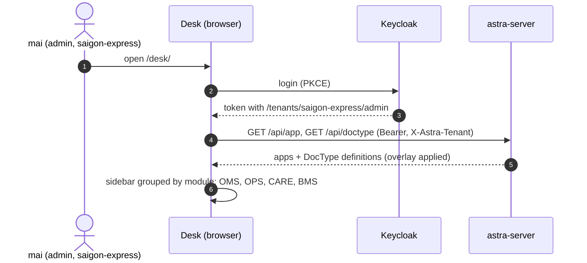

# Video 1 · What is Astra & running it locally

<a href="https://media.zerohostcms.com/astra-cms/astra-video-1-quickstart-en.mp4"></a>

▶ [English](https://media.zerohostcms.com/astra-cms/astra-video-1-quickstart-en.mp4) · [Tiếng Việt](https://media.zerohostcms.com/astra-cms/astra-video-1-quickstart-vi.mp4) · 2:32 · Script: [demo-video-series.en.md](../demo-video-series.en.md#video-1-what-astra-is--running-it-in-5-minutes)

> **In one sentence:** Astra is a metadata-driven business kernel; five commands give you a real Kubernetes cluster on a laptop, two seeded courier companies and a Desk generated from the DocTypes the apps contribute.
> **Read this if:** you want to run the whole stack locally and know what each pod is for (developer angle) / you want to know what is actually running today, what it costs to operate, and where the line between built and designed sits (tech-lead angle).

## The problem

Astra Express is a courier company with two branches run as separate businesses: `saigon-express` and
`hanoi-express`. It takes orders (OMS), moves parcels (OPS), answers customer calls (CARE) and collects
cash on delivery (BMS). Each of those is usually a separate product with its own database, login and
integration code. Every new branch or rule turns into a project: a new schema, a new service, a new
deployment.

The usual answer to "show me it works" is a slide deck or a single-container toy that hides the hard
parts: tenancy, identity, transactions across stores, and more than one application server. Teams then
find out in production that their naming counter collides across pods or that tenant isolation was a
`WHERE` clause someone forgot.

Frappe/ERPNext solved the first half of this with one idea: the application is metadata. A DocType
describes a business record, and the forms, API and permissions come from it. Astra keeps that idea,
rebuilt in Java 25 on Quarkus, and adds the constraints a cluster brings
([explain.en.md](../explain.en.md)). Video 1 exists to show that the starting point is a real cluster,
not a toy: two kernel pods from the first command, so tenancy and naming series have to be cluster-safe
from day one.

## What the video shows

| Scene | What you see | What it proves |
| --- | --- | --- |
| Architecture | The README diagram: kernel, DocType Engine, Plugin Host | Apps plug in through metadata; the narration separates what runs from what is design |
| Prerequisites | JDK 25, Docker Desktop, `kubectl`, `k3d`, `jq`, Bash 5; Rust only for Wasm | The toolchain is ordinary; no proprietary installer |
| `make k3d-up` | Real output, sped up; the cluster already existed, so it rebuilt three images and redeployed every pod in 1 minute 29 seconds | One command builds and deploys the whole stack |
| `kubectl -n astra get pods` | Seven pods, all `Running` | Two kernel pods behind one Service, plus PostgreSQL, Redis, Keycloak, Seata and the Rust CDC worker |
| `make demo-seed` | Two courier companies loaded | All data goes through the REST API with Keycloak logins; hooks, lifecycle, ledger and overlays run during the load; no SQL |
| Scene 1 of `demo-express` | `/api/app` and `/api/doctype` | At recording time: one server, two apps, eight DocTypes across OMS, OPS, CARE, BMS and CMS |
| Desk | Login as `mai`, Installed apps, left menu | The menu is generated from the DocTypes the app contributes |


*Figure 2: Five commands from laptop to Desk.*

## How it works

### One server, apps compiled in

An app is a CDI bean that implements the `AstraApp` SPI and lists its DocType YAML files. It depends
only on `astra-spi`, never on kernel internals.

*`astra-spi/src/main/java/io/astra/spi/app/AstraApp.java`*

```java
public interface AstraApp {

    /** Stable, reverse-DNS style identifier, e.g. {@code io.astra.cms}. */
    String id();

    /** Semantic version of this app build. */
    String version();

    /**
     * Classpath resource paths of DocType definitions (YAML) this app contributes,
     * e.g. {@code META-INF/astra/doctypes/article.doctype.yaml}. Explicit listing keeps
     * loading deterministic inside jars and native images.
     */
    List<String> doctypeResources();
}
```

*`astra-apps/express/src/main/java/io/astra/apps/express/ExpressApp.java`*

```java
@ApplicationScoped
public class ExpressApp implements AstraApp {

    @Override
    public String id() { return "io.astra.express"; }

    @Override
    public String version() { return "0.1.0"; }

    @Override
    public List<String> doctypeResources() {
        return List.of(
                "META-INF/astra/doctypes/customer.doctype.yaml",
                "META-INF/astra/doctypes/customer-order.doctype.yaml",
                // …
                "META-INF/astra/doctypes/pricing-rule.doctype.yaml");
    }
}
```

The server module depends on each app module, so the apps are compiled into one image. That is what the
API reports as tier `0 (shared, build-time)`:

*`astra-doctype/src/main/java/io/astra/doctype/api/AppResource.java`*

```java
    @GET
    public List<Map<String, Object>> list() {
        return apps.apps().stream().map(app -> {
            Map<String, Object> m = new LinkedHashMap<>();
            m.put("id", app.id());
            m.put("version", app.version());
            m.put("tier", "0 (shared, build-time)");
            m.put("doctypes", registry.namesByApp(app.id()));
            return m;
        }).toList();
    }
```

Why explicit resource lists instead of classpath scanning: the javadoc says it keeps loading
deterministic inside jars and native images. You always know which DocTypes an app brings by reading one
method.


*Figure 3: An app is metadata plus code, compiled in.*

### What `make k3d-up` actually does

The Makefile target calls [`scripts/k3d-up.sh`](../../scripts/k3d-up.sh). It creates or reuses the k3d
cluster `astra`, builds the Maven modules, builds three images (server, Keycloak with the Astra theme,
Rust CDC worker), imports them into k3d, applies `deploy/k8s/base`, prepares the database with
`scripts/db-setup.sh`, syncs the Keycloak realm, and restarts the deployments so a re-imported image with
the same tag is picked up.

```mermaid
flowchart LR
    dev["make k3d-up"] --> mvn["./mvnw package"]
    mvn --> img["docker build<br/>astra/server · astra/keycloak · astra/cdc"]
    img --> imp["k3d image import"]
    imp --> k8s["kubectl apply -k deploy/k8s/base"]
    k8s --> db["scripts/db-setup.sh k3d<br/>BMS schema, CDC role"]
    db --> kc["keycloak-sync-realm.sh"]
    kc --> srv["rollout astra-server (2 pods)"]
    srv --> pub["db-setup.sh k3d again<br/>CDC publication"]
    pub --> cdc["rollout astra-cdc"]
```



The CDC publication is created after the server has started because the server's Flyway migrations
create the tables the publication covers; the script comments say so directly
(`# now the CDC publication, on the migrated schema`).

### Seven pods, and why two of them are the kernel

*`deploy/k8s/base/astra-server.yaml`*

```yaml
  replicas: 2                     # two pods from the start: tenancy and naming series must be cluster-safe
```

Every other workload in `deploy/k8s/base` (PostgreSQL, Redis, Keycloak, Seata, CDC) runs one replica, which
gives the seven pods in the video. Starting with two kernel pods is a deliberate test condition: a
counter kept in memory, or a cache that assumes one writer, breaks immediately. The naming series is
stored in PostgreSQL per tenant (`astra_series`), which is why order numbers stay unique across pods
(Video 10 proves it under load).

| Pod | Role in the demo |
| --- | --- |
| `astra-server` ×2 | Quarkus kernel: REST, Desk, MCP, hooks, DocType engine |
| `postgres-0` | `astra_doc`, ledger, BMS schema, replicas; `wal_level=logical` for CDC |
| `redis` | TCC pickup capacity (Video 17) |
| `keycloak` | OIDC login, per-tenant roles as groups (Video 11) |
| `seata-server` | Global transaction coordinator (Video 17) |
| `astra-cdc` | Rust worker decoding `pgoutput` into replica tables (Video 16) |


*Figure 1: The seven pods and who talks to whom.*

### Seeding through the front door

[`scripts/demo-seed.sh`](../../scripts/demo-seed.sh) signs in through Keycloak as the `demo` user and
creates everything with HTTP calls. Nothing is inserted with SQL:

*`scripts/demo-seed.sh`*

```bash
customer() { call "$1" POST /api/doc/Customer "$2" >/dev/null; echo "  customer $(jq -r .code <<<"$2")"; }
order()    { call "$1" POST /api/doc/CustomerOrder "$2" | jq -r .name; }
submit()   { call "$1" POST "/api/doc/CustomerOrder/$2/submit" | jq -r .data.waybill; }
scan()     { call "$1" PUT "/api/doc/Waybill/$2" "$3" >/dev/null; }
```

Why this matters: seed data that bypasses the API also bypasses validation, hooks, permissions and the
ledger. Seeding through the API means the demo data was produced by the same rules a user hits, so a
fee or a journal entry you see in Desk was computed, not typed in.

### Desk knows nothing in advance

Desk is a static page served by the kernel (`astra-server/src/main/resources/META-INF/resources/desk/`).
After login it asks `/api/doctype` for the tenant's effective DocTypes and builds the left menu by
module. Video 2 covers the form renderer; the point for Video 1 is that installing an app is enough for
its DocTypes to show up.



## Real-world example

*Illustrative scenario: the company, people and values are made up; the mechanism and the rules it applies are the real ones shown above.*

A regional third-party logistics company in Vietnam runs two legal entities, one in Hanoi and one in Ho
Chi Minh City, and its CTO wants a proof of concept before committing a team. The question is narrow:
can one platform serve both entities with separate data, real logins and the company's own order rules?

Inputs:

- A laptop with Docker Desktop given 8 GB of RAM, JDK 25, `kubectl`, `k3d`, `jq`, Bash 5.
- The repository, unchanged.

What Astra does, in order:

1. `make k3d-up` builds and deploys seven pods.
2. `make demo-seed` creates the two tenants' data through the API. In `saigon-express` it creates, among
   others, customer `C001` "Shop Hoa Mai" (segment B2B, credit limit 2,000,000 ₫) and posts orders that
   are priced by the shipping-fee hook and, when submitted, create waybills and ledger entries.
3. Signing in as `mai` (admin) shows only `saigon-express`; `nam` (admin) sees only `hanoi-express`.

Outputs the CTO can check in about half an hour:

- `kubectl -n astra get pods`: two `astra-server` pods plus the five infrastructure pods.
- `GET /api/app`: the apps compiled into the image and their DocTypes.
- Desk at `http://localhost:8080/desk/`: orders, operations, customer care and accounting menus,
  generated from metadata.

What the proof of concept does not answer, and should not be stretched to answer: throughput, upgrade
behaviour, or production hardening. Those need their own tests.

## For technical leaders

- **What you are evaluating.** A thin slice that runs end to end: DocType engine, hooks, lifecycle,
  ledger, overlays, Wasm sandbox, MCP, CDC, Seata, Keycloak, two kernel pods. The README's
  [Project Status](../../README.md#project-status) is the authority on what runs; the rest of the README
  is target architecture.
- **Operational footprint.** Seven pods for one demo environment, with Keycloak, Seata and a CDC worker
  each being a system to patch and monitor. If you do not need distributed transactions or a read replica,
  that is cost without benefit; the kernel uses Seata only when a DocType declares `transaction: global`
  and a coordinator is available.
- **Build-time apps.** Every app today is Tier 0: compiled into the image. Adding or changing an app means
  a new image and a rollout. Runtime loading (Tier 1 isolated JVM) and versioned side-by-side apps are
  roadmap.
- **What to measure in a pilot.** Time from `git clone` to a working Desk on a clean machine; time for a
  developer to add one DocType and one hook (Videos 2, 3, 9); whether your security team accepts row-level
  security as the tenant boundary (Videos 7, 8).
- **When not to use it.** If you need a finished ERP today, ERPNext is a mature product and Astra is not.
  If one tenant and one database are enough, a conventional Spring or Quarkus service is simpler to run.
- **Compared with Frappe/ERPNext.** Same core idea (DocType as metadata, apps, submittable documents).
  Different storage (one JSONB table, no DDL per field), Java 25 virtual threads instead of Python
  workers, and row-level security instead of one database per site. Astra is clean-room: no code, schema
  or assets from either project.

## Try it yourself

Prerequisites: JDK 25, Docker Desktop with about 8 GB of RAM allocated, `kubectl`, `k3d`, `jq` and Bash 5
(`brew install bash` on macOS; the scripts re-run themselves under Bash 5 if the default shell is 3.2).
Rust is only needed to change the Wasm modules or the CDC worker locally.

```bash
make k3d-up                                # cluster, images, deploy, wait
kubectl -n astra get pods                  # expect 7 pods Running: astra-server x2, postgres-0, redis, keycloak, seata-server, astra-cdc
make demo-seed                             # seed saigon-express and hanoi-express through the REST API
make demo-express SCENES=1 PAUSE=0         # /q/health/ready, /api/app, /api/doctype
open http://localhost:8080/desk/           # log in as mai / Astra@123
```

Expected output of the scene (abridged):

```text
━━━ Scene 1 · One server, many apps ━━━
$ curl -X GET http://localhost:8080/q/health/ready …
HTTP 200
"UP"
$ curl -X GET http://localhost:8080/api/app …
HTTP 200
[ { "id": "io.astra.express", "version": "0.1.0", "tier": "0 (shared, build-time)", "doctypes": [ "Customer", "CustomerOrder", … ] }, … ]
```

To run it again from a clean state, `make demo-reset && make demo-seed`. `scripts/demo-reset.sh` targets
the k3d database when its PostgreSQL pod exists and Docker Compose otherwise; it uses the local bootstrap
superuser, so never point it at real data. `make k3d-down` deletes the cluster.

## To be accurate

- **Counts in the video reflect the recording.** The video shows two apps and eight DocTypes (Express and
  CMS). The current server image also bundles the HRM and STMS apps, so `/api/app` now returns four apps
  and `/api/doctype` returns more DocTypes.
- **The 1 minute 29 seconds** was a rebuild on a machine where the cluster already existed. A first run
  also pulls base images and creates the cluster, and takes longer.
- **Tier 0 only for compiled apps.** Tier 2 Wasm runs (Video 14). Tier 1 isolated JVM loading, versioned
  apps side by side, canary rollout and automatic rollback are roadmap, marked ○ or ◐ in the README.
- **Desk is a demo UI** generated from metadata: list, form, lifecycle, ledger, replica and overlay views.
  Dashboards, reports and the full Desk are not built.
- **k3d is a local cluster.** The manifests in `deploy/k8s/base` are not a production deployment: no
  managed database, no backups, no high availability for PostgreSQL or Keycloak.

## Figures

- [Figure 1 · The seven pods and who talks to whom](#seven-pods-and-why-two-of-them-are-the-kernel)
- [Figure 2 · Five commands from laptop to Desk](#what-the-video-shows)
- [Figure 3 · An app is metadata plus code, compiled in](#one-server-apps-compiled-in)

## Related

- Next: [Video 2 · DocType: from one YAML file to API, UI and indexes](./02-doctype.md)
- Then: [Video 3 · Business rules: hooks & validation](./03-hooks.md)
- Script and recording setup: [demo-video-series.en.md](../demo-video-series.en.md)
- Why the design looks like this: [explain.en.md](../explain.en.md)
- What runs today: [README Project Status](../../README.md#project-status)
- Source: [`scripts/k3d-up.sh`](../../scripts/k3d-up.sh), [`scripts/demo-seed.sh`](../../scripts/demo-seed.sh),
  [`scripts/demo-express.sh`](../../scripts/demo-express.sh), [`deploy/k8s/base`](../../deploy/k8s/base),
  [`AstraApp.java`](../../astra-spi/src/main/java/io/astra/spi/app/AstraApp.java),
  [`AppResource.java`](../../astra-doctype/src/main/java/io/astra/doctype/api/AppResource.java)
