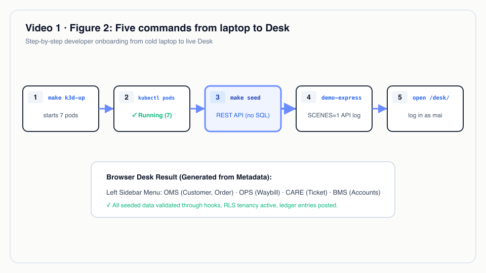
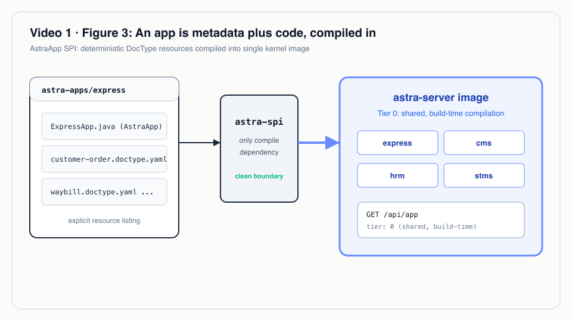
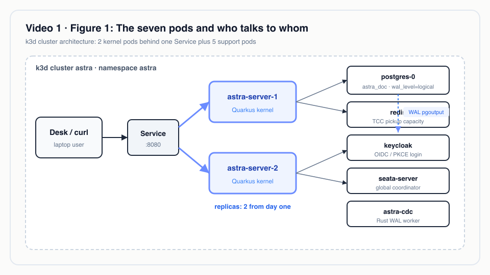
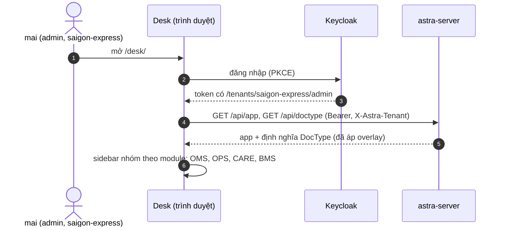

# Video 1 · Astra là gì & chạy trong 5 phút

<a href="https://media.zerohostcms.com/astra-cms/astra-video-1-quickstart-vi.mp4"></a>

▶ [Tiếng Việt](https://media.zerohostcms.com/astra-cms/astra-video-1-quickstart-vi.mp4) · [English](https://media.zerohostcms.com/astra-cms/astra-video-1-quickstart-en.mp4) · 2:32 · Kịch bản: [demo-video-series.md](../demo-video-series.md#video-1-astra-là-gì--chạy-trong-5-phút) · [Bản tiếng Anh](./01-quickstart.md)

> **Tóm tắt một câu:** Astra là một kernel nghiệp vụ hướng metadata; năm lệnh là bạn có một cụm Kubernetes thật trên laptop, hai công ty chuyển phát đã nạp sẵn dữ liệu và một Desk sinh ra từ các DocType mà các app đóng góp.
> **Nên đọc nếu:** bạn muốn chạy toàn bộ stack trên máy và biết mỗi pod để làm gì (góc nhìn developer) / bạn muốn biết thứ gì thực sự đang chạy hôm nay, vận hành tốn bao nhiêu, và ranh giới giữa phần đã làm và phần mới thiết kế nằm ở đâu (góc nhìn tech lead).

## Vấn đề

Astra Express là một công ty chuyển phát có hai chi nhánh hoạt động như hai doanh nghiệp riêng:
`saigon-express` và `hanoi-express`. Công ty nhận đơn (OMS), vận chuyển bưu kiện (OPS), trả lời cuộc gọi
của khách (CARE) và thu tiền hộ khi giao hàng (BMS). Mỗi mảng đó thường là một sản phẩm riêng, có
database, đăng nhập và code tích hợp riêng. Mỗi chi nhánh mới hay quy tắc mới lại thành một dự án: một
schema mới, một service mới, một lần triển khai mới.

Câu trả lời quen thuộc cho yêu cầu "cho tôi xem nó chạy" là một bộ slide, hoặc một bản đồ chơi chạy trong
một container, giấu đi những phần khó: đa thuê bao, danh tính, giao dịch trải trên nhiều kho dữ liệu, và
nhiều hơn một application server. Rồi các đội phát hiện ra trên production rằng bộ đếm đánh số bị trùng
giữa các pod, hoặc cách ly tenant chỉ là một mệnh đề `WHERE` mà ai đó quên viết.

Frappe/ERPNext đã giải quyết nửa đầu của bài toán bằng một ý tưởng: ứng dụng chính là metadata. Một
DocType mô tả một bản ghi nghiệp vụ, còn form, API và phân quyền sinh ra từ nó. Astra giữ ý tưởng đó, viết
lại bằng Java 25 trên Quarkus, và thêm những ràng buộc mà một cụm máy đặt ra
([explain.md](../explain.md)). Video 1 có mặt để cho thấy điểm xuất phát là một cụm thật, không phải đồ
chơi: hai pod kernel ngay từ lệnh đầu tiên, nên đa thuê bao và naming series phải an toàn trên cụm từ
ngày đầu.

## Video cho thấy gì

| Cảnh | Bạn thấy gì | Điều đó chứng minh |
| --- | --- | --- |
| Kiến trúc | Sơ đồ trong README: kernel, DocType Engine, Plugin Host | App cắm vào qua metadata; lời thuyết minh tách rõ phần đang chạy và phần thiết kế |
| Điều kiện cần | JDK 25, Docker Desktop, `kubectl`, `k3d`, `jq`, Bash 5; Rust chỉ cần cho Wasm | Bộ công cụ bình thường, không có trình cài đặt độc quyền |
| `make k3d-up` | Output thật, tua nhanh; cụm đã có sẵn nên lệnh build lại ba image và triển khai lại mọi pod trong 1 phút 29 giây | Một lệnh build và triển khai cả stack |
| `kubectl -n astra get pods` | Bảy pod, tất cả `Running` | Hai pod kernel sau một Service, cùng PostgreSQL, Redis, Keycloak, Seata và worker CDC viết bằng Rust |
| `make demo-seed` | Nạp dữ liệu hai công ty chuyển phát | Mọi dữ liệu đi qua REST API với đăng nhập Keycloak; hook, vòng đời, sổ cái và overlay đều chạy trong lúc nạp; không có SQL |
| Cảnh 1 của `demo-express` | `/api/app` và `/api/doctype` | Tại thời điểm quay: một server, hai app, tám DocType thuộc OMS, OPS, CARE, BMS và CMS |
| Desk | Đăng nhập bằng `mai`, Installed apps, menu bên trái | Menu sinh ra từ các DocType mà app đóng góp |


*Năm lệnh từ laptop đến Desk.*

## Cách hoạt động

### Một server, app được biên dịch kèm

Một app là một CDI bean hiện thực SPI `AstraApp` và liệt kê các file YAML DocType của nó. App chỉ phụ
thuộc vào `astra-spi`, không bao giờ phụ thuộc vào phần bên trong của kernel.

*`astra-spi/src/main/java/io/astra/spi/app/AstraApp.java`*

```java
public interface AstraApp {

    /** Stable, reverse-DNS style identifier, e.g. {@code io.astra.cms}. */
    String id();

    /** Semantic version of this app build. */
    String version();

    /**
     * Classpath resource paths of DocType definitions (YAML) this app contributes,
     * e.g. {@code META-INF/astra/doctypes/article.doctype.yaml}. Explicit listing keeps
     * loading deterministic inside jars and native images.
     */
    List<String> doctypeResources();
}
```

*`astra-apps/express/src/main/java/io/astra/apps/express/ExpressApp.java`*

```java
@ApplicationScoped
public class ExpressApp implements AstraApp {

    @Override
    public String id() { return "io.astra.express"; }

    @Override
    public String version() { return "0.1.0"; }

    @Override
    public List<String> doctypeResources() {
        return List.of(
                "META-INF/astra/doctypes/customer.doctype.yaml",
                "META-INF/astra/doctypes/customer-order.doctype.yaml",
                // …
                "META-INF/astra/doctypes/pricing-rule.doctype.yaml");
    }
}
```

Module server phụ thuộc vào từng module app, nên các app được biên dịch vào cùng một image. Đó là lý do
API báo tier `0 (shared, build-time)`:

*`astra-doctype/src/main/java/io/astra/doctype/api/AppResource.java`*

```java
    @GET
    public List<Map<String, Object>> list() {
        return apps.apps().stream().map(app -> {
            Map<String, Object> m = new LinkedHashMap<>();
            m.put("id", app.id());
            m.put("version", app.version());
            m.put("tier", "0 (shared, build-time)");
            m.put("doctypes", registry.namesByApp(app.id()));
            return m;
        }).toList();
    }
```

Vì sao liệt kê resource tường minh thay vì quét classpath: javadoc nói rằng cách này giữ việc nạp ổn định,
có thể đoán trước, bên trong file jar và native image. Chỉ cần đọc một method là bạn biết app mang theo
những DocType nào.


*Một app là metadata cộng code, biên dịch kèm.*

### `make k3d-up` thực sự làm gì

Target trong Makefile gọi [`scripts/k3d-up.sh`](../../scripts/k3d-up.sh). Script tạo mới hoặc dùng lại
cụm k3d `astra`, build các module Maven, build ba image (server, Keycloak kèm theme Astra, worker CDC
Rust), import chúng vào k3d, apply `deploy/k8s/base`, chuẩn bị database bằng `scripts/db-setup.sh`, đồng
bộ realm Keycloak, rồi khởi động lại các deployment để image được import lại với cùng tag được nhận.

```mermaid
flowchart LR
    dev["make k3d-up"] --> mvn["./mvnw package"]
    mvn --> img["docker build<br/>astra/server · astra/keycloak · astra/cdc"]
    img --> imp["k3d image import"]
    imp --> k8s["kubectl apply -k deploy/k8s/base"]
    k8s --> db["scripts/db-setup.sh k3d<br/>schema BMS, role CDC"]
    db --> kc["keycloak-sync-realm.sh"]
    kc --> srv["rollout astra-server (2 pod)"]
    srv --> pub["db-setup.sh k3d lần nữa<br/>publication CDC"]
    pub --> cdc["rollout astra-cdc"]
```



Publication CDC được tạo sau khi server đã khởi động, vì các migration Flyway của server tạo ra những bảng
mà publication bao phủ; comment trong script nói thẳng điều này
(`# now the CDC publication, on the migrated schema`).

### Bảy pod, và vì sao hai trong số đó là kernel

*`deploy/k8s/base/astra-server.yaml`*

```yaml
  replicas: 2                     # two pods from the start: tenancy and naming series must be cluster-safe
```

Mọi workload khác trong `deploy/k8s/base` (PostgreSQL, Redis, Keycloak, Seata, CDC) chạy một replica,
cộng lại thành bảy pod như trong video. Khởi đầu với hai pod kernel là một điều kiện kiểm thử có chủ ý:
một bộ đếm giữ trong bộ nhớ, hay một cache giả định chỉ có một bên ghi, sẽ hỏng ngay. Naming series được
lưu trong PostgreSQL theo từng tenant (`astra_series`), nhờ vậy số đơn hàng luôn duy nhất giữa các pod
(Video 10 chứng minh điều này khi chịu tải).

| Pod | Vai trò trong demo |
| --- | --- |
| `astra-server` ×2 | Kernel Quarkus: REST, Desk, MCP, hook, DocType engine |
| `postgres-0` | `astra_doc`, sổ cái, schema BMS, bảng replica; `wal_level=logical` cho CDC |
| `redis` | Năng lực lấy hàng TCC (Video 17) |
| `keycloak` | Đăng nhập OIDC, role theo tenant dưới dạng group (Video 11) |
| `seata-server` | Bộ điều phối giao dịch toàn cục (Video 17) |
| `astra-cdc` | Worker Rust giải mã `pgoutput` vào các bảng replica (Video 16) |


*Bảy pod và ai nói chuyện với ai.*

### Nạp dữ liệu qua cửa chính

[`scripts/demo-seed.sh`](../../scripts/demo-seed.sh) đăng nhập qua Keycloak bằng user `demo` và tạo mọi
thứ bằng lời gọi HTTP. Không có gì được chèn bằng SQL:

*`scripts/demo-seed.sh`*

```bash
customer() { call "$1" POST /api/doc/Customer "$2" >/dev/null; echo "  customer $(jq -r .code <<<"$2")"; }
order()    { call "$1" POST /api/doc/CustomerOrder "$2" | jq -r .name; }
submit()   { call "$1" POST "/api/doc/CustomerOrder/$2/submit" | jq -r .data.waybill; }
scan()     { call "$1" PUT "/api/doc/Waybill/$2" "$3" >/dev/null; }
```

Vì sao điều này quan trọng: dữ liệu mẫu đi vòng qua API cũng đi vòng qua validation, hook, phân quyền và
sổ cái. Nạp qua API nghĩa là dữ liệu demo được tạo ra bởi chính những quy tắc mà người dùng gặp, nên một
khoản cước hay một bút toán bạn thấy trong Desk là do hệ thống tính, không phải gõ tay vào.

### Desk không biết trước điều gì

Desk là một trang tĩnh do kernel phục vụ (`astra-server/src/main/resources/META-INF/resources/desk/`).
Sau khi đăng nhập, Desk hỏi `/api/doctype` để lấy các DocType hiệu lực của tenant và dựng menu bên trái
theo module. Video 2 nói về bộ dựng form; điều Video 1 muốn nhấn mạnh là chỉ cần cài app là các DocType
của nó xuất hiện.



## Ví dụ thực tế

*Tình huống minh hoạ: công ty, con người và các con số là hư cấu; cơ chế và các quy tắc nó áp dụng là thật, như đã trình bày ở trên.*

Một công ty logistics bên thứ ba cấp vùng ở Việt Nam vận hành hai pháp nhân, một ở Hà Nội và một ở TP.
Hồ Chí Minh, và CTO muốn có một proof of concept trước khi cam kết đầu tư một đội. Câu hỏi rất hẹp: một
nền tảng có phục vụ được cả hai pháp nhân với dữ liệu tách biệt, đăng nhập thật và quy tắc đơn hàng riêng
của công ty hay không?

Đầu vào:

- Một laptop có Docker Desktop được cấp 8 GB RAM, JDK 25, `kubectl`, `k3d`, `jq`, Bash 5.
- Repository, giữ nguyên không sửa.

Astra làm gì, theo thứ tự:

1. `make k3d-up` build và triển khai bảy pod.
2. `make demo-seed` tạo dữ liệu của hai tenant qua API. Trong `saigon-express`, script tạo, cùng nhiều
   thứ khác, khách hàng `C001` "Shop Hoa Mai" (phân khúc B2B, hạn mức tín dụng 2.000.000 ₫) và tạo các
   đơn hàng được hook tính cước định giá, và khi Submit thì sinh vận đơn cùng bút toán sổ cái.
3. Đăng nhập bằng `mai` (admin) chỉ thấy `saigon-express`; `nam` (admin) chỉ thấy `hanoi-express`.

Kết quả CTO có thể kiểm tra trong khoảng nửa giờ:

- `kubectl -n astra get pods`: hai pod `astra-server` cộng năm pod hạ tầng.
- `GET /api/app`: các app được biên dịch vào image và DocType của chúng.
- Desk tại `http://localhost:8080/desk/`: các menu đơn hàng, vận hành, chăm sóc khách hàng và kế toán,
  sinh ra từ metadata.

Những gì proof of concept này không trả lời, và không nên bị kéo giãn để trả lời: thông lượng, hành vi
khi nâng cấp, hay mức độ sẵn sàng cho production. Những điều đó cần bài kiểm thử riêng.

## Dành cho tech lead

- **Bạn đang đánh giá cái gì.** Một lát cắt mỏng chạy từ đầu đến cuối: DocType engine, hook, vòng đời,
  sổ cái, overlay, sandbox Wasm, MCP, CDC, Seata, Keycloak, hai pod kernel. Mục
  [Trạng thái dự án](../../README.vi.md#trạng-thái-dự-án) trong README là nguồn chuẩn về thứ đang chạy;
  phần còn lại của README là kiến trúc mục tiêu.
- **Chi phí vận hành.** Bảy pod cho một môi trường demo, trong đó Keycloak, Seata và worker CDC mỗi thứ
  là một hệ thống phải vá và giám sát. Nếu bạn không cần giao dịch phân tán hay bản replica để đọc, đó là
  chi phí không đem lại lợi ích; kernel chỉ dùng Seata khi một DocType khai báo `transaction: global` và
  có sẵn bộ điều phối.
- **App build-time.** Mọi app hiện nay đều là Tier 0: biên dịch vào image. Thêm hay sửa một app nghĩa là
  một image mới và một lần rollout. Nạp lúc chạy (Tier 1, JVM cô lập) và chạy song song nhiều phiên bản
  app nằm trong lộ trình.
- **Đo gì trong một đợt thí điểm.** Thời gian từ `git clone` đến một Desk chạy được trên máy sạch; thời
  gian để một developer thêm một DocType và một hook (Video 2, 3, 9); đội bảo mật của bạn có chấp nhận
  row-level security làm ranh giới tenant hay không (Video 7, 8).
- **Khi nào không nên dùng.** Nếu bạn cần một ERP hoàn chỉnh ngay hôm nay, ERPNext là sản phẩm trưởng
  thành còn Astra thì chưa. Nếu một tenant và một database là đủ, một service Spring hoặc Quarkus thông
  thường sẽ đơn giản hơn để vận hành.
- **So với Frappe/ERPNext.** Cùng ý tưởng cốt lõi (DocType là metadata, app, chứng từ có thể Submit).
  Khác ở lưu trữ (một bảng JSONB, không có DDL cho mỗi field), virtual thread của Java 25 thay cho worker
  Python, và row-level security thay cho mỗi site một database. Astra viết theo kiểu clean-room: không có
  code, schema hay asset nào lấy từ hai dự án đó.

## Tự chạy thử

Điều kiện cần: JDK 25, Docker Desktop được cấp khoảng 8 GB RAM, `kubectl`, `k3d`, `jq` và Bash 5
(`brew install bash` trên macOS; nếu shell mặc định là 3.2, các script tự chạy lại dưới Bash 5). Rust chỉ
cần khi bạn muốn sửa các module Wasm hoặc worker CDC trên máy.

```bash
make k3d-up                                # cluster, images, deploy, wait
kubectl -n astra get pods                  # expect 7 pods Running: astra-server x2, postgres-0, redis, keycloak, seata-server, astra-cdc
make demo-seed                             # seed saigon-express and hanoi-express through the REST API
make demo-express SCENES=1 PAUSE=0         # /q/health/ready, /api/app, /api/doctype
open http://localhost:8080/desk/           # log in as mai / Astra@123
```

Output mong đợi của cảnh (rút gọn):

```text
━━━ Scene 1 · One server, many apps ━━━
$ curl -X GET http://localhost:8080/q/health/ready …
HTTP 200
"UP"
$ curl -X GET http://localhost:8080/api/app …
HTTP 200
[ { "id": "io.astra.express", "version": "0.1.0", "tier": "0 (shared, build-time)", "doctypes": [ "Customer", "CustomerOrder", … ] }, … ]
```

Để chạy lại từ trạng thái sạch, dùng `make demo-reset && make demo-seed`. `scripts/demo-reset.sh` nhắm
vào database của k3d khi có pod PostgreSQL, ngược lại thì nhắm vào Docker Compose; script dùng superuser
bootstrap cục bộ, nên tuyệt đối không trỏ nó vào dữ liệu thật. `make k3d-down` xoá cụm.

## Nói đúng

- **Các con số trong video phản ánh lúc quay.** Video cho thấy hai app và tám DocType (Express và CMS).
  Image server hiện tại còn đóng gói thêm app HRM và STMS, nên `/api/app` giờ trả về bốn app và
  `/api/doctype` trả về nhiều DocType hơn.
- **Con số 1 phút 29 giây** là một lần build lại trên máy đã có sẵn cụm. Lần chạy đầu tiên còn phải kéo
  image nền và tạo cụm, nên mất lâu hơn.
- **Tier 0 chỉ dành cho app biên dịch kèm.** Tier 2 Wasm đã chạy (Video 14). Nạp JVM cô lập Tier 1, chạy
  song song nhiều phiên bản app, rollout canary và rollback tự động nằm trong lộ trình, được đánh dấu ○
  hoặc ◐ trong README.
- **Desk là giao diện demo** sinh ra từ metadata: các màn hình danh sách, form, vòng đời, sổ cái, replica
  và overlay. Dashboard, báo cáo và Desk đầy đủ chưa được xây.
- **k3d là cụm cục bộ.** Các manifest trong `deploy/k8s/base` không phải bản triển khai production: không
  có database được quản lý, không có backup, không có high availability cho PostgreSQL hay Keycloak.

## Hình minh hoạ

### Hình 1 · Bảy pod và ai nói chuyện với ai


### Hình 2 · Năm lệnh từ laptop đến Desk


### Hình 3 · Một app là metadata cộng code, biên dịch kèm


## Liên quan

- Tiếp theo: [Video 2 · DocType: từ một file YAML đến API, giao diện và index](./02-doctype.vi.md)
- Sau đó: [Video 3 · Quy tắc nghiệp vụ: hook & validation](./03-hooks.vi.md)
- Kịch bản và cách chuẩn bị quay: [demo-video-series.md](../demo-video-series.md)
- Vì sao thiết kế như vậy: [explain.md](../explain.md)
- Thứ đang chạy hôm nay: [Trạng thái dự án trong README](../../README.vi.md#trạng-thái-dự-án)
- Mã nguồn: [`scripts/k3d-up.sh`](../../scripts/k3d-up.sh), [`scripts/demo-seed.sh`](../../scripts/demo-seed.sh),
  [`scripts/demo-express.sh`](../../scripts/demo-express.sh), [`deploy/k8s/base`](../../deploy/k8s/base),
  [`AstraApp.java`](../../astra-spi/src/main/java/io/astra/spi/app/AstraApp.java),
  [`AppResource.java`](../../astra-doctype/src/main/java/io/astra/doctype/api/AppResource.java)
