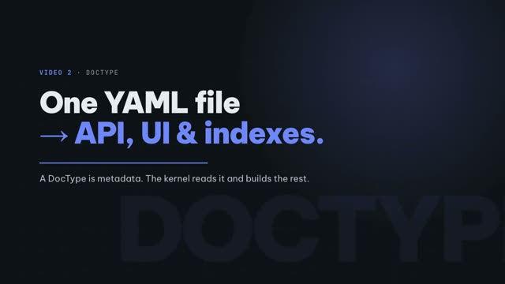
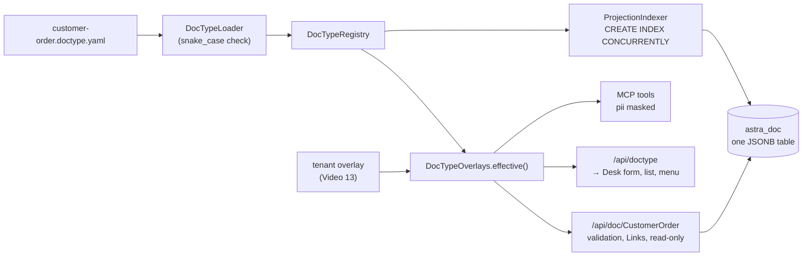

# Video 2 · DocType: from one YAML file to API, UI and indexes

<a href="https://media.zerohostcms.com/astra-cms/astra-video-2-doctype-en.mp4"></a>

▶ [English](https://media.zerohostcms.com/astra-cms/astra-video-2-doctype-en.mp4) · [Tiếng Việt](https://media.zerohostcms.com/astra-cms/astra-video-2-doctype-vi.mp4) · 2:38 · Script: [demo-video-series.en.md](../demo-video-series.en.md#video-2-doctype-from-one-yaml-file-to-api-ui-and-index)

> **In one sentence:** A DocType is one YAML file; from it the kernel serves a validated REST API, Desk builds the form and list, `projected` fields get online expression indexes, and every DocType is stored in one shared JSONB table with no `ALTER TABLE`.
> **Read this if:** you want to know exactly which YAML keys turn into which runtime behaviour (developer angle) / you need to judge the zero-DDL storage choice: what it buys, what it costs, and where it stops scaling (tech-lead angle).

## The problem

Astra Express needs a Customer Order record: who is sending, who receives, the zone, the service level,
weight, cash on delivery, and a fee nobody may type by hand. In a conventional stack that one record
means a migration, an entity class, a DTO, a controller, validation annotations, a form component, a
list page and a permission check. Six or seven artefacts have to agree about the same twelve fields, and
when the business adds a thirteenth, all of them change again, plus an `ALTER TABLE` on a table that is
being written to all day.

Frappe/ERPNext removed most of that duplication: the DocType is the single definition and the rest is
generated. It still creates one table per DocType and runs DDL when a Custom Field is added
([explain.en.md](../explain.en.md)). On a busy multi-tenant database, DDL means locks, deployment
windows, and one tenant's customisation touching every other tenant's table.

Astra keeps the DocType idea and changes the storage: business fields live in JSONB in one table, and
the only DDL a new indexed field ever causes is an online `CREATE INDEX CONCURRENTLY`.

## What the video shows

| Scene | What you see | What it proves |
| --- | --- | --- |
| YAML | `customer-order.doctype.yaml`: module, fields, Select, Link, read-only, `pii`, `submittable`, `transaction: global` | The whole definition of a business record fits in one file in the app |
| Derive | Bad Select values get 422; Links must point to records in the tenant; clients cannot write read-only fields; projected fields get an index | Behaviour comes from metadata, not per-DocType code |
| Desk metadata page | Field table for Customer Order | Built from the definition the API returns, with the tenant overlay already applied |
| Renderer | `desk.js` code | Each field type is a control; permissions decide whether Submit appears |
| Projections | Two valid indexes for Customer Order | Built at kernel startup with `CREATE INDEX CONCURRENTLY`, no write lock, no `ALTER TABLE` |
| `\d astra_doc` | One table, a GIN index, ten projection indexes at recording time, forced RLS, `astra_cdc` publication | Every DocType shares one JSONB table |

## How it works

### The definition

*`astra-apps/express/src/main/resources/META-INF/astra/doctypes/customer-order.doctype.yaml`*

```yaml
name: CustomerOrder
module: oms
kind: transaction
submittable: true                 # Draft (0) -> Submitted (1) -> Cancelled (2) -> Amend
transaction: global               # submit/cancel span BMS credit (Seata AT) and pickup capacity (Seata TCC)
naming: { series: "ORD-.YYYYMMDD.-.#####" }

fields:
  - { name: customer,         type: Link,     options: Customer, required: true, in-list: true, projected: true }
  - { name: receiver_name,    type: Data,     required: true, in-list: true, pii: true }
  - { name: receiver_phone,   type: Data,     required: true, pii: true }
  # …
  - { name: zone,             type: Select,   options: [Same city, Domestic, Remote], default: Domestic, in-list: true, projected: true }
  - { name: service,          type: Select,   options: [Standard, Express], default: Standard, in-list: true }
  - { name: weight_kg,        type: Float,    required: true, label: Weight (kg) }
  - { name: cod_amount,       type: Currency, default: 0, label: COD amount }
  - { name: shipping_fee,     type: Currency, read-only: true, in-list: true }   # computed by ShippingFeeHook
  # …

permissions:
  - { role: admin,      read: true, create: true, write: true, submit: true, cancel: true }
  - { role: sales,      read: true, create: true, write: true, if-owner: true, submit: true }
  # …
```

The loader parses each field into an immutable `FieldDefinition` and rejects anything that is not a
snake_case identifier. That check is not cosmetic: field names are later spliced into SQL expressions
(`data->>'zone'`), so the name rule is what keeps those expressions safe.

*`astra-doctype/src/main/java/io/astra/doctype/registry/DocTypeLoader.java`*

```java
    static FieldDefinition field(JsonNode f, String where) {
        String fieldName = f.path("name").asText("");
        if (!fieldName.matches("[a-z][a-z0-9_]{0,50}")) {
            throw new IllegalStateException(where + ": field name '" + fieldName + "' must be snake_case");
        }
        return new FieldDefinition(
                fieldName,
                FieldType.valueOf(f.path("type").asText("Data").toUpperCase(Locale.ROOT)),
                f.path("label").asText(null),
                f.path("required").asBoolean(false),
                f.path("read-only").asBoolean(false),
                f.path("in-list").asBoolean(false),
                f.path("projected").asBoolean(false),
                options(f),
                f.hasNonNull("default") ? YAML.convertValue(f.get("default"), Object.class) : null,
                f.path("pii").asBoolean(false));
    }
```

### What each key turns into

| YAML | Runtime behaviour | Owner |
| --- | --- | --- |
| `name`, `fields` | `GET/POST /api/doc/CustomerOrder`, `GET/PUT /api/doc/CustomerOrder/{name}`; Desk form and list | `DocResource`, `desk.js` |
| field not declared | 422 `unknown field '…' for DocType CustomerOrder` | `DocumentValidator` |
| `required`, `default` | 422 when missing; default filled in before hooks run | `DocumentValidator` |
| `type: Select` + `options` | 422 `field 'zone' must be one of [Same city, Domestic, Remote]` | `DocumentValidator` |
| `read-only: true` | 422 `field 'shipping_fee' is read-only` when a client sends it; hooks may set it | `DocumentValidator.rejectReadOnly` |
| `type: Link` + `options` | 422 `field 'customer': Customer '…' not found` unless the target exists in this tenant | `DocumentStore.validateLinks` |
| `projected: true` | Expression index `astra_doc_p_<field>`; list filters use the same expression | `ProjectionIndexer` |
| `naming.series` | `ORD-<yyyyMMdd>-00001`, counted per tenant in `astra_series` | `SeriesService` |
| `submittable` | `/submit`, `/cancel`, `/amend` endpoints (Video 4) | `DocumentStore` |
| `transaction: global` | Submit and cancel run inside a Seata global transaction when a coordinator is available (Video 17) | `DocumentStore.global` |
| `pii: true` | Masked when data leaves through MCP to an AI model (Video 15) | `PiiMasking` |
| `permissions` | Per-role read/create/write/submit/cancel; `if-owner` limits writes to the owner (Video 11) | `DocPermissions` |



Note the two arrows into `effective()`: the API, Desk and MCP never read the app's YAML directly. They
read the effective definition for the tenant in scope, which is the app's DocType with that tenant's
overlay applied. That is why a Hanoi-only field appears in Hanoi's forms and API without the Express app
changing (Video 13).

### Desk is a renderer, not an application

Desk asks the API for definitions and maps field types to controls. The form code switches on the field
type and never on a DocType name:

*`astra-server/src/main/resources/META-INF/resources/desk/desk.js`*

```js
function control(f, value, locked, linkOptions) {
  // …
  switch (f.type) {
    case 'SELECT':
      input = h('select', { disabled: locked },
        f.required ? null : h('option', { value: '' }, ''),
        f.options.map((o) => h('option', { selected: String(v) === o }, o)));
      break;
    // …
    case 'INT': case 'FLOAT': case 'CURRENCY':
      input = h('input', { type: 'number', step: f.type === 'INT' ? '1' : 'any', disabled: locked, value: v });
      break;
    // …
    case 'LINK': {
      const listId = 'opts-' + f.name;
      input = h('input', { list: listId, disabled: locked, value: v, placeholder: f.options[0] + ' name', spellcheck: 'false' });
      // …
    }
  }
  // …
}
```

Buttons follow the signed-in user's effective permissions, not hard-coded roles:

*`astra-server/src/main/resources/META-INF/resources/desk/desk.js`*

```js
    if (doc.docstatus === 0 && perm.submit) actions.append(h('button', { class: 'btn', type: 'button', onclick: () => lifecycle(def, doc, 'submit', linkOptions) }, 'Submit'));
    if (doc.docstatus === 1 && perm.cancel) actions.append(h('button', { class: 'btn danger', type: 'button', onclick: () => lifecycle(def, doc, 'cancel', linkOptions) }, 'Cancel'));
```

Why build Desk this way: it is the cheapest proof that the metadata is complete. If Desk can render and
operate a DocType it has never heard of, then so can an MCP client or a mobile app reading the same
`/api/doctype`.

### One table for every DocType

*`astra-doctype/src/main/resources/db/migration/V1__astra_doc.sql`*

```sql
CREATE TABLE astra_doc (
    id           uuid        PRIMARY KEY DEFAULT gen_random_uuid(),
    tenant_id    text        NOT NULL,
    doctype      text        NOT NULL,
    name         text        NOT NULL,
    docstatus    smallint    NOT NULL DEFAULT 0,
    owner        text        NOT NULL,
    created_at   timestamptz NOT NULL DEFAULT now(),
    modified_at  timestamptz NOT NULL DEFAULT now(),
    version      integer     NOT NULL DEFAULT 1,
    data         jsonb       NOT NULL DEFAULT '{}'::jsonb,
    CONSTRAINT astra_doc_tenant_doctype_name_key UNIQUE (tenant_id, doctype, name)
);

CREATE INDEX astra_doc_list_idx ON astra_doc (tenant_id, doctype, modified_at DESC);
CREATE INDEX astra_doc_data_gin ON astra_doc USING gin (data jsonb_path_ops);

ALTER TABLE astra_doc ENABLE ROW LEVEL SECURITY;
ALTER TABLE astra_doc FORCE ROW LEVEL SECURITY;   -- applies to the table owner too
```

The columns are the ones the kernel itself needs on every record: identity, tenant, type, lifecycle
state (`docstatus`), owner, timestamps and an optimistic-lock `version`. Everything the business defines
goes into `data`. Adding a DocType or a field is therefore a metadata change, never a schema change.
(A later migration adds `amended_from` for Video 4's amend chain.)

### Projections: indexes without `ALTER TABLE`

*`astra-doctype/src/main/java/io/astra/doctype/store/ProjectionIndexer.java`*

```java
    static String expression(FieldDefinition field) {
        return "(data->>'" + field.name() + "')";
    }
    // …
    void onStart(@Observes StartupEvent ev) {
        Map<String, FieldDefinition> fields = projectedFields();
        try (Connection conn = dataSource.getConnection(); Statement st = conn.createStatement()) {
            conn.setAutoCommit(true); // CREATE INDEX CONCURRENTLY cannot run inside a transaction block
            for (FieldDefinition f : fields.values()) {
                try {
                    st.execute("CREATE INDEX CONCURRENTLY IF NOT EXISTS " + indexName(f.name())
                            + " ON astra_doc (tenant_id, doctype, " + expression(f) + ")");
                    // …
                } catch (SQLException e) {
                    // Another pod may be building the same index right now; the next start retries.
                    // …
                }
            }
        }
        // …
    }
```

Three design choices are packed in here:

1. **`CONCURRENTLY`** builds the index without blocking writes. It cannot run in a transaction, hence
   `setAutoCommit(true)`.
2. **Indexes are keyed by field name, not by DocType.** `astra_doc_p_zone` serves every DocType that has a
   projected `zone`, and the leading `(tenant_id, doctype, …)` columns keep lookups narrow. This keeps the
   index count proportional to distinct projected field names, not to DocTypes times fields.
3. **The list filter uses the same expression.** A planner can only use an expression index when the
   query repeats the expression exactly, so `DocumentStore.list` builds its `WHERE` with
   `ProjectionIndexer.expression(field)`:

*`astra-doctype/src/main/java/io/astra/doctype/store/DocumentStore.java`*

```java
                FieldDefinition field = def.field(f.getKey())
                        .orElseThrow(() -> new DocValidationException("unknown filter '" + f.getKey() + "' for DocType " + doctype));
                sql.append(" AND ").append(ProjectionIndexer.expression(field)).append(" = ?");
```

The projections endpoint reads the result back from the PostgreSQL catalog, not from the YAML, so what
Desk shows is what the database actually has:

```sql
SELECT i.indisvalid, pg_get_indexdef(i.indexrelid) FROM pg_index i
JOIN pg_class c ON c.oid = i.indexrelid WHERE c.relname = ?
```

## Real-world example

A cold-chain distributor (hypothetical, mechanisms real) ships vaccines and seafood from Ho Chi Minh City
and needs to separate frozen, chilled and ambient orders. Dispatchers filter by that class all day.

Input: one field added to the app's order DocType and a new image rolled out.

```yaml
  - { name: temperature_class, type: Select, options: [Frozen, Chilled, Ambient], default: Ambient, in-list: true, projected: true }
```

What Astra does:

1. On startup, each kernel pod runs
   `CREATE INDEX CONCURRENTLY IF NOT EXISTS astra_doc_p_temperature_class ON astra_doc (tenant_id, doctype, (data->>'temperature_class'))`.
   Writes continue during the build. If the second pod collides with the first, it logs a warning and the
   index is retried on its next start.
2. Existing orders have no `temperature_class` in `data`. When a draft is next saved, the validator
   fills the default `Ambient`. No backfill migration runs; submitted and untouched rows simply lack the
   key, so a `?temperature_class=Ambient` filter does not return them.
3. The API rejects `{"temperature_class":"Warm"}` with 422 and
   `field 'temperature_class' must be one of [Frozen, Chilled, Ambient]`.
4. Desk shows a drop-down on the form and a column in the list, because `in-list` is true.
5. `GET /api/doc/CustomerOrder?temperature_class=Frozen` filters with the indexed expression.

Output: a new, validated, indexed field with zero `ALTER TABLE` and no change to Desk code. If only one
tenant needed the field, a tenant overlay would add it at run time without a new image (Video 13).

## For technical leaders

- **What zero-DDL buys.** Adding DocTypes and fields never locks a table, and tenant customisations
  cannot collide in the schema. Rollouts no longer need a migration window for form changes.
- **What it costs.** Every DocType shares one table and one set of indexes. Type safety moves from the
  database to the kernel validator; a buggy writer that bypasses the kernel can store anything in `data`.
  The kernel is the only intended writer, and row-level security still applies to every statement.
- **Index semantics are text equality.** The expression is `data->>'field'`, so the index serves equality
  filters on text. Range queries on numbers or dates, sorting by a business field, or aggregation are not
  served by these indexes today.
- **Hot fields.** PostgreSQL rewrites the whole row on `UPDATE`. A DocType whose few fields change many
  times a day (stock, balances, counters) bloats a JSONB row. The design answer is materialised projection
  columns and ledgers ([explain.en.md](../explain.en.md)); materialised projections are not built yet.
  Measure update rate per DocType before putting high-churn data in `astra_doc`.
- **Index lifecycle.** The indexer only creates. Removing `projected: true` does not drop the index;
  that is a manual `DROP INDEX CONCURRENTLY` today.
- **What to measure.** Index count on `astra_doc` and its write amplification; `indisvalid` for every
  projection after each rollout (`GET /api/doctype/{name}/projections`); p95 list latency per filter.
- **When not to use it.** Heavy analytical queries, wide numeric reporting, or data that needs database
  constraints between business fields. Those belong in a ledger, a module schema (as BMS does for credit,
  Video 17) or an analytics store.
- **Compared with Frappe.** Frappe: one table per DocType, real columns, DDL per Custom Field, strong
  per-column typing. Astra: one JSONB table, online expression indexes, typing enforced in the kernel.

## Try it yourself

Prerequisites: the stack from [Video 1](./01-quickstart.md) running (`make k3d-up`, `make demo-seed`).

```bash
make demo-express SCENES=2 PAUSE=0
```

The scene prints the YAML, then the projection status, then `\d astra_doc` from the k3d PostgreSQL pod.
Expected projection output:

```text
$ curl -X GET http://localhost:8080/api/doctype/CustomerOrder/projections …
HTTP 200
[
  { "field": "customer", "valid": true,
    "definition": "CREATE INDEX astra_doc_p_customer ON public.astra_doc USING btree (tenant_id, doctype, ((data ->> 'customer'::text)))" },
  { "field": "zone", "valid": true,
    "definition": "CREATE INDEX astra_doc_p_zone ON public.astra_doc USING btree (tenant_id, doctype, ((data ->> 'zone'::text)))" }
]
```

`\d astra_doc` ends with `Policies (forced row security enabled)` and `Publications: "astra_cdc"`.

In Desk (`http://localhost:8080/desk/`, user `mai`): open **DocType metadata**, choose `CustomerOrder`,
and expand "Raw JSON from GET /api/doctype/CustomerOrder" to see the exact definition the page rendered.

## To be accurate

- **The projection expression has changed since the video.** Under row-level security PostgreSQL never used
  an index on `(data->>'field')`, because `->>` is not a LEAKPROOF function, so list filters scanned the whole
  tenant. The kernel now filters and indexes on `astra_ext.astra_field(data, 'field')`, a LEAKPROOF alias of
  the same function created by the bootstrap superuser, and the indexes are `astra_doc_pf_<field>` with
  `modified_at DESC` appended and `WHERE ... IS NOT NULL`. The code and catalog output quoted in this article
  show the version recorded in the video. Measurements and reasons: [benchmark-doctype-jsonb-the-right-way.md](../benchmark-doctype-jsonb-the-right-way.md).
- **`CONCURRENTLY` is not visible in the catalog.** `pg_index` stores only the index definition, so the
  definition column never shows the word `CONCURRENTLY`; the narration says this on screen.
- **The index count is install-specific.** The video showed ten projection indexes. The current image
  also bundles HRM and STMS, whose projected fields add more `astra_doc_p_*` indexes.
- **Projection indexes are built at kernel startup.** A field added by an app needs a new image; there is
  no projection builder triggered by a metadata change at run time.
- **`pii` masks only the MCP path.** Desk and REST show PII to users whose role can read the DocType.
- **Not built:** materialised projections, typed expression indexes, projection quotas and dropping
  unused indexes. These appear in the README as target architecture. Child tables are declared in the
  SPI's `FieldType` enum (`TABLE`), but neither the kernel validator nor Desk handles them yet.
- **Any declared field can be filtered**, projected or not. Only projected fields have an index behind
  the filter; filtering on another field scans the tenant's rows of that DocType.
- **Desk has one DocType reference.** The form, list and menu code never name a DocType, but `desk.js`
  maps `CustomerOrder` and `Waybill` to their CDC replica tables for the replica card (Video 16).

## Visualize it: sketch prompts

### Figure 1 · One YAML file, many outputs
*Where it goes:* How it works, after "What each key turns into"

```text
Hand-drawn whiteboard sketch, black ink line art on off-white paper, one accent color (#6b8cff blue) for the key path, simple boxes and arrows, short handwritten labels in English, generous white space, no logos, no photorealism, 16:9. On the left, a tall paper sheet labelled "customer-order.doctype.yaml" with five visible lines: "type: Select", "type: Link", "read-only: true", "projected: true", "pii: true". From each line, an arrow fans out to the right to one small box: "Select" to "422 must be one of [...]", "Link" to "Customer exists in tenant?", "read-only" to "client write → 422", "projected" to "astra_doc_p_zone index" (this arrow and box in blue, the highlight), "pii" to "masked in MCP". Above the fan, a separate arrow from the whole sheet to a browser window labelled "Desk form + list", and to a JSON brace labelled "/api/doc/CustomerOrder".
```

### Figure 2 · The shared JSONB table
*Where it goes:* How it works, "One table for every DocType"

```text
Hand-drawn whiteboard sketch, black ink line art on off-white paper, one accent color (#6b8cff blue) for the key path, simple boxes and arrows, short handwritten labels in English, generous white space, no logos, no photorealism, 16:9. A wide table drawing labelled "astra_doc" with column headers left to right: "tenant_id", "doctype", "name", "docstatus", "version", "data (jsonb)". Three rows: "saigon-express | CustomerOrder | ORD-...-00001 | 0 | 1 | {zone: Domestic, ...}", "saigon-express | Waybill | WB-... | 0 | 3 | {ops_status: ...}", "hanoi-express | Customer | C001 | 0 | 1 | {segment: B2B}". The "data (jsonb)" column is shaded blue. Under the table, three small index tags hanging from the data column: "GIN jsonb_path_ops", "astra_doc_p_zone", "astra_doc_p_customer". To the right, a padlock doodle labelled "FORCE ROW LEVEL SECURITY: tenant_id = astra.tenant". A crossed-out speech bubble at top right: "ALTER TABLE".
```

### Figure 3 · Online projection index at startup
*Where it goes:* How it works, "Projections"

```text
Hand-drawn whiteboard sketch, black ink line art on off-white paper, one accent color (#6b8cff blue) for the key path, simple boxes and arrows, short handwritten labels in English, generous white space, no logos, no photorealism, 16:9. Top to bottom timeline. Top: a box "kernel pod starts (StartupEvent)". Arrow down to "ProjectionIndexer: fields with projected: true". Arrow down (blue) to a box "CREATE INDEX CONCURRENTLY IF NOT EXISTS astra_doc_p_zone ON astra_doc (tenant_id, doctype, (data->>'zone'))". To the right of this box, a steady stream of small arrows labelled "INSERT / UPDATE keep flowing" passing by unblocked. Arrow down to "pg_index: indisvalid = true". Arrow down to "GET /api/doctype/CustomerOrder/projections → valid". A small side note next to a second pod icon: "other pod collides → warn, retry next start".
```

## Related

- Previous: [Video 1 · What is Astra & running it locally](./01-quickstart.md)
- Next: [Video 3 · Business rules: hooks & validation](./03-hooks.md)
- Script: [demo-video-series.en.md](../demo-video-series.en.md); design rationale for storage:
  [explain.en.md](../explain.en.md); developer excerpts: [demo-code-snippets.md](../demo-code-snippets.md) (S1, S12)
- Source: [`customer-order.doctype.yaml`](../../astra-apps/express/src/main/resources/META-INF/astra/doctypes/customer-order.doctype.yaml),
  [`DocTypeLoader.java`](../../astra-doctype/src/main/java/io/astra/doctype/registry/DocTypeLoader.java),
  [`DocumentValidator.java`](../../astra-doctype/src/main/java/io/astra/doctype/store/DocumentValidator.java),
  [`ProjectionIndexer.java`](../../astra-doctype/src/main/java/io/astra/doctype/store/ProjectionIndexer.java),
  [`V1__astra_doc.sql`](../../astra-doctype/src/main/resources/db/migration/V1__astra_doc.sql),
  [`desk.js`](../../astra-server/src/main/resources/META-INF/resources/desk/desk.js)
