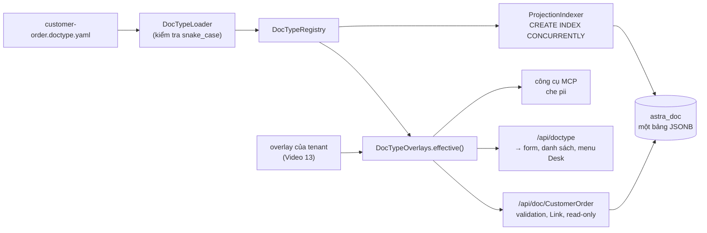

# Video 2 · DocType: từ một file YAML đến API, giao diện và index

<a href="https://media.zerohostcms.com/astra-cms/astra-video-2-doctype-vi.mp4"></a>

▶ [Tiếng Việt](https://media.zerohostcms.com/astra-cms/astra-video-2-doctype-vi.mp4) · [English](https://media.zerohostcms.com/astra-cms/astra-video-2-doctype-en.mp4) · 2:38 · Kịch bản: [demo-video-series.md](../demo-video-series.md#video-2-doctype-từ-một-file-yaml-đến-api-giao-diện-và-index) · [Bản tiếng Anh](./02-doctype.md)

> **Tóm tắt một câu:** Một DocType là một file YAML; từ đó kernel phục vụ một REST API có validation, Desk dựng form và danh sách, các field `projected` có expression index tạo online, và mọi DocType được lưu chung trong một bảng JSONB duy nhất mà không cần `ALTER TABLE`.
> **Nên đọc nếu:** bạn muốn biết chính xác key YAML nào biến thành hành vi runtime nào (góc nhìn developer) / bạn cần đánh giá lựa chọn lưu trữ zero-DDL: được gì, mất gì, và tới đâu thì không còn mở rộng được (góc nhìn tech lead).

## Vấn đề

Astra Express cần một bản ghi Đơn hàng (Customer Order): ai gửi, ai nhận, vùng giao, mức dịch vụ, cân
nặng, tiền thu hộ, và một khoản cước không ai được phép gõ tay. Trong một stack thông thường, chỉ một bản
ghi đó đã kéo theo một migration, một entity class, một DTO, một controller, các annotation validation,
một component form, một trang danh sách và một bước kiểm tra quyền. Sáu bảy thành phần phải thống nhất về
cùng mười hai field, và khi nghiệp vụ thêm field thứ mười ba, tất cả lại phải sửa, kèm một lệnh
`ALTER TABLE` trên một bảng đang bị ghi suốt cả ngày.

Frappe/ERPNext đã loại bỏ phần lớn sự trùng lặp đó: DocType là định nghĩa duy nhất, phần còn lại được
sinh ra. Nhưng Frappe vẫn tạo một bảng cho mỗi DocType và chạy DDL khi thêm một Custom Field
([explain.md](../explain.md)). Trên một database đa thuê bao bận rộn, DDL nghĩa là khoá bảng, phải canh
khung giờ triển khai, và tuỳ biến của một tenant đụng tới bảng của mọi tenant khác.

Astra giữ ý tưởng DocType nhưng đổi cách lưu trữ: các field nghiệp vụ nằm trong JSONB của một bảng duy
nhất, và DDL duy nhất mà một field được index mới có thể gây ra là một lệnh online
`CREATE INDEX CONCURRENTLY`.

## Video cho thấy gì

| Cảnh | Bạn thấy gì | Điều đó chứng minh |
| --- | --- | --- |
| YAML | `customer-order.doctype.yaml`: module, field, Select, Link, read-only, `pii`, `submittable`, `transaction: global` | Toàn bộ định nghĩa của một bản ghi nghiệp vụ nằm gọn trong một file trong app |
| Suy ra | Giá trị Select sai bị 422; Link phải trỏ tới bản ghi trong tenant; client không ghi được field read-only; field projected có index | Hành vi đến từ metadata, không phải code riêng cho từng DocType |
| Trang metadata của Desk | Bảng field của Customer Order | Dựng từ định nghĩa mà API trả về, đã áp overlay của tenant |
| Bộ dựng giao diện | Code `desk.js` | Mỗi kiểu field là một control; quyền quyết định nút Submit có hiện hay không |
| Projection | Hai index hợp lệ cho Customer Order | Tạo lúc kernel khởi động bằng `CREATE INDEX CONCURRENTLY`, không khoá ghi, không `ALTER TABLE` |
| `\d astra_doc` | Một bảng, một index GIN, mười projection index tại thời điểm quay, RLS cưỡng bức, publication `astra_cdc` | Mọi DocType dùng chung một bảng JSONB |

## Cách hoạt động

### Định nghĩa

*`astra-apps/express/src/main/resources/META-INF/astra/doctypes/customer-order.doctype.yaml`*

```yaml
name: CustomerOrder
module: oms
kind: transaction
submittable: true                 # Draft (0) -> Submitted (1) -> Cancelled (2) -> Amend
transaction: global               # submit/cancel span BMS credit (Seata AT) and pickup capacity (Seata TCC)
naming: { series: "ORD-.YYYYMMDD.-.#####" }

fields:
  - { name: customer,         type: Link,     options: Customer, required: true, in-list: true, projected: true }
  - { name: receiver_name,    type: Data,     required: true, in-list: true, pii: true }
  - { name: receiver_phone,   type: Data,     required: true, pii: true }
  # …
  - { name: zone,             type: Select,   options: [Same city, Domestic, Remote], default: Domestic, in-list: true, projected: true }
  - { name: service,          type: Select,   options: [Standard, Express], default: Standard, in-list: true }
  - { name: weight_kg,        type: Float,    required: true, label: Weight (kg) }
  - { name: cod_amount,       type: Currency, default: 0, label: COD amount }
  - { name: shipping_fee,     type: Currency, read-only: true, in-list: true }   # computed by ShippingFeeHook
  # …

permissions:
  - { role: admin,      read: true, create: true, write: true, submit: true, cancel: true }
  - { role: sales,      read: true, create: true, write: true, if-owner: true, submit: true }
  # …
```

Bộ nạp phân tích mỗi field thành một `FieldDefinition` bất biến và từ chối mọi tên không phải định danh
snake_case. Bước kiểm tra này không phải để cho đẹp: tên field về sau được ghép thẳng vào biểu thức SQL
(`data->>'zone'`), nên chính quy tắc đặt tên là thứ giữ cho các biểu thức đó an toàn.

*`astra-doctype/src/main/java/io/astra/doctype/registry/DocTypeLoader.java`*

```java
    static FieldDefinition field(JsonNode f, String where) {
        String fieldName = f.path("name").asText("");
        if (!fieldName.matches("[a-z][a-z0-9_]{0,50}")) {
            throw new IllegalStateException(where + ": field name '" + fieldName + "' must be snake_case");
        }
        return new FieldDefinition(
                fieldName,
                FieldType.valueOf(f.path("type").asText("Data").toUpperCase(Locale.ROOT)),
                f.path("label").asText(null),
                f.path("required").asBoolean(false),
                f.path("read-only").asBoolean(false),
                f.path("in-list").asBoolean(false),
                f.path("projected").asBoolean(false),
                options(f),
                f.hasNonNull("default") ? YAML.convertValue(f.get("default"), Object.class) : null,
                f.path("pii").asBoolean(false));
    }
```

### Mỗi key biến thành gì

| YAML | Hành vi runtime | Nơi xử lý |
| --- | --- | --- |
| `name`, `fields` | `GET/POST /api/doc/CustomerOrder`, `GET/PUT /api/doc/CustomerOrder/{name}`; form và danh sách trên Desk | `DocResource`, `desk.js` |
| field không khai báo | 422 `unknown field '…' for DocType CustomerOrder` | `DocumentValidator` |
| `required`, `default` | 422 khi thiếu; giá trị mặc định được điền trước khi hook chạy | `DocumentValidator` |
| `type: Select` + `options` | 422 `field 'zone' must be one of [Same city, Domestic, Remote]` | `DocumentValidator` |
| `read-only: true` | 422 `field 'shipping_fee' is read-only` khi client gửi lên; hook thì được phép đặt | `DocumentValidator.rejectReadOnly` |
| `type: Link` + `options` | 422 `field 'customer': Customer '…' not found` trừ khi bản ghi đích tồn tại trong tenant này | `DocumentStore.validateLinks` |
| `projected: true` | Expression index `astra_doc_p_<field>`; bộ lọc danh sách dùng đúng biểu thức đó | `ProjectionIndexer` |
| `naming.series` | `ORD-<yyyyMMdd>-00001`, đếm theo tenant trong `astra_series` | `SeriesService` |
| `submittable` | Các endpoint `/submit`, `/cancel`, `/amend` (Video 4) | `DocumentStore` |
| `transaction: global` | Submit và Cancel chạy trong một giao dịch toàn cục Seata khi có bộ điều phối (Video 17) | `DocumentStore.global` |
| `pii: true` | Bị che khi dữ liệu đi ra qua MCP tới một mô hình AI (Video 15) | `PiiMasking` |
| `permissions` | Quyền read/create/write/submit/cancel theo role; `if-owner` giới hạn quyền ghi cho chủ sở hữu (Video 11) | `DocPermissions` |



Để ý hai mũi tên đi vào `effective()`: API, Desk và MCP không bao giờ đọc thẳng YAML của app. Chúng đọc
định nghĩa hiệu lực cho tenant đang xét, tức DocType của app đã áp overlay của tenant đó. Vì vậy một field
chỉ dành cho Hà Nội xuất hiện trong form và API của Hà Nội mà app Express không cần thay đổi (Video 13).

### Desk là bộ dựng giao diện, không phải một ứng dụng

Desk hỏi API để lấy định nghĩa và ánh xạ kiểu field sang control. Code form rẽ nhánh theo kiểu field, không
bao giờ theo tên DocType:

*`astra-server/src/main/resources/META-INF/resources/desk/desk.js`*

```js
function control(f, value, locked, linkOptions) {
  // …
  switch (f.type) {
    case 'SELECT':
      input = h('select', { disabled: locked },
        f.required ? null : h('option', { value: '' }, ''),
        f.options.map((o) => h('option', { selected: String(v) === o }, o)));
      break;
    // …
    case 'INT': case 'FLOAT': case 'CURRENCY':
      input = h('input', { type: 'number', step: f.type === 'INT' ? '1' : 'any', disabled: locked, value: v });
      break;
    // …
    case 'LINK': {
      const listId = 'opts-' + f.name;
      input = h('input', { list: listId, disabled: locked, value: v, placeholder: f.options[0] + ' name', spellcheck: 'false' });
      // …
    }
  }
  // …
}
```

Các nút bấm đi theo quyền hiệu lực của người dùng đang đăng nhập, không theo role viết cứng:

*`astra-server/src/main/resources/META-INF/resources/desk/desk.js`*

```js
    if (doc.docstatus === 0 && perm.submit) actions.append(h('button', { class: 'btn', type: 'button', onclick: () => lifecycle(def, doc, 'submit', linkOptions) }, 'Submit'));
    if (doc.docstatus === 1 && perm.cancel) actions.append(h('button', { class: 'btn danger', type: 'button', onclick: () => lifecycle(def, doc, 'cancel', linkOptions) }, 'Cancel'));
```

Vì sao dựng Desk theo cách này: đây là bằng chứng rẻ nhất rằng metadata đã đầy đủ. Nếu Desk dựng và thao
tác được một DocType nó chưa từng biết, thì một MCP client hay một app di động đọc cùng `/api/doctype` cũng
làm được.

### Một bảng cho mọi DocType

*`astra-doctype/src/main/resources/db/migration/V1__astra_doc.sql`*

```sql
CREATE TABLE astra_doc (
    id           uuid        PRIMARY KEY DEFAULT gen_random_uuid(),
    tenant_id    text        NOT NULL,
    doctype      text        NOT NULL,
    name         text        NOT NULL,
    docstatus    smallint    NOT NULL DEFAULT 0,
    owner        text        NOT NULL,
    created_at   timestamptz NOT NULL DEFAULT now(),
    modified_at  timestamptz NOT NULL DEFAULT now(),
    version      integer     NOT NULL DEFAULT 1,
    data         jsonb       NOT NULL DEFAULT '{}'::jsonb,
    CONSTRAINT astra_doc_tenant_doctype_name_key UNIQUE (tenant_id, doctype, name)
);

CREATE INDEX astra_doc_list_idx ON astra_doc (tenant_id, doctype, modified_at DESC);
CREATE INDEX astra_doc_data_gin ON astra_doc USING gin (data jsonb_path_ops);

ALTER TABLE astra_doc ENABLE ROW LEVEL SECURITY;
ALTER TABLE astra_doc FORCE ROW LEVEL SECURITY;   -- applies to the table owner too
```

Các cột là những thứ chính kernel cần trên mọi bản ghi: định danh, tenant, kiểu, trạng thái vòng đời
(`docstatus`), chủ sở hữu, mốc thời gian và một `version` cho optimistic lock. Mọi thứ do nghiệp vụ định
nghĩa đều nằm trong `data`. Vì vậy thêm một DocType hay một field là thay đổi metadata, không bao giờ là
thay đổi schema. (Một migration sau này thêm cột `amended_from` cho chuỗi Amend ở Video 4.)

### Projection: index mà không cần `ALTER TABLE`

*`astra-doctype/src/main/java/io/astra/doctype/store/ProjectionIndexer.java`*

```java
    static String expression(FieldDefinition field) {
        return "(data->>'" + field.name() + "')";
    }
    // …
    void onStart(@Observes StartupEvent ev) {
        Map<String, FieldDefinition> fields = projectedFields();
        try (Connection conn = dataSource.getConnection(); Statement st = conn.createStatement()) {
            conn.setAutoCommit(true); // CREATE INDEX CONCURRENTLY cannot run inside a transaction block
            for (FieldDefinition f : fields.values()) {
                try {
                    st.execute("CREATE INDEX CONCURRENTLY IF NOT EXISTS " + indexName(f.name())
                            + " ON astra_doc (tenant_id, doctype, " + expression(f) + ")");
                    // …
                } catch (SQLException e) {
                    // Another pod may be building the same index right now; the next start retries.
                    // …
                }
            }
        }
        // …
    }
```

Ba lựa chọn thiết kế gói gọn trong đoạn này:

1. **`CONCURRENTLY`** tạo index mà không chặn ghi. Lệnh này không chạy được trong một transaction, nên mới
   có `setAutoCommit(true)`.
2. **Index được đặt khoá theo tên field, không theo DocType.** `astra_doc_p_zone` phục vụ mọi DocType có
   field `zone` được projected, và các cột dẫn đầu `(tenant_id, doctype, …)` giữ cho việc tra cứu hẹp. Nhờ
   đó số index tỷ lệ với số tên field projected khác nhau, không phải số DocType nhân số field.
3. **Bộ lọc danh sách dùng đúng biểu thức đó.** Planner chỉ dùng được expression index khi câu truy vấn
   lặp lại biểu thức y hệt, nên `DocumentStore.list` dựng mệnh đề `WHERE` bằng
   `ProjectionIndexer.expression(field)`:

*`astra-doctype/src/main/java/io/astra/doctype/store/DocumentStore.java`*

```java
                FieldDefinition field = def.field(f.getKey())
                        .orElseThrow(() -> new DocValidationException("unknown filter '" + f.getKey() + "' for DocType " + doctype));
                sql.append(" AND ").append(ProjectionIndexer.expression(field)).append(" = ?");
```

Endpoint projections đọc lại kết quả từ catalog của PostgreSQL chứ không từ YAML, nên thứ Desk hiển thị
chính là thứ database thực sự có:

```sql
SELECT i.indisvalid, pg_get_indexdef(i.indexrelid) FROM pg_index i
JOIN pg_class c ON c.oid = i.indexrelid WHERE c.relname = ?
```

## Ví dụ thực tế

Một nhà phân phối chuỗi lạnh (giả định, cơ chế là thật) vận chuyển vắc-xin và hải sản từ TP. Hồ Chí Minh
và cần tách đơn hàng đông lạnh, ướp lạnh và nhiệt độ thường. Điều phối viên lọc theo nhóm này suốt cả ngày.

Đầu vào: thêm một field vào DocType đơn hàng của app và rollout một image mới.

```yaml
  - { name: temperature_class, type: Select, options: [Frozen, Chilled, Ambient], default: Ambient, in-list: true, projected: true }
```

Astra làm gì:

1. Khi khởi động, mỗi pod kernel chạy
   `CREATE INDEX CONCURRENTLY IF NOT EXISTS astra_doc_p_temperature_class ON astra_doc (tenant_id, doctype, (data->>'temperature_class'))`.
   Việc ghi vẫn tiếp tục trong lúc tạo index. Nếu pod thứ hai đụng với pod thứ nhất, nó ghi một cảnh báo và
   index được thử lại ở lần khởi động kế tiếp.
2. Các đơn hàng cũ không có `temperature_class` trong `data`. Khi một bản nháp được lưu lần tới, validator
   điền giá trị mặc định `Ambient`. Không có migration backfill nào chạy; các dòng đã Submit hoặc chưa được
   đụng tới đơn giản là thiếu key này, nên bộ lọc `?temperature_class=Ambient` không trả về chúng.
3. API từ chối `{"temperature_class":"Warm"}` với mã 422 và
   `field 'temperature_class' must be one of [Frozen, Chilled, Ambient]`.
4. Desk hiện một drop-down trên form và một cột trong danh sách, vì `in-list` là true.
5. `GET /api/doc/CustomerOrder?temperature_class=Frozen` lọc bằng biểu thức có index.

Kết quả: một field mới, có validation, có index, không một lệnh `ALTER TABLE` nào và không sửa code Desk.
Nếu chỉ một tenant cần field này, một overlay của tenant sẽ thêm nó lúc chạy mà không cần image mới
(Video 13).

## Dành cho tech lead

- **Zero-DDL đem lại gì.** Thêm DocType và field không bao giờ khoá bảng, và tuỳ biến của các tenant
  không thể va nhau trong schema. Rollout không còn cần khung giờ migration cho những thay đổi về form.
- **Cái giá phải trả.** Mọi DocType dùng chung một bảng và một bộ index. An toàn kiểu dữ liệu chuyển từ
  database sang validator của kernel; một bên ghi có lỗi đi vòng qua kernel có thể lưu bất cứ thứ gì vào
  `data`. Kernel là bên ghi duy nhất theo thiết kế, và row-level security vẫn áp lên mọi câu lệnh.
- **Ngữ nghĩa index là so sánh bằng trên chuỗi.** Biểu thức là `data->>'field'`, nên index phục vụ bộ lọc
  so sánh bằng trên text. Truy vấn theo khoảng trên số hay ngày, sắp xếp theo một field nghiệp vụ, hay tổng
  hợp đều chưa được các index này phục vụ.
- **Field nóng.** PostgreSQL ghi lại toàn bộ dòng khi `UPDATE`. Một DocType có vài field thay đổi nhiều lần
  mỗi ngày (tồn kho, số dư, bộ đếm) sẽ làm phình dòng JSONB. Câu trả lời trong thiết kế là các cột
  projection vật lý hoá và sổ cái ([explain.md](../explain.md)); projection vật lý hoá chưa được xây. Hãy
  đo tần suất cập nhật theo từng DocType trước khi đưa dữ liệu thay đổi liên tục vào `astra_doc`.
- **Vòng đời index.** Indexer chỉ tạo. Bỏ `projected: true` không xoá index; hiện tại việc đó là một lệnh
  `DROP INDEX CONCURRENTLY` chạy tay.
- **Đo gì.** Số index trên `astra_doc` và mức khuếch đại ghi của nó; `indisvalid` của mọi projection sau
  mỗi lần rollout (`GET /api/doctype/{name}/projections`); độ trễ p95 của danh sách theo từng bộ lọc.
- **Khi nào không nên dùng.** Truy vấn phân tích nặng, báo cáo số liệu dạng rộng, hoặc dữ liệu cần ràng
  buộc database giữa các field nghiệp vụ. Những thứ đó thuộc về sổ cái, một schema riêng của module (như
  BMS làm cho tín dụng, Video 17) hoặc một kho phân tích.
- **So với Frappe.** Frappe: mỗi DocType một bảng, cột thật, DDL cho mỗi Custom Field, kiểu dữ liệu chặt
  theo từng cột. Astra: một bảng JSONB, expression index tạo online, kiểu dữ liệu được kernel cưỡng chế.

## Tự chạy thử

Điều kiện cần: stack từ [Video 1](./01-quickstart.vi.md) đang chạy (`make k3d-up`, `make demo-seed`).

```bash
make demo-express SCENES=2 PAUSE=0
```

Cảnh này in ra YAML, rồi trạng thái projection, rồi `\d astra_doc` từ pod PostgreSQL của k3d. Output
projection mong đợi:

```text
$ curl -X GET http://localhost:8080/api/doctype/CustomerOrder/projections …
HTTP 200
[
  { "field": "customer", "valid": true,
    "definition": "CREATE INDEX astra_doc_p_customer ON public.astra_doc USING btree (tenant_id, doctype, ((data ->> 'customer'::text)))" },
  { "field": "zone", "valid": true,
    "definition": "CREATE INDEX astra_doc_p_zone ON public.astra_doc USING btree (tenant_id, doctype, ((data ->> 'zone'::text)))" }
]
```

`\d astra_doc` kết thúc bằng `Policies (forced row security enabled)` và `Publications: "astra_cdc"`.

Trong Desk (`http://localhost:8080/desk/`, user `mai`): mở **DocType metadata**, chọn `CustomerOrder`, rồi
mở rộng mục "Raw JSON from GET /api/doctype/CustomerOrder" để xem đúng định nghĩa mà trang đã dựng.

## Nói đúng

- **Biểu thức projection đã đổi sau khi quay video.** Dưới row-level security, PostgreSQL không bao giờ dùng
  index trên `(data->>'field')`, vì `->>` không phải hàm LEAKPROOF, nên mọi bộ lọc danh sách quét toàn tenant.
  Kernel nay lọc và đánh index bằng `astra_ext.astra_field(data, 'field')`, một alias LEAKPROOF của cùng hàm do
  superuser bootstrap tạo, và index có tên `astra_doc_pf_<field>`, thêm `modified_at DESC` và `WHERE ... IS NOT
  NULL`. Mã và output catalog trích trong bài là phiên bản lúc quay video. Số đo và lý do:
  [why_doctype_jsonb.md](../why_doctype_jsonb.md).
- **`CONCURRENTLY` không hiện trong catalog.** `pg_index` chỉ lưu định nghĩa index, nên cột định nghĩa
  không bao giờ có chữ `CONCURRENTLY`; lời thuyết minh nói rõ điều này trên màn hình.
- **Số index tuỳ từng bản cài.** Video cho thấy mười projection index. Image hiện tại còn đóng gói HRM và
  STMS, mà các field projected của chúng tạo thêm các index `astra_doc_p_*`.
- **Projection index được tạo lúc kernel khởi động.** Một field do app thêm vào cần image mới; không có bộ
  tạo projection nào được kích hoạt bởi thay đổi metadata lúc chạy.
- **`pii` chỉ che trên đường MCP.** Desk và REST vẫn hiện PII cho người dùng có role đọc được DocType.
- **Chưa được xây:** projection vật lý hoá, expression index có kiểu, hạn mức projection và xoá index không
  dùng. Những thứ này xuất hiện trong README dưới dạng kiến trúc mục tiêu. Bảng con được khai báo trong enum
  `FieldType` của SPI (`TABLE`), nhưng cả validator của kernel lẫn Desk đều chưa xử lý.
- **Field nào đã khai báo cũng lọc được**, projected hay không. Chỉ field projected mới có index đằng sau
  bộ lọc; lọc theo field khác sẽ quét các dòng của DocType đó trong tenant.
- **Desk có một chỗ nhắc tới DocType cụ thể.** Code form, danh sách và menu không bao giờ gọi tên một
  DocType, nhưng `desk.js` ánh xạ `CustomerOrder` và `Waybill` sang các bảng replica CDC của chúng cho thẻ
  replica (Video 16).

## Minh hoạ: prompt vẽ hình

Prompt giữ nguyên tiếng Anh để mô hình tạo ảnh hiểu chính xác; nhãn trên hình là tên kỹ thuật thật.

### Hình 1 · Một file YAML, nhiều đầu ra
*Đặt ở:* Cách hoạt động, sau "Mỗi key biến thành gì"

```text
Hand-drawn whiteboard sketch, black ink line art on off-white paper, one accent color (#6b8cff blue) for the key path, simple boxes and arrows, short handwritten labels in English, generous white space, no logos, no photorealism, 16:9. On the left, a tall paper sheet labelled "customer-order.doctype.yaml" with five visible lines: "type: Select", "type: Link", "read-only: true", "projected: true", "pii: true". From each line, an arrow fans out to the right to one small box: "Select" to "422 must be one of [...]", "Link" to "Customer exists in tenant?", "read-only" to "client write → 422", "projected" to "astra_doc_p_zone index" (this arrow and box in blue, the highlight), "pii" to "masked in MCP". Above the fan, a separate arrow from the whole sheet to a browser window labelled "Desk form + list", and to a JSON brace labelled "/api/doc/CustomerOrder".
```

### Hình 2 · Bảng JSONB dùng chung
*Đặt ở:* Cách hoạt động, "Một bảng cho mọi DocType"

```text
Hand-drawn whiteboard sketch, black ink line art on off-white paper, one accent color (#6b8cff blue) for the key path, simple boxes and arrows, short handwritten labels in English, generous white space, no logos, no photorealism, 16:9. A wide table drawing labelled "astra_doc" with column headers left to right: "tenant_id", "doctype", "name", "docstatus", "version", "data (jsonb)". Three rows: "saigon-express | CustomerOrder | ORD-...-00001 | 0 | 1 | {zone: Domestic, ...}", "saigon-express | Waybill | WB-... | 0 | 3 | {ops_status: ...}", "hanoi-express | Customer | C001 | 0 | 1 | {segment: B2B}". The "data (jsonb)" column is shaded blue. Under the table, three small index tags hanging from the data column: "GIN jsonb_path_ops", "astra_doc_p_zone", "astra_doc_p_customer". To the right, a padlock doodle labelled "FORCE ROW LEVEL SECURITY: tenant_id = astra.tenant". A crossed-out speech bubble at top right: "ALTER TABLE".
```

### Hình 3 · Projection index tạo online lúc khởi động
*Đặt ở:* Cách hoạt động, "Projection"

```text
Hand-drawn whiteboard sketch, black ink line art on off-white paper, one accent color (#6b8cff blue) for the key path, simple boxes and arrows, short handwritten labels in English, generous white space, no logos, no photorealism, 16:9. Top to bottom timeline. Top: a box "kernel pod starts (StartupEvent)". Arrow down to "ProjectionIndexer: fields with projected: true". Arrow down (blue) to a box "CREATE INDEX CONCURRENTLY IF NOT EXISTS astra_doc_p_zone ON astra_doc (tenant_id, doctype, (data->>'zone'))". To the right of this box, a steady stream of small arrows labelled "INSERT / UPDATE keep flowing" passing by unblocked. Arrow down to "pg_index: indisvalid = true". Arrow down to "GET /api/doctype/CustomerOrder/projections → valid". A small side note next to a second pod icon: "other pod collides → warn, retry next start".
```

## Liên quan

- Trước: [Video 1 · Astra là gì & chạy trong 5 phút](./01-quickstart.vi.md)
- Tiếp theo: [Video 3 · Quy tắc nghiệp vụ: hook & validation](./03-hooks.vi.md)
- Kịch bản: [demo-video-series.md](../demo-video-series.md); lý do thiết kế lưu trữ:
  [explain.md](../explain.md); trích đoạn code cho developer: [demo-code-snippets.md](../demo-code-snippets.md) (S1, S12)
- Mã nguồn: [`customer-order.doctype.yaml`](../../astra-apps/express/src/main/resources/META-INF/astra/doctypes/customer-order.doctype.yaml),
  [`DocTypeLoader.java`](../../astra-doctype/src/main/java/io/astra/doctype/registry/DocTypeLoader.java),
  [`DocumentValidator.java`](../../astra-doctype/src/main/java/io/astra/doctype/store/DocumentValidator.java),
  [`ProjectionIndexer.java`](../../astra-doctype/src/main/java/io/astra/doctype/store/ProjectionIndexer.java),
  [`V1__astra_doc.sql`](../../astra-doctype/src/main/resources/db/migration/V1__astra_doc.sql),
  [`desk.js`](../../astra-server/src/main/resources/META-INF/resources/desk/desk.js)
