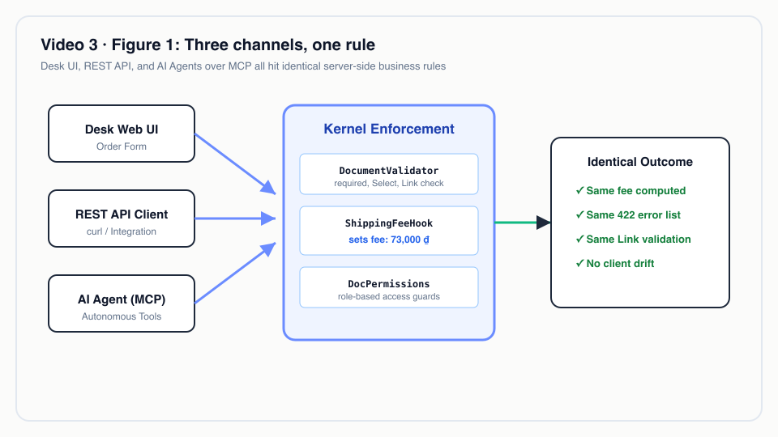
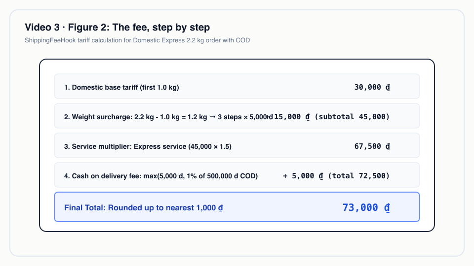
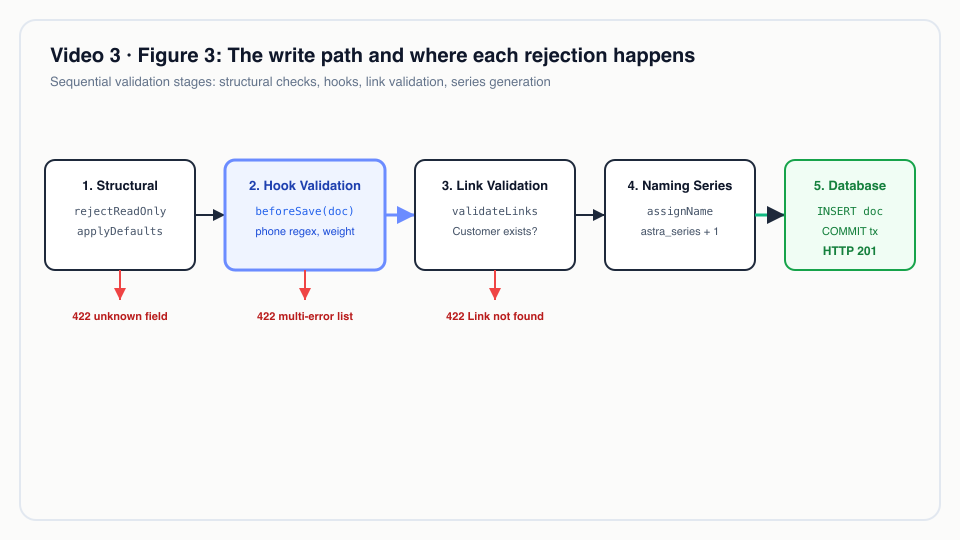

# Video 3 · Quy tắc nghiệp vụ: hook & validation

<a href="https://media.zerohostcms.com/astra-cms/astra-video-3-hooks-vi.mp4"></a>

▶ [Tiếng Việt](https://media.zerohostcms.com/astra-cms/astra-video-3-hooks-vi.mp4) · [English](https://media.zerohostcms.com/astra-cms/astra-video-3-hooks-en.mp4) · 2:53 · Kịch bản: [demo-video-series.md](../demo-video-series.md#video-3-quy-tắc-nghiệp-vụ-hook--validation) · [Bản tiếng Anh](./03-hooks.md)

> **Tóm tắt một câu:** Một quy tắc nghiệp vụ là một CDI bean Java bình thường mà kernel gọi trước mỗi lần ghi DocType của nó, bên trong chính transaction của lần ghi đó, nên khoản cước 73.000 ₫ và các lỗi validation giống hệt nhau dù đơn hàng đến từ Desk, REST hay một agent AI qua MCP.
> **Nên đọc nếu:** bạn cần viết một hook và muốn biết chính xác nó chạy khi nào, được làm gì (góc nhìn developer) / bạn muốn biết quy tắc nghiệp vụ nằm ở đâu, được cưỡng chế trên các kênh ra sao, và cái giá là gì (góc nhìn tech lead).

## Vấn đề

Astra Express tính phí giao hàng theo vùng, cân nặng và dịch vụ, cộng thêm phí khi thu hộ (COD), và từ
chối bưu kiện trên 30 kg hoặc số điện thoại không đúng định dạng di động Việt Nam. Quy tắc thì đơn giản;
giữ nó ở một chỗ duy nhất thì không. Một hệ thống điển hình rốt cuộc có công thức tính cước trong form web
(để xem trước), lặp lại trong controller API, lặp lại trong app di động, và đôi khi trong một job chạy ban
đêm. Chúng lệch nhau dần. Lần đầu tiên có người nhận ra là khi khách được báo một giá trên website nhưng bị
tính một giá khác.

Validation còn một vấn đề thứ hai, âm thầm hơn: lỗi đến từng cái một. Nhân viên sửa số điện thoại, lưu, rồi
mới biết cân nặng cũng sai. Một controller Frappe điển hình cũng hành xử như vậy, vì `frappe.throw` dừng ở
lỗi đầu tiên trừ khi developer tự tay gom các thông báo lại.

Câu trả lời của Astra là hai lớp mà mọi kênh đều phải đi qua:

- **DocType** cưỡng chế các quy tắc cấu trúc nó khai báo: field bắt buộc, lựa chọn Select, field lạ, field
  read-only, và Link phải tồn tại trong tenant;
- **hook** cưỡng chế các quy tắc nghiệp vụ mà YAML không diễn đạt được, và có thể tính các field như cước
  phí.

Cả hai chạy trong kernel, bên dưới Desk, REST và MCP, nên không client nào bỏ qua được.


*Ba kênh, một quy tắc.*

## Video cho thấy gì

| Cảnh | Bạn thấy gì | Điều đó chứng minh |
| --- | --- | --- |
| Tạo | `tuan` (sales) tạo đơn cho `C001`: Domestic, Express, 2,2 kg, COD 500.000 ₫ | Mã đơn lấy từ series theo ngày; `ShippingFeeHook` đặt cước trong cùng transaction với lần ghi |
| Cước | 30.000 + 3 × 5.000 = 45.000; × 1,5 = 67.500; + 5.000 COD = 72.500; làm tròn lên 73.000 ₫ | Quy tắc là phép tính nhìn thấy được, không phải hộp đen; "Priced by: Standard tariff" |
| Lỗi | Số điện thoại `123`, cân nặng `45` → Save | Cả hai lỗi trong một phản hồi 422 duy nhất, trước khi bất cứ thứ gì được ghi |
| Link | Giá trị hợp lệ, khách hàng `C999` | Không phải hook: kernel kiểm tra bản ghi đích của Link có tồn tại; bản nháp không đổi |
| Các kênh | Cùng dữ liệu đó qua REST | Cùng hai thông báo, theo cùng thứ tự |
| Code | `ExpressApp` và `ShippingFeeHook` | Hook là một CDI bean; không cần đăng ký, không cần cấu hình |
| Quy tắc của API | Client gửi `shipping_fee`, field lạ `discount`, giá trị Select `Mars` | Tất cả bị từ chối chỉ nhờ YAML, dữ liệu không đổi |

## Cách hoạt động

### Hook

*`astra-spi/src/main/java/io/astra/spi/hook/DocLifecycleHook.java`*

```java
public interface DocLifecycleHook {

    /** The DocType this hook applies to, e.g. {@code "Article"}. */
    String doctype();

    /** Runs before a document is inserted or updated, after kernel validation of declared fields. */
    default void beforeSave(Document doc) { }

    /** Runs after the document has been persisted in the same transaction. */
    default void afterSave(Document doc) { }

    // … onSubmit and onCancel (Video 4)
}
```

Quy tắc của app Express hiện thực interface này. Phần quan trọng là cấu trúc: gom mọi lỗi, ném một lần,
rồi mới tính.

*`astra-apps/express/src/main/java/io/astra/apps/express/ShippingFeeHook.java`*

```java
@ApplicationScoped
public class ShippingFeeHook implements DocLifecycleHook {

    static final double MAX_WEIGHT_KG = 30;
    static final long MAX_COD = 50_000_000;

    /** Zone → {price for the first kg, price per additional 0.5 kg}, in VND. */
    private static final Map<String, long[]> TARIFF = Map.of(
            "Same city", new long[] {18_000, 2_500},
            "Domestic", new long[] {30_000, 5_000},
            "Remote", new long[] {45_000, 7_000});
    // …

    @Override
    public String doctype() { return "CustomerOrder"; }

    @Override
    public void beforeSave(Document doc) {
        List<String> errors = new ArrayList<>();
        String phone = doc.getString("receiver_phone");
        if (phone != null && !phone.matches("0\\d{9}")) errors.add("receiver_phone must be 10 digits starting with 0");
        double weight = Numbers.toDouble(doc.get("weight_kg"));
        if (weight <= 0 || weight > MAX_WEIGHT_KG) errors.add("weight_kg must be between 0 and " + (int) MAX_WEIGHT_KG);
        long cod = Math.round(Numbers.toDouble(doc.get("cod_amount")));
        if (cod < 0 || cod > MAX_COD) errors.add("cod_amount must be between 0 and " + MAX_COD);
        if (!errors.isEmpty()) throw new DocValidationException(errors);

        String zone = doc.getString("zone");
        // … a tenant's active Wasm PricingRule takes precedence (Video 14)
        doc.set("shipping_fee", fee(zone, doc.getString("service"), weight, cod));
        doc.set("priced_by", "Standard tariff");
    }

    // …
    static long fee(String zone, String service, double weightKg, long cod) {
        long[] t = TARIFF.getOrDefault(zone, TARIFF.get("Domestic"));
        long extraSteps = (long) Math.ceil(Math.max(0, weightKg - 1) / 0.5);
        double fee = t[0] + extraSteps * t[1];
        if ("Express".equals(service)) fee *= 1.5;
        if (cod > 0) fee += Math.max(5_000, cod * 0.01);
        return (long) Math.ceil(fee / 1_000) * 1_000;
    }
}
```

Cước của đơn demo, từng bước theo `fee(...)`:

| Bước | Giá trị |
| --- | --- |
| Domestic, kg đầu tiên | 30.000 |
| 2,2 kg − 1 = 1,2 kg → `ceil(1.2 / 0.5)` = 3 bước × 5.000 | + 15.000 = 45.000 |
| Express × 1,5 | 67.500 |
| COD: `max(5,000; 1% × 500,000)` | + 5.000 = 72.500 |
| Làm tròn lên hàng nghìn | **73.000 ₫** |


*Cước phí, từng bước.*

### Tự phát hiện: không cần đăng ký

Lớp app chỉ liệt kê DocType. Hook được tìm thấy vì chúng là CDI bean hiện thực SPI. Lúc khởi động, kernel
nhóm chúng theo `doctype()` một lần, nên việc điều phối trên đường ghi chỉ là duyệt một danh sách:

*`astra-kernel/src/main/java/io/astra/kernel/extension/HookRegistry.java`*

```java
    @Inject
    public HookRegistry(Instance<DocLifecycleHook> hooks) {
        this.chains = hooks.stream().collect(Collectors.groupingBy(DocLifecycleHook::doctype));
        // … logs "DocType %s: %d lifecycle hook(s) [%s]"
    }

    public void beforeSave(Document doc) {
        for (DocLifecycleHook hook : chains.getOrDefault(doc.doctype(), List.of())) {
            hook.beforeSave(doc);
        }
    }
```

Vì sao dùng CDI mà không dùng file khai báo hook hay annotation quét theo tên: hook là Java bình thường,
inject được (`ShippingFeeHook` inject `DocumentService` và `ScriptRuntime`), và test được như mọi bean
khác. Tuy vậy, phần gắn kết vẫn là một chuỗi (`doctype()` trả về `"CustomerOrder"`) và registry không đối
chiếu nó với các DocType đã nạp, nên gõ sai tên nghĩa là hook không bao giờ chạy. Dòng log lúc khởi động cho
mỗi chuỗi hook là chỗ để bắt lỗi đó.

### Đường ghi, theo thứ tự

Mọi thao tác tạo và cập nhật đều đi qua `DocumentStore`, bất kể kênh nào. `DocResource` (REST, cũng là thứ
Desk gọi) và `McpServer` (agent AI) đều gọi `store.insert` / `store.update`.

*`astra-doctype/src/main/java/io/astra/doctype/store/DocumentStore.java`*

```java
    public Document insert(String doctype, Map<String, Object> data, String owner) {
        DocTypeDefinition def = overlays.effective(doctype);
        DocumentValidator.rejectReadOnly(def, data);
        return inTenantTx(conn -> persistNew(conn, def, new Document(doctype, data).owner(owner)));
    }
    // …
    private Document persistNew(Connection conn, DocTypeDefinition def, Document doc) throws SQLException {
        DocumentValidator.applyDefaultsAndValidate(def, doc);
        hooks.beforeSave(doc);
        validateLinks(conn, def, doc);
        if (doc.name() == null) doc.name(assignName(conn, def, doc));
        try (PreparedStatement ps = conn.prepareStatement(
                "INSERT INTO astra_doc (id, tenant_id, doctype, name, owner, data, amended_from) "
                        + "VALUES (?, ?, ?, ?, ?, ?::jsonb, ?) RETURNING *")) {
            // …
                hooks.afterSave(saved);
            // …
        }
    }
```

```mermaid
sequenceDiagram
    autonumber
    actor U as tuan (Desk / curl / MCP)
    participant API as DocResource / McpServer
    participant S as DocumentStore
    participant H as ShippingFeeHook
    participant PG as PostgreSQL (RLS)
    U->>API: POST /api/doc/CustomerOrder
    API->>API: DocPermissions: sales được tạo
    API->>S: insert(CustomerOrder, data)
    S->>S: rejectReadOnly (có gửi shipping_fee? → 422)
    S->>PG: BEGIN; set_config('astra.tenant', …)
    S->>S: applyDefaultsAndValidate (field lạ, bắt buộc, Select)
    S->>H: beforeSave(doc)
    H-->>S: có lỗi → 422, hoặc shipping_fee = 73000
    S->>PG: validateLinks: Customer C001 có tồn tại? (RLS: chỉ tenant này)
    S->>PG: astra_series +1 → ORD-<date>-0000n
    S->>PG: INSERT astra_doc … RETURNING *
    S->>PG: COMMIT
    API-->>U: 201 + chứng từ
```

Những lựa chọn thiết kế đáng chú ý:

- **Hook chạy sau validation của chính kernel.** Giá trị mặc định đã được điền và giá trị Select đã được
  kiểm tra, nên hook không bao giờ thấy `zone: "Mars"`. Code hook chỉ lo nghiệp vụ, không lo hình dạng dữ
  liệu.
- **Lỗi được báo theo từng tầng, và trong một tầng thì báo tất cả cùng lúc.** `DocValidationException` mang
  theo một danh sách, và exception mapper trả nguyên danh sách đó:

  *`astra-doctype/src/main/java/io/astra/doctype/api/ApiExceptionMappers.java`*

  ```java
      @ServerExceptionMapper
      public Response validation(DocValidationException e) {
          return Response.status(422).entity(Map.of("error", "validation", "errors", e.errors())).build();
      }
  ```

- **Kiểm tra Link chạy bên trong transaction của tenant.** Câu truy vấn là
  `SELECT 1 FROM astra_doc WHERE doctype = ? AND name = ?`, không có điều kiện tenant trong SQL; row-level
  security tự thêm vào. Một khách hàng chỉ tồn tại trong `hanoi-express` sẽ là "not found" trong
  `saigon-express` (Video 7).
- **Số chứng từ được lấy sau cùng.** Bộ đếm series chỉ tăng sau khi validation, hook và Link đều qua, và
  trong cùng transaction với lệnh insert. Một đơn bị từ chối không bao giờ tiêu tốn một số, nên series theo
  ngày không có lỗ hổng do lỗi validation.
- **Read-only nghĩa là "thuộc quyền hook".** Client không được gửi `shipping_fee`, nhưng hook thì đặt nó.
  Vì vậy cước luôn đến từ quy tắc, không bao giờ từ một client tự tính theo cách khác.
- **Đọc bên trong hook dùng cùng transaction.** `ShippingFeeHook` tra phân khúc của khách và quy tắc định
  giá đang hiệu lực của tenant qua `DocumentService`. `TenantTransactions` mang connection đang mở trong một
  `ScopedValue`, nên các lần đọc đó tham gia vào transaction của lần ghi và thấy cùng tenant.


*Đường ghi và nơi mỗi lần từ chối xảy ra.*

## Ví dụ thực tế

Một công ty giao hàng chặng cuối ở Việt Nam (giả định, các con số lấy từ bảng cước chuẩn thật trong
`ShippingFeeHook`, tenant không có `PricingRule` nào đang hiệu lực) nhận năm đơn từ một tích hợp sàn thương
mại điện tử trong đợt đồng bộ buổi sáng:

| Đơn | Đầu vào | Astra làm gì | Kết quả |
| --- | --- | --- | --- |
| A | Same city, Standard, 0,8 kg, không COD | 18.000; `ceil(max(0, −0.2) / 0.5)` = 0 bước thêm; không có phí COD | 201, cước **18.000 ₫** |
| B | Domestic, Standard, 3 kg, COD 1.200.000 | 30.000 + 4 × 5.000 = 50.000; COD `max(5,000; 12,000)` = 12.000 | 201, cước **62.000 ₫** |
| C | Remote, Express, 5 kg, COD 2.000.000 | 45.000 + 8 × 7.000 = 101.000; × 1,5 = 151.500; + 20.000 COD = 171.500; làm tròn lên | 201, cước **172.000 ₫** |
| D | Domestic, số điện thoại `84901234567`, 31 kg | Hook gom hai lỗi, ném một lần | 422, `["receiver_phone must be 10 digits starting with 0", "weight_kg must be between 0 and 30"]`, không ghi gì, không tiêu tốn số |
| E | Bưu kiện hợp lệ, tích hợp gửi kèm `"shipping_fee": 0` | Bị từ chối trước khi transaction mở | 422, `["field 'shipping_fee' is read-only"]` |

Đơn E là đơn mà bộ phận tài chính quan tâm: một đối tác tích hợp không thể tự đặt giá của mình, dù client
được viết thế nào. Nếu sau này đội kinh doanh của công ty cho một phân khúc B2B một công thức khuyến mãi, nó
được triển khai dưới dạng một quy tắc Wasm của tenant và chính hook này sẽ áp dụng nó, với "Priced by" ghi
lại quy tắc nào đã được dùng (Video 14).

## Dành cho tech lead

- **Quy tắc nằm ở đâu.** Quy tắc cấu trúc trong YAML của DocType; quy tắc nghiệp vụ trong hook Java của
  app; công thức riêng của tenant trong Wasm (Video 14) hoặc overlay (Video 13). Cách phân chia này là quyết
  định thiết kế chính cần xem xét cùng đội của bạn.
- **Điểm cưỡng chế.** Hook chạy trong `DocumentStore`, bên dưới mọi kênh. Thứ gì ghi qua kernel đều chịu
  quy tắc. Thứ gì ghi thẳng vào PostgreSQL thì không; hãy khoá chặt role database (Video 8).
- **Chi phí trên đường ghi.** Mỗi hook chạy đồng bộ bên trong transaction database. Một hook chậm giữ một
  connection và các khoá dòng mà transaction đã lấy. `ShippingFeeHook` thêm các lần đọc (phân khúc khách,
  quy tắc định giá đang hiệu lực) vào mỗi lần lưu đơn hàng. Hãy đo độ trễ lưu p95 theo từng DocType và số
  hook trong mỗi chuỗi (được log lúc khởi động).
- **Thứ tự.** SPI không có thuộc tính độ ưu tiên; các hook của một DocType chạy theo thứ tự CDI cung cấp.
  Nếu hai hook trên cùng một DocType phụ thuộc vào output của nhau, hãy gộp chúng lại hoặc làm rõ sự phụ
  thuộc trong một hook.
- **Hợp đồng lỗi.** 422 với `{"error":"validation","errors":[…]}` là ổn định và giống nhau trên mọi kênh,
  giúp việc xử lý lỗi phía client và việc agent AI thử lại trở nên đơn giản. Lỗi đến theo từng tầng: lỗi cấu
  trúc của kernel trước, rồi lỗi của hook, rồi lỗi Link. Một client sửa xong một tầng có thể gặp tầng kế
  tiếp.
- **Khi nào không nên dùng hook.** Việc chạy lâu, lời gọi tới service bên ngoài có thể treo, hoặc bất cứ
  thứ gì phải tồn tại sau rollback (gửi SMS). Những việc đó thuộc về giai đoạn sau commit, trong một job
  hoặc event, mà phần này chưa có trong lát cắt mỏng.
- **So với Frappe.** Cùng ý tưởng với các method controller `validate` / `before_save` và `doc_events`.
  Khác biệt: một interface Java có kiểu thay cho các method Python được gọi theo tên, phát hiện qua CDI, và
  một danh sách lỗi trả về trong một phản hồi.

## Tự chạy thử

Điều kiện cần: stack từ [Video 1](./01-quickstart.vi.md) đang chạy và đã nạp dữ liệu.

```bash
make demo-express SCENES=3 PAUSE=0
```

Cảnh này tạo một đơn nháp thật trong `saigon-express`, nên hãy chạy `make demo-reset && make demo-seed` sau
đó nếu bạn muốn số đơn khớp với video. Những gì cảnh làm, theo thứ tự, cùng kết quả mong đợi:

| Lời gọi | Mong đợi |
| --- | --- |
| `POST /api/doc/CustomerOrder` (C001, Domestic, Express, 2,2 kg, COD 500.000) | `HTTP 201`, `name` `ORD-<today>-0000n`, `shipping_fee` `73000` |
| Như trên với số điện thoại `123`, cân nặng `45` | `HTTP 422`, cả hai lỗi của hook |
| Khách hàng `C999` | `HTTP 422`, `field 'customer': Customer 'C999' not found` |
| Client gửi `shipping_fee` | `HTTP 422`, `field 'shipping_fee' is read-only` |
| `PUT` bản nháp với `zone: Mars`, `discount: 10` | `HTTP 422`, `unknown field 'discount' for DocType CustomerOrder` và `field 'zone' must be one of [Same city, Domestic, Remote]` |

Trong Desk, đăng nhập bằng `tuan` / `Astra@123`, mở danh sách Customer Order, bấm **New**, và dùng nút
**API inspector** để xem đúng các request và nội dung 422 đó.

Bài integration test [`ExpressFlowTest`](../../astra-server/src/test/java/io/astra/server/ExpressFlowTest.java)
kiểm tra cước 73.000, tên chứng từ theo ngày, và các lần từ chối do read-only, số điện thoại và Link trên
một PostgreSQL thật; `make test` chạy toàn bộ bộ test.

## Nói đúng

- **"Một vòng sửa" chỉ đúng trong một tầng.** Hook trả về mọi lỗi của nó cùng lúc, và validator trả về mọi
  lỗi cấu trúc cùng lúc, nhưng một request trượt ở tầng cấu trúc sẽ không bao giờ tới được hook. Trong
  video, cả hai lỗi đều đến từ hook, nên một vòng là đủ.
- **Kiểm tra Link là của kernel, không phải của hook.** Video có nói điều này; hook không nhìn vào
  `customer` ngoại trừ để tìm phân khúc phục vụ việc tính giá.
- **Phát hiện hook diễn ra lúc build.** Hook là CDI bean trong các app Tier 0 được biên dịch vào image. Sửa
  một hook nghĩa là một image mới. Hook Java nạp lúc chạy (Tier 1) chưa được xây; logic riêng của tenant
  lúc chạy đi qua Wasm (Video 14).
- **Không có thứ tự hook hay hook sau commit.** `afterSave` chạy bên trong cùng transaction, trước khi
  commit.
- **Làm tròn cước dùng số thực dấu phẩy động** (`double`) trước khi làm tròn lên hàng nghìn. Với các giá trị
  của bảng cước thì đủ chính xác; một quy tắc tính tiền trên production nên dùng `BigDecimal` hoặc đơn vị
  tiền nhỏ nhất dạng số nguyên.

## Hình minh hoạ

### Hình 1 · Ba kênh, một quy tắc


### Hình 2 · Cước phí, từng bước


### Hình 3 · Đường ghi và nơi mỗi lần từ chối xảy ra


## Liên quan

- Trước: [Video 2 · DocType: từ một file YAML đến API, giao diện và index](./02-doctype.vi.md)
- Tiếp theo: [Video 4 · Vòng đời chứng từ: Submit, Cancel, Amend](./04-lifecycle.vi.md)
- Bài đầu tiên: [Video 1 · Astra là gì & chạy trong 5 phút](./01-quickstart.vi.md)
- Kịch bản: [demo-video-series.md](../demo-video-series.md); trích đoạn code cho developer:
  [demo-code-snippets.md](../demo-code-snippets.md) (S2)
- Mã nguồn: [`ShippingFeeHook.java`](../../astra-apps/express/src/main/java/io/astra/apps/express/ShippingFeeHook.java),
  [`DocLifecycleHook.java`](../../astra-spi/src/main/java/io/astra/spi/hook/DocLifecycleHook.java),
  [`HookRegistry.java`](../../astra-kernel/src/main/java/io/astra/kernel/extension/HookRegistry.java),
  [`DocumentStore.java`](../../astra-doctype/src/main/java/io/astra/doctype/store/DocumentStore.java),
  [`DocumentValidator.java`](../../astra-doctype/src/main/java/io/astra/doctype/store/DocumentValidator.java),
  [`TenantTransactions.java`](../../astra-doctype/src/main/java/io/astra/doctype/store/TenantTransactions.java),
  [`ExpressFlowTest.java`](../../astra-server/src/test/java/io/astra/server/ExpressFlowTest.java)
