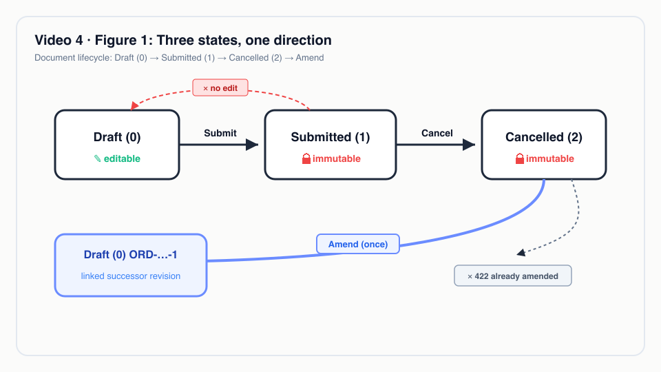
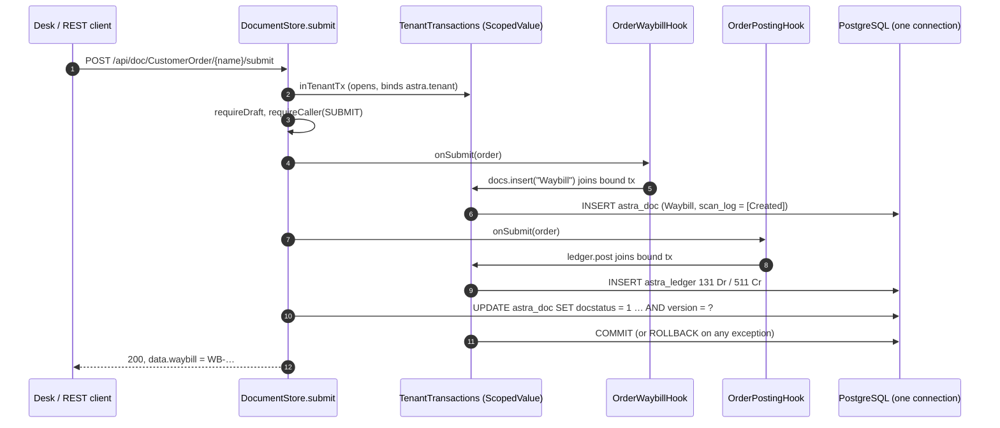
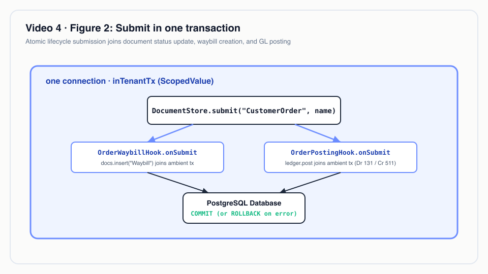
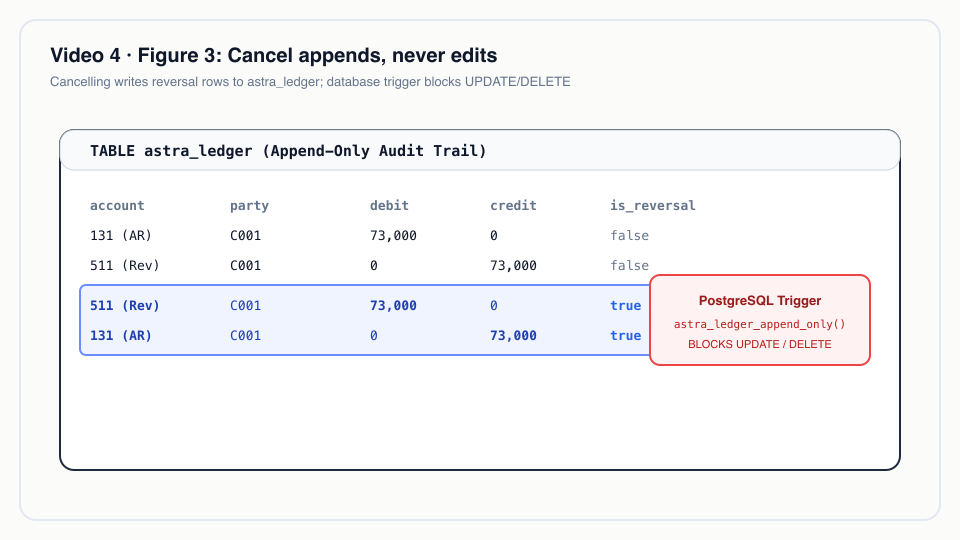

# Video 4 · Document lifecycle: Submit, Cancel, Amend

<a href="https://media.zerohostcms.com/astra-cms/astra-video-4-lifecycle-en.mp4"></a>

▶ [English](https://media.zerohostcms.com/astra-cms/astra-video-4-lifecycle-en.mp4) · [Tiếng Việt](https://media.zerohostcms.com/astra-cms/astra-video-4-lifecycle-vi.mp4) · 3:10 · Script: [demo-video-series.en.md](../demo-video-series.en.md#video-4-document-lifecycle-submit-cancel-amend)

> **In one sentence:** a submitted document in Astra is final; you correct it by cancelling (which writes reversals, never edits) and amending (which creates one new linked draft), and every step runs in a single database transaction together with the documents and ledger entries it causes.
>
> **Read this if:** you write hooks and need to know exactly what runs inside the submit/cancel transaction (developer angle) / you are deciding how an ERP-style platform should guarantee audit trails and consistency between orders, waybills and accounting (tech-lead angle).

## The problem

Astra Express takes a customer order, hands it to operations as a waybill, and bills the shipping fee to
the customer's receivable account. Three records, owned by three teams (OMS, OPS, BMS), describe one
business fact. In most hand-built systems these records drift apart:

- The order is "confirmed" but the waybill insert failed, so the parcel is never picked up.
- Someone fixes a typo in a confirmed order with an `UPDATE`, and the invoice that was already sent no
  longer matches the database.
- Accounting "deletes" a wrong journal line, and the auditor cannot reconstruct what the books said last month.

Frappe/ERPNext solved the business side of this years ago with `docstatus` (0 Draft, 1 Submitted,
2 Cancelled) and the Amend button, and ERPNext posts reversing GL entries on cancel. Astra keeps that
model, because accountants and operators already understand it, and adds two things a platform kernel
can enforce: the lifecycle step and everything its hooks write share one transaction, and the ledger
table refuses `UPDATE` and `DELETE` at the database level.


*The three document states and legal transitions. Amend creates a new draft; submitted documents can only be cancelled, never edited.*

## What the video shows

The video follows one new order for customer C001 in tenant `saigon-express`, signed in as `mai` (admin).

| Scene | What you see | What it proves |
| --- | --- | --- |
| States | Draft → Submitted → Cancelled → Amend, one direction | Only three `docstatus` values; Amend creates a new document instead of moving backwards. |
| Create | Draft `ORD-20261021-00011`, fee 58,000 ₫ set by the pricing hook on save, waybill empty | Side effects wait for Submit; a draft is still freely editable. |
| Submit | Status becomes Submitted, waybill `WB-2610-000008` appears, "Ledger entries" shows Debit 131 / Credit 511, 58,000 | The waybill and the journal entry are written in the same transaction as the status change. |
| One transaction | Code card from `DocumentStore.submit` | Hooks join the open connection; a failure anywhere rolls everything back. |
| Locked | Form fields locked; a `PUT` through the API returns 422 `submitted documents are immutable; cancel and amend instead` | Immutability is enforced in the kernel, not only hidden in the UI. |
| Cancel | Waybill becomes Cancelled; ledger gains two reversing lines (Debit 511 / Credit 131); the two original lines are unchanged | Cancel never edits or deletes; it appends a mirror entry. |
| Amend | `ORD-20261021-00011-1`, Draft, "amends ORD-20261021-00011", waybill empty | A new revision, linked to the old one; the cancelled version stays in history. |
| Re-amend | Amend on the cancelled original again → 422 `ORD-20261021-00011 was already amended as ORD-20261021-00011-1` | Each cancelled document gets exactly one amendment; further changes go on `-1`. |
| API | `make demo-express SCENES=4`: create (201), submit (200), rejected edit (422), cancel (200), waybill `Cancelled`, amend (201) | Desk uses the same REST endpoints; there is no private UI path. |

Document numbers in the Desk scenes (`ORD-…-00011`, `WB-2610-000008`) differ from those in the API log
(`ORD-20261021-00008`, `WB-2610-000006`) because they were recorded in separate runs.

## How it works

### The three transitions live in the kernel

All lifecycle rules sit in one class, `DocumentStore`, so every app gets the same behaviour. A DocType opts
in with `submittable: true`.

*`astra-apps/express/src/main/resources/META-INF/astra/doctypes/customer-order.doctype.yaml`*

```yaml
name: CustomerOrder
module: oms
kind: transaction
submittable: true                 # Draft (0) -> Submitted (1) -> Cancelled (2) -> Amend
transaction: global               # submit/cancel span BMS credit (Seata AT) and pickup capacity (Seata TCC)
naming: { series: "ORD-.YYYYMMDD.-.#####" }
# …
  - { name: waybill,          type: Link,     options: Waybill, read-only: true, in-list: true }   # created on submit
```

Submit and cancel are short and symmetrical. Note the order of operations: the hooks run *before* the
kernel writes the new `docstatus`, on the same connection, and the final `write` uses an optimistic version
check.

*`astra-doctype/src/main/java/io/astra/doctype/store/DocumentStore.java`*

```java
public Optional<Document> submit(String doctype, String name) {
    DocTypeDefinition def = requireSubmittable(doctype);
    return global(def, "submit " + doctype + " " + name, () -> inTenantTx(conn -> {
        Optional<Document> existing = get(doctype, name);
        if (existing.isEmpty()) return Optional.empty();
        Document doc = existing.get();
        requireDraft(doc);
        requireCaller(doc, Action.SUBMIT);
        hooks.onSubmit(doc);
        DocumentValidator.applyDefaultsAndValidate(def, doc);
        validateLinks(conn, def, doc);
        return Optional.of(write(conn, doc, 1));
    }));
}

public Optional<Document> cancel(String doctype, String name) {
    DocTypeDefinition def = requireSubmittable(doctype);
    return global(def, "cancel " + doctype + " " + name, () -> inTenantTx(conn -> {
        // …
        if (doc.docstatus() != 1) throw new DocValidationException("only submitted documents can be cancelled");
        requireCaller(doc, Action.CANCEL);
        hooks.onCancel(doc);
        return Optional.of(write(conn, doc, 2));
    }));
}
```

Immutability is one guard, shared by `update` and `submit`:

*`astra-doctype/src/main/java/io/astra/doctype/store/DocumentStore.java`*

```java
private static void requireDraft(Document doc) {
    if (doc.docstatus() == 1) throw new DocValidationException("submitted documents are immutable; cancel and amend instead");
    if (doc.docstatus() == 2) throw new DocValidationException("cancelled documents are immutable; amend instead");
}
```

Why in the kernel: if immutability were a UI convention, any script, integration or AI agent calling the API
could still edit a submitted order. Putting the check in the only write path means Desk, REST, MCP tools and
hooks all hit the same rule.

### "One transaction" is a ScopedValue, not a convention

The claim "all in one transaction" rests on `TenantTransactions`. The first call opens a connection, binds
the tenant for row-level security and stores the connection in a Java `ScopedValue`. Any nested call (a
hook inserting a waybill, the ledger posting an entry) finds the bound connection and joins it.

*`astra-doctype/src/main/java/io/astra/doctype/store/TenantTransactions.java`*

```java
public <T> T inTenantTx(SqlWork<T> work) {
    if (TX.isBound()) {
        try {
            return work.run(TX.get());
        } // …
    }
    String tenant = TenantContext.require();
    try (Connection conn = dataSource.getConnection()) {
        conn.setAutoCommit(false);
        try {
            // … SELECT set_config('astra.tenant', ?, true)
            T result = ScopedValue.where(TX, conn).call(() -> work.run(conn));
            conn.commit();
            return result;
        } catch (Exception e) {
            conn.rollback();
            // …
```

Why a `ScopedValue` rather than a thread-local or passing `Connection` through the SPI: hooks only see
`DocumentService` and `GeneralLedger` (from `astra-spi`), so app code never handles connections, cannot leak
one, and cannot accidentally open a second transaction. `ScopedValue` is bounded by the call, works with
virtual threads, and disappears when the outer operation returns.

### The hooks that ride along

`CustomerOrder` has several hooks; three matter for this video. The kernel's `HookRegistry` groups every
installed `DocLifecycleHook` by DocType and calls each in turn.

*`astra-apps/express/src/main/java/io/astra/apps/express/OrderWaybillHook.java`*

```java
@Override
public void onSubmit(Document order) {
    Document waybill = docs.insert("Waybill", Map.of(
            "order", order.name(),
            "receiver_name", order.getString("receiver_name")), order.owner());
    order.set("waybill", waybill.name());
}

@Override
public void onCancel(Document order) {
    String name = order.getString("waybill");
    if (name == null) return;
    Document waybill = docs.get("Waybill", name).orElseThrow(() -> new DocValidationException("waybill " + name + " not found"));
    String status = waybill.getString("ops_status");
    if (!CANCELLABLE.contains(status)) {
        throw new DocValidationException("cannot cancel " + order.name() + ": waybill " + name + " is already '" + status + "'");
    }
    docs.update("Waybill", name, Map.of("ops_status", "Cancelled"));
}
```

*`astra-apps/express/src/main/java/io/astra/apps/express/OrderPostingHook.java`*

```java
/** Submitting an order bills its shipping fee (Dr 131 / Cr 511); cancelling it posts the reversal. */
// …
@Override
public void onSubmit(Document order) {
    BigDecimal fee = BigDecimal.valueOf(Numbers.toDouble(order.get("shipping_fee")));
    String customer = order.getString("customer");
    ledger.post("CustomerOrder", order.name(), LocalDate.now(), List.of(
            Entry.debit(Accounts.RECEIVABLE, customer, fee),
            Entry.credit(Accounts.REVENUE, customer, fee)), "Shipping fee " + order.name());
}

@Override
public void onCancel(Document order) {
    ledger.reverse("CustomerOrder", order.name());
}
```

The third, `OrderCreditHook`, reserves the fee against the customer's credit limit and a pickup slot when a
Seata coordinator is available (`transaction: global`); without one it does nothing. That path is the
subject of [Video 17](./17-seata.md).

The hooks do not depend on each other's order. If `OrderWaybillHook` vetoes a cancel after
`OrderPostingHook` has already written the reversal, the exception rolls back the reversal too, because both
writes went through the same connection.




*Submit joins the DocumentStore status update, waybill creation, and accounting ledger posting into a single atomic database transaction.*

### Cancel appends, the database enforces it

`LedgerStore.reverse` reads the voucher's original lines and inserts their mirror image with
`is_reversal = true`. It refuses to reverse the same voucher twice.

*`astra-doctype/src/main/java/io/astra/doctype/ledger/LedgerStore.java`*

```java
if (reversed) throw new DocValidationException("voucher " + voucherNo + " is already reversed");
if (original.isEmpty()) return null;
LocalDate today = LocalDate.now();
ensurePartition(conn, today);
List<Entry> mirror = original.stream().map(e -> new Entry(e.account(), e.party(), e.credit(), e.debit())).toList();
insert(conn, voucherType, voucherNo, today, mirror, true, "Reversal of " + voucherNo);
```

Even if application code tried to edit a posted line, PostgreSQL would refuse:

*`astra-doctype/src/main/resources/db/migration/V3__ledger.sql`*

```sql
-- Corrections are reversal entries, never UPDATE or DELETE; a trigger enforces this for every role,
-- including the table owner. Tenant isolation uses the same row-level security setting as astra_doc.
-- …
CREATE TRIGGER astra_ledger_no_update_delete
    BEFORE UPDATE OR DELETE ON astra_ledger
    FOR EACH ROW EXECUTE FUNCTION astra_ledger_append_only();
```

The reversal is dated the day of the cancel, not the original posting date. That matches how a closed month
is normally corrected: the old period stays as reported, the correction appears in the current one.


*Cancelling an order posts a mirror reversal entry to astra_ledger. A database trigger blocks UPDATE and DELETE, preserving audit history.*

### Amend: exactly one successor

*`astra-doctype/src/main/java/io/astra/doctype/store/DocumentStore.java`*

```java
if (cancelled.docstatus() != 2) throw new DocValidationException("only cancelled documents can be amended");
try (PreparedStatement ps = conn.prepareStatement(
        "SELECT name FROM astra_doc WHERE doctype = ? AND amended_from = ?")) {
    // …
        if (rs.next()) throw new DocValidationException(name + " was already amended as " + rs.getString(1));
}
// Read-only fields belong to the kernel and hooks; the new revision recomputes them.
Map<String, Object> copy = new LinkedHashMap<>(cancelled.data());
def.fields().stream().filter(FieldDefinition::readOnly).forEach(f -> copy.remove(f.name()));
Document draft = new Document(doctype, copy).owner(owner)
        .name(amendedName(cancelled)).amendedFrom(name);
return Optional.of(persistNew(conn, def, draft));
```

Three design choices are visible here:

- **One successor per cancelled version.** Two parallel amendments of the same order would give two live
  "corrections" of one fact. Refusing the second keeps the chain linear: `ORD-…-00011` → `-1` → `-2`.
  `amendedName` increments the suffix when you cancel and amend an amendment.
- **Read-only fields are dropped.** `waybill`, `shipping_fee` and `priced_by` are kernel/hook output, so the
  new draft recomputes them through `beforeSave` rather than inheriting stale values. That is why the
  amended order shows an empty waybill.
- **The link is a column.** `amended_from` is a real column on `astra_doc` (`V2__amendments.sql`), so the
  chain is queryable without parsing JSON.

## Real-world example

A Saigon shop books an Express parcel to Đà Nẵng: C001, Domestic, Express, 2.2 kg, COD 500,000 ₫. These are
the inputs of `make demo-express SCENES=4`, and `ExpressFlowTest` asserts the resulting fee is 73,000 ₫.

1. **Submit (09:00).** Sales submits. In one commit: the order becomes `docstatus = 1`, waybill
   `WB-…` is inserted at `Created`, and the ledger gets Debit 131 (C001) 73,000 / Credit 511 73,000.
2. **The customer phones (09:20):** wrong receiver address. Editing is refused with 422. The parcel has not
   been picked up, so the waybill is still `Created`, which is in `CANCELLABLE`.
3. **Cancel.** In one commit: the waybill moves `Created → Cancelled` (and gets that milestone in its scan
   log), the ledger appends Debit 511 / Credit 131 73,000 marked as reversal, the order becomes `docstatus = 2`.
4. **Amend.** A new draft `ORD-…-1` with the same customer data, empty waybill, fee recomputed on save.
   Sales fixes the address and submits: a new waybill and a new 73,000 entry.

Outputs an auditor sees for C001 on account 131: +73,000, −73,000, +73,000 = 73,000 outstanding, with three
lines that each point to a voucher number. The cancelled order, its cancelled waybill and the amendment are
all still readable.

If the call had come at 15:00, after the parcel reached a hub, step 3 fails with
`cannot cancel …: waybill … is already 'At Hub'`, and nothing changes: no reversal, no status change. That
veto is the topic of [Video 5](./05-ops.md).

The same pattern fits a bank's maker/checker flow on payment orders or a month-end payroll: once approved,
a record is never edited; it is reversed and reissued, and the trail is the data itself.

## For technical leaders

- **Consistency model.** Everything a lifecycle step causes inside PostgreSQL commits or rolls back together.
  This is the strongest guarantee you can buy cheaply, and it only holds for writes that go through
  `DocumentService` and `GeneralLedger`. A hook that calls an external HTTP API is outside the transaction;
  for that, Astra offers Seata AT/TCC per DocType (`transaction: global`, see [Video 17](./17-seata.md)).
- **Audit by construction.** Immutability is enforced twice: in the kernel (`requireDraft`) for documents and
  by a database trigger for ledger rows. Auditors can rely on the database, not on application discipline.
- **Cost.** Every cancel+amend roughly doubles rows for that fact (old doc, new doc, original and reversal
  lines). For order and accounting volumes this is negligible; monthly ledger partitions keep it manageable.
- **Concurrency.** `write` uses `version = ?`; two people submitting the same draft get one success and one
  `concurrent modification` error, not a double posting.
- **Hook discipline matters.** Long-running work inside `onSubmit` holds the transaction (and row locks) open.
  Measure p95 submit latency and transaction duration per DocType; keep slow integrations out of hooks.
- **What to measure.** Cancel rate and amend rate per DocType (a high rate signals a UX or data-quality
  problem upstream), share of cancels vetoed by hooks, submit latency.
- **When not to use it.** Records that are naturally mutable (a customer's phone number, a support ticket's
  status) should not be submittable; making them so adds ceremony with no audit value. `Customer`, `Waybill`
  and `SupportTicket` in the demo are deliberately not submittable.
- **Compared with Frappe/ERPNext.** Same mental model (`docstatus`, `amended_from`, `-1` suffix), so ERPNext
  users transfer directly. Differences: hooks are typed Java in the same transaction rather than Python
  controllers, the ledger is append-only by trigger, and tenancy is enforced by PostgreSQL row-level security.

## Try it yourself

Prerequisites: JDK 25, Docker Desktop with about 8 GB RAM, `kubectl`, `k3d`, `jq`, Bash 5 (`brew install bash`
on macOS).

```bash
make k3d-up                           # cluster, kernel, PostgreSQL, Redis, Keycloak, Seata, CDC worker
make demo-reset && make demo-seed     # two tenants, demo users (password Astra@123)
make demo-express SCENES=4 PAUSE=0    # the API half of this video
open http://localhost:8080/desk/      # sign in as mai, New Customer Order for C001 → Create → Submit → Cancel → Amend
```

Expected terminal output (numbers depend on the seed date and how many orders exist):

```text
HTTP 201   X-Tx-LSN: 0/…        { "name": "ORD-<date>-000NN", "docstatus": 0 }
HTTP 200   X-Tx-LSN: 0/…        { "name": "ORD-…", "docstatus": 1, "waybill": "WB-<yymm>-0000NN" }
HTTP 422                        { "errors": ["submitted documents are immutable; cancel and amend instead"], "error": "validation" }
HTTP 200   X-Tx-LSN: 0/…        { "name": "ORD-…", "docstatus": 2 }
HTTP 200                        { "name": "WB-…", "ops_status": "Cancelled" }
HTTP 201   X-Tx-LSN: 0/…        { "name": "ORD-…-1", "docstatus": 0, "amendedFrom": "ORD-…", "waybill": null }
```

The scene does not call amend a second time; to see the rejection, send the same amend request again
(`POST /api/doc/CustomerOrder/<original>/amend`) and expect HTTP 422 `… was already amended as …-1`.

The same behaviour is asserted without a cluster in `astra-server/src/test/java/io/astra/server/ExpressFlowTest.java`
(`cancelCascadesAndAmendCreatesRevision`, `submitCreatesWaybillAndCancelIsVetoedOnceInNetwork`); `make test`
runs the whole suite with Quarkus Dev Services starting PostgreSQL in Docker.

## To be accurate

- **Thin slice.** `CustomerOrder` and `CODRemittance` are the submittable DocTypes in the Express app. The
  invoices, payment entries and journal entries described in [use-case-01.md](../use-case-01.md) for BMS are
  target scope, not built.
- **"One transaction" means one PostgreSQL transaction** for documents and ledger. When Seata is connected,
  the credit reservation (separate BMS schema) and the Redis pickup slot join a Seata global transaction
  around it; that is shown in [Video 17](./17-seata.md), not here.
- **Hook order is not configurable.** `HookRegistry` calls every hook for the DocType in turn, in the order the
  CDI container returns them; correctness here relies on all writes sharing the transaction, not on order.
- **The 58,000 ₫ fee** in the Desk scenes comes from the order entered in Desk; the API run uses a different
  order (2.2 kg, Express, COD 500,000) whose fee is 73,000 ₫.
- **Reversals are dated the cancel day.** There is no option today to back-date a reversal into the original
  period.

## Figures

### Figure 1 · Three states, one direction


### Figure 2 · Submit in one transaction


### Figure 3 · Cancel appends, never edits


## Related

- Previous: [Video 3 · Business rules, hooks & validation](./03-hooks.md). Next: [Video 5 · Operations, the parcel state machine](./05-ops.md).
- Deeper: [Video 12 · Append-only ledger](./12-ledger.md), [Video 17 · Seata global transactions](./17-seata.md), [Video 11 · Keycloak permissions](./11-keycloak.md) (who may submit and cancel).
- Code excerpts: [demo-code-snippets.md, S3](../demo-code-snippets.md#s3-lifecycle-in-one-transaction).
- Source: `astra-doctype/src/main/java/io/astra/doctype/store/DocumentStore.java`,
  `astra-doctype/src/main/java/io/astra/doctype/store/TenantTransactions.java`,
  `astra-doctype/src/main/java/io/astra/doctype/ledger/LedgerStore.java`,
  `astra-apps/express/src/main/java/io/astra/apps/express/OrderWaybillHook.java`,
  `astra-apps/express/src/main/java/io/astra/apps/express/OrderPostingHook.java`,
  `astra-spi/src/main/java/io/astra/spi/hook/DocLifecycleHook.java`, `scripts/demo-express.sh` (`scene4`).
