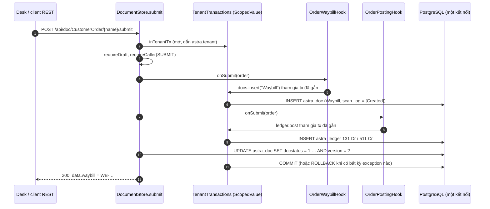

# Video 4 · Vòng đời chứng từ: Submit, Cancel, Amend

<a href="https://media.zerohostcms.com/astra-cms/astra-video-4-lifecycle-vi.mp4"></a>

▶ [Tiếng Việt](https://media.zerohostcms.com/astra-cms/astra-video-4-lifecycle-vi.mp4) · [English](https://media.zerohostcms.com/astra-cms/astra-video-4-lifecycle-en.mp4) · 3:10 · Kịch bản: [demo-video-series.md](../demo-video-series.md#video-4-vòng-đời-chứng-từ-submit-cancel-amend) · [Bản tiếng Anh](./04-lifecycle.md)

> **Tóm tắt một câu:** trong Astra, chứng từ đã Submit là bản chốt; muốn sửa thì Cancel (ghi bút toán đảo, không bao giờ sửa dòng cũ) rồi Amend (tạo đúng một bản nháp mới có liên kết), và mỗi bước chạy trong một transaction cơ sở dữ liệu duy nhất, cùng với mọi chứng từ và bút toán mà nó sinh ra.
>
> **Nên đọc nếu:** bạn viết hook và cần biết chính xác những gì chạy bên trong transaction submit/cancel (góc nhìn developer) / bạn đang quyết định một nền tảng kiểu ERP nên bảo đảm audit trail và tính nhất quán giữa đơn hàng, vận đơn và kế toán như thế nào (góc nhìn tech lead).

## Vấn đề

Astra Express nhận đơn của khách, chuyển cho bộ phận vận hành dưới dạng vận đơn, rồi ghi cước vận chuyển vào
công nợ phải thu của khách. Ba bản ghi do ba đội (OMS, OPS, BMS) quản lý cùng mô tả một sự kiện nghiệp vụ. Ở
phần lớn các hệ thống tự viết, ba bản ghi này dần lệch nhau:

- Đơn hàng đã "xác nhận" nhưng lệnh insert vận đơn thất bại, nên bưu kiện không bao giờ được lấy.
- Ai đó sửa lỗi chính tả trên đơn đã xác nhận bằng một câu `UPDATE`, và hoá đơn đã gửi khách không còn khớp với
  cơ sở dữ liệu.
- Kế toán "xoá" một dòng bút toán sai, và kiểm toán viên không thể dựng lại sổ sách tháng trước trông ra sao.

Frappe/ERPNext đã giải quyết phần nghiệp vụ của bài toán này từ nhiều năm trước bằng `docstatus` (0 Draft,
1 Submitted, 2 Cancelled) và nút Amend, và ERPNext ghi bút toán GL đảo khi cancel. Astra giữ nguyên mô hình đó,
vì kế toán và nhân viên vận hành vốn đã quen, và bổ sung hai điều mà kernel của một nền tảng có thể ép buộc:
bước vòng đời và mọi thứ các hook của nó ghi ra dùng chung một transaction, và bảng sổ cái từ chối `UPDATE` và
`DELETE` ngay ở tầng cơ sở dữ liệu.


*Ba trạng thái, một chiều.*

## Video cho thấy gì

Video theo một đơn hàng mới của khách C001 trong tenant `saigon-express`, đăng nhập bằng `mai` (admin).

| Cảnh | Bạn thấy gì | Điều được chứng minh |
| --- | --- | --- |
| Trạng thái | Draft → Submitted → Cancelled → Amend, một chiều | Chỉ có ba giá trị `docstatus`; Amend tạo chứng từ mới chứ không lùi trạng thái. |
| Tạo | Bản nháp `ORD-20261021-00011`, cước 58,000 ₫ do hook tính giá đặt khi lưu, vận đơn trống | Tác dụng phụ chờ đến lúc Submit; bản nháp vẫn sửa thoải mái. |
| Submit | Trạng thái thành Submitted, vận đơn `WB-2610-000008` xuất hiện, thẻ "Ledger entries" hiện Nợ 131 / Có 511, 58,000 | Vận đơn và bút toán được ghi trong cùng transaction với việc đổi trạng thái. |
| Một transaction | Thẻ code từ `DocumentStore.submit` | Các hook tham gia kết nối đang mở; lỗi ở bất kỳ đâu sẽ rollback toàn bộ. |
| Khoá | Các trường trên form bị khoá; một lệnh `PUT` qua API trả về 422 `submitted documents are immutable; cancel and amend instead` | Tính bất biến được kernel ép buộc, không chỉ là ẩn đi trên giao diện. |
| Cancel | Vận đơn thành Cancelled; sổ cái có thêm hai dòng đảo (Nợ 511 / Có 131); hai dòng gốc giữ nguyên | Cancel không bao giờ sửa hay xoá; nó nối thêm một bút toán đối xứng. |
| Amend | `ORD-20261021-00011-1`, Draft, "amends ORD-20261021-00011", vận đơn trống | Một phiên bản mới, liên kết với bản cũ; bản đã hủy vẫn nằm trong lịch sử. |
| Amend lại | Amend thêm lần nữa trên bản gốc đã hủy → 422 `ORD-20261021-00011 was already amended as ORD-20261021-00011-1` | Mỗi chứng từ đã hủy chỉ có đúng một bản amend; thay đổi tiếp theo làm trên `-1`. |
| API | `make demo-express SCENES=4`: tạo (201), submit (200), sửa bị từ chối (422), cancel (200), vận đơn `Cancelled`, amend (201) | Desk dùng chính các endpoint REST này; không có đường riêng cho giao diện. |

Số chứng từ trong các cảnh Desk (`ORD-…-00011`, `WB-2610-000008`) khác với số trong log API
(`ORD-20261021-00008`, `WB-2610-000006`) vì chúng được ghi ở hai lần chạy khác nhau.

## Cách hoạt động

### Ba bước chuyển nằm trong kernel

Toàn bộ quy tắc vòng đời nằm trong một class, `DocumentStore`, nên mọi app đều có cùng hành vi. Một DocType chọn
tham gia bằng `submittable: true`.

*`astra-apps/express/src/main/resources/META-INF/astra/doctypes/customer-order.doctype.yaml`*

```yaml
name: CustomerOrder
module: oms
kind: transaction
submittable: true                 # Draft (0) -> Submitted (1) -> Cancelled (2) -> Amend
transaction: global               # submit/cancel span BMS credit (Seata AT) and pickup capacity (Seata TCC)
naming: { series: "ORD-.YYYYMMDD.-.#####" }
# …
  - { name: waybill,          type: Link,     options: Waybill, read-only: true, in-list: true }   # created on submit
```

Submit và cancel đều ngắn và đối xứng nhau. Chú ý thứ tự thao tác: các hook chạy *trước* khi kernel ghi
`docstatus` mới, trên cùng kết nối, và lệnh `write` cuối cùng có kiểm tra version kiểu optimistic.

*`astra-doctype/src/main/java/io/astra/doctype/store/DocumentStore.java`*

```java
public Optional<Document> submit(String doctype, String name) {
    DocTypeDefinition def = requireSubmittable(doctype);
    return global(def, "submit " + doctype + " " + name, () -> inTenantTx(conn -> {
        Optional<Document> existing = get(doctype, name);
        if (existing.isEmpty()) return Optional.empty();
        Document doc = existing.get();
        requireDraft(doc);
        requireCaller(doc, Action.SUBMIT);
        hooks.onSubmit(doc);
        DocumentValidator.applyDefaultsAndValidate(def, doc);
        validateLinks(conn, def, doc);
        return Optional.of(write(conn, doc, 1));
    }));
}

public Optional<Document> cancel(String doctype, String name) {
    DocTypeDefinition def = requireSubmittable(doctype);
    return global(def, "cancel " + doctype + " " + name, () -> inTenantTx(conn -> {
        // …
        if (doc.docstatus() != 1) throw new DocValidationException("only submitted documents can be cancelled");
        requireCaller(doc, Action.CANCEL);
        hooks.onCancel(doc);
        return Optional.of(write(conn, doc, 2));
    }));
}
```

Tính bất biến chỉ là một guard, dùng chung cho `update` và `submit`:

*`astra-doctype/src/main/java/io/astra/doctype/store/DocumentStore.java`*

```java
private static void requireDraft(Document doc) {
    if (doc.docstatus() == 1) throw new DocValidationException("submitted documents are immutable; cancel and amend instead");
    if (doc.docstatus() == 2) throw new DocValidationException("cancelled documents are immutable; amend instead");
}
```

Vì sao đặt trong kernel: nếu tính bất biến chỉ là quy ước trên giao diện, bất kỳ script, tích hợp hay agent AI
nào gọi API vẫn sửa được đơn đã Submit. Đặt kiểm tra trên con đường ghi duy nhất nghĩa là Desk, REST, công cụ
MCP và hook đều gặp cùng một quy tắc.

### "Một transaction" là một ScopedValue, không phải quy ước

Khẳng định "tất cả trong một transaction" dựa trên `TenantTransactions`. Lời gọi đầu tiên mở một kết nối, gắn
tenant cho row-level security và lưu kết nối vào một `ScopedValue` của Java. Mọi lời gọi lồng bên trong (một
hook insert vận đơn, sổ cái ghi một bút toán) đều tìm thấy kết nối đã gắn và tham gia vào nó.

*`astra-doctype/src/main/java/io/astra/doctype/store/TenantTransactions.java`*

```java
public <T> T inTenantTx(SqlWork<T> work) {
    if (TX.isBound()) {
        try {
            return work.run(TX.get());
        } // …
    }
    String tenant = TenantContext.require();
    try (Connection conn = dataSource.getConnection()) {
        conn.setAutoCommit(false);
        try {
            // … SELECT set_config('astra.tenant', ?, true)
            T result = ScopedValue.where(TX, conn).call(() -> work.run(conn));
            conn.commit();
            return result;
        } catch (Exception e) {
            conn.rollback();
            // …
```

Vì sao dùng `ScopedValue` thay vì thread-local hay truyền `Connection` qua SPI: hook chỉ thấy `DocumentService`
và `GeneralLedger` (từ `astra-spi`), nên code của app không bao giờ cầm kết nối, không thể làm rò rỉ kết nối,
và không thể vô tình mở transaction thứ hai. `ScopedValue` bị giới hạn trong phạm vi lời gọi, chạy được với
virtual thread, và biến mất khi thao tác bên ngoài trả về.

### Các hook đi kèm

`CustomerOrder` có nhiều hook; ba hook liên quan đến video này. `HookRegistry` của kernel gom mọi
`DocLifecycleHook` đã cài theo DocType và gọi lần lượt từng hook.

*`astra-apps/express/src/main/java/io/astra/apps/express/OrderWaybillHook.java`*

```java
@Override
public void onSubmit(Document order) {
    Document waybill = docs.insert("Waybill", Map.of(
            "order", order.name(),
            "receiver_name", order.getString("receiver_name")), order.owner());
    order.set("waybill", waybill.name());
}

@Override
public void onCancel(Document order) {
    String name = order.getString("waybill");
    if (name == null) return;
    Document waybill = docs.get("Waybill", name).orElseThrow(() -> new DocValidationException("waybill " + name + " not found"));
    String status = waybill.getString("ops_status");
    if (!CANCELLABLE.contains(status)) {
        throw new DocValidationException("cannot cancel " + order.name() + ": waybill " + name + " is already '" + status + "'");
    }
    docs.update("Waybill", name, Map.of("ops_status", "Cancelled"));
}
```

*`astra-apps/express/src/main/java/io/astra/apps/express/OrderPostingHook.java`*

```java
/** Submitting an order bills its shipping fee (Dr 131 / Cr 511); cancelling it posts the reversal. */
// …
@Override
public void onSubmit(Document order) {
    BigDecimal fee = BigDecimal.valueOf(Numbers.toDouble(order.get("shipping_fee")));
    String customer = order.getString("customer");
    ledger.post("CustomerOrder", order.name(), LocalDate.now(), List.of(
            Entry.debit(Accounts.RECEIVABLE, customer, fee),
            Entry.credit(Accounts.REVENUE, customer, fee)), "Shipping fee " + order.name());
}

@Override
public void onCancel(Document order) {
    ledger.reverse("CustomerOrder", order.name());
}
```

Hook thứ ba, `OrderCreditHook`, giữ chỗ khoản cước trên hạn mức công nợ của khách và một suất lấy hàng khi có
Seata coordinator (`transaction: global`); không có coordinator thì nó không làm gì. Con đường đó là chủ đề
của [Video 17](./17-seata.vi.md).

Các hook không phụ thuộc vào thứ tự của nhau. Nếu `OrderWaybillHook` chặn một lệnh cancel sau khi
`OrderPostingHook` đã ghi bút toán đảo, exception sẽ rollback cả bút toán đảo đó, vì cả hai lần ghi đều đi qua
cùng một kết nối.




*Submit trong một transaction.*

### Cancel chỉ nối thêm, cơ sở dữ liệu ép buộc điều đó

`LedgerStore.reverse` đọc các dòng gốc của chứng từ và insert bản đối xứng của chúng với `is_reversal = true`.
Nó từ chối đảo cùng một chứng từ hai lần.

*`astra-doctype/src/main/java/io/astra/doctype/ledger/LedgerStore.java`*

```java
if (reversed) throw new DocValidationException("voucher " + voucherNo + " is already reversed");
if (original.isEmpty()) return null;
LocalDate today = LocalDate.now();
ensurePartition(conn, today);
List<Entry> mirror = original.stream().map(e -> new Entry(e.account(), e.party(), e.credit(), e.debit())).toList();
insert(conn, voucherType, voucherNo, today, mirror, true, "Reversal of " + voucherNo);
```

Kể cả khi code ứng dụng cố sửa một dòng đã ghi sổ, PostgreSQL cũng từ chối:

*`astra-doctype/src/main/resources/db/migration/V3__ledger.sql`*

```sql
-- Corrections are reversal entries, never UPDATE or DELETE; a trigger enforces this for every role,
-- including the table owner. Tenant isolation uses the same row-level security setting as astra_doc.
-- …
CREATE TRIGGER astra_ledger_no_update_delete
    BEFORE UPDATE OR DELETE ON astra_ledger
    FOR EACH ROW EXECUTE FUNCTION astra_ledger_append_only();
```

Bút toán đảo mang ngày cancel, không phải ngày ghi sổ gốc. Đó đúng là cách thường dùng để điều chỉnh một tháng đã
khoá sổ: kỳ cũ giữ nguyên như đã báo cáo, phần điều chỉnh xuất hiện ở kỳ hiện tại.


*Cancel chỉ nối thêm, không bao giờ sửa.*

### Amend: đúng một bản kế tiếp

*`astra-doctype/src/main/java/io/astra/doctype/store/DocumentStore.java`*

```java
if (cancelled.docstatus() != 2) throw new DocValidationException("only cancelled documents can be amended");
try (PreparedStatement ps = conn.prepareStatement(
        "SELECT name FROM astra_doc WHERE doctype = ? AND amended_from = ?")) {
    // …
        if (rs.next()) throw new DocValidationException(name + " was already amended as " + rs.getString(1));
}
// Read-only fields belong to the kernel and hooks; the new revision recomputes them.
Map<String, Object> copy = new LinkedHashMap<>(cancelled.data());
def.fields().stream().filter(FieldDefinition::readOnly).forEach(f -> copy.remove(f.name()));
Document draft = new Document(doctype, copy).owner(owner)
        .name(amendedName(cancelled)).amendedFrom(name);
return Optional.of(persistNew(conn, def, draft));
```

Ở đây thấy rõ ba lựa chọn thiết kế:

- **Mỗi phiên bản đã hủy có một bản kế tiếp.** Hai bản amend song song của cùng một đơn sẽ tạo ra hai "bản sửa"
  còn hiệu lực cho cùng một sự kiện. Từ chối bản thứ hai giữ cho chuỗi thẳng hàng: `ORD-…-00011` → `-1` → `-2`.
  `amendedName` tăng hậu tố khi bạn cancel rồi amend một bản amend.
- **Các trường read-only bị bỏ đi.** `waybill`, `shipping_fee` và `priced_by` là đầu ra của kernel/hook, nên bản
  nháp mới tính lại chúng qua `beforeSave` thay vì thừa hưởng giá trị cũ. Đó là lý do đơn đã amend hiện vận đơn
  trống.
- **Liên kết là một cột.** `amended_from` là cột thật trên `astra_doc` (`V2__amendments.sql`), nên có thể truy vấn
  chuỗi phiên bản mà không phải parse JSON.

## Ví dụ thực tế

Một shop ở Sài Gòn gửi một bưu kiện Express đi Đà Nẵng: C001, Domestic, Express, 2,2 kg, COD 500,000 ₫. Đây là
đầu vào của `make demo-express SCENES=4`, và `ExpressFlowTest` khẳng định cước tính ra là 73,000 ₫.

1. **Submit (09:00).** Nhân viên kinh doanh submit. Trong một lần commit: đơn thành `docstatus = 1`, vận đơn
   `WB-…` được insert ở trạng thái `Created`, và sổ cái có Nợ 131 (C001) 73,000 / Có 511 73,000.
2. **Khách gọi điện (09:20):** sai địa chỉ người nhận. Lệnh sửa bị từ chối với 422. Bưu kiện chưa được lấy, nên
   vận đơn vẫn ở `Created`, thuộc `CANCELLABLE`.
3. **Cancel.** Trong một lần commit: vận đơn chuyển `Created → Cancelled` (và có thêm mốc đó trong scan log), sổ
   cái nối thêm Nợ 511 / Có 131 73,000 đánh dấu là bút toán đảo, đơn thành `docstatus = 2`.
4. **Amend.** Một bản nháp mới `ORD-…-1` với cùng dữ liệu khách, vận đơn trống, cước tính lại khi lưu. Nhân viên
   sửa địa chỉ và submit: một vận đơn mới và một bút toán 73,000 mới.

Những gì kiểm toán viên thấy cho C001 trên tài khoản 131: +73,000, −73,000, +73,000 = còn phải thu 73,000, với ba
dòng, mỗi dòng trỏ về một số chứng từ. Đơn đã hủy, vận đơn đã hủy của nó và bản amend đều vẫn đọc được.

Nếu cuộc gọi đến lúc 15:00, sau khi bưu kiện đã tới hub, bước 3 thất bại với
`cannot cancel …: waybill … is already 'At Hub'`, và không có gì thay đổi: không bút toán đảo, không đổi trạng thái.
Quyền phủ quyết đó là chủ đề của [Video 5](./05-ops.vi.md).

Mẫu này cũng hợp với quy trình maker/checker cho lệnh thanh toán ở ngân hàng hay bảng lương cuối tháng: một khi
đã duyệt, bản ghi không bao giờ bị sửa; nó được đảo và phát hành lại, và chính dữ liệu là dấu vết kiểm toán.

## Dành cho tech lead

- **Mô hình nhất quán.** Mọi thứ một bước vòng đời gây ra bên trong PostgreSQL cùng commit hoặc cùng rollback. Đây
  là bảo đảm mạnh nhất mà bạn có được với chi phí thấp, và nó chỉ đúng với các lần ghi đi qua `DocumentService`
  và `GeneralLedger`. Một hook gọi HTTP API bên ngoài thì nằm ngoài transaction; cho trường hợp đó, Astra cung cấp
  Seata AT/TCC theo từng DocType (`transaction: global`, xem [Video 17](./17-seata.vi.md)).
- **Kiểm toán ngay từ thiết kế.** Tính bất biến được ép buộc hai lần: trong kernel (`requireDraft`) cho chứng từ
  và bằng trigger cơ sở dữ liệu cho các dòng sổ cái. Kiểm toán viên có thể tin vào cơ sở dữ liệu, không phải vào
  sự kỷ luật của code ứng dụng.
- **Chi phí.** Mỗi lần cancel+amend làm số dòng cho sự kiện đó tăng khoảng gấp đôi (chứng từ cũ, chứng từ mới,
  dòng gốc và dòng đảo). Với khối lượng đơn hàng và kế toán thì không đáng kể; phân vùng sổ cái theo tháng giữ cho
  nó trong tầm kiểm soát.
- **Đồng thời.** `write` dùng `version = ?`; hai người cùng submit một bản nháp sẽ có một người thành công và một
  người nhận lỗi `concurrent modification`, không bị ghi sổ hai lần.
- **Kỷ luật viết hook rất quan trọng.** Việc chạy lâu bên trong `onSubmit` giữ transaction (và row lock) mở. Hãy đo
  độ trễ submit p95 và thời lượng transaction theo DocType; để các tích hợp chậm ra ngoài hook.
- **Nên đo gì.** Tỷ lệ cancel và tỷ lệ amend theo DocType (tỷ lệ cao báo hiệu vấn đề UX hoặc chất lượng dữ liệu ở
  khâu trước), tỷ lệ cancel bị hook chặn, độ trễ submit.
- **Khi nào không nên dùng.** Những bản ghi vốn thay đổi tự nhiên (số điện thoại khách hàng, trạng thái ticket
  hỗ trợ) không nên để submittable; làm vậy chỉ thêm thủ tục mà không có giá trị kiểm toán. `Customer`, `Waybill`
  và `SupportTicket` trong demo cố ý không submittable.
- **So với Frappe/ERPNext.** Cùng mô hình tư duy (`docstatus`, `amended_from`, hậu tố `-1`), nên người dùng ERPNext
  chuyển sang được ngay. Khác biệt: hook là Java có kiểu chạy trong cùng transaction thay vì controller Python, sổ
  cái append-only nhờ trigger, và việc cô lập tenant do row-level security của PostgreSQL ép buộc.

## Tự chạy thử

Yêu cầu: JDK 25, Docker Desktop với khoảng 8 GB RAM, `kubectl`, `k3d`, `jq`, Bash 5 (`brew install bash` trên
macOS).

```bash
make k3d-up                           # cluster, kernel, PostgreSQL, Redis, Keycloak, Seata, CDC worker
make demo-reset && make demo-seed     # two tenants, demo users (password Astra@123)
make demo-express SCENES=4 PAUSE=0    # the API half of this video
open http://localhost:8080/desk/      # sign in as mai, New Customer Order for C001 → Create → Submit → Cancel → Amend
```

Output terminal dự kiến (các con số phụ thuộc vào ngày seed và số đơn hàng đang có):

```text
HTTP 201   X-Tx-LSN: 0/…        { "name": "ORD-<date>-000NN", "docstatus": 0 }
HTTP 200   X-Tx-LSN: 0/…        { "name": "ORD-…", "docstatus": 1, "waybill": "WB-<yymm>-0000NN" }
HTTP 422                        { "errors": ["submitted documents are immutable; cancel and amend instead"], "error": "validation" }
HTTP 200   X-Tx-LSN: 0/…        { "name": "ORD-…", "docstatus": 2 }
HTTP 200                        { "name": "WB-…", "ops_status": "Cancelled" }
HTTP 201   X-Tx-LSN: 0/…        { "name": "ORD-…-1", "docstatus": 0, "amendedFrom": "ORD-…", "waybill": null }
```

Cảnh này không gọi amend lần thứ hai; để thấy lỗi từ chối, hãy gửi lại đúng request amend đó
(`POST /api/doc/CustomerOrder/<original>/amend`) và chờ HTTP 422 `… was already amended as …-1`.

Hành vi này cũng được kiểm chứng mà không cần cụm trong `astra-server/src/test/java/io/astra/server/ExpressFlowTest.java`
(`cancelCascadesAndAmendCreatesRevision`, `submitCreatesWaybillAndCancelIsVetoedOnceInNetwork`); `make test` chạy
toàn bộ bộ test, Quarkus Dev Services khởi động PostgreSQL trong Docker.

## Nói đúng

- **Lát cắt mỏng.** `CustomerOrder` và `CODRemittance` là các DocType submittable trong app Express. Hoá đơn, phiếu
  thanh toán và bút toán nhật ký mô tả cho BMS trong [use-case-01.md](../use-case-01.md) là phạm vi mục tiêu, chưa
  được xây dựng.
- **"Một transaction" nghĩa là một transaction PostgreSQL** cho chứng từ và sổ cái. Khi có kết nối Seata, việc giữ
  chỗ hạn mức công nợ (schema BMS riêng) và suất lấy hàng trên Redis tham gia một global transaction của Seata bao
  quanh nó; phần đó được trình bày ở [Video 17](./17-seata.vi.md), không phải ở đây.
- **Thứ tự hook không cấu hình được.** `HookRegistry` gọi lần lượt mọi hook của DocType theo thứ tự CDI container
  trả về; tính đúng đắn ở đây dựa vào việc mọi lần ghi dùng chung transaction, không dựa vào thứ tự.
- **Khoản cước 58,000 ₫** trong các cảnh Desk đến từ đơn nhập trên Desk; lần chạy API dùng một đơn khác (2,2 kg,
  Express, COD 500,000) có cước 73,000 ₫.
- **Bút toán đảo mang ngày cancel.** Hiện chưa có tuỳ chọn ghi lùi ngày bút toán đảo về kỳ gốc.

## Hình minh hoạ

- [Hình 1 · Ba trạng thái, một chiều](#vấn-đề)
- [Hình 2 · Submit trong một transaction](#các-hook-đi-kèm)
- [Hình 3 · Cancel chỉ nối thêm, không bao giờ sửa](#cancel-chỉ-nối-thêm-cơ-sở-dữ-liệu-ép-buộc-điều-đó)

## Liên quan

- Trước: [Video 3 · Quy tắc nghiệp vụ: hook & validation](./03-hooks.vi.md). Tiếp: [Video 5 · Vận hành: máy trạng thái bưu kiện](./05-ops.vi.md).
- Đào sâu: [Video 12 · Sổ cái append-only](./12-ledger.vi.md), [Video 17 · Seata: một lần submit, ba tài nguyên](./17-seata.vi.md), [Video 11 · Keycloak: một danh tính, role theo tenant, quyền theo DocType](./11-keycloak.vi.md) (ai được submit và cancel).
- Trích đoạn code: [demo-code-snippets.md, S3](../demo-code-snippets.md#s3-lifecycle-in-one-transaction).
- Mã nguồn: `astra-doctype/src/main/java/io/astra/doctype/store/DocumentStore.java`,
  `astra-doctype/src/main/java/io/astra/doctype/store/TenantTransactions.java`,
  `astra-doctype/src/main/java/io/astra/doctype/ledger/LedgerStore.java`,
  `astra-apps/express/src/main/java/io/astra/apps/express/OrderWaybillHook.java`,
  `astra-apps/express/src/main/java/io/astra/apps/express/OrderPostingHook.java`,
  `astra-spi/src/main/java/io/astra/spi/hook/DocLifecycleHook.java`, `scripts/demo-express.sh` (`scene4`).
