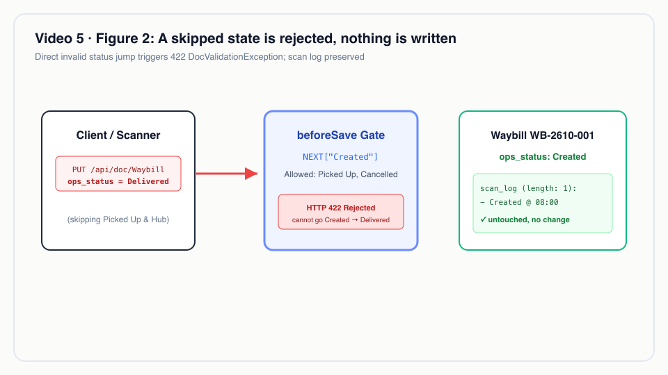
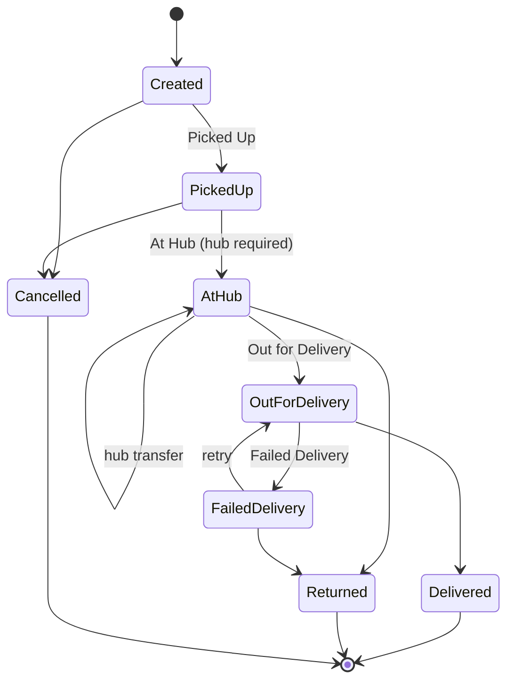
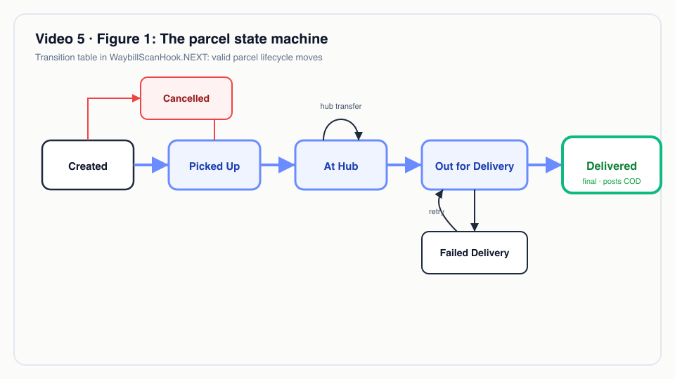
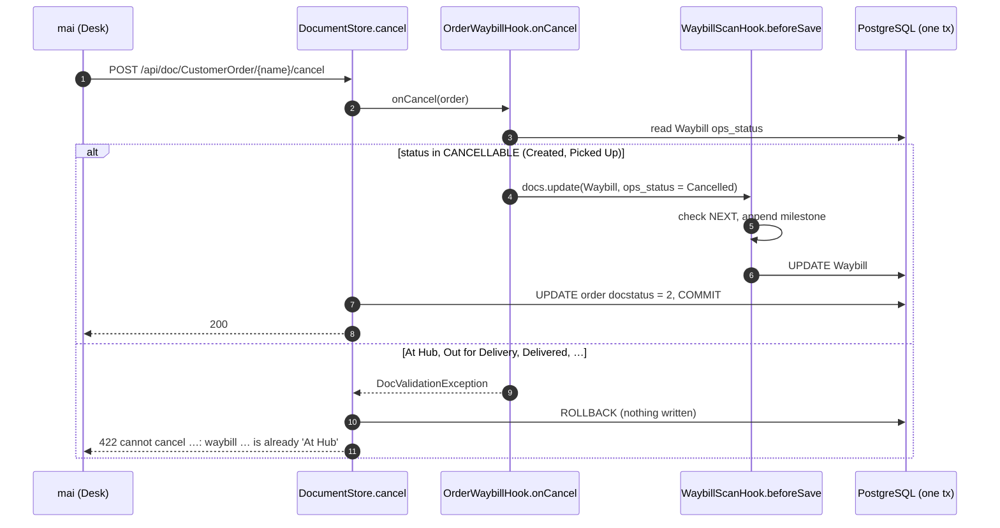
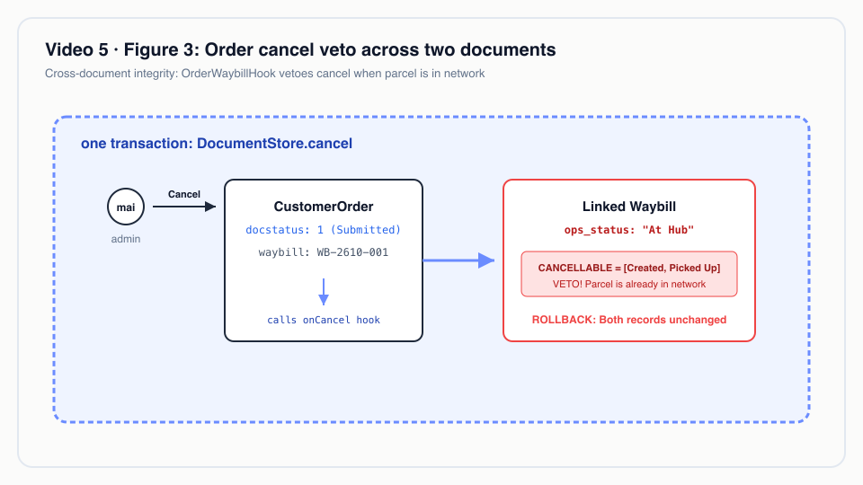

# Video 5 · Operations: the parcel state machine

<a href="https://media.zerohostcms.com/astra-cms/astra-video-5-ops-en.mp4"></a>

▶ [English](https://media.zerohostcms.com/astra-cms/astra-video-5-ops-en.mp4) · [Tiếng Việt](https://media.zerohostcms.com/astra-cms/astra-video-5-ops-vi.mp4) · 3:00 · Script: [demo-video-series.en.md](../demo-video-series.en.md#video-5-operations-the-parcel-state-machine)

> **In one sentence:** a parcel's status in Astra can only move along a transition table declared in one Java map, every accepted move appends a milestone to a scan log that no user can write, and an order cannot be cancelled once its parcel is in the network, because the veto and the cascade share one transaction.
>
> **Read this if:** you need to implement a status workflow with validation and history as a plain hook (developer angle) / you are weighing a workflow engine against a table-driven state machine for operational data such as parcels, tickets or work orders (tech-lead angle).

## The problem

A courier's operations team scans each parcel many times a day: picked up, arrived at a hub, transferred
to another hub, out for delivery, delivered or failed. Three things go wrong in typical systems:

- **Skipped or impossible states.** A scanner app or an integration sets `Delivered` on a parcel that was never
  picked up. Reports then show deliveries with no pickup, and COD reconciliation breaks.
- **Lost history.** The status column is overwritten on each scan, so "where was this parcel on Tuesday" needs
  a separate audit table that someone forgot to write to.
- **Orders and parcels disagree.** Sales cancels an order while the parcel is already on a truck. The order
  says cancelled, the driver still delivers, and nobody bills it.

The usual answers are a BPMN workflow engine (heavy for a status field), database enum checks (cannot express
"from A only to B or C"), or scattered `if` statements in controllers (each client re-implements them).
Frappe/ERPNext offers a Workflow DocType with states and transitions configured in the UI, mainly aimed at
approval chains with roles. Astra Express takes the smallest workable option: the transition table is data in
one hook, and the kernel guarantees every write path goes through that hook.

## What the video shows

Tenant `saigon-express`. Operations user `quang` (role `ops`), then admin `mai`.

| Scene | What you see | What it proves |
| --- | --- | --- |
| Filter | Waybill list filtered by `Ops status = At Hub` (⚡ projected field); one waybill at HCM-Tân Bình | Status filters use an expression index, not a JSONB scan. |
| Timeline | `WB-2610-000001`: six milestones from Created to Delivered, each with time and hub | The scan log is the parcel's history; only `WaybillScanHook` appends to it. |
| Diagram | The state machine drawn from the `NEXT` table; Delivered, Cancelled and Returned are final | The rule is a data table checked before every save. |
| Skip | A new waybill at `Created`, choose `Delivered` → HTTP 422; the scan log still has one milestone | No skipping states; a rejected write changes nothing. |
| Hub | `Picked Up` succeeds; `At Hub` with an empty hub fails; with hub DN-Hải Châu it succeeds and the timeline gains a milestone; the CARE replica also reaches three milestones | Per-state required data; the replica follows (Video 16 explains how). |
| Cancel | `mai` cancels a delivered order → rejected; after reload: order still Submitted (version 2), waybill still Delivered (version 6) | The order-side veto and the waybill cascade share one transaction. |
| API | `make demo-express SCENES=5`: valid transitions 200; `At Hub → Delivered` 422; cancelling the order while At Hub 422 and the order stays `docstatus 1` | Desk and REST go through the same hook. |
| Code | The `NEXT` table, `beforeSave`, and `OrderWaybillHook.onCancel` | One table, one veto. |


*A skipped state transition is rejected by beforeSave; the document and scan log remain untouched.*


## How it works

### The waybill is an ordinary DocType

*`astra-apps/express/src/main/resources/META-INF/astra/doctypes/waybill.doctype.yaml`*

```yaml
name: Waybill
module: ops
kind: transaction
naming: { series: "WB-.YYMM.-.######" }

fields:
  - { name: order,         type: Link,   options: CustomerOrder, required: true, in-list: true }
  - { name: receiver_name, type: Data,   in-list: true, pii: true }
  - { name: ops_status,    type: Select, options: [Created, Picked Up, At Hub, Out for Delivery, Delivered, Failed Delivery, Returned, Cancelled],
      default: Created, in-list: true, projected: true, label: Ops status }
  - { name: current_hub,   type: Data,   in-list: true, projected: true }
  - { name: scan_log,      type: JSON,   read-only: true }    # appended by WaybillScanHook on every status change

permissions:
  - { role: admin, read: true, write: true }
  - { role: ops,   read: true, write: true }    # scanning is an OPS action only
  - { role: sales, read: true }
  - { role: care,  read: true }
```

Four declarations do most of the work:

- `Select` with eight options: the kernel rejects any value outside the list before hooks run.
- `projected: true` on `ops_status` and `current_hub`: `ProjectionIndexer` builds
  `CREATE INDEX CONCURRENTLY … ON astra_doc (tenant_id, doctype, (data->>'ops_status'))` at startup, and list
  filters use the same expression, so the planner can pick the index.
- `read-only: true` on `scan_log`: the kernel rejects any client payload containing it
  (`DocumentValidator.rejectReadOnly`), so only server-side hooks can write the history.
- `permissions`: only `ops` and `admin` can scan; `care` and `sales` can read.

`Waybill` is not `submittable`. A parcel's status is supposed to change; what must not change is its
history, and that is handled by the read-only log rather than by document immutability.

### The transition table

*`astra-apps/express/src/main/java/io/astra/apps/express/WaybillScanHook.java`*

```java
static final Map<String, Set<String>> NEXT = Map.of(
        "Created", Set.of("Picked Up", "Cancelled"),
        "Picked Up", Set.of("At Hub", "Cancelled"),
        "At Hub", Set.of("At Hub", "Out for Delivery", "Returned"),
        "Out for Delivery", Set.of("Delivered", "Failed Delivery"),
        "Failed Delivery", Set.of("Out for Delivery", "Returned"),
        "Delivered", Set.of(),
        "Returned", Set.of(),
        "Cancelled", Set.of());
```




*The parcel state machine declared in WaybillScanHook.NEXT. The main happy path goes from Created to Delivered.*


`At Hub → At Hub` is allowed on purpose: a parcel moving from HCM-Tân Bình to DN-Hải Châu stays "At Hub" but
changes hub, and that transfer is a milestone worth recording. `Failed Delivery → Out for Delivery` models a
second delivery attempt.

### The check and the log in one method

*`astra-apps/express/src/main/java/io/astra/apps/express/WaybillScanHook.java`*

```java
@Override
@SuppressWarnings("unchecked")
public void beforeSave(Document doc) {
    List<Map<String, Object>> log = doc.get("scan_log") instanceof List<?> l
            ? new ArrayList<>((List<Map<String, Object>>) l) : new ArrayList<>();
    Map<String, Object> last = log.isEmpty() ? null : log.getLast();
    String status = doc.getString("ops_status");
    String hub = doc.getString("current_hub");

    if (last != null) {
        String from = (String) last.get("status");
        boolean same = from.equals(status) && Objects.equals(last.get("hub"), hub);
        if (same) return;
        if (!NEXT.getOrDefault(from, Set.of()).contains(status)) {
            throw new DocValidationException("ops_status cannot go from '" + from + "' to '" + status + "'");
        }
    } else if (!"Created".equals(status)) {
        throw new DocValidationException("a new waybill starts as 'Created'");
    }
    if ("At Hub".equals(status) && (hub == null || hub.isBlank())) {
        throw new DocValidationException("current_hub is required when ops_status is 'At Hub'");
    }

    if ("Delivered".equals(status)) postCollectedCod(doc);

    Map<String, Object> scan = new LinkedHashMap<>();
    scan.put("status", status);
    scan.put("hub", hub);
    scan.put("at", Instant.now().toString());
    log.add(scan);
    doc.set("scan_log", log);
}
```

Design notes:

- **The "from" state is the last log entry, not the stored column.** The log is the source of truth for
  history, so the check compares against what was actually recorded.
- **Idempotent saves.** If status and hub are unchanged (for example, editing another field), the hook returns
  without adding a milestone. Re-sending the same scan does not duplicate history.
- **`beforeSave` runs on every insert and update.** `DocumentStore.update` calls `hooks.beforeSave(doc)` before the
  `UPDATE`, and `persistNew` calls it before the `INSERT`, which is why the new waybill created at submit
  already has its `Created` milestone. A thrown `DocValidationException` becomes HTTP 422 and the transaction
  rolls back, so the stored document is untouched.
- **Delivery has an accounting side effect.** On `Delivered`, `postCollectedCod` posts the collected COD:
  Debit 1388 (COD held by couriers) / Credit 3388 (owed to the shop), in the same transaction as the status
  change. If the posting fails, the parcel is not marked delivered.

### The order-side veto

Cancelling an order (Video 4) cascades to its waybill, but only while the parcel has not entered the network.

*`astra-apps/express/src/main/java/io/astra/apps/express/OrderWaybillHook.java`*

```java
private static final Set<String> CANCELLABLE = Set.of("Created", "Picked Up");
// …
@Override
public void onCancel(Document order) {
    String name = order.getString("waybill");
    if (name == null) return;
    Document waybill = docs.get("Waybill", name).orElseThrow(() -> new DocValidationException("waybill " + name + " not found"));
    String status = waybill.getString("ops_status");
    if (!CANCELLABLE.contains(status)) {
        throw new DocValidationException("cannot cancel " + order.name() + ": waybill " + name + " is already '" + status + "'");
    }
    docs.update("Waybill", name, Map.of("ops_status", "Cancelled"));
}
```

Note the composition: the cascade `docs.update("Waybill", …, "Cancelled")` itself goes through
`WaybillScanHook.beforeSave`, so it is validated against `NEXT` and appended to the scan log like any scan.
`CANCELLABLE` and the `Cancelled` entries in `NEXT` agree (`Created`, `Picked Up`), so the two hooks cannot
contradict each other in practice; if they ever did, the stricter one wins and the whole cancel rolls back.




*Cancelling an order is vetoed if the waybill is already in the network; both documents share one transaction and roll back together.*


### Why a hook and not a workflow engine

- The rule fits in nine lines of data; a BPMN engine would add a runtime, a deployment artifact and a second
  persistence model for the same fact.
- The check runs inside the document's own transaction, so it composes with other hooks (COD posting, order
  cancel) without distributed coordination.
- Every write channel (Desk, REST, other hooks through `DocumentService`) reaches the same `beforeSave`,
  so there is no client that can bypass the table.

## Real-world example

A Vietnamese 3PL runs a Saigon → Đà Nẵng lane. The parcel below follows the same scans that
`scripts/demo-seed.sh` applies to the first seeded waybill (order for C001, COD 850,000 ₫); the clock times
and the premature `Delivered` tap are illustrative additions.

| Time | Scan (input) | Astra's response | Scan log length |
| --- | --- | --- | --- |
| 08:00 | Order submitted | Waybill inserted at `Created` | 1 |
| 09:10 | `Picked Up` | 200 | 2 |
| 11:30 | `At Hub`, hub `HCM-Tân Bình` | 200 | 3 |
| 18:00 | `At Hub`, hub `DN-Hải Châu` (line-haul arrived) | 200, hub transfer recorded | 4 |
| 07:30 next day | `Delivered` (driver taps too early) | 422 `ops_status cannot go from 'At Hub' to 'Delivered'` | 4 |
| 07:31 | `Out for Delivery` | 200 | 5 |
| 10:05 | `Delivered` | 200, ledger: Dr 1388 / Cr 3388 850,000 | 6 |

Meanwhile, at 14:00 on day one the shop asks sales to cancel. The order-side veto returns
`cannot cancel …: waybill … is already 'At Hub'`, and both documents stay as they were. Customer care can now
see the full history in the scan log (and in the CDC replica, Video 6) instead of asking the hub by phone,
and finance sees exactly 850,000 ₫ held by couriers for that parcel until it is remitted.

## For technical leaders

- **Where the rule lives.** In code (`WaybillScanHook.NEXT`), reviewed and versioned like code. Changing the
  workflow means a deploy of the app module. That is a feature for core operational rules and a limitation if
  business users expect to edit transitions themselves; per-tenant variation is the job of overlays
  ([Video 13](./13-overlay.md)) or Wasm scripts ([Video 14](./14-wasm.md)), not of this table.
- **Write amplification.** `scan_log` lives inside the JSONB document, so each scan rewrites the whole document
  and the log grows with every milestone. For tens of scans per parcel this is fine; for very high scan rates
  measure row size, TOAST growth and update latency. [use-case-01.md](../use-case-01.md) describes moving hot
  fields to physical columns or narrow side tables as the target design; it is not built.
- **Concurrency.** Two scanners updating the same waybill at once: the optimistic `version` check makes one
  fail with `concurrent modification`, instead of interleaving two log appends.
- **What to measure.** Rate of 422s per transition (a spike means a scanner app or integration is out of step),
  share of order cancels vetoed, time spent per state (SLA), p95 scan latency.
- **When not to use this pattern.** Approval chains with roles, escalations and timers per step are better
  served by a workflow engine or Frappe-style Workflow configuration. Use the table pattern for physical or
  technical lifecycles with a small, stable set of states.
- **Risk.** Every rule in one hook means one place to get wrong; the transitions are covered by
  `ExpressFlowTest.submitCreatesWaybillAndCancelIsVetoedOnceInNetwork`.

## Try it yourself

Prerequisites: JDK 25, Docker Desktop (about 8 GB RAM), `kubectl`, `k3d`, `jq`, Bash 5.

```bash
make k3d-up
make demo-reset && make demo-seed
make demo-express SCENES=5 PAUSE=0
open http://localhost:8080/desk/     # sign in as quang (ops), Waybill list, filter Ops status = At Hub
```

Expected output, abridged from a recorded run (`docs/video/v05-ops/assets/scene-05.log`):

```text
▸ Scan: picked up, then at hub
HTTP 200   { "ops_status": "Picked Up" }
HTTP 200   [ {"status":"Created",…}, {"status":"Picked Up",…}, {"hub":"DN-Hải Châu","status":"At Hub",…} ]
▸ Skipping a step is refused by WaybillScanHook
HTTP 422   { "errors": ["ops_status cannot go from 'At Hub' to 'Delivered'"], "error": "validation" }
▸ Once the parcel is in the network, cancelling the order is vetoed — and nothing changes (one transaction)
HTTP 422   { "errors": ["cannot cancel ORD-…: waybill WB-… is already 'At Hub'"], "error": "validation" }
HTTP 200   { "name": "ORD-…", "docstatus": 1 }
▸ Filter on a projected field: every parcel currently At Hub
HTTP 200   [ {"name":"WB-…","hub":"DN-Hải Châu"}, {"name":"WB-…","hub":"HCM-Tân Bình"} ]
```

Demo users share the password `Astra@123`. Sign in as `mai` to try cancelling the seeded order whose waybill
is Delivered.

## To be accurate

- **Thin slice.** One hook covers the parcel lifecycle. Barcode scanners, a mobile courier app, a separate
  `ScanEventLedger`, per-module schemas (`schema_ops`) and hot-field columns from
  [use-case-01.md](../use-case-01.md) are target architecture and are not built.
- **Scans are document updates.** A scan is `PUT /api/doc/Waybill/{name}` with `ops_status` and, for `At Hub`,
  `current_hub`. There is no dedicated scan endpoint.
- **The table is not tenant-configurable.** Both tenants share the same `NEXT` map.
- **Returned and Failed Delivery** exist in the table but are not exercised in the video.
- **COD posting on Delivered** is shown in [Video 12](./12-ledger.md); this video only shows the status side.
- **The replica milestone count** in the Hub scene comes from the Rust CDC worker (`scans` column computed as the
  length of `scan_log`, see `astra-cdc-rust/cdc-routes.yaml`); how it stays current is Video 16.

## Figures

- [Figure 1 · The parcel state machine](#the-transition-table)
- [Figure 2 · A skipped state is rejected, nothing is written](#what-the-video-shows)
- [Figure 3 · Order cancel veto across two documents](#the-order-side-veto)

## Related

- Previous: [Video 4 · Document lifecycle](./04-lifecycle.md). Next: [Video 6 · Customer care sees operations](./06-care.md).
- Deeper: [Video 2 · DocType and projected fields](./02-doctype.md), [Video 12 · Append-only ledger](./12-ledger.md) (COD posting), [Video 16 · Rust CDC](./16-cdc.md) (the replica), [Video 11 · Keycloak](./11-keycloak.md) (who may scan).
- Code excerpts: [demo-code-snippets.md, S3](../demo-code-snippets.md#s3-lifecycle-in-one-transaction).
- Source: `astra-apps/express/src/main/java/io/astra/apps/express/WaybillScanHook.java`,
  `astra-apps/express/src/main/java/io/astra/apps/express/OrderWaybillHook.java`,
  `astra-apps/express/src/main/resources/META-INF/astra/doctypes/waybill.doctype.yaml`,
  `astra-doctype/src/main/java/io/astra/doctype/store/ProjectionIndexer.java`,
  `astra-doctype/src/main/java/io/astra/doctype/store/DocumentStore.java`, `scripts/demo-express.sh` (`scene5`).
