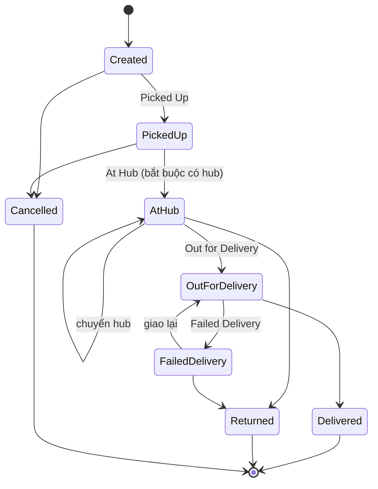
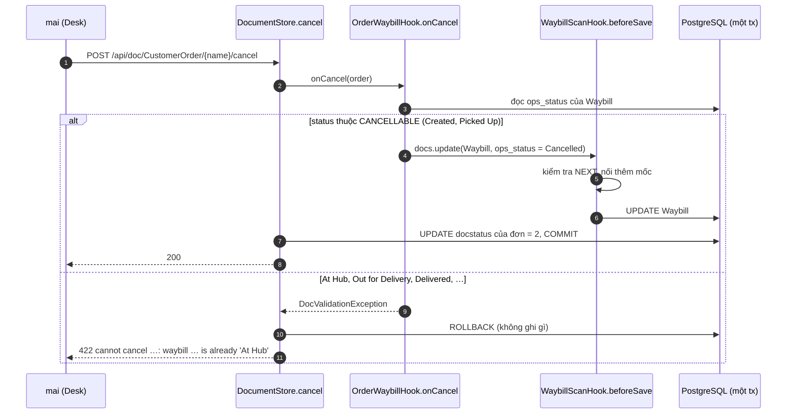

# Video 5 · Vận hành: máy trạng thái bưu kiện

<a href="https://media.zerohostcms.com/astra-cms/astra-video-5-ops-vi.mp4"></a>

▶ [Tiếng Việt](https://media.zerohostcms.com/astra-cms/astra-video-5-ops-vi.mp4) · [English](https://media.zerohostcms.com/astra-cms/astra-video-5-ops-en.mp4) · 3:00 · Kịch bản: [demo-video-series.md](../demo-video-series.md#video-5-vận-hành-máy-trạng-thái-bưu-kiện) · [Bản tiếng Anh](./05-ops.md)

> **Tóm tắt một câu:** trong Astra, trạng thái của bưu kiện chỉ được đi theo một bảng chuyển trạng thái khai báo trong một Java map duy nhất, mỗi bước chuyển hợp lệ nối thêm một mốc vào scan log mà không người dùng nào ghi được, và đơn hàng không thể bị hủy khi bưu kiện đã vào mạng lưới, vì quyền phủ quyết và thao tác lan truyền dùng chung một transaction.
>
> **Nên đọc nếu:** bạn cần hiện thực một quy trình trạng thái có kiểm tra hợp lệ và lịch sử dưới dạng một hook bình thường (góc nhìn developer) / bạn đang cân nhắc giữa workflow engine và máy trạng thái dựa trên bảng cho dữ liệu vận hành như bưu kiện, ticket hay lệnh công việc (góc nhìn tech lead).

## Vấn đề

Đội vận hành của một hãng chuyển phát quét mỗi bưu kiện nhiều lần trong ngày: đã lấy hàng, đến hub, chuyển sang
hub khác, đang giao, giao thành công hoặc giao thất bại. Ở các hệ thống thông thường, ba điều hay hỏng:

- **Nhảy cóc hoặc trạng thái vô lý.** Một app quét mã hay một tích hợp đặt `Delivered` cho bưu kiện chưa từng được
  lấy. Báo cáo khi đó có những lượt giao không có lượt lấy, và việc đối soát COD đổ vỡ.
- **Mất lịch sử.** Cột trạng thái bị ghi đè sau mỗi lần quét, nên câu hỏi "thứ Ba bưu kiện này ở đâu" cần một bảng
  audit riêng mà ai đó đã quên ghi vào.
- **Đơn hàng và bưu kiện vênh nhau.** Kinh doanh hủy đơn trong khi bưu kiện đã lên xe. Đơn ghi là đã hủy, tài xế vẫn
  giao, và không ai tính tiền.

Các lời giải thường gặp là một BPMN workflow engine (quá nặng cho một trường trạng thái), ràng buộc enum trong cơ
sở dữ liệu (không diễn đạt được "từ A chỉ sang B hoặc C"), hoặc các câu `if` rải rác trong controller (mỗi client
tự viết lại). Frappe/ERPNext có DocType Workflow với trạng thái và bước chuyển cấu hình trên giao diện, chủ yếu nhắm
tới chuỗi phê duyệt theo role. Astra Express chọn phương án nhỏ nhất dùng được: bảng chuyển trạng thái là dữ liệu
trong một hook, và kernel bảo đảm mọi đường ghi đều đi qua hook đó.

## Video cho thấy gì

Tenant `saigon-express`. Người dùng vận hành `quang` (role `ops`), sau đó là admin `mai`.

| Cảnh | Bạn thấy gì | Điều được chứng minh |
| --- | --- | --- |
| Filter | Danh sách Waybill lọc theo `Ops status = At Hub` (⚡ trường projected); một vận đơn ở HCM-Tân Bình | Filter theo trạng thái dùng expression index, không quét JSONB. |
| Timeline | `WB-2610-000001`: sáu mốc từ Created đến Delivered, mỗi mốc có thời gian và hub | Scan log là lịch sử của bưu kiện; chỉ `WaybillScanHook` nối thêm vào đó. |
| Sơ đồ | Máy trạng thái vẽ từ bảng `NEXT`; Delivered, Cancelled và Returned là trạng thái cuối | Quy tắc là một bảng dữ liệu được kiểm tra trước mỗi lần lưu. |
| Nhảy cóc | Một vận đơn mới ở `Created`, chọn `Delivered` → HTTP 422; scan log vẫn chỉ có một mốc | Không được nhảy cóc trạng thái; lần ghi bị từ chối không thay đổi gì. |
| Hub | `Picked Up` thành công; `At Hub` để trống hub thì lỗi; có hub DN-Hải Châu thì thành công và timeline có thêm một mốc; replica CARE cũng lên ba mốc | Dữ liệu bắt buộc theo từng trạng thái; replica theo kịp (Video 16 giải thích cách làm). |
| Cancel | `mai` hủy một đơn đã giao → bị từ chối; tải lại trang: đơn vẫn Submitted (version 2), vận đơn vẫn Delivered (version 6) | Quyền phủ quyết phía đơn hàng và thao tác lan sang vận đơn dùng chung một transaction. |
| API | `make demo-express SCENES=5`: các bước chuyển hợp lệ trả 200; `At Hub → Delivered` trả 422; hủy đơn khi đang At Hub trả 422 và đơn giữ `docstatus 1` | Desk và REST đi qua cùng một hook. |
| Code | Bảng `NEXT`, `beforeSave` và `OrderWaybillHook.onCancel` | Một bảng, một quyền phủ quyết. |

## Cách hoạt động

### Vận đơn là một DocType bình thường

*`astra-apps/express/src/main/resources/META-INF/astra/doctypes/waybill.doctype.yaml`*

```yaml
name: Waybill
module: ops
kind: transaction
naming: { series: "WB-.YYMM.-.######" }

fields:
  - { name: order,         type: Link,   options: CustomerOrder, required: true, in-list: true }
  - { name: receiver_name, type: Data,   in-list: true, pii: true }
  - { name: ops_status,    type: Select, options: [Created, Picked Up, At Hub, Out for Delivery, Delivered, Failed Delivery, Returned, Cancelled],
      default: Created, in-list: true, projected: true, label: Ops status }
  - { name: current_hub,   type: Data,   in-list: true, projected: true }
  - { name: scan_log,      type: JSON,   read-only: true }    # appended by WaybillScanHook on every status change

permissions:
  - { role: admin, read: true, write: true }
  - { role: ops,   read: true, write: true }    # scanning is an OPS action only
  - { role: sales, read: true }
  - { role: care,  read: true }
```

Bốn khai báo làm phần lớn công việc:

- `Select` với tám lựa chọn: kernel từ chối mọi giá trị nằm ngoài danh sách trước khi hook chạy.
- `projected: true` trên `ops_status` và `current_hub`: `ProjectionIndexer` tạo
  `CREATE INDEX CONCURRENTLY … ON astra_doc (tenant_id, doctype, (data->>'ops_status'))` lúc khởi động, và filter
  của danh sách dùng đúng biểu thức đó, nên planner có thể chọn index.
- `read-only: true` trên `scan_log`: kernel từ chối mọi payload từ client có chứa trường này
  (`DocumentValidator.rejectReadOnly`), nên chỉ hook phía server mới ghi được lịch sử.
- `permissions`: chỉ `ops` và `admin` được quét; `care` và `sales` chỉ được đọc.

`Waybill` không `submittable`. Trạng thái bưu kiện vốn phải thay đổi; thứ không được thay đổi là lịch sử của nó, và
điều đó do log read-only đảm nhận chứ không phải tính bất biến của chứng từ.

### Bảng chuyển trạng thái

*`astra-apps/express/src/main/java/io/astra/apps/express/WaybillScanHook.java`*

```java
static final Map<String, Set<String>> NEXT = Map.of(
        "Created", Set.of("Picked Up", "Cancelled"),
        "Picked Up", Set.of("At Hub", "Cancelled"),
        "At Hub", Set.of("At Hub", "Out for Delivery", "Returned"),
        "Out for Delivery", Set.of("Delivered", "Failed Delivery"),
        "Failed Delivery", Set.of("Out for Delivery", "Returned"),
        "Delivered", Set.of(),
        "Returned", Set.of(),
        "Cancelled", Set.of());
```



`At Hub → At Hub` được cho phép có chủ đích: bưu kiện đi từ HCM-Tân Bình sang DN-Hải Châu vẫn ở "At Hub" nhưng đổi
hub, và lần chuyển đó là một mốc đáng ghi lại. `Failed Delivery → Out for Delivery` mô hình hoá lần giao thứ hai.

### Kiểm tra và ghi log trong một method

*`astra-apps/express/src/main/java/io/astra/apps/express/WaybillScanHook.java`*

```java
@Override
@SuppressWarnings("unchecked")
public void beforeSave(Document doc) {
    List<Map<String, Object>> log = doc.get("scan_log") instanceof List<?> l
            ? new ArrayList<>((List<Map<String, Object>>) l) : new ArrayList<>();
    Map<String, Object> last = log.isEmpty() ? null : log.getLast();
    String status = doc.getString("ops_status");
    String hub = doc.getString("current_hub");

    if (last != null) {
        String from = (String) last.get("status");
        boolean same = from.equals(status) && Objects.equals(last.get("hub"), hub);
        if (same) return;
        if (!NEXT.getOrDefault(from, Set.of()).contains(status)) {
            throw new DocValidationException("ops_status cannot go from '" + from + "' to '" + status + "'");
        }
    } else if (!"Created".equals(status)) {
        throw new DocValidationException("a new waybill starts as 'Created'");
    }
    if ("At Hub".equals(status) && (hub == null || hub.isBlank())) {
        throw new DocValidationException("current_hub is required when ops_status is 'At Hub'");
    }

    if ("Delivered".equals(status)) postCollectedCod(doc);

    Map<String, Object> scan = new LinkedHashMap<>();
    scan.put("status", status);
    scan.put("hub", hub);
    scan.put("at", Instant.now().toString());
    log.add(scan);
    doc.set("scan_log", log);
}
```

Ghi chú thiết kế:

- **Trạng thái "from" là mục log cuối cùng, không phải cột đang lưu.** Log là nguồn sự thật của lịch sử, nên phép
  kiểm tra so với những gì thực sự đã được ghi nhận.
- **Lưu idempotent.** Nếu trạng thái và hub không đổi (ví dụ khi sửa một trường khác), hook trả về mà không thêm
  mốc. Gửi lại cùng một lần quét không làm lịch sử bị trùng.
- **`beforeSave` chạy ở mọi lần insert và update.** `DocumentStore.update` gọi `hooks.beforeSave(doc)` trước lệnh
  `UPDATE`, và `persistNew` gọi nó trước lệnh `INSERT`; đó là lý do vận đơn mới tạo lúc submit đã có sẵn mốc
  `Created`. Một `DocValidationException` bị ném ra sẽ thành HTTP 422 và transaction rollback, nên chứng từ đang
  lưu không bị đụng tới.
- **Giao hàng có tác dụng phụ về kế toán.** Khi `Delivered`, `postCollectedCod` ghi khoản COD đã thu:
  Nợ 1388 (COD tài xế đang giữ) / Có 3388 (phải trả cho shop), trong cùng transaction với việc đổi trạng thái. Nếu
  ghi sổ thất bại, bưu kiện không được đánh dấu đã giao.

### Quyền phủ quyết phía đơn hàng

Hủy một đơn hàng (Video 4) sẽ lan sang vận đơn của nó, nhưng chỉ khi bưu kiện chưa vào mạng lưới.

*`astra-apps/express/src/main/java/io/astra/apps/express/OrderWaybillHook.java`*

```java
private static final Set<String> CANCELLABLE = Set.of("Created", "Picked Up");
// …
@Override
public void onCancel(Document order) {
    String name = order.getString("waybill");
    if (name == null) return;
    Document waybill = docs.get("Waybill", name).orElseThrow(() -> new DocValidationException("waybill " + name + " not found"));
    String status = waybill.getString("ops_status");
    if (!CANCELLABLE.contains(status)) {
        throw new DocValidationException("cannot cancel " + order.name() + ": waybill " + name + " is already '" + status + "'");
    }
    docs.update("Waybill", name, Map.of("ops_status", "Cancelled"));
}
```

Để ý cách chúng ghép với nhau: thao tác lan truyền `docs.update("Waybill", …, "Cancelled")` cũng đi qua
`WaybillScanHook.beforeSave`, nên nó được kiểm tra với `NEXT` và được nối vào scan log như mọi lần quét khác.
`CANCELLABLE` và các mục `Cancelled` trong `NEXT` khớp nhau (`Created`, `Picked Up`), nên trên thực tế hai hook không
thể mâu thuẫn; nếu có ngày chúng mâu thuẫn, hook chặt hơn sẽ thắng và cả lệnh cancel bị rollback.



### Vì sao dùng hook mà không dùng workflow engine

- Quy tắc gói gọn trong chín dòng dữ liệu; một BPMN engine sẽ thêm một runtime, một artifact triển khai và một mô
  hình lưu trữ thứ hai cho cùng một sự kiện.
- Phép kiểm tra chạy bên trong transaction của chính chứng từ, nên nó ghép được với các hook khác (ghi sổ COD, hủy
  đơn) mà không cần điều phối phân tán.
- Mọi kênh ghi (Desk, REST, các hook khác qua `DocumentService`) đều tới cùng một `beforeSave`, nên không có client
  nào vượt qua được bảng.

## Ví dụ thực tế

Một công ty 3PL Việt Nam chạy tuyến Sài Gòn → Đà Nẵng. Bưu kiện dưới đây đi qua đúng các lần quét mà
`scripts/demo-seed.sh` áp dụng cho vận đơn seed đầu tiên (đơn của C001, COD 850,000 ₫); giờ giấc và cú bấm
`Delivered` quá sớm là phần thêm vào để minh hoạ.

| Thời điểm | Lần quét (đầu vào) | Phản hồi của Astra | Số mốc trong scan log |
| --- | --- | --- | --- |
| 08:00 | Đơn được submit | Vận đơn được insert ở `Created` | 1 |
| 09:10 | `Picked Up` | 200 | 2 |
| 11:30 | `At Hub`, hub `HCM-Tân Bình` | 200 | 3 |
| 18:00 | `At Hub`, hub `DN-Hải Châu` (xe trung chuyển đã tới) | 200, ghi nhận chuyển hub | 4 |
| 07:30 hôm sau | `Delivered` (tài xế bấm quá sớm) | 422 `ops_status cannot go from 'At Hub' to 'Delivered'` | 4 |
| 07:31 | `Out for Delivery` | 200 | 5 |
| 10:05 | `Delivered` | 200, sổ cái: Nợ 1388 / Có 3388 850,000 | 6 |

Trong khi đó, lúc 14:00 ngày đầu, shop nhờ kinh doanh hủy đơn. Quyền phủ quyết phía đơn hàng trả về
`cannot cancel …: waybill … is already 'At Hub'`, và cả hai chứng từ giữ nguyên. Giờ đây CSKH xem được toàn bộ lịch
sử trong scan log (và trong replica CDC, Video 6) thay vì gọi điện hỏi hub, còn kế toán thấy chính xác 850,000 ₫ tài
xế đang giữ cho bưu kiện đó cho tới khi được nộp lại.

## Dành cho tech lead

- **Quy tắc nằm ở đâu.** Trong code (`WaybillScanHook.NEXT`), được review và quản lý phiên bản như code. Thay đổi quy
  trình nghĩa là deploy lại module app. Đó là ưu điểm với các quy tắc vận hành cốt lõi và là hạn chế nếu người dùng
  nghiệp vụ muốn tự sửa bước chuyển; khác biệt theo từng tenant là việc của overlay
  ([Video 13](./13-overlay.vi.md)) hoặc script Wasm ([Video 14](./14-wasm.vi.md)), không phải của bảng này.
- **Khuếch đại ghi.** `scan_log` nằm trong chứng từ JSONB, nên mỗi lần quét ghi lại toàn bộ chứng từ và log dài ra
  theo từng mốc. Với vài chục lần quét mỗi bưu kiện thì ổn; với tần suất quét rất cao, hãy đo kích thước dòng, mức
  tăng TOAST và độ trễ update. [use-case-01.md](../use-case-01.md) mô tả thiết kế mục tiêu là chuyển các trường nóng
  sang cột vật lý hoặc bảng phụ hẹp; phần này chưa được xây dựng.
- **Đồng thời.** Hai máy quét cùng cập nhật một vận đơn: kiểm tra `version` kiểu optimistic làm một bên thất bại với
  `concurrent modification`, thay vì đan xen hai lần nối log.
- **Nên đo gì.** Tỷ lệ 422 theo từng bước chuyển (tăng đột biến nghĩa là một app quét mã hay tích hợp đang lệch
  nhịp), tỷ lệ lệnh hủy đơn bị chặn, thời gian ở mỗi trạng thái (SLA), độ trễ quét p95.
- **Khi nào không nên dùng mẫu này.** Chuỗi phê duyệt có role, leo thang và hẹn giờ theo từng bước thì hợp với
  workflow engine hoặc cấu hình Workflow kiểu Frappe hơn. Dùng mẫu bảng cho các vòng đời vật lý hoặc kỹ thuật có tập
  trạng thái nhỏ và ổn định.
- **Rủi ro.** Mọi quy tắc trong một hook nghĩa là chỉ có một chỗ để sai; các bước chuyển được kiểm chứng bởi
  `ExpressFlowTest.submitCreatesWaybillAndCancelIsVetoedOnceInNetwork`.

## Tự chạy thử

Yêu cầu: JDK 25, Docker Desktop (khoảng 8 GB RAM), `kubectl`, `k3d`, `jq`, Bash 5.

```bash
make k3d-up
make demo-reset && make demo-seed
make demo-express SCENES=5 PAUSE=0
open http://localhost:8080/desk/     # sign in as quang (ops), Waybill list, filter Ops status = At Hub
```

Output dự kiến, rút gọn từ một lần chạy đã ghi lại (`docs/video/v05-ops/assets/scene-05.log`):

```text
▸ Scan: picked up, then at hub
HTTP 200   { "ops_status": "Picked Up" }
HTTP 200   [ {"status":"Created",…}, {"status":"Picked Up",…}, {"hub":"DN-Hải Châu","status":"At Hub",…} ]
▸ Skipping a step is refused by WaybillScanHook
HTTP 422   { "errors": ["ops_status cannot go from 'At Hub' to 'Delivered'"], "error": "validation" }
▸ Once the parcel is in the network, cancelling the order is vetoed — and nothing changes (one transaction)
HTTP 422   { "errors": ["cannot cancel ORD-…: waybill WB-… is already 'At Hub'"], "error": "validation" }
HTTP 200   { "name": "ORD-…", "docstatus": 1 }
▸ Filter on a projected field: every parcel currently At Hub
HTTP 200   [ {"name":"WB-…","hub":"DN-Hải Châu"}, {"name":"WB-…","hub":"HCM-Tân Bình"} ]
```

Người dùng demo dùng chung mật khẩu `Astra@123`. Đăng nhập bằng `mai` để thử hủy đơn đã seed có vận đơn ở trạng
thái Delivered.

## Nói đúng

- **Lát cắt mỏng.** Một hook bao trọn vòng đời bưu kiện. Máy quét mã vạch, app di động cho tài xế, một
  `ScanEventLedger` riêng, schema theo module (`schema_ops`) và các cột cho trường nóng trong
  [use-case-01.md](../use-case-01.md) là kiến trúc mục tiêu, chưa được xây dựng.
- **Lần quét là lệnh cập nhật chứng từ.** Một lần quét là `PUT /api/doc/Waybill/{name}` với `ops_status` và, với
  `At Hub`, thêm `current_hub`. Không có endpoint quét riêng.
- **Bảng không cấu hình được theo tenant.** Cả hai tenant dùng chung một map `NEXT`.
- **Returned và Failed Delivery** có trong bảng nhưng không được dùng tới trong video.
- **Ghi sổ COD khi Delivered** được trình bày ở [Video 12](./12-ledger.vi.md); video này chỉ cho thấy phía trạng
  thái.
- **Số mốc trên replica** trong cảnh Hub đến từ worker Rust CDC (cột `scans` tính bằng độ dài của `scan_log`, xem
  `astra-cdc-rust/cdc-routes.yaml`); cách nó luôn cập nhật là chủ đề của Video 16.

## Minh hoạ: prompt vẽ hình

Prompt giữ nguyên tiếng Anh để mô hình tạo ảnh hiểu chính xác; nhãn trên hình là tên kỹ thuật thật.

### Hình 1 · Máy trạng thái bưu kiện

*Đặt ở:* Cách hoạt động

```text
Hand-drawn whiteboard sketch, black ink line art on off-white paper, one accent color (#6b8cff blue) for the key path, simple boxes and arrows, short handwritten labels in English, generous white space, no logos, no photorealism, 16:9.
Left to right main row of rounded boxes: "Created" → "Picked Up" → "At Hub" → "Out for Delivery" → "Delivered". A small self-loop arrow on "At Hub" labelled "hub transfer". Below "Out for Delivery" a box "Failed Delivery" with an arrow down from Out for Delivery and an arrow back up labelled "retry". Below "At Hub" a box "Returned", with arrows from "At Hub" and from "Failed Delivery". Above "Created" and "Picked Up" a box "Cancelled" with arrows from both. "Delivered", "Returned" and "Cancelled" drawn with double borders and the note "final". A tag on "At Hub" reading "current_hub required". Title in the corner: "WaybillScanHook.NEXT".
Highlight in blue: the main happy path from Created to Delivered.
```

### Hình 2 · Nhảy cóc trạng thái bị từ chối, không có gì được ghi

*Đặt ở:* Video cho thấy gì

```text
Hand-drawn whiteboard sketch, black ink line art on off-white paper, one accent color (#6b8cff blue) for the key path, simple boxes and arrows, short handwritten labels in English, generous white space, no logos, no photorealism, 16:9.
Left: a hand-drawn phone labelled "PUT ops_status = Delivered". Middle: a gate drawn as a turnstile labelled "beforeSave: NEXT['At Hub']" with a small list beside it "At Hub, Out for Delivery, Returned". The arrow from the phone hits the gate and bounces back with the label "422 cannot go from 'At Hub' to 'Delivered'". Right: a document card "WB-…" with a scan log of three lines "Created", "Picked Up", "At Hub · DN-Hải Châu", untouched, with the note "no change".
Highlight in blue: the gate.
```

### Hình 3 · Quyền phủ quyết hủy đơn trên hai chứng từ

*Đặt ở:* Cách hoạt động

```text
Hand-drawn whiteboard sketch, black ink line art on off-white paper, one accent color (#6b8cff blue) for the key path, simple boxes and arrows, short handwritten labels in English, generous white space, no logos, no photorealism, 16:9.
Two document cards side by side inside one large blue dashed rectangle labelled "one transaction". Left card "CustomerOrder · Submitted", right card "Waybill · At Hub". An arrow from a person icon "mai" to the left card labelled "Cancel". From the left card, an arrow to the right card labelled "onCancel: CANCELLABLE = Created, Picked Up?" ending in a question mark, then a "no" branch returning to the person with "422" and a small note "rollback, both unchanged".
Highlight in blue: the shared transaction rectangle.
```

## Liên quan

- Trước: [Video 4 · Vòng đời chứng từ: Submit, Cancel, Amend](./04-lifecycle.vi.md). Tiếp: [Video 6 · CSKH nhìn thấy vận hành](./06-care.vi.md).
- Đào sâu: [Video 2 · DocType và trường projected](./02-doctype.vi.md), [Video 12 · Sổ cái append-only](./12-ledger.vi.md) (ghi sổ COD), [Video 16 · Rust CDC + Sync-Aware LSN](./16-cdc.vi.md) (replica), [Video 11 · Keycloak](./11-keycloak.vi.md) (ai được quét).
- Trích đoạn code: [demo-code-snippets.md, S3](../demo-code-snippets.md#s3-lifecycle-in-one-transaction).
- Mã nguồn: `astra-apps/express/src/main/java/io/astra/apps/express/WaybillScanHook.java`,
  `astra-apps/express/src/main/java/io/astra/apps/express/OrderWaybillHook.java`,
  `astra-apps/express/src/main/resources/META-INF/astra/doctypes/waybill.doctype.yaml`,
  `astra-doctype/src/main/java/io/astra/doctype/store/ProjectionIndexer.java`,
  `astra-doctype/src/main/java/io/astra/doctype/store/DocumentStore.java`, `scripts/demo-express.sh` (`scene5`).
