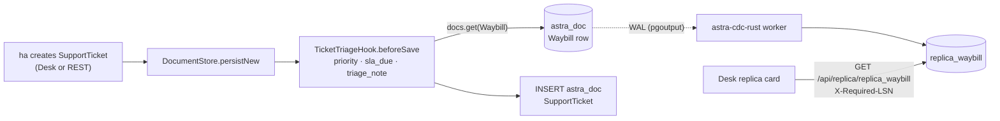

# Video 6 · Customer care sees operations

<a href="https://media.zerohostcms.com/astra-cms/astra-video-6-care-en.mp4"></a>

▶ [English](https://media.zerohostcms.com/astra-cms/astra-video-6-care-en.mp4) · [Tiếng Việt](https://media.zerohostcms.com/astra-cms/astra-video-6-care-vi.mp4) · 2:30 · Script: [demo-video-series.en.md](../demo-video-series.en.md#video-6-customer-care-sees-operations)

> **In one sentence:** when a care agent opens a support ticket against a waybill, a hook raises the priority for loss or damage complaints, sets an SLA deadline and copies the parcel's current status onto the ticket, while a card under the form shows the parcel as kept by a CDC replica rather than by the operations table.
>
> **Read this if:** you want to see how a small `beforeSave` hook links two modules without a service call (developer angle) / you are deciding how support teams should see operational data without loading the operational database (tech-lead angle).

## The problem

A customer of Astra Express calls the hotline: the ceramics arrived broken, they want compensation. In many
companies the care agent then:

- opens the CRM to log a ticket, with priority chosen by gut feeling;
- switches to the operations system (or phones the hub) to find out where the parcel is;
- works out the response deadline from a policy document.

Each step is slow and inconsistent: urgent complaints sit at Normal priority, and SLA reports are built later
from whatever agents typed. The other common fix, letting the CRM query the operations database directly,
puts reporting-style load on the tables that scanners write to all day.

Frappe/ERPNext's Issue DocType has priorities and Service Level Agreements configured in the UI, and links
to other documents. Astra's demo shows the same business outcome with two pieces: a rule hook for the ticket
fields, and a CDC replica for the read-heavy operational view.

## What the video shows

Tenant `saigon-express`, signed in as `ha` (role `care`).

| Scene | What you see | What it proves |
| --- | --- | --- |
| New ticket | New Support Ticket "Hàng bị vỡ, khách yêu cầu đền bù" (goods broken, customer asks for compensation), linked to delivered waybill `WB-2610-000001`; priority Normal; the three hook fields empty | The agent enters only what they know. |
| Created | `TCK-00004`: priority High, triage note `auto-escalated: mentions 'vỡ'`, SLA due creation time + 24 h, waybill status `Delivered` | One hook sets priority, SLA and the operational snapshot at save time. |
| Hook code | `TicketTriageHook`: seven keywords; escalates only from Low or Normal | The rule is plain code; the narration states AI triage over MCP is still roadmap. |
| Kernel | `beforeSave` is called right before the `INSERT` | The hook writes into the document being created, in the same transaction. |
| Replica card | "CARE replica (CDC) `replica_waybill`": in sync, worker lag 47 ms | The card reads a replica kept by the Rust CDC worker, not the `astra_doc` table. |
| API | `make demo-express SCENES=6`: a damage complaint is raised to High with an SLA and a waybill status snapshot; open High tickets are listed | Same hook behind REST and Desk. |

One distinction the video is careful about: the ticket's `waybill_status` field is read from the Waybill
document by the hook when the ticket is saved. Only the card under the form reads the replica.

## How it works

### The ticket DocType

*`astra-apps/express/src/main/resources/META-INF/astra/doctypes/support-ticket.doctype.yaml`*

```yaml
name: SupportTicket
module: care
kind: transaction
naming: { series: "TCK-.#####" }

fields:
  - { name: subject,        type: Data,     required: true, in-list: true }
  - { name: waybill,        type: Link,     options: Waybill, in-list: true }
  - { name: customer,       type: Link,     options: Customer }
  - { name: channel,        type: Select,   options: [Hotline, Zalo, Email, Web], default: Hotline }
  - { name: description,    type: Text }
  - { name: priority,       type: Select,   options: [Low, Normal, High, Urgent], default: Normal, in-list: true, projected: true }
  - { name: status,         type: Select,   options: [Open, In Progress, Resolved], default: Open, in-list: true, projected: true }
  - { name: waybill_status, type: Data,     read-only: true, in-list: true }   # snapshot of the waybill when the ticket is saved
  - { name: sla_due,        type: Datetime, read-only: true, in-list: true }
  - { name: triage_note,    type: Data,     read-only: true }

permissions:
  - { role: admin, read: true, create: true, write: true }
  - { role: care,  read: true, create: true, write: true }
  - { role: sales, read: true, create: true }
  - { role: ops,   read: true }
```

Why these choices:

- `waybill_status`, `sla_due` and `triage_note` are `read-only`: a client cannot send them, so an agent cannot
  set their own deadline or fake the parcel status. Only server-side hooks fill them.
- `priority` and `status` are `projected`, so the queue "open, High" is an indexed query
  (`GET /api/doc/SupportTicket?priority=High&status=Open` in scene 6).
- `waybill` is a `Link`: the kernel rejects a ticket that names a waybill that does not exist in this tenant.
- `ops` can read tickets but not write them; `care` can read waybills but not scan them (see
  [Video 5](./05-ops.md)). Each module keeps write ownership of its own documents.
- `SupportTicket` is not `submittable`: a ticket's status is meant to change, so the Draft/Submit lifecycle of
  [Video 4](./04-lifecycle.md) would add ceremony with no audit value.

### The triage hook

*`astra-apps/express/src/main/java/io/astra/apps/express/TicketTriageHook.java`*

```java
/**
 * Customer care rules: loss or damage complaints are escalated, every ticket gets an SLA deadline from
 * its priority, and the linked waybill's current status is copied in so the agent sees OPS state
 * without leaving CARE. Rule-based today; AI triage over MCP is on the roadmap.
 */
@ApplicationScoped
public class TicketTriageHook implements DocLifecycleHook {

    private static final List<String> ESCALATE = List.of("mất", "thất lạc", "hỏng", "vỡ", "lost", "damaged", "broken");
    private static final Set<String> LOW = Set.of("Low", "Normal");
    private static final Map<String, Duration> SLA = Map.of(
            "Urgent", Duration.ofHours(4),
            "High", Duration.ofHours(24),
            "Normal", Duration.ofHours(72),
            "Low", Duration.ofDays(5));

    @Inject DocumentService docs;

    @Override
    public String doctype() { return "SupportTicket"; }

    @Override
    public void beforeSave(Document t) {
        String text = (Objects.toString(t.get("subject"), "") + " " + Objects.toString(t.get("description"), "")).toLowerCase(Locale.ROOT);
        if (LOW.contains(t.getString("priority"))) {
            ESCALATE.stream().filter(text::contains).findFirst().ifPresent(word -> {
                t.set("priority", "High");
                t.set("triage_note", "auto-escalated: mentions '" + word + "'");
            });
        }
        if (t.get("sla_due") == null) {
            t.set("sla_due", Instant.now().plus(SLA.getOrDefault(t.getString("priority"), SLA.get("Normal"))).toString());
        }
        String waybill = t.getString("waybill");
        if (waybill != null && !waybill.isBlank()) {
            docs.get("Waybill", waybill).ifPresent(w -> t.set("waybill_status", w.getString("ops_status")));
        }
    }
}
```

Design notes, read directly from the code:

- **Escalation only goes up, and only from Low or Normal.** An agent who already chose Urgent is never
  downgraded to High by the rule.
- **Keywords cover Vietnamese and English** ("mất", "thất lạc", "hỏng", "vỡ", "lost", "damaged", "broken"), checked
  in the subject and the description, case-insensitively. The first match is recorded in `triage_note`, so the
  escalation is explainable to the agent and to an auditor.
- **The SLA is set once.** `sla_due` is only filled when empty, so editing the ticket later does not move the
  deadline. Note the consequence: if an agent raises a ticket to Urgent after creation, the deadline stays at the
  value computed at creation.
- **The waybill status is refreshed on each save.** `beforeSave` runs on insert and on every update, so
  `waybill_status` is a snapshot as of the ticket's last save, not a live value. The live view is the card below.
- **Cross-module read through the SPI.** The hook reads the waybill through `DocumentService`, the same API any
  app uses. No REST call between modules, no shared DAO, and the read happens inside the ticket's transaction
  under the same tenant.


*One save fills three fields: TicketTriageHook escalates priority to High, computes the SLA deadline, and takes a snapshot of the linked waybill status.*


### Where the kernel calls it

*`astra-doctype/src/main/java/io/astra/doctype/store/DocumentStore.java`*

```java
private Document persistNew(Connection conn, DocTypeDefinition def, Document doc) throws SQLException {
    DocumentValidator.applyDefaultsAndValidate(def, doc);
    hooks.beforeSave(doc);
    validateLinks(conn, def, doc);
    if (doc.name() == null) doc.name(assignName(conn, def, doc));
    try (PreparedStatement ps = conn.prepareStatement(
            "INSERT INTO astra_doc (id, tenant_id, doctype, name, owner, data, amended_from) "
                    + "VALUES (?, ?, ?, ?, ?, ?::jsonb, ?) RETURNING *")) {
        // …
```

Defaults are applied first (so `priority` is already `Normal` when the hook looks at it), then the hook mutates
the document, then links are validated and the row is inserted. Hook output is therefore part of the first
version of the row, and part of the first WAL record the CDC worker sees.

### The replica card

The card is generic Desk code. For a ticket it looks up the linked waybill in `replica_waybill`:

*`astra-server/src/main/resources/META-INF/resources/desk/desk.js`*

```js
const REPLICA_OF = { Waybill: ['replica_waybill', (d) => d.name], CustomerOrder: ['replica_order', (d) => d.name],
  SupportTicket: ['replica_waybill', (d) => d.data.waybill] };
// …
    const required = state.lastLsn;
    const res = await api('GET', '/api/replica/' + spec[0] + '?name=' + enc(key), undefined, required ? { 'X-Required-LSN': required } : {});
    if (res.status === 202) {
      // … 'sync pending' badge, retry after 100 ms
```

The replica table is written by the Rust CDC worker from the PostgreSQL WAL, with its columns declared in a
routes file:

*`astra-cdc-rust/cdc-routes.yaml`*

```yaml
routes:
  - doctype: Waybill
    target: replica_waybill
    columns:
      - { name: order_name,    from: order }
      - { name: ops_status,    from: ops_status }
      - { name: current_hub,   from: current_hub }
      - { name: receiver_name, from: receiver_name }
      - { name: scans,         from: scan_log, transform: length, type: integer }
```

`ReplicaResource` serves `GET /api/replica/{table}` to anyone who may read the source DocType (here `Waybill`,
which `care` may read), under the same row-level security as everything else. When the request carries
`X-Required-LSN`, `SyncAwareLsnFilter` answers `202 Sync Pending` until the worker's watermark has reached that
LSN; that read-your-writes mechanism is the subject of [Video 16](./16-cdc.md).




*Two ways care sees a parcel: a point-in-time snapshot on the ticket via DocumentService, and a near-real-time CDC replica for the read-heavy care card.*


Why a replica for the care view: care screens are read-heavy, open all day and tolerant of milliseconds of lag;
operational tables take the scan writes. Splitting the reads is the pattern described for CARE in
[use-case-01.md](../use-case-01.md). The hook still does one point read on the Waybill at save time, which is cheap
and gives the ticket a status that is consistent with the moment it was saved.

## Real-world example

A Vietnamese e-commerce fulfilment provider runs a hotline and a Zalo channel. Three tickets arrive on a
Monday morning; all values below follow from the hook's rules.

| Input | Priority in → out | `triage_note` | SLA due | `waybill_status` |
| --- | --- | --- | --- | --- |
| 09:00, Hotline, "Hàng bị vỡ, khách yêu cầu đền bù", waybill Delivered | Normal → High | `auto-escalated: mentions 'vỡ'` | Tue 09:00 (+24 h) | Delivered |
| 09:05, Zalo, "Hỏi giờ giao hàng", priority Low, waybill Out for Delivery | Low → Low | empty | Sat 09:05 (+5 days) | Out for Delivery |
| 09:10, Email, "Parcel lost, no update for 3 days", priority Urgent, waybill At Hub | Urgent → Urgent | empty (already above Normal) | Mon 13:10 (+4 h) | At Hub |


*Incoming complaints pass through the triage rules; damage claims escalate to High, while routine inquiries follow their standard SLAs.*


What the team lead gets without anyone typing it: a High queue
(`GET /api/doc/SupportTicket?priority=High&status=Open`) sorted with the damage claim on top, a deadline on
every ticket that SLA reports can trust, and for each ticket the parcel status at the time it was logged, which
matters when a customer later disputes "it was never delivered". The agent sees the parcel's current status,
hub and scan count in the replica card on the same screen.

For a bank's complaints desk the same pattern holds: keyword or category rules raise priority, the regulator's
response window becomes `sla_due`, and the linked transaction's status is captured at logging time.

## For technical leaders

- **Rule-based, deliberately.** Seven keywords are transparent, testable
  (`ExpressFlowTest.ticketsAreTriagedAndSeeTheWaybill`) and free to run. They will miss paraphrases ("cracked",
  "không còn nguyên vẹn") and can over-escalate ("không bị vỡ"). Measure the false-negative rate by sampling
  Normal tickets before investing in AI triage.
- **AI triage is roadmap.** The hook's own Javadoc says so. When it comes, the cheap path is to keep this hook as
  the deterministic floor and let a model only raise priority, never lower it.
- **SLA policy in code.** Four durations in a map are easy to review but require a deploy to change. Business
  hours, holidays and per-customer contracts are not modelled. If SLA terms vary by tenant or customer, that is a
  candidate for overlays ([Video 13](./13-overlay.md)) or a Wasm rule ([Video 14](./14-wasm.md)).
- **Two kinds of freshness.** `waybill_status` is a point-in-time snapshot (consistent with the ticket write);
  the replica card is near-real-time (eventually consistent, with read-your-writes on request). Make sure agents
  and reports know which one they are looking at.
- **Operational cost.** The replica requires the CDC worker, a logical replication slot and monitoring of lag.
  Measure worker lag (the card shows 47 ms in the recording), replication slot retained WAL, and the share of
  202 Sync Pending responses.
- **When not to use a replica.** For a small team with low read volume, reading the Waybill directly is simpler
  and the hook already does it. The replica pays off when care read traffic is large enough to compete with
  operational writes, or when care data must live in a separate store.
- **Compared with Frappe/ERPNext.** ERPNext's Service Level Agreement DocType offers configurable priorities and
  working hours in the UI; Astra's demo is code-first and thinner on SLA policy, but runs the rule in the same
  transaction as the ticket write and separates the care read path from operations.

## Try it yourself

Prerequisites: JDK 25, Docker Desktop (about 8 GB RAM), `kubectl`, `k3d`, `jq`, Bash 5. The replica card needs the
k3d stack, which includes the Rust CDC worker.

```bash
make k3d-up
make demo-reset && make demo-seed
make demo-express SCENES=6 PAUSE=0
open http://localhost:8080/desk/     # sign in as ha (password Astra@123), New Support Ticket, link a waybill, Create
```

Expected output, abridged from a recorded run (`docs/video/v06-care/assets/scene-06.log`):

```text
━━━ Scene 6 · Customer care sees operations ━━━
HTTP 200   [ "WB-2610-000002" ]
▸ A complaint mentioning damage is escalated, gets an SLA deadline and a snapshot of the waybill status
HTTP 201   X-Tx-LSN: 0/…
{
  "name": "TCK-00003",
  "priority": "High",
  "triage_note": "auto-escalated: mentions 'vỡ'",
  "sla_due": "<now + 24 h>",
  "waybill_status": "Out for Delivery"
}
▸ Open high-priority tickets
HTTP 200   [ {"name":"TCK-00003",…}, {"name":"TCK-00001","subject":"Khách báo hàng gốm bị vỡ"} ]
```

`TCK-00001` is seeded by `scripts/demo-seed.sh`; it is escalated by the same hook because its subject contains "vỡ".
Ticket numbers depend on how many tickets exist when you run the scene.

## To be accurate

- **Rule-based triage only.** No model is involved. AI triage over MCP, ticket auto-assignment and Tier 2 Wasm
  triage flows described for CARE in [use-case-01.md](../use-case-01.md) are not built.
- **`waybill_status` is not read from the replica.** The hook reads the Waybill document directly at save time.
  Only the "CARE replica (CDC)" card reads `replica_waybill`.
- **No separate CARE schema.** The replica tables live alongside `astra_doc` (`V5__cdc_replicas.sql`), protected by
  row-level security; the per-module `schema_care` of the target architecture is not built.
- **SLA is wall-clock.** No business hours, holidays, pause on "waiting for customer", or recalculation when
  priority changes after creation.
- **Claims and compensation** (a `ClaimCase` that posts to the ledger on approval) are target scope, not built.
- **The 47 ms worker lag** is the value shown in one recording; it varies with load.

## Figures

### Figure 1 · One save, three filled fields


### Figure 2 · Two ways care sees a parcel


### Figure 3 · The triage queue


## Related

- Previous: [Video 5 · Operations, the parcel state machine](./05-ops.md). Next: [Video 7 · Multi-tenancy](./07-tenants.md).
- Deeper: [Video 16 · Rust CDC + Sync-Aware LSN](./16-cdc.md) (how the replica card stays current), [Video 3 · Hooks](./03-hooks.md) (the same hook pattern), [Video 15 · MCP](./15-mcp.md) (AI agents over the same permissions), [Video 11 · Keycloak](./11-keycloak.md) (the `care` role).
- Code excerpts: [demo-code-snippets.md, S3](../demo-code-snippets.md#s3-lifecycle-in-one-transaction) and [S10](../demo-code-snippets.md#s10-rust-cdc-and-sync-aware-lsn).
- Source: `astra-apps/express/src/main/java/io/astra/apps/express/TicketTriageHook.java`,
  `astra-apps/express/src/main/resources/META-INF/astra/doctypes/support-ticket.doctype.yaml`,
  `astra-doctype/src/main/java/io/astra/doctype/store/DocumentStore.java`,
  `astra-doctype/src/main/java/io/astra/doctype/api/ReplicaResource.java`,
  `astra-doctype/src/main/java/io/astra/doctype/sync/SyncAwareLsnFilter.java`, `astra-cdc-rust/cdc-routes.yaml`,
  `scripts/demo-express.sh` (`scene6`).
