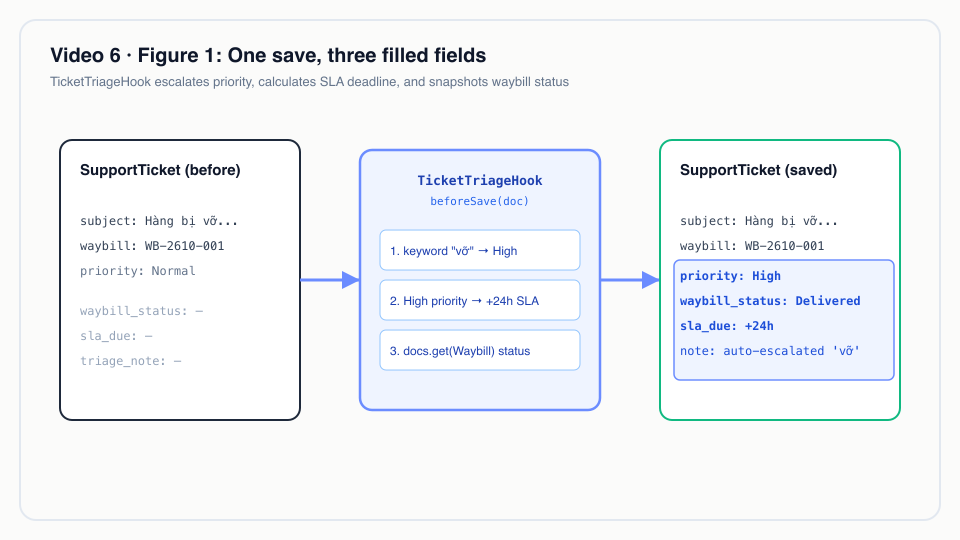
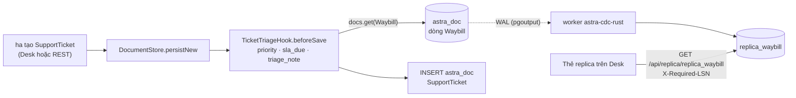
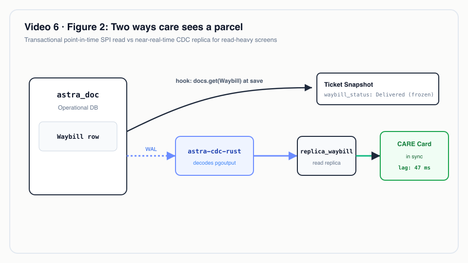
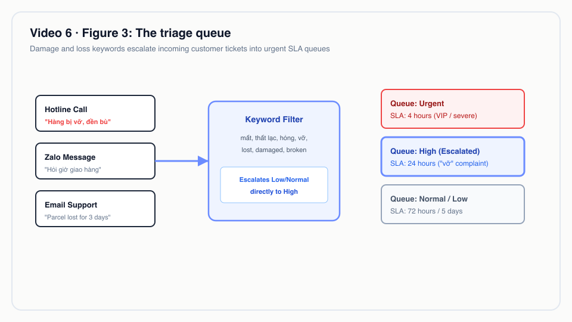

# Video 6 · CSKH nhìn thấy vận hành

<a href="https://media.zerohostcms.com/astra-cms/astra-video-6-care-vi.mp4"></a>

▶ [Tiếng Việt](https://media.zerohostcms.com/astra-cms/astra-video-6-care-vi.mp4) · [English](https://media.zerohostcms.com/astra-cms/astra-video-6-care-en.mp4) · 2:30 · Kịch bản: [demo-video-series.md](../demo-video-series.md#video-6-cskh-nhìn-thấy-vận-hành) · [Bản tiếng Anh](./06-care.md)

> **Tóm tắt một câu:** khi nhân viên CSKH mở một ticket hỗ trợ gắn với một vận đơn, một hook nâng mức ưu tiên cho các khiếu nại mất hoặc hỏng hàng, đặt hạn SLA và chép trạng thái hiện tại của bưu kiện vào ticket, còn một thẻ bên dưới form hiển thị bưu kiện theo một replica CDC chứ không đọc từ bảng vận hành.
>
> **Nên đọc nếu:** bạn muốn xem một hook `beforeSave` nhỏ nối hai module với nhau mà không cần gọi service như thế nào (góc nhìn developer) / bạn đang quyết định cách cho đội hỗ trợ xem dữ liệu vận hành mà không đè tải lên cơ sở dữ liệu vận hành (góc nhìn tech lead).

## Vấn đề

Một khách hàng của Astra Express gọi hotline: hàng gốm tới nơi đã vỡ, khách đòi bồi thường. Ở nhiều công ty, nhân
viên CSKH khi đó phải:

- mở CRM để ghi ticket, với mức ưu tiên chọn theo cảm tính;
- chuyển sang hệ thống vận hành (hoặc gọi điện cho hub) để biết bưu kiện đang ở đâu;
- tự tính hạn phản hồi từ một tài liệu chính sách.

Bước nào cũng chậm và thiếu nhất quán: khiếu nại khẩn nằm ở mức Normal, và báo cáo SLA được dựng sau từ bất cứ thứ
gì nhân viên đã gõ. Cách sửa phổ biến còn lại, cho CRM truy vấn thẳng cơ sở dữ liệu vận hành, lại đặt tải kiểu báo
cáo lên chính những bảng mà máy quét ghi vào suốt ngày.

DocType Issue của Frappe/ERPNext có mức ưu tiên và Service Level Agreement cấu hình trên giao diện, và liên kết được
tới các chứng từ khác. Demo của Astra cho ra cùng kết quả nghiệp vụ bằng hai mảnh: một hook quy tắc cho các trường
của ticket, và một replica CDC cho góc nhìn vận hành vốn đọc nhiều.

## Video cho thấy gì

Tenant `saigon-express`, đăng nhập bằng `ha` (role `care`).

| Cảnh | Bạn thấy gì | Điều được chứng minh |
| --- | --- | --- |
| Ticket mới | New Support Ticket "Hàng bị vỡ, khách yêu cầu đền bù", gắn với vận đơn đã giao `WB-2610-000001`; mức ưu tiên Normal; ba trường do hook điền đang trống | Nhân viên chỉ nhập những gì họ biết. |
| Đã tạo | `TCK-00004`: mức ưu tiên High, ghi chú phân loại `auto-escalated: mentions 'vỡ'`, hạn SLA bằng thời điểm tạo + 24 h, trạng thái vận đơn `Delivered` | Một hook đặt mức ưu tiên, SLA và ảnh chụp trạng thái vận hành ngay lúc lưu. |
| Code hook | `TicketTriageHook`: bảy từ khoá; chỉ nâng mức khi đang ở Low hoặc Normal | Quy tắc là code thuần; lời dẫn nói rõ phân loại bằng AI qua MCP vẫn nằm trong lộ trình. |
| Kernel | `beforeSave` được gọi ngay trước lệnh `INSERT` | Hook ghi vào chính chứng từ đang được tạo, trong cùng transaction. |
| Thẻ replica | "CARE replica (CDC) `replica_waybill`": in sync, độ trễ worker 47 ms | Thẻ đọc một replica do worker Rust CDC duy trì, không đọc bảng `astra_doc`. |
| API | `make demo-express SCENES=6`: một khiếu nại hư hỏng được nâng lên High, có SLA và ảnh chụp trạng thái vận đơn; liệt kê các ticket High đang mở | Cùng một hook phía sau REST và Desk. |

Có một điểm phân biệt mà video làm rất cẩn thận: trường `waybill_status` của ticket do hook đọc từ chứng từ Waybill
khi ticket được lưu. Chỉ thẻ bên dưới form mới đọc replica.

## Cách hoạt động

### DocType ticket

*`astra-apps/express/src/main/resources/META-INF/astra/doctypes/support-ticket.doctype.yaml`*

```yaml
name: SupportTicket
module: care
kind: transaction
naming: { series: "TCK-.#####" }

fields:
  - { name: subject,        type: Data,     required: true, in-list: true }
  - { name: waybill,        type: Link,     options: Waybill, in-list: true }
  - { name: customer,       type: Link,     options: Customer }
  - { name: channel,        type: Select,   options: [Hotline, Zalo, Email, Web], default: Hotline }
  - { name: description,    type: Text }
  - { name: priority,       type: Select,   options: [Low, Normal, High, Urgent], default: Normal, in-list: true, projected: true }
  - { name: status,         type: Select,   options: [Open, In Progress, Resolved], default: Open, in-list: true, projected: true }
  - { name: waybill_status, type: Data,     read-only: true, in-list: true }   # snapshot of the waybill when the ticket is saved
  - { name: sla_due,        type: Datetime, read-only: true, in-list: true }
  - { name: triage_note,    type: Data,     read-only: true }

permissions:
  - { role: admin, read: true, create: true, write: true }
  - { role: care,  read: true, create: true, write: true }
  - { role: sales, read: true, create: true }
  - { role: ops,   read: true }
```

Vì sao chọn như vậy:

- `waybill_status`, `sla_due` và `triage_note` là `read-only`: client không gửi được các trường này, nên nhân viên
  không thể tự đặt hạn cho mình hay làm giả trạng thái bưu kiện. Chỉ hook phía server điền chúng.
- `priority` và `status` là `projected`, nên hàng đợi "đang mở, High" là một truy vấn có index
  (`GET /api/doc/SupportTicket?priority=High&status=Open` ở cảnh 6).
- `waybill` là `Link`: kernel từ chối ticket trỏ tới vận đơn không tồn tại trong tenant này.
- `ops` đọc được ticket nhưng không ghi được; `care` đọc được vận đơn nhưng không quét được (xem
  [Video 5](./05-ops.vi.md)). Mỗi module giữ quyền ghi đối với chứng từ của riêng mình.
- `SupportTicket` không `submittable`: trạng thái của ticket vốn phải thay đổi, nên vòng đời Draft/Submit của
  [Video 4](./04-lifecycle.vi.md) chỉ thêm thủ tục mà không có giá trị kiểm toán.

### Hook phân loại

*`astra-apps/express/src/main/java/io/astra/apps/express/TicketTriageHook.java`*

```java
/**
 * Customer care rules: loss or damage complaints are escalated, every ticket gets an SLA deadline from
 * its priority, and the linked waybill's current status is copied in so the agent sees OPS state
 * without leaving CARE. Rule-based today; AI triage over MCP is on the roadmap.
 */
@ApplicationScoped
public class TicketTriageHook implements DocLifecycleHook {

    private static final List<String> ESCALATE = List.of("mất", "thất lạc", "hỏng", "vỡ", "lost", "damaged", "broken");
    private static final Set<String> LOW = Set.of("Low", "Normal");
    private static final Map<String, Duration> SLA = Map.of(
            "Urgent", Duration.ofHours(4),
            "High", Duration.ofHours(24),
            "Normal", Duration.ofHours(72),
            "Low", Duration.ofDays(5));

    @Inject DocumentService docs;

    @Override
    public String doctype() { return "SupportTicket"; }

    @Override
    public void beforeSave(Document t) {
        String text = (Objects.toString(t.get("subject"), "") + " " + Objects.toString(t.get("description"), "")).toLowerCase(Locale.ROOT);
        if (LOW.contains(t.getString("priority"))) {
            ESCALATE.stream().filter(text::contains).findFirst().ifPresent(word -> {
                t.set("priority", "High");
                t.set("triage_note", "auto-escalated: mentions '" + word + "'");
            });
        }
        if (t.get("sla_due") == null) {
            t.set("sla_due", Instant.now().plus(SLA.getOrDefault(t.getString("priority"), SLA.get("Normal"))).toString());
        }
        String waybill = t.getString("waybill");
        if (waybill != null && !waybill.isBlank()) {
            docs.get("Waybill", waybill).ifPresent(w -> t.set("waybill_status", w.getString("ops_status")));
        }
    }
}
```

Ghi chú thiết kế, đọc thẳng từ code:

- **Chỉ nâng mức, và chỉ từ Low hoặc Normal.** Nhân viên đã chọn Urgent thì không bao giờ bị quy tắc hạ xuống High.
- **Từ khoá phủ cả tiếng Việt và tiếng Anh** ("mất", "thất lạc", "hỏng", "vỡ", "lost", "damaged", "broken"), được
  tìm trong tiêu đề và mô tả, không phân biệt hoa thường. Từ khớp đầu tiên được ghi vào `triage_note`, nên việc
  nâng mức giải thích được cho cả nhân viên lẫn kiểm toán viên.
- **SLA chỉ đặt một lần.** `sla_due` chỉ được điền khi đang trống, nên sửa ticket về sau không dời hạn. Lưu ý hệ
  quả: nếu nhân viên nâng ticket lên Urgent sau khi tạo, hạn vẫn giữ giá trị tính lúc tạo.
- **Trạng thái vận đơn được làm mới mỗi lần lưu.** `beforeSave` chạy khi insert và ở mọi lần update, nên
  `waybill_status` là ảnh chụp tại lần lưu gần nhất của ticket, không phải giá trị trực tiếp. Góc nhìn trực tiếp là
  thẻ bên dưới.
- **Đọc chéo module qua SPI.** Hook đọc vận đơn qua `DocumentService`, chính API mà mọi app dùng. Không có lời gọi
  REST giữa các module, không có DAO dùng chung, và lần đọc diễn ra bên trong transaction của ticket, dưới cùng
  tenant.


*Một lần lưu, ba trường được điền.*

### Kernel gọi hook ở đâu

*`astra-doctype/src/main/java/io/astra/doctype/store/DocumentStore.java`*

```java
private Document persistNew(Connection conn, DocTypeDefinition def, Document doc) throws SQLException {
    DocumentValidator.applyDefaultsAndValidate(def, doc);
    hooks.beforeSave(doc);
    validateLinks(conn, def, doc);
    if (doc.name() == null) doc.name(assignName(conn, def, doc));
    try (PreparedStatement ps = conn.prepareStatement(
            "INSERT INTO astra_doc (id, tenant_id, doctype, name, owner, data, amended_from) "
                    + "VALUES (?, ?, ?, ?, ?, ?::jsonb, ?) RETURNING *")) {
        // …
```

Giá trị mặc định được áp trước (nên `priority` đã là `Normal` khi hook xem tới), rồi hook sửa chứng từ, rồi các
liên kết được kiểm tra và dòng được insert. Vì vậy đầu ra của hook là một phần của phiên bản đầu tiên của dòng, và
là một phần của bản ghi WAL đầu tiên mà worker CDC nhìn thấy.

### Thẻ replica

Thẻ này là code Desk dùng chung. Với một ticket, nó tra vận đơn được liên kết trong `replica_waybill`:

*`astra-server/src/main/resources/META-INF/resources/desk/desk.js`*

```js
const REPLICA_OF = { Waybill: ['replica_waybill', (d) => d.name], CustomerOrder: ['replica_order', (d) => d.name],
  SupportTicket: ['replica_waybill', (d) => d.data.waybill] };
// …
    const required = state.lastLsn;
    const res = await api('GET', '/api/replica/' + spec[0] + '?name=' + enc(key), undefined, required ? { 'X-Required-LSN': required } : {});
    if (res.status === 202) {
      // … 'sync pending' badge, retry after 100 ms
```

Bảng replica do worker Rust CDC ghi từ WAL của PostgreSQL, với các cột khai báo trong một file routes:

*`astra-cdc-rust/cdc-routes.yaml`*

```yaml
routes:
  - doctype: Waybill
    target: replica_waybill
    columns:
      - { name: order_name,    from: order }
      - { name: ops_status,    from: ops_status }
      - { name: current_hub,   from: current_hub }
      - { name: receiver_name, from: receiver_name }
      - { name: scans,         from: scan_log, transform: length, type: integer }
```

`ReplicaResource` phục vụ `GET /api/replica/{table}` cho bất kỳ ai được đọc DocType nguồn (ở đây là `Waybill`, mà
`care` được đọc), dưới cùng row-level security như mọi thứ khác. Khi request mang `X-Required-LSN`,
`SyncAwareLsnFilter` trả `202 Sync Pending` cho tới khi watermark của worker đạt tới LSN đó; cơ chế read-your-writes
này là chủ đề của [Video 16](./16-cdc.vi.md).



Vì sao dùng replica cho góc nhìn CSKH: màn hình CSKH đọc nhiều, mở cả ngày và chịu được độ trễ vài mili giây; các
bảng vận hành thì gánh các lần ghi từ máy quét. Tách luồng đọc ra là mẫu được mô tả cho CARE trong
[use-case-01.md](../use-case-01.md). Hook vẫn đọc một điểm trên Waybill lúc lưu, việc này rẻ và cho ticket một
trạng thái nhất quán với thời điểm nó được lưu.


*Hai cách CSKH nhìn một bưu kiện.*

## Ví dụ thực tế

Một nhà cung cấp dịch vụ fulfilment thương mại điện tử ở Việt Nam vận hành một hotline và một kênh Zalo. Ba ticket
đến vào sáng thứ Hai; mọi giá trị dưới đây đều suy ra từ các quy tắc của hook.

| Đầu vào | Mức ưu tiên vào → ra | `triage_note` | Hạn SLA | `waybill_status` |
| --- | --- | --- | --- | --- |
| 09:00, Hotline, "Hàng bị vỡ, khách yêu cầu đền bù", vận đơn Delivered | Normal → High | `auto-escalated: mentions 'vỡ'` | 09:00 thứ Ba (+24 h) | Delivered |
| 09:05, Zalo, "Hỏi giờ giao hàng", mức ưu tiên Low, vận đơn Out for Delivery | Low → Low | trống | 09:05 thứ Bảy (+5 ngày) | Out for Delivery |
| 09:10, Email, "Parcel lost, no update for 3 days", mức ưu tiên Urgent, vận đơn At Hub | Urgent → Urgent | trống (đã cao hơn Normal) | 13:10 thứ Hai (+4 h) | At Hub |

Những gì trưởng nhóm nhận được mà không ai phải gõ: một hàng đợi High
(`GET /api/doc/SupportTicket?priority=High&status=Open`) với khiếu nại hư hỏng nằm trên cùng, một hạn chót trên mọi
ticket mà báo cáo SLA tin được, và với mỗi ticket là trạng thái bưu kiện tại thời điểm ghi nhận, điều quan trọng khi
khách sau này phản bác "chưa bao giờ nhận được hàng". Nhân viên thấy trạng thái hiện tại, hub và số lần quét của
bưu kiện trong thẻ replica trên cùng màn hình.

Với bộ phận khiếu nại của ngân hàng, mẫu này vẫn đúng: quy tắc theo từ khoá hoặc danh mục nâng mức ưu tiên, thời hạn
phản hồi của cơ quan quản lý trở thành `sla_due`, và trạng thái của giao dịch được liên kết được ghi lại lúc tiếp nhận.


*Hàng đợi phân loại.*

## Dành cho tech lead

- **Dựa trên quy tắc, có chủ đích.** Bảy từ khoá thì minh bạch, kiểm thử được
  (`ExpressFlowTest.ticketsAreTriagedAndSeeTheWaybill`) và chạy không tốn gì. Chúng sẽ bỏ sót cách diễn đạt khác
  ("cracked", "không còn nguyên vẹn") và có thể nâng mức nhầm ("không bị vỡ"). Hãy đo tỷ lệ bỏ sót bằng cách lấy mẫu
  các ticket Normal trước khi đầu tư vào phân loại bằng AI.
- **Phân loại bằng AI là lộ trình.** Chính Javadoc của hook nói vậy. Khi tới lúc, cách rẻ là giữ hook này làm mức
  sàn tất định và chỉ để mô hình nâng mức ưu tiên, không bao giờ hạ.
- **Chính sách SLA nằm trong code.** Bốn khoảng thời gian trong một map thì dễ review nhưng muốn đổi phải deploy.
  Giờ làm việc, ngày lễ và hợp đồng theo từng khách chưa được mô hình hoá. Nếu điều khoản SLA khác nhau theo tenant
  hay theo khách, đó là ứng viên cho overlay ([Video 13](./13-overlay.vi.md)) hoặc một quy tắc Wasm
  ([Video 14](./14-wasm.vi.md)).
- **Hai kiểu độ tươi dữ liệu.** `waybill_status` là ảnh chụp tại một thời điểm (nhất quán với lần ghi ticket); thẻ
  replica gần thời gian thực (nhất quán sau cùng, có read-your-writes khi yêu cầu). Hãy chắc rằng nhân viên và báo
  cáo biết mình đang nhìn vào loại nào.
- **Chi phí vận hành.** Replica cần worker CDC, một logical replication slot và giám sát độ trễ. Hãy đo độ trễ worker
  (thẻ hiện 47 ms trong bản ghi hình), lượng WAL mà replication slot giữ lại, và tỷ lệ phản hồi 202 Sync Pending.
- **Khi nào không nên dùng replica.** Với một đội nhỏ, lượng đọc thấp, đọc thẳng Waybill đơn giản hơn và hook vốn đã
  làm vậy. Replica có lợi khi lưu lượng đọc của CSKH đủ lớn để tranh tài nguyên với các lần ghi vận hành, hoặc khi dữ
  liệu CSKH phải nằm ở một kho riêng.
- **So với Frappe/ERPNext.** DocType Service Level Agreement của ERPNext cho cấu hình mức ưu tiên và giờ làm việc
  trên giao diện; demo của Astra đi theo hướng code trước và mỏng hơn về chính sách SLA, nhưng chạy quy tắc trong
  cùng transaction với lần ghi ticket và tách luồng đọc của CSKH khỏi vận hành.

## Tự chạy thử

Yêu cầu: JDK 25, Docker Desktop (khoảng 8 GB RAM), `kubectl`, `k3d`, `jq`, Bash 5. Thẻ replica cần stack k3d, trong
đó có worker Rust CDC.

```bash
make k3d-up
make demo-reset && make demo-seed
make demo-express SCENES=6 PAUSE=0
open http://localhost:8080/desk/     # sign in as ha (password Astra@123), New Support Ticket, link a waybill, Create
```

Output dự kiến, rút gọn từ một lần chạy đã ghi lại (`docs/video/v06-care/assets/scene-06.log`):

```text
━━━ Scene 6 · Customer care sees operations ━━━
HTTP 200   [ "WB-2610-000002" ]
▸ A complaint mentioning damage is escalated, gets an SLA deadline and a snapshot of the waybill status
HTTP 201   X-Tx-LSN: 0/…
{
  "name": "TCK-00003",
  "priority": "High",
  "triage_note": "auto-escalated: mentions 'vỡ'",
  "sla_due": "<now + 24 h>",
  "waybill_status": "Out for Delivery"
}
▸ Open high-priority tickets
HTTP 200   [ {"name":"TCK-00003",…}, {"name":"TCK-00001","subject":"Khách báo hàng gốm bị vỡ"} ]
```

`TCK-00001` được seed bởi `scripts/demo-seed.sh`; nó được chính hook này nâng mức vì tiêu đề chứa "vỡ". Số ticket
phụ thuộc vào số ticket đang có khi bạn chạy cảnh này.

## Nói đúng

- **Chỉ phân loại theo quy tắc.** Không có mô hình nào tham gia. Phân loại bằng AI qua MCP, tự động phân công ticket
  và các luồng phân loại Wasm Tier 2 mô tả cho CARE trong [use-case-01.md](../use-case-01.md) chưa được xây dựng.
- **`waybill_status` không đọc từ replica.** Hook đọc trực tiếp chứng từ Waybill lúc lưu. Chỉ thẻ "CARE replica
  (CDC)" mới đọc `replica_waybill`.
- **Không có schema CARE riêng.** Các bảng replica nằm cạnh `astra_doc` (`V5__cdc_replicas.sql`), được bảo vệ bằng
  row-level security; `schema_care` theo module của kiến trúc mục tiêu chưa được xây dựng.
- **SLA tính theo giờ đồng hồ.** Không có giờ làm việc, ngày lễ, tạm dừng khi "chờ khách phản hồi", hay tính lại khi
  mức ưu tiên đổi sau lúc tạo.
- **Khiếu nại và bồi thường** (một `ClaimCase` ghi sổ cái khi được duyệt) là phạm vi mục tiêu, chưa được xây dựng.
- **Độ trễ worker 47 ms** là giá trị hiện trong một lần ghi hình; nó thay đổi theo tải.

## Hình minh hoạ

- [Hình 1 · Một lần lưu, ba trường được điền](#hook-phân-loại)
- [Hình 2 · Hai cách CSKH nhìn một bưu kiện](#thẻ-replica)
- [Hình 3 · Hàng đợi phân loại](#ví-dụ-thực-tế)

## Liên quan

- Trước: [Video 5 · Vận hành: máy trạng thái bưu kiện](./05-ops.vi.md). Tiếp: [Video 7 · Đa thuê bao](./07-tenants.vi.md).
- Đào sâu: [Video 16 · Rust CDC + Sync-Aware LSN](./16-cdc.vi.md) (cách thẻ replica luôn cập nhật), [Video 3 · Quy tắc nghiệp vụ: hook & validation](./03-hooks.vi.md) (cùng mẫu hook), [Video 15 · MCP: agent AI dùng Astra bằng quyền của người dùng](./15-mcp.vi.md) (agent AI trên cùng bộ quyền), [Video 11 · Keycloak](./11-keycloak.vi.md) (role `care`).
- Trích đoạn code: [demo-code-snippets.md, S3](../demo-code-snippets.md#s3-lifecycle-in-one-transaction) và [S10](../demo-code-snippets.md#s10-rust-cdc-and-sync-aware-lsn).
- Mã nguồn: `astra-apps/express/src/main/java/io/astra/apps/express/TicketTriageHook.java`,
  `astra-apps/express/src/main/resources/META-INF/astra/doctypes/support-ticket.doctype.yaml`,
  `astra-doctype/src/main/java/io/astra/doctype/store/DocumentStore.java`,
  `astra-doctype/src/main/java/io/astra/doctype/api/ReplicaResource.java`,
  `astra-doctype/src/main/java/io/astra/doctype/sync/SyncAwareLsnFilter.java`, `astra-cdc-rust/cdc-routes.yaml`,
  `scripts/demo-express.sh` (`scene6`).
