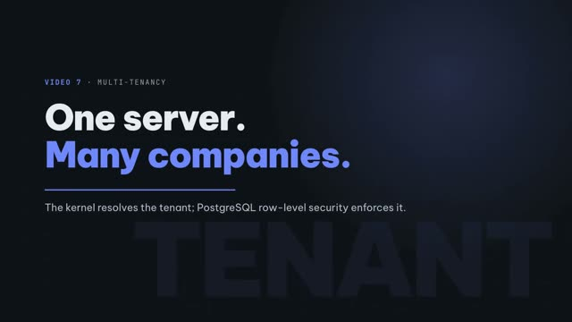

# Video 7 · Multi-tenancy

<a href="https://media.zerohostcms.com/astra-cms/astra-video-7-tenants-en.mp4"></a>

▶ [English](https://media.zerohostcms.com/astra-cms/astra-video-7-tenants-en.mp4) · [Tiếng Việt](https://media.zerohostcms.com/astra-cms/astra-video-7-tenants-vi.mp4) · 2:28 · Script: [demo-video-series.en.md](../demo-video-series.en.md#video-7-multi-tenancy)

> **In one sentence:** One Astra server hosts many companies; the kernel decides which tenant a request belongs to, carries that decision in a Java `ScopedValue` into a transaction-local PostgreSQL setting, and row-level security returns zero rows whenever that setting is missing.
>
> **Read this if:** you write Astra apps and want to know why no API takes a `tenant` parameter (developer angle) / you are choosing between shared-schema, database-per-tenant and instance-per-tenant SaaS and want to know where the isolation boundary actually sits (tech-lead angle).

## The problem

Astra Express, the demo's courier company, runs as two tenants on one platform: `saigon-express` and
`hanoi-express`. Both have a customer called `C001`. In Saigon it is "Shop Hoa Mai"; in Hanoi it is
"Nhà sách Tràng Tiền". Both create orders, waybills and COD remittances through the same URLs and the same
DocTypes. Some people work for both: the `demo` user is an admin in each.

The pain in a shared-schema SaaS is well known. Isolation usually lives in application code: every query
needs a `WHERE tenant_id = ?`, every repository method takes a tenant argument, and every new developer,
background job, report or AI tool is one more place where that filter can be forgotten. The failure mode is
silent: a missing filter does not throw; it returns another company's customers.

The usual alternatives trade that risk for operating cost:

- **Database or instance per tenant.** Frappe/ERPNext does this: a bench hosts many *sites*, each with its
  own database. Isolation is strong, but every site is migrated, backed up and monitored separately, and
  cross-site work (a dispatcher serving two branches) means two logins.
- **Shared tables with an ORM filter.** Cheap to run, but the boundary is only as strong as the most
  careless query, including raw SQL in reports and hooks.

Astra's thin slice takes the shared-table route but moves the boundary out of application code into two
places the application cannot skip: the kernel's request filter and PostgreSQL row-level security (RLS).

## What the video shows

| Scene | What you see | What it proves |
| --- | --- | --- |
| 1 · Title | "One server, many companies." | Framing. |
| 2 · List | `demo` opens `/desk/compare.html`, Screen `#/list/Customer`. Two panes, same URL, same DocType. Saigon shows 3 customers, Hanoi 2. | Each pane calls the same API with a different `X-Astra-Tenant` header; the data differs. |
| 3 · Form | `#/form/Customer/C001` in both panes. | The same document name is two separate records. Uniqueness is `(tenant_id, doctype, name)`. |
| 4 · Resolve | The resolution order: header, subdomain, the user's only tenant. Unresolved: 400. Non-member: 403. | No API takes the tenant as a parameter; the kernel resolves it once per request. |
| 5 · Links | `GET Customer/C003` as Hanoi returns 404; a Hanoi order pointing at `C003` fails with `field 'customer': Customer 'C003' not found`. | Link validation sees only the current tenant's rows. |
| 6 · Members | `nam` (Hanoi admin) calling Saigon gets `403 not a member of tenant saigon-express`; `demo` without a header gets `400`. | Fail-closed: if the tenant is ambiguous, the kernel refuses rather than guesses. |
| 7 · RLS | In `psql` as the application role: `visible_rows = 0` without a tenant; after `set_config('astra.tenant','saigon-express',true)`, counts per DocType (Customer 3, CustomerOrder 7, Waybill 5, …). | The database itself enforces the boundary, even for raw SQL. |
| 8 · Code | `TenantContext`, `TenantTransactions`, `RowLevelSecurityGuard`. | The tenant follows the call flow, not the argument list. |
| 9 · Recap | Four layers: one URL, Links, Keycloak per tenant, zero rows without a tenant. | |

The terminal half of the video is `make demo-express SCENES=7`. The captured run
(`docs/video/v07-tenants/assets/scene-07.log`) shows exactly these responses:

```text
$ curl -X GET http://localhost:8080/api/doc/Customer -H "Authorization: Bearer <nam>" -H "X-Astra-Tenant: saigon-express"
HTTP 403
{ "error": "not a member of tenant saigon-express" }

$ curl -X GET http://localhost:8080/api/doc/Customer -H "Authorization: Bearer <demo>"
HTTP 400
{ "error": "tenant could not be resolved; send X-Astra-Tenant or use a tenant subdomain" }
```

## How it works

The path from HTTP request to SQL row has four steps. Each one is a place where the tenant is either
established or enforced, never passed in by the caller.

```mermaid
sequenceDiagram
    participant C as Client (Desk / curl / MCP)
    participant F as TenantResolverFilter
    participant R as DocResource
    participant T as TenantTransactions
    participant P as PostgreSQL (RLS)
    C->>F: Bearer JWT (groups /tenants/<t>/<role>) + optional X-Astra-Tenant
    F->>F: header → subdomain → only membership
    alt unresolved
        F-->>C: 400
    else not a member
        F-->>C: 403
    end
    F->>R: tenantRequest.tenantId(t), roles
    R->>R: TenantContext.call(t, work)  (ScopedValue)
    R->>T: inTenantTx(work)
    T->>P: BEGIN; set_config('astra.tenant', t, true)
    T->>P: SELECT/INSERT … (no tenant filter in SQL)
    P-->>T: only rows where tenant_id = current_setting('astra.tenant')
    T->>P: COMMIT (setting disappears)
```

### Step 1: resolve the tenant, once, from trusted inputs

*`astra-kernel/src/main/java/io/astra/kernel/tenant/TenantResolverFilter.java`*

```java
Memberships memberships = Memberships.of(identity);
String tenant = fromHeader(ctx).or(() -> fromHost(ctx)).or(() -> onlyMembership(memberships)).orElse(null);
if (tenant == null && "single".equals(mode)) {
    tenant = defaultTenant;
}
if (tenant == null || !tenant.matches("[a-z0-9][a-z0-9-]{0,62}")) {
    ctx.abortWith(error(Response.Status.BAD_REQUEST, "tenant could not be resolved; send "
            + TENANT_HEADER + " or use a tenant subdomain"));
    return;
}
Set<String> roles = memberships.roles(tenant);
if (roles.isEmpty()) {
    ctx.abortWith(error(Response.Status.FORBIDDEN, "not a member of tenant " + tenant));
    return;
}
```

Why this shape:

- **The header is a hint, not an authority.** A client may *name* a tenant, but membership is checked
  against the verified bearer token. Memberships come from Keycloak group paths of the form
  `/tenants/<tenant>/<role>` (`astra-kernel/src/main/java/io/astra/kernel/security/Memberships.java`), so
  roles are always per tenant: `nam` is an admin, but only in `hanoi-express`.
- **A single-tenant user never has to say anything.** `onlyMembership` picks the one tenant a user belongs
  to, so a user like `nam`, who belongs only to `hanoi-express`, does not need a header.
- **Ambiguity is an error.** A user in two tenants who sends nothing gets 400 instead of "the first
  tenant", because a guess is exactly how data ends up in the wrong company.
- **Subdomain resolution exists but is off by default.** `fromHost` only runs when
  `astra.tenancy.base-domain` is set; in `astra-server/src/main/resources/application.yml` it is
  commented out.

### Step 2: carry the tenant in a `ScopedValue`, not in arguments

*`astra-spi/src/main/java/io/astra/spi/tenant/TenantContext.java`*

```java
/**
 * The current tenant, carried in a Java 25 {@link ScopedValue}. The kernel binds it once per request;
 * every kernel service reads it from here. No kernel API accepts a tenant as a caller-supplied
 * parameter, which is what makes cross-tenant access impossible from app code.
 */
public final class TenantContext {

    private static final ScopedValue<String> TENANT = ScopedValue.newInstance();
    // …
    /** The bound tenant; throws when no tenant is in scope, which is always a programming error. */
    public static String require() {
        if (!TENANT.isBound()) {
            throw new IllegalStateException("No tenant bound in the current scope");
        }
        return TENANT.get();
    }
```

Resources bind it around each kernel call:

*`astra-doctype/src/main/java/io/astra/doctype/api/DocResource.java`*

```java
/** Binds the request's tenant into the ScopedValue scope for the duration of the kernel call. */
private <T> T scoped(ScopedValue.CallableOp<T, RuntimeException> work) {
    return TenantContext.call(tenant.tenantId(), work);
}
```

Why a `ScopedValue` rather than a `ThreadLocal` or a parameter:

- A **parameter** can be supplied by app code, so an app hook could ask for another tenant's data. The
  `DocumentService` SPI that hooks use has no tenant argument at all.
- A **`ThreadLocal`** can be set and forgotten, and leaks between pooled threads. A `ScopedValue` is
  immutable inside its scope and unbound outside it, which fits virtual threads: there is nothing to clean up.
- `TenantContext` lives in `astra-spi`, so apps can *read* the tenant (for example to log it) but the only
  way to *bind* one is the call that wraps their code.

### Step 3: turn the scope into a transaction-local database setting

*`astra-doctype/src/main/java/io/astra/doctype/store/TenantTransactions.java`*

```java
String tenant = TenantContext.require();
try (Connection conn = dataSource.getConnection()) {
    conn.setAutoCommit(false);
    try {
        try (PreparedStatement ps = conn.prepareStatement("SELECT set_config('astra.tenant', ?, true)")) {
            ps.setString(1, tenant);
            ps.execute();
        }
        T result = ScopedValue.where(TX, conn).call(() -> work.run(conn));
        conn.commit();
        return result;
    } catch (Exception e) {
        conn.rollback();
        // …
```

The third argument of `set_config` is `true`: the setting is **local to the transaction**. When the
connection goes back to the pool, the tenant goes with the commit or rollback. The next request that
borrows the connection starts with no tenant, which (step 4) means it sees nothing until it binds its own.
The open connection is also carried in a `ScopedValue`, so a hook that writes a Waybill while an order is
being submitted joins the same transaction and the same tenant.

### Step 4: let PostgreSQL enforce it

*`astra-doctype/src/main/resources/db/migration/V1__astra_doc.sql`*

```sql
ALTER TABLE astra_doc ENABLE ROW LEVEL SECURITY;
ALTER TABLE astra_doc FORCE ROW LEVEL SECURITY;   -- applies to the table owner too

CREATE POLICY astra_doc_tenant_isolation ON astra_doc
    USING      (tenant_id = current_setting('astra.tenant', true))
    WITH CHECK (tenant_id = current_setting('astra.tenant', true));
```

- `current_setting('astra.tenant', true)` returns NULL when nothing is bound; `tenant_id = NULL` is never
  true, so the result is **zero rows**, not an error and not all rows. That is scene 7's `visible_rows = 0`.
- `WITH CHECK` stops a write from landing in another tenant even if the inserted `tenant_id` were wrong.
- `FORCE` matters because the application role owns the tables Flyway creates; without `FORCE`, PostgreSQL
  exempts the owner from its own policies.
- The same pattern is applied in later migrations: `astra_series` (V1), the ledger (V3), overlays (V4)
  and the CDC replica tables (V5) all use `FORCE ROW LEVEL SECURITY`.

This is why Link validation needs no tenant filter. The query that rejects Hanoi's order for `C003` does
not mention a tenant at all:

*`astra-doctype/src/main/java/io/astra/doctype/store/DocumentStore.java`*

```java
try (PreparedStatement ps = conn.prepareStatement(
        "SELECT 1 FROM astra_doc WHERE doctype = ? AND name = ?")) {
    ps.setString(1, f.options().getFirst());
    ps.setString(2, target);
    try (ResultSet rs = ps.executeQuery()) {
        if (!rs.next()) errors.add("field '" + f.name() + "': " + f.options().getFirst() + " '" + target + "' not found");
    }
}
```

`C003` exists, but only under `saigon-express`. Inside Hanoi's transaction, RLS hides it, so it is
"not found". The SQL author did not have to remember anything.

### The safety net

All of the above assumes the database role is actually subject to RLS. PostgreSQL superusers and roles
with `BYPASSRLS` ignore every policy. `RowLevelSecurityGuard` checks this at startup and stops the kernel;
that is the subject of [Video 8](./08-failclosed.md).

## Real-world example

*Illustrative scenario: the company, people and values are made up; the mechanism and the rules it applies are the real ones shown above.*

**A 3PL platform in Vietnam hosting several courier brands.** A logistics software vendor runs one Astra
cluster for three regional courier companies. Each is a tenant. A freelance dispatcher, Linh, is
contracted by two of them.

Inputs:

- Keycloak groups for Linh: `/tenants/hanoi-express/dispatcher` and `/tenants/saigon-express/dispatcher`.
- Both tenants have a customer `C001` and an order series `ORD-.YYYYMMDD.-.#####`.
- A careless report written by the vendor's analyst: `SELECT count(*) FROM astra_doc WHERE doctype = 'CustomerOrder'`.

What Astra does:

1. Linh opens Desk without choosing a company and calls `GET /api/doc/CustomerOrder`. She is in two
   tenants and sent no header, so the kernel answers `400 tenant could not be resolved`. The client has to
   make her pick.
2. She picks Hanoi (`X-Astra-Tenant: hanoi-express`). The filter checks her token, finds the dispatcher
   role there, and binds `hanoi-express` for the call.
3. She creates an order for `C001`. Link validation finds Hanoi's `C001`. The order number comes from
   Hanoi's own counter row in `astra_series`, so Saigon's numbering is unaffected.
4. The analyst's report, run through the kernel, counts only the bound tenant's orders. Run directly as
   the application role with no tenant bound, it returns `0`.

Outputs: one order in Hanoi, no change visible in Saigon, a report that cannot over-count, and no code
anywhere that had to remember `WHERE tenant_id = ?`.

Contrast with a database-per-site model: Linh would hold two logins and the vendor would run three
databases, three migration runs and three backup schedules for the same schema.

## For technical leaders

- **Where the boundary is.** Two independent layers: the kernel filter (who may act in which tenant) and
  PostgreSQL RLS (which rows a transaction can touch). A bug in app code cannot cross tenants because app
  code never chooses the tenant. A bug in the kernel filter is still caught by RLS for anything that runs
  inside `inTenantTx`.
- **What it costs.** One extra `set_config` statement per transaction, and every query evaluated with the
  RLS predicate. The unique key and the list index in `V1__astra_doc.sql` both start with `tenant_id`,
  which keeps that predicate cheap for name lookups and lists. No benchmark of RLS overhead is published in the repo; measure it on your workload.
- **Operational benefit.** One schema, one migration run, one backup, one connection pool for all
  tenants. Onboarding a tenant in the demo is creating Keycloak groups and data, not provisioning a database.
- **What to measure.** 400 and 403 rates per client (a spike means a client lost its tenant selection),
  queries that return zero rows unexpectedly (a missing tenant scope), and per-tenant row counts on the
  largest tables (noisy neighbours).
- **Risks.**
  - Code that bypasses `TenantTransactions` (a raw `DataSource` call) gets zero rows rather than leaked
    rows. That is the safe direction, but it can look like a bug.
  - Noisy neighbours share CPU, I/O and the connection pool. Per-tenant bulkheads and quotas are design
    targets, not built (see "To be accurate").
  - RLS protects rows, not everything: caches, logs, files and search indexes need their own tenant keys.
- **When not to use shared-schema RLS.** Customers with contractual data-residency, dedicated-key or
  "own database" requirements. The design names `database-per-tenant` and `cluster-per-tenant` profiles
  for them; neither is built.
- **Compared with Frappe.** Frappe isolates by site and database; Astra isolates by row inside one
  database and treats multi-company users as first-class. Frappe's model is simpler to reason about per
  customer; Astra's is cheaper to operate at many tenants.

## Try it yourself

Prerequisites: JDK 25, Docker (8 GB for the full stack), `kubectl`, `k3d`, `jq`, Bash 5.

```bash
make k3d-up                                  # 2 kernel pods, PostgreSQL, Redis, Keycloak, Seata, CDC
make demo-reset && make demo-seed            # tenants saigon-express and hanoi-express
open http://localhost:8080/desk/compare.html # log in as demo / Astra@123 first
make demo-express SCENES=7 PAUSE=0           # the terminal half of the video
```

In `compare.html`, set Screen to `#/list/Customer` and then `#/form/Customer/C001`. Expected: Saigon
lists 3 customers and Hanoi 2; `C001` is "Shop Hoa Mai" in Saigon and "Nhà sách Tràng Tiền" in Hanoi.

Expected from scene 7, in order: two `HTTP 200` reads of `C001` with different names; `HTTP 404` for
`C003` in Hanoi; `HTTP 422` with `field 'customer': Customer 'C003' not found`; `HTTP 403` for `nam` on
Saigon; `HTTP 400` for `demo` without a header; then in SQL `visible_rows = 0` followed by per-DocType
counts for Saigon. The SQL part runs only when the script can reach the database (`DB=k3d` or
`DB=compose`, detected automatically in `scripts/demo-express.sh`).

The integration test `astra-server/src/test/java/io/astra/server/TenantIsolationTest.java` covers the same
rules without the demo stack: `make test`.

## To be accurate

- Built: header, subdomain (only when `astra.tenancy.base-domain` is set) and single-membership
  resolution; `single` mode with a default tenant; RLS on the document, series, ledger, overlay and CDC
  replica tables; the startup guard.
- The design in [explain.en.md](../explain.en.md#4a-multi-tenancy-a-kernel-property-not-an-app-feature)
  describes more than the thin slice: a `Tenant` DocType with a lifecycle, OIDC-claim and path-prefix
  resolution, isolation profiles (`database-per-tenant`, `cluster-per-tenant`), per-tenant bulkheads,
  quotas, metering, organisations and sharing, and `astra tenant migrate`. None of these is built. Tenants
  in the demo are Keycloak groups plus data; tenant administration is `astra-iam`'s
  `/api/iam/tenants` resource.
- The built resolution order is header → subdomain → only membership → default (single mode). The design
  document lists a different order (domain, token claim, header, path); the code is the authority for
  what runs today.
- RLS covers PostgreSQL tables only. Redis counters are tenant-scoped because `RedisCounters`
  (`astra-tx-seata`) prefixes every key with `astra:<tenant>:`, not because of a database policy.
- In the original recording plan, Hanoi's order for `C003` failed because Hanoi's overlay requires a
  `note`, not because of the Link. `scripts/demo-express.sh` now sends a `note`, so the error shown is the
  Link error.

## Visualize it: sketch prompts

### Figure 1 · One URL, two companies

*Where it goes:* What the video shows

```text
Hand-drawn whiteboard sketch, black ink line art on off-white paper, one accent color (#6b8cff blue) for the key path, simple boxes and arrows, short handwritten labels in English, generous white space, no logos, no photorealism, 16:9.
Left: a stick-figure user labelled "demo". From it, two arrows go right to one box labelled "GET /api/doc/Customer/C001". The upper arrow carries a tag "X-Astra-Tenant: saigon-express", the lower arrow a tag "X-Astra-Tenant: hanoi-express". From the box, two arrows continue right into a single cylinder labelled "astra_doc". Inside the cylinder draw two separated row groups: top group "saigon-express · C001 · Shop Hoa Mai", bottom group "hanoi-express · C001 · Nhà sách Tràng Tiền". Highlight in blue only the upper path from the saigon tag to the saigon row group. Small caption under the cylinder: "UNIQUE (tenant_id, doctype, name)".
```

### Figure 2 · Who decides the tenant

*Where it goes:* How it works, step 1

```text
Hand-drawn whiteboard sketch, black ink line art on off-white paper, one accent color (#6b8cff blue) for the key path, simple boxes and arrows, short handwritten labels in English, generous white space, no logos, no photorealism, 16:9.
A left-to-right decision flow. Start box "request + Bearer JWT". Then three stacked diamond checks in order, top to bottom: "X-Astra-Tenant header?", "tenant subdomain?", "only one membership?". Each "yes" arrow goes right to a box "tenant = t". A final "no" arrow from the last diamond goes down to a plain box "400 tenant could not be resolved". From "tenant = t" an arrow goes to a diamond "member of t? (groups /tenants/t/role)". "no" goes down to box "403 not a member". "yes" goes right to box "TenantContext (ScopedValue)". Highlight in blue the path from "tenant = t" through "member of t?" to "TenantContext".
```

### Figure 3 · Zero rows without a tenant

*Where it goes:* How it works, step 4

```text
Hand-drawn whiteboard sketch, black ink line art on off-white paper, one accent color (#6b8cff blue) for the key path, simple boxes and arrows, short handwritten labels in English, generous white space, no logos, no photorealism, 16:9.
Two side-by-side panels. Left panel titled "no tenant bound": a box "astra_app" with an arrow to a cylinder "astra_doc", a filter funnel between them labelled "tenant_id = current_setting('astra.tenant', true)" and under the funnel "NULL → 0 rows". Right panel titled "BEGIN; set_config('astra.tenant','saigon-express',true)": the same box, funnel and cylinder, and under the funnel a short list "Customer 3, CustomerOrder 7, Waybill 5". Highlight in blue the right panel's funnel and arrow. Bottom caption across both panels: "FORCE ROW LEVEL SECURITY: owner too".
```

## Related

- Previous: [Video 6 · Customer care sees operations](./06-care.md) · Next: [Video 8 · Fail-closed security](./08-failclosed.md)
- [Video 11 · Keycloak](./11-keycloak.md) (where per-tenant roles come from) · [Video 13 · Per-tenant overlays](./13-overlay.md) (per-tenant metadata on the same tables)
- Code walkthrough: [demo-code-snippets.md, S4](../demo-code-snippets.md#s4-tenants-and-row-level-security)
- Design: [explain.en.md, multi-tenancy](../explain.en.md#4a-multi-tenancy-a-kernel-property-not-an-app-feature)
- Source: `astra-kernel/src/main/java/io/astra/kernel/tenant/TenantResolverFilter.java`,
  `astra-spi/src/main/java/io/astra/spi/tenant/TenantContext.java`,
  `astra-doctype/src/main/java/io/astra/doctype/store/TenantTransactions.java`,
  `astra-doctype/src/main/resources/db/migration/V1__astra_doc.sql`,
  `astra-kernel/src/main/java/io/astra/kernel/security/Memberships.java`
