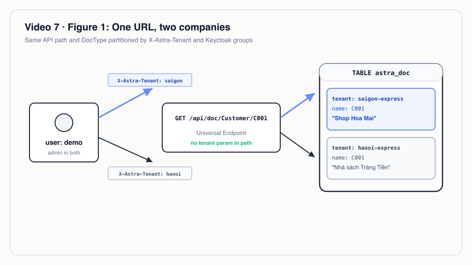
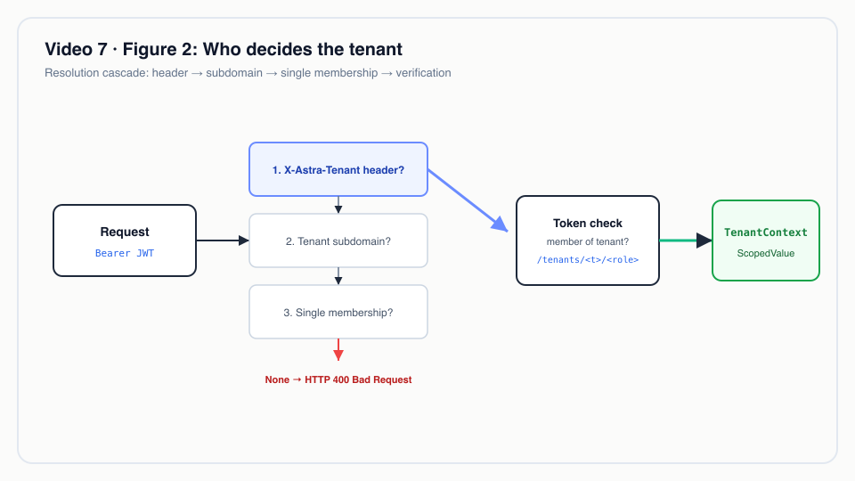
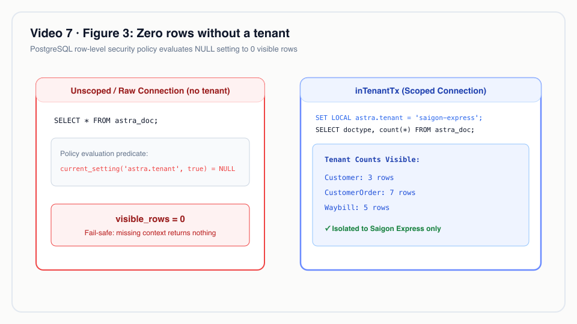

# Video 7 · Đa thuê bao

<a href="https://media.zerohostcms.com/astra-cms/astra-video-7-tenants-vi.mp4"></a>

▶ [Tiếng Việt](https://media.zerohostcms.com/astra-cms/astra-video-7-tenants-vi.mp4) · [English](https://media.zerohostcms.com/astra-cms/astra-video-7-tenants-en.mp4) · 2:28 · Kịch bản: [demo-video-series.md](../demo-video-series.md#video-7-đa-thuê-bao) · [Bản tiếng Anh](./07-tenants.md)

> **Tóm tắt một câu:** Một máy chủ Astra phục vụ nhiều công ty; kernel quyết định request thuộc tenant nào, mang quyết định đó trong một `ScopedValue` của Java vào một thiết lập PostgreSQL chỉ sống trong transaction, và row-level security trả về không dòng nào mỗi khi thiết lập đó vắng mặt.
>
> **Nên đọc nếu:** bạn viết app Astra và muốn biết vì sao không API nào nhận tham số `tenant` (góc nhìn developer) / bạn đang cân nhắc giữa SaaS dùng chung schema, mỗi tenant một database và mỗi tenant một instance, và muốn biết ranh giới cô lập thực sự nằm ở đâu (góc nhìn tech lead).

## Vấn đề

Astra Express, công ty chuyển phát trong demo, chạy thành hai tenant trên cùng một nền tảng: `saigon-express` và
`hanoi-express`. Cả hai đều có một khách hàng mã `C001`. Ở Sài Gòn đó là "Shop Hoa Mai"; ở Hà Nội là
"Nhà sách Tràng Tiền". Cả hai tạo đơn hàng, vận đơn và phiếu nộp tiền COD qua cùng các URL và cùng các
DocType. Có người làm việc cho cả hai: user `demo` là admin ở mỗi bên.

Nỗi đau của SaaS dùng chung schema thì ai cũng biết. Việc cô lập thường nằm trong code ứng dụng: mọi truy vấn
đều cần `WHERE tenant_id = ?`, mọi phương thức repository đều nhận tham số tenant, và mỗi developer mới, mỗi
background job, mỗi báo cáo hay công cụ AI lại thêm một chỗ có thể quên bộ lọc đó. Kiểu hỏng này diễn ra trong
im lặng: thiếu bộ lọc không ném lỗi, mà trả về khách hàng của công ty khác.

Các phương án thường gặp đổi rủi ro đó lấy chi phí vận hành:

- **Mỗi tenant một database hoặc một instance.** Frappe/ERPNext làm theo cách này: một bench chứa nhiều *site*,
  mỗi site có database riêng. Cô lập mạnh, nhưng mỗi site phải migrate, backup và giám sát riêng, và công việc
  xuyên site (một điều phối viên phục vụ hai chi nhánh) nghĩa là hai lần đăng nhập.
- **Bảng dùng chung với bộ lọc ở ORM.** Rẻ khi vận hành, nhưng ranh giới chỉ mạnh bằng truy vấn cẩu thả nhất,
  kể cả SQL thô trong báo cáo và hook.

Lát cắt mỏng của Astra chọn hướng bảng dùng chung, nhưng chuyển ranh giới ra khỏi code ứng dụng, đặt vào hai
nơi mà ứng dụng không thể bỏ qua: bộ lọc request của kernel và row-level security (RLS) của PostgreSQL.

## Video cho thấy gì

| Cảnh | Bạn thấy gì | Điều được chứng minh |
| --- | --- | --- |
| 1 · Tiêu đề | "Một máy chủ, nhiều công ty." | Đặt vấn đề. |
| 2 · Danh sách | `demo` mở `/desk/compare.html`, Screen `#/list/Customer`. Hai khung, cùng URL, cùng DocType. Sài Gòn hiện 3 khách hàng, Hà Nội 2. | Mỗi khung gọi cùng một API với header `X-Astra-Tenant` khác nhau; dữ liệu khác nhau. |
| 3 · Form | `#/form/Customer/C001` ở cả hai khung. | Cùng một tên chứng từ là hai bản ghi riêng biệt. Tính duy nhất là `(tenant_id, doctype, name)`. |
| 4 · Nhận diện | Thứ tự nhận diện: header, subdomain, tenant duy nhất của user. Không nhận diện được: 400. Không phải thành viên: 403. | Không API nào nhận tenant làm tham số; kernel nhận diện một lần cho mỗi request. |
| 5 · Link | `GET Customer/C003` với tư cách Hà Nội trả về 404; một đơn của Hà Nội trỏ tới `C003` thất bại với `field 'customer': Customer 'C003' not found`. | Kiểm tra Link chỉ thấy các dòng của tenant hiện tại. |
| 6 · Thành viên | `nam` (admin Hà Nội) gọi Sài Gòn nhận `403 not a member of tenant saigon-express`; `demo` không gửi header nhận `400`. | Fail-closed: khi tenant không rõ ràng, kernel từ chối thay vì đoán. |
| 7 · RLS | Trong `psql` với role ứng dụng: `visible_rows = 0` khi không có tenant; sau `set_config('astra.tenant','saigon-express',true)`, số dòng theo từng DocType (Customer 3, CustomerOrder 7, Waybill 5, …). | Chính database thực thi ranh giới, kể cả với SQL thô. |
| 8 · Code | `TenantContext`, `TenantTransactions`, `RowLevelSecurityGuard`. | Tenant đi theo luồng gọi, không theo danh sách tham số. |
| 9 · Tóm tắt | Bốn lớp: một URL, Link, Keycloak theo tenant, không dòng nào khi thiếu tenant. | |

Nửa terminal của video là `make demo-express SCENES=7`. Lần chạy được ghi lại
(`docs/video/v07-tenants/assets/scene-07.log`) cho thấy đúng các phản hồi này:

```text
$ curl -X GET http://localhost:8080/api/doc/Customer -H "Authorization: Bearer <nam>" -H "X-Astra-Tenant: saigon-express"
HTTP 403
{ "error": "not a member of tenant saigon-express" }

$ curl -X GET http://localhost:8080/api/doc/Customer -H "Authorization: Bearer <demo>"
HTTP 400
{ "error": "tenant could not be resolved; send X-Astra-Tenant or use a tenant subdomain" }
```


*Một URL, hai công ty.*

## Cách hoạt động

Đường đi từ HTTP request đến dòng SQL gồm bốn bước. Mỗi bước là nơi tenant được xác lập hoặc được thực thi,
không bao giờ do bên gọi truyền vào.

```mermaid
sequenceDiagram
    participant C as Client (Desk / curl / MCP)
    participant F as TenantResolverFilter
    participant R as DocResource
    participant T as TenantTransactions
    participant P as PostgreSQL (RLS)
    C->>F: Bearer JWT (groups /tenants/<t>/<role>) + X-Astra-Tenant tuỳ chọn
    F->>F: header → subdomain → membership duy nhất
    alt không nhận diện được
        F-->>C: 400
    else không phải thành viên
        F-->>C: 403
    end
    F->>R: tenantRequest.tenantId(t), roles
    R->>R: TenantContext.call(t, work)  (ScopedValue)
    R->>T: inTenantTx(work)
    T->>P: BEGIN; set_config('astra.tenant', t, true)
    T->>P: SELECT/INSERT … (SQL không có bộ lọc tenant)
    P-->>T: chỉ các dòng có tenant_id = current_setting('astra.tenant')
    T->>P: COMMIT (thiết lập biến mất)
```

### Bước 1: nhận diện tenant, một lần, từ đầu vào đáng tin

*`astra-kernel/src/main/java/io/astra/kernel/tenant/TenantResolverFilter.java`*

```java
Memberships memberships = Memberships.of(identity);
String tenant = fromHeader(ctx).or(() -> fromHost(ctx)).or(() -> onlyMembership(memberships)).orElse(null);
if (tenant == null && "single".equals(mode)) {
    tenant = defaultTenant;
}
if (tenant == null || !tenant.matches("[a-z0-9][a-z0-9-]{0,62}")) {
    ctx.abortWith(error(Response.Status.BAD_REQUEST, "tenant could not be resolved; send "
            + TENANT_HEADER + " or use a tenant subdomain"));
    return;
}
Set<String> roles = memberships.roles(tenant);
if (roles.isEmpty()) {
    ctx.abortWith(error(Response.Status.FORBIDDEN, "not a member of tenant " + tenant));
    return;
}
```

Vì sao có hình dạng này:

- **Header là gợi ý, không phải thẩm quyền.** Client có thể *nêu tên* một tenant, nhưng tư cách thành viên được
  kiểm tra dựa trên bearer token đã xác minh. Membership lấy từ đường dẫn group Keycloak dạng
  `/tenants/<tenant>/<role>` (`astra-kernel/src/main/java/io/astra/kernel/security/Memberships.java`), nên
  role luôn gắn với từng tenant: `nam` là admin, nhưng chỉ trong `hanoi-express`.
- **User chỉ thuộc một tenant không cần nói gì.** `onlyMembership` chọn tenant duy nhất mà user thuộc về,
  nên một user như `nam`, chỉ thuộc `hanoi-express`, không cần gửi header.
- **Mơ hồ là lỗi.** User thuộc hai tenant mà không gửi gì sẽ nhận 400 thay vì "tenant đầu tiên", vì đoán
  chính là cách dữ liệu rơi vào nhầm công ty.
- **Nhận diện theo subdomain có sẵn nhưng mặc định tắt.** `fromHost` chỉ chạy khi
  `astra.tenancy.base-domain` được đặt; trong `astra-server/src/main/resources/application.yml` dòng này đang
  bị comment.


*Ai quyết định tenant.*

### Bước 2: mang tenant trong một `ScopedValue`, không phải trong tham số

*`astra-spi/src/main/java/io/astra/spi/tenant/TenantContext.java`*

```java
/**
 * The current tenant, carried in a Java 25 {@link ScopedValue}. The kernel binds it once per request;
 * every kernel service reads it from here. No kernel API accepts a tenant as a caller-supplied
 * parameter, which is what makes cross-tenant access impossible from app code.
 */
public final class TenantContext {

    private static final ScopedValue<String> TENANT = ScopedValue.newInstance();
    // …
    /** The bound tenant; throws when no tenant is in scope, which is always a programming error. */
    public static String require() {
        if (!TENANT.isBound()) {
            throw new IllegalStateException("No tenant bound in the current scope");
        }
        return TENANT.get();
    }
```

Các resource bind nó quanh mỗi lời gọi kernel:

*`astra-doctype/src/main/java/io/astra/doctype/api/DocResource.java`*

```java
/** Binds the request's tenant into the ScopedValue scope for the duration of the kernel call. */
private <T> T scoped(ScopedValue.CallableOp<T, RuntimeException> work) {
    return TenantContext.call(tenant.tenantId(), work);
}
```

Vì sao dùng `ScopedValue` thay vì `ThreadLocal` hay tham số:

- **Tham số** có thể do code app cung cấp, nên một hook của app có thể đòi dữ liệu của tenant khác. SPI
  `DocumentService` mà hook dùng hoàn toàn không có tham số tenant.
- **`ThreadLocal`** có thể được gán rồi bị quên, và rò rỉ giữa các thread trong pool. `ScopedValue` bất biến
  bên trong scope và không được bind bên ngoài, rất hợp với virtual thread: không có gì phải dọn dẹp.
- `TenantContext` nằm trong `astra-spi`, nên app có thể *đọc* tenant (ví dụ để ghi log) nhưng cách duy nhất để
  *bind* một tenant là lời gọi bao quanh code của chúng.

### Bước 3: biến scope thành một thiết lập database chỉ sống trong transaction

*`astra-doctype/src/main/java/io/astra/doctype/store/TenantTransactions.java`*

```java
String tenant = TenantContext.require();
try (Connection conn = dataSource.getConnection()) {
    conn.setAutoCommit(false);
    try {
        try (PreparedStatement ps = conn.prepareStatement("SELECT set_config('astra.tenant', ?, true)")) {
            ps.setString(1, tenant);
            ps.execute();
        }
        T result = ScopedValue.where(TX, conn).call(() -> work.run(conn));
        conn.commit();
        return result;
    } catch (Exception e) {
        conn.rollback();
        // …
```

Tham số thứ ba của `set_config` là `true`: thiết lập này **chỉ sống trong transaction**. Khi connection trở về
pool, tenant cũng đi theo commit hoặc rollback. Request kế tiếp mượn connection đó bắt đầu mà không có tenant,
nghĩa là (bước 4) nó không thấy gì cho đến khi tự bind tenant của mình. Connection đang mở cũng được mang trong
một `ScopedValue`, nên một hook ghi Waybill trong lúc một đơn hàng đang được submit sẽ tham gia cùng
transaction và cùng tenant.

### Bước 4: để PostgreSQL thực thi

*`astra-doctype/src/main/resources/db/migration/V1__astra_doc.sql`*

```sql
ALTER TABLE astra_doc ENABLE ROW LEVEL SECURITY;
ALTER TABLE astra_doc FORCE ROW LEVEL SECURITY;   -- applies to the table owner too

CREATE POLICY astra_doc_tenant_isolation ON astra_doc
    USING      (tenant_id = current_setting('astra.tenant', true))
    WITH CHECK (tenant_id = current_setting('astra.tenant', true));
```

- `current_setting('astra.tenant', true)` trả về NULL khi chưa có gì được bind; `tenant_id = NULL` không bao giờ
  đúng, nên kết quả là **không dòng nào**, không phải lỗi và cũng không phải toàn bộ các dòng. Đó chính là
  `visible_rows = 0` ở cảnh 7.
- `WITH CHECK` chặn một thao tác ghi rơi vào tenant khác, kể cả khi `tenant_id` được insert bị sai.
- `FORCE` quan trọng vì role ứng dụng sở hữu các bảng do Flyway tạo; không có `FORCE`, PostgreSQL miễn cho
  chủ sở hữu khỏi chính các policy của nó.
- Cùng khuôn mẫu này được áp dụng trong các migration sau: `astra_series` (V1), sổ cái (V3), overlay (V4)
  và các bảng bản sao CDC (V5) đều dùng `FORCE ROW LEVEL SECURITY`.

Đây là lý do kiểm tra Link không cần bộ lọc tenant. Truy vấn từ chối đơn hàng `C003` của Hà Nội hoàn toàn
không nhắc đến tenant:

*`astra-doctype/src/main/java/io/astra/doctype/store/DocumentStore.java`*

```java
try (PreparedStatement ps = conn.prepareStatement(
        "SELECT 1 FROM astra_doc WHERE doctype = ? AND name = ?")) {
    ps.setString(1, f.options().getFirst());
    ps.setString(2, target);
    try (ResultSet rs = ps.executeQuery()) {
        if (!rs.next()) errors.add("field '" + f.name() + "': " + f.options().getFirst() + " '" + target + "' not found");
    }
}
```

`C003` có tồn tại, nhưng chỉ dưới `saigon-express`. Bên trong transaction của Hà Nội, RLS ẩn nó đi, nên kết quả
là "not found". Người viết SQL không phải nhớ gì cả.


*Không dòng nào khi thiếu tenant.*

### Lưới an toàn

Tất cả những điều trên đều giả định role database thực sự chịu RLS. Superuser của PostgreSQL và các role có
`BYPASSRLS` bỏ qua mọi policy. `RowLevelSecurityGuard` kiểm tra điều này lúc khởi động và dừng kernel; đó là
chủ đề của [Video 8](./08-failclosed.vi.md).

## Ví dụ thực tế

*Tình huống minh hoạ: công ty, con người và các giá trị là hư cấu; cơ chế và các quy tắc được áp dụng là thật, như đã trình bày ở trên.*

**Một nền tảng 3PL tại Việt Nam phục vụ nhiều thương hiệu chuyển phát.** Một nhà cung cấp phần mềm logistics
chạy một cụm Astra cho ba công ty chuyển phát theo vùng. Mỗi công ty là một tenant. Một điều phối viên tự do,
Linh, nhận hợp đồng với hai trong số đó.

Đầu vào:

- Group Keycloak của Linh: `/tenants/hanoi-express/dispatcher` và `/tenants/saigon-express/dispatcher`.
- Cả hai tenant đều có khách hàng `C001` và dãy số đơn hàng `ORD-.YYYYMMDD.-.#####`.
- Một báo cáo viết cẩu thả của chuyên viên phân tích bên nhà cung cấp: `SELECT count(*) FROM astra_doc WHERE doctype = 'CustomerOrder'`.

Astra xử lý thế nào:

1. Linh mở Desk mà không chọn công ty và gọi `GET /api/doc/CustomerOrder`. Cô thuộc hai tenant và không gửi
   header, nên kernel trả lời `400 tenant could not be resolved`. Client buộc phải để cô chọn.
2. Cô chọn Hà Nội (`X-Astra-Tenant: hanoi-express`). Bộ lọc kiểm tra token, tìm thấy role dispatcher ở đó và
   bind `hanoi-express` cho lời gọi.
3. Cô tạo một đơn cho `C001`. Kiểm tra Link tìm thấy `C001` của Hà Nội. Số đơn lấy từ dòng bộ đếm riêng của
   Hà Nội trong `astra_series`, nên việc đánh số của Sài Gòn không bị ảnh hưởng.
4. Báo cáo của chuyên viên phân tích, khi chạy qua kernel, chỉ đếm đơn của tenant đang được bind. Khi chạy
   trực tiếp bằng role ứng dụng mà không bind tenant nào, nó trả về `0`.

Đầu ra: một đơn ở Hà Nội, Sài Gòn không thấy thay đổi gì, một báo cáo không thể đếm thừa, và không có đoạn code
nào phải nhớ `WHERE tenant_id = ?`.

So với mô hình mỗi site một database: Linh sẽ phải giữ hai tài khoản đăng nhập, còn nhà cung cấp phải chạy ba
database, ba lần migrate và ba lịch backup cho cùng một schema.

## Dành cho tech lead

- **Ranh giới nằm ở đâu.** Hai lớp độc lập: bộ lọc của kernel (ai được thao tác trong tenant nào) và RLS của
  PostgreSQL (transaction được chạm vào những dòng nào). Một bug trong code app không thể vượt tenant vì code
  app không bao giờ chọn tenant. Một bug trong bộ lọc của kernel vẫn bị RLS chặn đối với mọi thứ chạy bên
  trong `inTenantTx`.
- **Chi phí.** Thêm một câu lệnh `set_config` cho mỗi transaction, và mọi truy vấn đều được đánh giá kèm
  predicate RLS. Khoá duy nhất và index danh sách trong `V1__astra_doc.sql` đều bắt đầu bằng `tenant_id`,
  giúp predicate đó rẻ khi tra theo tên và khi liệt kê. Repo chưa công bố benchmark nào về chi phí của RLS; hãy đo trên workload của bạn.
- **Lợi ích vận hành.** Một schema, một lần migrate, một bản backup, một connection pool cho mọi tenant.
  Onboard một tenant trong demo là tạo group Keycloak và dữ liệu, không phải cấp phát database.
- **Nên đo gì.** Tỉ lệ 400 và 403 theo từng client (tăng đột biến nghĩa là một client đã mất lựa chọn
  tenant), các truy vấn bất ngờ trả về không dòng nào (thiếu scope tenant), và số dòng theo tenant trên những
  bảng lớn nhất (hàng xóm ồn ào).
- **Rủi ro.**
  - Code đi vòng qua `TenantTransactions` (gọi `DataSource` trực tiếp) nhận về không dòng nào thay vì dữ liệu
    bị rò rỉ. Đó là hướng an toàn, nhưng có thể trông giống bug.
  - Hàng xóm ồn ào dùng chung CPU, I/O và connection pool. Bulkhead và quota theo tenant là mục tiêu thiết
    kế, chưa được xây (xem "Nói đúng").
  - RLS bảo vệ các dòng, không bảo vệ mọi thứ: cache, log, file và index tìm kiếm cần khoá tenant riêng.
- **Khi nào không nên dùng RLS trên schema chung.** Khách hàng có yêu cầu hợp đồng về nơi lưu trữ dữ liệu,
  khoá riêng hoặc "database của riêng mình". Thiết kế đặt tên các profile `database-per-tenant` và
  `cluster-per-tenant` cho họ; chưa profile nào được xây.
- **So với Frappe.** Frappe cô lập theo site và database; Astra cô lập theo dòng trong một database và coi
  user thuộc nhiều công ty là trường hợp chính danh. Mô hình của Frappe dễ suy luận hơn với từng khách hàng;
  mô hình của Astra rẻ hơn khi vận hành với nhiều tenant.

## Tự chạy thử

Yêu cầu: JDK 25, Docker (8 GB cho toàn bộ stack), `kubectl`, `k3d`, `jq`, Bash 5.

```bash
make k3d-up                                  # 2 kernel pods, PostgreSQL, Redis, Keycloak, Seata, CDC
make demo-reset && make demo-seed            # tenants saigon-express and hanoi-express
open http://localhost:8080/desk/compare.html # log in as demo / Astra@123 first
make demo-express SCENES=7 PAUSE=0           # the terminal half of the video
```

Trong `compare.html`, đặt Screen là `#/list/Customer` rồi `#/form/Customer/C001`. Kết quả mong đợi: Sài Gòn
liệt kê 3 khách hàng và Hà Nội 2; `C001` là "Shop Hoa Mai" ở Sài Gòn và "Nhà sách Tràng Tiền" ở Hà Nội.

Kết quả mong đợi của cảnh 7, theo thứ tự: hai lần đọc `C001` trả `HTTP 200` với hai tên khác nhau; `HTTP 404`
cho `C003` ở Hà Nội; `HTTP 422` với `field 'customer': Customer 'C003' not found`; `HTTP 403` cho `nam` trên
Sài Gòn; `HTTP 400` cho `demo` không gửi header; rồi trong SQL là `visible_rows = 0`, tiếp theo là số dòng
theo từng DocType của Sài Gòn. Phần SQL chỉ chạy khi script kết nối được tới database (`DB=k3d` hoặc
`DB=compose`, được tự phát hiện trong `scripts/demo-express.sh`).

Integration test `astra-server/src/test/java/io/astra/server/TenantIsolationTest.java` kiểm tra cùng các quy
tắc này mà không cần stack demo: `make test`.

## Nói đúng

- Đã xây: nhận diện qua header, subdomain (chỉ khi `astra.tenancy.base-domain` được đặt) và membership duy
  nhất; chế độ `single` với tenant mặc định; RLS trên các bảng chứng từ, dãy số, sổ cái, overlay và bản sao
  CDC; cơ chế chặn lúc khởi động.
- Thiết kế trong [explain.md](../explain.md#4a-đa-tenant-thuộc-tính-của-kernel-không-phải-tính-năng-của-app)
  mô tả nhiều hơn lát cắt mỏng: một DocType `Tenant` có vòng đời, nhận diện qua claim OIDC và tiền tố đường
  dẫn, các profile cô lập (`database-per-tenant`, `cluster-per-tenant`), bulkhead theo tenant, quota, đo đếm,
  tổ chức và chia sẻ, và `astra tenant migrate`. Chưa mục nào được xây. Tenant trong demo là group Keycloak
  cộng với dữ liệu; quản trị tenant là resource `/api/iam/tenants` của `astra-iam`.
- Thứ tự nhận diện đã xây là header → subdomain → membership duy nhất → mặc định (chế độ single). Tài liệu
  thiết kế liệt kê một thứ tự khác (domain, claim trong token, header, path); code là căn cứ cho những gì đang
  chạy hôm nay.
- RLS chỉ phủ các bảng PostgreSQL. Bộ đếm Redis được scope theo tenant vì `RedisCounters`
  (`astra-tx-seata`) gắn tiền tố `astra:<tenant>:` cho mọi key, chứ không nhờ một policy của database.
- Trong kế hoạch quay ban đầu, đơn hàng `C003` của Hà Nội thất bại vì overlay của Hà Nội bắt buộc trường
  `note`, chứ không phải vì Link. `scripts/demo-express.sh` giờ gửi kèm `note`, nên lỗi hiển thị là lỗi Link.

## Hình minh hoạ

- [Hình 1 · Một URL, hai công ty](#video-cho-thấy-gì)
- [Hình 2 · Ai quyết định tenant](#bước-1-nhận-diện-tenant-một-lần-từ-đầu-vào-đáng-tin)
- [Hình 3 · Không dòng nào khi thiếu tenant](#bước-4-để-postgresql-thực-thi)

## Liên quan

- Trước: [Video 6 · CSKH nhìn thấy vận hành](./06-care.vi.md) · Tiếp: [Video 8 · Bảo mật fail-closed](./08-failclosed.vi.md)
- [Video 11 · Keycloak](./11-keycloak.vi.md) (role theo tenant đến từ đâu) · [Video 13 · Overlay theo tenant](./13-overlay.vi.md) (metadata theo tenant trên cùng các bảng)
- Đi qua code: [demo-code-snippets.md, S4](../demo-code-snippets.md#s4-tenants-and-row-level-security)
- Thiết kế: [explain.md, đa tenant](../explain.md#4a-đa-tenant-thuộc-tính-của-kernel-không-phải-tính-năng-của-app)
- Mã nguồn: `astra-kernel/src/main/java/io/astra/kernel/tenant/TenantResolverFilter.java`,
  `astra-spi/src/main/java/io/astra/spi/tenant/TenantContext.java`,
  `astra-doctype/src/main/java/io/astra/doctype/store/TenantTransactions.java`,
  `astra-doctype/src/main/resources/db/migration/V1__astra_doc.sql`,
  `astra-kernel/src/main/java/io/astra/kernel/security/Memberships.java`
