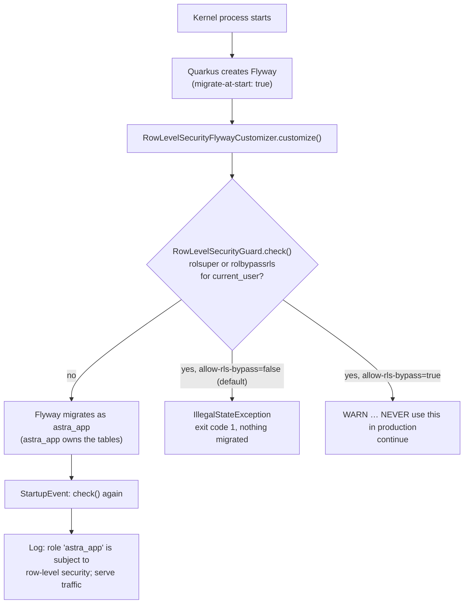

# Video 8 · Fail-closed security

<a href="https://media.zerohostcms.com/astra-cms/astra-video-8-failclosed-en.mp4"></a>

▶ [English](https://media.zerohostcms.com/astra-cms/astra-video-8-failclosed-en.mp4) · [Tiếng Việt](https://media.zerohostcms.com/astra-cms/astra-video-8-failclosed-vi.mp4) · 2:02 · Script: [demo-video-series.en.md](../demo-video-series.en.md#video-8-fail-closed-security)

> **In one sentence:** If the kernel is pointed at a PostgreSQL role that would ignore row-level security (a superuser or a `BYPASSRLS` role), it refuses to start, before any migration runs, instead of quietly serving every tenant's data to every tenant.
>
> **Read this if:** you deploy or configure Astra and want to know which database role it must use and what happens if you get it wrong (developer angle) / you need to explain to an auditor how a configuration mistake is prevented from becoming a cross-tenant data leak (tech-lead angle).

## The problem

[Video 7](./07-tenants.md) showed that Astra Express's two tenants, `saigon-express` and `hanoi-express`,
share one `astra_doc` table and are kept apart by PostgreSQL row-level security (RLS). RLS has one
well-documented exception: **superusers and roles with the `BYPASSRLS` attribute ignore every policy.**

That turns tenant isolation into a configuration question. In the Docker Compose stack the bootstrap role
`astra` is a superuser (it has to be, to create other roles) and the application role `astra_app` is not.
The two connection strings differ by four characters. If someone sets `ASTRA_DB_USER=astra`, perhaps to get
past a permission error during an incident, the kernel would work perfectly: every page loads, every test
that checks "can I read my data" passes. The only symptom is that Saigon's Customer list now also contains
Hanoi's customers. Nothing logs an error, because from PostgreSQL's point of view nothing is wrong.

Most systems treat this as a deployment checklist item. Frappe/ERPNext sidesteps it with a database per
site, so there is no shared table to leak from; the equivalent mistake there is pointing a site at the
wrong database. Astra's shared-table design needs a stronger answer than a checklist: the kernel checks the
role itself and treats an unsafe role as a fatal error.

## What the video shows

| Scene | What you see | What it proves |
| --- | --- | --- |
| 1 · Title | "Wrong config, and the kernel won't run." | Framing. |
| 2 · Risk | Role attributes in the Compose database: `astra` has `rolsuper = t`, `rolbypassrls = t`; `astra_app` has `f`, `f`. | One wrong connection string is enough to disable isolation silently. |
| 3 · Attempt | A second kernel starts with `ASTRA_DB_USER=astra`. It prints `Database role 'astra' is a SUPERUSER: row-level security would be ignored and tenants would see each other's data.` and exits with code 1. | The guard runs before Flyway: no migration runs and no DocType is loaded. |
| 4 · Guard | `RowLevelSecurityGuard` code. | It reads `rolsuper` and `rolbypassrls` for `current_user` and throws. It is called twice: before Flyway migrates and at startup. |
| 5 · Role | `deploy/docker/init/01-app-role.sql`. | The kernel's role is `NOSUPERUSER NOBYPASSRLS NOCREATEDB NOCREATEROLE`. `FORCE ROW LEVEL SECURITY` covers the table owner too. |
| 6 · Live | The running k3d cluster: kernel log line `Tenant isolation guard: role 'astra_app' is subject to row-level security`; connected roles `astra_app` (4 connections), `astra_bms` (2), `astra_cdc` (1), all with `rolsuper = f` and `rolbypassrls = f`. | The production-shaped deployment uses only plain roles. |
| 7 · To be accurate | `astra.tenancy.allow-rls-bypass`, default `false`. | When switched on, the kernel starts with a warning. For dev machines only. |

The full log of the refused start is in `docs/video/v08-failclosed/assets/unsafe-kernel.log`. The
important part of the stack trace is where the exception comes from:

```text
Caused by: java.lang.IllegalStateException: Database role 'astra' is a SUPERUSER: row-level security would be ignored and tenants would see each other's data. Connect as a non-superuser application role (see deploy/docker/init/01-app-role.sql).
	at io.astra.doctype.store.RowLevelSecurityGuard.check(RowLevelSecurityGuard.java:58)
	at io.astra.doctype.store.RowLevelSecurityGuard_ClientProxy.check(Unknown Source)
	at io.astra.doctype.store.RowLevelSecurityFlywayCustomizer.customize(RowLevelSecurityFlywayCustomizer.java:20)
	at io.quarkus.flyway.runtime.FlywayCreator.createFlyway(FlywayCreator.java:155)
```

The guard fires while Quarkus is still *creating* the Flyway instance, which is before Flyway can migrate.

## How it works



### The check

*`astra-doctype/src/main/java/io/astra/doctype/store/RowLevelSecurityGuard.java`*

```java
@ConfigProperty(name = "astra.tenancy.allow-rls-bypass", defaultValue = "false")
boolean allowBypass;

void onStart(@Observes StartupEvent ev) {
    check(dataSource);
}
// …
void check(DataSource dataSource) {
    try (Connection conn = dataSource.getConnection();
         Statement st = conn.createStatement();
         ResultSet rs = st.executeQuery(
                 "SELECT current_user, rolsuper, rolbypassrls FROM pg_roles WHERE rolname = current_user")) {
        if (!rs.next()) throw new IllegalStateException("cannot read role attributes for current_user");
        String role = rs.getString(1);
        boolean superuser = rs.getBoolean(2);
        boolean bypass = rs.getBoolean(3);
        if (superuser || bypass) {
            String msg = "Database role '" + role + "' is " + (superuser ? "a SUPERUSER" : "BYPASSRLS")
                    + ": row-level security would be ignored and tenants would see each other's data. "
                    + "Connect as a non-superuser application role (see deploy/docker/init/01-app-role.sql).";
            if (allowBypass) {
                LOG.warn(msg + " Continuing because astra.tenancy.allow-rls-bypass=true. NEVER use this in production.");
            } else {
                throw new IllegalStateException(msg);
            }
        } else {
            LOG.infof("Tenant isolation guard: role '%s' is subject to row-level security", role);
        }
    } catch (SQLException e) {
        throw new IllegalStateException("cannot verify row-level security role attributes", e);
    }
}
```

Design choices worth noting:

- **It asks the database, not the configuration.** The guard does not compare `ASTRA_DB_USER` against a
  deny-list. It asks PostgreSQL what the connected role *is*. A role renamed to something innocent, or a
  plain role later granted `BYPASSRLS`, is still caught.
- **Every failure path is closed.** If the role row cannot be read, or the query itself fails, the guard
  throws too. "Could not verify" is treated the same as "unsafe".
- **The escape hatch is explicit and loud.** `astra.tenancy.allow-rls-bypass` defaults to `false`. Turning it
  on does not hide the problem; it changes the exception into a warning that says "NEVER use this in
  production" on every start.
- **The success path logs too.** The `INFO` line on a healthy start is evidence an operator or auditor can
  grep for, which is what scene 6 shows from the k3d cluster.

### Why it runs before Flyway

*`astra-doctype/src/main/java/io/astra/doctype/store/RowLevelSecurityFlywayCustomizer.java`*

```java
/**
 * Runs the tenant isolation guard before Flyway migrates the default datasource at start. Quarkus migrates
 * before {@code StartupEvent} observers run, so without this a kernel started as a superuser would apply the
 * migrations (and own the tables it creates) before refusing to start.
 */
@Singleton
public class RowLevelSecurityFlywayCustomizer implements FlywayConfigurationCustomizer {

    @Inject RowLevelSecurityGuard guard;

    @Override
    public void customize(FluentConfiguration configuration) {
        guard.check(configuration.getDataSource());
    }
}
```

Ordering matters because of ownership. The application role owns the tables Flyway creates, and the
migrations depend on that (see `FORCE` below). If a superuser ran the first migration, the superuser would
own `astra_doc`, and the kernel would refuse to start only *after* leaving the schema in the wrong hands.
An earlier version of the demo did exactly that: the video brief notes that the superuser had already
created the V3 to V5 tables before the guard stopped it. Hooking into Flyway's configuration step closes
that window. The second call at `StartupEvent` covers deployments that migrate separately and run the
kernel with migrations off.

### The role the kernel is supposed to use

*`deploy/docker/init/01-app-role.sql`*

```sql
-- Runs once at database initialisation (docker-entrypoint-initdb.d), as the bootstrap superuser.
-- The kernel never connects as a superuser: superusers and BYPASSRLS roles ignore row-level
-- security, which would silently disable tenant isolation. The application role below owns the
-- schema objects Flyway creates; FORCE ROW LEVEL SECURITY keeps the owner subject to policies.
CREATE ROLE astra_app LOGIN PASSWORD 'astra_app' NOSUPERUSER NOBYPASSRLS NOCREATEDB NOCREATEROLE NOINHERIT;
GRANT CONNECT ON DATABASE astra TO astra_app;
GRANT USAGE, CREATE ON SCHEMA public TO astra_app;
```

The same statement is in the k3d manifest (`deploy/k8s/base/postgres.yaml`, ConfigMap `postgres-init`), and
the kernel's default username is `astra_app` (`astra-server/src/main/resources/application.yml`). The other
roles in the cluster are plain as well: `astra_bms` (Seata AT branches) is `NOSUPERUSER NOBYPASSRLS`, and
`astra_cdc` (`deploy/db/20-cdc.sql`) has `REPLICATION` to read the WAL but `NOSUPERUSER NOBYPASSRLS`.

### Two layers, not one

*`astra-doctype/src/main/resources/db/migration/V1__astra_doc.sql`*

```sql
ALTER TABLE astra_doc ENABLE ROW LEVEL SECURITY;
ALTER TABLE astra_doc FORCE ROW LEVEL SECURITY;   -- applies to the table owner too
```

By default PostgreSQL does not apply RLS to a table's owner. Because `astra_app` owns the tables, `ENABLE`
alone would leave the kernel exempt from its own policies. `FORCE` removes that exemption. The guard and
`FORCE` cover different holes:

| Hole | Closed by |
| --- | --- |
| The connected role is a superuser or has `BYPASSRLS` | `RowLevelSecurityGuard` (refuses to start) |
| The connected role owns the table | `FORCE ROW LEVEL SECURITY` in every tenant-scoped migration |
| No tenant is bound in the transaction | The policy compares against `current_setting('astra.tenant', true)`, which is NULL, so zero rows ([Video 7](./07-tenants.md)) |

## Real-world example

*Illustrative scenario: the company, people and values are made up; the mechanism and the rules it applies are the real ones shown above.*

**An accounting SaaS during a 2 a.m. incident.** A provider runs Astra for 40 small companies' ledgers on
one Kubernetes cluster. After a database restore, the kernel fails with a permission error on one table.
The on-call engineer, under pressure, edits the `astra-db` Secret so that `username` is the bootstrap
superuser, and restarts the deployment.

Inputs:

- Secret `astra-db`: `username` changed from `astra_app` to the superuser.
- Deployment `astra-server`: 2 replicas, `RollingUpdate` with `maxUnavailable: 0` and `maxSurge: 1`,
  `readinessProbe` on `/q/health/ready` (`deploy/k8s/base/astra-server.yaml`).

What Astra does:

1. The first new pod starts, Quarkus prepares Flyway, the customizer calls the guard, and the guard reads
   `rolsuper = t` for the connected role.
2. The guard throws `Database role '…' is a SUPERUSER: …`; the process exits with code 1 before any
   migration and before any HTTP request is served.
3. The pod never reports ready. Because `maxUnavailable` is 0, Kubernetes keeps the two old pods, which
   are still connected as `astra_app`, serving traffic. The rollout stalls instead of completing.

Outputs: no tenant ever sees another tenant's ledger, users keep working on the old pods, and the pod log
states the cause and the fix in one line. The engineer fixes the actual permission problem (for example,
a grant lost in the restore) instead.

The stalled rollout in step 3 is standard Kubernetes behaviour given the manifest's settings; the video
demonstrates step 2 with a local process, not this exact rollout.

Without the guard, the same incident ends with a working system and a reportable data breach, discovered
whenever a customer happens to notice someone else's invoices.

## For technical leaders

- **What it buys.** It converts the most likely way to disable tenant isolation, a wrong connection
  string, from a silent breach into a failed deployment. For an auditor, the control is code
  (`RowLevelSecurityGuard`), plus a log line on every healthy start, plus the role DDL.
- **What it costs.** One query against `pg_roles` per start, twice. Operationally, the cost is that teams
  must keep a separate bootstrap role for administration and never reuse it for the application.
- **What it does not cover.**
  - A role that is not a superuser but owns the tables could in principle run `ALTER TABLE … NO FORCE ROW
    LEVEL SECURITY` or drop a policy. Nothing in the kernel does that, and the guard does not detect it.
    Treat migrations as reviewed code.
  - The guard checks the default datasource only. The BMS datasource used for Seata AT
    (`astra-tx-seata/src/main/resources/db/bms`) has no RLS policies; its rows carry the tenant in the key.
  - Direct database access by people or other tools is outside the kernel's control. Give humans the same
    plain roles and audit superuser sessions.
- **What to measure.** Alert if the `Tenant isolation guard: role '…' is subject to row-level security`
  line is missing from a kernel start, and alert on any `allow-rls-bypass=true` warning outside dev.
  Periodically list connected roles with `rolsuper` or `rolbypassrls`; scene 6 shows the expected result
  for the cluster.
- **When the switch is acceptable.** `astra.tenancy.allow-rls-bypass=true` exists for a developer's
  laptop where the only database user is a superuser. It should never appear in a shared environment's
  configuration; consider failing CI on it.
- **Compared with alternatives.** Database-per-tenant designs (Frappe sites) are not exposed to this
  specific risk but pay for it in operational overhead. Application-level `WHERE tenant_id` filters have no
  equivalent fail-closed check at all: a missing filter fails open.

## Try it yourself

Prerequisites: JDK 25, Docker, `jq`, Bash 5, and an Astra kernel reachable at `BASE` (default
`http://localhost:8080`), because `scripts/lib/demo-common.sh` checks `/api/iam/config` before any scene
runs. The k3d stack (`make k3d-up`) satisfies this; the recording used it.

```bash
make infra-up && make build                  # Compose PostgreSQL (superuser astra, app role astra_app) + the kernel jar
make demo-express SCENES=8 PAUSE=0           # starts a throwaway kernel on :8099 as the superuser
```

Expected output (`docs/video/v08-failclosed/assets/scene-08.log`):

```text
━━━ Scene 8 · The kernel refuses to run unsafely ━━━

▸ Start a second kernel connected as the PostgreSQL superuser (RLS would be ignored)…
$ ASTRA_DB_USER=astra java -jar astra-server/target/quarkus-app/quarkus-run.jar
Database role 'astra' is a SUPERUSER: row-level security would be ignored and tenants would see each other's data.

▸ …it refuses to start. Tenant isolation cannot be switched off by a misconfigured connection.
```

If the Compose stack is not running or the jar is missing, the scene prints
`Needs the Docker Compose stack (make infra-up) and a build (make build)` instead.

To see the healthy path on the k3d cluster, look for the guard's `INFO` line in a kernel pod's log:

```bash
kubectl -n astra logs deployment/astra-server | grep "Tenant isolation guard"
```

Expected: `Tenant isolation guard: role 'astra_app' is subject to row-level security`.

## To be accurate

- The switch `astra.tenancy.allow-rls-bypass` exists and defaults to `false`. When it is `true`, an unsafe
  role only produces a warning and the kernel starts. Dev machines only.
- Do not read this as "the application role cannot disable RLS". As the table owner, `astra_app` could in
  theory change RLS settings on its own tables. `FORCE ROW LEVEL SECURITY` and the guard are two separate
  layers; neither prevents a deliberate DDL change by the owner.
- The guard checks role attributes at startup. A role altered to `BYPASSRLS` while the kernel is running is
  not detected until the next start.
- Only the default datasource is checked. The BMS schema is not under RLS.
- No automated test in the repository exercises the guard; the evidence is the scene 8 run and the captured
  logs in `docs/video/v08-failclosed/assets/`.

## Visualize it: sketch prompts

### Figure 1 · Two connection strings, two outcomes

*Where it goes:* The problem

```text
Hand-drawn whiteboard sketch, black ink line art on off-white paper, one accent color (#6b8cff blue) for the key path, simple boxes and arrows, short handwritten labels in English, generous white space, no logos, no photorealism, 16:9.
Left: a box "kernel". Two arrows go right to one cylinder "PostgreSQL · astra_doc". The upper arrow is labelled "ASTRA_DB_USER=astra_app" and ends at a small funnel labelled "RLS policy" before the cylinder, with a note "Saigon sees Saigon". The lower arrow is labelled "ASTRA_DB_USER=astra (SUPERUSER)" and goes around the funnel straight into the cylinder, with a note "Saigon sees Hanoi too · no error". Highlight in blue the upper arrow and the funnel. Draw a small crossed-out eye next to the lower note.
```

### Figure 2 · The guard stands before Flyway

*Where it goes:* How it works

```text
Hand-drawn whiteboard sketch, black ink line art on off-white paper, one accent color (#6b8cff blue) for the key path, simple boxes and arrows, short handwritten labels in English, generous white space, no logos, no photorealism, 16:9.
A left-to-right timeline of a kernel start with five boxes: "process start", "Flyway config", "Flyway migrate", "StartupEvent", "serve HTTP". Between "Flyway config" and "Flyway migrate" draw a gate labelled "RowLevelSecurityGuard.check()" with a small table above it: "rolsuper? rolbypassrls?". From the gate, a downward arrow labelled "yes" goes to a box "IllegalStateException · exit 1 · nothing migrated". The forward arrow through the gate is labelled "no (astra_app)". A second smaller gate at "StartupEvent" labelled "check() again". Highlight in blue the "no" path through both gates to "serve HTTP".
```

### Figure 3 · Two layers, three holes

*Where it goes:* How it works, two layers

```text
Hand-drawn whiteboard sketch, black ink line art on off-white paper, one accent color (#6b8cff blue) for the key path, simple boxes and arrows, short handwritten labels in English, generous white space, no logos, no photorealism, 16:9.
Three stacked rows, each with a hole on the left and a plug on the right. Row 1: hole "SUPERUSER / BYPASSRLS role", plug "RowLevelSecurityGuard: refuse to start". Row 2: hole "role owns the table", plug "FORCE ROW LEVEL SECURITY". Row 3: hole "no tenant bound", plug "current_setting('astra.tenant', true) = NULL → 0 rows". Arrows from each hole to its plug. Highlight row 1 in blue. Small footnote at the bottom: "dev only: astra.tenancy.allow-rls-bypass=true → WARN".
```

## Related

- Previous: [Video 7 · Multi-tenancy](./07-tenants.md) · Next: [Video 9 · For developers](./09-developer.md)
- [Video 10 · Running on Kubernetes](./10-k8s.md) (the deployment the guard protects) · [Video 16 · Rust CDC](./16-cdc.md) (the `astra_cdc` replication role)
- Code walkthrough: [demo-code-snippets.md, S4](../demo-code-snippets.md#s4-tenants-and-row-level-security)
- Source: `astra-doctype/src/main/java/io/astra/doctype/store/RowLevelSecurityGuard.java`,
  `astra-doctype/src/main/java/io/astra/doctype/store/RowLevelSecurityFlywayCustomizer.java`,
  `deploy/docker/init/01-app-role.sql`, `deploy/k8s/base/postgres.yaml`,
  `astra-doctype/src/main/resources/db/migration/V1__astra_doc.sql`
