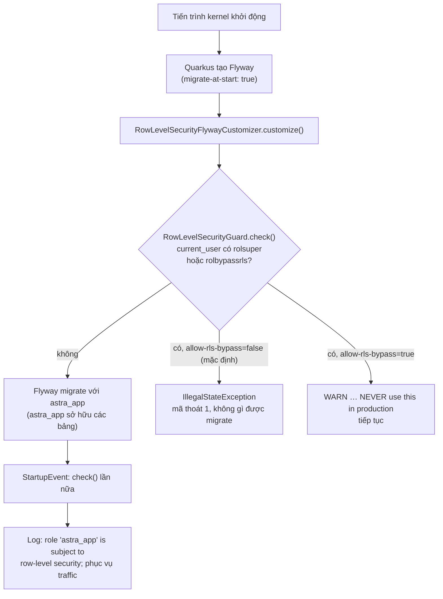

# Video 8 · Bảo mật fail-closed

<a href="https://media.zerohostcms.com/astra-cms/astra-video-8-failclosed-vi.mp4"></a>

▶ [Tiếng Việt](https://media.zerohostcms.com/astra-cms/astra-video-8-failclosed-vi.mp4) · [English](https://media.zerohostcms.com/astra-cms/astra-video-8-failclosed-en.mp4) · 2:02 · Kịch bản: [demo-video-series.md](../demo-video-series.md#video-8-bảo-mật-fail-closed) · [Bản tiếng Anh](./08-failclosed.md)

> **Tóm tắt một câu:** Nếu kernel được trỏ tới một role PostgreSQL sẽ bỏ qua row-level security (một superuser hoặc một role có `BYPASSRLS`), nó từ chối khởi động, trước khi bất kỳ migration nào chạy, thay vì lặng lẽ phục vụ dữ liệu của mọi tenant cho mọi tenant.
>
> **Nên đọc nếu:** bạn triển khai hoặc cấu hình Astra và muốn biết nó phải dùng role database nào, cũng như chuyện gì xảy ra nếu cấu hình sai (góc nhìn developer) / bạn cần giải thích với kiểm toán viên vì sao một lỗi cấu hình không thể trở thành rò rỉ dữ liệu giữa các tenant (góc nhìn tech lead).

## Vấn đề

[Video 7](./07-tenants.vi.md) cho thấy hai tenant của Astra Express, `saigon-express` và `hanoi-express`, dùng
chung một bảng `astra_doc` và được tách biệt bằng row-level security (RLS) của PostgreSQL. RLS có một ngoại lệ
được ghi rõ trong tài liệu: **superuser và các role có thuộc tính `BYPASSRLS` bỏ qua mọi policy.**

Điều đó biến việc cô lập tenant thành một câu hỏi cấu hình. Trong stack Docker Compose, role khởi tạo `astra` là
superuser (bắt buộc, để tạo các role khác) còn role ứng dụng `astra_app` thì không. Hai chuỗi kết nối chỉ khác
nhau bốn ký tự. Nếu ai đó đặt `ASTRA_DB_USER=astra`, có thể để vượt qua một lỗi quyền trong lúc xử lý sự cố,
kernel vẫn chạy hoàn hảo: mọi trang đều tải được, mọi test kiểu "tôi có đọc được dữ liệu của mình không" đều
qua. Triệu chứng duy nhất là danh sách Customer của Sài Gòn giờ chứa cả khách hàng của Hà Nội. Không có gì ghi
log lỗi, vì từ góc nhìn của PostgreSQL thì chẳng có gì sai.

Hầu hết hệ thống coi đây là một mục trong checklist triển khai. Frappe/ERPNext né vấn đề bằng cách mỗi site một
database, nên không có bảng chung nào để rò rỉ; lỗi tương đương ở đó là trỏ một site vào nhầm database. Thiết
kế bảng dùng chung của Astra cần một câu trả lời mạnh hơn checklist: kernel tự kiểm tra role và coi một role
không an toàn là lỗi nghiêm trọng.

## Video cho thấy gì

| Cảnh | Bạn thấy gì | Điều được chứng minh |
| --- | --- | --- |
| 1 · Tiêu đề | "Sai cấu hình, và kernel không chạy." | Đặt vấn đề. |
| 2 · Rủi ro | Thuộc tính role trong database Compose: `astra` có `rolsuper = t`, `rolbypassrls = t`; `astra_app` có `f`, `f`. | Chỉ một chuỗi kết nối sai là đủ để vô hiệu hoá việc cô lập trong im lặng. |
| 3 · Thử | Một kernel thứ hai khởi động với `ASTRA_DB_USER=astra`. Nó in ra `Database role 'astra' is a SUPERUSER: row-level security would be ignored and tenants would see each other's data.` và thoát với mã 1. | Cơ chế chặn chạy trước Flyway: không migration nào chạy và không DocType nào được nạp. |
| 4 · Cơ chế chặn | Code của `RowLevelSecurityGuard`. | Nó đọc `rolsuper` và `rolbypassrls` của `current_user` rồi ném lỗi. Nó được gọi hai lần: trước khi Flyway migrate và lúc khởi động. |
| 5 · Role | `deploy/docker/init/01-app-role.sql`. | Role của kernel là `NOSUPERUSER NOBYPASSRLS NOCREATEDB NOCREATEROLE`. `FORCE ROW LEVEL SECURITY` phủ cả chủ sở hữu bảng. |
| 6 · Thực tế | Cụm k3d đang chạy: dòng log của kernel `Tenant isolation guard: role 'astra_app' is subject to row-level security`; các role đang kết nối `astra_app` (4 kết nối), `astra_bms` (2), `astra_cdc` (1), tất cả đều `rolsuper = f` và `rolbypassrls = f`. | Bản triển khai có hình dạng production chỉ dùng các role thường. |
| 7 · Nói đúng | `astra.tenancy.allow-rls-bypass`, mặc định `false`. | Khi bật, kernel khởi động kèm một cảnh báo. Chỉ dành cho máy dev. |

Log đầy đủ của lần khởi động bị từ chối nằm ở `docs/video/v08-failclosed/assets/unsafe-kernel.log`. Phần quan
trọng của stack trace là nơi exception phát sinh:

```text
Caused by: java.lang.IllegalStateException: Database role 'astra' is a SUPERUSER: row-level security would be ignored and tenants would see each other's data. Connect as a non-superuser application role (see deploy/docker/init/01-app-role.sql).
	at io.astra.doctype.store.RowLevelSecurityGuard.check(RowLevelSecurityGuard.java:58)
	at io.astra.doctype.store.RowLevelSecurityGuard_ClientProxy.check(Unknown Source)
	at io.astra.doctype.store.RowLevelSecurityFlywayCustomizer.customize(RowLevelSecurityFlywayCustomizer.java:20)
	at io.quarkus.flyway.runtime.FlywayCreator.createFlyway(FlywayCreator.java:155)
```

Cơ chế chặn kích hoạt khi Quarkus vẫn đang *tạo* instance Flyway, tức là trước khi Flyway có thể migrate.

## Cách hoạt động



### Phép kiểm tra

*`astra-doctype/src/main/java/io/astra/doctype/store/RowLevelSecurityGuard.java`*

```java
@ConfigProperty(name = "astra.tenancy.allow-rls-bypass", defaultValue = "false")
boolean allowBypass;

void onStart(@Observes StartupEvent ev) {
    check(dataSource);
}
// …
void check(DataSource dataSource) {
    try (Connection conn = dataSource.getConnection();
         Statement st = conn.createStatement();
         ResultSet rs = st.executeQuery(
                 "SELECT current_user, rolsuper, rolbypassrls FROM pg_roles WHERE rolname = current_user")) {
        if (!rs.next()) throw new IllegalStateException("cannot read role attributes for current_user");
        String role = rs.getString(1);
        boolean superuser = rs.getBoolean(2);
        boolean bypass = rs.getBoolean(3);
        if (superuser || bypass) {
            String msg = "Database role '" + role + "' is " + (superuser ? "a SUPERUSER" : "BYPASSRLS")
                    + ": row-level security would be ignored and tenants would see each other's data. "
                    + "Connect as a non-superuser application role (see deploy/docker/init/01-app-role.sql).";
            if (allowBypass) {
                LOG.warn(msg + " Continuing because astra.tenancy.allow-rls-bypass=true. NEVER use this in production.");
            } else {
                throw new IllegalStateException(msg);
            }
        } else {
            LOG.infof("Tenant isolation guard: role '%s' is subject to row-level security", role);
        }
    } catch (SQLException e) {
        throw new IllegalStateException("cannot verify row-level security role attributes", e);
    }
}
```

Những lựa chọn thiết kế đáng chú ý:

- **Hỏi database, không hỏi cấu hình.** Cơ chế chặn không so `ASTRA_DB_USER` với một danh sách cấm. Nó hỏi
  PostgreSQL xem role đang kết nối *thực chất là gì*. Một role được đổi sang tên vô hại, hay một role thường về
  sau được cấp `BYPASSRLS`, vẫn bị bắt.
- **Mọi nhánh lỗi đều đóng.** Nếu không đọc được dòng role, hoặc chính truy vấn thất bại, cơ chế chặn cũng ném
  lỗi. "Không xác minh được" được đối xử như "không an toàn".
- **Lối thoát hiểm phải tường minh và ồn ào.** `astra.tenancy.allow-rls-bypass` mặc định là `false`. Bật nó lên
  không che giấu vấn đề; nó chỉ đổi exception thành một cảnh báo ghi "NEVER use this in production" ở mỗi lần
  khởi động.
- **Nhánh thành công cũng ghi log.** Dòng `INFO` ở một lần khởi động lành mạnh là bằng chứng mà người vận hành
  hay kiểm toán viên có thể grep, đó là điều cảnh 6 cho thấy từ cụm k3d.

### Vì sao nó chạy trước Flyway

*`astra-doctype/src/main/java/io/astra/doctype/store/RowLevelSecurityFlywayCustomizer.java`*

```java
/**
 * Runs the tenant isolation guard before Flyway migrates the default datasource at start. Quarkus migrates
 * before {@code StartupEvent} observers run, so without this a kernel started as a superuser would apply the
 * migrations (and own the tables it creates) before refusing to start.
 */
@Singleton
public class RowLevelSecurityFlywayCustomizer implements FlywayConfigurationCustomizer {

    @Inject RowLevelSecurityGuard guard;

    @Override
    public void customize(FluentConfiguration configuration) {
        guard.check(configuration.getDataSource());
    }
}
```

Thứ tự quan trọng vì quyền sở hữu. Role ứng dụng sở hữu các bảng do Flyway tạo, và các migration phụ thuộc vào
điều đó (xem `FORCE` bên dưới). Nếu một superuser chạy migration đầu tiên, superuser sẽ sở hữu `astra_doc`, và
kernel chỉ từ chối khởi động *sau khi* đã để schema rơi vào tay sai người. Một phiên bản demo trước đây đã làm
đúng như vậy: brief của video ghi rằng superuser đã tạo các bảng V3 đến V5 trước khi cơ chế chặn dừng nó lại.
Móc vào bước cấu hình của Flyway đóng cửa sổ đó. Lần gọi thứ hai ở `StartupEvent` phủ các bản triển khai chạy
migration riêng và chạy kernel với migration tắt.

### Role mà kernel phải dùng

*`deploy/docker/init/01-app-role.sql`*

```sql
-- Runs once at database initialisation (docker-entrypoint-initdb.d), as the bootstrap superuser.
-- The kernel never connects as a superuser: superusers and BYPASSRLS roles ignore row-level
-- security, which would silently disable tenant isolation. The application role below owns the
-- schema objects Flyway creates; FORCE ROW LEVEL SECURITY keeps the owner subject to policies.
CREATE ROLE astra_app LOGIN PASSWORD 'astra_app' NOSUPERUSER NOBYPASSRLS NOCREATEDB NOCREATEROLE NOINHERIT;
GRANT CONNECT ON DATABASE astra TO astra_app;
GRANT USAGE, CREATE ON SCHEMA public TO astra_app;
```

Câu lệnh tương tự có trong manifest k3d (`deploy/k8s/base/postgres.yaml`, ConfigMap `postgres-init`), và
username mặc định của kernel là `astra_app` (`astra-server/src/main/resources/application.yml`). Các role khác
trong cụm cũng đều là role thường: `astra_bms` (các nhánh Seata AT) là `NOSUPERUSER NOBYPASSRLS`, và
`astra_cdc` (`deploy/db/20-cdc.sql`) có `REPLICATION` để đọc WAL nhưng vẫn `NOSUPERUSER NOBYPASSRLS`.

### Hai lớp, không phải một

*`astra-doctype/src/main/resources/db/migration/V1__astra_doc.sql`*

```sql
ALTER TABLE astra_doc ENABLE ROW LEVEL SECURITY;
ALTER TABLE astra_doc FORCE ROW LEVEL SECURITY;   -- applies to the table owner too
```

Mặc định PostgreSQL không áp RLS lên chủ sở hữu bảng. Vì `astra_app` sở hữu các bảng, chỉ `ENABLE` thôi sẽ để
kernel được miễn khỏi chính các policy của nó. `FORCE` xoá bỏ sự miễn trừ đó. Cơ chế chặn và `FORCE` bịt những
lỗ hổng khác nhau:

| Lỗ hổng | Được bịt bởi |
| --- | --- |
| Role đang kết nối là superuser hoặc có `BYPASSRLS` | `RowLevelSecurityGuard` (từ chối khởi động) |
| Role đang kết nối sở hữu bảng | `FORCE ROW LEVEL SECURITY` trong mọi migration có scope theo tenant |
| Không có tenant nào được bind trong transaction | Policy so sánh với `current_setting('astra.tenant', true)`, giá trị này là NULL, nên không dòng nào ([Video 7](./07-tenants.vi.md)) |

## Ví dụ thực tế

*Tình huống minh hoạ: công ty, con người và các giá trị là hư cấu; cơ chế và các quy tắc được áp dụng là thật, như đã trình bày ở trên.*

**Một SaaS kế toán giữa sự cố lúc 2 giờ sáng.** Một nhà cung cấp chạy Astra cho sổ cái của 40 công ty nhỏ trên
một cụm Kubernetes. Sau khi khôi phục database, kernel báo lỗi quyền trên một bảng. Kỹ sư trực, dưới áp lực,
sửa Secret `astra-db` để `username` thành superuser khởi tạo, rồi restart deployment.

Đầu vào:

- Secret `astra-db`: `username` đổi từ `astra_app` sang superuser.
- Deployment `astra-server`: 2 replica, `RollingUpdate` với `maxUnavailable: 0` và `maxSurge: 1`,
  `readinessProbe` trên `/q/health/ready` (`deploy/k8s/base/astra-server.yaml`).

Astra xử lý thế nào:

1. Pod mới đầu tiên khởi động, Quarkus chuẩn bị Flyway, customizer gọi cơ chế chặn, và cơ chế chặn đọc được
   `rolsuper = t` cho role đang kết nối.
2. Cơ chế chặn ném `Database role '…' is a SUPERUSER: …`; tiến trình thoát với mã 1 trước mọi migration và
   trước khi phục vụ bất kỳ HTTP request nào.
3. Pod không bao giờ báo ready. Vì `maxUnavailable` là 0, Kubernetes giữ hai pod cũ, vẫn đang kết nối bằng
   `astra_app`, tiếp tục phục vụ traffic. Rollout bị treo thay vì hoàn tất.

Đầu ra: không tenant nào nhìn thấy sổ cái của tenant khác, người dùng tiếp tục làm việc trên các pod cũ, và log
của pod nêu nguyên nhân cùng cách sửa trong một dòng. Kỹ sư quay sang sửa vấn đề quyền thật sự (ví dụ một quyền
grant bị mất trong lúc khôi phục).

Việc rollout bị treo ở bước 3 là hành vi chuẩn của Kubernetes với các thiết lập trong manifest; video minh hoạ
bước 2 bằng một tiến trình cục bộ, không phải đúng lần rollout này.

Nếu không có cơ chế chặn, cùng sự cố đó sẽ kết thúc bằng một hệ thống chạy bình thường và một vụ rò rỉ dữ liệu
phải báo cáo, được phát hiện vào lúc nào đó khi một khách hàng tình cờ thấy hoá đơn của người khác.

## Dành cho tech lead

- **Nó mang lại gì.** Nó biến cách dễ xảy ra nhất để vô hiệu hoá việc cô lập tenant, một chuỗi kết nối sai, từ
  một vụ rò rỉ âm thầm thành một lần triển khai thất bại. Với kiểm toán viên, control này là code
  (`RowLevelSecurityGuard`), cộng một dòng log ở mỗi lần khởi động lành mạnh, cộng DDL của role.
- **Chi phí.** Một truy vấn vào `pg_roles` mỗi lần khởi động, hai lần. Về vận hành, cái giá là đội ngũ phải giữ
  một role khởi tạo riêng cho việc quản trị và không bao giờ dùng lại nó cho ứng dụng.
- **Những gì nó không phủ.**
  - Một role không phải superuser nhưng sở hữu bảng, về nguyên tắc, có thể chạy `ALTER TABLE … NO FORCE ROW
    LEVEL SECURITY` hoặc xoá một policy. Không có gì trong kernel làm vậy, và cơ chế chặn không phát hiện việc
    đó. Hãy coi migration là code phải được review.
  - Cơ chế chặn chỉ kiểm tra datasource mặc định. Datasource BMS dùng cho Seata AT
    (`astra-tx-seata/src/main/resources/db/bms`) không có policy RLS; các dòng của nó mang tenant trong khoá.
  - Truy cập database trực tiếp bởi con người hay công cụ khác nằm ngoài tầm kiểm soát của kernel. Hãy cấp cho
    người dùng cùng các role thường đó và kiểm toán các phiên superuser.
- **Nên đo gì.** Cảnh báo nếu dòng `Tenant isolation guard: role '…' is subject to row-level security` vắng mặt
  ở một lần khởi động kernel, và cảnh báo với mọi warning `allow-rls-bypass=true` ngoài môi trường dev. Định kỳ
  liệt kê các role đang kết nối có `rolsuper` hoặc `rolbypassrls`; cảnh 6 cho thấy kết quả mong đợi của cụm.
- **Khi nào được bật công tắc.** `astra.tenancy.allow-rls-bypass=true` tồn tại cho laptop của developer, nơi
  user database duy nhất là superuser. Nó không bao giờ nên xuất hiện trong cấu hình của một môi trường dùng
  chung; hãy cân nhắc cho CI thất bại khi gặp nó.
- **So với các phương án khác.** Thiết kế mỗi tenant một database (site của Frappe) không gặp rủi ro cụ thể này
  nhưng trả giá bằng chi phí vận hành. Bộ lọc `WHERE tenant_id` ở tầng ứng dụng hoàn toàn không có phép kiểm tra
  fail-closed tương đương: thiếu bộ lọc thì hỏng theo hướng mở.

## Tự chạy thử

Yêu cầu: JDK 25, Docker, `jq`, Bash 5, và một kernel Astra truy cập được tại `BASE` (mặc định
`http://localhost:8080`), vì `scripts/lib/demo-common.sh` kiểm tra `/api/iam/config` trước khi chạy bất kỳ cảnh
nào. Stack k3d (`make k3d-up`) đáp ứng điều này; bản ghi hình đã dùng nó.

```bash
make infra-up && make build                  # Compose PostgreSQL (superuser astra, app role astra_app) + the kernel jar
make demo-express SCENES=8 PAUSE=0           # starts a throwaway kernel on :8099 as the superuser
```

Kết quả mong đợi (`docs/video/v08-failclosed/assets/scene-08.log`):

```text
━━━ Scene 8 · The kernel refuses to run unsafely ━━━

▸ Start a second kernel connected as the PostgreSQL superuser (RLS would be ignored)…
$ ASTRA_DB_USER=astra java -jar astra-server/target/quarkus-app/quarkus-run.jar
Database role 'astra' is a SUPERUSER: row-level security would be ignored and tenants would see each other's data.

▸ …it refuses to start. Tenant isolation cannot be switched off by a misconfigured connection.
```

Nếu stack Compose chưa chạy hoặc thiếu file jar, cảnh này in ra
`Needs the Docker Compose stack (make infra-up) and a build (make build)` thay thế.

Để xem nhánh lành mạnh trên cụm k3d, tìm dòng `INFO` của cơ chế chặn trong log của một pod kernel:

```bash
kubectl -n astra logs deployment/astra-server | grep "Tenant isolation guard"
```

Kết quả mong đợi: `Tenant isolation guard: role 'astra_app' is subject to row-level security`.

## Nói đúng

- Công tắc `astra.tenancy.allow-rls-bypass` có tồn tại và mặc định là `false`. Khi là `true`, một role không an
  toàn chỉ sinh ra cảnh báo và kernel vẫn khởi động. Chỉ dành cho máy dev.
- Đừng hiểu điều này thành "role ứng dụng không thể tắt RLS". Với tư cách chủ sở hữu bảng, `astra_app` về lý
  thuyết có thể thay đổi thiết lập RLS trên chính các bảng của nó. `FORCE ROW LEVEL SECURITY` và cơ chế chặn là
  hai lớp riêng biệt; không lớp nào ngăn được một thay đổi DDL cố ý của chủ sở hữu.
- Cơ chế chặn kiểm tra thuộc tính role lúc khởi động. Một role bị đổi sang `BYPASSRLS` trong khi kernel đang chạy
  sẽ không bị phát hiện cho đến lần khởi động kế tiếp.
- Chỉ datasource mặc định được kiểm tra. Schema BMS không chịu RLS.
- Không có test tự động nào trong repository kiểm tra cơ chế chặn; bằng chứng là lần chạy cảnh 8 và các log được
  ghi lại trong `docs/video/v08-failclosed/assets/`.

## Minh hoạ: prompt vẽ hình

Prompt giữ nguyên tiếng Anh để mô hình tạo ảnh hiểu chính xác; nhãn trên hình là tên kỹ thuật thật.

### Hình 1 · Hai chuỗi kết nối, hai kết cục

*Đặt ở:* Vấn đề

```text
Hand-drawn whiteboard sketch, black ink line art on off-white paper, one accent color (#6b8cff blue) for the key path, simple boxes and arrows, short handwritten labels in English, generous white space, no logos, no photorealism, 16:9.
Left: a box "kernel". Two arrows go right to one cylinder "PostgreSQL · astra_doc". The upper arrow is labelled "ASTRA_DB_USER=astra_app" and ends at a small funnel labelled "RLS policy" before the cylinder, with a note "Saigon sees Saigon". The lower arrow is labelled "ASTRA_DB_USER=astra (SUPERUSER)" and goes around the funnel straight into the cylinder, with a note "Saigon sees Hanoi too · no error". Highlight in blue the upper arrow and the funnel. Draw a small crossed-out eye next to the lower note.
```

### Hình 2 · Cơ chế chặn đứng trước Flyway

*Đặt ở:* Cách hoạt động

```text
Hand-drawn whiteboard sketch, black ink line art on off-white paper, one accent color (#6b8cff blue) for the key path, simple boxes and arrows, short handwritten labels in English, generous white space, no logos, no photorealism, 16:9.
A left-to-right timeline of a kernel start with five boxes: "process start", "Flyway config", "Flyway migrate", "StartupEvent", "serve HTTP". Between "Flyway config" and "Flyway migrate" draw a gate labelled "RowLevelSecurityGuard.check()" with a small table above it: "rolsuper? rolbypassrls?". From the gate, a downward arrow labelled "yes" goes to a box "IllegalStateException · exit 1 · nothing migrated". The forward arrow through the gate is labelled "no (astra_app)". A second smaller gate at "StartupEvent" labelled "check() again". Highlight in blue the "no" path through both gates to "serve HTTP".
```

### Hình 3 · Hai lớp, ba lỗ hổng

*Đặt ở:* Cách hoạt động, hai lớp

```text
Hand-drawn whiteboard sketch, black ink line art on off-white paper, one accent color (#6b8cff blue) for the key path, simple boxes and arrows, short handwritten labels in English, generous white space, no logos, no photorealism, 16:9.
Three stacked rows, each with a hole on the left and a plug on the right. Row 1: hole "SUPERUSER / BYPASSRLS role", plug "RowLevelSecurityGuard: refuse to start". Row 2: hole "role owns the table", plug "FORCE ROW LEVEL SECURITY". Row 3: hole "no tenant bound", plug "current_setting('astra.tenant', true) = NULL → 0 rows". Arrows from each hole to its plug. Highlight row 1 in blue. Small footnote at the bottom: "dev only: astra.tenancy.allow-rls-bypass=true → WARN".
```

## Liên quan

- Trước: [Video 7 · Đa thuê bao](./07-tenants.vi.md) · Tiếp: [Video 9 · Dành cho developer: viết một app Astra](./09-developer.vi.md)
- [Video 10 · Chạy trên Kubernetes](./10-k8s.vi.md) (bản triển khai mà cơ chế chặn bảo vệ) · [Video 16 · Rust CDC](./16-cdc.vi.md) (role replication `astra_cdc`)
- Đi qua code: [demo-code-snippets.md, S4](../demo-code-snippets.md#s4-tenants-and-row-level-security)
- Mã nguồn: `astra-doctype/src/main/java/io/astra/doctype/store/RowLevelSecurityGuard.java`,
  `astra-doctype/src/main/java/io/astra/doctype/store/RowLevelSecurityFlywayCustomizer.java`,
  `deploy/docker/init/01-app-role.sql`, `deploy/k8s/base/postgres.yaml`,
  `astra-doctype/src/main/resources/db/migration/V1__astra_doc.sql`
