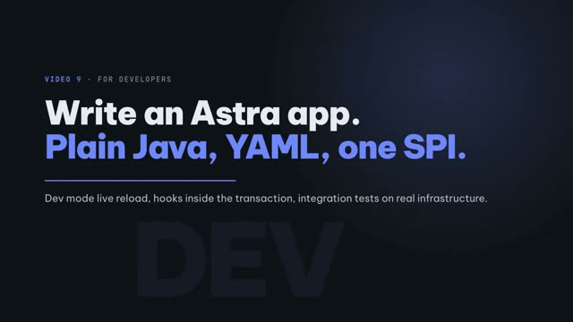
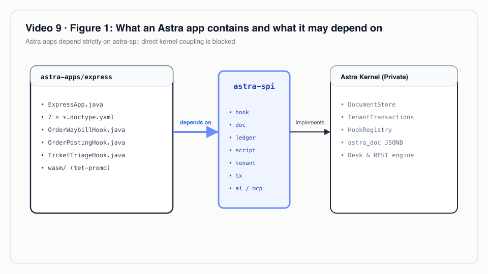
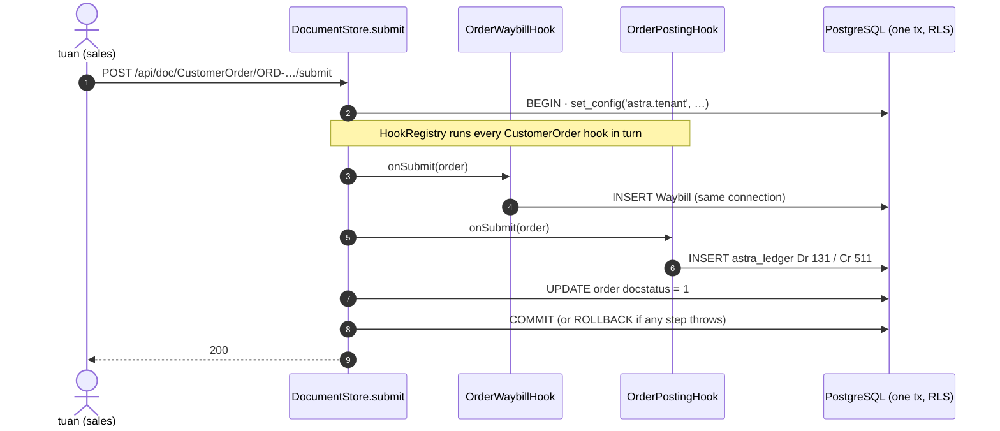
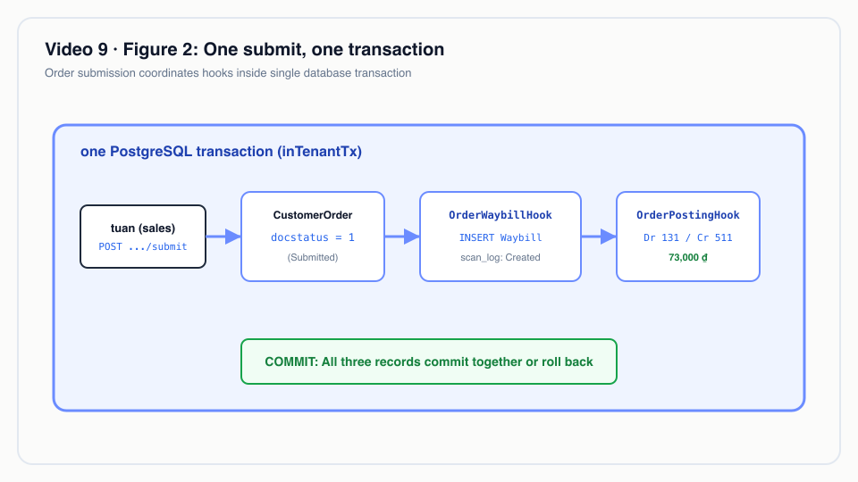
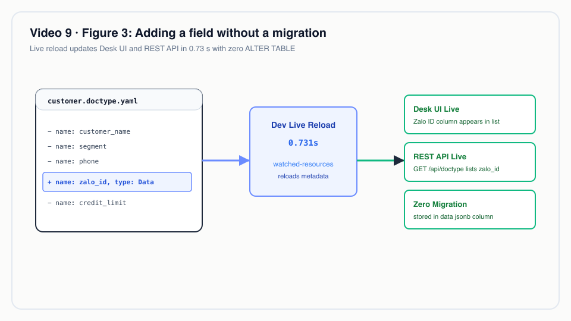

# Video 9 · For developers: writing an Astra app

<a href="https://media.zerohostcms.com/astra-cms/astra-video-9-developer-en.mp4"></a>

▶ [English](https://media.zerohostcms.com/astra-cms/astra-video-9-developer-en.mp4) · [Tiếng Việt](https://media.zerohostcms.com/astra-cms/astra-video-9-developer-vi.mp4) · 2:22 · Script: [demo-video-series.en.md](../demo-video-series.en.md#video-9-for-developers-writing-an-astra-app)

> **In one sentence:** an Astra app is plain Java and YAML compiled against one small SPI module (`astra-spi`); the kernel turns the YAML into storage, REST, Desk and validation, and runs your hooks inside the document's own transaction.
>
> **Read this if:** you are going to write business logic on Astra and want to know what you write, what you do not write, and how you test it / you are deciding whether a team can build modules on Astra without touching the kernel, and what the development loop costs.

## The problem

Astra Express is a courier company. Its developers need to ship business features every week: a new field the call
centre wants on the customer record, a rule that creates a waybill when an order is submitted, a journal entry for the
shipping fee. In most stacks each of those touches four layers: a database migration, an entity class, a controller
and a form. The waybill and the journal entry also raise a correctness question: if the order is saved but the waybill
insert fails, the two documents disagree, and someone reconciles them by hand at month end.

Three pains follow from that:

- **Schema churn.** Every new field is an `ALTER TABLE` plus a deploy. On a large table that is a lock and a
  maintenance window.
- **Cross-document consistency.** Side effects (waybill, ledger) are usually written in separate calls or in an event
  handler after commit, so a failure in the middle leaves half a business operation.
- **Platform coupling.** If app code can reach anything in the platform, every platform upgrade risks breaking every
  app.

Frappe/ERPNext solved the first problem with metadata (a DocType generates the form and the API) and the third with
installable apps and hooks. It still uses one table per DocType and runs DDL when a field is added
([explain.en.md](../explain.en.md)). Astra keeps the DocType idea, stores every DocType in one JSONB table, and
gives apps exactly one dependency: `astra-spi`.

## What the video shows

The video is a 2:22 guided walkthrough recorded against the Docker Compose stack in dev mode.

1. **Two commands start a kernel with live reload.** `make infra-up`, then `make dev`. k3d already holds port 8080, so
   dev mode runs on 8081 (`DEV_ARGS=-Dquarkus.http.port=8081`).
2. **The app tree.** `astra-apps/express` contains the `ExpressApp` class, hooks, MCP tools, seven DocType YAML files
   and two Wasm modules. The app sees only `astra-spi`; the kernel provides the rest.
3. **Hooks join the transaction.** On submit, `OrderWaybillHook` creates the waybill and `OrderPostingHook` posts the
   journal entry. Both run inside the order's transaction, so the documents never drift apart.
4. **Live edit.** One YAML line, `- { name: zalo_id, type: Data, in-list: true }`, is added to
   `customer.doctype.yaml`. Dev mode restarts (the recorded log shows `started in 0.731s`) and Desk shows a Zalo id
   column. No migration, no `ALTER TABLE`: the field lives in JSONB.
5. **Same definition everywhere.** `GET /api/doctype/Customer` already lists `zalo_id` (recorded response: HTTP 200,
   fields `code, customer_name, segment, phone, address, credit_limit, zalo_id`).
6. **Integration tests against real infrastructure.** The recorded `./mvnw test` run: 44 tests, 0 failures, build
   success, with containers for PostgreSQL, Seata Server 2.6 and Redis.
7. **To be accurate.** Adding fields is easy; removing them breaks editing of older documents. Safe schema evolution
   is on the roadmap.

What it proves: an app needs no framework of its own, a field change needs no migration, and cross-document side
effects are atomic.

## How it works

### An app is a list of DocTypes plus CDI beans

The app's entry point declares its id, version and DocType resources. Nothing else is registered by hand.

*`astra-apps/express/src/main/java/io/astra/apps/express/ExpressApp.java`*

```java
@ApplicationScoped
public class ExpressApp implements AstraApp {

    @Override
    public String id() { return "io.astra.express"; }

    @Override
    public String version() { return "0.1.0"; }

    @Override
    public List<String> doctypeResources() {
        return List.of(
                "META-INF/astra/doctypes/customer.doctype.yaml",
                "META-INF/astra/doctypes/customer-order.doctype.yaml",
                // …
                "META-INF/astra/doctypes/pricing-rule.doctype.yaml");
    }
}
```

The SPI explains why the list is explicit rather than scanned:

*`astra-spi/src/main/java/io/astra/spi/app/AstraApp.java`*

```java
    /**
     * Classpath resource paths of DocType definitions (YAML) this app contributes,
     * e.g. {@code META-INF/astra/doctypes/article.doctype.yaml}. Explicit listing keeps
     * loading deterministic inside jars and native images.
     */
    List<String> doctypeResources();
```

The dependency boundary is enforced by the build, not by convention. The Express module's only compile dependency
besides the CDI API is `astra-spi`:

*`astra-apps/express/pom.xml`*

```xml
  <dependencies>
    <dependency>
      <groupId>io.astra</groupId>
      <artifactId>astra-spi</artifactId>
    </dependency>
    <dependency>
      <groupId>jakarta.enterprise</groupId>
      <artifactId>jakarta.enterprise.cdi-api</artifactId>
      <scope>provided</scope>
    </dependency>
  </dependencies>
```

Why: if the app cannot import kernel classes, the kernel can change its internals (storage, caching, transactions)
without breaking apps. The SPI packages in this repository are `app`, `doc`, `doctype`, `hook`, `ledger`, `script`,
`tenant`, `tx`, `kv` and `ai` under `astra-spi/src/main/java/io/astra/spi/`.


*An Astra app consists of DocType YAML definitions and plain CDI beans implementing lifecycle hooks, depending strictly on astra-spi.*


### A hook is one interface with four defaults

*`astra-spi/src/main/java/io/astra/spi/hook/DocLifecycleHook.java`*

```java
public interface DocLifecycleHook {

    /** The DocType this hook applies to, e.g. {@code "Article"}. */
    String doctype();

    /** Runs before a document is inserted or updated, after kernel validation of declared fields. */
    default void beforeSave(Document doc) { }

    /** Runs after the document has been persisted in the same transaction. */
    default void afterSave(Document doc) { }

    /**
     * Runs when a draft of a submittable DocType is submitted, inside the transaction that writes
     * {@code docstatus = 1}. The hook may mutate the document and write other documents through
     * {@link io.astra.spi.doc.DocumentService}; throwing rolls all of it back.
     */
    default void onSubmit(Document doc) { }

    /** Runs when a submitted document is cancelled, inside the transaction that writes {@code docstatus = 2}. */
    default void onCancel(Document doc) { }
}
```

The kernel collects every hook bean once and precomputes a chain per DocType
(`astra-kernel/src/main/java/io/astra/kernel/extension/HookRegistry.java`), so dispatch on the hot path is a list
iteration, not a lookup by name.

### Side effects join the source document's transaction

Two hooks on `CustomerOrder` do the cross-module work shown in the video.

*`astra-apps/express/src/main/java/io/astra/apps/express/OrderWaybillHook.java`*

```java
    @Inject DocumentService docs;

    @Override
    public void onSubmit(Document order) {
        Document waybill = docs.insert("Waybill", Map.of(
                "order", order.name(),
                "receiver_name", order.getString("receiver_name")), order.owner());
        order.set("waybill", waybill.name());
    }

    @Override
    public void onCancel(Document order) {
        // …
        if (!CANCELLABLE.contains(status)) {
            throw new DocValidationException("cannot cancel " + order.name() + ": waybill " + name + " is already '" + status + "'");
        }
        docs.update("Waybill", name, Map.of("ops_status", "Cancelled"));
    }
```

*`astra-apps/express/src/main/java/io/astra/apps/express/OrderPostingHook.java`*

```java
    @Inject GeneralLedger ledger;

    @Override
    public void onSubmit(Document order) {
        BigDecimal fee = BigDecimal.valueOf(Numbers.toDouble(order.get("shipping_fee")));
        String customer = order.getString("customer");
        ledger.post("CustomerOrder", order.name(), LocalDate.now(), List.of(
                Entry.debit(Accounts.RECEIVABLE, customer, fee),
                Entry.credit(Accounts.REVENUE, customer, fee)), "Shipping fee " + order.name());
    }

    @Override
    public void onCancel(Document order) {
        ledger.reverse("CustomerOrder", order.name());
    }
```

Neither hook opens a transaction. The kernel's submit does, and everything inside it shares the connection:

*`astra-doctype/src/main/java/io/astra/doctype/store/DocumentStore.java`*

```java
    public Optional<Document> submit(String doctype, String name) {
        DocTypeDefinition def = requireSubmittable(doctype);
        return global(def, "submit " + doctype + " " + name, () -> inTenantTx(conn -> {
            // …
            requireDraft(doc);
            requireCaller(doc, Action.SUBMIT);
            hooks.onSubmit(doc);
            DocumentValidator.applyDefaultsAndValidate(def, doc);
            validateLinks(conn, def, doc);
            return Optional.of(write(conn, doc, 1));
        }));
    }
```

`inTenantTx` reuses the bound connection when one is already open, which is how `docs.insert(...)` inside a hook
joins the caller's transaction instead of starting its own:

*`astra-doctype/src/main/java/io/astra/doctype/store/TenantTransactions.java`*

```java
    public <T> T inTenantTx(SqlWork<T> work) {
        if (TX.isBound()) {
            try {
                return work.run(TX.get());
            // …
        }
        String tenant = TenantContext.require();
        try (Connection conn = dataSource.getConnection()) {
            conn.setAutoCommit(false);
            // … SELECT set_config('astra.tenant', ?, true)
```



Why this design: atomicity is the cheapest consistency model there is. There is no outbox, no retry and no
reconciliation job between order, waybill and ledger, because they are rows in one PostgreSQL transaction. When a
side effect crosses databases (BMS credit in another schema, a pickup slot in Redis), `transaction: global` on the
DocType wraps the same call in a Seata global transaction; that is Video 17.


*Hooks join the ambient tenant transaction: waybill creation and general ledger postings commit or rollback atomically with the document.*


### A field is one YAML line, stored in JSONB

Every DocType shares the `astra_doc` table, and business fields live in its `data jsonb` column, so adding a field is
a metadata change, not a schema change. The Customer DocType before the live edit:

*`astra-apps/express/src/main/resources/META-INF/astra/doctypes/customer.doctype.yaml`*

```yaml
fields:
  - { name: code,          type: Data,     required: true, in-list: true, label: Customer code }
  - { name: customer_name, type: Data,     required: true, in-list: true, label: Customer name }
  - { name: segment,       type: Select,   options: [Retail, B2B], default: Retail, in-list: true, projected: true }
  - { name: phone,         type: Data, pii: true }
  - { name: address,       type: Text, pii: true }
  - { name: credit_limit,  type: Currency, label: Credit limit (BMS) }   # mirrored to bms.customer_credit
```

The video appends `- { name: zalo_id, type: Data, in-list: true }`. Dev mode only restarts on a YAML edit because the
DocType files are listed as watched resources:

*`astra-server/src/main/resources/application.yml`*

```yaml
"%dev":
  quarkus:
    # …
    live-reload:
      # DocType YAML is read once at startup; without this, dev mode sees the edit but does not restart
      watched-resources:
        - META-INF/astra/doctypes/account.doctype.yaml
        # …
        - META-INF/astra/doctypes/customer.doctype.yaml
```

Desk has no code that names a DocType; it renders whatever `GET /api/doctype` returns
(`astra-server/src/main/resources/META-INF/resources/desk/desk.js`, see
[S12](../demo-code-snippets.md#s12-desk-generated-from-metadata)). That is why the column appears without a frontend
change.


*Adding a field requires only one line of YAML; the value is stored in JSONB with zero ALTER TABLE migrations.*


### Why removing a field is harder than adding one

The validator rejects any key in a document that the DocType does not declare:

*`astra-doctype/src/main/java/io/astra/doctype/store/DocumentValidator.java`*

```java
            if (def.field(key).isEmpty()) errors.add("unknown field '" + key + "' for DocType " + def.name());
```

That strictness is what catches typos and stale clients. Its cost: if you delete `zalo_id` from the YAML, every
existing document that still carries `zalo_id` in its JSONB fails validation on its next save. This is the limit the
video states at the end.

## Real-world example

*Illustrative scenario: the company, people and values are made up; the mechanism and the rules it applies are the real ones shown above.*

A Vietnamese 3PL serving e-commerce shops runs order intake and accounting on one system. Month-end close keeps
finding orders that were billed but never handed to the warehouse, because the old system created the waybill in a
background job after the order commit.

On Astra the same flow is the two hooks above. Take one order from the demo's B2B customer C001: Domestic, Express,
2.2 kg, COD 500,000 ₫, standard tariff.

| Step | Input | What Astra does | Output |
| --- | --- | --- | --- |
| Save draft | the order body | `ShippingFeeHook.beforeSave` validates phone and weight, prices the parcel | `shipping_fee = 73,000`, `priced_by = Standard tariff` |
| Submit | `POST …/submit` | one transaction: waybill insert, ledger post, `docstatus = 1` | waybill `WB-…`, entries Dr 131 73,000 / Cr 511 73,000 |
| Submit fails midway | e.g. the waybill insert throws | the whole transaction rolls back | order stays Draft, no waybill, no ledger rows |
| Cancel early | waybill still `Created` or `Picked Up` | waybill set to `Cancelled`, ledger posts mirror entries | Dr 511 / Cr 131 reversal; old rows unchanged |
| Cancel late | waybill already `At Hub` | `onCancel` throws `DocValidationException` | 422 `cannot cancel ORD-…: waybill WB-… is already 'At Hub'`; nothing changes |

The fee arithmetic (from Video 3): 30,000 + 3 × 5,000 = 45,000; × 1.5 Express = 67,500; + COD fee
max(5,000; 1 %) = 72,500; rounded up to the thousand = 73,000.

When the call centre later asks for a Zalo id on each customer (Zalo is the messaging app most Vietnamese customers
use), it is one YAML line and one rolling deploy of the app image; no migration window.

## For technical leaders

- **What a developer writes.** A DocType YAML file per entity, CDI beans implementing SPI interfaces (hooks, MCP
  tools, TCC participants), and integration tests. No controllers, no entities, no migrations, no form code.
- **Boundary enforcement.** Apps compile against `astra-spi` only. This is the main lever for keeping platform
  upgrades cheap; review any request to widen it.
- **Consistency model.** Same-database side effects are atomic by construction. Cross-store effects need
  `transaction: global` (Seata), which adds a coordinator and its operational cost. Do not reach for it when one
  PostgreSQL transaction suffices.
- **Hook order.** `HookRegistry` groups hooks per DocType from CDI discovery and declares no ordering, so hooks on
  the same DocType should not depend on each other's side effects.
- **Dev loop.** Edit YAML or Java, dev mode restarts (0.73 s in the recording). The full test suite needs Docker
  because it starts real PostgreSQL, Seata and Redis containers; budget CI minutes accordingly.
- **Field removal is a known gap.** Adding is free; removing or renaming breaks edits of old documents until safe
  schema evolution ships. Treat removals as a data migration you own.
- **Deploying an app change.** An Express app change is a Tier 0 change: it is compiled into the server image and
  rolled out like any image (Video 10). Per-tenant changes without a deploy use overlays (Video 13) and Wasm
  (Video 14).
- **When not to use this.** If your team needs to customise kernel behaviour itself (storage, transactions) rather
  than business rules, the SPI will feel narrow. If your data model is mostly relational analytics rather than
  documents with a lifecycle, a conventional schema may fit better.
- **What to measure.** Dev-mode restart time, test-suite wall time, number of hooks per DocType (the chain grows on
  every save), and 422 rates after a DocType change.

## Try it yourself

Prerequisites: JDK 25, Docker Desktop, `jq`, Bash 5. See the
[recording environment](../demo-video-series.en.md#1-preparing-the-recording-environment).

```bash
make infra-up && make build                          # PostgreSQL :5432, Redis, Keycloak :8180
make dev DEV_ARGS=-Dquarkus.http.port=8081           # dev mode with live reload on 8081
BASE=http://localhost:8081 make demo-seed            # demo tenants and data, through the REST API
open http://localhost:8081/desk/                     # log in as mai / Astra@123
```

Then add this line under `fields:` in
`astra-apps/express/src/main/resources/META-INF/astra/doctypes/customer.doctype.yaml`:

```yaml
  - { name: zalo_id, type: Data, in-list: true }
```

Expected: the dev-mode log prints a restart line like `started in 0.731s. Listening on: http://localhost:8081`, and
the Customer list in Desk shows a `zalo_id` column after a refresh.

Undo the edit and reset the demo data afterwards; the reset command for the Compose stack is
`scripts/demo-reset.sh compose`, then seed again.

Run the test suite (Docker required; Dev Services starts PostgreSQL):

```bash
make test
```

The recorded run reported `Tests run: 44, Failures: 0, Errors: 0, Skipped: 0` and `BUILD SUCCESS`. The repository has
gained tests since then (HRM, STMS, SCIM), so the count you see will be higher. The tests the video names are
`astra-server/src/test/java/io/astra/server/ExpressFlowTest.java`, `LedgerTest.java` and `SeataTest.java`.

## To be accurate

- Removing a field from a DocType makes older documents that still have that field impossible to edit (the validator
  rejects unknown fields). Safe schema evolution is on the roadmap. After the live edit, run
  `make demo-reset && make demo-seed` (or the Compose reset above).
- Live reload watches only the DocType files listed in `application.yml`; a new DocType file must be added there to
  trigger a dev-mode restart.
- The test count in the video (44) is the count at recording time.
- Tier 1 (isolated JVM apps, hot-swapped at runtime) is described in [explain.en.md](../explain.en.md) but is not
  built. Every app in this repository is Tier 0, compiled into the server image.

## Figures

- [Figure 1 · What an Astra app contains and what it may depend on](#an-app-is-a-list-of-doctypes-plus-cdi-beans)
- [Figure 2 · One submit, one transaction](#side-effects-join-the-source-documents-transaction)
- [Figure 3 · Adding a field without a migration](#a-field-is-one-yaml-line-stored-in-jsonb)

## Related

- Previous: [Video 8 · Fail-closed security](./08-failclosed.md) · Next: [Video 10 · Running on Kubernetes](./10-k8s.md)
- [Video 2 · DocType](./02-doctype.md), [Video 3 · Hooks](./03-hooks.md), [Video 4 · Lifecycle](./04-lifecycle.md),
  [Video 12 · Ledger](./12-ledger.md), [Video 17 · Seata](./17-seata.md)
- Code excerpts: [S2 An app and a hook](../demo-code-snippets.md#s2-an-app-and-a-hook),
  [S12 Desk generated from metadata](../demo-code-snippets.md#s12-desk-generated-from-metadata)
- Source: `astra-apps/express/`, `astra-spi/src/main/java/io/astra/spi/`,
  `astra-doctype/src/main/java/io/astra/doctype/store/DocumentStore.java`,
  `astra-kernel/src/main/java/io/astra/kernel/extension/HookRegistry.java`,
  `astra-server/src/test/java/io/astra/server/ExpressFlowTest.java`
