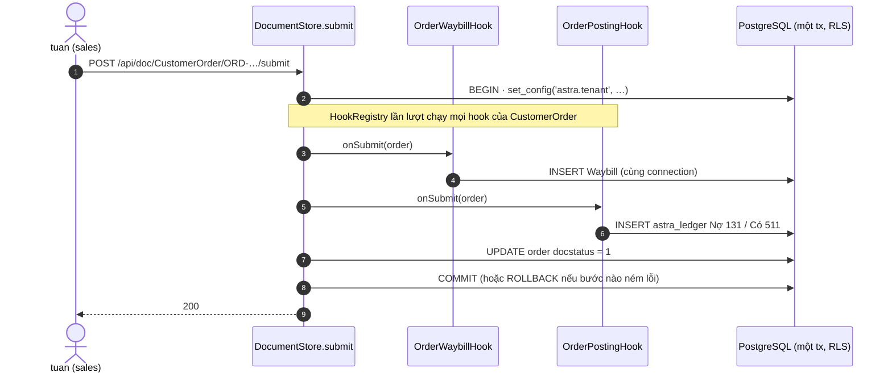

# Video 9 · Dành cho developer: viết một app Astra

<a href="https://media.zerohostcms.com/astra-cms/astra-video-9-developer-vi.mp4"></a>

▶ [Tiếng Việt](https://media.zerohostcms.com/astra-cms/astra-video-9-developer-vi.mp4) · [English](https://media.zerohostcms.com/astra-cms/astra-video-9-developer-en.mp4) · 2:22 · Kịch bản: [demo-video-series.md](../demo-video-series.md#video-9-dành-cho-developer-viết-một-app-astra) · [Bản tiếng Anh](./09-developer.md)

> **Tóm tắt một câu:** một app Astra chỉ là Java và YAML bình thường, biên dịch dựa trên một module SPI nhỏ (`astra-spi`); kernel biến YAML thành lưu trữ, REST, Desk và validation, đồng thời chạy hook của bạn ngay trong transaction của chính chứng từ.
>
> **Nên đọc nếu:** bạn sắp viết logic nghiệp vụ trên Astra và muốn biết mình viết gì, không phải viết gì, và test thế nào / bạn đang cân nhắc liệu một team có thể xây module trên Astra mà không đụng vào kernel hay không, và vòng lặp phát triển tốn bao nhiêu.

## Vấn đề

Astra Express là một công ty chuyển phát. Developer của họ phải giao tính năng nghiệp vụ mỗi tuần: một trường mới mà
tổng đài muốn có trên hồ sơ khách hàng, một quy tắc tạo vận đơn khi đơn hàng được submit, một bút toán cho phí vận
chuyển. Ở phần lớn các stack, mỗi việc như vậy chạm tới bốn tầng: migration database, lớp entity, controller và form.
Vận đơn và bút toán còn đặt ra câu hỏi về tính đúng đắn: nếu đơn hàng đã lưu nhưng việc insert vận đơn thất bại, hai
chứng từ lệch nhau, và cuối tháng sẽ có người phải đối chiếu bằng tay.

Từ đó sinh ra ba nỗi đau:

- **Schema thay đổi liên tục.** Mỗi trường mới là một lệnh `ALTER TABLE` cộng một lần deploy. Trên bảng lớn, đó là
  lock và một khung giờ bảo trì.
- **Nhất quán giữa các chứng từ.** Tác dụng phụ (vận đơn, sổ cái) thường được ghi bằng các lời gọi riêng hoặc trong
  một event handler sau khi commit, nên lỗi giữa chừng để lại một nghiệp vụ dở dang.
- **App dính chặt vào nền tảng.** Nếu code của app chạm được vào mọi thứ trong nền tảng, mỗi lần nâng cấp nền tảng đều
  có nguy cơ làm hỏng mọi app.

Frappe/ERPNext giải quyết vấn đề thứ nhất bằng metadata (một DocType sinh ra form và API) và vấn đề thứ ba bằng app
cài đặt được cùng hook. Nhưng Frappe vẫn dùng một bảng cho mỗi DocType và chạy DDL khi thêm trường
([explain.md](../explain.md)). Astra giữ ý tưởng DocType, lưu mọi DocType trong một bảng JSONB duy nhất, và chỉ cho app
đúng một dependency: `astra-spi`.

## Video cho thấy gì

Video dài 2:22, là phần hướng dẫn quay trên stack Docker Compose ở dev mode.

1. **Hai lệnh khởi động kernel có live reload.** `make infra-up`, rồi `make dev`. k3d đã chiếm cổng 8080, nên dev mode
   chạy ở 8081 (`DEV_ARGS=-Dquarkus.http.port=8081`).
2. **Cây thư mục của app.** `astra-apps/express` chứa lớp `ExpressApp`, các hook, tool MCP, bảy file YAML DocType và
   hai module Wasm. App chỉ thấy `astra-spi`; phần còn lại do kernel cung cấp.
3. **Hook tham gia transaction.** Khi submit, `OrderWaybillHook` tạo vận đơn và `OrderPostingHook` ghi bút toán. Cả hai
   chạy trong transaction của đơn hàng, nên các chứng từ không bao giờ lệch nhau.
4. **Sửa trực tiếp.** Một dòng YAML, `- { name: zalo_id, type: Data, in-list: true }`, được thêm vào
   `customer.doctype.yaml`. Dev mode khởi động lại (log quay được ghi `started in 0.731s`) và Desk hiện cột Zalo id.
   Không migration, không `ALTER TABLE`: trường này nằm trong JSONB.
5. **Một định nghĩa dùng ở mọi nơi.** `GET /api/doctype/Customer` đã liệt kê `zalo_id` (response quay được: HTTP 200,
   các trường `code, customer_name, segment, phone, address, credit_limit, zalo_id`).
6. **Test tích hợp trên hạ tầng thật.** Lần chạy `./mvnw test` được quay: 44 test, 0 lỗi, build thành công, với
   container PostgreSQL, Seata Server 2.6 và Redis.
7. **Nói đúng.** Thêm trường thì dễ; xoá trường sẽ làm hỏng việc sửa các chứng từ cũ. Tiến hoá schema an toàn còn trên
   roadmap.

Điều video chứng minh: app không cần framework riêng, đổi trường không cần migration, và tác dụng phụ giữa các chứng
từ là nguyên tử.

## Cách hoạt động

### Một app là danh sách DocType cộng các CDI bean

Điểm vào của app khai báo id, phiên bản và các resource DocType. Không có gì khác phải đăng ký bằng tay.

*`astra-apps/express/src/main/java/io/astra/apps/express/ExpressApp.java`*

```java
@ApplicationScoped
public class ExpressApp implements AstraApp {

    @Override
    public String id() { return "io.astra.express"; }

    @Override
    public String version() { return "0.1.0"; }

    @Override
    public List<String> doctypeResources() {
        return List.of(
                "META-INF/astra/doctypes/customer.doctype.yaml",
                "META-INF/astra/doctypes/customer-order.doctype.yaml",
                // …
                "META-INF/astra/doctypes/pricing-rule.doctype.yaml");
    }
}
```

SPI giải thích vì sao danh sách được liệt kê tường minh thay vì quét tự động:

*`astra-spi/src/main/java/io/astra/spi/app/AstraApp.java`*

```java
    /**
     * Classpath resource paths of DocType definitions (YAML) this app contributes,
     * e.g. {@code META-INF/astra/doctypes/article.doctype.yaml}. Explicit listing keeps
     * loading deterministic inside jars and native images.
     */
    List<String> doctypeResources();
```

Ranh giới dependency được build ép buộc, không dựa vào quy ước. Ngoài CDI API, dependency biên dịch duy nhất của
module Express là `astra-spi`:

*`astra-apps/express/pom.xml`*

```xml
  <dependencies>
    <dependency>
      <groupId>io.astra</groupId>
      <artifactId>astra-spi</artifactId>
    </dependency>
    <dependency>
      <groupId>jakarta.enterprise</groupId>
      <artifactId>jakarta.enterprise.cdi-api</artifactId>
      <scope>provided</scope>
    </dependency>
  </dependencies>
```

Vì sao: nếu app không import được lớp của kernel, kernel có thể đổi phần bên trong (lưu trữ, cache, transaction) mà
không làm hỏng app. Các package SPI trong repository này là `app`, `doc`, `doctype`, `hook`, `ledger`, `script`,
`tenant`, `tx`, `kv` và `ai`, nằm dưới `astra-spi/src/main/java/io/astra/spi/`.

### Một hook là một interface với bốn phương thức mặc định

*`astra-spi/src/main/java/io/astra/spi/hook/DocLifecycleHook.java`*

```java
public interface DocLifecycleHook {

    /** The DocType this hook applies to, e.g. {@code "Article"}. */
    String doctype();

    /** Runs before a document is inserted or updated, after kernel validation of declared fields. */
    default void beforeSave(Document doc) { }

    /** Runs after the document has been persisted in the same transaction. */
    default void afterSave(Document doc) { }

    /**
     * Runs when a draft of a submittable DocType is submitted, inside the transaction that writes
     * {@code docstatus = 1}. The hook may mutate the document and write other documents through
     * {@link io.astra.spi.doc.DocumentService}; throwing rolls all of it back.
     */
    default void onSubmit(Document doc) { }

    /** Runs when a submitted document is cancelled, inside the transaction that writes {@code docstatus = 2}. */
    default void onCancel(Document doc) { }
}
```

Kernel gom mọi hook bean một lần và tính sẵn một chuỗi cho từng DocType
(`astra-kernel/src/main/java/io/astra/kernel/extension/HookRegistry.java`), nên việc gọi hook trên đường nóng chỉ là
duyệt một danh sách, không phải tra cứu theo tên.

### Tác dụng phụ tham gia transaction của chứng từ gốc

Hai hook trên `CustomerOrder` làm phần việc liên module mà video cho thấy.

*`astra-apps/express/src/main/java/io/astra/apps/express/OrderWaybillHook.java`*

```java
    @Inject DocumentService docs;

    @Override
    public void onSubmit(Document order) {
        Document waybill = docs.insert("Waybill", Map.of(
                "order", order.name(),
                "receiver_name", order.getString("receiver_name")), order.owner());
        order.set("waybill", waybill.name());
    }

    @Override
    public void onCancel(Document order) {
        // …
        if (!CANCELLABLE.contains(status)) {
            throw new DocValidationException("cannot cancel " + order.name() + ": waybill " + name + " is already '" + status + "'");
        }
        docs.update("Waybill", name, Map.of("ops_status", "Cancelled"));
    }
```

*`astra-apps/express/src/main/java/io/astra/apps/express/OrderPostingHook.java`*

```java
    @Inject GeneralLedger ledger;

    @Override
    public void onSubmit(Document order) {
        BigDecimal fee = BigDecimal.valueOf(Numbers.toDouble(order.get("shipping_fee")));
        String customer = order.getString("customer");
        ledger.post("CustomerOrder", order.name(), LocalDate.now(), List.of(
                Entry.debit(Accounts.RECEIVABLE, customer, fee),
                Entry.credit(Accounts.REVENUE, customer, fee)), "Shipping fee " + order.name());
    }

    @Override
    public void onCancel(Document order) {
        ledger.reverse("CustomerOrder", order.name());
    }
```

Không hook nào mở transaction. Lệnh submit của kernel mở transaction, và mọi thứ bên trong dùng chung một connection:

*`astra-doctype/src/main/java/io/astra/doctype/store/DocumentStore.java`*

```java
    public Optional<Document> submit(String doctype, String name) {
        DocTypeDefinition def = requireSubmittable(doctype);
        return global(def, "submit " + doctype + " " + name, () -> inTenantTx(conn -> {
            // …
            requireDraft(doc);
            requireCaller(doc, Action.SUBMIT);
            hooks.onSubmit(doc);
            DocumentValidator.applyDefaultsAndValidate(def, doc);
            validateLinks(conn, def, doc);
            return Optional.of(write(conn, doc, 1));
        }));
    }
```

`inTenantTx` dùng lại connection đã gắn khi đang có một connection mở; nhờ vậy `docs.insert(...)` bên trong hook tham
gia transaction của bên gọi thay vì tự mở transaction riêng:

*`astra-doctype/src/main/java/io/astra/doctype/store/TenantTransactions.java`*

```java
    public <T> T inTenantTx(SqlWork<T> work) {
        if (TX.isBound()) {
            try {
                return work.run(TX.get());
            // …
        }
        String tenant = TenantContext.require();
        try (Connection conn = dataSource.getConnection()) {
            conn.setAutoCommit(false);
            // … SELECT set_config('astra.tenant', ?, true)
```



Vì sao thiết kế như vậy: tính nguyên tử là mô hình nhất quán rẻ nhất có thể có. Giữa đơn hàng, vận đơn và sổ cái không
có outbox, không retry, không job đối soát, vì chúng là các dòng trong một transaction PostgreSQL. Khi tác dụng phụ đi
qua nhiều database (hạn mức tín dụng BMS ở schema khác, một khung giờ lấy hàng trong Redis), `transaction: global` trên
DocType bọc cùng lời gọi đó trong một global transaction của Seata; đó là Video 17.

### Một trường là một dòng YAML, lưu trong JSONB

Mọi DocType dùng chung bảng `astra_doc`, và trường nghiệp vụ nằm trong cột `data jsonb` của bảng này, nên thêm trường
là thay đổi metadata chứ không phải thay đổi schema. DocType Customer trước khi sửa trực tiếp:

*`astra-apps/express/src/main/resources/META-INF/astra/doctypes/customer.doctype.yaml`*

```yaml
fields:
  - { name: code,          type: Data,     required: true, in-list: true, label: Customer code }
  - { name: customer_name, type: Data,     required: true, in-list: true, label: Customer name }
  - { name: segment,       type: Select,   options: [Retail, B2B], default: Retail, in-list: true, projected: true }
  - { name: phone,         type: Data, pii: true }
  - { name: address,       type: Text, pii: true }
  - { name: credit_limit,  type: Currency, label: Credit limit (BMS) }   # mirrored to bms.customer_credit
```

Video thêm dòng `- { name: zalo_id, type: Data, in-list: true }`. Dev mode chỉ khởi động lại khi sửa YAML vì các file
DocType được khai báo là resource được theo dõi:

*`astra-server/src/main/resources/application.yml`*

```yaml
"%dev":
  quarkus:
    # …
    live-reload:
      # DocType YAML is read once at startup; without this, dev mode sees the edit but does not restart
      watched-resources:
        - META-INF/astra/doctypes/account.doctype.yaml
        # …
        - META-INF/astra/doctypes/customer.doctype.yaml
```

Desk không có dòng code nào gọi tên một DocType cụ thể; nó render bất cứ thứ gì `GET /api/doctype` trả về
(`astra-server/src/main/resources/META-INF/resources/desk/desk.js`, xem
[S12](../demo-code-snippets.md#s12-desk-generated-from-metadata)). Vì vậy cột mới xuất hiện mà không phải sửa frontend.

### Vì sao xoá trường khó hơn thêm trường

Validator từ chối mọi key trong chứng từ mà DocType không khai báo:

*`astra-doctype/src/main/java/io/astra/doctype/store/DocumentValidator.java`*

```java
            if (def.field(key).isEmpty()) errors.add("unknown field '" + key + "' for DocType " + def.name());
```

Chính sự chặt chẽ này bắt được lỗi gõ nhầm và client cũ. Cái giá của nó: nếu bạn xoá `zalo_id` khỏi YAML, mọi chứng từ
hiện có vẫn còn `zalo_id` trong JSONB sẽ trượt validation ở lần lưu kế tiếp. Đây là giới hạn mà video nêu ở cuối.

## Ví dụ thực tế

*Tình huống minh hoạ: công ty, con người và số liệu là giả định; cơ chế và các quy tắc được áp dụng là thật, như đã trình bày ở trên.*

Một công ty 3PL ở Việt Nam phục vụ các shop thương mại điện tử, chạy cả nhận đơn lẫn kế toán trên một hệ thống. Kỳ khoá
sổ cuối tháng nào cũng lòi ra những đơn đã tính tiền nhưng chưa bao giờ được giao cho kho, vì hệ thống cũ tạo vận đơn
trong một background job sau khi đơn hàng commit.

Trên Astra, cùng luồng đó chính là hai hook ở trên. Lấy một đơn của khách B2B C001 trong demo: Domestic, Express,
2,2 kg, COD 500.000 ₫, biểu giá chuẩn.

| Bước | Đầu vào | Astra làm gì | Kết quả |
| --- | --- | --- | --- |
| Lưu nháp | nội dung đơn | `ShippingFeeHook.beforeSave` kiểm tra số điện thoại và cân nặng, tính cước bưu kiện | `shipping_fee = 73,000`, `priced_by = Standard tariff` |
| Submit | `POST …/submit` | một transaction: insert vận đơn, ghi sổ cái, `docstatus = 1` | vận đơn `WB-…`, bút toán Nợ 131 73.000 / Có 511 73.000 |
| Submit lỗi giữa chừng | ví dụ insert vận đơn ném lỗi | rollback toàn bộ transaction | đơn vẫn là Draft, không có vận đơn, không có dòng sổ cái |
| Hủy sớm | vận đơn vẫn ở `Created` hoặc `Picked Up` | vận đơn chuyển sang `Cancelled`, sổ cái ghi bút toán đối xứng | bút toán đảo Nợ 511 / Có 131; các dòng cũ giữ nguyên |
| Hủy muộn | vận đơn đã `At Hub` | `onCancel` ném `DocValidationException` | 422 `cannot cancel ORD-…: waybill WB-… is already 'At Hub'`; không có gì thay đổi |

Cách tính cước (từ Video 3): 30.000 + 3 × 5.000 = 45.000; × 1,5 cho Express = 67.500; + phí COD
max(5.000; 1 %) = 72.500; làm tròn lên hàng nghìn = 73.000.

Khi tổng đài sau đó muốn có Zalo id cho từng khách hàng (Zalo là ứng dụng nhắn tin mà phần lớn khách hàng Việt Nam dùng),
việc đó chỉ là một dòng YAML và một lần rolling deploy image của app; không cần khung giờ migration.

## Dành cho tech lead

- **Developer viết gì.** Một file YAML DocType cho mỗi thực thể, các CDI bean hiện thực interface SPI (hook, tool MCP,
  participant TCC), và test tích hợp. Không controller, không entity, không migration, không code form.
- **Giữ ranh giới.** App chỉ biên dịch dựa trên `astra-spi`. Đây là đòn bẩy chính để việc nâng cấp nền tảng luôn rẻ; hãy
  xem xét kỹ mọi đề xuất nới rộng ranh giới này.
- **Mô hình nhất quán.** Tác dụng phụ trong cùng database thì nguyên tử ngay từ thiết kế. Tác dụng phụ đi qua nhiều kho
  dữ liệu cần `transaction: global` (Seata), kéo theo một coordinator và chi phí vận hành của nó. Đừng dùng tới khi một
  transaction PostgreSQL là đủ.
- **Thứ tự hook.** `HookRegistry` nhóm hook theo DocType từ CDI discovery và không khai báo thứ tự nào, nên các hook trên
  cùng một DocType không nên phụ thuộc vào tác dụng phụ của nhau.
- **Vòng lặp phát triển.** Sửa YAML hoặc Java, dev mode khởi động lại (0,73 s trong bản quay). Bộ test đầy đủ cần Docker
  vì nó khởi động container PostgreSQL, Seata và Redis thật; hãy tính trước số phút CI.
- **Xoá trường là khoảng trống đã biết.** Thêm thì miễn phí; xoá hoặc đổi tên sẽ làm hỏng việc sửa chứng từ cũ cho tới
  khi có tiến hoá schema an toàn. Hãy coi việc xoá trường là một đợt migration dữ liệu do bạn chịu trách nhiệm.
- **Deploy thay đổi của app.** Thay đổi trong app Express là thay đổi Tier 0: nó được biên dịch vào image của server và
  rollout như mọi image khác (Video 10). Thay đổi theo từng tenant mà không cần deploy thì dùng overlay (Video 13) và
  Wasm (Video 14).
- **Khi nào không nên dùng.** Nếu team cần tuỳ biến chính hành vi của kernel (lưu trữ, transaction) chứ không phải quy
  tắc nghiệp vụ, SPI sẽ có cảm giác chật hẹp. Nếu mô hình dữ liệu chủ yếu là phân tích quan hệ thay vì chứng từ có vòng
  đời, một schema truyền thống có thể phù hợp hơn.
- **Cần đo gì.** Thời gian khởi động lại của dev mode, thời gian chạy bộ test, số hook trên mỗi DocType (chuỗi này chạy
  ở mỗi lần lưu), và tỉ lệ 422 sau khi đổi DocType.

## Tự chạy thử

Cần có: JDK 25, Docker Desktop, `jq`, Bash 5. Xem
[môi trường quay](../demo-video-series.md#1-chuẩn-bị-môi-trường-quay).

```bash
make infra-up && make build                          # PostgreSQL :5432, Redis, Keycloak :8180
make dev DEV_ARGS=-Dquarkus.http.port=8081           # dev mode with live reload on 8081
BASE=http://localhost:8081 make demo-seed            # demo tenants and data, through the REST API
open http://localhost:8081/desk/                     # log in as mai / Astra@123
```

Sau đó thêm dòng này dưới `fields:` trong
`astra-apps/express/src/main/resources/META-INF/astra/doctypes/customer.doctype.yaml`:

```yaml
  - { name: zalo_id, type: Data, in-list: true }
```

Kết quả mong đợi: log dev mode in ra một dòng khởi động lại kiểu `started in 0.731s. Listening on: http://localhost:8081`,
và danh sách Customer trong Desk hiện cột `zalo_id` sau khi tải lại trang.

Sau đó hãy hoàn tác thay đổi và reset dữ liệu demo; lệnh reset cho stack Compose là
`scripts/demo-reset.sh compose`, rồi seed lại.

Chạy bộ test (cần Docker; Dev Services khởi động PostgreSQL):

```bash
make test
```

Lần chạy được quay báo `Tests run: 44, Failures: 0, Errors: 0, Skipped: 0` và `BUILD SUCCESS`. Từ đó repository đã có
thêm test (HRM, STMS, SCIM), nên con số bạn thấy sẽ cao hơn. Các test mà video nhắc tới là
`astra-server/src/test/java/io/astra/server/ExpressFlowTest.java`, `LedgerTest.java` và `SeataTest.java`.

## Nói đúng

- Xoá một trường khỏi DocType khiến các chứng từ cũ còn trường đó không sửa được nữa (validator từ chối trường không
  khai báo). Tiến hoá schema an toàn còn trên roadmap. Sau khi sửa trực tiếp, hãy chạy
  `make demo-reset && make demo-seed` (hoặc lệnh reset Compose ở trên).
- Live reload chỉ theo dõi các file DocType được liệt kê trong `application.yml`; file DocType mới phải được thêm vào đó
  thì dev mode mới khởi động lại.
- Số test trong video (44) là số tại thời điểm quay.
- Tier 1 (app JVM cô lập, hot-swap lúc chạy) được mô tả trong [explain.md](../explain.md) nhưng chưa được xây. Mọi app
  trong repository này đều là Tier 0, biên dịch vào image của server.

## Minh hoạ: prompt vẽ hình

Prompt giữ nguyên tiếng Anh để mô hình tạo ảnh hiểu chính xác; nhãn trên hình là tên kỹ thuật thật.

### Hình 1 · Một app Astra chứa gì và được phép phụ thuộc vào đâu

*Đặt ở:* Cách hoạt động, "Một app là danh sách DocType cộng các CDI bean"

```text
Hand-drawn whiteboard sketch, black ink line art on off-white paper, one accent color (#6b8cff blue) for the key path, simple boxes and arrows, short handwritten labels in English, generous white space, no logos, no photorealism, 16:9.
Left: a tall folder box labelled "astra-apps/express" containing four small stacked cards: "ExpressApp.java", "7 × *.doctype.yaml", "hooks (OrderWaybillHook, OrderPostingHook…)", "wasm/ (tet-promo, runaway)". Center: a narrow vertical slab labelled "astra-spi" with tiny tabs "hook", "doc", "ledger", "script", "tx", "ai". Right: a large box labelled "kernel" containing "DocumentStore", "HookRegistry", "astra_doc (JSONB)", "REST + Desk". One thick blue arrow from the app folder to the "astra-spi" slab labelled "only dependency". A thin grey arrow from the kernel to the slab labelled "implements". A crossed-out dashed arrow from the app folder directly to the kernel labelled "not allowed". Highlight the blue arrow.
```

### Hình 2 · Một lần submit, một transaction

*Đặt ở:* Cách hoạt động, "Tác dụng phụ tham gia transaction của chứng từ gốc"

```text
Hand-drawn whiteboard sketch, black ink line art on off-white paper, one accent color (#6b8cff blue) for the key path, simple boxes and arrows, short handwritten labels in English, generous white space, no logos, no photorealism, 16:9.
A large rounded rectangle drawn in blue across the middle, labelled "one PostgreSQL transaction". Left of it, a person icon labelled "tuan (sales)" with an arrow into the rectangle labelled "POST …/submit". Inside the rectangle, left to right, three boxes connected by arrows: "OrderWaybillHook → INSERT Waybill", "OrderPostingHook → Dr 131 / Cr 511", "docstatus = 1". Under the rectangle, two outcomes branching down: left "COMMIT: order + waybill + ledger", right "any throw → ROLLBACK: nothing written". Highlight the blue rectangle boundary.
```

### Hình 3 · Thêm trường mà không cần migration

*Đặt ở:* Cách hoạt động, "Một trường là một dòng YAML, lưu trong JSONB"

```text
Hand-drawn whiteboard sketch, black ink line art on off-white paper, one accent color (#6b8cff blue) for the key path, simple boxes and arrows, short handwritten labels in English, generous white space, no logos, no photorealism, 16:9.
Top left: a sheet labelled "customer.doctype.yaml" with one new line written in blue: "- { name: zalo_id, type: Data, in-list: true }". Arrow right to a small stopwatch labelled "dev restart 0.73 s". From the stopwatch, three arrows fanning right to three boxes: "Desk list: zalo_id column", "GET /api/doctype/Customer", "validator". Bottom: a database cylinder labelled "astra_doc" with a column strip "data jsonb" and a note "no ALTER TABLE". A crossed-out box near the cylinder labelled "migration". Highlight the blue YAML line.
```

## Liên quan

- Trước: [Video 8 · Bảo mật fail-closed](./08-failclosed.vi.md) · Tiếp: [Video 10 · Chạy trên Kubernetes](./10-k8s.vi.md)
- [Video 2 · DocType](./02-doctype.vi.md), [Video 3 · Hook](./03-hooks.vi.md), [Video 4 · Vòng đời chứng từ](./04-lifecycle.vi.md),
  [Video 12 · Sổ cái](./12-ledger.vi.md), [Video 17 · Seata](./17-seata.vi.md)
- Trích đoạn code: [S2 Một app và một hook](../demo-code-snippets.md#s2-an-app-and-a-hook),
  [S12 Desk sinh ra từ metadata](../demo-code-snippets.md#s12-desk-generated-from-metadata)
- Mã nguồn: `astra-apps/express/`, `astra-spi/src/main/java/io/astra/spi/`,
  `astra-doctype/src/main/java/io/astra/doctype/store/DocumentStore.java`,
  `astra-kernel/src/main/java/io/astra/kernel/extension/HookRegistry.java`,
  `astra-server/src/test/java/io/astra/server/ExpressFlowTest.java`
