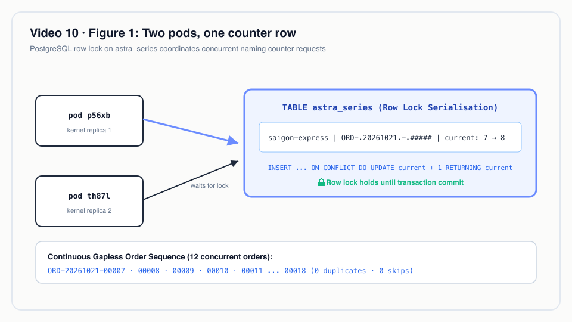
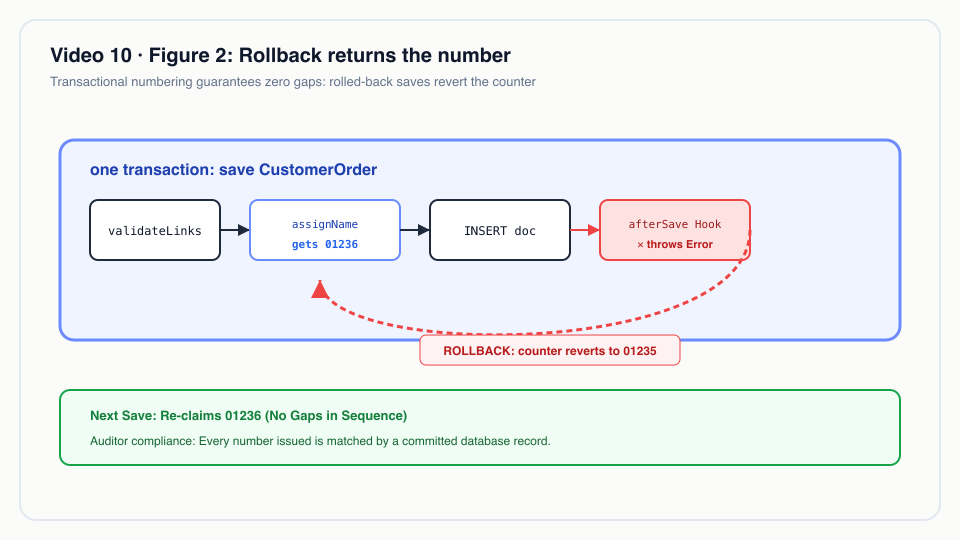
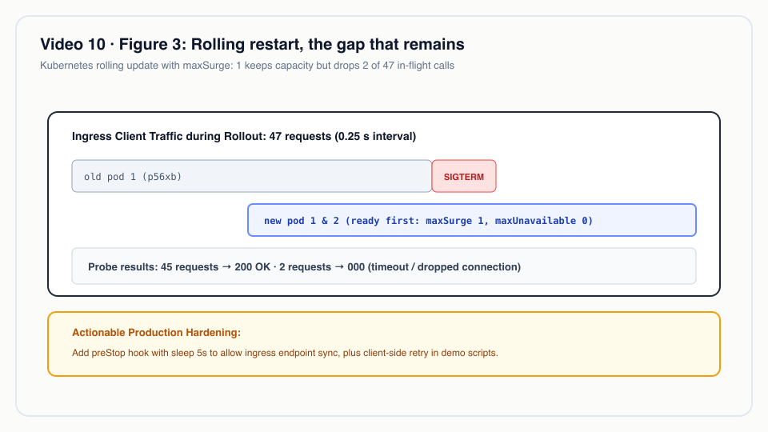

# Video 10 · Running on Kubernetes

<a href="https://media.zerohostcms.com/astra-cms/astra-video-10-k8s-en.mp4"></a>

▶ [English](https://media.zerohostcms.com/astra-cms/astra-video-10-k8s-en.mp4) · [Tiếng Việt](https://media.zerohostcms.com/astra-cms/astra-video-10-k8s-vi.mp4) · 2:06 · Script: [demo-video-series.en.md](../demo-video-series.en.md#video-10-running-on-kubernetes)

> **In one sentence:** Astra runs as two stateless kernel replicas from day one; document numbers stay gapless and unique across pods because the counter is one PostgreSQL upsert under a row lock inside the document's own transaction, and a rolling restart keeps the service nearly, but not fully, uninterrupted.
>
> **Read this if:** you want to know why `ORD-20261021-00007` can never be issued twice even when two pods write at once, and what to change before relying on rolling restarts (developer angle) / you are sizing the operational model: what is stateless, what is not, what a deploy costs users today (tech-lead angle).

## The problem

Astra Express creates orders from Desk, from the API and from an AI agent. Each order gets a human-readable
number such as `ORD-20261021-00007`: prefix, date, then a five-digit counter per tenant per day. Staff read
these numbers over the phone, print them on waybills and reconcile COD against them. Two properties matter:
**no duplicates** (two parcels with the same order number is an operational incident) and **no gaps**
(a missing number makes an auditor ask what was deleted).

Single-server systems get both for free: one process, one counter. The moment you run two replicas, the
usual approaches each break one property:

- **An in-memory counter per process** produces duplicates.
- **A database `SEQUENCE`** is unique and fast, but not transactional: a rolled-back insert still consumes
  a value, so gaps appear. It is also global, not per tenant and per day.
- **A Redis `INCR`** is unique across pods but lives outside the document's transaction, so a failed save
  leaves a gap, and Redis becomes part of the numbering's correctness.
- **Frappe/ERPNext** keeps naming-series counters in a database table updated inside the request's
  transaction, which is the same family of solution Astra uses. The difference is that Astra's kernel is
  designed to run as several replicas from the start, so the mechanism has to be proven under concurrent
  writers.

The second half of the problem is deployment. A rolling restart with users online should not log anyone
out or lose a click. The video measures how close the current manifest gets.

## What the video shows

| Scene | What you see | What it proves |
| --- | --- | --- |
| 1 · Title | "Two pods, one gapless number sequence." | Framing. |
| 2 · Deploy | `kubectl` shows `astra-server` `2/2` ready; the manifest has `replicas: 2`, `RollingUpdate` with `maxUnavailable: 0`, readiness and liveness probes. Other pods: `astra-cdc`, `keycloak`, `postgres-0`, `redis`, `seata-server`. | Two replicas from the start, because tenancy and numbering must be cluster-safe. |
| 3 · Parallel | 12 orders created at once, 6 sent directly to each pod. All return `201`. Numbers run `ORD-20261021-00007` to `ORD-20261021-00018` with no duplicates and no skips; which pod got which number is interleaved. | The counter is safe under concurrent writers on different pods. |
| 4 · Desk | The Customer Order list in Desk shows the same continuous sequence. | The pattern counts per tenant and per day. |
| 5 · Code | `SeriesService`: one upsert, one row lock. | The second pod waits for the first pod's lock; a rollback also rolls back the number. No separate sequence, no Redis. |
| 6 · Rollout | `kubectl -n astra rollout restart deployment/astra-server` while a client reads orders every 0.25 s through the ingress. 47 requests: 45 returned `200`, 2 got no response as an old pod stopped. | Nearly uninterrupted. |
| 7 · To be accurate | No preStop hook, no drain time. | Not zero downtime: one Desk action may need a retry. |

The captured pod-to-number mapping (`docs/video/v10-k8s/assets/parallel-sorted.txt`):

```text
astra-server-c6966f6f6-p56xb 201 ORD-20261021-00007
astra-server-c6966f6f6-th87l 201 ORD-20261021-00008
astra-server-c6966f6f6-th87l 201 ORD-20261021-00009
astra-server-c6966f6f6-p56xb 201 ORD-20261021-00010
astra-server-c6966f6f6-p56xb 201 ORD-20261021-00011
astra-server-c6966f6f6-th87l 201 ORD-20261021-00012
astra-server-c6966f6f6-p56xb 201 ORD-20261021-00013
astra-server-c6966f6f6-p56xb 201 ORD-20261021-00014
astra-server-c6966f6f6-th87l 201 ORD-20261021-00015
astra-server-c6966f6f6-p56xb 201 ORD-20261021-00016
astra-server-c6966f6f6-th87l 201 ORD-20261021-00017
astra-server-c6966f6f6-th87l 201 ORD-20261021-00018
```

The sequence starts at 7 because `make demo-seed` had already created six orders that day.

## How it works

### The deployment

*`deploy/k8s/base/astra-server.yaml`*

```yaml
spec:
  replicas: 2                     # two pods from the start: tenancy and naming series must be cluster-safe
  selector:
    matchLabels:
      app: astra-server
  strategy:
    type: RollingUpdate
    rollingUpdate:
      maxUnavailable: 0
      maxSurge: 1
  # …
          readinessProbe:
            httpGet: { path: /q/health/ready, port: 8080 }
            periodSeconds: 5
          livenessProbe:
            httpGet: { path: /q/health/live, port: 8080 }
            periodSeconds: 10
          resources:
            requests: { cpu: 250m, memory: 512Mi }
            limits: { memory: 1536Mi }   # ZGC heap is 75 % of this; the Timefold solver needs headroom
```

The same file also defines a `Service`, an `Ingress` (path `/auth` to Keycloak, `/` to the kernel) and a
`PodDisruptionBudget` with `minAvailable: 1`.

Why two replicas from the start rather than "scale later": anything that only works on one pod (an
in-memory counter, a local cache treated as truth, a sticky session) would hide until the first scale-out,
usually at the worst moment. Running two pods in the demo forces every feature to be cluster-safe now. The
kernel holds no session state: identity comes from the bearer token on each request, the tenant from the
request (see [Video 7](./07-tenants.md)), and documents from PostgreSQL.

`maxUnavailable: 0` with `maxSurge: 1` means Kubernetes starts a new pod, waits for it to pass readiness,
and only then stops an old one. Capacity never drops below two ready pods by design. The gap that remains
is covered under "To be accurate".

### The counter

*`astra-doctype/src/main/java/io/astra/doctype/store/SeriesService.java`*

```java
/**
 * Naming series such as {@code ART-.#####} or {@code ORD-.YYYYMMDD.-.#####}: literal parts and date
 * tokens ({@code YYYY}, {@code YY}, {@code MM}, {@code DD}) separated by dots, then a zero-padded
 * counter whose width is the number of {@code #}. Counters live per tenant in {@code astra_series},
 * keyed by the pattern with its date tokens resolved, so dated series restart every period. The row
 * lock taken by the upsert makes the sequence gap-free within the caller's transaction and safe across pods.
 */
// …
try (PreparedStatement ps = conn.prepareStatement(
        "INSERT INTO astra_series (tenant_id, series_key, current) VALUES (?, ?, 1) "
                + "ON CONFLICT (tenant_id, series_key) DO UPDATE SET current = astra_series.current + 1 "
                + "RETURNING current")) {
    ps.setString(1, TenantContext.require());
    ps.setString(2, key);
    try (ResultSet rs = ps.executeQuery()) {
        rs.next();
        return prefix + String.format("%0" + width + "d", rs.getLong(1));
    }
}
```

The pattern comes from the DocType:

*`astra-apps/express/src/main/resources/META-INF/astra/doctypes/customer-order.doctype.yaml`*

```yaml
naming: { series: "ORD-.YYYYMMDD.-.#####" }
```

And the counter table, created in the first migration with the same tenant policy as documents:

*`astra-doctype/src/main/resources/db/migration/V1__astra_doc.sql`*

```sql
-- Cluster-safe naming series, gap-free inside the enclosing transaction.
CREATE TABLE astra_series (
    tenant_id  text    NOT NULL,
    series_key text    NOT NULL,
    current    bigint  NOT NULL DEFAULT 0,
    PRIMARY KEY (tenant_id, series_key)
);
```

The key detail is *which connection* `next` runs on. `DocumentStore` calls it with the document's own
connection, inside the same transaction that inserts the document:

*`astra-doctype/src/main/java/io/astra/doctype/store/DocumentStore.java`*

```java
private Document persistNew(Connection conn, DocTypeDefinition def, Document doc) throws SQLException {
    DocumentValidator.applyDefaultsAndValidate(def, doc);
    hooks.beforeSave(doc);
    validateLinks(conn, def, doc);
    if (doc.name() == null) doc.name(assignName(conn, def, doc));
    try (PreparedStatement ps = conn.prepareStatement(
            "INSERT INTO astra_doc (id, tenant_id, doctype, name, owner, data, amended_from) "
                    + "VALUES (?, ?, ?, ?, ?, ?::jsonb, ?) RETURNING *")) {
        // …
```

```mermaid
sequenceDiagram
    participant A as Pod p56xb
    participant B as Pod th87l
    participant P as PostgreSQL astra_series
    A->>P: BEGIN; set_config('astra.tenant', 'saigon-express', true)
    B->>P: BEGIN; set_config('astra.tenant', 'saigon-express', true)
    A->>P: INSERT … ON CONFLICT DO UPDATE current+1 RETURNING current
    P-->>A: 7 (row ORD-20261021-##### locked by A)
    B->>P: INSERT … ON CONFLICT DO UPDATE current+1
    Note over B,P: B waits on A's row lock
    A->>P: INSERT astra_doc ORD-20261021-00007; COMMIT
    P-->>B: 8 (lock released, B sees 7)
    B->>P: INSERT astra_doc ORD-20261021-00008; COMMIT
```


*Two kernel pods incrementing a per-tenant counter row in PostgreSQL: row-level locks prevent collisions without in-memory caches.*


Why this design:

- **Uniqueness** comes from the row lock. `ON CONFLICT … DO UPDATE` locks the counter row; a second
  transaction incrementing the same key waits until the first commits or rolls back, then sees the new value.
- **No gaps** comes from sharing the transaction. If validation, a hook or the insert fails after the
  number is assigned, the whole transaction rolls back, including the increment, so the next order gets the
  same number. A database `SEQUENCE` cannot do that.


*Rollback preserves numbering continuity: counter increments commit only when the enclosing business transaction commits.*

- **Per tenant, per period** comes from the key. The primary key is `(tenant_id, series_key)` and the key
  has the date resolved (`ORD-.20261021.-.#####`), so each tenant gets its own row each day and numbering
  restarts daily without a reset job. The table is also under RLS, so a tenant cannot even read another
  tenant's counters.
- **No extra infrastructure.** Correctness depends on PostgreSQL alone. Redis being slow or down does not
  affect numbering.

The cost is serialization: all creations for one tenant's series on one day queue on one row, and the lock
is held from `assignName` until the transaction commits, which includes the insert and any `afterSave`
hooks. For a tenant creating a few orders per second this is invisible; see "For technical leaders" for
when it is not.

### The rolling restart

The captured probe (`docs/video/v10-k8s/assets/rollout-summary.txt`) counts response codes for 47 reads
sent every 0.25 s through the ingress during `rollout restart`:

```text
   2 000
  45 200
```

`000` means curl received no HTTP response at all. Per the video brief, one of the two hit the probe's 5 s
timeout, right as an old pod stopped. The cause is in what the manifest does *not* have: no `preStop` hook
and no drain delay. When Kubernetes marks a pod for termination, the pod receives `SIGTERM` at roughly the
same time as the ingress controller learns to stop routing to it. Requests that the ingress sends in that
window reach a process that is already shutting down.

The demo scripts themselves show the client-side mitigation. `scripts/lib/demo-common.sh` retries a request
up to 15 times when the ingress answers `502` or `503`, because "the ingress found no ready pod (a rollout is
draining), so nothing ran yet". That covers 502/503, not a dropped connection, which is what the probe saw.


*Rolling restart with two pods: traffic continues uninterrupted, though inflight requests without preStop drains may briefly drop.*


## Real-world example

**A 3PL's 11.11 peak with month-numbered COD remittances.** A courier on Astra runs two kernel pods.
During a shopping-festival peak, its Saigon tenant's sales staff and an integration with a marketplace
both create orders, and accountants batch COD remittances, which use the series `CODR-.YYMM.-.####`
(`astra-apps/express/src/main/resources/META-INF/astra/doctypes/cod-remittance.doctype.yaml`).

Inputs:

- 08:00:00.100: the marketplace integration posts an order, routed to pod A.
- 08:00:00.105: a salesperson saves an order in Desk, routed to pod B.
- 08:00:00.110: a third order from pod A passes validation, but an `afterSave` hook throws after the
  insert. (Validation and `beforeSave` run before `assignName`, so failures there never touch the counter.)
- 23:30: the ops lead runs a rolling restart to pick up a configuration change.

What Astra does:

1. Pod A's transaction takes the day's counter row and gets `ORD-<date>-01234`. Pod B's upsert waits
   for that row lock, then gets `01235` after A commits.
2. The third order gets `01236` inside its transaction; its `afterSave` hook throws; the transaction rolls
   back, and the counter goes back to `01235`. The next successful order is `01236`.
3. At 23:30 a new pod starts and becomes ready before an old pod is stopped (`maxSurge: 1`,
   `maxUnavailable: 0`). A request that lands on the stopping pod in its last moment may fail; the user
   clicks Save again.

Outputs: a continuous order sequence for the day per tenant, no duplicate waybill labels, a COD remittance
series that restarts each month without a cron job, and at most a retry for a user caught by the restart.

The 01234-style numbers are illustrative; the measured run is the 12-order sequence above.

## For technical leaders

- **What is stateless.** The kernel pods: identity per request from Keycloak tokens, tenant per request,
  data in PostgreSQL. You can add replicas without session affinity.
- **What is not.** PostgreSQL (`postgres-0`, a StatefulSet in the demo), Keycloak's database, Redis (TCC
  reservations) and the Seata server. `deploy/k8s/base/postgres.yaml` says it plainly: "Demo-grade
  PostgreSQL. Production uses an operator (CloudNativePG, Patroni) or a managed service."
- **Numbering throughput ceiling.** One counter row per tenant, series and period. As a rule of thumb, if a
  creating transaction holds the lock for *t* ms, that series tops out near 1000/*t* creations per second,
  regardless of pod count. Keep heavy work out of `afterSave` hooks on high-volume DocTypes, or choose a
  coarser key only if the business accepts it. No load test of this ceiling is published in the repo.
- **Gapless has a scope.** Numbers are gapless for committed creations. Cancelled documents keep their
  number; an amendment gets the cancelled name with a `-1` suffix rather than a new number. There is no
  document delete endpoint in `DocResource`, so committed numbers do not disappear.
- **Time zone.** The date part comes from `LocalDate.now()` in the JVM's default time zone, and
  `astra-server/src/main/docker/Dockerfile.jvm` does not set one. If day boundaries must follow Vietnam
  time, set the pod's time zone explicitly.
- **Deploy cost today.** Measured: 2 of 47 reads failed during one rolling restart. Before promising
  zero-downtime deploys, add a `preStop` delay, a termination grace period that covers in-flight requests,
  and client retries for idempotent calls.
- **What to measure.** Lock wait time on `astra_series` (PostgreSQL `pg_stat_activity` wait events), error
  rate at the ingress during each rollout, readiness time of a new pod, and memory against the 1536 Mi limit.
- **When not to use this counter.** Very high-volume, non-fiscal identifiers (event IDs, tracking scans)
  do not need gapless numbering; UUID naming (the default when no series is set) avoids the lock entirely.

## Try it yourself

Prerequisites: JDK 25, Docker with 8 GB of RAM, `kubectl`, `k3d`, `jq`, Bash 5.

```bash
make k3d-up                                   # builds images, deploys deploy/k8s/base, waits for rollouts
make demo-reset && make demo-seed             # clean demo data, including the astra_series counters
kubectl -n astra get pods                     # 2 astra-server pods + astra-cdc, keycloak, postgres-0, redis, seata-server
kubectl -n astra get deployment astra-server -o wide
```

Expected `get deployment` output (from `docs/video/v10-k8s/assets/deploy.txt`; age will differ):

```text
NAME           READY   UP-TO-DATE   AVAILABLE   AGE     CONTAINERS     IMAGES             SELECTOR
astra-server   2/2     2            2           7h45m   astra-server   astra/server:dev   app=astra-server
```

Open `http://localhost:8080/desk/`, sign in as `tuan` (password `Astra@123`), and create a few Customer
Orders: numbers continue from the seeded ones. To reproduce the parallel run, send concurrent
`POST /api/doc/CustomerOrder` requests to each pod separately (for example through one
`kubectl port-forward` per pod), using the order body defined as `ORDER` in `scripts/demo-express.sh`.
The capture script used for the video is not checked into the repository.

Rolling restart with Desk open:

```bash
kubectl -n astra rollout restart deployment/astra-server
kubectl -n astra rollout status deployment/astra-server
```

Expected: `deployment "astra-server" successfully rolled out`, two new pod names in `kubectl -n astra get
pods`, and Desk still usable, with the possibility that one action during the switch needs a retry.

Clean up with `make k3d-down`.

## To be accurate

- Nearly uninterrupted, not zero downtime. There is no `preStop` hook or drain time in
  `deploy/k8s/base/astra-server.yaml`, so requests that reach a pod as it stops can fail. Measured run: 2
  of 47 requests got no response.
- The demo PostgreSQL is a single StatefulSet pod, not a highly available setup.
- The design document ([explain.en.md](../explain.en.md)) describes naming series as "Redis counters, gap-free
  mode for fiscal documents" and kernel rolling upgrades that drain transactions. What is built is the
  PostgreSQL row-lock counter shown here, used for every series, and a plain rolling update without drain.
- No automated test in the repository exercises `SeriesService` under concurrent writers; the evidence is
  the 12-order capture in `docs/video/v10-k8s/assets/`.
- The orders `ORD-20261021-00007` to `00018` were created in the shared demo data; reset and seed before
  recording later videos.

## Figures

### Figure 1 · Two pods, one counter row


### Figure 2 · Rollback returns the number


### Figure 3 · Rolling restart, the gap that remains


## Related

- Previous: [Video 9 · For developers](./09-developer.md) · Next: [Video 11 · Keycloak](./11-keycloak.md)
- [Video 4 · Document lifecycle](./04-lifecycle.md) (cancel and amend keep the original number) · [Video 7 · Multi-tenancy](./07-tenants.md) (why counters are per tenant) · [Video 8 · Fail-closed security](./08-failclosed.md) (the roles these pods connect with)
- Setup: [demo-video-series.en.md, preparing the recording environment](../demo-video-series.en.md#1-preparing-the-recording-environment)
- Source: `deploy/k8s/base/astra-server.yaml`, `deploy/k8s/base/postgres.yaml`, `scripts/k3d-up.sh`,
  `astra-doctype/src/main/java/io/astra/doctype/store/SeriesService.java`,
  `astra-doctype/src/main/java/io/astra/doctype/store/DocumentStore.java`
