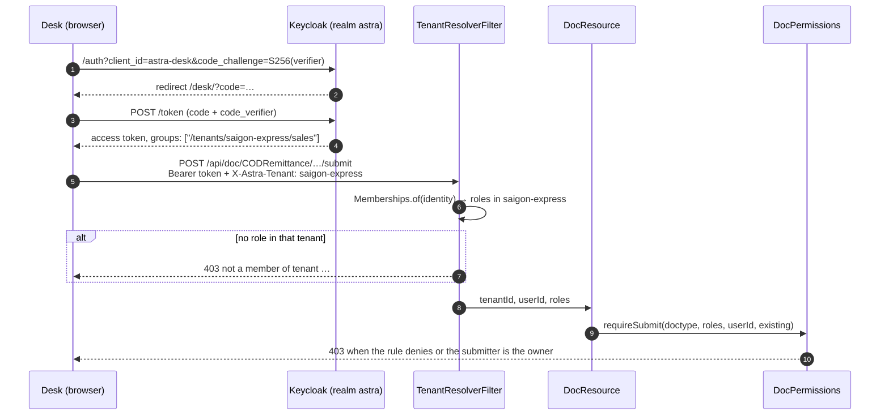

# Video 11 · Keycloak: one identity, roles per tenant, permissions per DocType

<a href="https://media.zerohostcms.com/astra-cms/astra-video-11-keycloak-en.mp4"></a>

▶ [English](https://media.zerohostcms.com/astra-cms/astra-video-11-keycloak-en.mp4) · [Tiếng Việt](https://media.zerohostcms.com/astra-cms/astra-video-11-keycloak-vi.mp4) · 2:18 · Script: [demo-video-series.en.md](../demo-video-series.en.md#video-11-keycloak-one-identity-per-tenant-roles-per-doctype-permissions-scene-9)

> **In one sentence:** a person signs in once with Keycloak, their roles come from signed Keycloak group paths `/tenants/<tenant>/<role>`, and each DocType's YAML decides what those roles may read, create, write, submit and cancel, with maker/checker enforced by the kernel.
> **Read this if:** you need to know where an `AccessDeniedException` comes from and how to declare permissions for your own DocType (developer) / you are deciding how identity, tenancy and approval rules should be split between an IdP and the application (tech lead).

## The problem

Astra Express runs two tenants, `saigon-express` and `hanoi-express`. In Saigon alone, five kinds of people touch
the same order: sales staff create and submit it, operations staff scan its waybill, customer care opens tickets
about it, and accountants cancel orders and pay collected COD (cash on delivery) out to shops. One person can
work for both tenants with different jobs in each.

The usual ways of handling this each leave a gap:

- **Roles in the application database.** Every app keeps its own user table and role table. Offboarding means
  remembering every app, and password handling lives in code that should not see passwords.
- **Global roles in the IdP.** "accountant" in the token says nothing about *which* company the person is an
  accountant for. Multi-tenant apps then trust a tenant header from the client, which is exactly what an attacker
  controls.
- **Permission checks in controllers and UI.** The UI hides a button, the API forgets the check, and a script
  calls the API directly.
- **Approval rules in process documents.** "The person who prepares a payout cannot approve it" is written in a
  policy PDF, not enforced anywhere.

Frappe/ERPNext puts role permissions on the DocType (with an "if owner" option), which is the right place; Astra
keeps that idea. The difference is where identity lives: in Astra, users, passwords and role membership live in
Keycloak, and the application only reads a signed token.

## What the video shows

| Scene | What you see | What it proves |
| --- | --- | --- |
| Login | Desk opens the Astra-themed Keycloak login page; `tuan` signs in | Authorization Code with PKCE in the browser. The password is typed into Keycloak only; Astra receives an authorization code. |
| Token | Tuan belongs to the Keycloak group `/tenants/saigon-express/sales` | Roles are Keycloak groups. The `X-Astra-Tenant` header only *picks* a tenant; the roles come from the signed token. |
| `/api/iam/me` | Tuan may read, create and submit orders, not cancel | Permissions are declared per DocType in YAML; Desk reads the effective result from `/api/iam/me`. |
| Desk | Tuan's draft order has Save and Submit; a submitted order has no Cancel; someone else's order cannot be saved, but sales can still submit it | Buttons follow permissions. `if-owner` limits *write*, not *submit*, exactly as the YAML says. |
| API, one order, four roles | Tuan (sales) cannot edit the waybill or cancel; Quang (ops) edits the waybill but cannot create orders; Ha (care) opens a ticket; Khoa (accountant) cancels | The kernel checks, so the API refuses the same things the UI hides. |
| Segregation of duties | Khoa's COD payment voucher of 350,000 VND: his own Submit is refused with 403; Thu, a second accountant, submits it and the ledger posts at once | Maker ≠ checker is a property of the DocType, enforced for Desk and API alike. |

The video ends with its "To be accurate" note: row-level conditions are still on the roadmap, and SAML and SCIM
now run, in [Video 21](./21-sso.md).

## How it works

### The path of one request



### 1. Sign-in: the browser holds the code verifier, not Astra

Desk is a public OIDC client (`astra-desk`). It creates a random verifier, sends only its SHA-256 hash to
Keycloak, and later proves possession of the verifier when it exchanges the code. Astra's server never sees the
password, and a stolen authorization code is useless without the verifier kept in `sessionStorage`.

*`astra-server/src/main/resources/META-INF/resources/desk/desk.js`*

```js
async function signIn() {
  const verifier = b64url(crypto.getRandomValues(new Uint8Array(32)));
  const challenge = b64url(await crypto.subtle.digest('SHA-256', new TextEncoder().encode(verifier)));
  const st = b64url(crypto.getRandomValues(new Uint8Array(16)));
  sessionStorage.setItem('astra-desk.pkce', JSON.stringify({ verifier, state: st, back: location.hash, tenant: state.tenant }));
  const q = new URLSearchParams({ client_id: state.config.deskClientId, redirect_uri: redirectUri(), response_type: 'code',
    scope: 'openid', code_challenge: challenge, code_challenge_method: 'S256', state: st, ui_locales: 'vi' });
  location.assign(oidc('auth') + '?' + q);
}
```

Why PKCE and not a server-side session: Desk is a static page served by the kernel, and the same flow serves the
mobile client (`astra.iam.mobile.client-id` in `IdentityResource`). One flow, no client secret in a browser or
an app bundle.

### 2. The server is a resource server that reads group paths

The kernel is configured as an OIDC *service* (it only verifies bearer tokens) and maps both the `groups` claim
and realm roles into identity roles.

*`astra-server/src/main/resources/application.yml`*

```yaml
  # Resource server: every /api call carries a Keycloak access token (Authorization Code + PKCE on mobile).
  # Group paths /tenants/<tenant>/<role> and realm roles both become identity roles.
  oidc:
    auth-server-url: ${ASTRA_OIDC_URL:http://localhost:8180/auth/realms/astra}   # deploy/docker compose Keycloak
    client-id: astra-server
    application-type: service
    token:
      audience: astra-server
      principal-claim: sub
    roles:
      role-claim-path: groups,realm_access/roles
```

`Memberships` turns those paths back into a `tenant → roles` map. Roles are never global; "accountant" only means
something next to a tenant name.

*`astra-kernel/src/main/java/io/astra/kernel/security/Memberships.java`*

```java
public record Memberships(Map<String, Set<String>> byTenant, boolean platformAdmin) {

    public static final String GROUP_PREFIX = "/tenants/";
    // …
    public static Memberships of(SecurityIdentity identity) {
        if (identity == null || identity.isAnonymous()) return new Memberships(Map.of(), false);
        Map<String, Set<String>> out = new TreeMap<>();
        for (String role : identity.getRoles()) {
            if (!role.startsWith(GROUP_PREFIX)) continue;
            String[] parts = role.substring(GROUP_PREFIX.length()).split("/");
            if (parts.length == 2 && !parts[0].isEmpty() && !parts[1].isEmpty()) {
                out.computeIfAbsent(parts[0], t -> new TreeSet<>()).add(parts[1]);
            }
        }
        // …
    }
```

Why groups and not client roles: a Keycloak group path carries two facts at once (tenant and role), it is what
SCIM later manipulates as "Groups" ([Video 21](./21-sso.md)), and an administrator can see a tenant's whole staff
by opening one group in the Keycloak console.

### 3. The tenant header selects; it does not grant

`TenantResolverFilter` resolves the tenant from the header, then a host subdomain, then the user's only
membership. Whatever it picks, the request continues only if the token holds at least one role in that tenant.

*`astra-kernel/src/main/java/io/astra/kernel/tenant/TenantResolverFilter.java`*

```java
        Memberships memberships = Memberships.of(identity);
        String tenant = fromHeader(ctx).or(() -> fromHost(ctx)).or(() -> onlyMembership(memberships)).orElse(null);
        // …
        Set<String> roles = memberships.roles(tenant);
        if (roles.isEmpty()) {
            ctx.abortWith(error(Response.Status.FORBIDDEN, "not a member of tenant " + tenant));
            return;
        }
        tenantRequest.tenantId(tenant);
        tenantRequest.userId(identity.getPrincipal().getName());
        tenantRequest.roles(roles);
```

A client that sends `X-Astra-Tenant: hanoi-express` with a Saigon-only token gets 403 before any resource code
runs. Database row-level security ([Video 7](./07-tenants.md)) is the second wall behind this one.

### 4. Permissions are data on the DocType

Each DocType lists rules per role. This is the order's table, which explains every refusal in the video:

*`astra-apps/express/src/main/resources/META-INF/astra/doctypes/customer-order.doctype.yaml`*

```yaml
permissions:
  - { role: admin,      read: true, create: true, write: true, submit: true, cancel: true }
  - { role: sales,      read: true, create: true, write: true, if-owner: true, submit: true }
  - { role: ops,        read: true }
  - { role: care,       read: true }
  - { role: accountant, read: true, cancel: true }
```

`if-owner` restricts only `write`. That is why Tuan cannot save a colleague's order but can still submit it, a
behaviour the video shows on purpose rather than hides. The evaluator is a union over matching rules; no matching
rule means no access:

*`astra-doctype/src/main/java/io/astra/doctype/permission/DocPermissions.java`*

```java
    private static boolean allows(DocTypeDefinition def, Set<String> roles, Action action, boolean owner) {
        for (PermissionRule rule : def.permissions()) {
            if (!roles.contains(rule.role())) continue;
            boolean granted = switch (action) {
                case READ -> rule.read();
                case CREATE -> rule.create();
                case WRITE -> rule.write() && (!rule.ifOwner() || owner);
                case SUBMIT -> rule.submit();
                case CANCEL -> rule.cancel();
            };
            if (granted) return true;
        }
        return false;
    }
```

The generated REST resource calls it before every operation (`DocResource`: `require(…READ)` for list and get,
`requireWrite` for update, `requireSubmit` for submit, `require(…CANCEL)` for cancel). Because apps do not write
their own controllers, an app cannot forget the check.

### 5. Desk asks, it does not decide

`/api/iam/me` returns, per tenant, the effective permissions computed by the same `DocPermissions` class:

*`astra-iam/src/main/java/io/astra/iam/IdentityResource.java`*

```java
    private Map<String, Object> tenantView(String tenant, Set<String> roles) {
        Map<String, Object> m = new LinkedHashMap<>();
        m.put("tenant", tenant);
        m.put("roles", roles);
        m.put("permissions", permissions.effective(roles));
        return m;
    }
```

Desk draws buttons from that answer (`desk.js`, `drawForm`: Submit when `perm.submit`, Cancel when
`perm.cancel`). Hiding a button is a convenience; the 403 from the kernel is the control.

### 6. Segregation of duties is one flag

*`astra-apps/express/src/main/resources/META-INF/astra/doctypes/cod-remittance.doctype.yaml`*

```yaml
submittable: true
segregation-of-duties: true        # maker/checker: whoever prepares a payout cannot approve it
# …
permissions:
  - { role: admin,      read: true, create: true, write: true, submit: true, cancel: true }
  - { role: accountant, read: true, create: true, write: true, submit: true, cancel: true }
```

*`astra-doctype/src/main/java/io/astra/doctype/permission/DocPermissions.java`*

```java
    public void requireSubmit(String doctype, Set<String> roles, String userId, Document existing) {
        DocTypeDefinition def = registry.require(doctype);
        if (!allows(def, roles, Action.SUBMIT, false)) {
            throw new AccessDeniedException("submit " + doctype);
        }
        if (def.segregationOfDuties() && userId != null && userId.equals(existing.owner())) {
            throw new AccessDeniedException("submit " + doctype + "/" + existing.name()
                    + ": segregation of duties, the creator cannot submit their own document");
        }
    }
```

The comparison uses the token's subject (`principal-claim: sub`) against the document's `owner`, so renaming a
user in Keycloak does not let them approve their own old drafts. The effective-permission map does not model SoD,
so Desk still shows Submit to Khoa; the kernel answers 403, which is what the video shows.

## Real-world example

*Illustrative scenario: the company, people and values are made up; the mechanism and the rules it applies are the real ones shown above.*

A regional 3PL runs two franchise tenants on one Astra cluster. Lan is the chief accountant of `hanoi-express` and
also helps the Saigon customer-care desk on weekends.

**Input (Keycloak):** Lan is a member of `/tenants/hanoi-express/accountant` and `/tenants/saigon-express/care`.

**What Astra does:**

| Request | Resolved roles | Result |
| --- | --- | --- |
| `GET /api/iam/me` | both tenants | `hanoi-express: [accountant]`, `saigon-express: [care]`, with per-DocType permissions for each |
| `POST /api/doc/CustomerOrder/<order>/cancel`, `X-Astra-Tenant: hanoi-express` | `{accountant}` | allowed (`accountant: cancel: true`) |
| Same call, `X-Astra-Tenant: saigon-express` | `{care}` | 403, care has only `read` on orders |
| `POST /api/doc/SupportTicket`, `X-Astra-Tenant: saigon-express` | `{care}` | 201 |
| Lan creates a 12,000,000 VND `CODRemittance` in Hanoi, then submits it | `{accountant}` | 403, segregation of duties |
| Her colleague Minh (also `hanoi-express/accountant`) submits it | `{accountant}` | 200; the payout posts to the ledger ([Video 12](./12-ledger.md)) |

**Output:** one login, two different jobs, no per-app user table, and an approval trail where the document's
`owner` and the submitter are provably different people. When Lan leaves the weekend shift, an administrator
removes one group membership in Keycloak; her next token no longer carries Saigon.

## For technical leaders

- **Where the truth lives.** Identity and membership in Keycloak; what a role may do in Git, next to the DocType.
  Reviews of a permission change are code reviews.
- **Fail-closed by default.** No rule means no access; no role in the resolved tenant means 403 before resource
  code. A new DocType without a `permissions:` block is unreachable, not open.
- **Token lifetime is your revocation latency.** Astra verifies JWTs offline. Removing a group takes effect at the
  next token refresh, not instantly. Size access-token lifetime to your risk; the realm uses 5 minutes for regular
  clients (see the Video 21 notes).
- **Token size.** Every membership is a string in `groups`. A consultant in hundreds of tenants produces a large
  token; if that is your shape, plan for it.
- **What to measure.** 403 rate per DocType and role (a spike after a deploy usually means a YAML regression), SoD
  refusals per month (evidence for auditors), and time from HR offboarding to group removal.
- **When not to use this as is.** If you need "sales may see only orders of their own branch" or amount limits
  ("submit up to 50 million"), that is row-level or attribute-based permission, which is not built yet. Today it
  has to be a hook that throws, which is code, not metadata.
- **Compared with alternatives.** Keycloak Authorization Services (policy enforcer) can centralise decisions but
  moves per-DocType rules out of the app's repository; Astra keeps them with the DocType. Frappe has the same
  DocType-level model but its own user store; Astra delegates users to an IdP.

## Try it yourself

Prerequisites: JDK 25, Docker Desktop with 8 GB for the k3d stack, `kubectl`, `k3d`, `jq`, Bash 5.

```bash
make k3d-up                                  # cluster with Keycloak, realm synced by scripts/keycloak-sync-realm.sh
make demo-reset && make demo-seed            # tenants saigon-express and hanoi-express, demo users
make demo-express SCENES=9 PAUSE=0           # the scene used in this video
open http://localhost:8080/desk/             # sign in as tuan / Astra@123, then khoa, then thu
```

Expected in the terminal (scene 9 of `scripts/demo-express.sh`): `/api/iam/me` for `tuan` with `CustomerOrder`
and `Waybill` permissions; `tuan` creates and submits an order; his `PUT /api/doc/Waybill/<waybill>` and his
cancel are refused; `quang` updates the waybill to `Picked Up` and is refused when creating an order; `ha` creates
a `SupportTicket`; `khoa` cancels the order.

For the SoD scene, record right after `demo-seed`: as `khoa`, open `CODR-…-0002` (350,000, created by `khoa`
during the seed) and press Submit (403), then sign in as `thu` and submit it.

Tests that pin this behaviour live in `astra-server/src/test/java/io/astra/server/IamAccessTest.java` and
`LedgerTest.java`; run them with `make test`. `make demo-iam` runs end-to-end IAM checks with real Keycloak
tokens.

Demo users share the password `Astra@123` and are defined in `deploy/keycloak/realm/astra-realm.json`. They are for
local environments only.

## To be accurate

- Row-level permission conditions (for example "only orders of my branch", or limits on amounts) are still on the
  roadmap. Permissions today are per role and per DocType, plus `if-owner` for writes and the
  `segregation-of-duties` flag for submit.
- SAML SSO and SCIM provisioning now run; they are shown in [Video 21](./21-sso.md).
- Desk's effective-permission view does not model segregation of duties, so the Submit button can appear and the
  kernel then refuses with 403.
- Role changes reach Astra with the next token; an access token already issued keeps its roles until it expires.

## Visualize it: sketch prompts

### Figure 1 · One identity, roles per tenant
*Where it goes:* How it works, section 2

```text
Hand-drawn whiteboard sketch, black ink line art on off-white paper, one accent color (#6b8cff blue) for the key path, simple boxes and arrows, short handwritten labels in English, generous white space, no logos, no photorealism, 16:9.
Left: a stick figure labelled "Lan". Center-left: a box labelled "Keycloak" containing a small folder tree: "/tenants" with two branches "hanoi-express → accountant" and "saigon-express → care". An arrow from Keycloak to the right labelled "access token: groups[]". Center-right: a box labelled "Memberships.of()" producing a two-row table "hanoi-express: {accountant}" and "saigon-express: {care}". Right: a box "TenantResolverFilter" with an input arrow labelled "X-Astra-Tenant: hanoi-express" and an output arrow labelled "roles = {accountant}". Highlight in blue the path from the hanoi-express group to "roles = {accountant}". A small crossed-out note near the header arrow: "header picks, never grants".
```

### Figure 2 · Same order, four roles
*Where it goes:* What the video shows

```text
Hand-drawn whiteboard sketch, black ink line art on off-white paper, one accent color (#6b8cff blue) for the key path, simple boxes and arrows, short handwritten labels in English, generous white space, no logos, no photorealism, 16:9.
Center: one document card labelled "CustomerOrder ORD-…" with a smaller linked card "Waybill". Around it, four stick figures with role tags: top-left "tuan · sales", top-right "quang · ops", bottom-left "ha · care", bottom-right "khoa · accountant". Arrows from each figure to the card, each with a short label and a tick or cross: tuan "submit ✓ / cancel ✗", quang "edit waybill ✓ / create order ✗", ha "open SupportTicket ✓", khoa "cancel ✓". Under the card, a small scroll labelled "customer-order.doctype.yaml · permissions". Highlight in blue the arrow from khoa labelled "cancel ✓".
```

### Figure 3 · Maker is not checker
*Where it goes:* How it works, section 6

```text
Hand-drawn whiteboard sketch, black ink line art on off-white paper, one accent color (#6b8cff blue) for the key path, simple boxes and arrows, short handwritten labels in English, generous white space, no logos, no photorealism, 16:9.
Left to right. A stick figure "khoa" creating a voucher card "CODRemittance 350,000 VND, owner = khoa". From khoa, an arrow labelled "Submit" hits a wall labelled "requireSubmit: segregation-of-duties" and bounces back with "403". Below, a second stick figure "thu" sends an arrow "Submit" through the same wall, which lets it pass because "thu ≠ owner". The passing arrow continues into a ledger book labelled "astra_ledger: Dr 3388 / Cr 112". Highlight in blue the path from thu through the wall to the ledger book.
```

## Related

- Previous: [Video 10 · Running on Kubernetes](./10-k8s.md). Next: [Video 12 · Append-only ledger](./12-ledger.md).
- [Video 7 · Multi-tenancy](./07-tenants.md) (row-level security behind the tenant filter) and
  [Video 21 · SAML SSO and SCIM](./21-sso.md) (enterprise IdPs and provisioning into the same groups).
- Docs: [demo-code-snippets.md, S5](../demo-code-snippets.md#s5-keycloak-permissions-and-sod),
  [iam-mobile-integration.md](../iam-mobile-integration.md).
- Source: `astra-kernel/src/main/java/io/astra/kernel/security/Memberships.java`,
  `astra-kernel/src/main/java/io/astra/kernel/tenant/TenantResolverFilter.java`,
  `astra-doctype/src/main/java/io/astra/doctype/permission/DocPermissions.java`,
  `astra-doctype/src/main/java/io/astra/doctype/api/DocResource.java`,
  `astra-iam/src/main/java/io/astra/iam/IdentityResource.java`,
  `deploy/keycloak/realm/astra-realm.json`, `scripts/demo-express.sh` (scene 9).
