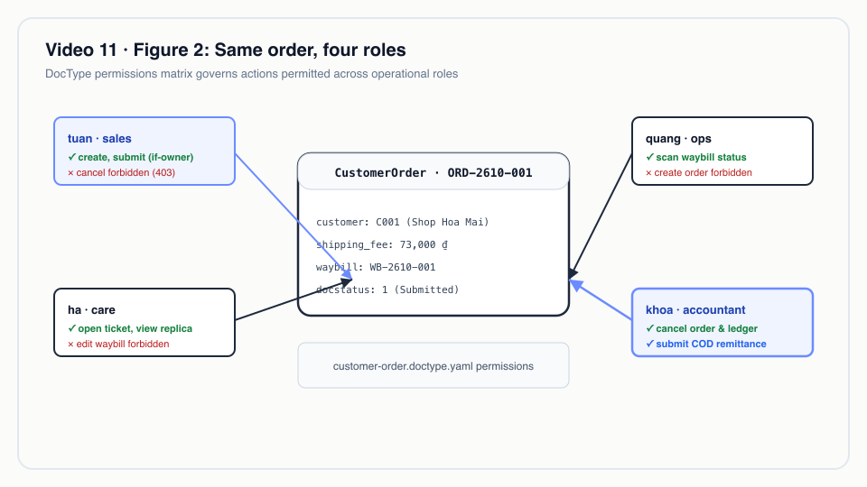
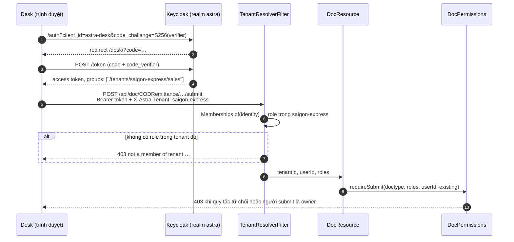
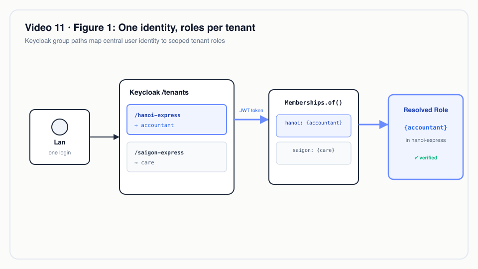
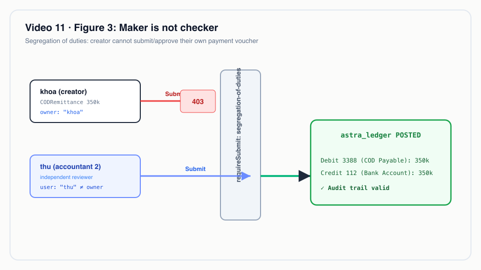

# Video 11 · Keycloak: một danh tính, role theo tenant, quyền theo DocType

<a href="https://media.zerohostcms.com/astra-cms/astra-video-11-keycloak-vi.mp4"></a>

▶ [Tiếng Việt](https://media.zerohostcms.com/astra-cms/astra-video-11-keycloak-vi.mp4) · [English](https://media.zerohostcms.com/astra-cms/astra-video-11-keycloak-en.mp4) · 2:18 · Kịch bản: [demo-video-series.md](../demo-video-series.md#video-11-keycloak-một-danh-tính-role-theo-tenant-quyền-theo-doctype-cảnh-9) · [Bản tiếng Anh](./11-keycloak.md)

> **Tóm tắt một câu:** người dùng đăng nhập một lần bằng Keycloak, role của họ đến từ đường dẫn nhóm Keycloak đã ký `/tenants/<tenant>/<role>`, còn YAML của từng DocType quyết định các role đó được đọc, tạo, sửa, submit và cancel những gì, với nguyên tắc người lập/người duyệt do kernel cưỡng chế.
> **Nên đọc nếu:** bạn cần biết một `AccessDeniedException` đến từ đâu và cách khai báo quyền cho DocType của mình (developer) / bạn đang quyết định chia danh tính, tenant và quy tắc phê duyệt giữa IdP và ứng dụng như thế nào (tech lead).

## Vấn đề

Astra Express chạy hai tenant, `saigon-express` và `hanoi-express`. Chỉ riêng ở Sài Gòn đã có năm nhóm người cùng
động vào một đơn hàng: nhân viên sales tạo và submit đơn, nhân viên vận hành quét vận đơn, chăm sóc khách hàng mở
ticket về đơn, còn kế toán hủy đơn và chi trả tiền COD (thu hộ) đã thu cho shop. Một người có thể làm cho cả hai
tenant với công việc khác nhau ở mỗi bên.

Các cách xử lý quen thuộc đều để hở một chỗ:

- **Role nằm trong database của ứng dụng.** Mỗi app giữ bảng user và bảng role riêng. Khi nhân viên nghỉ việc,
  phải nhớ đủ mọi app, và việc xử lý mật khẩu nằm trong code lẽ ra không được thấy mật khẩu.
- **Role toàn cục trong IdP.** Chữ "accountant" trong token không cho biết người đó là kế toán của công ty *nào*.
  App đa thuê bao khi đó đành tin header tenant do client gửi, mà đó chính là thứ kẻ tấn công kiểm soát.
- **Kiểm tra quyền trong controller và giao diện.** Giao diện ẩn một nút, API quên kiểm tra, và một script gọi
  thẳng API.
- **Quy tắc phê duyệt nằm trong văn bản quy trình.** "Người lập phiếu chi không được tự duyệt" được viết trong
  một file PDF chính sách, nhưng không ở đâu cưỡng chế.

Frappe/ERPNext đặt quyền theo role trên DocType (có tuỳ chọn "if owner"), và đó là chỗ đúng; Astra giữ ý tưởng
này. Khác biệt nằm ở nơi danh tính sống: trong Astra, user, mật khẩu và việc thuộc role nằm ở Keycloak, ứng dụng
chỉ đọc một token đã ký.

## Video cho thấy gì

| Cảnh | Bạn thấy gì | Điều đó chứng minh |
| --- | --- | --- |
| Đăng nhập | Desk mở trang đăng nhập Keycloak theo theme Astra; `tuan` đăng nhập | Authorization Code với PKCE ngay trong trình duyệt. Mật khẩu chỉ được gõ vào Keycloak; Astra nhận một authorization code. |
| Token | Tuấn thuộc nhóm Keycloak `/tenants/saigon-express/sales` | Role là nhóm trong Keycloak. Header `X-Astra-Tenant` chỉ *chọn* tenant; role đến từ token đã ký. |
| `/api/iam/me` | Tuấn được đọc, tạo và submit đơn, không được cancel | Quyền được khai báo theo từng DocType trong YAML; Desk đọc kết quả hiệu lực từ `/api/iam/me`. |
| Desk | Đơn nháp của Tuấn có Save và Submit; đơn đã submit không có Cancel; đơn của người khác không lưu được, nhưng sales vẫn submit được | Nút bấm đi theo quyền. `if-owner` giới hạn *write*, không giới hạn *submit*, đúng như YAML ghi. |
| API, một đơn, bốn role | Tuấn (sales) không sửa được vận đơn, không cancel được; Quang (ops) sửa vận đơn nhưng không tạo được đơn; Hà (care) mở ticket; Khoa (accountant) cancel | Kernel kiểm tra, nên API từ chối đúng những gì giao diện ẩn đi. |
| Phân tách nhiệm vụ | Phiếu chi COD 350.000 VND của Khoa: chính Khoa bấm Submit thì bị từ chối 403; Thu, một kế toán khác, submit được và sổ cái ghi ngay | Người lập ≠ người duyệt là thuộc tính của DocType, cưỡng chế như nhau cho Desk và API. |

Video kết thúc bằng ghi chú "Nói đúng": điều kiện theo từng dòng vẫn còn trên roadmap, còn SAML và SCIM nay đã
chạy, xem [Video 21](./21-sso.vi.md).


*Cùng một đơn, bốn role.*

## Cách hoạt động

### Đường đi của một request



### 1. Đăng nhập: trình duyệt giữ code verifier, không phải Astra

Desk là một OIDC client công khai (`astra-desk`). Nó tạo một verifier ngẫu nhiên, chỉ gửi giá trị băm SHA-256
của verifier cho Keycloak, rồi khi đổi code lấy token thì chứng minh mình đang giữ verifier. Server của Astra
không bao giờ thấy mật khẩu, và một authorization code bị đánh cắp cũng vô dụng nếu thiếu verifier được giữ trong
`sessionStorage`.

*`astra-server/src/main/resources/META-INF/resources/desk/desk.js`*

```js
async function signIn() {
  const verifier = b64url(crypto.getRandomValues(new Uint8Array(32)));
  const challenge = b64url(await crypto.subtle.digest('SHA-256', new TextEncoder().encode(verifier)));
  const st = b64url(crypto.getRandomValues(new Uint8Array(16)));
  sessionStorage.setItem('astra-desk.pkce', JSON.stringify({ verifier, state: st, back: location.hash, tenant: state.tenant }));
  const q = new URLSearchParams({ client_id: state.config.deskClientId, redirect_uri: redirectUri(), response_type: 'code',
    scope: 'openid', code_challenge: challenge, code_challenge_method: 'S256', state: st, ui_locales: 'vi' });
  location.assign(oidc('auth') + '?' + q);
}
```

Vì sao dùng PKCE thay cho session phía server: Desk là một trang tĩnh do kernel phục vụ, và cùng luồng này phục vụ
luôn client di động (`astra.iam.mobile.client-id` trong `IdentityResource`). Một luồng duy nhất, không có client
secret nào nằm trong trình duyệt hay trong gói ứng dụng.

### 2. Server là resource server đọc đường dẫn nhóm

Kernel được cấu hình như một OIDC *service* (chỉ xác minh bearer token) và ánh xạ cả claim `groups` lẫn realm role
thành role của danh tính.

*`astra-server/src/main/resources/application.yml`*

```yaml
  # Resource server: every /api call carries a Keycloak access token (Authorization Code + PKCE on mobile).
  # Group paths /tenants/<tenant>/<role> and realm roles both become identity roles.
  oidc:
    auth-server-url: ${ASTRA_OIDC_URL:http://localhost:8180/auth/realms/astra}   # deploy/docker compose Keycloak
    client-id: astra-server
    application-type: service
    token:
      audience: astra-server
      principal-claim: sub
    roles:
      role-claim-path: groups,realm_access/roles
```

`Memberships` chuyển các đường dẫn đó ngược lại thành một map `tenant → roles`. Role không bao giờ là toàn cục;
"accountant" chỉ có nghĩa khi đứng cạnh tên một tenant.

*`astra-kernel/src/main/java/io/astra/kernel/security/Memberships.java`*

```java
public record Memberships(Map<String, Set<String>> byTenant, boolean platformAdmin) {

    public static final String GROUP_PREFIX = "/tenants/";
    // …
    public static Memberships of(SecurityIdentity identity) {
        if (identity == null || identity.isAnonymous()) return new Memberships(Map.of(), false);
        Map<String, Set<String>> out = new TreeMap<>();
        for (String role : identity.getRoles()) {
            if (!role.startsWith(GROUP_PREFIX)) continue;
            String[] parts = role.substring(GROUP_PREFIX.length()).split("/");
            if (parts.length == 2 && !parts[0].isEmpty() && !parts[1].isEmpty()) {
                out.computeIfAbsent(parts[0], t -> new TreeSet<>()).add(parts[1]);
            }
        }
        // …
    }
```

Vì sao dùng nhóm thay cho client role: một đường dẫn nhóm Keycloak mang cùng lúc hai thông tin (tenant và role),
nó chính là thứ SCIM sau này thao tác dưới tên "Groups" ([Video 21](./21-sso.vi.md)), và quản trị viên có thể
xem toàn bộ nhân sự của một tenant chỉ bằng cách mở một nhóm trong Keycloak console.


*Một danh tính, role theo tenant.*

### 3. Header tenant dùng để chọn, không dùng để cấp quyền

`TenantResolverFilter` xác định tenant lần lượt từ header, rồi từ subdomain của host, rồi từ tenant duy nhất mà
người dùng là thành viên. Dù chọn được tenant nào, request chỉ đi tiếp nếu token có ít nhất một role trong tenant đó.

*`astra-kernel/src/main/java/io/astra/kernel/tenant/TenantResolverFilter.java`*

```java
        Memberships memberships = Memberships.of(identity);
        String tenant = fromHeader(ctx).or(() -> fromHost(ctx)).or(() -> onlyMembership(memberships)).orElse(null);
        // …
        Set<String> roles = memberships.roles(tenant);
        if (roles.isEmpty()) {
            ctx.abortWith(error(Response.Status.FORBIDDEN, "not a member of tenant " + tenant));
            return;
        }
        tenantRequest.tenantId(tenant);
        tenantRequest.userId(identity.getPrincipal().getName());
        tenantRequest.roles(roles);
```

Một client gửi `X-Astra-Tenant: hanoi-express` kèm token chỉ thuộc Sài Gòn sẽ nhận 403 trước khi bất kỳ code
resource nào chạy. Row-level security trong database ([Video 7](./07-tenants.vi.md)) là bức tường thứ hai
phía sau bức tường này.

### 4. Quyền là dữ liệu trên DocType

Mỗi DocType liệt kê quy tắc theo role. Đây là bảng quyền của đơn hàng, giải thích mọi lần bị từ chối trong video:

*`astra-apps/express/src/main/resources/META-INF/astra/doctypes/customer-order.doctype.yaml`*

```yaml
permissions:
  - { role: admin,      read: true, create: true, write: true, submit: true, cancel: true }
  - { role: sales,      read: true, create: true, write: true, if-owner: true, submit: true }
  - { role: ops,        read: true }
  - { role: care,       read: true }
  - { role: accountant, read: true, cancel: true }
```

`if-owner` chỉ giới hạn `write`. Vì vậy Tuấn không lưu được đơn của đồng nghiệp nhưng vẫn submit được, một hành vi
video cố ý cho thấy chứ không giấu đi. Bộ đánh giá lấy hợp (union) của các quy tắc khớp; không có quy tắc nào khớp
nghĩa là không có quyền:

*`astra-doctype/src/main/java/io/astra/doctype/permission/DocPermissions.java`*

```java
    private static boolean allows(DocTypeDefinition def, Set<String> roles, Action action, boolean owner) {
        for (PermissionRule rule : def.permissions()) {
            if (!roles.contains(rule.role())) continue;
            boolean granted = switch (action) {
                case READ -> rule.read();
                case CREATE -> rule.create();
                case WRITE -> rule.write() && (!rule.ifOwner() || owner);
                case SUBMIT -> rule.submit();
                case CANCEL -> rule.cancel();
            };
            if (granted) return true;
        }
        return false;
    }
```

REST resource được sinh ra gọi hàm này trước mọi thao tác (`DocResource`: `require(…READ)` cho list và get,
`requireWrite` cho update, `requireSubmit` cho submit, `require(…CANCEL)` cho cancel). Vì app không tự viết
controller, app không thể quên bước kiểm tra.

### 5. Desk hỏi, không tự quyết

`/api/iam/me` trả về, theo từng tenant, các quyền hiệu lực được tính bằng chính lớp `DocPermissions`:

*`astra-iam/src/main/java/io/astra/iam/IdentityResource.java`*

```java
    private Map<String, Object> tenantView(String tenant, Set<String> roles) {
        Map<String, Object> m = new LinkedHashMap<>();
        m.put("tenant", tenant);
        m.put("roles", roles);
        m.put("permissions", permissions.effective(roles));
        return m;
    }
```

Desk vẽ nút từ câu trả lời đó (`desk.js`, `drawForm`: Submit khi `perm.submit`, Cancel khi `perm.cancel`). Ẩn nút
chỉ là tiện lợi; mã 403 từ kernel mới là chốt kiểm soát.

### 6. Phân tách nhiệm vụ chỉ là một cờ

*`astra-apps/express/src/main/resources/META-INF/astra/doctypes/cod-remittance.doctype.yaml`*

```yaml
submittable: true
segregation-of-duties: true        # maker/checker: whoever prepares a payout cannot approve it
# …
permissions:
  - { role: admin,      read: true, create: true, write: true, submit: true, cancel: true }
  - { role: accountant, read: true, create: true, write: true, submit: true, cancel: true }
```

*`astra-doctype/src/main/java/io/astra/doctype/permission/DocPermissions.java`*

```java
    public void requireSubmit(String doctype, Set<String> roles, String userId, Document existing) {
        DocTypeDefinition def = registry.require(doctype);
        if (!allows(def, roles, Action.SUBMIT, false)) {
            throw new AccessDeniedException("submit " + doctype);
        }
        if (def.segregationOfDuties() && userId != null && userId.equals(existing.owner())) {
            throw new AccessDeniedException("submit " + doctype + "/" + existing.name()
                    + ": segregation of duties, the creator cannot submit their own document");
        }
    }
```

Phép so sánh dùng subject của token (`principal-claim: sub`) đối chiếu với `owner` của chứng từ, nên đổi tên một
user trong Keycloak không giúp họ tự duyệt được bản nháp cũ của mình. Map quyền hiệu lực không mô hình hoá phân
tách nhiệm vụ, nên Desk vẫn hiện nút Submit cho Khoa; kernel trả 403, đúng như video cho thấy.


*Người lập không phải người duyệt.*

## Ví dụ thực tế

*Tình huống minh hoạ: công ty, con người và số liệu là giả định; cơ chế và các quy tắc được áp dụng là thật, như đã trình bày ở trên.*

Một công ty 3PL khu vực chạy hai tenant nhượng quyền trên cùng một cụm Astra. Lan là kế toán trưởng của
`hanoi-express`, và cuối tuần còn hỗ trợ bàn chăm sóc khách hàng ở Sài Gòn.

**Đầu vào (Keycloak):** Lan là thành viên của `/tenants/hanoi-express/accountant` và `/tenants/saigon-express/care`.

**Astra làm gì:**

| Request | Role được xác định | Kết quả |
| --- | --- | --- |
| `GET /api/iam/me` | cả hai tenant | `hanoi-express: [accountant]`, `saigon-express: [care]`, kèm quyền theo từng DocType cho mỗi tenant |
| `POST /api/doc/CustomerOrder/<order>/cancel`, `X-Astra-Tenant: hanoi-express` | `{accountant}` | được phép (`accountant: cancel: true`) |
| Cùng lời gọi đó, `X-Astra-Tenant: saigon-express` | `{care}` | 403, care chỉ có `read` trên đơn hàng |
| `POST /api/doc/SupportTicket`, `X-Astra-Tenant: saigon-express` | `{care}` | 201 |
| Lan tạo một `CODRemittance` 12.000.000 VND ở Hà Nội, rồi tự submit | `{accountant}` | 403, phân tách nhiệm vụ |
| Đồng nghiệp Minh (cũng là `hanoi-express/accountant`) submit phiếu đó | `{accountant}` | 200; khoản chi được ghi vào sổ cái ([Video 12](./12-ledger.vi.md)) |

**Đầu ra:** một lần đăng nhập, hai công việc khác nhau, không có bảng user riêng cho từng app, và một vết phê duyệt
chứng minh được rằng `owner` của chứng từ và người submit là hai người khác nhau. Khi Lan thôi trực cuối tuần, quản
trị viên chỉ cần gỡ một thành viên nhóm trong Keycloak; token tiếp theo của chị không còn mang Sài Gòn.

## Dành cho tech lead

- **Sự thật nằm ở đâu.** Danh tính và việc thuộc nhóm nằm ở Keycloak; role được làm gì nằm trong Git, cạnh
  DocType. Review một thay đổi quyền chính là review code.
- **Mặc định fail-closed.** Không có quy tắc nghĩa là không có quyền; không có role trong tenant đã xác định nghĩa là
  403 trước khi code resource chạy. Một DocType mới không có khối `permissions:` là không truy cập được, chứ không
  phải mở toang.
- **Thời hạn token chính là độ trễ thu hồi.** Astra xác minh JWT offline. Gỡ một nhóm có hiệu lực ở lần refresh
  token tiếp theo, không phải tức thì. Hãy đặt thời hạn access token theo mức rủi ro; realm dùng 5 phút cho client
  thường (xem ghi chú ở Video 21).
- **Kích thước token.** Mỗi lần thuộc nhóm là một chuỗi trong `groups`. Một chuyên gia tư vấn thuộc hàng trăm
  tenant sẽ có token rất lớn; nếu tổ chức của bạn có dạng đó, hãy tính trước.
- **Nên đo gì.** Tỷ lệ 403 theo DocType và role (tăng vọt sau một lần deploy thường là YAML bị hồi quy), số lần từ
  chối do phân tách nhiệm vụ mỗi tháng (bằng chứng cho kiểm toán), và thời gian từ lúc HR cho nghỉ việc đến lúc gỡ
  nhóm.
- **Khi nào không dùng nguyên trạng.** Nếu bạn cần "sales chỉ thấy đơn của chi nhánh mình" hay hạn mức số tiền
  ("submit tối đa 50 triệu"), đó là quyền theo dòng hoặc theo thuộc tính, hiện chưa được xây. Hôm nay nó phải là
  một hook ném lỗi, tức là code chứ không phải metadata.
- **So với các phương án khác.** Keycloak Authorization Services (policy enforcer) có thể tập trung các quyết định
  nhưng đưa quy tắc theo DocType ra khỏi repository của app; Astra giữ chúng cạnh DocType. Frappe có cùng mô hình
  quyền ở mức DocType nhưng dùng kho user riêng; Astra giao user cho một IdP.

## Tự chạy thử

Yêu cầu: JDK 25, Docker Desktop với 8 GB cho stack k3d, `kubectl`, `k3d`, `jq`, Bash 5.

```bash
make k3d-up                                  # cluster with Keycloak, realm synced by scripts/keycloak-sync-realm.sh
make demo-reset && make demo-seed            # tenants saigon-express and hanoi-express, demo users
make demo-express SCENES=9 PAUSE=0           # the scene used in this video
open http://localhost:8080/desk/             # sign in as tuan / Astra@123, then khoa, then thu
```

Kết quả mong đợi trên terminal (cảnh 9 của `scripts/demo-express.sh`): `/api/iam/me` của `tuan` với quyền trên
`CustomerOrder` và `Waybill`; `tuan` tạo và submit một đơn; lệnh `PUT /api/doc/Waybill/<waybill>` và lệnh cancel
của anh bị từ chối; `quang` cập nhật vận đơn sang `Picked Up` và bị từ chối khi tạo đơn; `ha` tạo một
`SupportTicket`; `khoa` cancel đơn.

Với cảnh phân tách nhiệm vụ, hãy quay ngay sau `demo-seed`: đăng nhập `khoa`, mở `CODR-…-0002` (350.000, do `khoa`
lập khi seed) và bấm Submit (403), rồi đăng nhập `thu` và submit phiếu đó.

Các test giữ cố định hành vi này nằm ở `astra-server/src/test/java/io/astra/server/IamAccessTest.java` và
`LedgerTest.java`; chạy bằng `make test`. `make demo-iam` chạy kiểm tra IAM đầu-cuối với token Keycloak thật.

Các user demo dùng chung mật khẩu `Astra@123` và được định nghĩa trong `deploy/keycloak/realm/astra-realm.json`.
Chúng chỉ dành cho môi trường local.

## Nói đúng

- Điều kiện quyền theo từng dòng (ví dụ "chỉ đơn của chi nhánh tôi", hoặc hạn mức số tiền) vẫn còn trên roadmap.
  Quyền hiện nay là theo role và theo DocType, cộng thêm `if-owner` cho thao tác ghi và cờ
  `segregation-of-duties` cho submit.
- SAML SSO và SCIM provisioning nay đã chạy; chúng được trình bày trong [Video 21](./21-sso.vi.md).
- Màn hình quyền hiệu lực của Desk không mô hình hoá phân tách nhiệm vụ, nên nút Submit có thể hiện ra rồi kernel
  từ chối bằng 403.
- Thay đổi role đến Astra cùng token tiếp theo; một access token đã cấp vẫn giữ role cũ cho tới khi hết hạn.

## Hình minh hoạ

### Hình 1 · Một danh tính, role theo tenant


### Hình 2 · Cùng một đơn, bốn role


### Hình 3 · Người lập không phải người duyệt


## Liên quan

- Trước: [Video 10 · Chạy trên Kubernetes](./10-k8s.vi.md). Tiếp: [Video 12 · Sổ cái append-only](./12-ledger.vi.md).
- [Video 7 · Đa thuê bao](./07-tenants.vi.md) (row-level security phía sau bộ lọc tenant) và
  [Video 21 · SAML SSO và SCIM](./21-sso.vi.md) (IdP doanh nghiệp và provisioning vào chính các nhóm đó).
- Tài liệu: [demo-code-snippets.md, S5](../demo-code-snippets.md#s5-keycloak-permissions-and-sod),
  [iam-mobile-integration.md](../iam-mobile-integration.md).
- Mã nguồn: `astra-kernel/src/main/java/io/astra/kernel/security/Memberships.java`,
  `astra-kernel/src/main/java/io/astra/kernel/tenant/TenantResolverFilter.java`,
  `astra-doctype/src/main/java/io/astra/doctype/permission/DocPermissions.java`,
  `astra-doctype/src/main/java/io/astra/doctype/api/DocResource.java`,
  `astra-iam/src/main/java/io/astra/iam/IdentityResource.java`,
  `deploy/keycloak/realm/astra-realm.json`, `scripts/demo-express.sh` (cảnh 9).
