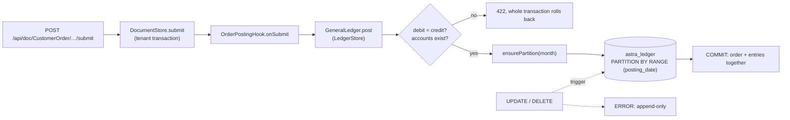
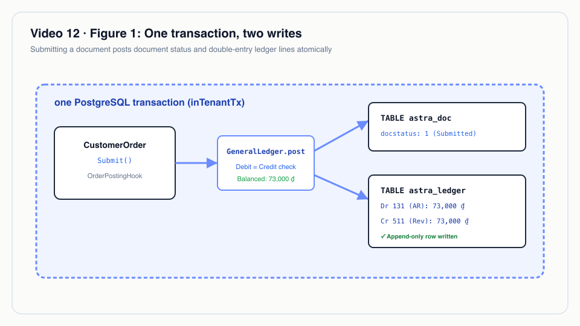
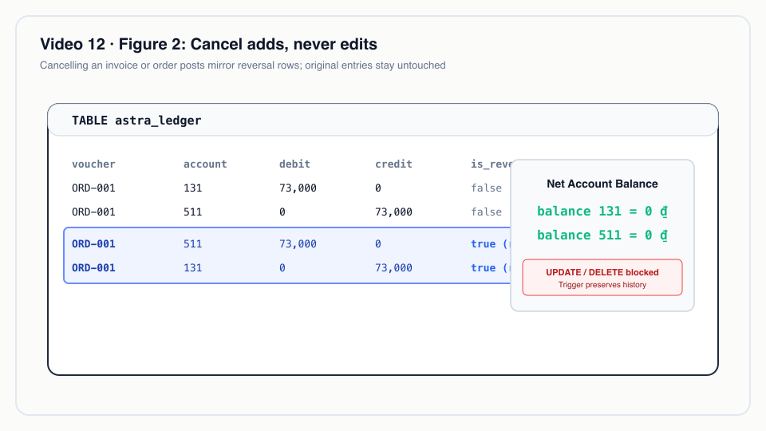
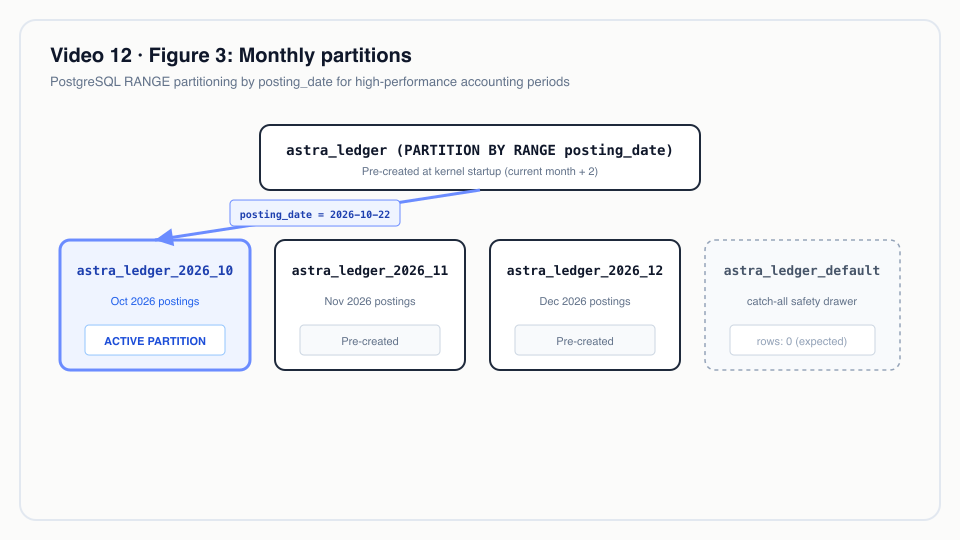

# Video 12 · Append-only ledger

<a href="https://media.zerohostcms.com/astra-cms/astra-video-12-ledger-en.mp4"></a>

▶ [English](https://media.zerohostcms.com/astra-cms/astra-video-12-ledger-en.mp4) · [Tiếng Việt](https://media.zerohostcms.com/astra-cms/astra-video-12-ledger-vi.mp4) · 2:32 · Script: [demo-video-series.en.md](../demo-video-series.en.md#video-12-append-only-ledger-scene-10)

> **In one sentence:** business documents post balanced double-entry lines into one PostgreSQL table, `astra_ledger`, in the same transaction as the document; corrections are reversing entries, and a database trigger refuses UPDATE and DELETE even from the table owner.
> **Read this if:** you write a hook that must book money and want to know what `GeneralLedger.post` and `reverse` guarantee (developer) / you need to explain to an auditor or CFO why the books cannot be silently edited, and where that guarantee stops (tech lead).

## The problem

Astra Express bills a shipping fee when an order is submitted, collects COD (cash on delivery) from the receiver
when the parcel is delivered, and later pays that cash out to the shop. Each of those is money, and each has to
be visible in the general ledger on the Vietnamese chart of accounts (Circular 200).

Three things usually go wrong:

- **The ledger drifts from the documents.** The order commits, then a background job posts the journal entry and
  fails. Now the order says "billed" and the books say nothing.
- **History gets edited.** A wrong fee is "fixed" with an UPDATE. The balance is right, but nobody can show what
  was booked last month, which is exactly what an auditor asks.
- **Balances live in a summary table** updated beside the entries. The two disagree after the first bug.

ERPNext answers the first two in application code: GL Entries are written on submit, and cancelling posts
reversing entries. Astra follows the same accounting model and adds two things: the posting joins the document's
database transaction through an SPI, and the database itself refuses to rewrite ledger rows.

## What the video shows

| Scene | What you see | What it proves |
| --- | --- | --- |
| General ledger | `khoa` opens the trial balance: accounts 112, 131, 1388, 3388, 511 | Balances are computed from the ledger rows; there is no summary table. |
| Submit | `tuan` submits an order; the form shows a "Ledger entries" card: Debit 131 / Credit 511, 73,000 VND | The journal entry is written in the same transaction as the order. |
| Cancel | The order is cancelled; two new lines appear, marked as reversal; the two original lines are unchanged | Cancelling deletes nothing. The balance returns to zero and the history stays intact. |
| Delivered | `quang` scans the parcel Delivered: Debit 1388 / Credit 3388, 850,000 VND | COD collected by the courier is owed to the shop, booked in the scan's transaction. |
| UPDATE | A terminal `UPDATE astra_ledger …` fails with `astra_ledger is append-only` | A trigger in the database blocks the change, even for the role that owns the table. |
| Partitions | The partitions section lists monthly partitions | At startup the kernel creates this month's partition and the next two; outside that range rows go to a default partition. |
| Payout | A COD payout of 99,000,000 against 350,000 owed is refused with 422; the creator cannot approve a payout, Thu can | The amount owed is read from the ledger inside the hook; maker ≠ checker ([Video 11](./11-keycloak.md)). |

## How it works




*One transaction, two writes: submitting a document commits the document status and debit/credit ledger lines atomically.*


### 1. Apps post through an SPI, not SQL

An app never touches the ledger table. It injects `GeneralLedger` from `astra-spi` and describes a voucher.

*`astra-spi/src/main/java/io/astra/spi/ledger/GeneralLedger.java`*

```java
/**
 * Double-entry postings to the append-only ledger of the current tenant. Called from lifecycle hooks,
 * a posting joins the triggering document's transaction: the voucher and its entries commit together.
 * Entries are never changed; {@link #reverse} posts mirror entries instead.
 */
public interface GeneralLedger {
    // …
    /** Posts a balanced voucher (total debit = total credit); zero-amount lines are skipped. */
    void post(String voucherType, String voucherNo, LocalDate postingDate, List<Entry> entries, String remarks);

    /** Posts the mirror of every entry of a voucher, dated today; refuses a voucher already reversed. */
    void reverse(String voucherType, String voucherNo);

    /** Debit minus credit of an account, optionally for one party. */
    BigDecimal balance(String account, String party);
}
```

The order's hook is the whole accounting integration for billing:

*`astra-apps/express/src/main/java/io/astra/apps/express/OrderPostingHook.java`*

```java
    @Override
    public void onSubmit(Document order) {
        BigDecimal fee = BigDecimal.valueOf(Numbers.toDouble(order.get("shipping_fee")));
        String customer = order.getString("customer");
        ledger.post("CustomerOrder", order.name(), LocalDate.now(), List.of(
                Entry.debit(Accounts.RECEIVABLE, customer, fee),
                Entry.credit(Accounts.REVENUE, customer, fee)), "Shipping fee " + order.name());
    }

    @Override
    public void onCancel(Document order) {
        ledger.reverse("CustomerOrder", order.name());
    }
```

The account codes are constants in the app, named after Circular 200:

*`astra-apps/express/src/main/java/io/astra/apps/express/Accounts.java`*

```java
    static final String BANK = "112";                 // Tiền gửi ngân hàng
    static final String RECEIVABLE = "131";           // Phải thu của khách hàng: shipping fees
    static final String COD_HELD = "1388";            // Phải thu khác: COD collected, still with couriers
    static final String COD_PAYABLE = "3388";         // Phải trả khác: COD owed to the shop
    static final String REVENUE = "511";              // Doanh thu cung cấp dịch vụ
```

Why an SPI: the same contract serves every app (the HRM app posts its payroll accrual through it, see
[Video 19](./19-hrm.md)), and the kernel can change storage without touching apps.

### 2. The kernel validates, then inserts in the tenant transaction

`LedgerStore` implements the SPI. It rounds to two decimals, refuses negatives, refuses an unbalanced voucher,
refuses accounts that are not in the tenant's `Account` DocType, and inserts inside `tx.inTenantTx`, the same
transaction the document is being saved in.

*`astra-doctype/src/main/java/io/astra/doctype/ledger/LedgerStore.java`*

```java
    @Override
    public void post(String voucherType, String voucherNo, LocalDate postingDate, List<Entry> entries, String remarks) {
        List<Entry> lines = entries.stream().map(LedgerStore::rounded)
                .filter(e -> e.debit().signum() != 0 || e.credit().signum() != 0).toList();
        if (lines.isEmpty()) return;
        BigDecimal debit = lines.stream().map(Entry::debit).reduce(BigDecimal.ZERO, BigDecimal::add);
        BigDecimal credit = lines.stream().map(Entry::credit).reduce(BigDecimal.ZERO, BigDecimal::add);
        if (debit.compareTo(credit) != 0) {
            throw new DocValidationException("unbalanced voucher " + voucherNo + ": debit " + debit + " ≠ credit " + credit);
        }
        tx.inTenantTx(conn -> {
            requireAccounts(conn, lines);
            ensurePartition(conn, postingDate);
            insert(conn, voucherType, voucherNo, postingDate, lines, false, remarks);
            return null;
        });
    }
```

Because the posting and the document share one transaction, a refused posting rolls back the submit. There is no
state where the order is submitted and its fee is missing from the books. Every row also records `posted_by`
(the token's user, or `system` outside a request).

### 3. Reversal mirrors, it never edits

*`astra-doctype/src/main/java/io/astra/doctype/ledger/LedgerStore.java`*

```java
            if (reversed) throw new DocValidationException("voucher " + voucherNo + " is already reversed");
            if (original.isEmpty()) return null;
            LocalDate today = LocalDate.now();
            ensurePartition(conn, today);
            List<Entry> mirror = original.stream().map(e -> new Entry(e.account(), e.party(), e.credit(), e.debit())).toList();
            insert(conn, voucherType, voucherNo, today, mirror, true, "Reversal of " + voucherNo);
```

Debit and credit swap; `is_reversal` is true; the posting date is *today*. Why today: an order billed in October
and cancelled in November must leave October's figures as they were reported. The reversal lands in November's
partition.


*Cancel adds, never edits: cancelling a document posts an exact mirror reversal entry; previous lines remain immutable.*


### 4. The database protects itself

*`astra-doctype/src/main/resources/db/migration/V3__ledger.sql`*

```sql
CREATE TABLE astra_ledger (
    id            bigint GENERATED ALWAYS AS IDENTITY,
    tenant_id     text           NOT NULL,
    -- …
    debit         numeric(18, 2) NOT NULL DEFAULT 0,
    credit        numeric(18, 2) NOT NULL DEFAULT 0,
    voucher_type  text           NOT NULL,
    voucher_no    text           NOT NULL,
    is_reversal   boolean        NOT NULL DEFAULT false,
    remarks       text,
    posted_by     text           NOT NULL,
    posted_at     timestamptz    NOT NULL DEFAULT now(),
    PRIMARY KEY (id, posting_date),
    CONSTRAINT astra_ledger_one_side CHECK (debit >= 0 AND credit >= 0 AND (debit = 0) <> (credit = 0))
) PARTITION BY RANGE (posting_date);

-- Rows outside the monthly partitions that the kernel creates ahead of time land here.
CREATE TABLE astra_ledger_default PARTITION OF astra_ledger DEFAULT;
-- …
CREATE FUNCTION astra_ledger_append_only() RETURNS trigger LANGUAGE plpgsql AS $$
BEGIN
    RAISE EXCEPTION 'astra_ledger is append-only: post a reversal instead of %', TG_OP
        USING ERRCODE = 'insufficient_privilege';
END $$;

CREATE TRIGGER astra_ledger_no_update_delete
    BEFORE UPDATE OR DELETE ON astra_ledger
    FOR EACH ROW EXECUTE FUNCTION astra_ledger_append_only();
```

Design choices worth noticing:

- **Fixed relational columns, not JSONB.** Documents live in `astra_doc` as JSONB ([Video 2](./02-doctype.md));
  ledger rows are narrow and numeric so sums are exact `numeric(18,2)` arithmetic and indexes are plain B-trees
  (`astra_ledger_voucher_idx`, `astra_ledger_account_idx`).
- **One side per line**, enforced by a CHECK constraint, so a line cannot be both debit and credit or negative.
- **Row-level security** with the same `astra.tenant` setting as documents, also enabled on each monthly
  partition, so querying a partition directly is as isolated as querying the parent.
- **A trigger instead of REVOKE.** Privileges do not bind the table owner; a trigger fires for every role that
  does not drop it.

### 5. Partitions are created ahead of time

*`astra-doctype/src/main/java/io/astra/doctype/ledger/LedgerPartitions.java`*

```java
    void onStart(@Observes StartupEvent ev) {
        try (Connection conn = dataSource.getConnection()) {
            conn.setAutoCommit(true);
            for (int i = 0; i < 3; i++) {
                LocalDate month = LocalDate.now().plusMonths(i);
                try {
                    ledger.ensurePartition(conn, month);
                } catch (SQLException e) {
                    // Another pod may be creating the same partition; the next posting retries.
                    LOG.warnf("Ledger partition for %s not created yet: %s", month.withDayOfMonth(1), e.getMessage());
                }
            }
        // …
```

`LedgerStore.ensurePartition` is also called lazily before each posting. Monthly partitions keep closing a period
cheap: a past month is a table you can archive or attach to a reporting system without touching the current one.


*Monthly partitions: ledger entries route into monthly partitions automatically, keeping table scans fast and maintenance manageable.*


### 6. COD: owed money comes from the ledger

Delivery books the cash the courier now holds (`WaybillScanHook`), and a payout may not exceed what the ledger
says is owed to that shop:

*`astra-apps/express/src/main/java/io/astra/apps/express/RemittanceHook.java`*

```java
    private BigDecimal outstanding(Document doc) {
        String customer = doc.getString("customer");
        return customer == null ? BigDecimal.ZERO : ledger.balance(Accounts.COD_PAYABLE, customer).negate();
    }

    private void check(Document doc) {
        BigDecimal amount = BigDecimal.valueOf(Numbers.toDouble(doc.get("amount")));
        BigDecimal owed = outstanding(doc);
        if (amount.signum() <= 0) throw new DocValidationException("amount must be positive");
        if (amount.compareTo(owed) > 0) {
            throw new DocValidationException("amount " + plain(amount) + " exceeds the COD owed to "
                    + doc.getString("customer") + " (" + plain(owed) + ")");
        }
    }
```

`check` runs on save and again on submit, then the payout posts Debit 3388 / Credit 112. There is no
"outstanding" column to maintain; the number is a sum over append-only rows.

## Real-world example

*Illustrative scenario: the company, people and values are made up; the mechanism and the rules it applies are the real ones shown above.*

A small e-commerce courier in Ho Chi Minh City runs one day of business on Astra.

**Inputs:**

1. Sales submits order A for shop S01 with a computed fee of 45,000 VND.
2. The weight was wrong. An accountant cancels order A (sales has no `cancel` permission); sales amends it, and
   the amended order is submitted with a fee of 62,000.
3. The parcel is delivered; the receiver paid COD of 1,200,000.
4. Accountant An prepares a payout of 1,200,000 to S01; accountant Binh approves it.

**What Astra posts (`astra_ledger`):**

| Voucher | Account | Debit | Credit | `is_reversal` |
| --- | --- | ---: | ---: | --- |
| Order A | 131 | 45,000 | | false |
| Order A | 511 | | 45,000 | false |
| Order A | 511 | 45,000 | | true |
| Order A | 131 | | 45,000 | true |
| Amended order | 131 | 62,000 | | false |
| Amended order | 511 | | 62,000 | false |
| Waybill | 1388 | 1,200,000 | | false |
| Waybill | 3388 | | 1,200,000 | false |
| CODRemittance | 3388 | 1,200,000 | | false |
| CODRemittance | 112 | | 1,200,000 | false |

**Output (trial balance, debit minus credit):** 131 = 62,000; 511 = −62,000; 1388 = 1,200,000; 3388 = 0;
112 = −1,200,000. The sum is zero. The wrong 45,000 fee is still visible, together with who posted it and who
reversed it. If An had tried to approve her own payout, or pay 1,300,000, the kernel would have answered 403 or
422 and nothing would have been written.

Note that the demo app does not post the courier handing cash to the company, so 1388 stays open here; a real
deployment needs that voucher (for example Debit 111 or 112 / Credit 1388).

## For technical leaders

- **The guarantee is layered.** Apps cannot write SQL to the ledger (SPI), the kernel refuses unbalanced or
  unknown-account vouchers, and the database refuses UPDATE and DELETE. The weakest layer is the database role:
  run the kernel with a role that does not own the tables, so it cannot DROP or ALTER them.
- **Atomicity is local.** Posting joins the PostgreSQL transaction of the document. A posting that must also
  commit with another resource (credit limits in another schema, capacity in Redis) needs Seata, covered in
  [Video 17](./17-seata.md).
- **Cost.** Every submit and cancel adds rows; nothing is ever removed. Plan storage per month of postings, and
  partition archiving as the retention mechanism.
- **Balances are aggregates.** `balance()` and the trial balance sum rows on demand. Fine for the demo's volume;
  at millions of rows per month, add period snapshots or a reporting replica ([Video 16](./16-cdc.md)) rather
  than a mutable summary.
- **What to measure.** Rows in `astra_ledger_default` (should be zero; non-zero means postings outside the
  pre-created months), unbalanced-voucher refusals (a bug in a hook), and reversal ratio per voucher type.
- **When not to use this.** If your accounting system of record is an external ERP and Astra only feeds it, post
  there instead and keep Astra's documents as the source.
- **Compared with alternatives.** An event-sourced store gives similar immutability with more machinery; a mutable
  GL table with audit logs gives edit history but not prevention. ERPNext uses reversing GL entries enforced in
  application code; Astra adds the database-level refusal.

## Try it yourself

Prerequisites: JDK 25, Docker Desktop with 8 GB for the k3d stack, `kubectl`, `k3d`, `jq`, Bash 5.

```bash
make k3d-up
make demo-reset && make demo-seed
make demo-express SCENES=10 PAUSE=0
open http://localhost:8080/desk/        # sign in as khoa / Astra@123 → General ledger
```

Expected from scene 10 of `scripts/demo-express.sh`:

- `GET /api/ledger/trial-balance` lists `account, debit, credit, balance`.
- After `tuan` submits an order, `GET /api/ledger/entries?voucher_no=<order>` shows Debit 131 / Credit 511 and the
  partition each row sits in.
- After the cancel, the same call shows two more rows with `is_reversal: true`.
- When the script can reach the database (`DB=k3d` or `DB=compose`), the `UPDATE astra_ledger …` prints
  `ERROR: astra_ledger is append-only: post a reversal instead of UPDATE`.
- `GET /api/ledger/partitions` lists the monthly partitions and the default partition with row counts.
- `POST /api/doc/CODRemittance` with `amount: 99000000` returns 422; a 100,000 payout by `khoa` is refused on
  submit by `khoa` and accepted by `thu`.

The behaviour is pinned by `astra-server/src/test/java/io/astra/server/LedgerTest.java` (for example
`theLedgerIsAppendOnlyEvenForItsOwner`); run `make test`.

## To be accurate

- The trigger blocks only UPDATE and DELETE. The role that owns the table can still DROP or ALTER it (and a row
  trigger does not fire on TRUNCATE). Production should run the kernel with a role that does not own the tables.
- An audit hash chain over ledger rows is still on the roadmap.
- The ledger lives in the kernel's PostgreSQL transaction; the separate `storage: ledger` DocType kind and
  per-app schemas described in [use-case-01.md](../use-case-01.md) are target architecture, not built.
- The demo app posts billing, COD collection and COD payout. It does not post the courier's cash handover, VAT,
  or period closing.

## Figures

- [Figure 1 · One transaction, two writes](#how-it-works)
- [Figure 2 · Cancel adds, never edits](#3-reversal-mirrors-it-never-edits)
- [Figure 3 · Monthly partitions](#5-partitions-are-created-ahead-of-time)

## Related

- Previous: [Video 11 · Keycloak](./11-keycloak.md). Next: [Video 13 · Per-tenant overlays](./13-overlay.md).
- [Video 4 · Document lifecycle](./04-lifecycle.md) (Submit, Cancel, Amend), [Video 5 · Operations](./05-ops.md)
  (the waybill scan that books COD), [Video 17 · Seata](./17-seata.md), [Video 19 · HRM](./19-hrm.md).
- Docs: [demo-code-snippets.md, S6](../demo-code-snippets.md#s6-append-only-ledger),
  [use-case-01.md](../use-case-01.md), [explain.en.md](../explain.en.md).
- Source: `astra-doctype/src/main/resources/db/migration/V3__ledger.sql`,
  `astra-doctype/src/main/java/io/astra/doctype/ledger/LedgerStore.java`,
  `astra-doctype/src/main/java/io/astra/doctype/ledger/LedgerPartitions.java`,
  `astra-doctype/src/main/java/io/astra/doctype/api/LedgerResource.java`,
  `astra-spi/src/main/java/io/astra/spi/ledger/GeneralLedger.java`,
  `astra-apps/express/src/main/java/io/astra/apps/express/OrderPostingHook.java`,
  `astra-apps/express/src/main/java/io/astra/apps/express/RemittanceHook.java`,
  `astra-apps/express/src/main/java/io/astra/apps/express/WaybillScanHook.java`.
