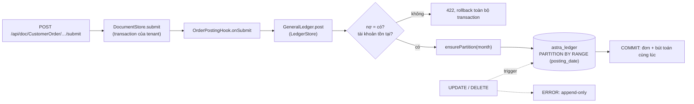

# Video 12 · Sổ cái append-only

<a href="https://media.zerohostcms.com/astra-cms/astra-video-12-ledger-vi.mp4"></a>

▶ [Tiếng Việt](https://media.zerohostcms.com/astra-cms/astra-video-12-ledger-vi.mp4) · [English](https://media.zerohostcms.com/astra-cms/astra-video-12-ledger-en.mp4) · 2:32 · Kịch bản: [demo-video-series.md](../demo-video-series.md#video-12-sổ-cái-append-only-cảnh-10) · [Bản tiếng Anh](./12-ledger.md)

> **Tóm tắt một câu:** chứng từ nghiệp vụ ghi các bút toán kép cân bằng vào một bảng PostgreSQL duy nhất, `astra_ledger`, trong cùng transaction với chứng từ; sửa sai bằng bút toán đảo, và một trigger trong database từ chối UPDATE và DELETE, kể cả từ chủ sở hữu bảng.
> **Nên đọc nếu:** bạn viết một hook phải ghi sổ tiền và muốn biết `GeneralLedger.post` và `reverse` bảo đảm điều gì (developer) / bạn cần giải thích với kiểm toán viên hoặc CFO vì sao sổ sách không thể bị sửa lén, và bảo đảm đó dừng ở đâu (tech lead).

## Vấn đề

Astra Express tính phí vận chuyển khi một đơn được submit, thu tiền COD (thu hộ) từ người nhận khi bưu kiện được
giao, rồi sau đó chi trả số tiền này cho shop. Mỗi bước đều là tiền, và mỗi bước phải hiện trên sổ cái tổng hợp
theo hệ thống tài khoản Việt Nam (Thông tư 200).

Thường có ba chỗ hỏng:

- **Sổ cái lệch khỏi chứng từ.** Đơn hàng commit xong, rồi một background job ghi bút toán và thất bại. Lúc này đơn
  nói "đã tính phí" còn sổ sách không nói gì.
- **Lịch sử bị sửa.** Một khoản phí sai được "sửa" bằng UPDATE. Số dư thì đúng, nhưng không ai chỉ ra được tháng
  trước đã ghi những gì, mà đó chính là câu kiểm toán hỏi.
- **Số dư nằm trong một bảng tổng hợp** được cập nhật song song với bút toán. Hai thứ lệch nhau ngay sau lỗi đầu tiên.

ERPNext giải quyết hai chỗ đầu bằng code ứng dụng: GL Entry được ghi khi submit, và cancel thì ghi bút toán đảo.
Astra theo cùng mô hình kế toán đó và thêm hai điều: việc ghi sổ tham gia transaction database của chứng từ thông
qua một SPI, và chính database từ chối viết lại các dòng sổ cái.

## Video cho thấy gì

| Cảnh | Bạn thấy gì | Điều đó chứng minh |
| --- | --- | --- |
| Sổ cái tổng hợp | `khoa` mở bảng cân đối số phát sinh: tài khoản 112, 131, 1388, 3388, 511 | Số dư được tính từ các dòng sổ cái; không có bảng tổng hợp. |
| Submit | `tuan` submit một đơn; form hiện thẻ "Ledger entries": Nợ 131 / Có 511, 73.000 VND | Bút toán được ghi trong cùng transaction với đơn. |
| Cancel | Đơn bị hủy; hai dòng mới xuất hiện, đánh dấu là bút toán đảo; hai dòng gốc giữ nguyên | Hủy không xoá gì. Số dư về không và lịch sử còn nguyên. |
| Delivered | `quang` quét bưu kiện Delivered: Nợ 1388 / Có 3388, 850.000 VND | Tiền COD bưu tá đã thu là khoản nợ shop, được ghi trong transaction của lần quét. |
| UPDATE | Một lệnh `UPDATE astra_ledger …` trên terminal thất bại với `astra_ledger is append-only` | Một trigger trong database chặn thay đổi, kể cả với role sở hữu bảng. |
| Partitions | Mục partitions liệt kê các phân vùng theo tháng | Khi khởi động, kernel tạo phân vùng của tháng này và hai tháng kế tiếp; dòng nằm ngoài khoảng đó đi vào một phân vùng mặc định. |
| Chi trả | Một phiếu chi COD 99.000.000 trong khi chỉ đang nợ 350.000 bị từ chối với 422; người lập không được duyệt phiếu chi, Thu thì được | Số đang nợ được đọc từ sổ cái ngay trong hook; người lập ≠ người duyệt ([Video 11](./11-keycloak.vi.md)). |

## Cách hoạt động




*Một transaction, hai lần ghi.*

### 1. App ghi sổ qua SPI, không qua SQL

App không bao giờ chạm vào bảng sổ cái. Nó inject `GeneralLedger` từ `astra-spi` và mô tả một chứng từ.

*`astra-spi/src/main/java/io/astra/spi/ledger/GeneralLedger.java`*

```java
/**
 * Double-entry postings to the append-only ledger of the current tenant. Called from lifecycle hooks,
 * a posting joins the triggering document's transaction: the voucher and its entries commit together.
 * Entries are never changed; {@link #reverse} posts mirror entries instead.
 */
public interface GeneralLedger {
    // …
    /** Posts a balanced voucher (total debit = total credit); zero-amount lines are skipped. */
    void post(String voucherType, String voucherNo, LocalDate postingDate, List<Entry> entries, String remarks);

    /** Posts the mirror of every entry of a voucher, dated today; refuses a voucher already reversed. */
    void reverse(String voucherType, String voucherNo);

    /** Debit minus credit of an account, optionally for one party. */
    BigDecimal balance(String account, String party);
}
```

Hook của đơn hàng là toàn bộ phần tích hợp kế toán cho việc tính phí:

*`astra-apps/express/src/main/java/io/astra/apps/express/OrderPostingHook.java`*

```java
    @Override
    public void onSubmit(Document order) {
        BigDecimal fee = BigDecimal.valueOf(Numbers.toDouble(order.get("shipping_fee")));
        String customer = order.getString("customer");
        ledger.post("CustomerOrder", order.name(), LocalDate.now(), List.of(
                Entry.debit(Accounts.RECEIVABLE, customer, fee),
                Entry.credit(Accounts.REVENUE, customer, fee)), "Shipping fee " + order.name());
    }

    @Override
    public void onCancel(Document order) {
        ledger.reverse("CustomerOrder", order.name());
    }
```

Mã tài khoản là hằng số trong app, đặt tên theo Thông tư 200:

*`astra-apps/express/src/main/java/io/astra/apps/express/Accounts.java`*

```java
    static final String BANK = "112";                 // Tiền gửi ngân hàng
    static final String RECEIVABLE = "131";           // Phải thu của khách hàng: shipping fees
    static final String COD_HELD = "1388";            // Phải thu khác: COD collected, still with couriers
    static final String COD_PAYABLE = "3388";         // Phải trả khác: COD owed to the shop
    static final String REVENUE = "511";              // Doanh thu cung cấp dịch vụ
```

Vì sao dùng SPI: cùng một hợp đồng phục vụ mọi app (app HRM ghi bút toán trích lương qua chính nó, xem
[Video 19](./19-hrm.vi.md)), và kernel có thể đổi cách lưu trữ mà không đụng tới app.

### 2. Kernel kiểm tra, rồi insert trong transaction của tenant

`LedgerStore` hiện thực SPI. Nó làm tròn tới hai chữ số thập phân, từ chối số âm, từ chối chứng từ không cân, từ
chối tài khoản không có trong DocType `Account` của tenant, và insert bên trong `tx.inTenantTx`, chính là
transaction mà chứng từ đang được lưu.

*`astra-doctype/src/main/java/io/astra/doctype/ledger/LedgerStore.java`*

```java
    @Override
    public void post(String voucherType, String voucherNo, LocalDate postingDate, List<Entry> entries, String remarks) {
        List<Entry> lines = entries.stream().map(LedgerStore::rounded)
                .filter(e -> e.debit().signum() != 0 || e.credit().signum() != 0).toList();
        if (lines.isEmpty()) return;
        BigDecimal debit = lines.stream().map(Entry::debit).reduce(BigDecimal.ZERO, BigDecimal::add);
        BigDecimal credit = lines.stream().map(Entry::credit).reduce(BigDecimal.ZERO, BigDecimal::add);
        if (debit.compareTo(credit) != 0) {
            throw new DocValidationException("unbalanced voucher " + voucherNo + ": debit " + debit + " ≠ credit " + credit);
        }
        tx.inTenantTx(conn -> {
            requireAccounts(conn, lines);
            ensurePartition(conn, postingDate);
            insert(conn, voucherType, voucherNo, postingDate, lines, false, remarks);
            return null;
        });
    }
```

Vì bút toán và chứng từ dùng chung một transaction, một bút toán bị từ chối sẽ rollback cả lần submit. Không có
trạng thái nào mà đơn đã submit còn phí thì vắng mặt trên sổ. Mỗi dòng cũng ghi lại `posted_by` (user của token,
hoặc `system` khi nằm ngoài một request).

### 3. Bút toán đảo là bản phản chiếu, không bao giờ là sửa

*`astra-doctype/src/main/java/io/astra/doctype/ledger/LedgerStore.java`*

```java
            if (reversed) throw new DocValidationException("voucher " + voucherNo + " is already reversed");
            if (original.isEmpty()) return null;
            LocalDate today = LocalDate.now();
            ensurePartition(conn, today);
            List<Entry> mirror = original.stream().map(e -> new Entry(e.account(), e.party(), e.credit(), e.debit())).toList();
            insert(conn, voucherType, voucherNo, today, mirror, true, "Reversal of " + voucherNo);
```

Nợ và Có đổi chỗ; `is_reversal` là true; ngày ghi sổ là *hôm nay*. Vì sao là hôm nay: một đơn tính phí trong tháng
Mười và bị hủy trong tháng Mười Một phải để nguyên số liệu tháng Mười như đã báo cáo. Bút toán đảo rơi vào phân
vùng của tháng Mười Một.


*Cancel thêm dòng, không bao giờ sửa.*

### 4. Database tự bảo vệ

*`astra-doctype/src/main/resources/db/migration/V3__ledger.sql`*

```sql
CREATE TABLE astra_ledger (
    id            bigint GENERATED ALWAYS AS IDENTITY,
    tenant_id     text           NOT NULL,
    -- …
    debit         numeric(18, 2) NOT NULL DEFAULT 0,
    credit        numeric(18, 2) NOT NULL DEFAULT 0,
    voucher_type  text           NOT NULL,
    voucher_no    text           NOT NULL,
    is_reversal   boolean        NOT NULL DEFAULT false,
    remarks       text,
    posted_by     text           NOT NULL,
    posted_at     timestamptz    NOT NULL DEFAULT now(),
    PRIMARY KEY (id, posting_date),
    CONSTRAINT astra_ledger_one_side CHECK (debit >= 0 AND credit >= 0 AND (debit = 0) <> (credit = 0))
) PARTITION BY RANGE (posting_date);

-- Rows outside the monthly partitions that the kernel creates ahead of time land here.
CREATE TABLE astra_ledger_default PARTITION OF astra_ledger DEFAULT;
-- …
CREATE FUNCTION astra_ledger_append_only() RETURNS trigger LANGUAGE plpgsql AS $$
BEGIN
    RAISE EXCEPTION 'astra_ledger is append-only: post a reversal instead of %', TG_OP
        USING ERRCODE = 'insufficient_privilege';
END $$;

CREATE TRIGGER astra_ledger_no_update_delete
    BEFORE UPDATE OR DELETE ON astra_ledger
    FOR EACH ROW EXECUTE FUNCTION astra_ledger_append_only();
```

Những lựa chọn thiết kế đáng chú ý:

- **Cột quan hệ cố định, không dùng JSONB.** Chứng từ nằm trong `astra_doc` dưới dạng JSONB
  ([Video 2](./02-doctype.vi.md)); dòng sổ cái thì hẹp và toàn số, nên phép cộng là số học `numeric(18,2)` chính
  xác và index là B-tree thông thường (`astra_ledger_voucher_idx`, `astra_ledger_account_idx`).
- **Mỗi dòng chỉ một bên**, được cưỡng chế bằng một CHECK constraint, nên một dòng không thể vừa Nợ vừa Có, cũng
  không thể âm.
- **Row-level security** dùng cùng setting `astra.tenant` như chứng từ, và cũng được bật trên từng phân vùng tháng,
  nên truy vấn thẳng vào một phân vùng cũng cô lập như truy vấn bảng cha.
- **Trigger thay cho REVOKE.** Phân quyền không ràng buộc chủ sở hữu bảng; còn trigger thì chạy với mọi role không
  xoá nó đi.

### 5. Phân vùng được tạo trước

*`astra-doctype/src/main/java/io/astra/doctype/ledger/LedgerPartitions.java`*

```java
    void onStart(@Observes StartupEvent ev) {
        try (Connection conn = dataSource.getConnection()) {
            conn.setAutoCommit(true);
            for (int i = 0; i < 3; i++) {
                LocalDate month = LocalDate.now().plusMonths(i);
                try {
                    ledger.ensurePartition(conn, month);
                } catch (SQLException e) {
                    // Another pod may be creating the same partition; the next posting retries.
                    LOG.warnf("Ledger partition for %s not created yet: %s", month.withDayOfMonth(1), e.getMessage());
                }
            }
        // …
```

`LedgerStore.ensurePartition` cũng được gọi theo kiểu lười trước mỗi lần ghi sổ. Phân vùng theo tháng giúp việc
khoá sổ một kỳ rẻ: một tháng đã qua là một bảng bạn có thể lưu trữ hoặc gắn sang hệ thống báo cáo mà không đụng
tới bảng hiện tại.


*Phân vùng theo tháng.*

### 6. COD: số tiền đang nợ lấy từ sổ cái

Lúc giao hàng thành công, hệ thống ghi nhận khoản tiền bưu tá đang giữ (`WaybillScanHook`), và một phiếu chi không
được vượt quá số tiền mà sổ cái cho biết đang nợ shop đó:

*`astra-apps/express/src/main/java/io/astra/apps/express/RemittanceHook.java`*

```java
    private BigDecimal outstanding(Document doc) {
        String customer = doc.getString("customer");
        return customer == null ? BigDecimal.ZERO : ledger.balance(Accounts.COD_PAYABLE, customer).negate();
    }

    private void check(Document doc) {
        BigDecimal amount = BigDecimal.valueOf(Numbers.toDouble(doc.get("amount")));
        BigDecimal owed = outstanding(doc);
        if (amount.signum() <= 0) throw new DocValidationException("amount must be positive");
        if (amount.compareTo(owed) > 0) {
            throw new DocValidationException("amount " + plain(amount) + " exceeds the COD owed to "
                    + doc.getString("customer") + " (" + plain(owed) + ")");
        }
    }
```

`check` chạy khi lưu và chạy lại khi submit, sau đó phiếu chi ghi Nợ 3388 / Có 112. Không có cột "còn nợ" nào phải
bảo trì; con số đó là tổng trên các dòng append-only.

## Ví dụ thực tế

*Tình huống minh hoạ: công ty, con người và số liệu là giả định; cơ chế và các quy tắc được áp dụng là thật, như đã trình bày ở trên.*

Một công ty chuyển phát thương mại điện tử nhỏ ở TP. Hồ Chí Minh chạy một ngày kinh doanh trên Astra.

**Đầu vào:**

1. Sales submit đơn A cho shop S01 với phí tính được là 45.000 VND.
2. Cân nặng bị sai. Một kế toán hủy đơn A (sales không có quyền `cancel`); sales amend đơn, và đơn đã amend được
   submit với phí 62.000.
3. Bưu kiện được giao; người nhận trả COD 1.200.000.
4. Kế toán An lập phiếu chi 1.200.000 cho S01; kế toán Bình duyệt.

**Astra ghi những gì (`astra_ledger`):**

| Chứng từ | Tài khoản | Nợ | Có | `is_reversal` |
| --- | --- | ---: | ---: | --- |
| Đơn A | 131 | 45.000 | | false |
| Đơn A | 511 | | 45.000 | false |
| Đơn A | 511 | 45.000 | | true |
| Đơn A | 131 | | 45.000 | true |
| Đơn đã amend | 131 | 62.000 | | false |
| Đơn đã amend | 511 | | 62.000 | false |
| Waybill | 1388 | 1.200.000 | | false |
| Waybill | 3388 | | 1.200.000 | false |
| CODRemittance | 3388 | 1.200.000 | | false |
| CODRemittance | 112 | | 1.200.000 | false |

**Đầu ra (bảng cân đối số phát sinh, Nợ trừ Có):** 131 = 62.000; 511 = −62.000; 1388 = 1.200.000; 3388 = 0;
112 = −1.200.000. Tổng bằng không. Khoản phí sai 45.000 vẫn còn thấy được, cùng với người đã ghi và người đã đảo
nó. Nếu An cố tự duyệt phiếu chi của mình, hoặc chi 1.300.000, kernel sẽ trả 403 hoặc 422 và không có gì được ghi.

Lưu ý app demo không ghi bút toán bưu tá nộp tiền mặt về công ty, nên ở đây 1388 vẫn còn số dư; một hệ thống triển
khai thật cần chứng từ đó (ví dụ Nợ 111 hoặc 112 / Có 1388).

## Dành cho tech lead

- **Bảo đảm có nhiều lớp.** App không thể viết SQL vào sổ cái (SPI), kernel từ chối chứng từ không cân hoặc dùng
  tài khoản không tồn tại, và database từ chối UPDATE và DELETE. Lớp yếu nhất là role database: hãy chạy kernel
  bằng một role không sở hữu các bảng, để nó không thể DROP hay ALTER chúng.
- **Tính nguyên tử chỉ ở phạm vi cục bộ.** Việc ghi sổ tham gia transaction PostgreSQL của chứng từ. Một bút toán
  cần commit cùng với một tài nguyên khác (hạn mức tín dụng ở schema khác, năng lực tải trong Redis) thì cần Seata,
  được trình bày ở [Video 17](./17-seata.vi.md).
- **Chi phí.** Mỗi lần submit và cancel đều thêm dòng; không có gì bị xoá. Hãy dự trù dung lượng lưu trữ theo số
  bút toán mỗi tháng, và dùng việc lưu trữ phân vùng làm cơ chế giữ dữ liệu.
- **Số dư là phép tổng hợp.** `balance()` và bảng cân đối số phát sinh cộng các dòng khi được hỏi. Ổn với khối
  lượng của demo; ở mức hàng triệu dòng mỗi tháng, hãy thêm snapshot theo kỳ hoặc một bản sao dành cho báo cáo
  ([Video 16](./16-cdc.vi.md)) thay vì một bảng tổng hợp có thể sửa.
- **Nên đo gì.** Số dòng trong `astra_ledger_default` (phải bằng không; khác không nghĩa là có bút toán nằm ngoài
  các tháng đã tạo trước), số lần từ chối chứng từ không cân (lỗi trong một hook), và tỷ lệ đảo theo loại chứng từ.
- **Khi nào không nên dùng.** Nếu hệ thống kế toán gốc của bạn là một ERP bên ngoài và Astra chỉ cấp dữ liệu cho
  nó, hãy ghi sổ ở đó và giữ chứng từ của Astra làm nguồn.
- **So với các phương án khác.** Một kho event-sourced cho mức bất biến tương tự nhưng cần nhiều cơ chế hơn; một
  bảng GL sửa được kèm audit log cho lịch sử chỉnh sửa nhưng không ngăn được việc sửa. ERPNext dùng GL entry đảo
  được cưỡng chế bằng code ứng dụng; Astra bổ sung lớp từ chối ở mức database.

## Tự chạy thử

Yêu cầu: JDK 25, Docker Desktop với 8 GB cho stack k3d, `kubectl`, `k3d`, `jq`, Bash 5.

```bash
make k3d-up
make demo-reset && make demo-seed
make demo-express SCENES=10 PAUSE=0
open http://localhost:8080/desk/        # sign in as khoa / Astra@123 → General ledger
```

Kết quả mong đợi từ cảnh 10 của `scripts/demo-express.sh`:

- `GET /api/ledger/trial-balance` liệt kê `account, debit, credit, balance`.
- Sau khi `tuan` submit một đơn, `GET /api/ledger/entries?voucher_no=<order>` cho thấy Nợ 131 / Có 511 và phân vùng
  chứa từng dòng.
- Sau khi cancel, cùng lời gọi đó cho thấy thêm hai dòng với `is_reversal: true`.
- Khi script truy cập được database (`DB=k3d` hoặc `DB=compose`), lệnh `UPDATE astra_ledger …` in ra
  `ERROR: astra_ledger is append-only: post a reversal instead of UPDATE`.
- `GET /api/ledger/partitions` liệt kê các phân vùng tháng và phân vùng mặc định kèm số dòng.
- `POST /api/doc/CODRemittance` với `amount: 99000000` trả 422; một phiếu chi 100.000 do `khoa` lập bị từ chối khi
  chính `khoa` submit và được chấp nhận khi `thu` submit.

Hành vi này được giữ cố định bởi `astra-server/src/test/java/io/astra/server/LedgerTest.java` (ví dụ
`theLedgerIsAppendOnlyEvenForItsOwner`); chạy `make test`.

## Nói đúng

- Trigger chỉ chặn UPDATE và DELETE. Role sở hữu bảng vẫn có thể DROP hoặc ALTER nó (và trigger theo dòng không
  chạy với TRUNCATE). Production nên chạy kernel bằng một role không sở hữu các bảng.
- Chuỗi hash audit trên các dòng sổ cái vẫn còn trên roadmap.
- Sổ cái nằm trong transaction PostgreSQL của kernel; loại DocType riêng `storage: ledger` và schema theo từng app
  mô tả trong [use-case-01.md](../use-case-01.md) là kiến trúc mục tiêu, chưa được xây.
- App demo ghi bút toán tính phí, thu COD và chi trả COD. Nó không ghi việc bưu tá nộp tiền mặt, VAT, hay khoá sổ
  cuối kỳ.

## Hình minh hoạ

### Hình 1 · Một transaction, hai lần ghi


### Hình 2 · Cancel thêm dòng, không bao giờ sửa


### Hình 3 · Phân vùng theo tháng


## Liên quan

- Trước: [Video 11 · Keycloak](./11-keycloak.vi.md). Tiếp: [Video 13 · Overlay theo tenant](./13-overlay.vi.md).
- [Video 4 · Vòng đời chứng từ](./04-lifecycle.vi.md) (Submit, Cancel, Amend), [Video 5 · Vận hành](./05-ops.vi.md)
  (lần quét vận đơn ghi nhận COD), [Video 17 · Seata](./17-seata.vi.md), [Video 19 · HRM](./19-hrm.vi.md).
- Tài liệu: [demo-code-snippets.md, S6](../demo-code-snippets.md#s6-append-only-ledger),
  [use-case-01.md](../use-case-01.md), [explain.md](../explain.md).
- Mã nguồn: `astra-doctype/src/main/resources/db/migration/V3__ledger.sql`,
  `astra-doctype/src/main/java/io/astra/doctype/ledger/LedgerStore.java`,
  `astra-doctype/src/main/java/io/astra/doctype/ledger/LedgerPartitions.java`,
  `astra-doctype/src/main/java/io/astra/doctype/api/LedgerResource.java`,
  `astra-spi/src/main/java/io/astra/spi/ledger/GeneralLedger.java`,
  `astra-apps/express/src/main/java/io/astra/apps/express/OrderPostingHook.java`,
  `astra-apps/express/src/main/java/io/astra/apps/express/RemittanceHook.java`,
  `astra-apps/express/src/main/java/io/astra/apps/express/WaybillScanHook.java`.
