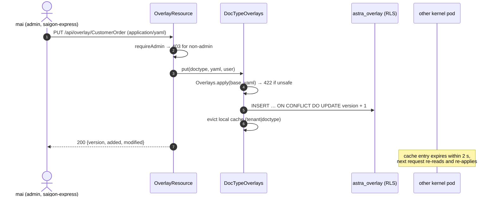

# Video 13 · Tenant overlays

<a href="https://media.zerohostcms.com/astra-cms/astra-video-13-overlay-en.mp4"></a>

▶ [English](https://media.zerohostcms.com/astra-cms/astra-video-13-overlay-en.mp4) · [Tiếng Việt](https://media.zerohostcms.com/astra-cms/astra-video-13-overlay-vi.mp4) · 2:24 · Script: [demo-video-series.en.md](../demo-video-series.en.md#video-13-per-tenant-overlays-scene-11)

> **In one sentence:** a tenant overlay is a small YAML file, stored per tenant under row-level security, that adds fields to an app's DocType or adjusts a safe subset of field properties, and takes effect at once for that tenant only, without forking or redeploying the app.
>
> **Read this if:** you need to know exactly what an overlay can change, how the kernel merges it, and why some changes are refused / you run one product for many companies and want per-customer configuration without per-customer code branches.

## The problem

Astra Express runs two tenants on the same Express app: `saigon-express` and `hanoi-express`. Hanoi has requirements
Saigon does not. Its B2B shippers ask for a VAT invoice on each order, it delivers to islands (Cát Bà, Cô Tô), and its
dispatchers want a delivery note on every order. Those requirements come straight from the comment at the top of the
real overlay file, `tenants/hanoi-express/overlays/customer-order.overlay.yaml`.

The usual options are all expensive:

- **Fork the app** for Hanoi. Every upstream fix must now be merged twice, and upgrades stall.
- **Add every tenant's fields to the shared app**, guarded by feature flags. The shared DocType grows fields most
  tenants never use, and Saigon users see or can submit fields that mean nothing to them.
- **A generic "extra attributes" key-value table.** Flexible, but the fields are invisible to validation, forms and
  APIs unless every layer special-cases them.

Frappe/ERPNext answered this with Custom Fields and Property Setters: per-site customisations that survive upgrades
([explain.en.md](../explain.en.md)). Astra borrows that idea and changes two things. The overlay is a per-tenant row
in a shared database rather than per-site schema changes, and because business fields live in JSONB, adding a field
runs no DDL.

## What the video shows

The video is 2:24.

1. **The overlay file.** Hanoi's YAML adds VAT invoice, tax code and invoice email fields, adds an `Island` zone, and
   makes the delivery note required. The tenant admin applies it through the overlay API; the file lives in Git. The
   Express app does not change a single line.
2. **Two tenants, one form.** `compare.html` shows the same New Customer Order screen for both tenants. Hanoi's added
   and modified fields carry a `✚ tenant overlay` or `✎ tenant overlay` tag; Saigon is unchanged.
3. **Validation is per tenant.** Hanoi accepts an Island order with a VAT invoice. Saigon refuses the same body:
   unknown fields, invalid zone. Hanoi refuses an order without a note. Form, API and validation read one effective
   definition.
4. **Live edit in Desk.** `mai`, a Saigon admin, adds a `gift_wrap` field in the overlay editor and saves. It takes
   effect at once: no restart, no migration. Other pods pick up the change within two seconds. (The overlay is removed
   afterwards so later recordings show Saigon without an overlay.)
5. **Guardrails.** Changing a field type returns 422. A sales user (`tuan`) editing the overlay gets 403.
6. **For developers.** Overlays are tenant data in their own table, under the same row-level security as documents.
7. **To be accurate.** Overlays add fields and edit some properties. No hooks or permissions yet, no field removal.

## How it works

### The overlay format

*`tenants/hanoi-express/overlays/customer-order.overlay.yaml`*

```yaml
# Hanoi Express only: B2B shippers ask for a VAT invoice on each order, deliveries reach islands
# (Cát Bà, Cô Tô), and dispatchers want delivery notes on every order. The Express app is untouched;
# applied with: PUT /api/overlay/CustomerOrder (tenant admin), see scripts/demo-seed.sh.
doctype: CustomerOrder
fields:
  add:
    - { name: vat_invoice,   type: Check, label: "Xuất hóa đơn VAT", in-list: true }
    - { name: tax_code,      type: Data,  label: "Mã số thuế" }
    - { name: invoice_email, type: Data,  label: "Email nhận hóa đơn" }
  modify:
    - { name: zone, options: [Same city, Domestic, Remote, Island] }
    - { name: note, label: "Ghi chú giao hàng", required: true }
```

Two verbs, `add` and `modify`. The base fields being modified are declared by the app:

*`astra-apps/express/src/main/resources/META-INF/astra/doctypes/customer-order.doctype.yaml`*

```yaml
  - { name: zone,             type: Select,   options: [Same city, Domestic, Remote], default: Domestic, in-list: true, projected: true }
  # …
  - { name: note,             type: Text }
```

### Merge rules: what an overlay may and may not do

All the rules live in one pure function.

*`astra-doctype/src/main/java/io/astra/doctype/registry/Overlays.java`*

```java
public final class Overlays {

    private static final Set<String> MODIFIABLE = Set.of("name", "label", "required", "options", "default", "in-list");

    /** Returns the effective DocType; throws {@link IllegalArgumentException} with a readable reason for a bad overlay. */
    public static DocTypeDefinition apply(DocTypeDefinition base, String yaml) {
        // … parse YAML, check the doctype name matches
        List<FieldDefinition> fields = new ArrayList<>(base.fields());
        for (JsonNode m : root.path("fields").path("modify")) {
            String name = m.path("name").asText("");
            int i = indexOf(fields, name);
            if (i < 0) throw new IllegalArgumentException("cannot modify unknown field '" + name + "' of " + base.name());
            m.fieldNames().forEachRemaining(k -> {
                if (!MODIFIABLE.contains(k)) throw new IllegalArgumentException("field property '" + k + "' cannot be changed by an overlay");
            });
            FieldDefinition f = fields.get(i);
            fields.set(i, new FieldDefinition(f.name(), f.type(),
                    m.hasNonNull("label") ? m.get("label").asText() : f.label(),
                    m.has("required") ? m.get("required").asBoolean() : f.required(),
                    f.readOnly(),
                    // … in-list, projected, options, default, pii
        }
        for (JsonNode a : root.path("fields").path("add")) {
            // … parse the field definition
            if (indexOf(fields, f.name()) >= 0) throw new IllegalArgumentException("field '" + f.name() + "' already exists in " + base.name());
            if (f.projected() || f.readOnly()) {
                throw new IllegalArgumentException("overlay field '" + f.name() + "' cannot be projected or read-only");
            }
            fields.add(f);
        }
        return new DocTypeDefinition(base.name(), base.module(), base.kind(), base.submittable(), base.naming(),
                fields, base.permissions(), base.segregationOfDuties(), base.globalTransaction());
    }
```

Why each rule exists:

| Rule | Reason |
| --- | --- |
| Only `label`, `required`, `options`, `default`, `in-list` can be modified | These change what users see and must enter. They do not change what the app's Java code reads. |
| `type` cannot change | App hooks read fields with typed accessors (`ShippingFeeHook` reads `weight_kg` as a number). Retyping would break the app, and documents already stored with the old type. |
| `read-only`, `projected` cannot be set | `read-only` fields are reserved for hooks (for example `shipping_fee`). `projected` creates an expression index on the shared `astra_doc` table, which a tenant should not trigger. |
| No removal | Documents written before the overlay must stay valid, and the app may depend on every field it declared. |
| `permissions`, `submittable`, naming, `transaction: global` copied from the base | Security and lifecycle stay the app's decision. |

The class comment summarises it: an overlay "may not remove or retype fields, so documents written before the
overlay stay valid and the app's own code keeps working".


*Base DocType plus overlay equals the tenant's effective DocType: custom fields merge seamlessly without touching app code.*


### Storage: tenant data under row-level security

*`astra-doctype/src/main/resources/db/migration/V4__overlays.sql`*

```sql
CREATE TABLE astra_overlay (
    tenant_id   text        NOT NULL,
    doctype     text        NOT NULL,
    yaml        text        NOT NULL,
    version     integer     NOT NULL DEFAULT 1,
    updated_by  text        NOT NULL,
    updated_at  timestamptz NOT NULL DEFAULT now(),
    PRIMARY KEY (tenant_id, doctype)
);

ALTER TABLE astra_overlay ENABLE ROW LEVEL SECURITY;
ALTER TABLE astra_overlay FORCE ROW LEVEL SECURITY;
CREATE POLICY astra_overlay_tenant_isolation ON astra_overlay
    USING      (tenant_id = current_setting('astra.tenant', true))
    WITH CHECK (tenant_id = current_setting('astra.tenant', true));
```

Why a table and not files on disk: overlays are tenant configuration, so they get the same isolation as tenant
documents (Video 7). A query in Hanoi's scope cannot see Saigon's overlay even if the code forgot a `WHERE` clause.
The primary key allows one overlay per tenant and DocType; every save increments `version` and records `updated_by`.
The YAML file under `tenants/` is the Git copy; the seed script applies it through the API
(`scripts/demo-seed.sh`).

### The effective DocType, cached for two seconds

Every place in the kernel that needs a DocType asks for "the DocType as this tenant sees it":

*`astra-doctype/src/main/java/io/astra/doctype/registry/DocTypeOverlays.java`*

```java
    static final long TTL_MILLIS = 2_000;

    /** The effective DocType for the tenant in scope, or the app's definition outside a tenant scope. */
    public DocTypeDefinition effective(String doctype) {
        DocTypeDefinition base = registry.require(doctype);
        Optional<String> tenant = TenantContext.current();
        if (tenant.isEmpty()) return base;
        String key = tenant.get() + "|" + doctype;
        Cached c = cache.get(key);
        if (c != null && System.currentTimeMillis() - c.loadedAt() < TTL_MILLIS) return c.def();
        DocTypeDefinition def = base;
        Optional<Map<String, Object>> overlay = get(doctype);
        if (overlay.isPresent()) {
            try {
                def = Overlays.apply(base, (String) overlay.get().get("yaml"));
            } catch (IllegalArgumentException e) {
                // Stored overlays are validated on write; one that no longer fits a newer app version is skipped.
                LOG.warnf("Overlay of %s for tenant %s ignored: %s", doctype, tenant.get(), e.getMessage());
            }
        }
        cache.put(key, new Cached(def, System.currentTimeMillis()));
        return def;
    }
```

`DocumentStore` calls `overlays.effective(doctype)` for list, insert, update and validation
(`astra-doctype/src/main/java/io/astra/doctype/store/DocumentStore.java`), and `GET /api/doctype` serves the same
result to Desk and API clients. That single call site is why form, list, REST and validation cannot disagree.

Why a 2-second TTL: the pod that handles the `PUT` evicts its own cache entry immediately, so the editor sees the
change at once. Other pods have no invalidation channel; they re-read within `TTL_MILLIS`. That trades a bounded
delay for having no message bus in the kernel.

Why "skip with a warning" on read: an overlay was valid when saved, but a later app version might remove or rename a
field it modifies. The kernel then serves the app's base definition and logs a warning instead of failing every
request for that tenant.




*Saving an overlay across two pods: the 2-second cache TTL guarantees near-instant propagation without cluster cache sync overhead.*


### Who may change an overlay

*`astra-doctype/src/main/java/io/astra/doctype/api/OverlayResource.java`*

```java
/**
 * Per-tenant DocType overlays. Every member may read them (they shape the forms they use); only the
 * tenant's {@code admin} role may change them. Bodies are YAML ({@code application/yaml} or text).
 */
@Path("/api/overlay")
// …
    @PUT
    @Path("/{doctype}")
    @Consumes({"application/yaml", "text/yaml", MediaType.TEXT_PLAIN})
    public Map<String, Object> put(@PathParam("doctype") String doctype, String yaml) {
        requireAdmin("change the overlay of " + doctype);
        return scoped(() -> overlays.put(doctype, yaml, tenant.userId()));
    }
```

The role check reads roles from the Keycloak token for the current tenant (Video 11), so `admin` in Hanoi grants
nothing in Saigon.

## Real-world example

*Illustrative scenario: the company, people and values are made up; the mechanism and the rules it applies are the real ones shown above.*

A regional courier in northern Vietnam serves B2B shippers in Hanoi and delivers to Hạ Long Bay islands. Finance needs
a tax code on any order that requires a VAT invoice; dispatch needs a note on every order. The courier licenses the
same Express app as a southern operator that has none of these rules.

The behaviour below is what `astra-server/src/test/java/io/astra/server/OverlayTest.java` and scene 11 of
`scripts/demo-express.sh` assert.

| Request | Tenant | Result |
| --- | --- | --- |
| `PUT /api/overlay/CustomerOrder` with the Hanoi YAML, as admin | hanoi | 200, `version: 1` |
| `GET /api/doctype/CustomerOrder` | hanoi | fields include `tax_code`; `zone` options include `Island`; `note.required = true` |
| same | saigon | no `tax_code`; original options |
| order with `zone: Island`, `vat_invoice: true`, `tax_code: 0100109106`, `note: Giao trước 10h` | hanoi | 201 |
| same body | saigon | 422: `unknown field 'tax_code' for DocType CustomerOrder`, and the zone is not one of the allowed options |
| order without `note` | hanoi | 422: `field 'note' is required` |
| overlay modifying `weight_kg` to `type: Data` | hanoi | 422: `field property 'type' cannot be changed by an overlay` |
| overlay adding `gift_wrap`, as `tuan` (sales) | saigon | 403 |


*Same request, two tenants, two answers: Saigon processes standard orders, while Hanoi enforces VAT and island shipping fields.*


What the regional courier gets: no fork, no schema change, and its rules are enforced on every channel (Desk, REST,
MCP), because all three validate against the effective definition.

One thing the overlay alone does not do: price island deliveries differently. The standard tariff in
`ShippingFeeHook` has no `Island` entry and falls back to the Domestic rate
(`TARIFF.getOrDefault(zone, TARIFF.get("Domestic"))`). A tenant that needs an island price uses a Tier 2 pricing rule,
whose ABI already maps `Island` to zone 3; see [Video 14](./14-wasm.md).

## For technical leaders

- **Customisation without divergence.** Each tenant's difference is a few lines of YAML, versioned in a table and in
  Git, not a branch. Upgrading the app upgrades every tenant.
- **Bounded power by design.** Overlays can add fields and change presentation and mandatory-ness. They cannot change
  types, security, lifecycle or indexing. This keeps the blast radius of a tenant admin's mistake to that tenant's
  forms and validation.
- **Consistency window.** A change is immediate on the pod that saved it and visible on other pods within 2 seconds.
  For configuration that is acceptable; do not use overlays for anything that needs cluster-wide atomic switch-over.
- **Upgrade risk.** If an app release removes or renames a field an overlay modifies, the kernel silently falls back
  to the base definition for that tenant and logs `Overlay of … ignored`. Monitor that log line after every app
  deploy; there is no automated pre-rollout conformance check yet.
- **Operational cost.** One extra cached lookup per DocType per tenant per 2 seconds per pod. No DDL, no deploys.
- **When not to use overlays.** When a tenant needs different behaviour (hooks, workflow, permissions), not just
  different fields; that is not supported yet. When a field should be indexed for filtering at scale; overlay fields
  cannot be projected.
- **What to measure.** Number of tenants with overlays, fields added per overlay, 422 rate per tenant after an overlay
  change, and occurrences of the "ignored" warning.

## Try it yourself

Prerequisites: the k3d stack from [the recording environment](../demo-video-series.en.md#1-preparing-the-recording-environment)
(`make k3d-up`), then a fresh seed. The seed applies Hanoi's overlay through the API.

```bash
make demo-reset && make demo-seed
make demo-express SCENES=11            # add PAUSE=0 to run without pressing Enter
```

Expected: scene 11 prints the overlay file, then `GET /api/doctype/CustomerOrder` for both tenants (Hanoi shows
`vat_invoice`, `tax_code`, `invoice_email`, `Island` and a required `note`; Saigon does not), a 201 for the Island VAT
order in hanoi-express, a 422 for the same body in saigon-express, a 422 for the order without a note, a 422 for the
type change and a 403 for `tuan`.

In the browser:

1. Log in as `demo` / `Astra@123` at `http://localhost:8080/desk/`, then open `http://localhost:8080/desk/compare.html`
   and go to `#/new/CustomerOrder`.
2. Log in as `mai`, open DocType metadata → CustomerOrder → Tenant overlay, add
   `- { name: gift_wrap, type: Check }` under `fields: add:`, and click Save overlay. Click Remove overlay when you are
   done.

Run the overlay tests alone (Docker required) with Maven's standard test filter, for example
`./mvnw -pl astra-server -am test -Dtest=OverlayTest -Dsurefire.failIfNoSpecifiedTests=false`.

## To be accurate

- Overlays add fields and modify `label`, `required`, `options`, `default` and `in-list`. They do not add hooks or
  permissions yet, and they cannot remove an app's fields.
- Overlay fields cannot be `projected` or `read-only`.
- Other pods see a change within 2 seconds, not instantly.
- An overlay that no longer fits a newer app version is skipped with a log warning; there is no conformance check
  before rollout yet.
- [overlay-wasm.md](../overlay-wasm.md) describes a broader target design (`add-permissions`, Wasm `scripts` attached
  to an overlay, an upgrade conformance check). Those parts are not built.

## Figures

- [Figure 1 · Base DocType plus overlay equals the tenant's effective DocType](#merge-rules-what-an-overlay-may-and-may-not-do)
- [Figure 2 · Same request, two tenants, two answers](#real-world-example)
- [Figure 3 · Saving an overlay across two pods](#the-effective-doctype-cached-for-two-seconds)

## Related

- Previous: [Video 12 · Append-only ledger](./12-ledger.md) · Next: [Video 14 · Tier 2 Wasm](./14-wasm.md)
- [Video 2 · DocType](./02-doctype.md), [Video 7 · Multi-tenancy](./07-tenants.md),
  [Video 9 · Writing an Astra app](./09-developer.md), [Video 11 · Keycloak](./11-keycloak.md)
- Code excerpts: [S7 Tenant overlays](../demo-code-snippets.md#s7-tenant-overlays)
- Background (target design, partly built): [overlay-wasm.md](../overlay-wasm.md), [explain.en.md](../explain.en.md)
- Source: `astra-doctype/src/main/java/io/astra/doctype/registry/Overlays.java`,
  `astra-doctype/src/main/java/io/astra/doctype/registry/DocTypeOverlays.java`,
  `astra-doctype/src/main/java/io/astra/doctype/api/OverlayResource.java`,
  `astra-doctype/src/main/resources/db/migration/V4__overlays.sql`,
  `tenants/hanoi-express/overlays/customer-order.overlay.yaml`,
  `astra-server/src/test/java/io/astra/server/OverlayTest.java`
