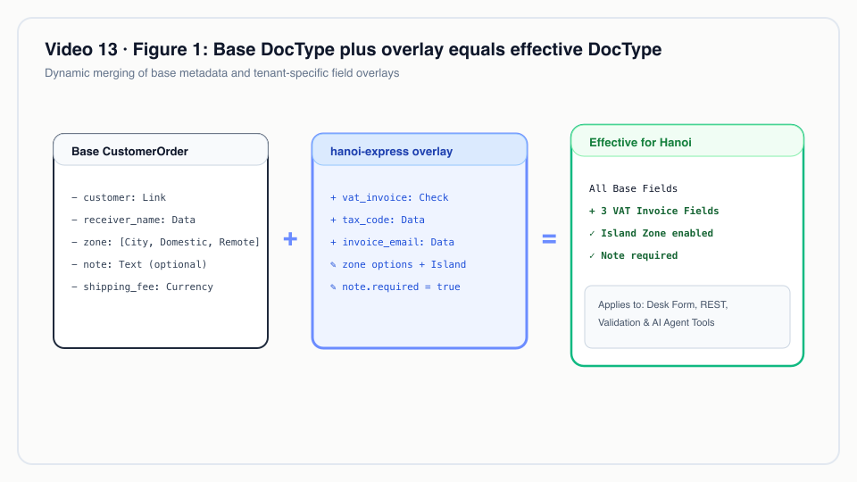
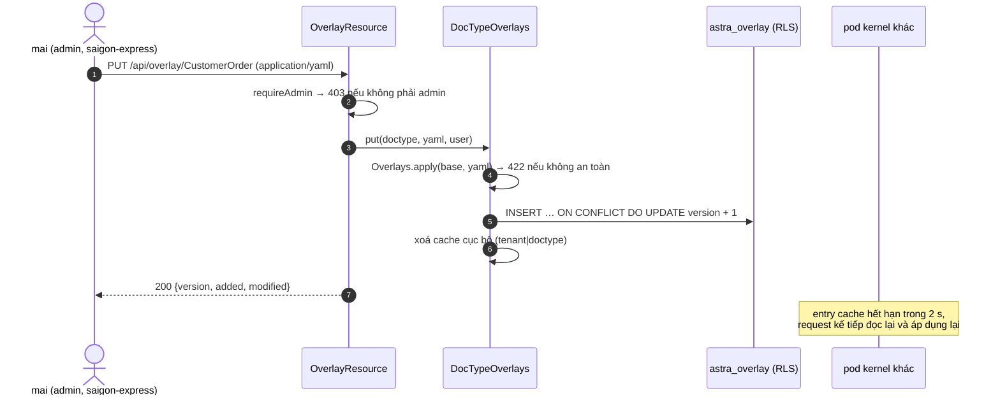
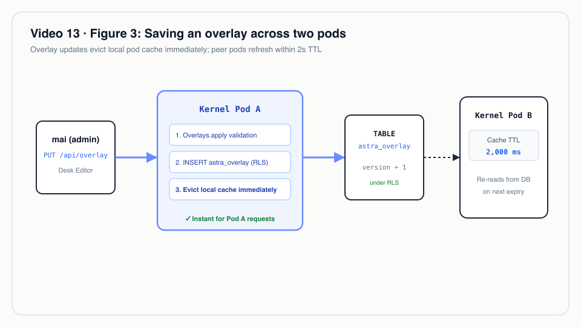
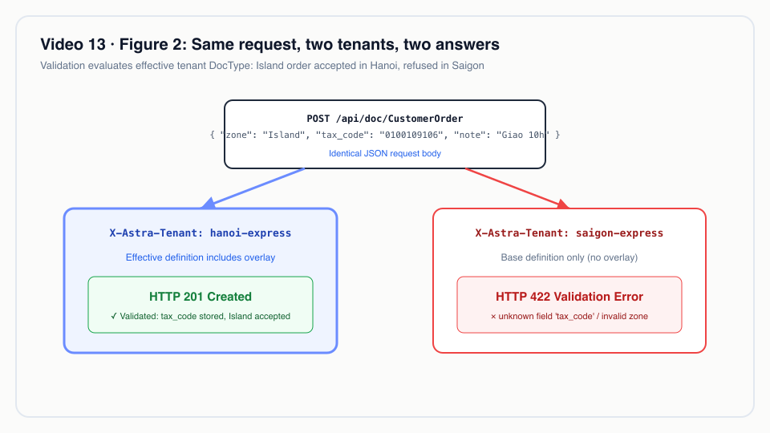

# Video 13 · Overlay theo tenant

<a href="https://media.zerohostcms.com/astra-cms/astra-video-13-overlay-vi.mp4"></a>

▶ [Tiếng Việt](https://media.zerohostcms.com/astra-cms/astra-video-13-overlay-vi.mp4) · [English](https://media.zerohostcms.com/astra-cms/astra-video-13-overlay-en.mp4) · 2:24 · Kịch bản: [demo-video-series.md](../demo-video-series.md#video-13-overlay-theo-tenant-cảnh-11) · [Bản tiếng Anh](./13-overlay.md)

> **Tóm tắt một câu:** overlay theo tenant là một file YAML nhỏ, lưu riêng cho từng tenant dưới row-level security, dùng để thêm trường vào DocType của một app hoặc chỉnh một nhóm thuộc tính trường an toàn; nó có hiệu lực ngay, chỉ cho tenant đó, mà không phải fork hay deploy lại app.
>
> **Nên đọc nếu:** bạn cần biết chính xác overlay thay đổi được gì, kernel trộn nó ra sao, và vì sao một số thay đổi bị từ chối / bạn vận hành một sản phẩm cho nhiều công ty và muốn cấu hình riêng cho từng khách hàng mà không phải tách nhánh code cho từng khách.

## Vấn đề

Astra Express chạy hai tenant trên cùng một app Express: `saigon-express` và `hanoi-express`. Hà Nội có những yêu cầu
mà Sài Gòn không có. Các shop B2B của họ đòi hoá đơn VAT cho từng đơn, họ giao hàng ra đảo (Cát Bà, Cô Tô), và bộ phận
điều phối muốn có ghi chú giao hàng trên mọi đơn. Các yêu cầu này lấy nguyên từ comment ở đầu file overlay thật,
`tenants/hanoi-express/overlays/customer-order.overlay.yaml`.

Các lựa chọn thông thường đều đắt:

- **Fork app** cho Hà Nội. Mọi bản sửa lỗi phía upstream giờ phải merge hai lần, và việc nâng cấp bị ách lại.
- **Thêm trường của mọi tenant vào app dùng chung**, chặn bằng feature flag. DocType dùng chung phình ra với những trường
  mà đa số tenant không bao giờ dùng, và người dùng Sài Gòn nhìn thấy hoặc có thể gửi lên những trường vô nghĩa với họ.
- **Một bảng key-value "thuộc tính mở rộng" chung chung.** Linh hoạt, nhưng các trường này vô hình với validation, form và
  API, trừ khi tầng nào cũng xử lý riêng cho chúng.

Frappe/ERPNext trả lời bài toán này bằng Custom Field và Property Setter: các tuỳ biến theo site, sống sót qua nâng cấp
([explain.md](../explain.md)). Astra mượn ý tưởng đó và đổi hai điểm. Overlay là một dòng theo tenant trong database dùng
chung thay vì thay đổi schema theo site, và vì trường nghiệp vụ nằm trong JSONB, thêm trường không chạy DDL nào.

## Video cho thấy gì

Video dài 2:24.

1. **File overlay.** YAML của Hà Nội thêm các trường hoá đơn VAT, mã số thuế và email nhận hoá đơn, thêm vùng `Island`,
   và bắt buộc ghi chú giao hàng. Admin của tenant áp dụng nó qua API overlay; file nằm trong Git. App Express không đổi
   một dòng nào.
2. **Hai tenant, một form.** `compare.html` hiện cùng màn hình New Customer Order cho cả hai tenant. Các trường được thêm
   và được sửa của Hà Nội mang nhãn `✚ tenant overlay` hoặc `✎ tenant overlay`; Sài Gòn không đổi.
3. **Validation theo từng tenant.** Hà Nội chấp nhận một đơn Island có hoá đơn VAT. Sài Gòn từ chối cùng nội dung đó:
   trường không xác định, vùng không hợp lệ. Hà Nội từ chối đơn không có ghi chú. Form, API và validation cùng đọc một
   định nghĩa hiệu lực.
4. **Sửa trực tiếp trong Desk.** `mai`, admin của Sài Gòn, thêm trường `gift_wrap` trong trình sửa overlay và lưu. Thay
   đổi có hiệu lực ngay: không restart, không migration. Các pod khác nhận thay đổi trong vòng hai giây. (Overlay được xoá
   sau đó để các bản quay sau vẫn thấy Sài Gòn không có overlay.)
5. **Hàng rào bảo vệ.** Đổi kiểu trường trả về 422. Một user sales (`tuan`) sửa overlay nhận 403.
6. **Cho developer.** Overlay là dữ liệu của tenant trong bảng riêng, dưới cùng row-level security như chứng từ.
7. **Nói đúng.** Overlay thêm trường và chỉnh một số thuộc tính. Chưa có hook hay quyền, không xoá được trường.

## Cách hoạt động

### Định dạng overlay

*`tenants/hanoi-express/overlays/customer-order.overlay.yaml`*

```yaml
# Hanoi Express only: B2B shippers ask for a VAT invoice on each order, deliveries reach islands
# (Cát Bà, Cô Tô), and dispatchers want delivery notes on every order. The Express app is untouched;
# applied with: PUT /api/overlay/CustomerOrder (tenant admin), see scripts/demo-seed.sh.
doctype: CustomerOrder
fields:
  add:
    - { name: vat_invoice,   type: Check, label: "Xuất hóa đơn VAT", in-list: true }
    - { name: tax_code,      type: Data,  label: "Mã số thuế" }
    - { name: invoice_email, type: Data,  label: "Email nhận hóa đơn" }
  modify:
    - { name: zone, options: [Same city, Domestic, Remote, Island] }
    - { name: note, label: "Ghi chú giao hàng", required: true }
```

Hai động từ, `add` và `modify`. Các trường gốc bị sửa là do app khai báo:

*`astra-apps/express/src/main/resources/META-INF/astra/doctypes/customer-order.doctype.yaml`*

```yaml
  - { name: zone,             type: Select,   options: [Same city, Domestic, Remote], default: Domestic, in-list: true, projected: true }
  # …
  - { name: note,             type: Text }
```

### Quy tắc trộn: overlay được và không được làm gì

Mọi quy tắc nằm trong một hàm thuần duy nhất.

*`astra-doctype/src/main/java/io/astra/doctype/registry/Overlays.java`*

```java
public final class Overlays {

    private static final Set<String> MODIFIABLE = Set.of("name", "label", "required", "options", "default", "in-list");

    /** Returns the effective DocType; throws {@link IllegalArgumentException} with a readable reason for a bad overlay. */
    public static DocTypeDefinition apply(DocTypeDefinition base, String yaml) {
        // … parse YAML, check the doctype name matches
        List<FieldDefinition> fields = new ArrayList<>(base.fields());
        for (JsonNode m : root.path("fields").path("modify")) {
            String name = m.path("name").asText("");
            int i = indexOf(fields, name);
            if (i < 0) throw new IllegalArgumentException("cannot modify unknown field '" + name + "' of " + base.name());
            m.fieldNames().forEachRemaining(k -> {
                if (!MODIFIABLE.contains(k)) throw new IllegalArgumentException("field property '" + k + "' cannot be changed by an overlay");
            });
            FieldDefinition f = fields.get(i);
            fields.set(i, new FieldDefinition(f.name(), f.type(),
                    m.hasNonNull("label") ? m.get("label").asText() : f.label(),
                    m.has("required") ? m.get("required").asBoolean() : f.required(),
                    f.readOnly(),
                    // … in-list, projected, options, default, pii
        }
        for (JsonNode a : root.path("fields").path("add")) {
            // … parse the field definition
            if (indexOf(fields, f.name()) >= 0) throw new IllegalArgumentException("field '" + f.name() + "' already exists in " + base.name());
            if (f.projected() || f.readOnly()) {
                throw new IllegalArgumentException("overlay field '" + f.name() + "' cannot be projected or read-only");
            }
            fields.add(f);
        }
        return new DocTypeDefinition(base.name(), base.module(), base.kind(), base.submittable(), base.naming(),
                fields, base.permissions(), base.segregationOfDuties(), base.globalTransaction());
    }
```

Vì sao có từng quy tắc:

| Quy tắc | Lý do |
| --- | --- |
| Chỉ sửa được `label`, `required`, `options`, `default`, `in-list` | Các thuộc tính này đổi thứ người dùng nhìn thấy và phải nhập. Chúng không đổi thứ mà code Java của app đọc. |
| Không đổi được `type` | Hook của app đọc trường bằng accessor có kiểu (`ShippingFeeHook` đọc `weight_kg` như một số). Đổi kiểu sẽ làm hỏng app, và cả các chứng từ đã lưu với kiểu cũ. |
| Không đặt được `read-only`, `projected` | Trường `read-only` dành riêng cho hook (ví dụ `shipping_fee`). `projected` tạo một expression index trên bảng dùng chung `astra_doc`, việc mà một tenant không nên kích hoạt. |
| Không xoá trường | Chứng từ ghi trước khi có overlay phải luôn hợp lệ, và app có thể phụ thuộc vào mọi trường nó đã khai báo. |
| `permissions`, `submittable`, cách đặt tên, `transaction: global` chép từ bản gốc | Bảo mật và vòng đời vẫn là quyết định của app. |

Comment của lớp tóm tắt điều này: overlay "may not remove or retype fields, so documents written before the overlay stay
valid and the app's own code keeps working" (không được xoá hay đổi kiểu trường, để chứng từ ghi trước overlay vẫn hợp lệ
và code của chính app vẫn chạy).


*DocType gốc cộng overlay bằng DocType hiệu lực của tenant.*

### Lưu trữ: dữ liệu tenant dưới row-level security

*`astra-doctype/src/main/resources/db/migration/V4__overlays.sql`*

```sql
CREATE TABLE astra_overlay (
    tenant_id   text        NOT NULL,
    doctype     text        NOT NULL,
    yaml        text        NOT NULL,
    version     integer     NOT NULL DEFAULT 1,
    updated_by  text        NOT NULL,
    updated_at  timestamptz NOT NULL DEFAULT now(),
    PRIMARY KEY (tenant_id, doctype)
);

ALTER TABLE astra_overlay ENABLE ROW LEVEL SECURITY;
ALTER TABLE astra_overlay FORCE ROW LEVEL SECURITY;
CREATE POLICY astra_overlay_tenant_isolation ON astra_overlay
    USING      (tenant_id = current_setting('astra.tenant', true))
    WITH CHECK (tenant_id = current_setting('astra.tenant', true));
```

Vì sao là bảng mà không phải file trên đĩa: overlay là cấu hình của tenant, nên nó được cô lập giống như chứng từ của
tenant (Video 7). Một truy vấn trong phạm vi Hà Nội không thấy được overlay của Sài Gòn, kể cả khi code quên mệnh đề
`WHERE`. Khoá chính cho phép mỗi tenant và DocType có một overlay; mỗi lần lưu tăng `version` và ghi lại `updated_by`.
File YAML dưới `tenants/` là bản trong Git; script seed áp dụng nó qua API (`scripts/demo-seed.sh`).

### DocType hiệu lực, cache trong hai giây

Mọi chỗ trong kernel cần một DocType đều hỏi "DocType mà tenant này nhìn thấy":

*`astra-doctype/src/main/java/io/astra/doctype/registry/DocTypeOverlays.java`*

```java
    static final long TTL_MILLIS = 2_000;

    /** The effective DocType for the tenant in scope, or the app's definition outside a tenant scope. */
    public DocTypeDefinition effective(String doctype) {
        DocTypeDefinition base = registry.require(doctype);
        Optional<String> tenant = TenantContext.current();
        if (tenant.isEmpty()) return base;
        String key = tenant.get() + "|" + doctype;
        Cached c = cache.get(key);
        if (c != null && System.currentTimeMillis() - c.loadedAt() < TTL_MILLIS) return c.def();
        DocTypeDefinition def = base;
        Optional<Map<String, Object>> overlay = get(doctype);
        if (overlay.isPresent()) {
            try {
                def = Overlays.apply(base, (String) overlay.get().get("yaml"));
            } catch (IllegalArgumentException e) {
                // Stored overlays are validated on write; one that no longer fits a newer app version is skipped.
                LOG.warnf("Overlay of %s for tenant %s ignored: %s", doctype, tenant.get(), e.getMessage());
            }
        }
        cache.put(key, new Cached(def, System.currentTimeMillis()));
        return def;
    }
```

`DocumentStore` gọi `overlays.effective(doctype)` cho list, insert, update và validation
(`astra-doctype/src/main/java/io/astra/doctype/store/DocumentStore.java`), và `GET /api/doctype` trả cùng kết quả đó cho
Desk và client API. Chính điểm gọi duy nhất này là lý do form, danh sách, REST và validation không thể lệch nhau.

Vì sao TTL 2 giây: pod xử lý lệnh `PUT` xoá ngay entry cache của chính nó, nên người sửa thấy thay đổi tức thì. Các pod
khác không có kênh vô hiệu hoá cache; chúng đọc lại trong vòng `TTL_MILLIS`. Đó là đánh đổi một độ trễ có giới hạn để
kernel không cần message bus.

Vì sao "bỏ qua kèm cảnh báo" khi đọc: overlay hợp lệ lúc lưu, nhưng một phiên bản app sau này có thể xoá hoặc đổi tên một
trường mà overlay sửa. Khi đó kernel phục vụ định nghĩa gốc của app và ghi log cảnh báo, thay vì làm hỏng mọi request của
tenant đó.




*Lưu overlay khi có hai pod.*

### Ai được đổi overlay

*`astra-doctype/src/main/java/io/astra/doctype/api/OverlayResource.java`*

```java
/**
 * Per-tenant DocType overlays. Every member may read them (they shape the forms they use); only the
 * tenant's {@code admin} role may change them. Bodies are YAML ({@code application/yaml} or text).
 */
@Path("/api/overlay")
// …
    @PUT
    @Path("/{doctype}")
    @Consumes({"application/yaml", "text/yaml", MediaType.TEXT_PLAIN})
    public Map<String, Object> put(@PathParam("doctype") String doctype, String yaml) {
        requireAdmin("change the overlay of " + doctype);
        return scoped(() -> overlays.put(doctype, yaml, tenant.userId()));
    }
```

Kiểm tra role đọc role từ token Keycloak cho tenant hiện tại (Video 11), nên `admin` ở Hà Nội không cho quyền gì ở Sài Gòn.

## Ví dụ thực tế

*Tình huống minh hoạ: công ty, con người và số liệu là giả định; cơ chế và các quy tắc được áp dụng là thật, như đã trình bày ở trên.*

Một hãng chuyển phát khu vực ở miền Bắc phục vụ các shop B2B tại Hà Nội và giao hàng ra các đảo trên vịnh Hạ Long. Kế toán
cần mã số thuế trên mọi đơn yêu cầu hoá đơn VAT; điều phối cần ghi chú trên mọi đơn. Hãng này dùng cùng app Express với
một nhà vận hành ở miền Nam không có quy tắc nào trong số đó.

Hành vi dưới đây là những gì `astra-server/src/test/java/io/astra/server/OverlayTest.java` và cảnh 11 của
`scripts/demo-express.sh` kiểm chứng.

| Request | Tenant | Kết quả |
| --- | --- | --- |
| `PUT /api/overlay/CustomerOrder` với YAML của Hà Nội, bằng admin | hanoi | 200, `version: 1` |
| `GET /api/doctype/CustomerOrder` | hanoi | các trường có `tax_code`; tuỳ chọn của `zone` có `Island`; `note.required = true` |
| như trên | saigon | không có `tax_code`; tuỳ chọn gốc |
| đơn có `zone: Island`, `vat_invoice: true`, `tax_code: 0100109106`, `note: Giao trước 10h` | hanoi | 201 |
| cùng nội dung | saigon | 422: `unknown field 'tax_code' for DocType CustomerOrder`, và vùng không nằm trong các tuỳ chọn cho phép |
| đơn không có `note` | hanoi | 422: `field 'note' is required` |
| overlay sửa `weight_kg` thành `type: Data` | hanoi | 422: `field property 'type' cannot be changed by an overlay` |
| overlay thêm `gift_wrap`, bằng `tuan` (sales) | saigon | 403 |

Hãng chuyển phát khu vực có được: không fork, không đổi schema, và quy tắc của họ được áp dụng trên mọi kênh (Desk, REST,
MCP), vì cả ba đều validate theo định nghĩa hiệu lực.

Một việc riêng overlay không làm được: tính cước khác cho hàng ra đảo. Biểu giá chuẩn trong `ShippingFeeHook` không có
mục `Island` và rơi về giá Domestic (`TARIFF.getOrDefault(zone, TARIFF.get("Domestic"))`). Tenant cần giá riêng cho đảo
dùng một pricing rule Tier 2, mà ABI của nó đã ánh xạ `Island` thành zone 3; xem [Video 14](./14-wasm.vi.md).


*Cùng một request, hai tenant, hai câu trả lời.*

## Dành cho tech lead

- **Tuỳ biến mà không phân nhánh.** Khác biệt của mỗi tenant là vài dòng YAML, có phiên bản trong bảng và trong Git,
  không phải một nhánh code. Nâng cấp app là nâng cấp cho mọi tenant.
- **Quyền hạn có giới hạn ngay từ thiết kế.** Overlay thêm được trường và đổi cách hiển thị cũng như tính bắt buộc.
  Overlay không đổi được kiểu, bảo mật, vòng đời hay index. Nhờ vậy sai sót của admin tenant chỉ ảnh hưởng tới form và
  validation của chính tenant đó.
- **Cửa sổ nhất quán.** Thay đổi có hiệu lực ngay trên pod đã lưu nó và hiện trên các pod khác trong vòng 2 giây. Với
  cấu hình, như vậy là chấp nhận được; đừng dùng overlay cho thứ cần chuyển đổi nguyên tử trên toàn cluster.
- **Rủi ro khi nâng cấp.** Nếu một bản phát hành app xoá hoặc đổi tên một trường mà overlay sửa, kernel lặng lẽ rơi về
  định nghĩa gốc cho tenant đó và ghi log `Overlay of … ignored`. Hãy theo dõi dòng log này sau mỗi lần deploy app;
  hiện chưa có bước kiểm tra tương thích tự động trước khi rollout.
- **Chi phí vận hành.** Thêm một lần tra cứu có cache cho mỗi DocType, mỗi tenant, mỗi 2 giây, mỗi pod. Không DDL, không
  deploy.
- **Khi nào không nên dùng overlay.** Khi tenant cần hành vi khác (hook, workflow, quyền), không chỉ trường khác; việc này
  chưa được hỗ trợ. Khi một trường cần được index để lọc ở quy mô lớn; trường của overlay không thể là projected.
- **Cần đo gì.** Số tenant có overlay, số trường được thêm mỗi overlay, tỉ lệ 422 theo tenant sau khi đổi overlay, và số
  lần xuất hiện cảnh báo "ignored".

## Tự chạy thử

Cần có: stack k3d theo [môi trường quay](../demo-video-series.md#1-chuẩn-bị-môi-trường-quay) (`make k3d-up`), rồi seed
lại từ đầu. Seed áp dụng overlay của Hà Nội qua API.

```bash
make demo-reset && make demo-seed
make demo-express SCENES=11            # add PAUSE=0 to run without pressing Enter
```

Kết quả mong đợi: cảnh 11 in ra file overlay, rồi `GET /api/doctype/CustomerOrder` cho cả hai tenant (Hà Nội có
`vat_invoice`, `tax_code`, `invoice_email`, `Island` và `note` bắt buộc; Sài Gòn thì không), 201 cho đơn Island có VAT ở
hanoi-express, 422 cho cùng nội dung ở saigon-express, 422 cho đơn không có ghi chú, 422 cho việc đổi kiểu và 403 cho
`tuan`.

Trong trình duyệt:

1. Đăng nhập bằng `demo` / `Astra@123` tại `http://localhost:8080/desk/`, rồi mở `http://localhost:8080/desk/compare.html`
   và vào `#/new/CustomerOrder`.
2. Đăng nhập bằng `mai`, mở DocType metadata → CustomerOrder → Tenant overlay, thêm `- { name: gift_wrap, type: Check }`
   dưới `fields: add:`, rồi bấm Save overlay. Xong việc thì bấm Remove overlay.

Chạy riêng test overlay (cần Docker) bằng bộ lọc test chuẩn của Maven, ví dụ
`./mvnw -pl astra-server -am test -Dtest=OverlayTest -Dsurefire.failIfNoSpecifiedTests=false`.

## Nói đúng

- Overlay thêm trường và sửa `label`, `required`, `options`, `default` và `in-list`. Overlay chưa thêm được hook hay quyền,
  và không xoá được trường của app.
- Trường của overlay không thể là `projected` hay `read-only`.
- Các pod khác thấy thay đổi trong vòng 2 giây, không phải tức thì.
- Overlay không còn khớp với phiên bản app mới hơn sẽ bị bỏ qua kèm cảnh báo trong log; hiện chưa có bước kiểm tra tương
  thích trước khi rollout.
- [overlay-wasm.md](../overlay-wasm.md) mô tả một thiết kế mục tiêu rộng hơn (`add-permissions`, `scripts` Wasm gắn vào
  overlay, kiểm tra tương thích khi nâng cấp). Các phần đó chưa được xây.

## Hình minh hoạ

### Hình 1 · DocType gốc cộng overlay bằng DocType hiệu lực của tenant


### Hình 2 · Cùng một request, hai tenant, hai câu trả lời


### Hình 3 · Lưu overlay khi có hai pod


## Liên quan

- Trước: [Video 12 · Sổ cái append-only](./12-ledger.vi.md) · Tiếp: [Video 14 · Tier 2 Wasm](./14-wasm.vi.md)
- [Video 2 · DocType](./02-doctype.vi.md), [Video 7 · Đa thuê bao](./07-tenants.vi.md),
  [Video 9 · Viết một app Astra](./09-developer.vi.md), [Video 11 · Keycloak](./11-keycloak.vi.md)
- Trích đoạn code: [S7 Overlay theo tenant](../demo-code-snippets.md#s7-tenant-overlays)
- Bối cảnh (thiết kế mục tiêu, mới xây một phần): [overlay-wasm.md](../overlay-wasm.md), [explain.md](../explain.md)
- Mã nguồn: `astra-doctype/src/main/java/io/astra/doctype/registry/Overlays.java`,
  `astra-doctype/src/main/java/io/astra/doctype/registry/DocTypeOverlays.java`,
  `astra-doctype/src/main/java/io/astra/doctype/api/OverlayResource.java`,
  `astra-doctype/src/main/resources/db/migration/V4__overlays.sql`,
  `tenants/hanoi-express/overlays/customer-order.overlay.yaml`,
  `astra-server/src/test/java/io/astra/server/OverlayTest.java`
