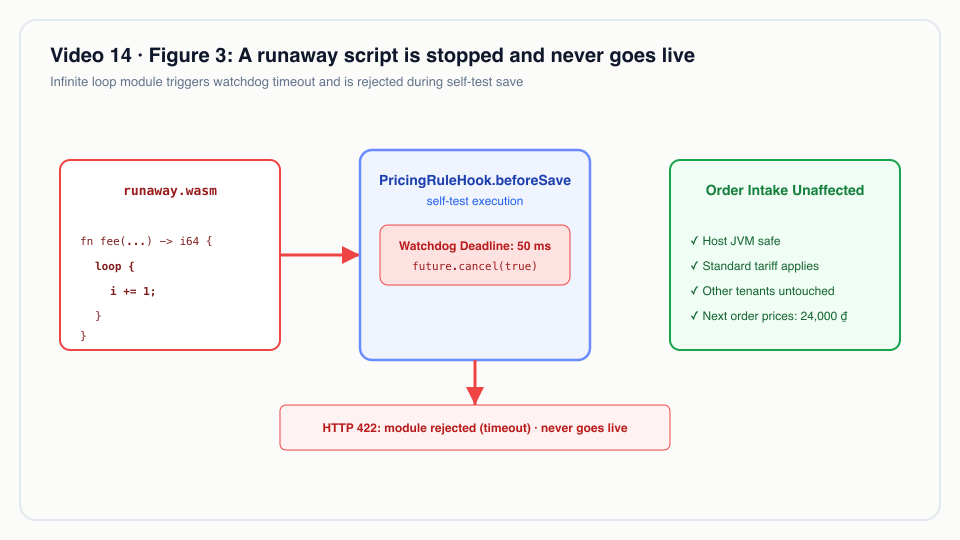
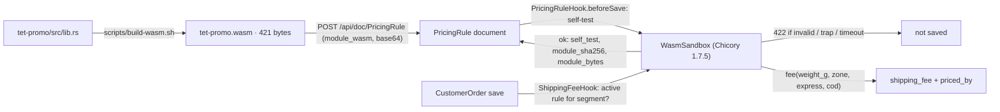
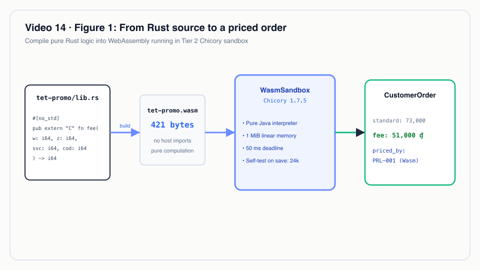
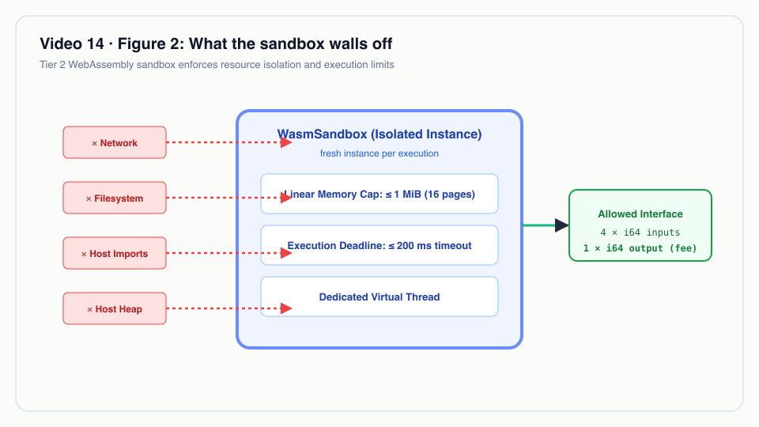

# Video 14 · Tier 2 Wasm: each tenant's own shipping formula

<a href="https://media.zerohostcms.com/astra-cms/astra-video-14-wasm-en.mp4"></a>

▶ [English](https://media.zerohostcms.com/astra-cms/astra-video-14-wasm-en.mp4) · [Tiếng Việt](https://media.zerohostcms.com/astra-cms/astra-video-14-wasm-vi.mp4) · 2:20 · Script: [demo-video-series.en.md](../demo-video-series.en.md#video-14-tier-2-wasm-a-tenants-own-freight-formula-scene-12)

> **In one sentence:** a tenant uploads its own shipping-fee formula as a WebAssembly module inside an ordinary `PricingRule` document; the kernel test-runs it in a pure-Java sandbox on save, and once switched on it prices orders with a 1 MiB memory cap, no host access and a hard deadline, without a deploy.
>
> **Read this if:** you want to know the exact ABI, sandbox limits and failure behaviour before writing a tenant script / you need to let customers (or an AI) supply business logic and must know what that code can and cannot do to the platform.

## The problem

Shipping prices change constantly. Astra Express's Saigon tenant wants a Tết promotion for its B2B shippers: 20 % off
outside the city, free same-city delivery up to 2 kg, Express at +30 % instead of +50 %, and a 0.8 % COD fee (the
header comment of `astra-apps/express/wasm/tet-promo/src/lib.rs`). Hanoi will want a different promotion next month.

The usual options:

- **Hard-code each tenant's formula in the app.** Every promotion is a release of the shared app, and the app fills
  up with `if tenant == …` branches.
- **A rules table or expression language.** Safe, but every new kind of rule needs a new column or operator, and
  real formulas (stepped weights, rounding, caps) outgrow it quickly.
- **Run tenant scripts in the server's own language.** Flexible, but a script can loop forever, allocate the heap or
  call anything on the classpath. One bad script takes down the pod for every tenant.

Frappe/ERPNext has Server Scripts: Python run in a restricted interpreter. Astra's design notes describe the same idea
"with a real sandbox instead of a restricted interpreter" ([explain.en.md](../explain.en.md)); Shopify Functions,
which runs merchant logic as Wasm, is cited there as a reference point. The approach: compile the formula to
WebAssembly and run it in a sandbox that cannot reach anything but its own memory.

## What the video shows

The video is 2:20.

1. **The formula is a pure Rust function.** It takes weight, zone, service and COD and returns a fee. It compiles to
   421 bytes: no standard library, no I/O, only computation. The tenant uploads the file like any other document.
2. **Saving is a test run.** In a Pricing Rule, saving runs the module in the sandbox. The hook prices a sample order;
   a module that fails to run is never saved.
3. **Rule off, rule on.** The same B2B order (C001, Domestic, Express, 2.2 kg, COD 500,000): rule off, 73,000 ₫. Rule
   on, with no deploy or restart: 51,000 ₫. By hand: 45,000, minus 20 %, plus 30 % for Express, plus the COD fee,
   rounded up to 51,000.
4. **The order says who priced it.** Desk shows 51,000 ₫ "by rule one, Wasm" (`priced_by` is
   `PRL-001 … (Wasm)`). The hook sets the fee and its source; users cannot edit them.
5. **A hostile script.** An infinite loop, uploaded as a new rule, is rejected after 50 ms and never switched on:
   `module rejected (timeout): script exceeded its 50 ms deadline and was stopped`. The next order is priced normally.
6. **The limits.** Chicory runs WebAssembly in pure Java. 1 MiB memory cap, no host imports, no I/O or network, a fresh
   instance per call. Each rule sets a deadline, at most 200 ms.
7. **To be accurate.** Chicory cannot count instructions yet, so CPU is capped by time. Tier 1 is on the roadmap.


*A runaway script is stopped and never goes live: verification test runs terminate infinite loops before saving the rule.*


## How it works




*From Rust source to a priced order: compiled WebAssembly rules evaluate custom shipping formulas within the order write path.*


### The tenant's code: one exported function, no imports

*`astra-apps/express/wasm/tet-promo/src/lib.rs`*

```rust
#![no_std]

const ZONE_BASE: [i64; 4] = [18_000, 30_000, 45_000, 60_000]; // first kg, per zone
const ZONE_STEP: [i64; 4] = [2_500, 5_000, 7_000, 9_000]; // each further 500 g

#[unsafe(no_mangle)]
pub extern "C" fn fee(weight_g: i64, zone: i64, express: i64, cod: i64) -> i64 {
    let z = zone.clamp(0, 3) as usize;
    if z == 0 && weight_g <= 2_000 && express == 0 {
        return cod_fee(cod);
    }
    let extra_steps = ((weight_g - 1_000).max(0) + 499) / 500;
    let mut fee = ZONE_BASE[z] + extra_steps * ZONE_STEP[z];
    if z > 0 {
        fee = fee * 80 / 100;
    }
    if express != 0 {
        fee = fee * 130 / 100;
    }
    round_up_thousand(fee + cod_fee(cod))
}

fn cod_fee(cod: i64) -> i64 {
    if cod <= 0 { 0 } else { (cod * 8 / 1_000).max(4_000) }
}
```

The ABI is documented in the workspace manifest:

*`astra-apps/express/wasm/Cargo.toml`*

```toml
# Tenant pricing scripts for the Express demo, compiled to WebAssembly and run by Astra's Tier 2 sandbox.
# ABI: export `fee(weight_g: i64, zone: i64, express: i64, cod: i64) -> i64` returning VND;
# zone is 0 = Same city, 1 = Domestic, 2 = Remote, 3 = Island. Build with scripts/build-wasm.sh.
```

Why integers only: `i64` in, `i64` out means no shared memory, no serialisation and no host functions are needed to
pass arguments. Weight is in grams and money is in whole đồng, so integer arithmetic is exact. `#![no_std]` keeps the
module at 421 bytes and guarantees it cannot link to any OS facility.

One build detail matters because of the memory cap:

*`astra-apps/express/wasm/.cargo/config.toml`*

```toml
# Tier 2 caps a script's linear memory (16 pages = 1 MiB by default). Rust reserves a 1 MiB stack
# unless told otherwise, which alone would exceed the cap; pricing scripts need only a few KiB.
[target.wasm32-unknown-unknown]
rustflags = ["-C", "link-arg=-zstack-size=32768"]
```

The hostile counterpart is ten lines:

*`astra-apps/express/wasm/runaway/src/lib.rs`*

```rust
#[unsafe(no_mangle)]
pub extern "C" fn fee(weight_g: i64, _zone: i64, _express: i64, _cod: i64) -> i64 {
    let mut i = weight_g;
    loop {
        i = core::hint::black_box(i.wrapping_add(1));
    }
}
```

### The sandbox: fresh instance, capped memory, no imports, a deadline

The kernel exposes Tier 2 to apps through one SPI method:

*`astra-spi/src/main/java/io/astra/spi/script/ScriptRuntime.java`*

```java
public interface ScriptRuntime {

    /**
     * Calls an exported function that takes and returns {@code i64} values.
     *
     * @throws ScriptException when the module is invalid, traps, exceeds its memory limit or misses its deadline
     */
    long callLong(byte[] module, String function, long timeoutMillis, long... args);
}
```

The implementation:

*`astra-plugin-host/src/main/java/io/astra/pluginhost/WasmSandbox.java`*

```java
    @ConfigProperty(name = "astra.scripts.max-memory-pages", defaultValue = "16")
    int maxPages;

    @ConfigProperty(name = "astra.scripts.max-timeout-ms", defaultValue = "200")
    long maxTimeoutMillis;

    private final ExecutorService threads = Executors.newVirtualThreadPerTaskExecutor();

    @Override
    public long callLong(byte[] module, String function, long timeoutMillis, long... args) {
        WasmModule wasm = parse(module);
        long deadline = Math.min(Math.max(timeoutMillis, 1), maxTimeoutMillis);
        // …
        Future<long[]> call = threads.submit(() -> instantiate(wasm).export(function).apply(args));
        try {
            long[] result = call.get(deadline, TimeUnit.MILLISECONDS);
            // … exactly one i64 or "invalid"
            return result[0];
        } catch (TimeoutException e) {
            call.cancel(true); // interrupts the interpreter loop, which stops at its next check
            // …
            throw new ScriptException("timeout", "script exceeded its " + deadline + " ms deadline and was stopped", e);
        } catch (ExecutionException e) {
            // … ScriptException("trap", "script failed: " + cause.getMessage(), cause)
        }
    }

    private Instance instantiate(WasmModule wasm) {
        // … declared initial pages
        return Instance.builder(wasm)
                .withMemoryLimits(new MemoryLimits(declaredInitial, maxPages))
                .build();
    }

    /** Parses and vets a module once per content hash. */
    private WasmModule parse(byte[] module) {
        // …
        return parsed.computeIfAbsent(sha256(module), k -> {
            // … Parser.parse(module), else "not a WebAssembly module"
            if (wasm.importSection().importCount() > 0) {
                throw new ScriptException("invalid", "module imports host functions; Tier 2 scripts must be self-contained", null);
            }
            // … initial pages > maxPages → "invalid"
            return wasm;
        });
    }
```

Why each control:

| Control | What it prevents |
| --- | --- |
| Chicory, pure Java, no JNI | Native code crashing the JVM. The module cannot address anything outside its linear memory. |
| Imports refused | Any I/O, network, clock or host callback. The module can compute and nothing else. |
| `MemoryLimits(declaredInitial, 16)` | Memory exhaustion. 16 pages × 64 KiB = 1 MiB per instance. |
| Fresh `Instance` per call | State leaking between calls or between tenants. |
| Own virtual thread, `call.get(deadline)`, `cancel(true)` | A loop holding the request thread. Deadline is the rule's `timeout_ms`, clamped to 1…200 ms. |
| Parsed module cached by SHA-256 | Re-parsing on every order; also makes the vetting result content-addressed. |
| Three failure reasons: `invalid`, `trap`, `timeout` | Callers can react precisely (`ScriptException.reason()`). |

Why a time deadline rather than an instruction budget: Chicory has no instruction counting ("fuel") yet, so wall-clock
time is the only CPU control available. That is the limit stated in the video.


*What the sandbox walls off: linear memory limits, zero host imports, and execution deadlines protect the host JVM.*


### Saving a rule is a test run

The rule is an ordinary DocType, so it gets REST, Desk, permissions and tenant isolation for free:

*`astra-apps/express/src/main/resources/META-INF/astra/doctypes/pricing-rule.doctype.yaml`*

```yaml
fields:
  - { name: rule_name,     type: Data,   required: true, in-list: true }
  - { name: segment,       type: Select, options: [All, Retail, B2B], default: All, in-list: true, projected: true }
  - { name: active,        type: Check,  default: false, in-list: true, projected: true }
  - { name: timeout_ms,    type: Int,    default: 50, label: Deadline (ms) }
  - { name: module_wasm,   type: Attach, required: true, label: WebAssembly module }
  - { name: module_sha256, type: Data,   read-only: true, label: Module SHA-256 }
  - { name: module_bytes,  type: Int,    read-only: true, in-list: true, label: Module size (bytes) }
  - { name: self_test,     type: Data,   read-only: true, in-list: true }   # set by PricingRuleHook on every save

permissions:
  - { role: admin,      read: true, create: true, write: true }
  - { role: accountant, read: true, create: true, write: true }
  - { role: sales,      read: true }
```

*`astra-apps/express/src/main/java/io/astra/apps/express/PricingRuleHook.java`*

```java
    @Override
    public void beforeSave(Document rule) {
        byte[] module = Base64.getDecoder().decode(rule.getString("module_wasm"));
        rule.set("module_sha256", sha256(module));
        rule.set("module_bytes", module.length);
        long started = System.nanoTime();
        long fee;
        try {
            fee = PricingRules.fee(scripts, rule, 1.0, "Domestic", false, 0);
        } catch (ScriptException e) {
            throw new DocValidationException("module rejected (" + e.reason() + "): " + e.getMessage());
        }
        if (fee < 0 || fee > 10_000_000) throw new DocValidationException("module rejected: fee(1 kg, Domestic) returned " + fee);
        long micros = (System.nanoTime() - started) / 1_000;
        rule.set("self_test", "fee(1 kg, Domestic) = " + fee + " VND in " + micros + " µs");
    }
```

Why test on save: a broken module is caught when an admin uploads it, not when a customer places an order. The
runaway script never reaches `active`.

### Pricing an order, and failing safe

*`astra-apps/express/src/main/java/io/astra/apps/express/ShippingFeeHook.java`*

```java
        Optional<Document> rule = activeRule(doc.getString("customer"));
        if (rule.isPresent()) {
            try {
                doc.set("shipping_fee", PricingRules.fee(scripts, rule.get(), weight, zone, express, cod));
                doc.set("priced_by", rule.get().name() + " " + rule.get().getString("rule_name") + " (Wasm)");
                return;
            } catch (ScriptException e) {
                // … log a warning
                doc.set("priced_by", "Standard tariff (" + rule.get().name() + " failed: " + e.reason() + ")");
                doc.set("shipping_fee", fee(zone, doc.getString("service"), weight, cod));
                return;
            }
        }
        doc.set("shipping_fee", fee(zone, doc.getString("service"), weight, cod));
        doc.set("priced_by", "Standard tariff");
```

`activeRule` picks the newest active rule whose segment is `All` or matches the customer's segment. Why fall back
instead of rejecting the order: a tenant script is the tenant's responsibility; a script failure should cost the
tenant its discount on that order, not stop order intake. `priced_by` records which path was taken, so the fallback
is visible.

The argument mapping lives in one place, shared by the self-test and pricing:

*`astra-apps/express/src/main/java/io/astra/apps/express/PricingRules.java`*

```java
    static long fee(ScriptRuntime scripts, Document rule, double weightKg, String zone, boolean express, long cod) {
        byte[] module = Base64.getDecoder().decode(rule.getString("module_wasm"));
        long timeout = Math.round(Numbers.toDouble(rule.get("timeout_ms")));
        return scripts.callLong(module, FUNCTION, timeout <= 0 ? 50 : timeout,
                Math.round(weightKg * 1000), Math.max(0, ZONES.indexOf(zone)), express ? 1 : 0, cod);
    }
```

## Real-world example

*Illustrative scenario: the company, people and values are made up; the mechanism and the rules it applies are the real ones shown above.*

A Saigon courier runs a Tết campaign for its B2B shippers from late January to mid-February. Marketing wants it live
on a Monday morning and gone two weeks later, without an engineering release.

1. A developer (or the shipper's own IT) writes the formula in Rust and builds it with `scripts/build-wasm.sh`:
   421 bytes.
2. An `admin` or `accountant` in the tenant creates a Pricing Rule, segment `B2B`, `active: false`, and attaches the
   file. The self-test answers `fee(1 kg, Domestic) = 24000 VND in … µs`.
3. On launch day they set `active: true`. On the last day, `active: false`. No deploy at either end.

Fees with the rule on, against the standard tariff. The first three rows are asserted in
`astra-server/src/test/java/io/astra/server/WasmTest.java`; the 2.2 kg row is the video's order.

| Parcel (B2B customer) | Standard tariff | Tết rule (Wasm) |
| --- | --- | --- |
| 1 kg, Domestic, Standard, no COD | 30,000 | 24,000 (30,000 − 20 %) |
| 1.5 kg, Same city, Standard, no COD | 21,000 | 0 (free same-city ≤ 2 kg) |
| 3 kg, Domestic, Express, COD 500,000 | 80,000 | 56,000 (50,000 − 20 % × 1.3 + 4,000) |
| 2.2 kg, Domestic, Express, COD 500,000 | 73,000 | 51,000 (45,000 − 20 % = 36,000; × 1.3 = 46,800; + 4,000; round up) |
| any parcel for Retail customer C003 | standard | standard (`priced_by: Standard tariff`, the rule is B2B only) |

If the module ever fails at run time, for example a later upload that traps, the order is still created at the
standard price and `priced_by` reads `Standard tariff (PRL-… failed: trap)`.

The ABI also covers zone 3 (`Island`), which only exists for tenants whose overlay adds it (Hanoi, [Video 13](./13-overlay.md)).
Computed from `lib.rs`, not shown in the video: 2.2 kg Island Express with COD 500,000 gives 60,000 + 3 × 9,000 =
87,000; − 20 % = 69,600; × 1.3 = 90,480; + 4,000 = 94,480; rounded up to 95,000. The standard tariff has no Island
rate and would charge the Domestic 73,000. Overlay plus Wasm is how one tenant gets an island price without touching
the app.

## For technical leaders

- **Trust boundary.** Tier 2 is for code you do not trust: tenant scripts, marketplace logic, AI-generated logic. The
  sandbox has no imports at all, so there is no capability to grant by mistake.
- **Blast radius.** Bounded per call to 1 MiB and at most 200 ms of wall time on a virtual thread. A failing script
  degrades to the standard tariff on that order; the pod and other tenants are unaffected (the runaway test asserts
  the next call still returns 24,000).
- **CPU accounting is approximate.** A deadline is not an instruction budget. Under heavy load a legitimate script can
  time out; a hostile one can still burn up to its deadline per call. Keep deadlines tight (the default rule deadline
  is 50 ms) and watch timeout rates.
- **ABI design is the real work.** `i64` in, `i64` out is trivially safe and fast, but cannot pass strings or
  structures. Richer extension points need a memory-passing ABI, which the current sandbox does not implement.
- **Governance.** Rules are documents: each one records the exact module it runs (`module_sha256`, `module_bytes`),
  and only `admin` and `accountant` can create or edit rules.
- **When not to use Tier 2.** Logic that needs to read other documents, call services or write data. The sandbox
  cannot do any of that; such logic belongs in a Tier 0 hook in the app.
- **What to measure.** Self-test duration (`self_test` records µs), rate of `priced_by` values containing `failed`,
  timeout warnings from `WasmSandbox` in the logs, and module sizes against the 1 MiB attachment limit.

## Try it yourself

Prerequisites: the k3d stack (`make k3d-up`) from
[the recording environment](../demo-video-series.en.md#1-preparing-the-recording-environment), and a fresh seed. The seed
uploads the Tết rule as inactive. Rust is only needed if you change the Rust sources; the `.wasm` files are committed.

```bash
make demo-reset && make demo-seed
make demo-express SCENES=12            # add PAUSE=0 to run without pressing Enter
```

Expected: the scene prints `lib.rs`, lists `runaway.wasm` (145 bytes) and `tet-promo.wasm` (421 bytes), shows the
Pricing Rule with its `self_test`, prices the B2B order at 73,000 with `Standard tariff`, switches the rule on and
prices it at 51,000 with `PRL-… (Wasm)`, rejects the runaway upload with
`module rejected (timeout): script exceeded its 50 ms deadline and was stopped`, prices the next order normally, and
switches the rule off again.

To rebuild the modules after editing Rust:

```bash
scripts/build-wasm.sh                  # adds the wasm32-unknown-unknown target, builds, copies to wasm/modules
```

In Desk, as `mai`: Pricing Rule → open the rule → check `self_test` → turn on `active` → create a B2B order for C001
(Domestic, Express, 2.2 kg, COD 500,000). Turn `active` off afterwards, otherwise B2B orders in other demos will no
longer be 73,000.

## To be accurate

- Chicory has no instruction counting (fuel) yet, so the CPU limit is a wall-clock deadline (rule default 50 ms,
  kernel maximum 200 ms).
- The ABI is `i64` arguments and one `i64` result. There is no Extism or memory-passing ABI in the code yet, even
  though [explain.en.md](../explain.en.md) lists an Extism-compatible ABI in the target design.
- Tier 2 is used by two apps in this repository: Express pricing rules and the HRM KPI bonus (Video 19).
  Wasm scripts attached to overlays, as sketched in [overlay-wasm.md](../overlay-wasm.md), are not built.
- Tier 1 (isolated JVM apps with hot-swap) is on the roadmap, not built.

## Figures

- [Figure 1 · From Rust source to a priced order](#how-it-works)
- [Figure 2 · What the sandbox walls off](#the-sandbox-fresh-instance-capped-memory-no-imports-a-deadline)
- [Figure 3 · A runaway script is stopped and never goes live](#what-the-video-shows)

## Related

- Previous: [Video 13 · Tenant overlays](./13-overlay.md) · Next: [Video 15 · MCP](./15-mcp.md)
- [Video 3 · Hooks](./03-hooks.md) (standard tariff), [Video 9 · Writing an Astra app](./09-developer.md),
  [Video 19 · HRM](./19-hrm.md) (Wasm KPI bonus)
- Code excerpts: [S8 Wasm Tier 2](../demo-code-snippets.md#s8-wasm-tier-2)
- Background (target design, partly built): [explain.en.md](../explain.en.md), [overlay-wasm.md](../overlay-wasm.md)
- Source: `astra-plugin-host/src/main/java/io/astra/pluginhost/WasmSandbox.java`,
  `astra-spi/src/main/java/io/astra/spi/script/ScriptRuntime.java`,
  `astra-apps/express/src/main/java/io/astra/apps/express/PricingRuleHook.java`,
  `astra-apps/express/src/main/java/io/astra/apps/express/ShippingFeeHook.java`,
  `astra-apps/express/wasm/`, `scripts/build-wasm.sh`,
  `astra-server/src/test/java/io/astra/server/WasmTest.java`
