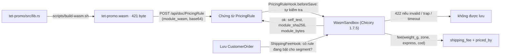

# Video 14 · Tier 2 Wasm: công thức cước của riêng tenant

<a href="https://media.zerohostcms.com/astra-cms/astra-video-14-wasm-vi.mp4"></a>

▶ [Tiếng Việt](https://media.zerohostcms.com/astra-cms/astra-video-14-wasm-vi.mp4) · [English](https://media.zerohostcms.com/astra-cms/astra-video-14-wasm-en.mp4) · 2:20 · Kịch bản: [demo-video-series.md](../demo-video-series.md#video-14-tier-2-wasm-công-thức-cước-của-riêng-tenant-cảnh-12) · [Bản tiếng Anh](./14-wasm.md)

> **Tóm tắt một câu:** tenant tải công thức tính phí vận chuyển của riêng mình lên dưới dạng một module WebAssembly nằm trong một chứng từ `PricingRule` bình thường; kernel chạy thử nó trong sandbox thuần Java khi lưu, và khi được bật, module tính cước cho đơn với giới hạn bộ nhớ 1 MiB, không truy cập host và có deadline cứng, mà không cần deploy.
>
> **Nên đọc nếu:** bạn muốn biết chính xác ABI, giới hạn sandbox và cách xử lý lỗi trước khi viết script cho tenant / bạn cần cho khách hàng (hoặc AI) cung cấp logic nghiệp vụ và phải biết đoạn code đó làm được gì và không làm được gì với nền tảng.

## Vấn đề

Giá cước vận chuyển thay đổi liên tục. Tenant Sài Gòn của Astra Express muốn chạy khuyến mãi Tết cho các shop B2B: giảm
20 % cho hàng ngoài thành phố, miễn phí giao nội thành tới 2 kg, Express chỉ +30 % thay vì +50 %, và phí COD 0,8 % (comment
đầu file `astra-apps/express/wasm/tet-promo/src/lib.rs`). Tháng sau Hà Nội sẽ muốn một chương trình khác.

Các lựa chọn thông thường:

- **Hard-code công thức của từng tenant trong app.** Mỗi chương trình khuyến mãi là một lần phát hành app dùng chung, và
  app đầy những nhánh `if tenant == …`.
- **Một bảng quy tắc hoặc ngôn ngữ biểu thức.** An toàn, nhưng mỗi loại quy tắc mới cần thêm cột hoặc toán tử mới, và các
  công thức thật (bậc cân nặng, làm tròn, mức trần) nhanh chóng vượt quá khả năng của nó.
- **Chạy script của tenant bằng chính ngôn ngữ của server.** Linh hoạt, nhưng script có thể lặp vô hạn, chiếm hết heap
  hoặc gọi bất cứ thứ gì trên classpath. Một script tồi đánh sập pod cho mọi tenant.

Frappe/ERPNext có Server Script: Python chạy trong một interpreter bị giới hạn. Ghi chú thiết kế của Astra mô tả cùng ý
tưởng đó "with a real sandbox instead of a restricted interpreter" (với một sandbox thật thay cho interpreter bị giới hạn)
([explain.md](../explain.md)); Shopify Functions, vốn chạy logic của merchant dưới dạng Wasm, được nhắc ở đó như một điểm
tham chiếu. Cách tiếp cận: biên dịch công thức ra WebAssembly và chạy nó trong một sandbox không với tới được thứ gì ngoài
bộ nhớ của chính nó.

## Video cho thấy gì

Video dài 2:20.

1. **Công thức là một hàm Rust thuần.** Hàm nhận cân nặng, vùng, dịch vụ và COD rồi trả về phí. Nó biên dịch ra 421 byte:
   không thư viện chuẩn, không I/O, chỉ có tính toán. Tenant tải file lên như mọi chứng từ khác.
2. **Lưu là chạy thử.** Trong một Pricing Rule, việc lưu sẽ chạy module trong sandbox. Hook tính cước cho một đơn mẫu;
   module không chạy được thì không bao giờ được lưu.
3. **Tắt rule, bật rule.** Cùng một đơn B2B (C001, Domestic, Express, 2,2 kg, COD 500.000): tắt rule, 73.000 ₫. Bật rule,
   không deploy hay restart: 51.000 ₫. Tính tay: 45.000, trừ 20 %, cộng 30 % cho Express, cộng phí COD, làm tròn lên
   51.000.
4. **Đơn hàng ghi rõ ai tính giá.** Desk hiện 51.000 ₫ "theo rule một, Wasm" (`priced_by` là `PRL-001 … (Wasm)`). Hook
   đặt phí và nguồn của nó; người dùng không sửa được.
5. **Một script độc hại.** Một vòng lặp vô hạn, tải lên dưới dạng rule mới, bị từ chối sau 50 ms và không bao giờ được bật:
   `module rejected (timeout): script exceeded its 50 ms deadline and was stopped`. Đơn kế tiếp vẫn được tính cước bình
   thường.
6. **Các giới hạn.** Chicory chạy WebAssembly bằng Java thuần. Trần bộ nhớ 1 MiB, không host import, không I/O hay mạng,
   mỗi lần gọi một instance mới. Mỗi rule tự đặt deadline, tối đa 200 ms.
7. **Nói đúng.** Chicory chưa đếm được số lệnh, nên CPU bị giới hạn theo thời gian. Tier 1 còn trên roadmap.

## Cách hoạt động



### Code của tenant: một hàm export, không import gì

*`astra-apps/express/wasm/tet-promo/src/lib.rs`*

```rust
#![no_std]

const ZONE_BASE: [i64; 4] = [18_000, 30_000, 45_000, 60_000]; // first kg, per zone
const ZONE_STEP: [i64; 4] = [2_500, 5_000, 7_000, 9_000]; // each further 500 g

#[unsafe(no_mangle)]
pub extern "C" fn fee(weight_g: i64, zone: i64, express: i64, cod: i64) -> i64 {
    let z = zone.clamp(0, 3) as usize;
    if z == 0 && weight_g <= 2_000 && express == 0 {
        return cod_fee(cod);
    }
    let extra_steps = ((weight_g - 1_000).max(0) + 499) / 500;
    let mut fee = ZONE_BASE[z] + extra_steps * ZONE_STEP[z];
    if z > 0 {
        fee = fee * 80 / 100;
    }
    if express != 0 {
        fee = fee * 130 / 100;
    }
    round_up_thousand(fee + cod_fee(cod))
}

fn cod_fee(cod: i64) -> i64 {
    if cod <= 0 { 0 } else { (cod * 8 / 1_000).max(4_000) }
}
```

ABI được ghi trong manifest của workspace:

*`astra-apps/express/wasm/Cargo.toml`*

```toml
# Tenant pricing scripts for the Express demo, compiled to WebAssembly and run by Astra's Tier 2 sandbox.
# ABI: export `fee(weight_g: i64, zone: i64, express: i64, cod: i64) -> i64` returning VND;
# zone is 0 = Same city, 1 = Domestic, 2 = Remote, 3 = Island. Build with scripts/build-wasm.sh.
```

Vì sao chỉ dùng số nguyên: `i64` vào, `i64` ra nghĩa là không cần bộ nhớ chia sẻ, không serialise, không host function
để truyền tham số. Cân nặng tính bằng gam và tiền tính bằng đồng chẵn, nên số học số nguyên là chính xác. `#![no_std]` giữ
module ở 421 byte và bảo đảm nó không thể liên kết tới bất kỳ tiện ích nào của hệ điều hành.

Có một chi tiết build quan trọng vì trần bộ nhớ:

*`astra-apps/express/wasm/.cargo/config.toml`*

```toml
# Tier 2 caps a script's linear memory (16 pages = 1 MiB by default). Rust reserves a 1 MiB stack
# unless told otherwise, which alone would exceed the cap; pricing scripts need only a few KiB.
[target.wasm32-unknown-unknown]
rustflags = ["-C", "link-arg=-zstack-size=32768"]
```

Phiên bản độc hại chỉ có mười dòng:

*`astra-apps/express/wasm/runaway/src/lib.rs`*

```rust
#[unsafe(no_mangle)]
pub extern "C" fn fee(weight_g: i64, _zone: i64, _express: i64, _cod: i64) -> i64 {
    let mut i = weight_g;
    loop {
        i = core::hint::black_box(i.wrapping_add(1));
    }
}
```

### Sandbox: instance mới, bộ nhớ có trần, không import, có deadline

Kernel mở Tier 2 cho app qua một phương thức SPI duy nhất:

*`astra-spi/src/main/java/io/astra/spi/script/ScriptRuntime.java`*

```java
public interface ScriptRuntime {

    /**
     * Calls an exported function that takes and returns {@code i64} values.
     *
     * @throws ScriptException when the module is invalid, traps, exceeds its memory limit or misses its deadline
     */
    long callLong(byte[] module, String function, long timeoutMillis, long... args);
}
```

Phần hiện thực:

*`astra-plugin-host/src/main/java/io/astra/pluginhost/WasmSandbox.java`*

```java
    @ConfigProperty(name = "astra.scripts.max-memory-pages", defaultValue = "16")
    int maxPages;

    @ConfigProperty(name = "astra.scripts.max-timeout-ms", defaultValue = "200")
    long maxTimeoutMillis;

    private final ExecutorService threads = Executors.newVirtualThreadPerTaskExecutor();

    @Override
    public long callLong(byte[] module, String function, long timeoutMillis, long... args) {
        WasmModule wasm = parse(module);
        long deadline = Math.min(Math.max(timeoutMillis, 1), maxTimeoutMillis);
        // …
        Future<long[]> call = threads.submit(() -> instantiate(wasm).export(function).apply(args));
        try {
            long[] result = call.get(deadline, TimeUnit.MILLISECONDS);
            // … exactly one i64 or "invalid"
            return result[0];
        } catch (TimeoutException e) {
            call.cancel(true); // interrupts the interpreter loop, which stops at its next check
            // …
            throw new ScriptException("timeout", "script exceeded its " + deadline + " ms deadline and was stopped", e);
        } catch (ExecutionException e) {
            // … ScriptException("trap", "script failed: " + cause.getMessage(), cause)
        }
    }

    private Instance instantiate(WasmModule wasm) {
        // … declared initial pages
        return Instance.builder(wasm)
                .withMemoryLimits(new MemoryLimits(declaredInitial, maxPages))
                .build();
    }

    /** Parses and vets a module once per content hash. */
    private WasmModule parse(byte[] module) {
        // …
        return parsed.computeIfAbsent(sha256(module), k -> {
            // … Parser.parse(module), else "not a WebAssembly module"
            if (wasm.importSection().importCount() > 0) {
                throw new ScriptException("invalid", "module imports host functions; Tier 2 scripts must be self-contained", null);
            }
            // … initial pages > maxPages → "invalid"
            return wasm;
        });
    }
```

Vì sao có từng lớp kiểm soát:

| Kiểm soát | Ngăn được gì |
| --- | --- |
| Chicory, Java thuần, không JNI | Code native làm sập JVM. Module không thể trỏ tới bất cứ thứ gì ngoài linear memory của nó. |
| Từ chối import | Mọi I/O, mạng, đồng hồ hay callback về host. Module chỉ tính toán được, ngoài ra không gì cả. |
| `MemoryLimits(declaredInitial, 16)` | Cạn bộ nhớ. 16 trang × 64 KiB = 1 MiB mỗi instance. |
| `Instance` mới cho mỗi lần gọi | Trạng thái rò rỉ giữa các lần gọi hoặc giữa các tenant. |
| Virtual thread riêng, `call.get(deadline)`, `cancel(true)` | Vòng lặp giữ chặt thread của request. Deadline là `timeout_ms` của rule, kẹp trong khoảng 1…200 ms. |
| Module đã parse được cache theo SHA-256 | Parse lại ở mỗi đơn hàng; đồng thời kết quả kiểm duyệt gắn với nội dung module. |
| Ba lý do thất bại: `invalid`, `trap`, `timeout` | Bên gọi phản ứng được chính xác (`ScriptException.reason()`). |

Vì sao dùng deadline thời gian thay vì ngân sách lệnh: Chicory chưa có cơ chế đếm lệnh ("fuel"), nên thời gian thực là cách
kiểm soát CPU duy nhất hiện có. Đó là giới hạn được nêu trong video.

### Lưu rule là chạy thử

Rule là một DocType bình thường, nên nó có sẵn REST, Desk, phân quyền và cô lập tenant mà không tốn công:

*`astra-apps/express/src/main/resources/META-INF/astra/doctypes/pricing-rule.doctype.yaml`*

```yaml
fields:
  - { name: rule_name,     type: Data,   required: true, in-list: true }
  - { name: segment,       type: Select, options: [All, Retail, B2B], default: All, in-list: true, projected: true }
  - { name: active,        type: Check,  default: false, in-list: true, projected: true }
  - { name: timeout_ms,    type: Int,    default: 50, label: Deadline (ms) }
  - { name: module_wasm,   type: Attach, required: true, label: WebAssembly module }
  - { name: module_sha256, type: Data,   read-only: true, label: Module SHA-256 }
  - { name: module_bytes,  type: Int,    read-only: true, in-list: true, label: Module size (bytes) }
  - { name: self_test,     type: Data,   read-only: true, in-list: true }   # set by PricingRuleHook on every save

permissions:
  - { role: admin,      read: true, create: true, write: true }
  - { role: accountant, read: true, create: true, write: true }
  - { role: sales,      read: true }
```

*`astra-apps/express/src/main/java/io/astra/apps/express/PricingRuleHook.java`*

```java
    @Override
    public void beforeSave(Document rule) {
        byte[] module = Base64.getDecoder().decode(rule.getString("module_wasm"));
        rule.set("module_sha256", sha256(module));
        rule.set("module_bytes", module.length);
        long started = System.nanoTime();
        long fee;
        try {
            fee = PricingRules.fee(scripts, rule, 1.0, "Domestic", false, 0);
        } catch (ScriptException e) {
            throw new DocValidationException("module rejected (" + e.reason() + "): " + e.getMessage());
        }
        if (fee < 0 || fee > 10_000_000) throw new DocValidationException("module rejected: fee(1 kg, Domestic) returned " + fee);
        long micros = (System.nanoTime() - started) / 1_000;
        rule.set("self_test", "fee(1 kg, Domestic) = " + fee + " VND in " + micros + " µs");
    }
```

Vì sao chạy thử khi lưu: module hỏng bị phát hiện ngay lúc admin tải lên, chứ không phải lúc khách hàng đặt đơn. Script
chạy vô hạn không bao giờ tới được trạng thái `active`.

### Tính cước cho đơn, và thất bại an toàn

*`astra-apps/express/src/main/java/io/astra/apps/express/ShippingFeeHook.java`*

```java
        Optional<Document> rule = activeRule(doc.getString("customer"));
        if (rule.isPresent()) {
            try {
                doc.set("shipping_fee", PricingRules.fee(scripts, rule.get(), weight, zone, express, cod));
                doc.set("priced_by", rule.get().name() + " " + rule.get().getString("rule_name") + " (Wasm)");
                return;
            } catch (ScriptException e) {
                // … log a warning
                doc.set("priced_by", "Standard tariff (" + rule.get().name() + " failed: " + e.reason() + ")");
                doc.set("shipping_fee", fee(zone, doc.getString("service"), weight, cod));
                return;
            }
        }
        doc.set("shipping_fee", fee(zone, doc.getString("service"), weight, cod));
        doc.set("priced_by", "Standard tariff");
```

`activeRule` chọn rule đang bật mới nhất có segment là `All` hoặc khớp segment của khách hàng. Vì sao rơi về biểu giá chuẩn
thay vì từ chối đơn: script của tenant là trách nhiệm của tenant; script lỗi chỉ nên khiến tenant mất khoản giảm giá trên
đơn đó, không được làm ngừng việc nhận đơn. `priced_by` ghi lại nhánh đã đi, nên việc rơi về giá chuẩn luôn nhìn thấy được.

Phần ánh xạ tham số nằm ở một chỗ duy nhất, dùng chung cho bước tự kiểm tra và bước tính cước:

*`astra-apps/express/src/main/java/io/astra/apps/express/PricingRules.java`*

```java
    static long fee(ScriptRuntime scripts, Document rule, double weightKg, String zone, boolean express, long cod) {
        byte[] module = Base64.getDecoder().decode(rule.getString("module_wasm"));
        long timeout = Math.round(Numbers.toDouble(rule.get("timeout_ms")));
        return scripts.callLong(module, FUNCTION, timeout <= 0 ? 50 : timeout,
                Math.round(weightKg * 1000), Math.max(0, ZONES.indexOf(zone)), express ? 1 : 0, cod);
    }
```

## Ví dụ thực tế

*Tình huống minh hoạ: công ty, con người và số liệu là giả định; cơ chế và các quy tắc được áp dụng là thật, như đã trình bày ở trên.*

Một hãng chuyển phát ở Sài Gòn chạy chiến dịch Tết cho các shop B2B từ cuối tháng Một tới giữa tháng Hai. Bộ phận marketing
muốn chiến dịch lên sóng vào một sáng thứ Hai và tắt hai tuần sau đó, không cần một lần phát hành nào từ phía kỹ thuật.

1. Một developer (hoặc chính bộ phận IT của shop) viết công thức bằng Rust và build bằng `scripts/build-wasm.sh`:
   421 byte.
2. Một `admin` hoặc `accountant` của tenant tạo Pricing Rule, segment `B2B`, `active: false`, và đính kèm file. Bước tự
   kiểm tra trả lời `fee(1 kg, Domestic) = 24000 VND in … µs`.
3. Ngày ra mắt họ đặt `active: true`. Ngày cuối, `active: false`. Không deploy ở cả hai đầu.

Phí khi bật rule, so với biểu giá chuẩn. Ba dòng đầu được kiểm chứng trong
`astra-server/src/test/java/io/astra/server/WasmTest.java`; dòng 2,2 kg là đơn trong video.

| Bưu kiện (khách B2B) | Biểu giá chuẩn | Rule Tết (Wasm) |
| --- | --- | --- |
| 1 kg, Domestic, Standard, không COD | 30.000 | 24.000 (30.000 − 20 %) |
| 1,5 kg, Same city, Standard, không COD | 21.000 | 0 (miễn phí nội thành ≤ 2 kg) |
| 3 kg, Domestic, Express, COD 500.000 | 80.000 | 56.000 (50.000 − 20 % × 1,3 + 4.000) |
| 2,2 kg, Domestic, Express, COD 500.000 | 73.000 | 51.000 (45.000 − 20 % = 36.000; × 1,3 = 46.800; + 4.000; làm tròn lên) |
| bưu kiện bất kỳ của khách Retail C003 | chuẩn | chuẩn (`priced_by: Standard tariff`, rule chỉ áp dụng cho B2B) |

Nếu module có lúc lỗi khi chạy, ví dụ một lần tải lên sau đó bị trap, đơn vẫn được tạo với giá chuẩn và `priced_by` ghi
`Standard tariff (PRL-… failed: trap)`.

ABI còn bao gồm zone 3 (`Island`), vốn chỉ tồn tại ở những tenant có overlay thêm nó (Hà Nội, [Video 13](./13-overlay.vi.md)).
Tính từ `lib.rs`, không có trong video: 2,2 kg Island Express với COD 500.000 cho ra 60.000 + 3 × 9.000 = 87.000;
− 20 % = 69.600; × 1,3 = 90.480; + 4.000 = 94.480; làm tròn lên 95.000. Biểu giá chuẩn không có giá cho Island và sẽ tính
giá Domestic 73.000. Overlay cộng Wasm là cách để một tenant có giá riêng cho hàng ra đảo mà không đụng tới app.

## Dành cho tech lead

- **Ranh giới tin cậy.** Tier 2 dành cho code bạn không tin: script của tenant, logic từ marketplace, logic do AI sinh ra.
  Sandbox hoàn toàn không có import, nên không có năng lực nào để lỡ tay cấp nhầm.
- **Phạm vi ảnh hưởng.** Mỗi lần gọi bị giới hạn ở 1 MiB và tối đa 200 ms thời gian thực trên một virtual thread. Script
  lỗi chỉ khiến đơn đó rơi về biểu giá chuẩn; pod và các tenant khác không bị ảnh hưởng (test runaway kiểm chứng rằng lần
  gọi kế tiếp vẫn trả về 24.000).
- **Đo CPU chỉ là gần đúng.** Deadline không phải ngân sách lệnh. Khi tải nặng, một script hợp lệ có thể bị timeout; một
  script độc hại vẫn đốt được tới hết deadline mỗi lần gọi. Hãy giữ deadline chặt (deadline mặc định của rule là 50 ms) và
  theo dõi tỉ lệ timeout.
- **Thiết kế ABI mới là phần việc thật.** `i64` vào, `i64` ra thì an toàn và nhanh một cách hiển nhiên, nhưng không truyền
  được chuỗi hay cấu trúc. Các điểm mở rộng phong phú hơn cần một ABI truyền qua bộ nhớ, thứ mà sandbox hiện tại chưa hiện
  thực.
- **Quản trị.** Rule là chứng từ: mỗi rule ghi lại chính xác module nó chạy (`module_sha256`, `module_bytes`), và chỉ
  `admin` và `accountant` được tạo hoặc sửa rule.
- **Khi nào không nên dùng Tier 2.** Logic cần đọc chứng từ khác, gọi dịch vụ hoặc ghi dữ liệu. Sandbox không làm được
  những việc đó; logic như vậy thuộc về một hook Tier 0 trong app.
- **Cần đo gì.** Thời gian tự kiểm tra (`self_test` ghi µs), tỉ lệ giá trị `priced_by` chứa `failed`, cảnh báo timeout từ
  `WasmSandbox` trong log, và kích thước module so với giới hạn đính kèm 1 MiB.

## Tự chạy thử

Cần có: stack k3d (`make k3d-up`) theo [môi trường quay](../demo-video-series.md#1-chuẩn-bị-môi-trường-quay), và seed lại
từ đầu. Seed tải rule Tết lên ở trạng thái tắt. Chỉ cần Rust nếu bạn sửa mã nguồn Rust; các file `.wasm` đã được commit.

```bash
make demo-reset && make demo-seed
make demo-express SCENES=12            # add PAUSE=0 to run without pressing Enter
```

Kết quả mong đợi: cảnh này in ra `lib.rs`, liệt kê `runaway.wasm` (145 byte) và `tet-promo.wasm` (421 byte), hiện Pricing
Rule cùng `self_test` của nó, tính đơn B2B ở 73.000 với `Standard tariff`, bật rule và tính lại ở 51.000 với
`PRL-… (Wasm)`, từ chối bản tải lên runaway với
`module rejected (timeout): script exceeded its 50 ms deadline and was stopped`, tính đơn kế tiếp bình thường, rồi tắt
rule trở lại.

Để build lại module sau khi sửa Rust:

```bash
scripts/build-wasm.sh                  # adds the wasm32-unknown-unknown target, builds, copies to wasm/modules
```

Trong Desk, bằng `mai`: Pricing Rule → mở rule → xem `self_test` → bật `active` → tạo đơn B2B cho C001 (Domestic, Express,
2,2 kg, COD 500.000). Sau đó tắt `active`, nếu không đơn B2B trong các demo khác sẽ không còn là 73.000.

## Nói đúng

- Chicory chưa có đếm lệnh (fuel), nên giới hạn CPU là deadline thời gian thực (mặc định của rule 50 ms, tối đa của kernel
  200 ms).
- ABI là các tham số `i64` và một kết quả `i64`. Trong code chưa có Extism hay ABI truyền qua bộ nhớ, dù
  [explain.md](../explain.md) liệt kê một ABI tương thích Extism trong thiết kế mục tiêu.
- Tier 2 được hai app trong repository này dùng: pricing rule của Express và thưởng KPI của HRM (Video 19). Script Wasm
  gắn vào overlay, như phác thảo trong [overlay-wasm.md](../overlay-wasm.md), chưa được xây.
- Tier 1 (app JVM cô lập có hot-swap) còn trên roadmap, chưa được xây.

## Minh hoạ: prompt vẽ hình

Prompt giữ nguyên tiếng Anh để mô hình tạo ảnh hiểu chính xác; nhãn trên hình là tên kỹ thuật thật.

### Hình 1 · Từ mã nguồn Rust tới một đơn đã tính cước

*Đặt ở:* Cách hoạt động, sơ đồ đầu mục

```text
Hand-drawn whiteboard sketch, black ink line art on off-white paper, one accent color (#6b8cff blue) for the key path, simple boxes and arrows, short handwritten labels in English, generous white space, no logos, no photorealism, 16:9.
Left to right: a sheet "lib.rs  fn fee(weight_g, zone, express, cod) -> i64", arrow labelled "build-wasm.sh" to a tiny cube "tet-promo.wasm 421 bytes", arrow labelled "POST /api/doc/PricingRule" to a document card "PricingRule PRL-001  active: true", arrow to a sealed box drawn in blue "WasmSandbox (Chicory)", arrow to an order card "CustomerOrder  shipping_fee 51,000  priced_by PRL-001 (Wasm)". Above the order card, a small crossed-out "73,000". Highlight the blue sandbox box and the final arrow.
```

### Hình 2 · Sandbox ngăn những gì

*Đặt ở:* Cách hoạt động, "Sandbox"

```text
Hand-drawn whiteboard sketch, black ink line art on off-white paper, one accent color (#6b8cff blue) for the key path, simple boxes and arrows, short handwritten labels in English, generous white space, no logos, no photorealism, 16:9.
Center: a thick-walled box drawn in blue labelled "fresh Instance per call", containing a small block "linear memory ≤ 1 MiB (16 pages)" and a stopwatch "deadline ≤ 200 ms". One arrow in from the left labelled "4 × i64", one arrow out to the right labelled "1 × i64". Outside the box, four crossed-out arrows pointing at the wall labelled "network", "files", "clock", "host imports". Below the box, a JVM rectangle labelled "kernel keeps running" with other tenants as small icons. Highlight the blue box walls.
```

### Hình 3 · Script chạy vô hạn bị chặn và không bao giờ được bật

*Đặt ở:* Video cho thấy gì, cảnh 5

```text
Hand-drawn whiteboard sketch, black ink line art on off-white paper, one accent color (#6b8cff blue) for the key path, simple boxes and arrows, short handwritten labels in English, generous white space, no logos, no photorealism, 16:9.
Left: a card "runaway.wasm  loop { i += 1 }" with a circular arrow. Arrow to a box "PricingRuleHook self-test". Inside, a stopwatch at "50 ms" and a hand pulling a plug labelled "cancel(true)". Arrow down to a black ink stamp "422 module rejected (timeout)" and a note "never active". On the right, a separate blue path: a new order card "next order" going to "Standard tariff / priced normally". Highlight the blue path for the next order.
```

## Liên quan

- Trước: [Video 13 · Overlay theo tenant](./13-overlay.vi.md) · Tiếp: [Video 15 · MCP](./15-mcp.vi.md)
- [Video 3 · Hook](./03-hooks.vi.md) (biểu giá chuẩn), [Video 9 · Viết một app Astra](./09-developer.vi.md),
  [Video 19 · HRM](./19-hrm.vi.md) (thưởng KPI bằng Wasm)
- Trích đoạn code: [S8 Wasm Tier 2](../demo-code-snippets.md#s8-wasm-tier-2)
- Bối cảnh (thiết kế mục tiêu, mới xây một phần): [explain.md](../explain.md), [overlay-wasm.md](../overlay-wasm.md)
- Mã nguồn: `astra-plugin-host/src/main/java/io/astra/pluginhost/WasmSandbox.java`,
  `astra-spi/src/main/java/io/astra/spi/script/ScriptRuntime.java`,
  `astra-apps/express/src/main/java/io/astra/apps/express/PricingRuleHook.java`,
  `astra-apps/express/src/main/java/io/astra/apps/express/ShippingFeeHook.java`,
  `astra-apps/express/wasm/`, `scripts/build-wasm.sh`,
  `astra-server/src/test/java/io/astra/server/WasmTest.java`
