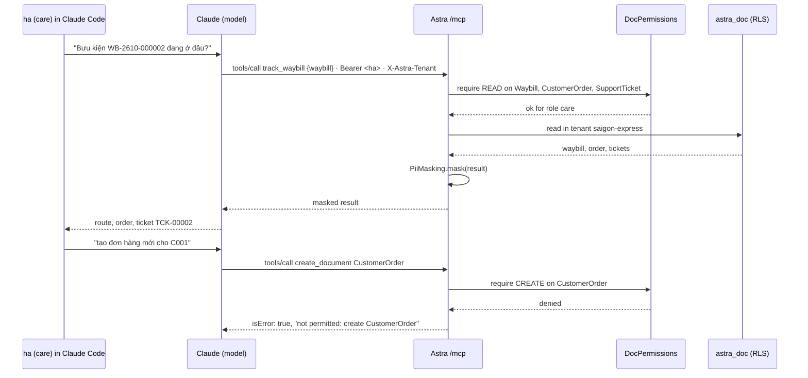

# Video 15 · MCP: AI agents use Astra with the user's permissions

<a href="https://media.zerohostcms.com/astra-cms/astra-video-15-mcp-en.mp4"></a>

▶ [English](https://media.zerohostcms.com/astra-cms/astra-video-15-mcp-en.mp4) · [Tiếng Việt](https://media.zerohostcms.com/astra-cms/astra-video-15-mcp-vi.mp4) · 2:24 · Script: [demo-video-series.en.md](../demo-video-series.en.md#video-15-mcp-an-ai-agent-uses-astra-with-the-users-permissions-scene-13)

> **In one sentence:** Astra exposes one MCP endpoint, `/mcp`, where an AI agent signs in with the same Keycloak token as its human user, so it gets that user's tenant, row-level security and DocType permissions, and personal data is masked before it reaches the model.
> **Read this if:** you want to add an AI tool to an Astra app with one class and no auth code (developer) / you have to decide whether letting an LLM touch business data is safe, auditable and bounded (tech lead).

## The problem

Astra Express runs customer care (CARE) for two courier tenants, Saigon and Hanoi. Care staff field calls such as
"where is my parcel, and has anyone complained?" Answering means opening the waybill, its scan history, the order
behind it and any support tickets, which takes four screens. An AI assistant could do it in one question, but
connecting an LLM to business data usually goes wrong in one of three ways:

- **A service account with god mode.** The assistant gets a database user or an API key that can read every
  tenant and every table. Whatever the care agent is not allowed to see, the model can still see, and a prompt
  injection can make it act on that.
- **A second permission model.** The AI integration re-implements "who can see what" in its own layer. It drifts
  from the real rules the first time someone adds a role.
- **Raw personal data to a third-party model.** Receiver names, phone numbers and addresses are sent to the model
  provider in full, which is hard to defend under Vietnam's personal data protection law or GDPR's data
  minimisation principle.

Frappe/ERPNext exposes a REST API and lets you script around it, but there is no built-in agent protocol and no
masking layer between the data and a model: each integration solves the three problems above on its own.

Astra's answer is that **the agent is just another client of the same kernel**. It authenticates as the user, every
tool call goes through the same permission checks as the REST API and the Desk, and fields declared `pii: true` in
the DocType are masked on the MCP channel.


*The AI agent accesses Astra over MCP using the caller's verified bearer token, inheriting tenant and role permissions.*

## What the video shows

| Scene | What you see | What it proves |
| --- | --- | --- |
| Tools | `initialize` with protocol `2025-11-25`, then `tools/list` returns 7 tools | 5 kernel tools (`list_doctypes`, `search_documents`, `get_document`, `create_document`, `ledger_trial_balance`) and 2 contributed by the Express app (`track_waybill`, `cod_outstanding`) |
| PII | `search_documents` for customer C001's orders | `receiver_phone` comes back as `*******888`, `receiver_name` as `B*** A*** K***`, the address as `3*** L*** L*** …`; `shipping_fee` (23,000) is unchanged. The signed-in Desk still shows full data |
| Track | Real Claude Code, signed in as `ha` (care), asked in Vietnamese where parcel `WB-2610-000002` is and whether there are complaints | Claude picks `track_waybill` by itself and answers with the route (Created → Picked Up → HCM-Tân Bình → HN-Long Biên → Out for Delivery), the order and ticket `TCK-00002` |
| Refuse | `ha` asks Claude to create a new order for C001 | Claude calls `create_document`, the kernel answers `not permitted: create CustomerOrder`; Claude explains the problem is permissions, not data |
| COD | Accountant `khoa` asks which shops are waiting for COD payouts | `cod_outstanding` reads the ledger: Shop Hoa Mai (C001), 350,000 ₫ collected, not yet paid out |
| Code | `TrackWaybillTool.java` | An app adds a tool with one class; the kernel handles auth, tenant, RLS, permission checks and masking |

The terminal scene (`SCENES=13`) also shows two things the narration only touches on: `ha` calling
`cod_outstanding` is refused with `not permitted: read Account`, and `ha` creating a SupportTicket through MCP
succeeds, with the app's triage hook still raising its priority to High (`auto-escalated: mentions 'vỡ'`).


*Permission boundaries enforced cleanly: an unauthorized tool invocation returns an informative error without breaking the agent loop.*

## How it works

### One endpoint, same identity

The MCP server is a JAX-RS resource in `astra-ai`. It speaks JSON-RPC over the Streamable HTTP transport with plain
JSON responses (no server-initiated stream), and it has no authentication code of its own: the bearer token and
`X-Astra-Tenant` header are validated by the same filters that protect `/api/doc`, and `TenantRequest` carries the
resolved user, tenant and roles.

*`astra-ai/src/main/java/io/astra/ai/McpServer.java`*

```java
@Path("/mcp")
@RunOnVirtualThread
public class McpServer {

    private static final Logger LOG = Logger.getLogger(McpServer.class);
    static final List<String> PROTOCOL_VERSIONS = List.of("2025-11-25", "2025-06-18", "2025-03-26");
    static final Set<String> KERNEL_TOOLS = Set.of("list_doctypes", "search_documents", "get_document", "create_document",
            "ledger_trial_balance");
    // …

    /** No server-initiated stream: the spec allows 405 for clients that try to open one. */
    @GET
    public Response stream() {
        return Response.status(405).header("Allow", "POST").build();
    }
```

Kernel tools call the same `DocPermissions` check as REST before touching the store. That is why `ha` gets exactly
the answer she would get from the Desk:

*`astra-ai/src/main/java/io/astra/ai/McpServer.java`*

```java
    private Object create(Map<String, Object> args) {
        String doctype = required(args, "doctype");
        permissions.require(doctype, tenant.roles(), Action.CREATE);
        if (!(args.get("data") instanceof Map<?, ?> data)) throw new IllegalArgumentException("'data' must be an object");
        Map<String, Object> fields = new LinkedHashMap<>();
        data.forEach((k, v) -> fields.put(String.valueOf(k), v));
        return doc(store.insert(doctype, fields, tenant.userId()));
    }
```

The rule that refused her lives in the app's DocType, not in any AI code. `care` may read orders but has no `create`:

*`astra-apps/express/src/main/resources/META-INF/astra/doctypes/customer-order.doctype.yaml`*

```yaml
permissions:
  - { role: admin,      read: true, create: true, write: true, submit: true, cancel: true }
  - { role: sales,      read: true, create: true, write: true, if-owner: true, submit: true }
  - { role: ops,        read: true }
  - { role: care,       read: true }
  - { role: accountant, read: true, cancel: true }
```

A refusal is returned as a tool result with `isError: true`, not as a transport error, so the model can read the
reason and explain it to the user (which is what Claude did in the video):

*`astra-ai/src/main/java/io/astra/ai/McpServer.java`*

```java
        } catch (AccessDeniedException | DocValidationException | DocTypeNotFoundException | IllegalArgumentException e) {
            result = toolResult(Map.of("error", String.valueOf(e.getMessage())), true);
            wrote = false;
        }
```



### Masking on the way out

`PiiMasking` walks the tool result and recognises documents by shape (a map with `doctype` and `data`). For each
field the effective DocType (including the tenant overlay) marks `pii`, it replaces the value:

*`astra-ai/src/main/java/io/astra/ai/PiiMasking.java`*

```java
    static Object maskValue(Object v) {
        if (v == null) return null;
        String s = v.toString();
        String digits = s.replaceAll("\\D", "");
        if (digits.length() >= 8 && digits.length() >= s.replaceAll("\\s", "").length() - 2) {
            return "*".repeat(digits.length() - 3) + digits.substring(digits.length() - 3);
        }
        return Arrays.stream(s.trim().split("\\s+"))
                .map(w -> w.isEmpty() ? w : w.substring(0, w.offsetByCodePoints(0, 1)) + "***")
                .collect(Collectors.joining(" "));
    }
```

Why this design:

- **Masking is driven by metadata.** The DocType author already says which fields are personal
  (`receiver_name`, `receiver_phone`, `receiver_address` are `pii: true` in `customer-order.doctype.yaml`). No AI
  integration has to keep its own list.
- **Something useful survives.** The last three digits of a phone and the first letter of each word are enough for a
  care agent to confirm "is this the customer on the line?" without the model ever holding the full value.
- **It is applied at the channel, not at storage.** The Desk shows full data to the signed-in user; only data
  leaving through MCP is masked. That keeps the human workflow intact.


*Masking PII on the way out: customer name and phone numbers declared as pii: true are redacted before reaching the model.*

### An app contributes a tool with one class

The `McpTool` SPI is in `astra-spi`, so an app depends on nothing in `astra-ai`. The tool declares the DocTypes it
reads; the kernel checks read permission on all of them before the tool runs, binds the tenant, logs the call and
masks the result.

*`astra-apps/express/src/main/java/io/astra/apps/express/TrackWaybillTool.java`*

```java
@ApplicationScoped
public class TrackWaybillTool implements McpTool {

    @Inject DocumentService docs;

    @Override public String name() { return "track_waybill"; }
    // …
    @Override public List<String> reads() { return List.of("Waybill", "CustomerOrder", "SupportTicket"); }

    @Override public Object call(Map<String, Object> arguments) {
        String name = String.valueOf(arguments.get("waybill"));
        Document waybill = docs.get("Waybill", name).orElseThrow(() -> new IllegalArgumentException("waybill " + name + " not found"));
        Map<String, Object> out = new LinkedHashMap<>();
        out.put("waybill", doc(waybill));
        docs.get("CustomerOrder", waybill.getString("order")).ifPresent(o -> out.put("order", doc(o)));
        out.put("tickets", docs.find("SupportTicket", Map.of("waybill", name), 20).stream().map(TrackWaybillTool::doc).toList());
        return out;
    }

    static Map<String, Object> doc(Document d) {
        return Map.of("doctype", d.doctype(), "name", d.name(), "docstatus", d.docstatus(), "data", d.data());
    }
}
```

*`astra-ai/src/main/java/io/astra/ai/AppToolInvoker.java`*

```java
    public McpTool authorize(String name) {
        McpTool tool = tools.stream().filter(t -> t.name().equals(name)).findFirst()
                .orElseThrow(() -> new IllegalArgumentException("unknown tool: " + name));
        for (String doctype : tool.reads()) permissions.require(doctype, tenant.roles(), Action.READ);
        return tool;
    }
    // …
    public Outcome call(String channel, String name, Map<String, Object> args) {
        McpTool tool = authorize(name);
        LOG.infof("%s tool %s by %s in tenant %s (arguments: %s)", channel, name, tenant.userId(), tenant.tenantId(), args.keySet());
        Object result = TenantContext.call(tenant.tenantId(), () -> pii.mask(tool.call(args)));
        return new Outcome(result, tool.writes());
    }
```

`cod_outstanding` declares `reads() = List.of("Customer", "Account")`. The `care` role has no rule on `Account`, so
`ha` is refused with `not permitted: read Account` before the tool's code runs; `khoa` (accountant) can read
`Account` and gets the ledger balance of account 3388 per shop.

Two design notes worth knowing:

- **The permission check is declarative and up front.** A tool that reads three DocTypes is refused if the user lacks
  any one of them, even if this particular call would not have touched it. That is stricter than necessary, but it
  means a reviewer can audit a tool by reading one line.
- **Masking depends on the result shape.** The SPI asks tools to return documents as `{doctype, name, data}` maps.
  A tool that flattens a PII field into its own map (for example `{"phone": "0901…"}`) would bypass masking. Review
  app tools for this.


*A single McpTool SPI implementation provides tool execution while the kernel handles tenant isolation, permissions, and auditing.*

### Writes report their WAL position

Every MCP call is a POST, so the kernel adds `X-Tx-LSN` only after a successful call of a tool that writes
(`create_document`, or an app tool whose `writes()` is true). The scene log shows it on the SupportTicket creation
(`X-Tx-LSN: 0/432E3F8`). This is the same read-your-writes mechanism explained in [Video 16](./16-cdc.md).

## Real-world example

**A 3PL's customer hotline in Ho Chi Minh City.** A care agent, signed in as a `care` user, uses an AI assistant
during calls. The scenario below applies the mechanism above to illustrative values; it is not output from the demo.

**Input.** A caller says her parcel `WB-2611-004211` has not arrived. The agent types: "Where is WB-2611-004211 and
is there an open complaint?"

**What Astra does.**

1. The assistant calls `track_waybill`. The kernel checks that `care` may read Waybill, CustomerOrder and
   SupportTicket, binds the agent's tenant, and runs the tool. Row-level security means a waybill number from another
   tenant simply returns "not found".
2. The order's `receiver_name` "Trần Thị Hồng", `receiver_phone` "0912 345 678" and `receiver_address`
   "12 Nguyễn Huệ, Quận 1" are masked to `T*** T*** H***`, `*******678` and `1*** N*** H*** Q*** 1***`.
3. The agent asks the caller for the last three digits of her phone; "678" matches the masked value, so the agent
   has verified the caller without the model ever seeing the full number.

**Output.** The assistant answers with the scan route and the open ticket. When the caller then asks for a refund
and the agent says "create a refund order", the assistant's `create_document` call is refused for the same reason
the agent could not do it in the Desk. The log line `MCP tool create_document by <user> in tenant <tenant>` records
who tried.

## For technical leaders

- **The security boundary is the user, not the AI.** An agent can never do more than the person whose token it
  carries. That also means it can do *everything* that person can, including writes allowed by their role. Give
  agent users the narrowest role that serves the workflow.
- **Tokens are the weak point today.** The demo client registers a static bearer token that lasts about an hour
  (`scripts/mcp-claude.sh`). There is no OAuth flow for MCP clients yet, so token handling on the client machine is
  your responsibility.
- **Masking is not anonymisation.** First letters plus last three digits reduce exposure; they do not make data
  anonymous. Fields not marked `pii: true` (for example the shop name "Shop Hoa Mai" in `cod_outstanding`) go to
  the model in full. Treat the `pii` flag as part of DocType review.
- **Masking covers MCP only.** The Desk and the REST API return full data to authorised users, which is intended.
- **What to measure:** tool calls per user and tenant (from the `MCP tool … by … in tenant …` log lines), refusal
  rate (`isError: true`), which tools are used, and which DocTypes still lack `pii` annotations.
- **When not to use it:** if you need the model to see unmasked personal data (for example, drafting a letter to a
  named customer), this channel will not give it to you, by design. If you need autonomous agents running without
  a user present, that is not built.
- **Compared with alternatives:** a hand-written REST wrapper per AI vendor duplicates auth and permission logic;
  a read-only database replica for the model loses tenant isolation unless you rebuild RLS around it. MCP is an open
  protocol, so the same endpoint serves Claude, Cursor or an in-house agent.

## Try it yourself

Prerequisites: the k3d stack from [demo-video-series.en.md](../demo-video-series.en.md#1-preparing-the-recording-environment)
(JDK 25, Docker with 8 GB, `kubectl`, `k3d`, `jq`, Bash 5), and Claude Code (`claude`) for the agent part.

```bash
make k3d-up
make demo-reset && make demo-seed
make demo-express SCENES=13 PAUSE=0
```

Expected output (abbreviated from the recorded run): `protocolVersion: "2025-11-25"`, a list of 7 tools, masked
`receiver_phone` values such as `*******888`, `track_waybill` with five scans, then
`not permitted: create CustomerOrder` and `not permitted: read Account` for `ha`, and for `khoa`
`[{"customer": "C001", "customer_name": "Shop Hoa Mai", "cod_owed_vnd": 350000.00}]`.

To talk to it with a real agent:

```bash
scripts/mcp-claude.sh ha saigon-express    # registers the "astra" MCP server in Claude Code with ha's token
claude                                     # ask: "Bưu kiện WB-2610-000002 đang ở đâu, có khiếu nại không?"
scripts/mcp-claude.sh khoa saigon-express  # then ask: "Khách nào đang chờ trả COD?"
```

The script runs `claude mcp add --transport http astra http://localhost:8080/mcp` with the user's bearer token and
`X-Astra-Tenant` header. Run it again when the token expires (about one hour). Waybill numbers contain the seed
month, so pick one that exists in your seed.

The integration tests are in `astra-server/src/test/java/io/astra/server/McpTest.java` (handshake, masking,
permissions, unknown tools) and run with `make test`.

## To be accurate

- The client uses a static bearer token (the dev client's one-hour token). OAuth discovery for MCP is on the roadmap.
- Autonomous AI agents and vector search (pgvector RAG) are on the roadmap, not built.
- PII masking applies to the MCP channel, not to the Desk.
- Claude's answers on screen are real but shortened (the last scan time and SLA deadline were cut); the video labels
  them as shortened.
- The MCP server answers with JSON only; a client that opens a GET stream gets 405.

## Figures

### Figure 1 · The agent carries the user's identity


### Figure 2 · What masking does to one order


### Figure 3 · One app tool, many kernel duties


### Figure 4 · Refused, not broken


## Related

- Previous: [Video 14 · Tier 2 Wasm](./14-wasm.md) · Next: [Video 16 · Rust CDC + Sync-Aware LSN](./16-cdc.md)
- [Video 11 · Keycloak](./11-keycloak.md) (where roles and DocType permissions come from) · [Video 20 · STMS](./20-stms.md) (more app MCP tools)
- Code walkthrough: [S9 MCP for AI agents](../demo-code-snippets.md#s9-mcp-for-ai-agents) (Vietnamese)
- Background: [explain.en.md](../explain.en.md) (AI surface and MCP in the target architecture)
- Source: `astra-ai/src/main/java/io/astra/ai/McpServer.java`, `astra-ai/src/main/java/io/astra/ai/PiiMasking.java`,
  `astra-ai/src/main/java/io/astra/ai/AppToolInvoker.java`, `astra-spi/src/main/java/io/astra/spi/ai/McpTool.java`,
  `astra-apps/express/src/main/java/io/astra/apps/express/TrackWaybillTool.java`,
  `astra-apps/express/src/main/java/io/astra/apps/express/CodOutstandingTool.java`, `scripts/mcp-claude.sh`
