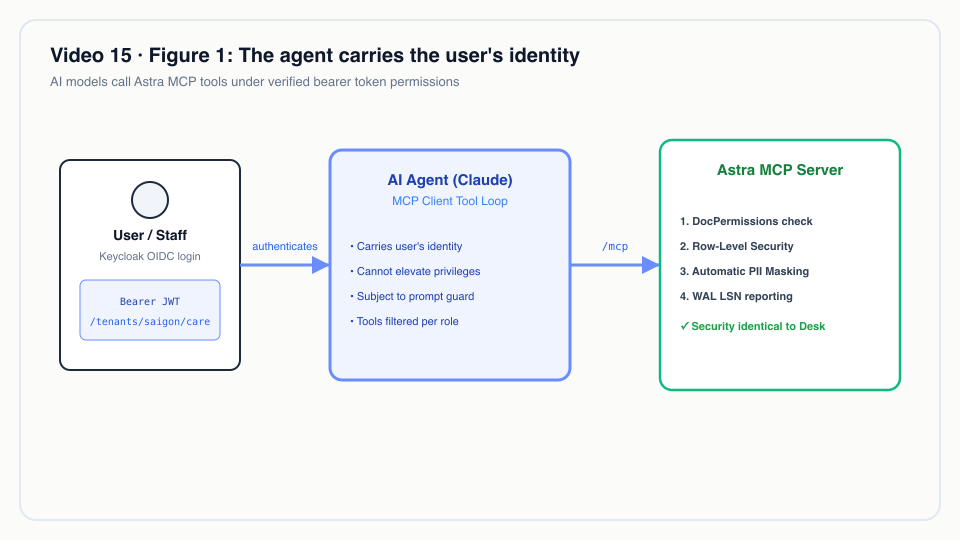
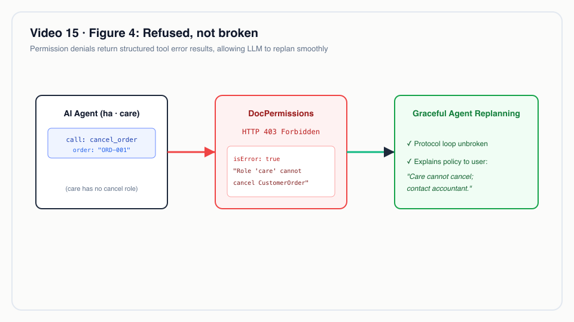
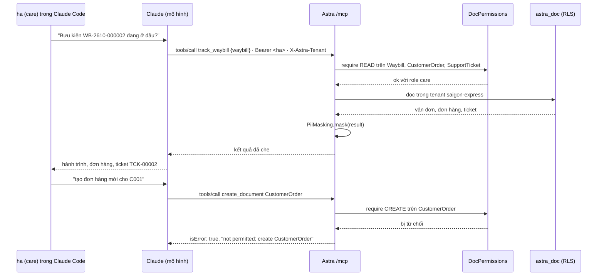
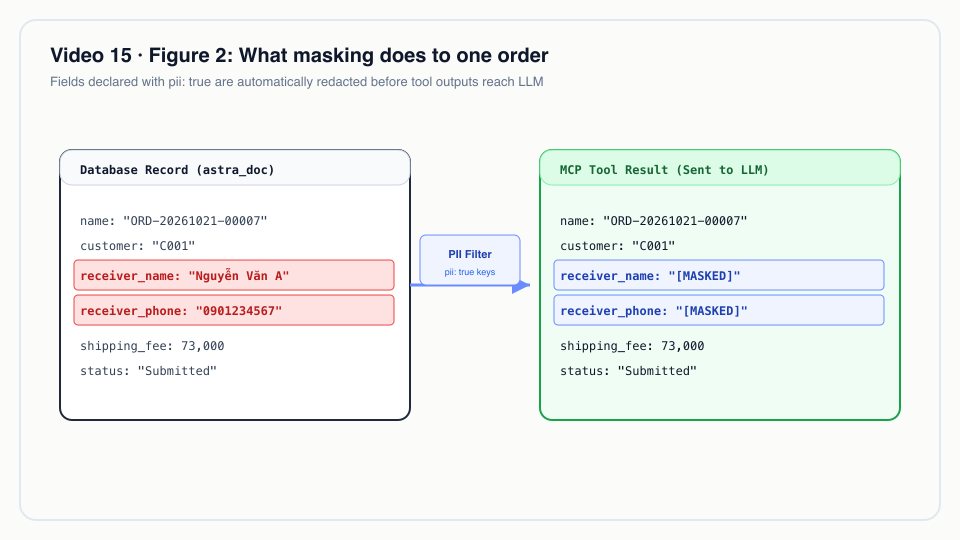
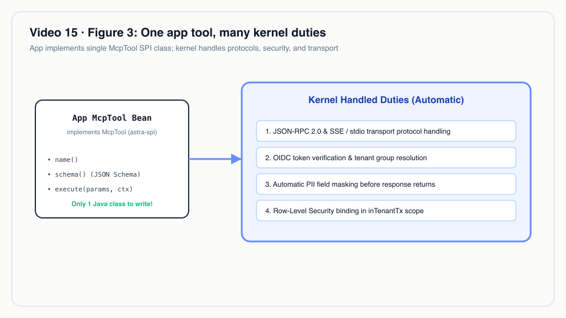

# Video 15 · MCP: agent AI dùng Astra bằng quyền của người dùng

<a href="https://media.zerohostcms.com/astra-cms/astra-video-15-mcp-vi.mp4"></a>

▶ [Tiếng Việt](https://media.zerohostcms.com/astra-cms/astra-video-15-mcp-vi.mp4) · [English](https://media.zerohostcms.com/astra-cms/astra-video-15-mcp-en.mp4) · 2:24 · Kịch bản: [demo-video-series.md](../demo-video-series.md#video-15-mcp-agent-ai-dùng-astra-bằng-quyền-của-người-dùng-cảnh-13) · [Bản tiếng Anh](./15-mcp.md)

> **Tóm tắt một câu:** Astra mở một endpoint MCP duy nhất, `/mcp`, nơi agent AI đăng nhập bằng đúng token Keycloak của người dùng mà nó phục vụ, nên nó nhận đúng tenant, row-level security và quyền DocType của người đó, còn dữ liệu cá nhân bị che trước khi tới mô hình.
> **Nên đọc nếu:** bạn muốn thêm một tool AI vào app Astra chỉ bằng một class, không viết code xác thực (developer) / bạn phải quyết định việc cho LLM chạm vào dữ liệu nghiệp vụ có an toàn, kiểm toán được và có giới hạn hay không (tech lead).

## Vấn đề

Astra Express vận hành chăm sóc khách hàng (CARE) cho hai tenant chuyển phát, Sài Gòn và Hà Nội. Nhân viên CSKH nhận
những cuộc gọi kiểu "bưu kiện của tôi đang ở đâu, đã có ai khiếu nại chưa?". Để trả lời, họ phải mở vận đơn, lịch sử
quét mã, đơn hàng gốc và các ticket hỗ trợ, tức là bốn màn hình. Một trợ lý AI có thể làm việc đó bằng một câu hỏi,
nhưng nối LLM vào dữ liệu nghiệp vụ thường hỏng theo một trong ba cách:

- **Một service account toàn quyền.** Trợ lý được cấp một user database hoặc API key đọc được mọi tenant, mọi bảng.
  Những gì nhân viên CSKH không được xem thì mô hình vẫn xem được, và một cú prompt injection có thể khiến nó hành
  động dựa trên dữ liệu đó.
- **Một mô hình phân quyền thứ hai.** Lớp tích hợp AI tự cài lại logic "ai được xem gì". Lần đầu tiên có người thêm
  một role, nó đã lệch khỏi luật thật.
- **Gửi nguyên dữ liệu cá nhân cho mô hình bên thứ ba.** Tên, số điện thoại và địa chỉ người nhận được gửi đầy đủ cho
  nhà cung cấp mô hình, điều khó bảo vệ trước luật bảo vệ dữ liệu cá nhân của Việt Nam hay nguyên tắc tối thiểu hoá
  dữ liệu của GDPR.

Frappe/ERPNext có REST API và cho phép viết script xung quanh, nhưng không có giao thức agent dựng sẵn và không có lớp
che dữ liệu giữa dữ liệu và mô hình: mỗi tích hợp tự giải ba bài toán trên theo cách riêng.

Câu trả lời của Astra là **agent chỉ là một client nữa của cùng một kernel**. Nó xác thực với tư cách người dùng, mọi
lần gọi tool đi qua cùng những bước kiểm tra quyền như REST API và Desk, và các trường khai báo `pii: true` trong
DocType bị che trên kênh MCP.


*Agent mang danh tính của người dùng.*

## Video cho thấy gì

| Cảnh | Bạn thấy gì | Điều được chứng minh |
| --- | --- | --- |
| Tool | `initialize` với giao thức `2025-11-25`, rồi `tools/list` trả về 7 tool | 5 tool của kernel (`list_doctypes`, `search_documents`, `get_document`, `create_document`, `ledger_trial_balance`) và 2 tool do app Express đóng góp (`track_waybill`, `cod_outstanding`) |
| PII | `search_documents` tìm đơn hàng của khách C001 | `receiver_phone` trả về `*******888`, `receiver_name` thành `B*** A*** K***`, địa chỉ thành `3*** L*** L*** …`; `shipping_fee` (23.000) giữ nguyên. Desk đã đăng nhập vẫn hiện đầy đủ dữ liệu |
| Tra cứu | Claude Code thật, đăng nhập bằng `ha` (care), được hỏi bằng tiếng Việt bưu kiện `WB-2610-000002` đang ở đâu và có khiếu nại không | Claude tự chọn `track_waybill` và trả lời kèm hành trình (Created → Picked Up → HCM-Tân Bình → HN-Long Biên → Out for Delivery), đơn hàng và ticket `TCK-00002` |
| Từ chối | `ha` nhờ Claude tạo đơn hàng mới cho C001 | Claude gọi `create_document`, kernel trả lời `not permitted: create CustomerOrder`; Claude giải thích rằng vấn đề nằm ở quyền, không phải ở dữ liệu |
| COD | Kế toán `khoa` hỏi shop nào đang chờ trả tiền COD | `cod_outstanding` đọc sổ cái: Shop Hoa Mai (C001), đã thu 350.000 ₫, chưa trả |
| Code | `TrackWaybillTool.java` | App thêm một tool chỉ bằng một class; kernel lo xác thực, tenant, RLS, kiểm tra quyền và che dữ liệu |

Cảnh terminal (`SCENES=13`) còn cho thấy hai điều mà lời dẫn chỉ lướt qua: `ha` gọi `cod_outstanding` bị từ chối với
`not permitted: read Account`, và `ha` tạo một SupportTicket qua MCP thì thành công, đồng thời hook phân loại của app
vẫn nâng mức ưu tiên lên High (`auto-escalated: mentions 'vỡ'`).


*Bị từ chối, không phải bị lỗi.*

## Cách hoạt động

### Một endpoint, cùng một danh tính

MCP server là một JAX-RS resource trong `astra-ai`. Nó nói JSON-RPC qua transport Streamable HTTP với response JSON
thuần (không có stream do server khởi tạo), và nó không có chút code xác thực nào của riêng mình: bearer token và header
`X-Astra-Tenant` được kiểm tra bởi chính các filter bảo vệ `/api/doc`, còn `TenantRequest` mang user, tenant và role
đã được xác định.

*`astra-ai/src/main/java/io/astra/ai/McpServer.java`*

```java
@Path("/mcp")
@RunOnVirtualThread
public class McpServer {

    private static final Logger LOG = Logger.getLogger(McpServer.class);
    static final List<String> PROTOCOL_VERSIONS = List.of("2025-11-25", "2025-06-18", "2025-03-26");
    static final Set<String> KERNEL_TOOLS = Set.of("list_doctypes", "search_documents", "get_document", "create_document",
            "ledger_trial_balance");
    // …

    /** No server-initiated stream: the spec allows 405 for clients that try to open one. */
    @GET
    public Response stream() {
        return Response.status(405).header("Allow", "POST").build();
    }
```

Tool của kernel gọi cùng bước kiểm tra `DocPermissions` như REST trước khi chạm vào store. Đó là lý do `ha` nhận đúng
câu trả lời mà cô sẽ nhận được từ Desk:

*`astra-ai/src/main/java/io/astra/ai/McpServer.java`*

```java
    private Object create(Map<String, Object> args) {
        String doctype = required(args, "doctype");
        permissions.require(doctype, tenant.roles(), Action.CREATE);
        if (!(args.get("data") instanceof Map<?, ?> data)) throw new IllegalArgumentException("'data' must be an object");
        Map<String, Object> fields = new LinkedHashMap<>();
        data.forEach((k, v) -> fields.put(String.valueOf(k), v));
        return doc(store.insert(doctype, fields, tenant.userId()));
    }
```

Luật từ chối cô nằm trong DocType của app, không nằm trong code AI nào. `care` được đọc đơn hàng nhưng không có quyền
`create`:

*`astra-apps/express/src/main/resources/META-INF/astra/doctypes/customer-order.doctype.yaml`*

```yaml
permissions:
  - { role: admin,      read: true, create: true, write: true, submit: true, cancel: true }
  - { role: sales,      read: true, create: true, write: true, if-owner: true, submit: true }
  - { role: ops,        read: true }
  - { role: care,       read: true }
  - { role: accountant, read: true, cancel: true }
```

Lời từ chối được trả về như một kết quả tool có `isError: true`, không phải lỗi transport, nên mô hình đọc được lý do
và giải thích lại cho người dùng (đúng như Claude đã làm trong video):

*`astra-ai/src/main/java/io/astra/ai/McpServer.java`*

```java
        } catch (AccessDeniedException | DocValidationException | DocTypeNotFoundException | IllegalArgumentException e) {
            result = toolResult(Map.of("error", String.valueOf(e.getMessage())), true);
            wrote = false;
        }
```



### Che dữ liệu trên đường ra

`PiiMasking` duyệt kết quả của tool và nhận ra document theo hình dạng (một map có `doctype` và `data`). Với mỗi trường
mà DocType hiệu lực (đã gồm overlay của tenant) đánh dấu `pii`, nó thay giá trị:

*`astra-ai/src/main/java/io/astra/ai/PiiMasking.java`*

```java
    static Object maskValue(Object v) {
        if (v == null) return null;
        String s = v.toString();
        String digits = s.replaceAll("\\D", "");
        if (digits.length() >= 8 && digits.length() >= s.replaceAll("\\s", "").length() - 2) {
            return "*".repeat(digits.length() - 3) + digits.substring(digits.length() - 3);
        }
        return Arrays.stream(s.trim().split("\\s+"))
                .map(w -> w.isEmpty() ? w : w.substring(0, w.offsetByCodePoints(0, 1)) + "***")
                .collect(Collectors.joining(" "));
    }
```

Vì sao thiết kế như vậy:

- **Việc che dữ liệu do metadata điều khiển.** Người viết DocType đã khai báo trường nào là dữ liệu cá nhân
  (`receiver_name`, `receiver_phone`, `receiver_address` là `pii: true` trong `customer-order.doctype.yaml`). Không
  tích hợp AI nào phải tự giữ một danh sách riêng.
- **Vẫn giữ lại phần hữu ích.** Ba số cuối của số điện thoại và chữ cái đầu của mỗi từ là đủ để nhân viên CSKH xác nhận
  "đây có phải khách đang gọi không?" mà mô hình không bao giờ cầm giá trị đầy đủ.
- **Áp ở kênh, không áp ở tầng lưu trữ.** Desk hiện đầy đủ dữ liệu cho người dùng đã đăng nhập; chỉ dữ liệu đi ra qua
  MCP mới bị che. Nhờ vậy quy trình làm việc của con người không bị ảnh hưởng.


*Lớp che làm gì với một đơn hàng.*

### App đóng góp một tool chỉ bằng một class

SPI `McpTool` nằm trong `astra-spi`, nên app không phụ thuộc vào thứ gì trong `astra-ai`. Tool khai báo các DocType mà
nó đọc; kernel kiểm tra quyền đọc trên tất cả các DocType đó trước khi tool chạy, gắn tenant, ghi log lần gọi và che
kết quả.

*`astra-apps/express/src/main/java/io/astra/apps/express/TrackWaybillTool.java`*

```java
@ApplicationScoped
public class TrackWaybillTool implements McpTool {

    @Inject DocumentService docs;

    @Override public String name() { return "track_waybill"; }
    // …
    @Override public List<String> reads() { return List.of("Waybill", "CustomerOrder", "SupportTicket"); }

    @Override public Object call(Map<String, Object> arguments) {
        String name = String.valueOf(arguments.get("waybill"));
        Document waybill = docs.get("Waybill", name).orElseThrow(() -> new IllegalArgumentException("waybill " + name + " not found"));
        Map<String, Object> out = new LinkedHashMap<>();
        out.put("waybill", doc(waybill));
        docs.get("CustomerOrder", waybill.getString("order")).ifPresent(o -> out.put("order", doc(o)));
        out.put("tickets", docs.find("SupportTicket", Map.of("waybill", name), 20).stream().map(TrackWaybillTool::doc).toList());
        return out;
    }

    static Map<String, Object> doc(Document d) {
        return Map.of("doctype", d.doctype(), "name", d.name(), "docstatus", d.docstatus(), "data", d.data());
    }
}
```

*`astra-ai/src/main/java/io/astra/ai/AppToolInvoker.java`*

```java
    public McpTool authorize(String name) {
        McpTool tool = tools.stream().filter(t -> t.name().equals(name)).findFirst()
                .orElseThrow(() -> new IllegalArgumentException("unknown tool: " + name));
        for (String doctype : tool.reads()) permissions.require(doctype, tenant.roles(), Action.READ);
        return tool;
    }
    // …
    public Outcome call(String channel, String name, Map<String, Object> args) {
        McpTool tool = authorize(name);
        LOG.infof("%s tool %s by %s in tenant %s (arguments: %s)", channel, name, tenant.userId(), tenant.tenantId(), args.keySet());
        Object result = TenantContext.call(tenant.tenantId(), () -> pii.mask(tool.call(args)));
        return new Outcome(result, tool.writes());
    }
```

`cod_outstanding` khai báo `reads() = List.of("Customer", "Account")`. Role `care` không có luật nào trên `Account`, nên
`ha` bị từ chối với `not permitted: read Account` trước khi code của tool kịp chạy; `khoa` (accountant) đọc được
`Account` và nhận số dư sổ cái của tài khoản 3388 theo từng shop.

Hai ghi chú thiết kế nên biết:

- **Kiểm tra quyền mang tính khai báo và làm từ đầu.** Một tool đọc ba DocType sẽ bị từ chối nếu người dùng thiếu quyền
  trên bất kỳ DocType nào trong đó, kể cả khi lần gọi cụ thể này không chạm tới nó. Như vậy chặt hơn mức cần thiết,
  nhưng đổi lại người review chỉ cần đọc một dòng là kiểm toán được một tool.
- **Việc che dữ liệu phụ thuộc vào hình dạng kết quả.** SPI yêu cầu tool trả document dưới dạng map `{doctype, name, data}`.
  Một tool tự "làm phẳng" trường PII vào map riêng của nó (ví dụ `{"phone": "0901…"}`) sẽ lọt qua lớp che. Hãy review
  các tool của app về điểm này.


*Một tool của app, nhiều việc của kernel.*

### Lệnh ghi báo vị trí WAL của mình

Mọi lần gọi MCP đều là POST, nên kernel chỉ thêm `X-Tx-LSN` sau một lần gọi thành công tới tool có ghi dữ liệu
(`create_document`, hoặc tool của app có `writes()` là true). Log của cảnh cho thấy header này khi tạo SupportTicket
(`X-Tx-LSN: 0/432E3F8`). Đây chính là cơ chế read-your-writes được giải thích trong [Video 16](./16-cdc.vi.md).

## Ví dụ thực tế

**Tổng đài chăm sóc khách hàng của một công ty 3PL ở TP. Hồ Chí Minh.** Một nhân viên CSKH, đăng nhập bằng user
`care`, dùng trợ lý AI trong lúc nghe máy.

*Tình huống minh hoạ: tình huống dưới đây áp cơ chế ở trên vào các giá trị minh hoạ; đây không phải output của bản demo.*

**Đầu vào.** Một khách gọi đến báo bưu kiện `WB-2611-004211` chưa tới. Nhân viên gõ: "WB-2611-004211 đang ở đâu và có
khiếu nại nào đang mở không?"

**Astra làm gì.**

1. Trợ lý gọi `track_waybill`. Kernel kiểm tra `care` được đọc Waybill, CustomerOrder và SupportTicket, gắn tenant của
   nhân viên rồi chạy tool. Nhờ row-level security, một mã vận đơn thuộc tenant khác chỉ đơn giản trả về "not found".
2. `receiver_name` "Trần Thị Hồng", `receiver_phone` "0912 345 678" và `receiver_address` "12 Nguyễn Huệ, Quận 1" của
   đơn hàng bị che thành `T*** T*** H***`, `*******678` và `1*** N*** H*** Q*** 1***`.
3. Nhân viên hỏi khách ba số cuối điện thoại; "678" khớp với giá trị đã che, vậy là nhân viên đã xác minh được người
   gọi mà mô hình không hề thấy số đầy đủ.

**Kết quả.** Trợ lý trả lời kèm hành trình quét mã và ticket đang mở. Khi khách tiếp tục đòi hoàn tiền và nhân viên
bảo "tạo đơn hoàn tiền", lệnh `create_document` của trợ lý bị từ chối vì đúng lý do mà chính nhân viên không làm được
việc này trên Desk. Dòng log `MCP tool create_document by <user> in tenant <tenant>` ghi lại ai đã thử.

## Dành cho tech lead

- **Ranh giới bảo mật là người dùng, không phải AI.** Agent không bao giờ làm được nhiều hơn người có token mà nó mang.
  Điều đó cũng có nghĩa là nó làm được *mọi thứ* người đó làm được, kể cả các thao tác ghi mà role của họ cho phép.
  Hãy cấp cho user dùng agent role hẹp nhất đủ phục vụ quy trình.
- **Token là điểm yếu hiện nay.** Client demo đăng ký một bearer token tĩnh sống khoảng một giờ (`scripts/mcp-claude.sh`).
  Chưa có luồng OAuth cho client MCP, nên việc quản lý token trên máy client là trách nhiệm của bạn.
- **Che dữ liệu không phải là ẩn danh hoá.** Chữ cái đầu cộng ba số cuối giảm mức phơi nhiễm; chúng không làm dữ liệu
  trở thành ẩn danh. Các trường không đánh dấu `pii: true` (ví dụ tên shop "Shop Hoa Mai" trong `cod_outstanding`) đi
  tới mô hình đầy đủ. Hãy coi cờ `pii` là một phần của việc review DocType.
- **Che dữ liệu chỉ áp cho MCP.** Desk và REST API trả đầy đủ dữ liệu cho người dùng có quyền, đúng như chủ đích.
- **Nên đo gì:** số lần gọi tool theo người dùng và tenant (từ các dòng log `MCP tool … by … in tenant …`), tỷ lệ bị
  từ chối (`isError: true`), tool nào được dùng, và DocType nào vẫn còn thiếu chú thích `pii`.
- **Khi nào không nên dùng:** nếu bạn cần mô hình thấy dữ liệu cá nhân chưa che (ví dụ soạn thư gửi một khách hàng có
  tên cụ thể), kênh này sẽ không đưa cho bạn, và đó là chủ đích thiết kế. Nếu bạn cần agent tự hành chạy khi không có
  người dùng, phần đó chưa được xây.
- **So với các lựa chọn khác:** viết tay một lớp bọc REST cho từng nhà cung cấp AI là nhân đôi logic xác thực và phân
  quyền; một bản sao database chỉ đọc cho mô hình sẽ mất cô lập tenant, trừ khi bạn dựng lại RLS quanh nó. MCP là giao
  thức mở, nên cùng một endpoint phục vụ được Claude, Cursor hay một agent nội bộ.

## Tự chạy thử

Điều kiện: cụm k3d theo [demo-video-series.md](../demo-video-series.md#1-chuẩn-bị-môi-trường-quay)
(JDK 25, Docker với 8 GB, `kubectl`, `k3d`, `jq`, Bash 5), và Claude Code (`claude`) cho phần agent.

```bash
make k3d-up
make demo-reset && make demo-seed
make demo-express SCENES=13 PAUSE=0
```

Output mong đợi (rút gọn từ lần quay): `protocolVersion: "2025-11-25"`, danh sách 7 tool, các giá trị `receiver_phone`
đã che như `*******888`, `track_waybill` với năm lần quét, rồi `not permitted: create CustomerOrder` và
`not permitted: read Account` cho `ha`, còn với `khoa` là
`[{"customer": "C001", "customer_name": "Shop Hoa Mai", "cod_owed_vnd": 350000.00}]`.

Để trò chuyện với nó bằng một agent thật:

```bash
scripts/mcp-claude.sh ha saigon-express    # registers the "astra" MCP server in Claude Code with ha's token
claude                                     # ask: "Bưu kiện WB-2610-000002 đang ở đâu, có khiếu nại không?"
scripts/mcp-claude.sh khoa saigon-express  # then ask: "Khách nào đang chờ trả COD?"
```

Script chạy `claude mcp add --transport http astra http://localhost:8080/mcp` với bearer token và header
`X-Astra-Tenant` của người dùng. Hãy chạy lại khi token hết hạn (khoảng một giờ). Mã vận đơn chứa tháng của dữ liệu
seed, nên hãy chọn một mã có trong seed của bạn.

Các integration test nằm ở `astra-server/src/test/java/io/astra/server/McpTest.java` (handshake, che dữ liệu, phân
quyền, tool không tồn tại) và chạy bằng `make test`.

## Nói đúng

- Client dùng bearer token tĩnh (token một giờ của client dev). OAuth discovery cho MCP còn trên roadmap.
- AI agent tự hành và vector search (pgvector RAG) còn trên roadmap, chưa được xây.
- Che PII áp dụng cho kênh MCP, không áp cho Desk.
- Câu trả lời của Claude trên màn hình là thật nhưng đã rút gọn (bỏ thời điểm quét cuối và hạn SLA); video có ghi chú
  là đã rút gọn.
- MCP server chỉ trả lời bằng JSON; client nào mở stream GET sẽ nhận 405.

## Hình minh hoạ

- [Hình 1 · Agent mang danh tính của người dùng](#vấn-đề)
- [Hình 2 · Lớp che làm gì với một đơn hàng](#che-dữ-liệu-trên-đường-ra)
- [Hình 3 · Một tool của app, nhiều việc của kernel](#app-đóng-góp-một-tool-chỉ-bằng-một-class)
- [Hình 4 · Bị từ chối, không phải bị lỗi](#video-cho-thấy-gì)

## Liên quan

- Trước: [Video 14 · Tier 2 Wasm](./14-wasm.vi.md) · Tiếp: [Video 16 · Rust CDC + Sync-Aware LSN](./16-cdc.vi.md)
- [Video 11 · Keycloak](./11-keycloak.vi.md) (role và quyền DocType đến từ đâu) · [Video 20 · STMS](./20-stms.vi.md) (thêm các tool MCP của app)
- Đi qua code: [S9 MCP for AI agents](../demo-code-snippets.md#s9-mcp-for-ai-agents)
- Bối cảnh: [explain.md](../explain.md) (bề mặt AI và MCP trong kiến trúc mục tiêu)
- Mã nguồn: `astra-ai/src/main/java/io/astra/ai/McpServer.java`, `astra-ai/src/main/java/io/astra/ai/PiiMasking.java`,
  `astra-ai/src/main/java/io/astra/ai/AppToolInvoker.java`, `astra-spi/src/main/java/io/astra/spi/ai/McpTool.java`,
  `astra-apps/express/src/main/java/io/astra/apps/express/TrackWaybillTool.java`,
  `astra-apps/express/src/main/java/io/astra/apps/express/CodOutstandingTool.java`, `scripts/mcp-claude.sh`
