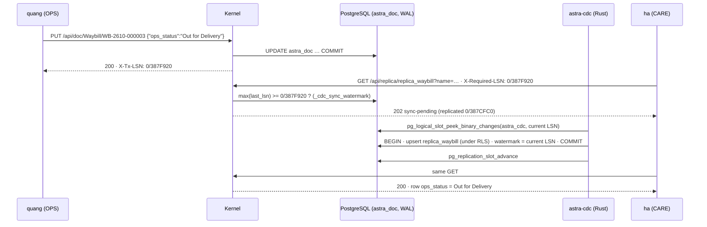

# Video 16 · Rust CDC + Sync-Aware LSN

<a href="https://media.zerohostcms.com/astra-cms/astra-video-16-cdc-en.mp4"></a>

▶ [English](https://media.zerohostcms.com/astra-cms/astra-video-16-cdc-en.mp4) · [Tiếng Việt](https://media.zerohostcms.com/astra-cms/astra-video-16-cdc-vi.mp4) · 2:36 · Script: [demo-video-series.en.md](../demo-video-series.en.md#video-16-rust-cdc--sync-aware-lsn-scene-14)

> **In one sentence:** A Rust worker reads PostgreSQL's write-ahead log and keeps replica tables for customer care, every write tells the client its WAL position (`X-Tx-LSN`), and a replica read that demands that position gets `202 Sync Pending` until the replica has caught up, so care never reads stale data.
> **Read this if:** you need one module to read another module's data without querying its tables, and still see your own writes immediately (developer) / you are weighing eventual consistency against coupling and want a concrete, measurable contract (tech lead).

## The problem

In Astra Express, operations (OPS) scans parcels and customer care (CARE) answers calls about them. The two
modules should not share tables: OPS changes its schema on its own schedule, CARE needs a narrow, stable view, and
in the target design the analytics side reads the same change stream. The standard answer is change data capture
(CDC): stream changes out of the operational database into a copy the other module owns.

CDC brings the classic problem of every replica: **staleness**. A courier scans a parcel "Out for Delivery"; two
seconds later the customer calls; the care agent opens the parcel and sees "At Hub". Nobody can tell whether the
copy is behind or the scan never happened. Teams usually pick one of these:

- **Read the source tables directly.** Fresh, but CARE is now coupled to OPS's schema and load.
- **Accept eventual consistency and hope.** Most of the time the copy is a few hundred milliseconds behind, and the
  rare stale read becomes a support ticket nobody can reproduce.
- **Add a sleep or a "refresh in a minute" banner.** Slower for everybody, still no guarantee.

Frappe/ERPNext keeps every module in the same database and reads source tables directly, so it does not have this
problem, and also does not get the decoupling. Astra keeps the decoupling and makes staleness **visible and
bounded**: the write returns a position in the log; a read can say "I need at least that position"; the kernel
either serves data that includes the write or answers "not yet" without data.

## What the video shows

| Scene | What you see | What it proves |
| --- | --- | --- |
| Replication page | Desk → Replication (CDC): the worker decodes the WAL (`pgoutput`), a lag of 77 ms, bytes remaining | The worker is live and reports its progress through the kernel |
| Code | `astra-cdc-rust/cdc-routes.yaml` and the worker loop | Routes are declared in YAML (DocType, target table, columns); the worker decodes pgoutput itself and writes replica rows and the watermark in one transaction; the slot advances only after commit |
| Write | Worker paused (`kubectl scale … --replicas=0`), `quang` (OPS) sets `WB-2610-000003` to Out for Delivery | The response carries `X-Tx-LSN: 0/387F920` |
| Pending | `ha` (CARE) reads `replica_waybill` with `X-Required-LSN: 0/387F920` | `202` with `"status": "sync-pending"`, replicated position `0/387CFC0`, no stale row |
| Resume | Worker back on | The same read returns 200 26 ms after the worker came back, with `ops_status: Out for Delivery`. Steady state: a write followed by an immediate read caught up in 117 ms. Numbers vary per run |
| Desk | The Waybill form's "CARE replica (CDC)" card | Shows "sync pending" and retries for 10 s. In the recording the worker was off longer, so the form was reopened once it ran |
| Slot | `pg_replication_slots`, replica table flags | One logical slot `astra_cdc`, plugin `pgoutput`, `active = f` (normal, see below); replica tables have row-level security forced, and the worker role has neither SUPERUSER nor BYPASSRLS |

## How it works



### 1. What gets replicated is declared, not coded

*`astra-cdc-rust/cdc-routes.yaml`*

```yaml
slot: astra_cdc
publication: astra_cdc
poll_ms: 50
routes:
  - doctype: Waybill
    target: replica_waybill
    columns:
      - { name: order_name,    from: order }
      - { name: ops_status,    from: ops_status }
      - { name: current_hub,   from: current_hub }
      - { name: receiver_name, from: receiver_name }
      - { name: scans,         from: scan_log, transform: length, type: integer }
  # …
```

All DocTypes live in one JSONB table, `astra_doc` ([Video 2](./02-doctype.md)). The publication covers only that
table, and a route picks one DocType and projects chosen JSON keys into typed columns. CARE gets `scans` as a count
rather than the full scan log, which is the point of a replica: a narrow view the consumer owns. Route names become
SQL identifiers, so the worker refuses anything that is not a plain lower-case name or one of four types.

### 2. The worker loop: peek, apply with the watermark, then advance

*`astra-cdc-rust/src/main.rs`*

```rust
    loop {
        let cur: String = client.query_one("SELECT pg_current_wal_lsn()::text", &[]).await?.get(0);
        let rows = client
            .query(
                "SELECT lsn::text, data FROM pg_logical_slot_peek_binary_changes($1, $2::text::pg_lsn, NULL, \
                 'proto_version', '1', 'publication_names', $3)",
                &[&cfg.slot, &cur, &cfg.publication],
            )
            .await?;

        let tx = client.transaction().await?;
        // … decode each row with pgoutput::decode, upsert matching astra_doc rows into their replica …
        if applied > 0 || last_watermark.elapsed() >= Duration::from_secs(1) {
            tx.execute(
                "INSERT INTO _cdc_sync_watermark (slot, last_lsn, events, lag_ms, updated_at) VALUES ($1, $2::text::pg_lsn, $3, $4, now()) \
                 ON CONFLICT (slot) DO UPDATE SET last_lsn = excluded.last_lsn, events = _cdc_sync_watermark.events + excluded.events, \
                 lag_ms = coalesce(excluded.lag_ms, _cdc_sync_watermark.lag_ms), updated_at = now()",
                &[&cfg.slot, &cur, &(applied as i64), &lag_ms.map(|v| v as i32)],
            )
            .await?;
            last_watermark = Instant::now();
        }
        tx.commit().await?;
        client.execute("SELECT pg_replication_slot_advance($1, $2::text::pg_lsn)", &[&cfg.slot, &cur]).await?;
        // …
        tokio::time::sleep(Duration::from_millis(cfg.poll_ms)).await;
    }
```

Why it is built this way:

- **The watermark commits with the data.** Replica rows and `_cdc_sync_watermark.last_lsn` are written in the same
  transaction, so "the watermark says X" always means "every change up to X is in the replicas". There is no window
  where the watermark is ahead of the data.
- **The slot advances after the commit.** If the worker crashes between commit and advance, the next poll peeks the
  same changes again. Upserts keyed by `(tenant_id, name)` make that replay harmless: at-least-once delivery,
  idempotent apply.
- **SQL peek/advance instead of a streaming connection.** The worker uses an ordinary connection and the SQL
  functions for logical slots. That is simpler to run and reason about, at the cost of a poll interval (50 ms) and
  the fact that the slot shows `active = f` between polls. Streaming is on the roadmap.
- **pgoutput is decoded in the worker.** `src/pgoutput.rs` decodes protocol version 1 (Begin, Commit, Relation,
  Insert, Update, Delete, Truncate). pgoutput is PostgreSQL's built-in output plugin, so no extension is needed on
  the database. Deletes are ignored because documents are never deleted, only cancelled.

### 3. Replica rows are written under RLS

The worker does not get a privileged role. Each row's tenant is bound before the upsert:

*`astra-cdc-rust/src/main.rs`*

```rust
    // The replica tables are under row-level security; bind this row's tenant for the write.
    tx.execute("SELECT set_config('astra.tenant', $1, true)", &[&tenant]).await?;
```

*`astra-doctype/src/main/resources/db/migration/V5__cdc_replicas.sql`*

```sql
ALTER TABLE replica_waybill ENABLE ROW LEVEL SECURITY;
ALTER TABLE replica_waybill FORCE ROW LEVEL SECURITY;
CREATE POLICY replica_waybill_tenant ON replica_waybill
    USING (tenant_id = current_setting('astra.tenant', true)) WITH CHECK (tenant_id = current_setting('astra.tenant', true));
```

*`deploy/db/20-cdc.sql`*

```sql
        -- REPLICATION reads the WAL through a slot; no SUPERUSER and no BYPASSRLS: replica rows are
        -- written under row-level security like any other.
        CREATE ROLE astra_cdc LOGIN REPLICATION PASSWORD 'astra_cdc' NOSUPERUSER NOBYPASSRLS NOCREATEDB NOCREATEROLE;
```

`WITH CHECK` means a bug in the worker that binds the wrong tenant fails the write instead of leaking a row into
another tenant's replica. The recorded `replica-rls.txt` confirms `relforcerowsecurity = t` on both replica tables
and `rolsuper = f`, `rolbypassrls = f` for `astra_cdc`.

### 4. The kernel's LSN gate

*`astra-doctype/src/main/java/io/astra/doctype/sync/SyncAwareLsnFilter.java`*

```java
    @Override
    public void filter(ContainerRequestContext req) {
        String required = req.getHeaderString(REQUIRED_LSN);
        if (required == null || required.isBlank() || !path(req).startsWith("api/replica")) return;
        // … reject a malformed LSN with 400 …
        if (!watermark.reached(required)) {
            Map<String, Object> body = new LinkedHashMap<>();
            body.put("status", "sync-pending");
            body.put("requiredLsn", required);
            body.put("replicatedLsn", watermark.status().get("replicatedLsn"));
            body.put("retryAfterMs", 50);
            req.abortWith(Response.status(202).entity(body).build());
        }
    }

    @Override
    public void filter(ContainerRequestContext req, ContainerResponseContext res) {
        String path = path(req);
        if (WRITES.contains(req.getMethod()) && res.getStatus() / 100 == 2 && path.startsWith("api/doc/")) {
            res.getHeaders().putSingle(TX_LSN, watermark.currentLsn());
        }
    }
```

*`astra-doctype/src/main/java/io/astra/doctype/sync/SyncWatermark.java`*

```java
    /** Whether everything up to {@code required} has been applied to the replicas. */
    public boolean reached(String required) {
        try (Connection conn = dataSource.getConnection();
             PreparedStatement ps = conn.prepareStatement(
                     "SELECT coalesce(max(last_lsn) >= ?::pg_lsn, false) FROM _cdc_sync_watermark")) {
            // …
```

Design notes:

- **The LSN is taken after the commit.** The response filter runs after the document transaction has committed and
  reads `pg_current_wal_lsn()`, which is at or past the commit record. The position may be slightly later than the
  write strictly needs (other writes can land in between), so a client may wait a few milliseconds longer than
  necessary; it can never be told "in sync" too early. In the recording, the row's `source_lsn` (`0/387EFF0`) is
  just below the `X-Tx-LSN` the client received (`0/387F920`).
- **202, not a blocked request.** The kernel does not hold a thread waiting for the worker. It answers immediately
  with the positions and a retry hint, and the client decides how long to wait. Reads without `X-Required-LSN` are
  served as before, so a dashboard that tolerates lag pays nothing.
- **The contract is opt-in per read.** Only the client knows whether it just wrote something it needs to see.
  The Desk remembers the `X-Tx-LSN` of its latest write and sends it on replica reads:

*`astra-server/src/main/resources/META-INF/resources/desk/desk.js`*

```js
  for (let attempt = 0; attempt < 100; attempt++) {
    const required = state.lastLsn;
    const res = await api('GET', '/api/replica/' + spec[0] + '?name=' + enc(key), undefined, required ? { 'X-Required-LSN': required } : {});
    if (res.status === 202) {
      // … show "sync pending" with required and replicated positions …
      await new Promise((r) => setTimeout(r, 100));
      continue;
    }
    // … show "in sync" and the replica row …
  }
  status.textContent = 'Still pending after 10 s: is the CDC worker running? See Replication (CDC).';
```

The replica endpoint itself (`ReplicaResource`) requires read permission on the *source* DocType, so a role that
cannot read Waybill cannot read `replica_waybill` either.

## Real-world example

**A last-mile operator in Hanoi with a separate support team.** Couriers update parcel status from handhelds
through the OPS module; the support team works only from replica tables. The values below are illustrative.

**Input.** At 14:02:10 courier Minh marks `WB-2611-018803` as "Failed Delivery" (customer not home). The PUT
returns `200` with `X-Tx-LSN: 1/0A41C2D8`. His handheld app forwards that position to the support system with the
parcel number, as part of its "call the customer" task.

**What Astra does.**

1. At 14:02:11 support agent Lan opens the parcel. Her client sends `X-Required-LSN: 1/0A41C2D8`.
2. The worker is mid-poll; the watermark is `1/0A41B900`. The kernel answers `202 sync-pending` with both positions.
3. Lan's screen shows "sync pending" instead of the old "Out for Delivery". On the next poll the worker applies the
   change, commits the replica row and watermark `1/0A41D010` together, and the retry returns `200` with
   `ops_status: Failed Delivery`.

**Output.** Lan never sees a stale status and never has to ask "can you refresh?". If the worker is down, she sees
"still pending" and the Replication page shows the worker as not reporting, which turns a silent data problem into
an operational alert.

## For technical leaders

- **What you get:** module decoupling through CDC with an explicit read-your-writes contract. The guarantee is
  "never stale for the writes you name", not "always fresh".
- **What it costs:** one Rust process (`astra-cdc`), one logical replication slot, one watermark table and one extra
  query per replica read that carries `X-Required-LSN`. `wal_level=logical` is required on PostgreSQL.
- **Operational risk: the slot retains WAL.** While the worker is stopped, PostgreSQL keeps the WAL the slot has not
  consumed. A worker that stays down for a long time grows the WAL on disk. Monitor `bytesBehind` from
  `GET /api/sync/status` and alert on `workerReporting: false`.
- **Latency is a measured number, not a promise.** The recorded run showed a 77 ms lag on the Replication page,
  26 ms from worker restart to the first in-sync read, and 117 ms from write to in-sync in steady state. The poll
  interval (50 ms) sets the floor. Measure p50/p99 of write-to-in-sync on your own load.
- **One watermark for all tenants.** The worker applies every tenant's changes in order, so a burst from one tenant
  delays the watermark for all of them. That is fine at demo scale; watch it under multi-tenant load.
- **When not to use it:** if a screen must always show the latest data and cannot handle "pending", read the source
  DocType through the REST API instead. If you need a replica in another database or an analytics store, that is
  not built yet.
- **Compared with alternatives:** Debezium plus Kafka is a mature general CDC pipeline but adds a broker and a JVM
  connector, and does not give you a per-request freshness contract on its own. Reading the source tables directly
  is fresh but couples modules. Astra's approach is small and specific: one table, declared routes, and an
  LSN handshake between writer and reader.

## Try it yourself

Prerequisites: the k3d stack from [demo-video-series.en.md](../demo-video-series.en.md#1-preparing-the-recording-environment)
(JDK 25, Docker with 8 GB, `kubectl`, `k3d`, `jq`, Bash 5). `make k3d-up` starts PostgreSQL with
`wal_level=logical` and runs `scripts/db-setup.sh`, which creates the CDC role and publication. Rust is only needed
if you change the worker.

```bash
make k3d-up
make demo-reset && make demo-seed
make demo-express SCENES=14 PAUSE=0
```

The scene pauses the worker (`kubectl -n astra scale deployment/astra-cdc --replicas=0`), writes, reads with the
LSN, resumes the worker and polls until the read returns 200. Expected output, excerpted from the recorded run
(positions and times differ per run):

*`docs/video/v16-cdc/assets/scene-14.log`*

```text
HTTP 200   X-Tx-LSN: 0/387F920
// …
HTTP 202
{
  "status": "sync-pending",
  "requiredLsn": "0/387F920",
  "replicatedLsn": "0/387CFC0",
  "retryAfterMs": 50
}
// …
in sync 26 ms after the worker came back
// …
replica caught up 117 ms after the write: {"ops_status":"Delivered","scans":5,"source_lsn":"0/3880788"}
// …
 slot_name |  plugin  | active | confirmed_flush_lsn 
-----------+----------+--------+---------------------
 astra_cdc | pgoutput | f      | 0/38812D0
```

To see it in the Desk: open `http://localhost:8080/desk/`, go to Replication (CDC), then save a Waybill and watch
the "CARE replica (CDC)" card under the form.

The kernel side is covered by `astra-server/src/test/java/io/astra/server/SyncTest.java` (run with `make test`).
That test advances `_cdc_sync_watermark` itself rather than running the Rust worker; the worker end to end is
exercised by scene 14 on the k3d stack.

## To be accurate

- The worker reads the slot with `pg_logical_slot_peek_binary_changes` every 50 ms (at-least-once, idempotent
  upsert) and does not use the streaming replication protocol yet.
- Nothing is pushed to Apache Doris yet; the analytics pipeline in [use-case-01.md](../use-case-01.md) is target
  architecture.
- The use case describes the worker as built on `supabase/etl` with replicas in per-module schemas and a Redis
  cache for the watermark. The running worker is a small custom decoder on `tokio-postgres`, the replicas are in the
  `public` schema, and the watermark is read from its table on each gated request.
- The Desk retries for 10 s. If the worker is off longer, the card says it is still pending and you reopen the form.
- Latency numbers vary between runs; the script's original "about 50 ms" became 117 ms in this recording, and the
  video says so.

## Visualize it: sketch prompts

### Figure 1 · Write, position, read

*Where it goes:* The problem

```text
Hand-drawn whiteboard sketch, black ink line art on off-white paper, one accent color (#6b8cff blue) for the key path, simple boxes and arrows, short handwritten labels in English, generous white space, no logos, no photorealism, 16:9.
Left: stick figure "quang (OPS)" with an arrow to a box "Kernel" labelled "PUT Waybill → 200". A blue ticket comes back to quang labelled "X-Tx-LSN 0/387F920". A dotted handoff carries the same blue ticket to the right, to stick figure "ha (CARE)". From ha an arrow goes back to "Kernel" labelled "GET replica + X-Required-LSN". Two outcomes stacked on the right: top "202 sync pending (no data)", bottom "200 Out for Delivery". Highlight the blue ticket being carried from writer to reader.
```

### Figure 2 · Inside one worker poll

*Where it goes:* How it works (worker loop)

```text
Hand-drawn whiteboard sketch, black ink line art on off-white paper, one accent color (#6b8cff blue) for the key path, simple boxes and arrows, short handwritten labels in English, generous white space, no logos, no photorealism, 16:9.
Left to right: a long tape labelled "WAL" with a marker "slot astra_cdc". Arrow "peek up to current LSN" to a gear box labelled "astra-cdc (Rust) · pgoutput decode". From the gear, one blue bracket labelled "one transaction" encloses two boxes: "upsert replica_waybill (RLS)" and "_cdc_sync_watermark.last_lsn". After the bracket, an arrow labelled "then: pg_replication_slot_advance" back to the slot marker. A small clock labelled "50 ms" loops back to the start. Highlight the blue "one transaction" bracket.
```

### Figure 3 · The 202 gate

*Where it goes:* How it works (kernel gate)

```text
Hand-drawn whiteboard sketch, black ink line art on off-white paper, one accent color (#6b8cff blue) for the key path, simple boxes and arrows, short handwritten labels in English, generous white space, no logos, no photorealism, 16:9.
A horizontal number line labelled "WAL position" with two marks: "watermark 0/387CFC0" (left) and "required 0/387F920" (right). Above, a gate labelled "SyncAwareLsnFilter" with a sign "watermark >= required ?". Left branch "no → 202 sync-pending, retryAfterMs 50". Right branch in blue "yes → 200 replica row". A small arrow shows the watermark mark sliding right over time. Highlight the comparison sign.
```

## Related

- Previous: [Video 15 · MCP](./15-mcp.md) · Next: [Video 17 · Seata](./17-seata.md)
- [Video 6 · Customer care sees operations](./06-care.md) (the CARE replica card first appears) · [Video 7 · Multi-tenancy](./07-tenants.md) (row-level security)
- Code walkthrough: [S10 Rust CDC and Sync-Aware LSN](../demo-code-snippets.md#s10-rust-cdc-and-sync-aware-lsn) (Vietnamese)
- Target design: [use-case-01.md](../use-case-01.md) (Rust CDC, Sync-Aware LSN, Doris; Vietnamese)
- Source: `astra-cdc-rust/src/main.rs`, `astra-cdc-rust/src/pgoutput.rs`, `astra-cdc-rust/cdc-routes.yaml`,
  `astra-doctype/src/main/java/io/astra/doctype/sync/SyncAwareLsnFilter.java`,
  `astra-doctype/src/main/java/io/astra/doctype/sync/SyncWatermark.java`,
  `astra-doctype/src/main/java/io/astra/doctype/api/ReplicaResource.java`,
  `astra-doctype/src/main/resources/db/migration/V5__cdc_replicas.sql`, `deploy/db/20-cdc.sql`
