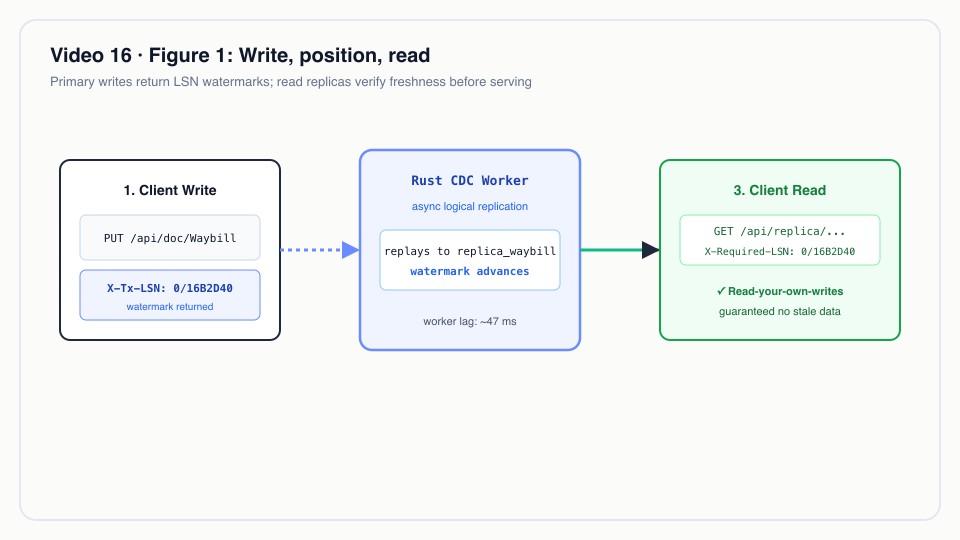
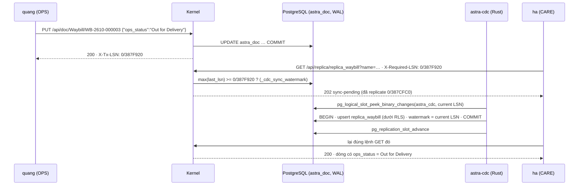
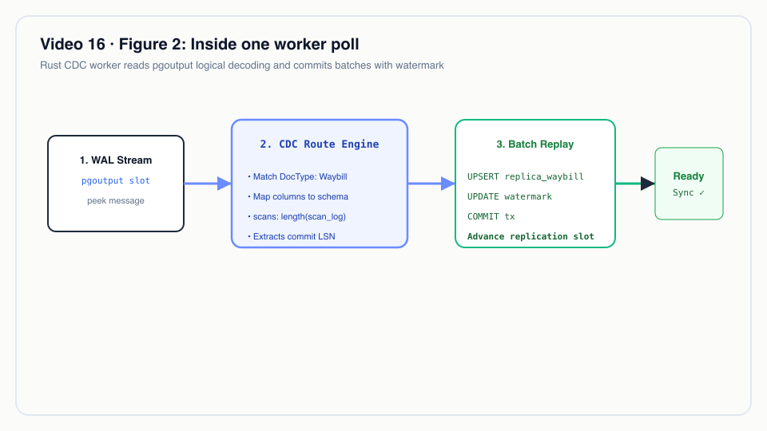
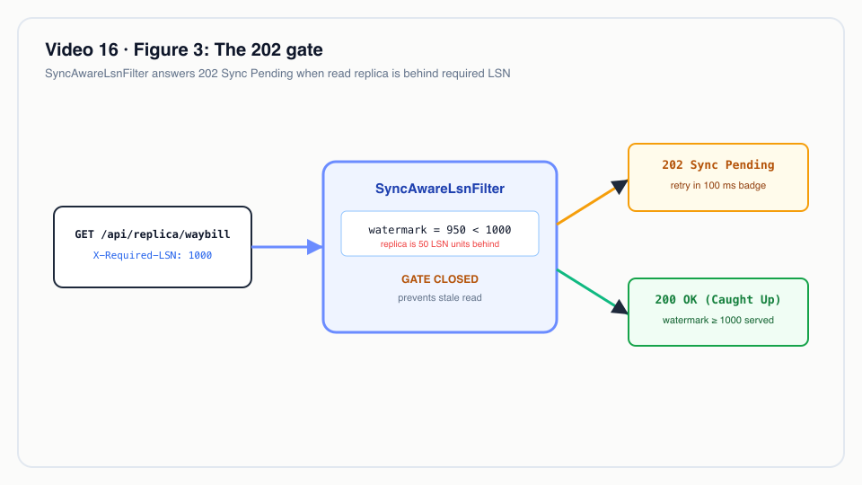

# Video 16 · Rust CDC + Sync-Aware LSN

<a href="https://media.zerohostcms.com/astra-cms/astra-video-16-cdc-vi.mp4"></a>

▶ [Tiếng Việt](https://media.zerohostcms.com/astra-cms/astra-video-16-cdc-vi.mp4) · [English](https://media.zerohostcms.com/astra-cms/astra-video-16-cdc-en.mp4) · 2:36 · Kịch bản: [demo-video-series.md](../demo-video-series.md#video-16-rust-cdc--sync-aware-lsn-cảnh-14) · [Bản tiếng Anh](./16-cdc.md)

> **Tóm tắt một câu:** Một worker Rust đọc write-ahead log của PostgreSQL và duy trì các bảng replica cho chăm sóc khách hàng, mỗi lần ghi đều báo cho client vị trí WAL của nó (`X-Tx-LSN`), và một lần đọc replica có yêu cầu vị trí đó sẽ nhận `202 Sync Pending` cho tới khi replica bắt kịp, nên CSKH không bao giờ đọc phải dữ liệu cũ.
> **Nên đọc nếu:** bạn cần một module đọc dữ liệu của module khác mà không truy vấn thẳng vào bảng của nó, nhưng vẫn thấy ngay những gì mình vừa ghi (developer) / bạn đang cân nhắc giữa eventual consistency và sự phụ thuộc chặt giữa các module, và muốn một hợp đồng cụ thể, đo được (tech lead).

## Vấn đề

Trong Astra Express, bộ phận vận hành (OPS) quét mã bưu kiện còn bộ phận chăm sóc khách hàng (CARE) trả lời các cuộc
gọi về chúng. Hai module không nên dùng chung bảng: OPS thay đổi schema theo lịch riêng của mình, CARE cần một góc nhìn
hẹp và ổn định, và trong thiết kế mục tiêu phía phân tích cũng đọc cùng luồng thay đổi đó. Lời giải chuẩn là change
data capture (CDC): đẩy các thay đổi từ database vận hành sang một bản sao do module kia sở hữu.

CDC kéo theo vấn đề kinh điển của mọi bản replica: **dữ liệu cũ**. Bưu tá quét một bưu kiện sang "Out for Delivery";
hai giây sau khách gọi đến; nhân viên CSKH mở bưu kiện và thấy "At Hub". Không ai biết được bản sao đang chậm hay lần
quét kia chưa hề xảy ra. Các đội thường chọn một trong những cách sau:

- **Đọc thẳng bảng nguồn.** Dữ liệu mới, nhưng CARE giờ bị trói vào schema và tải của OPS.
- **Chấp nhận eventual consistency và cầu may.** Phần lớn thời gian bản sao chỉ chậm vài trăm mili giây, và lần đọc
  dữ liệu cũ hiếm hoi biến thành một ticket hỗ trợ không ai tái hiện được.
- **Thêm một lệnh sleep hoặc banner "vui lòng tải lại sau một phút".** Chậm hơn với tất cả mọi người, mà vẫn không có
  gì bảo đảm.

Frappe/ERPNext để mọi module trong cùng một database và đọc thẳng bảng nguồn, nên không gặp vấn đề này, nhưng cũng
không có được sự tách rời. Astra giữ sự tách rời và làm cho độ trễ dữ liệu trở nên **nhìn thấy được và có giới hạn**:
lệnh ghi trả về một vị trí trong log; lệnh đọc có thể nói "tôi cần ít nhất vị trí đó"; kernel hoặc trả dữ liệu đã bao
gồm lần ghi, hoặc trả lời "chưa xong" mà không kèm dữ liệu.


*Ghi, vị trí, đọc.*

## Video cho thấy gì

| Cảnh | Bạn thấy gì | Điều được chứng minh |
| --- | --- | --- |
| Trang Replication | Desk → Replication (CDC): worker giải mã WAL (`pgoutput`), độ trễ 77 ms, số byte còn lại | Worker đang chạy và báo tiến độ qua kernel |
| Code | `astra-cdc-rust/cdc-routes.yaml` và vòng lặp của worker | Route được khai báo trong YAML (DocType, bảng đích, cột); worker tự giải mã pgoutput và ghi các dòng replica cùng watermark trong một transaction; slot chỉ tiến lên sau khi commit |
| Ghi | Tạm dừng worker (`kubectl scale … --replicas=0`), `quang` (OPS) chuyển `WB-2610-000003` sang Out for Delivery | Response mang `X-Tx-LSN: 0/387F920` |
| Chờ | `ha` (CARE) đọc `replica_waybill` với `X-Required-LSN: 0/387F920` | `202` với `"status": "sync-pending"`, vị trí đã replicate `0/387CFC0`, không có dòng dữ liệu cũ |
| Chạy lại | Bật worker trở lại | Cùng lệnh đọc đó trả 200 sau 26 ms kể từ khi worker chạy lại, với `ops_status: Out for Delivery`. Ở trạng thái ổn định: một lần ghi rồi đọc ngay lập tức bắt kịp sau 117 ms. Con số thay đổi theo từng lần chạy |
| Desk | Thẻ "CARE replica (CDC)" trên form Waybill | Hiện "sync pending" và tự hỏi lại trong 10 s. Trong lần quay, worker tắt lâu hơn thế, nên form được mở lại khi worker đã chạy |
| Slot | `pg_replication_slots`, cờ của bảng replica | Một logical slot `astra_cdc`, plugin `pgoutput`, `active = f` (bình thường, xem bên dưới); bảng replica bị ép row-level security, và role của worker không có SUPERUSER lẫn BYPASSRLS |

## Cách hoạt động



### 1. Cái gì được replicate là do khai báo, không phải do viết code

*`astra-cdc-rust/cdc-routes.yaml`*

```yaml
slot: astra_cdc
publication: astra_cdc
poll_ms: 50
routes:
  - doctype: Waybill
    target: replica_waybill
    columns:
      - { name: order_name,    from: order }
      - { name: ops_status,    from: ops_status }
      - { name: current_hub,   from: current_hub }
      - { name: receiver_name, from: receiver_name }
      - { name: scans,         from: scan_log, transform: length, type: integer }
  # …
```

Mọi DocType nằm trong một bảng JSONB, `astra_doc` ([Video 2](./02-doctype.vi.md)). Publication chỉ bao bảng đó, và mỗi
route chọn một DocType rồi chiếu các key JSON được chọn thành các cột có kiểu. CARE nhận `scans` dưới dạng số đếm thay
vì cả log quét mã, và đó chính là ý nghĩa của một replica: một góc nhìn hẹp do bên tiêu thụ sở hữu. Tên trong route trở
thành định danh SQL, nên worker từ chối mọi thứ không phải là một tên viết thường đơn giản hoặc một trong bốn kiểu.

### 2. Vòng lặp của worker: peek, áp dụng cùng watermark, rồi advance

*`astra-cdc-rust/src/main.rs`*

```rust
    loop {
        let cur: String = client.query_one("SELECT pg_current_wal_lsn()::text", &[]).await?.get(0);
        let rows = client
            .query(
                "SELECT lsn::text, data FROM pg_logical_slot_peek_binary_changes($1, $2::text::pg_lsn, NULL, \
                 'proto_version', '1', 'publication_names', $3)",
                &[&cfg.slot, &cur, &cfg.publication],
            )
            .await?;

        let tx = client.transaction().await?;
        // … decode each row with pgoutput::decode, upsert matching astra_doc rows into their replica …
        if applied > 0 || last_watermark.elapsed() >= Duration::from_secs(1) {
            tx.execute(
                "INSERT INTO _cdc_sync_watermark (slot, last_lsn, events, lag_ms, updated_at) VALUES ($1, $2::text::pg_lsn, $3, $4, now()) \
                 ON CONFLICT (slot) DO UPDATE SET last_lsn = excluded.last_lsn, events = _cdc_sync_watermark.events + excluded.events, \
                 lag_ms = coalesce(excluded.lag_ms, _cdc_sync_watermark.lag_ms), updated_at = now()",
                &[&cfg.slot, &cur, &(applied as i64), &lag_ms.map(|v| v as i32)],
            )
            .await?;
            last_watermark = Instant::now();
        }
        tx.commit().await?;
        client.execute("SELECT pg_replication_slot_advance($1, $2::text::pg_lsn)", &[&cfg.slot, &cur]).await?;
        // …
        tokio::time::sleep(Duration::from_millis(cfg.poll_ms)).await;
    }
```

Vì sao làm như vậy:

- **Watermark commit cùng với dữ liệu.** Các dòng replica và `_cdc_sync_watermark.last_lsn` được ghi trong cùng một
  transaction, nên "watermark là X" luôn có nghĩa "mọi thay đổi tới X đã có trong replica". Không có khoảng thời gian
  nào watermark đi trước dữ liệu.
- **Slot tiến lên sau khi commit.** Nếu worker sập giữa lúc commit và lúc advance, lần poll sau sẽ peek lại đúng những
  thay đổi đó. Upsert theo khoá `(tenant_id, name)` khiến việc phát lại vô hại: giao ít nhất một lần, áp dụng
  idempotent.
- **Peek/advance bằng SQL thay cho kết nối streaming.** Worker dùng một kết nối bình thường và các hàm SQL dành cho
  logical slot. Cách này đơn giản hơn để vận hành và dễ suy luận hơn, đổi lại phải có chu kỳ poll (50 ms) và slot hiện
  `active = f` giữa các lần poll. Streaming còn trên roadmap.
- **pgoutput được giải mã ngay trong worker.** `src/pgoutput.rs` giải mã giao thức phiên bản 1 (Begin, Commit, Relation,
  Insert, Update, Delete, Truncate). pgoutput là output plugin có sẵn của PostgreSQL, nên database không cần cài
  extension nào. Lệnh Delete bị bỏ qua vì document không bao giờ bị xoá, chỉ bị hủy.


*Bên trong một lần poll của worker.*

### 3. Dòng replica được ghi dưới RLS

Worker không được cấp role đặc quyền. Tenant của từng dòng được gắn trước khi upsert:

*`astra-cdc-rust/src/main.rs`*

```rust
    // The replica tables are under row-level security; bind this row's tenant for the write.
    tx.execute("SELECT set_config('astra.tenant', $1, true)", &[&tenant]).await?;
```

*`astra-doctype/src/main/resources/db/migration/V5__cdc_replicas.sql`*

```sql
ALTER TABLE replica_waybill ENABLE ROW LEVEL SECURITY;
ALTER TABLE replica_waybill FORCE ROW LEVEL SECURITY;
CREATE POLICY replica_waybill_tenant ON replica_waybill
    USING (tenant_id = current_setting('astra.tenant', true)) WITH CHECK (tenant_id = current_setting('astra.tenant', true));
```

*`deploy/db/20-cdc.sql`*

```sql
        -- REPLICATION reads the WAL through a slot; no SUPERUSER and no BYPASSRLS: replica rows are
        -- written under row-level security like any other.
        CREATE ROLE astra_cdc LOGIN REPLICATION PASSWORD 'astra_cdc' NOSUPERUSER NOBYPASSRLS NOCREATEDB NOCREATEROLE;
```

`WITH CHECK` nghĩa là nếu worker có lỗi gắn nhầm tenant thì lệnh ghi thất bại, thay vì làm rò một dòng sang replica của
tenant khác. File `replica-rls.txt` ghi lại trong lần quay xác nhận `relforcerowsecurity = t` trên cả hai bảng replica,
và `rolsuper = f`, `rolbypassrls = f` cho `astra_cdc`.

### 4. Cổng LSN của kernel

*`astra-doctype/src/main/java/io/astra/doctype/sync/SyncAwareLsnFilter.java`*

```java
    @Override
    public void filter(ContainerRequestContext req) {
        String required = req.getHeaderString(REQUIRED_LSN);
        if (required == null || required.isBlank() || !path(req).startsWith("api/replica")) return;
        // … reject a malformed LSN with 400 …
        if (!watermark.reached(required)) {
            Map<String, Object> body = new LinkedHashMap<>();
            body.put("status", "sync-pending");
            body.put("requiredLsn", required);
            body.put("replicatedLsn", watermark.status().get("replicatedLsn"));
            body.put("retryAfterMs", 50);
            req.abortWith(Response.status(202).entity(body).build());
        }
    }

    @Override
    public void filter(ContainerRequestContext req, ContainerResponseContext res) {
        String path = path(req);
        if (WRITES.contains(req.getMethod()) && res.getStatus() / 100 == 2 && path.startsWith("api/doc/")) {
            res.getHeaders().putSingle(TX_LSN, watermark.currentLsn());
        }
    }
```

*`astra-doctype/src/main/java/io/astra/doctype/sync/SyncWatermark.java`*

```java
    /** Whether everything up to {@code required} has been applied to the replicas. */
    public boolean reached(String required) {
        try (Connection conn = dataSource.getConnection();
             PreparedStatement ps = conn.prepareStatement(
                     "SELECT coalesce(max(last_lsn) >= ?::pg_lsn, false) FROM _cdc_sync_watermark")) {
            // …
```

Ghi chú thiết kế:

- **LSN được lấy sau khi commit.** Response filter chạy sau khi transaction của document đã commit và đọc
  `pg_current_wal_lsn()`, giá trị này nằm ở hoặc sau bản ghi commit. Vị trí đó có thể muộn hơn một chút so với mức lần
  ghi thực sự cần (các lần ghi khác có thể chen vào giữa), nên client có thể phải chờ lâu hơn cần thiết vài mili giây;
  nhưng nó không bao giờ được báo "đã đồng bộ" quá sớm. Trong lần quay, `source_lsn` của dòng (`0/387EFF0`) chỉ nhỏ hơn
  một chút so với `X-Tx-LSN` mà client nhận được (`0/387F920`).
- **Trả 202, không giữ request lại.** Kernel không giữ một thread để chờ worker. Nó trả lời ngay với các vị trí và một
  gợi ý thời gian thử lại, còn client tự quyết định chờ bao lâu. Lệnh đọc không có `X-Required-LSN` vẫn được phục vụ như
  cũ, nên một dashboard chấp nhận độ trễ không tốn thêm gì.
- **Hợp đồng là tuỳ chọn theo từng lần đọc.** Chỉ client mới biết nó vừa ghi thứ gì cần nhìn thấy. Desk nhớ `X-Tx-LSN`
  của lần ghi gần nhất và gửi kèm khi đọc replica:

*`astra-server/src/main/resources/META-INF/resources/desk/desk.js`*

```js
  for (let attempt = 0; attempt < 100; attempt++) {
    const required = state.lastLsn;
    const res = await api('GET', '/api/replica/' + spec[0] + '?name=' + enc(key), undefined, required ? { 'X-Required-LSN': required } : {});
    if (res.status === 202) {
      // … show "sync pending" with required and replicated positions …
      await new Promise((r) => setTimeout(r, 100));
      continue;
    }
    // … show "in sync" and the replica row …
  }
  status.textContent = 'Still pending after 10 s: is the CDC worker running? See Replication (CDC).';
```

Bản thân endpoint replica (`ReplicaResource`) đòi quyền đọc trên DocType *nguồn*, nên role nào không đọc được Waybill
thì cũng không đọc được `replica_waybill`.


*Cổng 202.*

## Ví dụ thực tế

**Một đơn vị giao hàng chặng cuối ở Hà Nội có đội hỗ trợ riêng.** Bưu tá cập nhật trạng thái bưu kiện từ máy cầm tay
qua module OPS; đội hỗ trợ chỉ làm việc trên các bảng replica.

*Tình huống minh hoạ: các giá trị dưới đây chỉ mang tính minh hoạ.*

**Đầu vào.** Lúc 14:02:10, bưu tá Minh đánh dấu `WB-2611-018803` là "Failed Delivery" (khách không có nhà). Lệnh PUT
trả `200` với `X-Tx-LSN: 1/0A41C2D8`. Ứng dụng trên máy cầm tay chuyển vị trí đó sang hệ thống hỗ trợ cùng mã bưu kiện,
như một phần của tác vụ "gọi cho khách".

**Astra làm gì.**

1. Lúc 14:02:11, nhân viên hỗ trợ Lan mở bưu kiện. Client của cô gửi `X-Required-LSN: 1/0A41C2D8`.
2. Worker đang giữa một lần poll; watermark là `1/0A41B900`. Kernel trả `202 sync-pending` kèm cả hai vị trí.
3. Màn hình của Lan hiện "sync pending" thay vì trạng thái cũ "Out for Delivery". Ở lần poll kế tiếp, worker áp dụng
   thay đổi, commit dòng replica cùng watermark `1/0A41D010`, và lần thử lại trả `200` với `ops_status: Failed Delivery`.

**Kết quả.** Lan không bao giờ thấy trạng thái cũ và không bao giờ phải hỏi "anh tải lại giúp em được không?". Nếu
worker ngừng chạy, cô thấy "still pending" và trang Replication báo worker không còn gửi báo cáo, biến một lỗi dữ liệu
âm thầm thành một cảnh báo vận hành.

## Dành cho tech lead

- **Bạn nhận được gì:** tách rời module bằng CDC với một hợp đồng read-your-writes rõ ràng. Cam kết là "không bao giờ
  cũ với những lần ghi bạn chỉ định", không phải "lúc nào cũng mới nhất".
- **Chi phí:** một process Rust (`astra-cdc`), một logical replication slot, một bảng watermark và một truy vấn thêm cho
  mỗi lần đọc replica có `X-Required-LSN`. PostgreSQL bắt buộc phải bật `wal_level=logical`.
- **Rủi ro vận hành: slot giữ lại WAL.** Khi worker dừng, PostgreSQL giữ lại phần WAL mà slot chưa tiêu thụ. Worker
  dừng lâu sẽ làm WAL trên đĩa phình ra. Hãy theo dõi `bytesBehind` từ `GET /api/sync/status` và cảnh báo khi
  `workerReporting: false`.
- **Độ trễ là con số đo được, không phải lời hứa.** Lần quay ghi nhận độ trễ 77 ms trên trang Replication, 26 ms từ lúc
  worker khởi động lại tới lần đọc đồng bộ đầu tiên, và 117 ms từ lúc ghi tới lúc đồng bộ ở trạng thái ổn định. Chu kỳ
  poll (50 ms) đặt ra mức sàn. Hãy đo p50/p99 của thời gian từ ghi tới đồng bộ trên tải của chính bạn.
- **Một watermark cho mọi tenant.** Worker áp dụng thay đổi của mọi tenant theo thứ tự, nên một đợt ghi dồn dập từ một
  tenant sẽ làm chậm watermark của tất cả. Ở quy mô demo thì ổn; hãy để mắt tới điểm này khi tải nhiều tenant.
- **Khi nào không nên dùng:** nếu một màn hình luôn phải hiện dữ liệu mới nhất và không xử lý được trạng thái "pending",
  hãy đọc DocType nguồn qua REST API. Nếu bạn cần replica nằm ở một database khác hoặc một kho phân tích, phần đó chưa
  được xây.
- **So với các lựa chọn khác:** Debezium cộng Kafka là một pipeline CDC tổng quát đã trưởng thành nhưng thêm một broker
  và một connector JVM, và tự nó không cho bạn hợp đồng về độ mới theo từng request. Đọc thẳng bảng nguồn thì dữ liệu
  mới nhưng trói các module vào nhau. Cách của Astra nhỏ và cụ thể: một bảng, các route khai báo, và một cái bắt tay LSN
  giữa bên ghi và bên đọc.

## Tự chạy thử

Điều kiện: cụm k3d theo [demo-video-series.md](../demo-video-series.md#1-chuẩn-bị-môi-trường-quay)
(JDK 25, Docker với 8 GB, `kubectl`, `k3d`, `jq`, Bash 5). `make k3d-up` khởi động PostgreSQL với `wal_level=logical`
và chạy `scripts/db-setup.sh`, script này tạo role CDC và publication. Chỉ cần Rust nếu bạn sửa worker.

```bash
make k3d-up
make demo-reset && make demo-seed
make demo-express SCENES=14 PAUSE=0
```

Cảnh này tạm dừng worker (`kubectl -n astra scale deployment/astra-cdc --replicas=0`), ghi, đọc kèm LSN, bật lại worker
và poll cho tới khi lệnh đọc trả 200. Output mong đợi, trích từ lần quay (vị trí và thời gian khác nhau giữa các lần
chạy):

*`docs/video/v16-cdc/assets/scene-14.log`*

```text
HTTP 200   X-Tx-LSN: 0/387F920
// …
HTTP 202
{
  "status": "sync-pending",
  "requiredLsn": "0/387F920",
  "replicatedLsn": "0/387CFC0",
  "retryAfterMs": 50
}
// …
in sync 26 ms after the worker came back
// …
replica caught up 117 ms after the write: {"ops_status":"Delivered","scans":5,"source_lsn":"0/3880788"}
// …
 slot_name |  plugin  | active | confirmed_flush_lsn 
-----------+----------+--------+---------------------
 astra_cdc | pgoutput | f      | 0/38812D0
```

Để xem trên Desk: mở `http://localhost:8080/desk/`, vào Replication (CDC), rồi lưu một Waybill và theo dõi thẻ
"CARE replica (CDC)" bên dưới form.

Phía kernel được kiểm thử bởi `astra-server/src/test/java/io/astra/server/SyncTest.java` (chạy bằng `make test`).
Test này tự đẩy `_cdc_sync_watermark` lên thay vì chạy worker Rust; worker được kiểm tra đầu cuối bằng cảnh 14 trên
cụm k3d.

## Nói đúng

- Worker đọc slot bằng `pg_logical_slot_peek_binary_changes` mỗi 50 ms (ít nhất một lần, upsert idempotent) và chưa
  dùng giao thức streaming replication.
- Chưa có gì được đẩy sang Apache Doris; pipeline phân tích trong [use-case-01.md](../use-case-01.md) là kiến trúc
  mục tiêu.
- Use case mô tả worker dựng trên `supabase/etl`, với replica nằm trong schema riêng của từng module và một cache Redis
  cho watermark. Worker đang chạy là một bộ giải mã tự viết nhỏ gọn trên `tokio-postgres`, các replica nằm trong schema
  `public`, và watermark được đọc từ bảng của nó ở mỗi request đi qua cổng.
- Desk tự hỏi lại trong 10 s. Nếu worker tắt lâu hơn, thẻ báo vẫn đang chờ và bạn mở lại form.
- Số liệu độ trễ thay đổi giữa các lần chạy; con số "khoảng 50 ms" trong kịch bản gốc thành 117 ms ở lần quay này, và
  video nói rõ điều đó.

## Hình minh hoạ

- [Hình 1 · Ghi, vị trí, đọc](#vấn-đề)
- [Hình 2 · Bên trong một lần poll của worker](#2-vòng-lặp-của-worker-peek-áp-dụng-cùng-watermark-rồi-advance)
- [Hình 3 · Cổng 202](#4-cổng-lsn-của-kernel)

## Liên quan

- Trước: [Video 15 · MCP](./15-mcp.vi.md) · Tiếp: [Video 17 · Seata](./17-seata.vi.md)
- [Video 6 · CSKH nhìn thấy vận hành](./06-care.vi.md) (nơi thẻ CARE replica xuất hiện lần đầu) · [Video 7 · Đa thuê bao](./07-tenants.vi.md) (row-level security)
- Đi qua code: [S10 Rust CDC and Sync-Aware LSN](../demo-code-snippets.md#s10-rust-cdc-and-sync-aware-lsn)
- Thiết kế mục tiêu: [use-case-01.md](../use-case-01.md) (Rust CDC, Sync-Aware LSN, Doris)
- Mã nguồn: `astra-cdc-rust/src/main.rs`, `astra-cdc-rust/src/pgoutput.rs`, `astra-cdc-rust/cdc-routes.yaml`,
  `astra-doctype/src/main/java/io/astra/doctype/sync/SyncAwareLsnFilter.java`,
  `astra-doctype/src/main/java/io/astra/doctype/sync/SyncWatermark.java`,
  `astra-doctype/src/main/java/io/astra/doctype/api/ReplicaResource.java`,
  `astra-doctype/src/main/resources/db/migration/V5__cdc_replicas.sql`, `deploy/db/20-cdc.sql`
