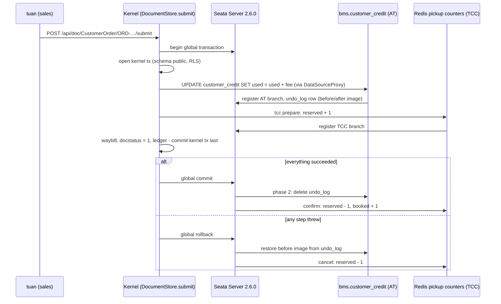

# Video 17 · Seata: one submit, three resources

<a href="https://media.zerohostcms.com/astra-cms/astra-video-17-seata-en.mp4"></a>

▶ [English](https://media.zerohostcms.com/astra-cms/astra-video-17-seata-en.mp4) · [Tiếng Việt](https://media.zerohostcms.com/astra-cms/astra-video-17-seata-vi.mp4) · 2:26 · Script: [demo-video-series.en.md](../demo-video-series.en.md#video-17-seata-one-submit-across-three-resources-scene-15)

> **In one sentence:** One YAML line, `transaction: global`, makes submitting an order a single Apache Seata global transaction that spans the BMS credit limit (an AT branch in its own schema), a pickup slot in Redis (a TCC branch) and the kernel's own document transaction, so either all three change or none do.
> **Read this if:** you write a hook that must change data another module owns and want rollback without writing compensation code yourself (developer) / you are deciding between distributed transactions, sagas and a single shared database, and want to see the real trade-offs in running code (tech lead).

## The problem

When a sales clerk at Astra Express submits a customer order, three things must happen together:

1. **BMS (billing)** charges the shipping fee against the customer's credit limit. BMS owns its data in its own
   schema (`bms`), under its own database role. The order module cannot write there in its own transaction.
2. **OPS (operations)** reserves a pickup slot for today. Pickup capacity is a fast counter in Redis, not a
   database row.
3. **The kernel** marks the order Submitted, creates the waybill and posts the journal entry, all in PostgreSQL.

If BMS accepts the charge but OPS has no slot left, the customer has been charged credit for an order that will
never be picked up. If the order is submitted but the credit charge failed, billing is wrong. Usually teams pick one
of:

- **One shared database and one transaction.** This is how Frappe/ERPNext works: all modules share one database,
  so a credit check and a submit are one database transaction. It is simple, but it gives up module ownership of
  data, and Redis is still outside the transaction.
- **Hand-written compensation (saga).** Each step has an "undo" written by hand; every developer has to get the
  failure ordering, retries and duplicates right.
- **Ignore it.** Reconcile with a nightly job and fix mismatches by hand.

Astra uses a transaction coordinator. The app says *what* it wants (use credit, reserve a slot); Seata records each
branch and drives commit or rollback for all of them. Database writes get automatic undo (AT mode); non-database
resources implement try/confirm/cancel (TCC mode).


*One submit, three resources: the document lifecycle coordinates PostgreSQL, Redis pickup capacity, and BMS credit limits.*

## What the video shows

| Scene | What you see | What it proves |
| --- | --- | --- |
| YAML | `customer-order.doctype.yaml`: `transaction: global` | The kernel opens a global transaction around submit and cancel |
| Success | Submit order `ORD-20261021-00007` for C001 (fee 73,000 ₫) | Used credit goes from 123,000 to 196,000; pickup slots booked go from 5 to 6; waybill `WB-2610-000006` is created. Seata Server records two branches, AT then TCC, and commits both |
| Over limit | Submit the draft `ORD-20261021-00005` for C002 | `422 credit limit of C002 exceeded: 54000.00 used of 150000.00, this order needs 105000.00`. The order stays a draft, no waybill, no journal entry; AT refused first, TCC never reserved |
| Late refusal | The day is set to fully booked (200 of 200); submit `ORD-20261021-00008` | AT has already taken the credit, then TCC refuses: `no pickup slot left for 2026-10-21 (capacity 200)`. Seata restores C001's credit from the undo log (still 196,000), `undo_rows` is 0, reserved slots stay at 0 |
| Server log | The real log of Seata Server 2.6.0 (JDK 25) | Begin, two branch registrations, both rolled back: about 75 ms on its clock |
| Code | `OrderCreditHook`, `PickupCapacity` | The app calls an SPI and sees no Seata type. AT is plain JDBC on a proxied datasource; TCC is an app participant that throws when slots run out |


*Two-phase commit in action: if a branch rejects, Seata coordinates global rollback across AT undo logs and TCC cancel handlers.*

## How it works



### 1. One line in the DocType

*`astra-apps/express/src/main/resources/META-INF/astra/doctypes/customer-order.doctype.yaml`*

```yaml
name: CustomerOrder
module: oms
kind: transaction
submittable: true                 # Draft (0) -> Submitted (1) -> Cancelled (2) -> Amend
transaction: global               # submit/cancel span BMS credit (Seata AT) and pickup capacity (Seata TCC)
```

The kernel reads this flag and wraps submit and cancel. Other DocTypes are untouched: a draft save, or a submit of
a DocType without the flag, never contacts the coordinator.

*`astra-doctype/src/main/java/io/astra/doctype/store/DocumentStore.java`*

```java
    public Optional<Document> submit(String doctype, String name) {
        DocTypeDefinition def = requireSubmittable(doctype);
        return global(def, "submit " + doctype + " " + name, () -> inTenantTx(conn -> {
            // … load the draft, check the caller may submit …
            hooks.onSubmit(doc);
            DocumentValidator.applyDefaultsAndValidate(def, doc);
            validateLinks(conn, def, doc);
            return Optional.of(write(conn, doc, 1));
        }));
    }
    // …
    private <T> T global(DocTypeDefinition def, String name, Supplier<T> work) {
        if (def.globalTransaction() && coordinator.isResolvable() && coordinator.get().available()) {
            return coordinator.get().inGlobal(name, work);
        }
        return work.get();
    }
```

The global transaction is the outer scope and the kernel's database transaction is inside it, so the kernel's own
writes commit last, after every branch has done its phase 1. If the kernel transaction fails, the exception reaches
the global scope and every branch is rolled back.

### 2. The coordinator: begin, run, commit or roll back

*`astra-tx-seata/src/main/java/io/astra/tx/seata/SeataTransactions.java`*

```java
    @Override
    public <T> T inGlobal(String name, Supplier<T> work) {
        if (RootContext.inGlobalTransaction()) return work.get();
        GlobalTransaction gtx = GlobalTransactionContext.getCurrentOrCreate();
        // … gtx.begin(timeoutMillis, name) …
        String xid = gtx.getXid();
        try {
            T result = work.get();
            gtx.commit();
            LOG.infof("Global transaction %s committed (%s)", xid, name);
            return result;
        } catch (TransactionException e) {
            throw new IllegalStateException("global commit failed: " + e.getMessage(), e);
        } catch (Throwable e) {
            // Any failure, Errors included: a branch may already hold global locks that only a rollback releases.
            try {
                gtx.rollback();
                LOG.infof("Global transaction %s rolled back (%s): %s", xid, name, e.getMessage());
            } catch (TransactionException te) {
                LOG.errorf(te, "Global transaction %s rollback failed; the coordinator retries it", xid);
            }
            throw e;
        } finally {
            if (xid != null && xid.equals(RootContext.getXID())) RootContext.unbind();
        }
    }
```

Catching `Throwable` rather than `Exception` is deliberate: once an AT branch has run, it holds a global lock on the
credit row, and only a rollback releases it. Seata is disabled unless `astra.seata.enabled` is true; without it,
`global(...)` runs the work locally and the hook below skips its checks.


*TCC participant lifecycle: Try reserves resources, while Confirm commits and Cancel releases reserved capacity.*

### 3. The app hook sees an SPI, not Seata

*`astra-apps/express/src/main/java/io/astra/apps/express/OrderCreditHook.java`*

```java
    @Override
    public void onSubmit(Document order) {
        GlobalTransactions tx = coordinator();
        if (tx == null) return;
        CreditLimits.use(tx, order.getString("customer"), fee(order));
        tx.tcc(PickupCapacity.NAME, LocalDate.now().toString(), Map.of("capacity", DAILY_PICKUP_CAPACITY, "order", order.name()));
    }
```

`GlobalTransactions` and `TccParticipant` are interfaces in `astra-spi`. The Express app depends only on the SPI, so
the coordinator could be replaced without touching app code.

**AT branch: plain JDBC.** `CreditLimits.use` gets a connection from `tx.atDataSource("bms")`, which is the BMS
datasource wrapped in Seata's `DataSourceProxy`. The check and the charge are one statement:

*`astra-apps/express/src/main/java/io/astra/apps/express/CreditLimits.java`*

```java
            try (PreparedStatement ps = conn.prepareStatement(
                    "UPDATE customer_credit SET used = used + ?, updated_at = now() WHERE account_key = ? AND used + ? <= credit_limit")) {
                ps.setBigDecimal(1, amount);
                ps.setString(2, accountKey(customer));
                ps.setBigDecimal(3, amount);
                if (ps.executeUpdate() == 1) return;
            }
            // … otherwise read the row and throw "credit limit of … exceeded: … used of …, this order needs …"
```

The proxy records the row's before and after images in `bms.undo_log` (the table is created by
`astra-tx-seata/src/main/resources/db/bms/V1__customer_credit.sql`) and commits the BMS change locally. On global
commit, Seata deletes the undo rows; on rollback, it writes the before image back. That is why the video can show
"credit restored, `undo_rows` 0" without any compensation code in the app.

**TCC branch: an app participant.** Redis has no undo log, so the app implements the three phases itself:

*`astra-apps/express/src/main/java/io/astra/apps/express/PickupCapacity.java`*

```java
    @Override
    public void prepare(String branchId, String day, Map<String, Object> args) {
        if (counters.get("tcc-done:" + branchId) > 0) {
            throw new DocValidationException("pickup reservation " + branchId + " was already cancelled"); // late try after rollback
        }
        counters.add("tcc-try:" + branchId, 1, KEEP);
        long capacity = Math.round(Numbers.toDouble(args.get("capacity")));
        long reserved = counters.add(reservedKey(day), 1, KEEP);
        if (reserved + counters.get(bookedKey(day)) > capacity) {
            // The branch is registered, so Seata calls rollback, which gives this slot back.
            throw new DocValidationException("no pickup slot left for " + day + " (capacity " + capacity + ")");
        }
    }

    @Override
    public void commit(String branchId, String day, Map<String, Object> args) {
        if (!counters.markOnce("tcc-done:" + branchId, KEEP)) return;
        counters.add(reservedKey(day), -1, KEEP);
        counters.add(bookedKey(day), 1, KEEP);
    }

    @Override
    public void rollback(String branchId, String day, Map<String, Object> args) {
        if (!counters.markOnce("tcc-done:" + branchId, KEEP)) return;
        if (counters.get("tcc-try:" + branchId) > 0) counters.add(reservedKey(day), -1, KEEP); // nothing to give back after an empty rollback
    }
```

The three classic TCC hazards are handled per branch, keyed by `branchId`:

- **Idempotent phase 2.** Seata may retry commit or rollback. `markOnce("tcc-done:…")` makes the second call a no-op.
- **Empty rollback.** A rollback can arrive for a branch whose try never ran. `tcc-try:…` is checked before giving a
  slot back.
- **Suspension.** A try that arrives after its own rollback is refused.

The kernel registers a single Seata TCC resource, `astra-tcc`, and dispatches to app participants by name. Phase 2
runs on a Seata thread with no HTTP request, so the dispatcher re-binds the tenant recorded at prepare time:

*`astra-tx-seata/src/main/java/io/astra/tx/seata/AstraTccDispatcher.java`*

```java
    private void phase2(BusinessActionContext c, boolean commit) {
        String tenant = String.valueOf(c.getActionContext("tenant"));
        TccParticipant p = find(String.valueOf(c.getActionContext("participant")));
        String key = String.valueOf(c.getActionContext("key"));
        Map<String, Object> args = arguments(String.valueOf(c.getActionContext("arguments")));
        String branch = c.getXid() + "/" + c.getBranchId();
        TenantContext.run(tenant, () -> {
            if (commit) p.commit(branch, key, args);
            else p.rollback(branch, key, args);
        });
    }
```


*Apps interact strictly with transactional SPI interfaces; the Seata client runtime remains completely decoupled from app logic.*

### 4. What the coordinator saw

The video's server log (`docs/video/v17-seata/assets/seata-server.log`) shows, for the late-refusal case, the
global begin at `00:48:03.690`, the AT branch registration, the TCC branch registration, a `GlobalRollbackRequest`
and the last `BranchRollbackResponse` at `00:48:03.765`: about 75 ms on the server's clock. The branch order in the
log (AT before TCC) matches `OrderCreditHook`.

## Real-world example

**A B2B distributor with credit terms and a loading-dock schedule.** Finance owns customer credit in its own schema;
the warehouse manages dock appointments in Redis because they change every few seconds. The values below are
illustrative; the mechanism is the one in this video.

**Input.** Customer "Minh Phát Trading" has a credit limit of 500,000,000 ₫ with 462,000,000 ₫ used. A sales rep
submits a sales order of 31,500,000 ₫ that needs a dock slot on 15 November. The dock has 40 slots per day; 39 are
booked.

**What Astra does.**

1. The coordinator begins a global transaction.
2. AT branch: `used` goes from 462,000,000 to 493,500,000 (within the limit); the before image is in `undo_log`.
3. TCC branch: `reserved` goes to 1; 1 + 39 ≤ 40, so the slot is held.
4. The kernel writes the order as Submitted and posts its journal entry, then commits; the coordinator commits
   both branches: undo rows are deleted, `reserved` returns to 0 and `booked` becomes 40.

**Output, and the failure case.** A second order for the same customer, 4,000,000 ₫, arrives a minute later. The AT
branch succeeds (493,500,000 + 4,000,000 ≤ 500,000,000), but the dock is now full: the TCC try sees 1 + 40 > 40 and
throws. The coordinator restores `used` to 493,500,000 from the undo log and cancels the reservation. The order
stays a draft, and the rep sees "no slot left" instead of a half-done order that finance has to chase.

## For technical leaders

- **What you get:** all-or-nothing across a module's own schema, Redis and the kernel, with automatic undo for SQL
  (AT) and an explicit, testable contract for everything else (TCC). App code stays free of coordinator types.
- **What it costs:** a Seata Server to operate, extra round trips to it per global submit (in the recorded commit
  case, begin to "Committing global transaction is successfully done" spans about 67 ms on the server's clock), and
  an `undo_log` table in each AT schema. Only DocTypes marked `transaction: global` pay this.
- **Hot rows serialise.** An AT branch holds a global lock on the rows it changed until phase 2. Many concurrent
  submits for one large customer will queue on that customer's credit row. Measure lock waits if one shop dominates
  your volume.
- **The coordinator is central.** In this demo it runs with the file store in one pod
  (`deploy/k8s/base/seata.yaml`); losing that pod loses in-flight transaction state. Production needs Seata's
  database or Raft store.
- **Know the last-resource window.** The kernel's own transaction is not a Seata branch; it commits last, then the
  global commit is sent. If the coordinator cannot be reached in that window, the order is already committed while
  the branches wait for the coordinator to resolve them. Making the kernel a branch (AT for the kernel itself) is on
  the roadmap. Track `global commit failed` in logs.
- **TCC participants are real code.** Each one must be idempotent and handle empty rollback and suspension. Review
  and test them like payment code; `PickupCapacity` is the reference pattern.
- **When not to use it:** if all data is in one PostgreSQL database and one schema, a local transaction is simpler
  and faster. If steps span external partners or take minutes (a carrier API, a human approval), use an
  asynchronous saga or outbox instead; a global lock should not be held that long.
- **Compared with alternatives:** XA two-phase commit needs XA support in every resource and holds database locks
  through both phases; Redis has no XA. A saga avoids locks but pushes compensation and visible intermediate states
  onto app developers. [explain.en.md](../explain.en.md) records a transactional outbox plus idempotent TCC as the
  fallback if Seata did not work out.

## Try it yourself

Prerequisites: the k3d stack from [demo-video-series.en.md](../demo-video-series.en.md#1-preparing-the-recording-environment)
(JDK 25, Docker with 8 GB, `kubectl`, `k3d`, `jq`, Bash 5). `make k3d-up` deploys Seata Server
(`apache/seata-server:2.6.0.jdk25`) and runs `scripts/db-setup.sh`, which prepares the BMS schema and role.

```bash
make k3d-up
make demo-reset && make demo-seed
make demo-express SCENES=15 PAUSE=0
```

Expected output, excerpted from the recorded run (order numbers carry the seed date):

*`docs/video/v17-seata/assets/scene-15.log`*

```text
 customer | credit_limit |   used    
----------+--------------+-----------
 C001     |   2000000.00 | 196000.00
 C002     |    150000.00 |  54000.00
(2 rows)

pickup slots today: reserved=0 booked=6
// …
    "credit limit of C002 exceeded: 54000.00 used of 150000.00, this order needs 105000.00"
// …
    "no pickup slot left for 2026-10-21 (capacity 200)"
// …
 undo_rows 
-----------
         0
(1 row)
```

The scene fills today's pickup slots to force the late refusal and then sets them back, so other scenes can still
submit orders. The draft order for C002 (`ORD-…-00005`) is created by the seed for this scene; if you have already
submitted or changed it, run `make demo-reset && make demo-seed` again.

The integration test `astra-server/src/test/java/io/astra/server/SeataTest.java` runs the same three cases
(commit, BMS refusal, refusal after the AT branch committed) against a real Seata Server and Redis; it runs with
`make test`.

## To be accurate

- Seata Server uses the file store, which is enough for the demo; production should use a database or Raft store.
- TCC handles idempotency, empty rollback and suspension per branch itself and does not use Seata's fence table yet.
- The kernel commits its own transaction last (as the last resource) and is not yet a Seata branch.
- Only the credit limit (AT) and pickup capacity (TCC) are wired in; the target design in
  [use-case-01.md](../use-case-01.md) and [explain.en.md](../explain.en.md) describes more (for example a
  smart bypass of the coordinator and an `@AstraGlobalTransactional` annotation) that is not built. In the running
  code, the YAML flag `transaction: global` is the switch.

## Figures

### Figure 1 · One submit, three resources


### Figure 2 · Rollback after a branch committed


### Figure 3 · TCC participant states


### Figure 4 · Who sees Seata


## Related

- Previous: [Video 16 · Rust CDC + Sync-Aware LSN](./16-cdc.md) · Next: [Video 18 · Roadmap](./18-roadmap.md)
- [Video 4 · Lifecycle](./04-lifecycle.md) (submit, cancel, amend in one kernel transaction) · [Video 12 · Ledger](./12-ledger.md) (the journal entry written on submit)
- Code walkthrough: [S11 Seata AT and TCC](../demo-code-snippets.md#s11-seata-at-and-tcc) (Vietnamese)
- Background: [explain.en.md](../explain.en.md) (why Seata, risks and the fallback) · [use-case-01.md](../use-case-01.md) (target design; Vietnamese)
- Source: `astra-tx-seata/src/main/java/io/astra/tx/seata/SeataTransactions.java`,
  `astra-tx-seata/src/main/java/io/astra/tx/seata/AstraTccDispatcher.java`,
  `astra-spi/src/main/java/io/astra/spi/tx/GlobalTransactions.java`, `astra-spi/src/main/java/io/astra/spi/tx/TccParticipant.java`,
  `astra-apps/express/src/main/java/io/astra/apps/express/OrderCreditHook.java`,
  `astra-apps/express/src/main/java/io/astra/apps/express/CreditLimits.java`,
  `astra-apps/express/src/main/java/io/astra/apps/express/PickupCapacity.java`,
  `astra-tx-seata/src/main/resources/db/bms/V1__customer_credit.sql`, `deploy/k8s/base/seata.yaml`
