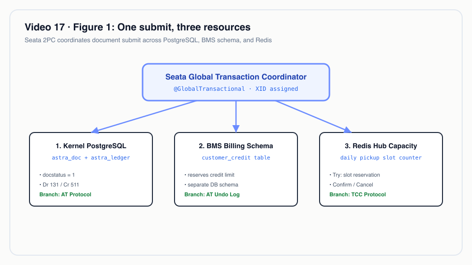
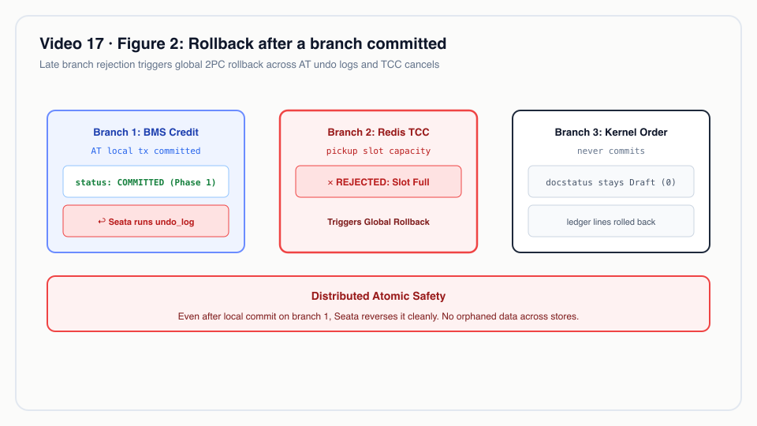
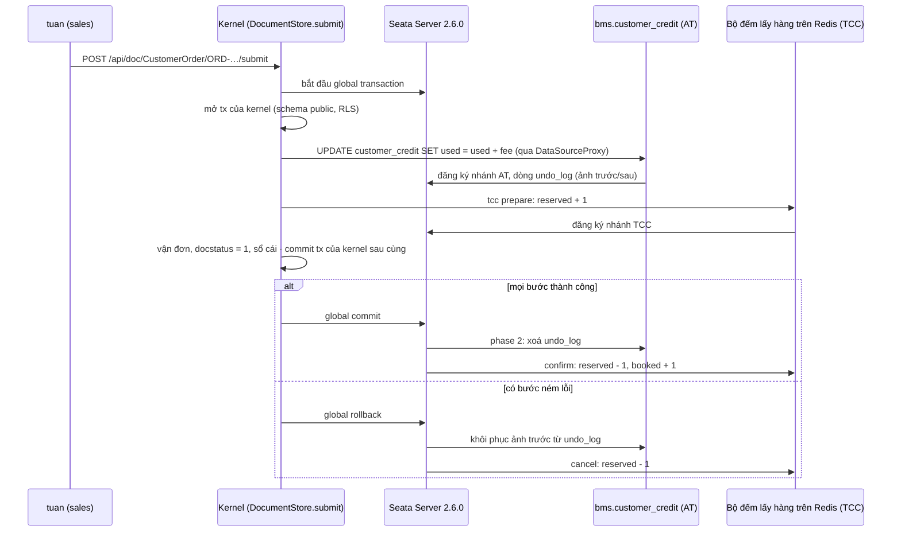
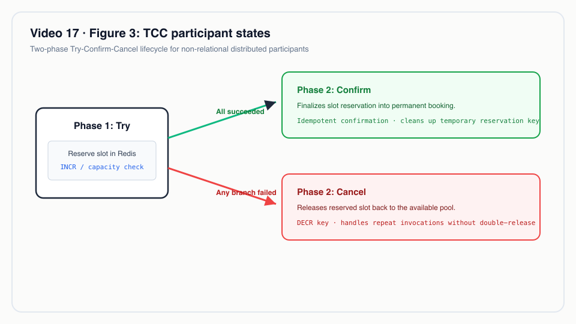
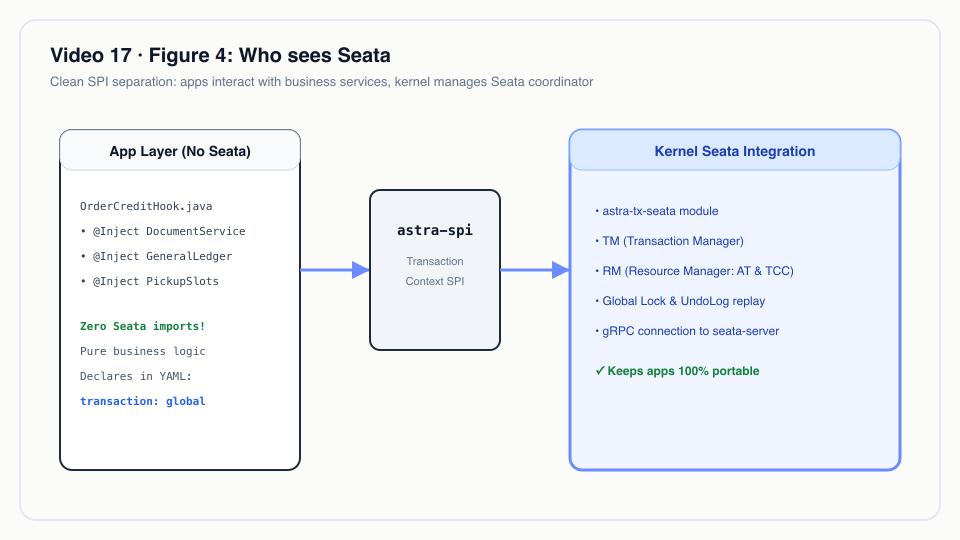

# Video 17 · Seata: một lần submit, ba tài nguyên

<a href="https://media.zerohostcms.com/astra-cms/astra-video-17-seata-vi.mp4"></a>

▶ [Tiếng Việt](https://media.zerohostcms.com/astra-cms/astra-video-17-seata-vi.mp4) · [English](https://media.zerohostcms.com/astra-cms/astra-video-17-seata-en.mp4) · 2:26 · Kịch bản: [demo-video-series.md](../demo-video-series.md#video-17-seata-một-lần-submit-trên-ba-tài-nguyên-cảnh-15) · [Bản tiếng Anh](./17-seata.md)

> **Tóm tắt một câu:** Chỉ một dòng YAML, `transaction: global`, biến việc submit đơn hàng thành một global transaction duy nhất của Apache Seata, trải qua hạn mức công nợ BMS (một nhánh AT trong schema riêng), một chỗ lấy hàng trên Redis (một nhánh TCC) và transaction chứng từ của chính kernel, nên hoặc cả ba cùng thay đổi, hoặc không cái nào thay đổi.
> **Nên đọc nếu:** bạn viết một hook phải thay đổi dữ liệu do module khác sở hữu và muốn có rollback mà không phải tự viết code bù trừ (developer) / bạn đang chọn giữa distributed transaction, saga và một database dùng chung, và muốn thấy các đánh đổi thật trong code đang chạy (tech lead).

## Vấn đề

Khi một nhân viên bán hàng của Astra Express submit đơn hàng của khách, ba việc phải xảy ra cùng nhau:

1. **BMS (billing)** trừ phí vận chuyển vào hạn mức công nợ của khách. BMS sở hữu dữ liệu trong schema riêng (`bms`),
   dưới role database riêng. Module đơn hàng không thể ghi vào đó trong transaction của chính mình.
2. **OPS (vận hành)** giữ một chỗ lấy hàng cho hôm nay. Năng lực lấy hàng là một bộ đếm nhanh trên Redis, không phải
   một dòng trong database.
3. **Kernel** đánh dấu đơn hàng là Submitted, tạo vận đơn và ghi bút toán, tất cả trong PostgreSQL.

Nếu BMS đã nhận khoản trừ mà OPS hết chỗ, khách bị trừ công nợ cho một đơn hàng sẽ không bao giờ được lấy. Nếu đơn đã
được submit mà khoản trừ công nợ thất bại, billing bị sai. Các đội thường chọn một trong những cách sau:

- **Một database dùng chung và một transaction.** Đây là cách Frappe/ERPNext làm: mọi module dùng chung một database,
  nên kiểm tra công nợ và submit là một database transaction. Cách này đơn giản, nhưng từ bỏ quyền sở hữu dữ liệu của
  từng module, và Redis vẫn nằm ngoài transaction.
- **Tự viết code bù trừ (saga).** Mỗi bước có một thao tác "hoàn tác" viết tay; mọi developer đều phải làm đúng thứ tự
  khi lỗi, việc thử lại và trùng lặp.
- **Mặc kệ.** Đối soát bằng một job chạy ban đêm và sửa chênh lệch bằng tay.

Astra dùng một bộ điều phối transaction. App nói nó muốn *gì* (dùng công nợ, giữ một chỗ); Seata ghi nhận từng nhánh
và điều khiển commit hoặc rollback cho tất cả. Các lệnh ghi database được hoàn tác tự động (chế độ AT); các tài nguyên
không phải database thì cài đặt try/confirm/cancel (chế độ TCC).


*Một lần submit, ba tài nguyên.*

## Video cho thấy gì

| Cảnh | Bạn thấy gì | Điều được chứng minh |
| --- | --- | --- |
| YAML | `customer-order.doctype.yaml`: `transaction: global` | Kernel mở một global transaction quanh submit và cancel |
| Thành công | Submit đơn `ORD-20261021-00007` của C001 (phí 73.000 ₫) | Công nợ đã dùng từ 123.000 lên 196.000; số chỗ lấy hàng đã đặt từ 5 lên 6; vận đơn `WB-2610-000006` được tạo. Seata Server ghi hai nhánh, AT rồi TCC, và commit cả hai |
| Vượt hạn mức | Submit đơn nháp `ORD-20261021-00005` của C002 | `422 credit limit of C002 exceeded: 54000.00 used of 150000.00, this order needs 105000.00`. Đơn vẫn là nháp, không vận đơn, không bút toán; AT từ chối trước, TCC chưa hề giữ chỗ |
| Từ chối muộn | Ngày được đặt thành kín chỗ (200 trên 200); submit `ORD-20261021-00008` | AT đã trừ công nợ, rồi TCC từ chối: `no pickup slot left for 2026-10-21 (capacity 200)`. Seata khôi phục công nợ của C001 từ undo log (vẫn là 196.000), `undo_rows` bằng 0, số chỗ đang giữ vẫn là 0 |
| Log server | Log thật của Seata Server 2.6.0 (JDK 25) | Begin, hai lần đăng ký nhánh, cả hai bị rollback: khoảng 75 ms theo đồng hồ của server |
| Code | `OrderCreditHook`, `PickupCapacity` | App gọi một SPI và không thấy kiểu nào của Seata. AT là JDBC thuần trên một datasource được proxy; TCC là một participant của app, ném lỗi khi hết chỗ |


*Rollback sau khi một nhánh đã commit.*

## Cách hoạt động



### 1. Một dòng trong DocType

*`astra-apps/express/src/main/resources/META-INF/astra/doctypes/customer-order.doctype.yaml`*

```yaml
name: CustomerOrder
module: oms
kind: transaction
submittable: true                 # Draft (0) -> Submitted (1) -> Cancelled (2) -> Amend
transaction: global               # submit/cancel span BMS credit (Seata AT) and pickup capacity (Seata TCC)
```

Kernel đọc cờ này và bọc submit cùng cancel. Các DocType khác không bị ảnh hưởng: lưu nháp, hay submit một DocType
không có cờ này, không bao giờ liên lạc với bộ điều phối.

*`astra-doctype/src/main/java/io/astra/doctype/store/DocumentStore.java`*

```java
    public Optional<Document> submit(String doctype, String name) {
        DocTypeDefinition def = requireSubmittable(doctype);
        return global(def, "submit " + doctype + " " + name, () -> inTenantTx(conn -> {
            // … load the draft, check the caller may submit …
            hooks.onSubmit(doc);
            DocumentValidator.applyDefaultsAndValidate(def, doc);
            validateLinks(conn, def, doc);
            return Optional.of(write(conn, doc, 1));
        }));
    }
    // …
    private <T> T global(DocTypeDefinition def, String name, Supplier<T> work) {
        if (def.globalTransaction() && coordinator.isResolvable() && coordinator.get().available()) {
            return coordinator.get().inGlobal(name, work);
        }
        return work.get();
    }
```

Global transaction là phạm vi bên ngoài, còn database transaction của kernel nằm bên trong, nên các lệnh ghi của chính
kernel commit sau cùng, khi mọi nhánh đã xong phase 1. Nếu transaction của kernel thất bại, exception đi tới phạm vi
global và mọi nhánh đều bị rollback.

### 2. Bộ điều phối: begin, chạy, commit hoặc rollback

*`astra-tx-seata/src/main/java/io/astra/tx/seata/SeataTransactions.java`*

```java
    @Override
    public <T> T inGlobal(String name, Supplier<T> work) {
        if (RootContext.inGlobalTransaction()) return work.get();
        GlobalTransaction gtx = GlobalTransactionContext.getCurrentOrCreate();
        // … gtx.begin(timeoutMillis, name) …
        String xid = gtx.getXid();
        try {
            T result = work.get();
            gtx.commit();
            LOG.infof("Global transaction %s committed (%s)", xid, name);
            return result;
        } catch (TransactionException e) {
            throw new IllegalStateException("global commit failed: " + e.getMessage(), e);
        } catch (Throwable e) {
            // Any failure, Errors included: a branch may already hold global locks that only a rollback releases.
            try {
                gtx.rollback();
                LOG.infof("Global transaction %s rolled back (%s): %s", xid, name, e.getMessage());
            } catch (TransactionException te) {
                LOG.errorf(te, "Global transaction %s rollback failed; the coordinator retries it", xid);
            }
            throw e;
        } finally {
            if (xid != null && xid.equals(RootContext.getXID())) RootContext.unbind();
        }
    }
```

Bắt `Throwable` thay vì `Exception` là có chủ ý: một khi nhánh AT đã chạy, nó giữ global lock trên dòng công nợ, và chỉ
rollback mới giải phóng được. Seata bị tắt trừ khi `astra.seata.enabled` là true; khi tắt, `global(...)` chạy công việc
cục bộ và hook bên dưới bỏ qua các bước kiểm tra.


*Các trạng thái của TCC participant.*

### 3. Hook của app thấy một SPI, không thấy Seata

*`astra-apps/express/src/main/java/io/astra/apps/express/OrderCreditHook.java`*

```java
    @Override
    public void onSubmit(Document order) {
        GlobalTransactions tx = coordinator();
        if (tx == null) return;
        CreditLimits.use(tx, order.getString("customer"), fee(order));
        tx.tcc(PickupCapacity.NAME, LocalDate.now().toString(), Map.of("capacity", DAILY_PICKUP_CAPACITY, "order", order.name()));
    }
```

`GlobalTransactions` và `TccParticipant` là các interface trong `astra-spi`. App Express chỉ phụ thuộc vào SPI, nên có
thể thay bộ điều phối mà không đụng tới code của app.

**Nhánh AT: JDBC thuần.** `CreditLimits.use` lấy kết nối từ `tx.atDataSource("bms")`, tức datasource của BMS được bọc
trong `DataSourceProxy` của Seata. Việc kiểm tra và việc trừ công nợ nằm trong một câu lệnh:

*`astra-apps/express/src/main/java/io/astra/apps/express/CreditLimits.java`*

```java
            try (PreparedStatement ps = conn.prepareStatement(
                    "UPDATE customer_credit SET used = used + ?, updated_at = now() WHERE account_key = ? AND used + ? <= credit_limit")) {
                ps.setBigDecimal(1, amount);
                ps.setString(2, accountKey(customer));
                ps.setBigDecimal(3, amount);
                if (ps.executeUpdate() == 1) return;
            }
            // … otherwise read the row and throw "credit limit of … exceeded: … used of …, this order needs …"
```

Proxy ghi ảnh trước và ảnh sau của dòng vào `bms.undo_log` (bảng này được tạo bởi
`astra-tx-seata/src/main/resources/db/bms/V1__customer_credit.sql`) và commit thay đổi của BMS cục bộ. Khi global
commit, Seata xoá các dòng undo; khi rollback, nó ghi ảnh trước trở lại. Đó là lý do video có thể cho thấy "công nợ đã
được khôi phục, `undo_rows` bằng 0" mà app không có chút code bù trừ nào.

**Nhánh TCC: một participant của app.** Redis không có undo log, nên app tự cài đặt cả ba pha:

*`astra-apps/express/src/main/java/io/astra/apps/express/PickupCapacity.java`*

```java
    @Override
    public void prepare(String branchId, String day, Map<String, Object> args) {
        if (counters.get("tcc-done:" + branchId) > 0) {
            throw new DocValidationException("pickup reservation " + branchId + " was already cancelled"); // late try after rollback
        }
        counters.add("tcc-try:" + branchId, 1, KEEP);
        long capacity = Math.round(Numbers.toDouble(args.get("capacity")));
        long reserved = counters.add(reservedKey(day), 1, KEEP);
        if (reserved + counters.get(bookedKey(day)) > capacity) {
            // The branch is registered, so Seata calls rollback, which gives this slot back.
            throw new DocValidationException("no pickup slot left for " + day + " (capacity " + capacity + ")");
        }
    }

    @Override
    public void commit(String branchId, String day, Map<String, Object> args) {
        if (!counters.markOnce("tcc-done:" + branchId, KEEP)) return;
        counters.add(reservedKey(day), -1, KEEP);
        counters.add(bookedKey(day), 1, KEEP);
    }

    @Override
    public void rollback(String branchId, String day, Map<String, Object> args) {
        if (!counters.markOnce("tcc-done:" + branchId, KEEP)) return;
        if (counters.get("tcc-try:" + branchId) > 0) counters.add(reservedKey(day), -1, KEEP); // nothing to give back after an empty rollback
    }
```

Ba rủi ro kinh điển của TCC được xử lý theo từng nhánh, với khoá là `branchId`:

- **Phase 2 idempotent.** Seata có thể thử lại commit hoặc rollback. `markOnce("tcc-done:…")` biến lần gọi thứ hai thành
  không làm gì.
- **Empty rollback.** Một lệnh rollback có thể tới cho một nhánh mà bước try chưa từng chạy. `tcc-try:…` được kiểm tra
  trước khi trả lại chỗ.
- **Suspension.** Một bước try tới sau chính lệnh rollback của nó sẽ bị từ chối.

Kernel đăng ký một TCC resource duy nhất của Seata, `astra-tcc`, và chuyển tới participant của app theo tên. Phase 2
chạy trên một thread của Seata, không có HTTP request nào, nên dispatcher gắn lại tenant đã ghi nhận lúc prepare:

*`astra-tx-seata/src/main/java/io/astra/tx/seata/AstraTccDispatcher.java`*

```java
    private void phase2(BusinessActionContext c, boolean commit) {
        String tenant = String.valueOf(c.getActionContext("tenant"));
        TccParticipant p = find(String.valueOf(c.getActionContext("participant")));
        String key = String.valueOf(c.getActionContext("key"));
        Map<String, Object> args = arguments(String.valueOf(c.getActionContext("arguments")));
        String branch = c.getXid() + "/" + c.getBranchId();
        TenantContext.run(tenant, () -> {
            if (commit) p.commit(branch, key, args);
            else p.rollback(branch, key, args);
        });
    }
```


*Ai nhìn thấy Seata.*

### 4. Bộ điều phối đã thấy gì

Log server trong video (`docs/video/v17-seata/assets/seata-server.log`) cho thấy, với trường hợp từ chối muộn, global
begin lúc `00:48:03.690`, lần đăng ký nhánh AT, lần đăng ký nhánh TCC, một `GlobalRollbackRequest` và
`BranchRollbackResponse` cuối cùng lúc `00:48:03.765`: khoảng 75 ms theo đồng hồ của server. Thứ tự nhánh trong log
(AT trước TCC) khớp với `OrderCreditHook`.

## Ví dụ thực tế

**Một nhà phân phối B2B có điều khoản công nợ và lịch xếp dỡ tại kho.** Bộ phận tài chính sở hữu công nợ khách hàng
trong schema riêng; kho quản lý lịch hẹn xếp dỡ trên Redis vì chúng thay đổi vài giây một lần.

*Tình huống minh hoạ: các giá trị dưới đây chỉ mang tính minh hoạ; cơ chế là cơ chế trong video này.*

**Đầu vào.** Khách hàng "Minh Phát Trading" có hạn mức công nợ 500.000.000 ₫, đã dùng 462.000.000 ₫. Một nhân viên bán
hàng submit đơn bán 31.500.000 ₫ cần một chỗ xếp dỡ vào ngày 15 tháng 11. Kho có 40 chỗ mỗi ngày; 39 chỗ đã được đặt.

**Astra làm gì.**

1. Bộ điều phối bắt đầu một global transaction.
2. Nhánh AT: `used` đi từ 462.000.000 lên 493.500.000 (trong hạn mức); ảnh trước nằm trong `undo_log`.
3. Nhánh TCC: `reserved` lên 1; 1 + 39 ≤ 40, nên chỗ được giữ.
4. Kernel ghi đơn hàng ở trạng thái Submitted và ghi bút toán, rồi commit; bộ điều phối commit cả hai nhánh: các dòng
   undo bị xoá, `reserved` về 0 và `booked` thành 40.

**Kết quả, và trường hợp thất bại.** Một phút sau, một đơn thứ hai của cùng khách hàng, 4.000.000 ₫, được gửi tới. Nhánh
AT thành công (493.500.000 + 4.000.000 ≤ 500.000.000), nhưng kho giờ đã kín: bước try của TCC thấy 1 + 40 > 40 và ném
lỗi. Bộ điều phối khôi phục `used` về 493.500.000 từ undo log và hủy chỗ đã giữ. Đơn vẫn là nháp, và nhân viên bán
hàng thấy "hết chỗ" thay vì một đơn làm dở mà bộ phận tài chính phải đi đuổi theo.

## Dành cho tech lead

- **Bạn nhận được gì:** tất cả hoặc không gì cả trên schema riêng của một module, Redis và kernel, với hoàn tác tự động
  cho SQL (AT) và một hợp đồng rõ ràng, kiểm thử được cho mọi thứ khác (TCC). Code của app không dính kiểu nào của bộ
  điều phối.
- **Chi phí:** một Seata Server phải vận hành, thêm vài lượt đi về tới nó cho mỗi lần submit global (trong trường hợp
  commit được ghi lại, từ begin tới "Committing global transaction is successfully done" mất khoảng 67 ms theo đồng hồ
  của server), và một bảng `undo_log` trong mỗi schema AT. Chỉ DocType nào đánh dấu `transaction: global` mới phải trả
  chi phí này.
- **Dòng nóng bị tuần tự hoá.** Một nhánh AT giữ global lock trên các dòng nó đã đổi cho tới phase 2. Nhiều lần submit
  đồng thời cho một khách hàng lớn sẽ xếp hàng trên dòng công nợ của khách đó. Hãy đo thời gian chờ lock nếu một shop
  chiếm phần lớn sản lượng của bạn.
- **Bộ điều phối là điểm trung tâm.** Trong demo này nó chạy với file store trong một pod
  (`deploy/k8s/base/seata.yaml`); mất pod đó là mất trạng thái của các transaction đang dở. Production cần store
  database hoặc Raft của Seata.
- **Hiểu rõ khoảng hở của last-resource.** Transaction của chính kernel không phải là một nhánh Seata; nó commit sau
  cùng, rồi lệnh global commit mới được gửi đi. Nếu không liên lạc được bộ điều phối trong khoảng đó, đơn hàng đã được
  commit trong khi các nhánh chờ bộ điều phối xử lý. Biến kernel thành một nhánh (AT cho chính kernel) còn trên roadmap.
  Hãy theo dõi `global commit failed` trong log.
- **TCC participant là code thật.** Mỗi participant phải idempotent và xử lý được empty rollback lẫn suspension. Hãy
  review và test chúng như code thanh toán; `PickupCapacity` là mẫu tham chiếu.
- **Khi nào không nên dùng:** nếu toàn bộ dữ liệu nằm trong một database PostgreSQL và một schema, transaction cục bộ
  đơn giản và nhanh hơn. Nếu các bước trải qua đối tác bên ngoài hoặc kéo dài nhiều phút (API của hãng vận chuyển, một
  bước duyệt của con người), hãy dùng saga bất đồng bộ hoặc outbox; không nên giữ global lock lâu như vậy.
- **So với các lựa chọn khác:** two-phase commit kiểu XA đòi mọi tài nguyên phải hỗ trợ XA và giữ lock database qua cả
  hai pha; Redis không có XA. Saga tránh được lock nhưng đẩy việc bù trừ và các trạng thái trung gian nhìn thấy được sang
  developer của app. [explain.md](../explain.md) ghi lại phương án dự phòng là transactional outbox cộng TCC idempotent
  nếu Seata không thành công.

## Tự chạy thử

Điều kiện: cụm k3d theo [demo-video-series.md](../demo-video-series.md#1-chuẩn-bị-môi-trường-quay)
(JDK 25, Docker với 8 GB, `kubectl`, `k3d`, `jq`, Bash 5). `make k3d-up` triển khai Seata Server
(`apache/seata-server:2.6.0.jdk25`) và chạy `scripts/db-setup.sh`, script này chuẩn bị schema và role của BMS.

```bash
make k3d-up
make demo-reset && make demo-seed
make demo-express SCENES=15 PAUSE=0
```

Output mong đợi, trích từ lần quay (số đơn hàng mang ngày của dữ liệu seed):

*`docs/video/v17-seata/assets/scene-15.log`*

```text
 customer | credit_limit |   used    
----------+--------------+-----------
 C001     |   2000000.00 | 196000.00
 C002     |    150000.00 |  54000.00
(2 rows)

pickup slots today: reserved=0 booked=6
// …
    "credit limit of C002 exceeded: 54000.00 used of 150000.00, this order needs 105000.00"
// …
    "no pickup slot left for 2026-10-21 (capacity 200)"
// …
 undo_rows 
-----------
         0
(1 row)
```

Cảnh này lấp kín chỗ lấy hàng của hôm nay để ép ra trường hợp từ chối muộn, sau đó đặt lại, để các cảnh khác vẫn submit
đơn được. Đơn nháp của C002 (`ORD-…-00005`) do dữ liệu seed tạo ra cho cảnh này; nếu bạn đã submit hoặc sửa nó, hãy
chạy lại `make demo-reset && make demo-seed`.

Integration test `astra-server/src/test/java/io/astra/server/SeataTest.java` chạy đúng ba trường hợp đó (commit, BMS
từ chối, từ chối sau khi nhánh AT đã commit) trên Seata Server và Redis thật; test chạy bằng `make test`.

## Nói đúng

- Seata Server dùng file store, đủ cho demo; production nên dùng store database hoặc Raft.
- TCC tự xử lý idempotent, empty rollback và suspension theo từng nhánh, chưa dùng bảng fence của Seata.
- Kernel commit transaction của chính mình sau cùng (làm last resource) và chưa là một nhánh Seata.
- Mới chỉ có hạn mức công nợ (AT) và năng lực lấy hàng (TCC) được nối vào; thiết kế mục tiêu trong
  [use-case-01.md](../use-case-01.md) và [explain.md](../explain.md) mô tả nhiều hơn (ví dụ cơ chế bỏ qua bộ điều phối
  một cách thông minh và annotation `@AstraGlobalTransactional`), những phần đó chưa được xây. Trong code đang chạy, cờ
  YAML `transaction: global` là công tắc.

## Hình minh hoạ

### Hình 1 · Một lần submit, ba tài nguyên


### Hình 2 · Rollback sau khi một nhánh đã commit


### Hình 3 · Các trạng thái của TCC participant


### Hình 4 · Ai nhìn thấy Seata


## Liên quan

- Trước: [Video 16 · Rust CDC + Sync-Aware LSN](./16-cdc.vi.md) · Tiếp: [Video 18 · Video lộ trình](./18-roadmap.vi.md)
- [Video 4 · Vòng đời chứng từ](./04-lifecycle.vi.md) (submit, cancel, amend trong một transaction của kernel) · [Video 12 · Sổ cái](./12-ledger.vi.md) (bút toán được ghi khi submit)
- Đi qua code: [S11 Seata AT and TCC](../demo-code-snippets.md#s11-seata-at-and-tcc)
- Bối cảnh: [explain.md](../explain.md) (vì sao chọn Seata, rủi ro và phương án dự phòng) · [use-case-01.md](../use-case-01.md) (thiết kế mục tiêu)
- Mã nguồn: `astra-tx-seata/src/main/java/io/astra/tx/seata/SeataTransactions.java`,
  `astra-tx-seata/src/main/java/io/astra/tx/seata/AstraTccDispatcher.java`,
  `astra-spi/src/main/java/io/astra/spi/tx/GlobalTransactions.java`, `astra-spi/src/main/java/io/astra/spi/tx/TccParticipant.java`,
  `astra-apps/express/src/main/java/io/astra/apps/express/OrderCreditHook.java`,
  `astra-apps/express/src/main/java/io/astra/apps/express/CreditLimits.java`,
  `astra-apps/express/src/main/java/io/astra/apps/express/PickupCapacity.java`,
  `astra-tx-seata/src/main/resources/db/bms/V1__customer_credit.sql`, `deploy/k8s/base/seata.yaml`
