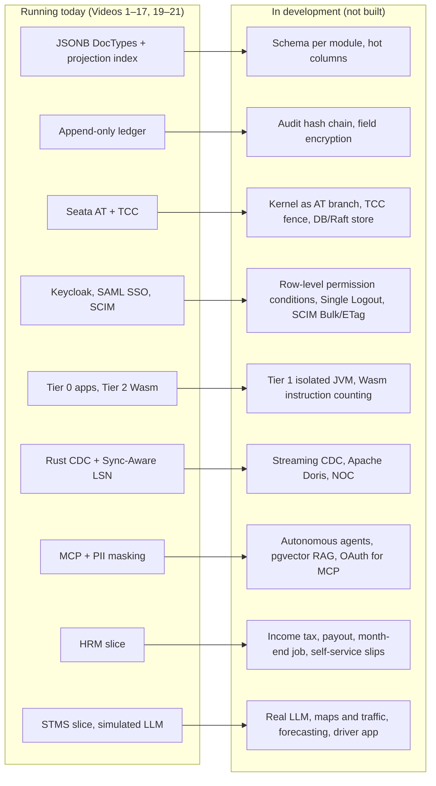

# Video 18 · Roadmap: the rest of use-case-01

<a href="https://media.zerohostcms.com/astra-cms/astra-video-18-roadmap-en.mp4"></a>

▶ [English](https://media.zerohostcms.com/astra-cms/astra-video-18-roadmap-en.mp4) · [Tiếng Việt](https://media.zerohostcms.com/astra-cms/astra-video-18-roadmap-vi.mp4) · 1:36 · Script: [demo-video-series.en.md](../demo-video-series.en.md#video-18-roadmap-the-rest-of-use-case-01-in-development)

> **In one sentence:** Videos 1 to 17 and 19 to 21 show thin slices of running code; this video, and this article, list what the courier use case still needs and label every one of those items **In development**.
>
> **Read this if:** you want to know which extension points already exist in the code so you can see where the missing pieces will attach (developer angle) / you are deciding whether to pilot Astra and need an honest line between what runs and what is only designed (tech-lead angle).

> [!WARNING]
> **Everything marked "In development" in this article is not built.** It is target design from
> [use-case-01.md](../use-case-01.md) and the [README roadmap](../../README.md#roadmap). No video demonstrates it, and no
> code sample below implements it. Code excerpts in this article are taken from components that **run today**; they are
> shown because they are the places where the missing pieces are meant to attach.

Status legend used below: **Running** = shown in a demo video and present in the repository. **In development** = not
built; target design only.

## The problem

Platform demos tend to blur two things: what the product does today and what the architecture slide promises.
Evaluators then discover the gap during a pilot, which is the most expensive time to find it.

Astra's demo series follows one storyline, [use-case-01](../use-case-01.md): Astra Express, a courier company with
seven business modules (OMS orders, OPS parcel operations, BMS billing and ledger, HRM payroll, NOC insights, STMS
dispatch, CARE customer care) on one platform. The videos prove the mechanisms with thin slices: enough code to show the
mechanism working, not the full module. Each mechanism video ends with a "To be accurate" note on its own limits.
Video 18 collects those limits in one place.

Frappe and ERPNext, which Astra uses as a design reference (concepts only, no shared code), are mature products with
years of modules behind them. Astra is not at that point. The comparison that matters for a reader today is not feature
count, but whether the mechanisms Astra does run (zero-DDL DocTypes, per-tenant overlays, a Wasm sandbox, an
append-only ledger, CDC with read-your-writes, MCP with permissions) are the right foundation for the rest.

## What the video shows

Ninety-six seconds, no demo footage. Every frame carries the label **"Roadmap / In development"**. The scenes follow the
narration:

1. **Title.** "The rest is running code. This is work in progress."
2. **What runs.** Thin slices from DocType to Seata, plus HRM, STMS and SAML SSO (Videos 19 to 21). Each video lists its
   limits; this one collects them.
3. **Storage.** Running: JSONB, an append-only ledger, a separate BMS schema, Seata. In development: a schema per
   module, the TCC fence table, a production Seata store.
4. **Identity and extensibility.** Running: Keycloak, SAML SSO, SCIM, Wasm. In development: row-level permissions,
   Single Logout, SCIM Bulk, Tier 1 isolated JVMs.
5. **Data and AI.** Running: Rust CDC, MCP with personal data masked. In development: streaming CDC, Apache Doris,
   autonomous agents, vector RAG.
6. **Business modules.** HRM needs income tax, payouts and a month-end job. STMS needs a real LLM, real maps and a driver
   app. Audit hash chains and field encryption have not started.
7. **Close.** Each step runs for real before it gets a video; the README holds the roadmap. The most useful feedback now
   is critique of the DocType model and overlays.

## How it works

This section describes the **target design**. Each subsection names what is running, what is in development, and the
running code that the in-development piece will extend.




*Architecture roadmap: core kernel features and business apps running today versus roadmap capabilities in development.*

### Storage

- **Running:** every DocType in one JSONB table with online expression indexes for `projected: true` fields
  ([Video 2](./02-doctype.md)); an append-only ledger with monthly partitions ([Video 12](./12-ledger.md)); BMS data in
  its own `bms` schema with its own role ([Video 17](./17-seata.md)).
- **In development:** use-case-01 puts each module in its own PostgreSQL schema (`schema_oms`, `schema_ops`,
  `schema_hrm`, …) with row-level security, and adds "hot-field materialisation" for documents whose status changes
  many times a day (parcel status, vehicle position): frequently updated fields move to physical columns so that
  PostgreSQL can update them without rewriting the JSONB document.
- **In development:** an audit hash chain over every change and field-level encryption declared in the DocType YAML
  (`encrypt: field`). The narration says these have not started.

The ledger's append-only guarantee today is a database trigger. A hash chain would add tamper evidence on top of this
tamper resistance:

*`astra-doctype/src/main/resources/db/migration/V3__ledger.sql`* (running)
```sql
CREATE FUNCTION astra_ledger_append_only() RETURNS trigger LANGUAGE plpgsql AS $$
BEGIN
    RAISE EXCEPTION 'astra_ledger is append-only: post a reversal instead of %', TG_OP
        USING ERRCODE = 'insufficient_privilege';
END $$;

CREATE TRIGGER astra_ledger_no_update_delete
    BEFORE UPDATE OR DELETE ON astra_ledger
    FOR EACH ROW EXECUTE FUNCTION astra_ledger_append_only();
```

**Why this order.** The trigger blocks UPDATE and DELETE but not the table owner's DROP or ALTER (Video 12's "To be
accurate"). A hash chain detects tampering that slips past access control; it is listed in the README's next steps.

### Transactions

- **Running:** Seata 2.6 AT branch on the BMS credit limit, TCC branch on Redis pickup capacity, and the kernel's own
  transaction committed last ([Video 17](./17-seata.md)).
- **In development:** the kernel as a Seata AT branch itself (today it is the "last resource"), Seata's TCC fence table
  for idempotency and suspension (today each TCC participant handles that itself), and a DB or Raft store for Seata
  Server (today it uses the file store).

### Identity and permissions

- **Running:** Keycloak OIDC with per-tenant roles and DocType permissions, segregation of duties
  ([Video 11](./11-keycloak.md)); SAML SSO and per-tenant SCIM 2.0 ([Video 21](./21-sso.md)).
- **In development:** row-level permission conditions (for example "an accountant sees only her branch's documents"),
  SAML Single Logout, SCIM Bulk and ETag, and full SCIM filters (today only `userName eq` and `displayName eq`).

### Extensibility tiers

- **Running:** Tier 0 apps compiled into the image (Express, HRM, STMS, CMS) and the Tier 2 Wasm sandbox for tenant
  formulas ([Video 14](./14-wasm.md)).
- **In development:** Tier 1, an isolated JVM class loader for hot-swapping plugins without a pod restart. use-case-01
  intends it for localisations such as Vietnamese e-invoicing, VAT, payment gateways and 3PL connectors. Also in
  development: instruction counting ("fuel") for Wasm, so the CPU limit is not only a wall-clock deadline.

Today the Wasm CPU control is a deadline, stated in the sandbox's own documentation:

*`astra-plugin-host/src/main/java/io/astra/pluginhost/WasmSandbox.java`* (running)
```java
/**
 * Tier 2 sandbox on Chicory, a pure-Java WebAssembly runtime: no native code, no JNI, nothing the
 * module can reach outside its own linear memory. Each call gets a fresh instance (no state survives
 * between calls or leaks between tenants), memory is capped at {@code astra.scripts.max-memory-pages}
 * (64 KiB each), host imports are refused, and the call runs on its own virtual thread that is
 * interrupted at the deadline. Chicory has no instruction metering, so the deadline is the CPU control.
 */
```

### Data, analytics and AI

- **Running:** a Rust CDC worker decoding `pgoutput` into a CARE replica, with `X-Tx-LSN` / `X-Required-LSN`
  read-your-writes ([Video 16](./16-cdc.md)); an MCP server with PII masking and app-contributed tools
  ([Video 15](./15-mcp.md)).
- **In development:** the streaming replication protocol (today the worker polls the slot), pushing changes into
  Apache Doris for the NOC module, and NOC dashboards. use-case-01 describes Doris tables exposed as "virtual DocTypes"
  so that the same permissions and generated UI apply to analytics.
- **In development:** autonomous agents (beyond tools called by a client), pgvector-based retrieval for CARE, and OAuth
  discovery for MCP clients (today the client uses a static bearer token).

The CDC worker's current read loop is a poll, which is what the streaming protocol would replace:

*`astra-cdc-rust/src/main.rs`* (running)
```rust
    loop {
        let cur: String = client.query_one("SELECT pg_current_wal_lsn()::text", &[]).await?.get(0);
        let rows = client
            .query(
                "SELECT lsn::text, data FROM pg_logical_slot_peek_binary_changes($1, $2::text::pg_lsn, NULL, \
                 'proto_version', '1', 'publication_names', $3)",
                &[&cfg.slot, &cur, &cfg.publication],
            )
            .await?;
        // …
```

### Business modules

- **HRM, running** ([Video 19](./19-hrm.md)): attendance, Payroll Entry, salary slips on virtual threads, a Wasm KPI
  bonus, one accrual voucher per run. **In development:** personal income tax, the employer insurance share, the salary
  payout entry, a month-end background job with leader election, employee self-service slips, and parcel counts fed by
  CDC from OPS and STMS instead of typed with attendance.
- **STMS, running** ([Video 20](./20-stms.md)): Timefold routing in the kernel, replanning, MCP tools, a dispatch copilot
  whose **LLM is simulated**. **In development:** a real LLM provider, real maps and traffic, load forecasting (Tier 1),
  a driver app.
- **NOC and the full CARE design:** **In development.** CARE today is the ticket triage and CDC replica slice of
  [Video 6](./06-care.md).

The STMS copilot shows the pattern most roadmap items follow: the interface is in the code, the real implementation is
not. The interface's documentation says so:

*`astra-apps/stms/src/main/java/io/astra/apps/stms/copilot/LlmClient.java`* (running interface; only a mock implements it)
```java
/**
 * The language model behind the dispatch copilot: turns a dispatcher's instruction into tool calls. Implementations
 * are CDI beans; {@code astra.stms.llm} selects one by {@link #id()}. Only {@link MockLlmClient} exists today; a real
 * provider plugs in here with the same contract.
 */
public interface LlmClient {
```


*SPI contracts and extension points exist across modules; target enterprise domains will implement them incrementally.*

### Smaller gaps named in other videos

These are not in the Video 18 table but are stated in the scripts' "To be accurate" notes. All are **In development**:

| Area | Gap | Where it is stated |
| --- | --- | --- |
| Schema evolution | Removing a field makes older documents that still carry it impossible to edit | [Video 9](./09-developer.md) |
| Rolling restart | No preStop hook or drain; requests that land as an old pod stops can fail | [Video 10](./10-k8s.md) |
| Overlays | Overlays add or modify fields; they cannot add hooks or permissions, or remove an app's fields | [Video 13](./13-overlay.md) |
| MCP | PII masking applies to the MCP channel, not to Desk | [Video 15](./15-mcp.md) |

## Real-world example

*Illustrative scenario: the company, people and values are made up; the mechanism and the rules it applies are the real ones shown above.*

A mid-size 3PL in Vietnam with branches in Hanoi and Ho Chi Minh City is considering Astra for order intake, parcel
operations, COD settlement, payroll and dispatch. Its CTO maps the requirements to the status above:

| Requirement | Status | What that means for a pilot |
| --- | --- | --- |
| Per-branch tenants that cannot see each other | Running | Pilot can rely on RLS and the fail-closed guard (Videos 7, 8) |
| Order → waybill → revenue entry in one transaction | Running | Pilot the lifecycle and ledger (Videos 4, 12) |
| Hanoi needs an extra VAT field, Saigon does not | Running | Overlay, no code change (Video 13) |
| COD maker/checker | Running | Segregation of duties (Videos 11, 12) |
| Accountants see only their branch's documents inside one tenant | In development | Needs row-level permission conditions; split tenants or wait |
| Monthly payroll with personal income tax and bank file | In development | HRM slice computes accruals only; keep the current payroll system |
| Daily route planning for 20–50 vehicles on real roads | In development | STMS slice uses straight-line distance and has been measured only at about 20 stops |
| Vietnamese chat assistant for dispatchers | In development | The copilot's LLM is simulated; no model is wired in |
| Tamper-evident audit for regulators | In development | Append-only ledger runs; hash chain has not started |
| Real-time NOC dashboards | In development | No Doris pipeline yet |

**Output of the exercise:** a pilot scoped to OMS, OPS, BMS and tenant overlays, with payroll and dispatch kept on
existing tools, and a list of five roadmap items to track. That is the decision Video 18 is meant to support.


*Recommended pilot scope: validating tenancy, doc lifecycle, append-only ledgers, and developer ergonomics.*

## For technical leaders

- **Read the status, not the architecture diagram.** The README states that everything outside "Project Status"
  describes target architecture and that performance figures there are design targets, not measurements.
- **Where to invest evaluation time.** The narration asks for critique of the DocType model and overlays. Those are the
  decisions that are hardest to change later; most roadmap items attach behind existing interfaces (`LlmClient`, the
  ledger SPI, the sandbox, the CDC worker).
- **Risk of the gaps.** The ones that change data or security guarantees (row-level permission conditions, audit hash
  chain, field encryption, safe schema evolution) matter more for a pilot than the ones that add features (Doris, driver
  app).
- **What to measure in a pilot.** Request latency on hooks that do batch work (payroll runs inside a request), solver
  CPU per tenant (STMS), CDC lag under your write rate, and rolling-restart errors (Video 10 measured 2 of 47 requests
  failing during a restart without drain).
- **When not to adopt yet.** If the first workload depends on an In-development item (tax-compliant payroll, real-road
  routing, an LLM assistant), Astra is not ready for it.

## Try it yourself

There is nothing to run for the In-development items. Everything in the "Running" lists can be run from the repository.
Prerequisites: JDK 25, Docker with about 8 GB of RAM, `kubectl`, `k3d`, `jq`, Bash 5.

```bash
make k3d-up && make demo-seed                    # the whole stack, two tenants
make demo-express SCENES="9 10" PAUSE=0          # Keycloak permissions and SoD, then the ledger
make demo-express SCENES="11 12 13" PAUSE=0      # overlays, Wasm, MCP
make demo-express SCENES="14 15" PAUSE=0         # Rust CDC + LSN, Seata AT + TCC
make demo-hrm                                    # HRM slice (Video 19)
make demo-stms                                   # STMS slice (Video 20), copilot LLM simulated
make demo-sso                                    # SAML SSO and SCIM (Video 21); see its script for Keycloak setup
```

Video 8 (the kernel refuses to start as a superuser) needs the Docker Compose stack: `make infra-up && make build &&
make demo-express SCENES=8`. Each scene's expected output is described in its article and in
[demo-video-series.en.md](../demo-video-series.en.md).

## To be accurate

- Every item marked **In development** is not built. Descriptions of it come from [use-case-01.md](../use-case-01.md)
  and the [README](../../README.md#roadmap) and may change as the work is done.
- The video's table covers the main gaps, not every limit. The full list for each mechanism is in that video's "To be
  accurate" section in [demo-video-series.en.md](../demo-video-series.en.md).
- The "Running" items are thin slices: enough to prove the mechanism, not the full scope of the use case.
- This article does not give dates or an order of delivery for the In-development items; the README's phase list is the
  authority on sequencing.

## Figures

- [Figure 1 · Running versus In development](#how-it-works)
- [Figure 2 · Interfaces exist, implementations do not](#business-modules)
- [Figure 3 · A CTO's pilot scope](#real-world-example)

## Related

- Previous: [Video 17 · Seata: one submit, three resources](./17-seata.md). Next: [Video 19 · HRM: attendance and payroll](./19-hrm.md).
- Module slices this roadmap builds on: [Video 19 · HRM](./19-hrm.md), [Video 20 · STMS](./20-stms.md), [Video 21 · SAML SSO and SCIM](./21-sso.md).
- Target design: [use-case-01.md](../use-case-01.md) (Vietnamese; modules carry status notes where a slice runs), [README roadmap](../../README.md#roadmap), [README project status](../../README.md#project-status), design reasoning in [explain.en.md](../explain.en.md).
- Running seams quoted above: [`V3__ledger.sql`](../../astra-doctype/src/main/resources/db/migration/V3__ledger.sql), [`WasmSandbox`](../../astra-plugin-host/src/main/java/io/astra/pluginhost/WasmSandbox.java), [`astra-cdc-rust/src/main.rs`](../../astra-cdc-rust/src/main.rs), [`LlmClient`](../../astra-apps/stms/src/main/java/io/astra/apps/stms/copilot/LlmClient.java).
