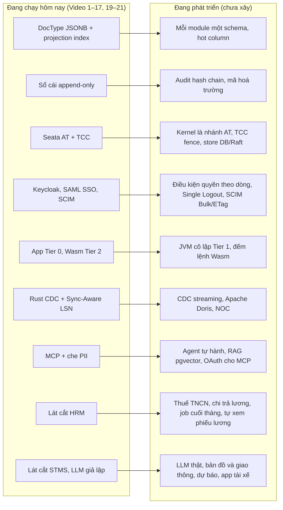
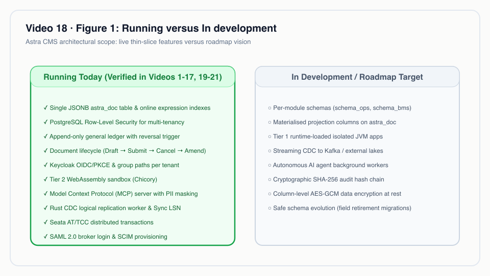
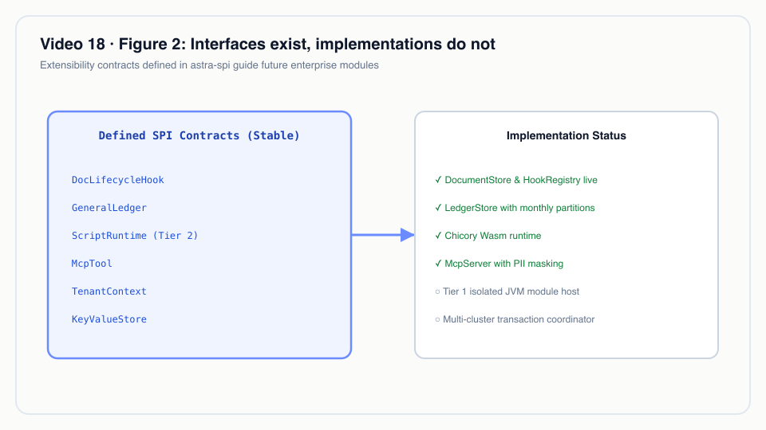
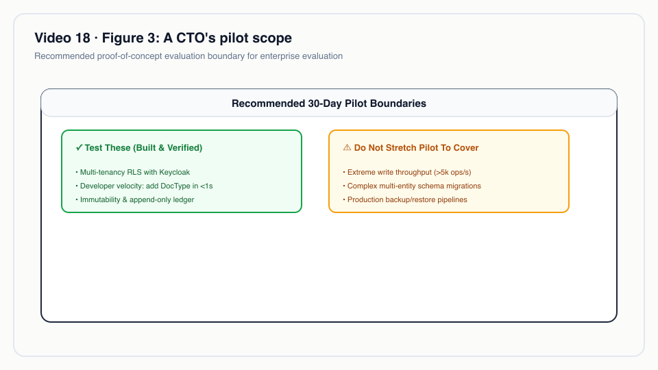

# Video 18 · Lộ trình: phần còn lại của use-case-01

<a href="https://media.zerohostcms.com/astra-cms/astra-video-18-roadmap-vi.mp4"></a>

▶ [Tiếng Việt](https://media.zerohostcms.com/astra-cms/astra-video-18-roadmap-vi.mp4) · [English](https://media.zerohostcms.com/astra-cms/astra-video-18-roadmap-en.mp4) · 1:36 · Kịch bản: [demo-video-series.md](../demo-video-series.md#video-18-roadmap-phần-còn-lại-của-use-case-01-đang-phát-triển) · [Bản tiếng Anh](./18-roadmap.md)

> **Tóm tắt một câu:** Video 1 đến 17 và 19 đến 21 cho thấy các lát cắt mỏng của code đang chạy; video này, và bài viết này, liệt kê những gì use case chuyển phát còn thiếu và gắn nhãn **Đang phát triển** cho từng hạng mục.
>
> **Nên đọc nếu:** bạn muốn biết những extension point nào đã có trong code để thấy các mảnh còn thiếu sẽ gắn vào đâu (góc nhìn developer) / bạn đang cân nhắc có thí điểm Astra hay không và cần một ranh giới trung thực giữa phần đã chạy và phần mới chỉ có thiết kế (góc nhìn tech lead).

> [!WARNING]
> **Mọi thứ gắn nhãn "Đang phát triển" trong bài này đều chưa được xây.** Đó là thiết kế mục tiêu lấy từ
> [use-case-01.md](../use-case-01.md) và [lộ trình trong README](../../README.vi.md#lộ-trình). Không video nào trình
> diễn chúng, và không đoạn code nào bên dưới hiện thực chúng. Các trích đoạn code trong bài lấy từ những thành phần
> **đang chạy hôm nay**; chúng được đưa ra vì đó chính là chỗ các mảnh còn thiếu sẽ gắn vào.

Chú giải trạng thái dùng bên dưới: **Đang chạy** = có trong một video demo và có trong repository. **Đang phát triển** =
chưa xây; mới là thiết kế mục tiêu.

## Vấn đề

Demo nền tảng hay làm nhoè hai thứ: điều sản phẩm làm được hôm nay và điều slide kiến trúc hứa hẹn. Người đánh giá
sau đó mới phát hiện khoảng trống trong lúc thí điểm, tức là thời điểm tốn kém nhất để phát hiện.

Loạt demo của Astra đi theo một mạch truyện, [use-case-01](../use-case-01.md): Astra Express, một công ty chuyển phát
với bảy module nghiệp vụ (OMS đơn hàng, OPS vận hành bưu kiện, BMS tính cước và sổ cái, HRM tiền lương, NOC phân tích,
STMS điều phối, CARE chăm sóc khách hàng) trên cùng một nền tảng. Các video chứng minh cơ chế bằng lát cắt mỏng: đủ code
để thấy cơ chế chạy, không phải toàn bộ module. Mỗi video về cơ chế kết thúc bằng một ghi chú "Nói đúng" về giới hạn của
chính nó. Video 18 gom các giới hạn đó về một chỗ.

Frappe và ERPNext, mà Astra dùng làm tham chiếu thiết kế (chỉ khái niệm, không dùng chung code), là những sản phẩm
trưởng thành với nhiều năm phát triển module phía sau. Astra chưa ở mức đó. Phép so sánh có ý nghĩa với người đọc hôm
nay không phải là số lượng tính năng, mà là liệu những cơ chế Astra đang chạy (DocType zero-DDL, overlay theo tenant,
sandbox Wasm, sổ cái append-only, CDC có read-your-writes, MCP có phân quyền) có phải là nền móng đúng cho phần còn lại
hay không.

## Video cho thấy gì

Chín mươi sáu giây, không có cảnh quay demo. Mọi khung hình đều mang nhãn **"Roadmap / Đang phát triển"**. Các cảnh đi
theo lời dẫn:

1. **Tiêu đề.** "Phần còn lại là code đang chạy. Đây là phần đang làm."
2. **Những gì đã chạy.** Các lát cắt mỏng từ DocType đến Seata, cùng HRM, STMS và SAML SSO (Video 19 đến 21). Mỗi video
   tự liệt kê giới hạn của mình; video này gom chúng lại.
3. **Lưu trữ.** Đang chạy: JSONB, sổ cái append-only, schema BMS riêng, Seata. Đang phát triển: mỗi module một schema,
   bảng fence TCC, store Seata cho production.
4. **Danh tính và khả năng mở rộng.** Đang chạy: Keycloak, SAML SSO, SCIM, Wasm. Đang phát triển: quyền theo dòng,
   Single Logout, SCIM Bulk, JVM cô lập Tier 1.
5. **Dữ liệu và AI.** Đang chạy: Rust CDC, MCP có che dữ liệu cá nhân. Đang phát triển: CDC streaming, Apache Doris,
   agent tự hành, RAG vector.
6. **Module nghiệp vụ.** HRM cần thuế thu nhập cá nhân, chi trả lương và một job cuối tháng. STMS cần LLM thật, bản đồ
   thật và app tài xế. Audit hash chain và mã hoá trường chưa bắt đầu.
7. **Kết.** Mỗi bước phải chạy thật rồi mới có video; README giữ lộ trình. Góp ý hữu ích nhất lúc này là phản biện mô
   hình DocType và overlay.

## Cách hoạt động

Phần này mô tả **thiết kế mục tiêu**. Mỗi tiểu mục nêu phần đang chạy, phần đang phát triển, và đoạn code đang chạy mà
phần đang phát triển sẽ mở rộng từ đó.




*Đang chạy và Đang phát triển.*

### Lưu trữ

- **Đang chạy:** mọi DocType nằm trong một bảng JSONB, với expression index tạo online cho các trường `projected: true`
  ([Video 2](./02-doctype.vi.md)); sổ cái append-only phân vùng theo tháng ([Video 12](./12-ledger.vi.md)); dữ liệu BMS
  nằm trong schema `bms` riêng với role riêng ([Video 17](./17-seata.vi.md)).
- **Đang phát triển:** use-case-01 đặt mỗi module vào một schema PostgreSQL riêng (`schema_oms`, `schema_ops`,
  `schema_hrm`, …) có row-level security, và thêm "hot-field materialisation" cho các chứng từ đổi trạng thái nhiều lần
  trong ngày (trạng thái bưu kiện, vị trí xe): các trường cập nhật thường xuyên được chuyển ra cột vật lý để PostgreSQL
  cập nhật chúng mà không phải ghi lại cả chứng từ JSONB.
- **Đang phát triển:** audit hash chain trên mọi thay đổi và mã hoá ở mức trường khai báo trong YAML của DocType
  (`encrypt: field`). Lời dẫn nói rõ các phần này chưa bắt đầu.

Bảo đảm append-only của sổ cái hôm nay là một trigger trong cơ sở dữ liệu. Hash chain sẽ bổ sung khả năng phát hiện
giả mạo lên trên khả năng chống sửa này:

*`astra-doctype/src/main/resources/db/migration/V3__ledger.sql`* (đang chạy)
```sql
CREATE FUNCTION astra_ledger_append_only() RETURNS trigger LANGUAGE plpgsql AS $$
BEGIN
    RAISE EXCEPTION 'astra_ledger is append-only: post a reversal instead of %', TG_OP
        USING ERRCODE = 'insufficient_privilege';
END $$;

CREATE TRIGGER astra_ledger_no_update_delete
    BEFORE UPDATE OR DELETE ON astra_ledger
    FOR EACH ROW EXECUTE FUNCTION astra_ledger_append_only();
```

**Vì sao theo thứ tự này.** Trigger chặn UPDATE và DELETE nhưng không chặn DROP hay ALTER của chủ sở hữu bảng (mục "Nói
đúng" của Video 12). Hash chain phát hiện những lần giả mạo lọt qua kiểm soát truy cập; nó nằm trong các bước tiếp
theo của README.

### Giao dịch

- **Đang chạy:** nhánh AT của Seata 2.6 trên hạn mức tín dụng BMS, nhánh TCC trên sức chứa lấy hàng trong Redis, và
  transaction của chính kernel commit sau cùng ([Video 17](./17-seata.vi.md)).
- **Đang phát triển:** bản thân kernel là một nhánh AT của Seata (hôm nay nó là "last resource"), bảng TCC fence của
  Seata cho idempotency và suspension (hôm nay mỗi bên tham gia TCC tự xử lý), và store DB hoặc Raft cho Seata Server
  (hôm nay dùng file store).

### Danh tính và phân quyền

- **Đang chạy:** Keycloak OIDC với role theo tenant và quyền theo DocType, tách bạch nhiệm vụ
  ([Video 11](./11-keycloak.vi.md)); SAML SSO và SCIM 2.0 theo tenant ([Video 21](./21-sso.vi.md)).
- **Đang phát triển:** điều kiện quyền theo dòng (ví dụ "kế toán chỉ thấy chứng từ của chi nhánh mình"), SAML Single
  Logout, SCIM Bulk và ETag, và bộ lọc SCIM đầy đủ (hôm nay chỉ có `userName eq` và `displayName eq`).

### Các tầng mở rộng

- **Đang chạy:** các app Tier 0 biên dịch vào image (Express, HRM, STMS, CMS) và sandbox Wasm Tier 2 cho công thức của
  tenant ([Video 14](./14-wasm.vi.md)).
- **Đang phát triển:** Tier 1, một class loader JVM cô lập để hot-swap plugin mà không phải khởi động lại pod.
  use-case-01 dự định dùng nó cho các bản địa hoá như hoá đơn điện tử Việt Nam, VAT, cổng thanh toán và connector 3PL.
  Cũng đang phát triển: đếm lệnh ("fuel") cho Wasm, để giới hạn CPU không chỉ là một deadline theo thời gian thực.

Hôm nay, kiểm soát CPU của Wasm là một deadline, như chính tài liệu của sandbox ghi:

*`astra-plugin-host/src/main/java/io/astra/pluginhost/WasmSandbox.java`* (đang chạy)
```java
/**
 * Tier 2 sandbox on Chicory, a pure-Java WebAssembly runtime: no native code, no JNI, nothing the
 * module can reach outside its own linear memory. Each call gets a fresh instance (no state survives
 * between calls or leaks between tenants), memory is capped at {@code astra.scripts.max-memory-pages}
 * (64 KiB each), host imports are refused, and the call runs on its own virtual thread that is
 * interrupted at the deadline. Chicory has no instruction metering, so the deadline is the CPU control.
 */
```

### Dữ liệu, phân tích và AI

- **Đang chạy:** một worker Rust CDC giải mã `pgoutput` vào bản sao CARE, có read-your-writes qua `X-Tx-LSN` /
  `X-Required-LSN` ([Video 16](./16-cdc.vi.md)); một MCP server có che PII và tool do app đóng góp
  ([Video 15](./15-mcp.vi.md)).
- **Đang phát triển:** giao thức streaming replication (hôm nay worker poll slot), đẩy thay đổi vào Apache Doris cho
  module NOC, và dashboard NOC. use-case-01 mô tả các bảng Doris được phơi ra dưới dạng "virtual DocType" để cùng quyền
  và cùng giao diện sinh tự động áp dụng cho phân tích.
- **Đang phát triển:** agent tự hành (vượt ra ngoài các tool do client gọi), truy xuất dựa trên pgvector cho CARE, và
  OAuth discovery cho MCP client (hôm nay client dùng bearer token tĩnh).

Vòng đọc hiện tại của worker CDC là poll, đúng phần mà giao thức streaming sẽ thay thế:

*`astra-cdc-rust/src/main.rs`* (đang chạy)
```rust
    loop {
        let cur: String = client.query_one("SELECT pg_current_wal_lsn()::text", &[]).await?.get(0);
        let rows = client
            .query(
                "SELECT lsn::text, data FROM pg_logical_slot_peek_binary_changes($1, $2::text::pg_lsn, NULL, \
                 'proto_version', '1', 'publication_names', $3)",
                &[&cfg.slot, &cur, &cfg.publication],
            )
            .await?;
        // …
```

### Module nghiệp vụ

- **HRM, đang chạy** ([Video 19](./19-hrm.vi.md)): chấm công, Payroll Entry, phiếu lương tính trên virtual thread, thưởng
  KPI bằng Wasm, một bút toán dồn tích cho mỗi lượt chạy. **Đang phát triển:** thuế thu nhập cá nhân, phần bảo hiểm
  doanh nghiệp đóng, bút toán chi trả lương, job nền cuối tháng có bầu leader, nhân viên tự xem phiếu lương, và số kiện
  lấy qua CDC từ OPS và STMS thay vì nhập kèm chấm công.
- **STMS, đang chạy** ([Video 20](./20-stms.vi.md)): định tuyến Timefold trong kernel, lập lại kế hoạch, tool MCP, một
  copilot điều phối mà **LLM là LLM giả lập (kịch bản demo)**. **Đang phát triển:** nhà cung cấp LLM thật, bản đồ và
  giao thông thật, dự báo tải (Tier 1), app tài xế.
- **NOC và thiết kế CARE đầy đủ:** **Đang phát triển.** CARE hôm nay là lát cắt phân loại ticket và bản sao CDC của
  [Video 6](./06-care.vi.md).

Copilot STMS cho thấy khuôn mẫu mà phần lớn hạng mục trong lộ trình đi theo: interface đã có trong code, bản hiện thực
thật thì chưa. Tài liệu của interface nói rõ điều đó:

*`astra-apps/stms/src/main/java/io/astra/apps/stms/copilot/LlmClient.java`* (interface đang chạy; chỉ có một bản mock hiện thực nó)
```java
/**
 * The language model behind the dispatch copilot: turns a dispatcher's instruction into tool calls. Implementations
 * are CDI beans; {@code astra.stms.llm} selects one by {@link #id()}. Only {@link MockLlmClient} exists today; a real
 * provider plugs in here with the same contract.
 */
public interface LlmClient {
```


*Interface đã có, bản hiện thực thì chưa.*

### Các khoảng trống nhỏ hơn nêu ở video khác

Những mục này không nằm trong bảng của Video 18 nhưng được ghi trong phần "Nói đúng" của các kịch bản. Tất cả đều
**Đang phát triển**:

| Mảng | Khoảng trống | Nêu ở đâu |
| --- | --- | --- |
| Tiến hoá schema | Xoá một trường khiến các chứng từ cũ còn mang trường đó không sửa được nữa | [Video 9](./09-developer.vi.md) |
| Rolling restart | Chưa có preStop hook hay drain; request rơi đúng lúc pod cũ dừng có thể lỗi | [Video 10](./10-k8s.vi.md) |
| Overlay | Overlay thêm hoặc chỉnh trường; không thêm được hook hay quyền, không xoá được trường của app | [Video 13](./13-overlay.vi.md) |
| MCP | Che PII áp dụng cho kênh MCP, không áp dụng cho Desk | [Video 15](./15-mcp.vi.md) |

## Ví dụ thực tế

*Tình huống minh hoạ: công ty, con người và giá trị là hư cấu; cơ chế và các quy tắc nó áp dụng là thật, như đã trình bày ở trên.*

Một công ty 3PL quy mô vừa ở Việt Nam, có chi nhánh ở Hà Nội và TP. Hồ Chí Minh, đang cân nhắc Astra cho tiếp nhận đơn,
vận hành bưu kiện, đối soát COD, tính lương và điều phối. CTO của họ đối chiếu yêu cầu với trạng thái ở trên:

| Yêu cầu | Trạng thái | Ý nghĩa với đợt thí điểm |
| --- | --- | --- |
| Mỗi chi nhánh là một tenant, không nhìn thấy nhau | Đang chạy | Thí điểm có thể dựa vào RLS và guard fail-closed (Video 7, 8) |
| Đơn → vận đơn → bút toán doanh thu trong một transaction | Đang chạy | Thí điểm vòng đời chứng từ và sổ cái (Video 4, 12) |
| Hà Nội cần thêm một trường VAT, Sài Gòn thì không | Đang chạy | Overlay, không đổi code (Video 13) |
| Maker/checker cho COD | Đang chạy | Tách bạch nhiệm vụ (Video 11, 12) |
| Kế toán chỉ thấy chứng từ chi nhánh mình trong cùng một tenant | Đang phát triển | Cần điều kiện quyền theo dòng; tách tenant hoặc chờ |
| Lương tháng có thuế thu nhập cá nhân và file ngân hàng | Đang phát triển | Lát cắt HRM chỉ tính dồn tích; giữ hệ thống lương hiện tại |
| Lập tuyến hằng ngày cho 20–50 xe trên đường thật | Đang phát triển | Lát cắt STMS dùng khoảng cách đường chim bay và mới đo ở khoảng 20 điểm dừng |
| Trợ lý chat tiếng Việt cho người điều phối | Đang phát triển | LLM của copilot là LLM giả lập (kịch bản demo); chưa nối mô hình nào |
| Audit chống giả mạo cho cơ quan quản lý | Đang phát triển | Sổ cái append-only đã chạy; hash chain chưa bắt đầu |
| Dashboard NOC thời gian thực | Đang phát triển | Chưa có pipeline Doris |

**Kết quả của bài tập:** một đợt thí điểm giới hạn ở OMS, OPS, BMS và overlay theo tenant, còn tính lương và điều phối
vẫn ở công cụ hiện có, kèm danh sách năm hạng mục lộ trình cần theo dõi. Đó chính là quyết định mà Video 18 muốn hỗ trợ.


*Phạm vi thí điểm của một CTO.*

## Dành cho tech lead

- **Đọc trạng thái, đừng đọc sơ đồ kiến trúc.** README ghi rằng mọi thứ ngoài mục "Trạng thái dự án" là kiến trúc mục
  tiêu, và các con số hiệu năng ở đó là mục tiêu thiết kế, không phải số đo.
- **Nên dồn thời gian đánh giá vào đâu.** Lời dẫn đề nghị phản biện mô hình DocType và overlay. Đó là những quyết định
  khó đổi nhất về sau; phần lớn hạng mục lộ trình gắn vào phía sau các interface đã có (`LlmClient`, SPI của sổ cái,
  sandbox, worker CDC).
- **Rủi ro của các khoảng trống.** Những khoảng trống làm thay đổi bảo đảm về dữ liệu hay bảo mật (điều kiện quyền theo
  dòng, audit hash chain, mã hoá trường, tiến hoá schema an toàn) quan trọng với đợt thí điểm hơn những khoảng trống chỉ
  thêm tính năng (Doris, app tài xế).
- **Nên đo gì khi thí điểm.** Độ trễ request ở các hook làm việc theo lô (tính lương chạy trong request), CPU của solver
  theo tenant (STMS), độ trễ CDC ở tốc độ ghi của bạn, và lỗi khi rolling restart (Video 10 đo được 2 trên 47 request
  lỗi trong một lần restart không có drain).
- **Khi nào chưa nên dùng.** Nếu workload đầu tiên phụ thuộc vào một hạng mục Đang phát triển (lương tuân thủ thuế,
  định tuyến trên đường thật, trợ lý LLM), Astra chưa sẵn sàng cho nó.

## Tự chạy thử

Không có gì để chạy cho các hạng mục Đang phát triển. Mọi thứ trong các danh sách "Đang chạy" đều chạy được từ
repository. Yêu cầu: JDK 25, Docker với khoảng 8 GB RAM, `kubectl`, `k3d`, `jq`, Bash 5.

```bash
make k3d-up && make demo-seed                    # the whole stack, two tenants
make demo-express SCENES="9 10" PAUSE=0          # Keycloak permissions and SoD, then the ledger
make demo-express SCENES="11 12 13" PAUSE=0      # overlays, Wasm, MCP
make demo-express SCENES="14 15" PAUSE=0         # Rust CDC + LSN, Seata AT + TCC
make demo-hrm                                    # HRM slice (Video 19)
make demo-stms                                   # STMS slice (Video 20), copilot LLM simulated
make demo-sso                                    # SAML SSO and SCIM (Video 21); see its script for Keycloak setup
```

Video 8 (kernel từ chối khởi động khi chạy bằng superuser) cần stack Docker Compose: `make infra-up && make build &&
make demo-express SCENES=8`. Kết quả mong đợi của từng cảnh được mô tả trong bài viết tương ứng và trong
[demo-video-series.md](../demo-video-series.md).

## Nói đúng

- Mọi hạng mục gắn nhãn **Đang phát triển** đều chưa được xây. Mô tả về chúng lấy từ [use-case-01.md](../use-case-01.md)
  và [README](../../README.vi.md#lộ-trình), và có thể thay đổi khi bắt tay vào làm.
- Bảng trong video bao quát các khoảng trống chính, không phải mọi giới hạn. Danh sách đầy đủ của từng cơ chế nằm ở mục
  "Nói đúng" của video tương ứng trong [demo-video-series.md](../demo-video-series.md).
- Các hạng mục "Đang chạy" là lát cắt mỏng: đủ để chứng minh cơ chế, không phải toàn bộ phạm vi của use case.
- Bài này không đưa ra mốc thời gian hay thứ tự bàn giao cho các hạng mục Đang phát triển; danh sách phase trong README
  là nguồn có thẩm quyền về trình tự.

## Hình minh hoạ

### Hình 1 · Đang chạy và Đang phát triển


### Hình 2 · Interface đã có, bản hiện thực thì chưa


### Hình 3 · Phạm vi thí điểm của một CTO


## Liên quan

- Trước: [Video 17 · Seata: một lần submit, ba tài nguyên](./17-seata.vi.md). Tiếp: [Video 19 · HRM: nhân sự và tiền lương](./19-hrm.vi.md).
- Các lát cắt module mà lộ trình này xây tiếp: [Video 19 · HRM](./19-hrm.vi.md), [Video 20 · STMS](./20-stms.vi.md), [Video 21 · SAML SSO và SCIM](./21-sso.vi.md).
- Thiết kế mục tiêu: [use-case-01.md](../use-case-01.md) (tiếng Việt; các module có ghi chú trạng thái ở chỗ đã có lát cắt chạy), [lộ trình trong README](../../README.vi.md#lộ-trình), [trạng thái dự án trong README](../../README.vi.md#trạng-thái-dự-án), lập luận thiết kế trong [explain.md](../explain.md).
- Các điểm nối đang chạy được trích ở trên: [`V3__ledger.sql`](../../astra-doctype/src/main/resources/db/migration/V3__ledger.sql), [`WasmSandbox`](../../astra-plugin-host/src/main/java/io/astra/pluginhost/WasmSandbox.java), [`astra-cdc-rust/src/main.rs`](../../astra-cdc-rust/src/main.rs), [`LlmClient`](../../astra-apps/stms/src/main/java/io/astra/apps/stms/copilot/LlmClient.java).
