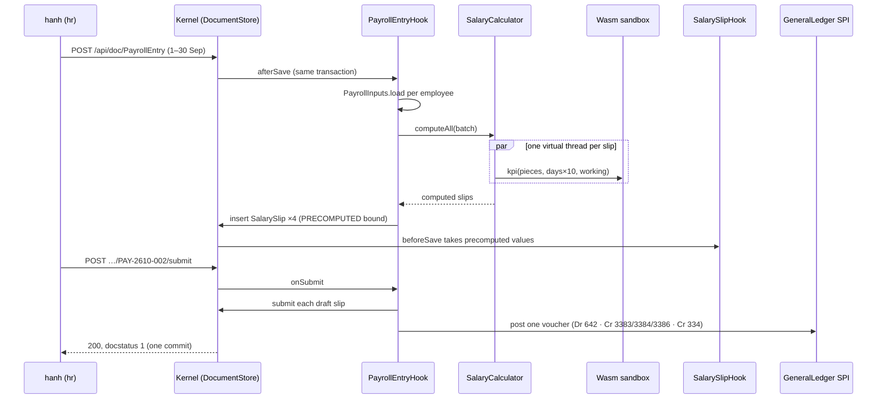

# Video 19 · HRM: attendance and payroll

<a href="https://media.zerohostcms.com/astra-cms/astra-video-19-hrm-en.mp4"></a>

▶ [English](https://media.zerohostcms.com/astra-cms/astra-video-19-hrm-en.mp4) · [Tiếng Việt](https://media.zerohostcms.com/astra-cms/astra-video-19-hrm-vi.mp4) · 2:40 · Script: [demo-video-series.en.md](../demo-video-series.en.md#video-19-hrm-hr-and-payroll)

> **In one sentence:** A payroll app that uses only Astra's public SPI and follows the Frappe HRMS model: attendance sets the working days, a tenant's Wasm module computes the courier bonus, one Payroll Entry computes every salary slip in parallel, and submitting it writes exactly one balanced accrual journal entry to the append-only ledger.
>
> **Read this if:** you want to see how a real business module (eight DocTypes, five hooks, one MCP tool) is built on the SPI without touching the kernel (developer angle) / you are judging whether a metadata platform can carry money-sensitive batch work such as month-end payroll, and what is still missing before it is payroll software (tech-lead angle).

## The problem

Astra Express pays couriers a base salary plus a bonus per parcel delivered. At month end, HR at the Saigon tenant has to
turn attendance into working days, apply the parcel bonus tariff, deduct the employee's social, health and unemployment
insurance, and hand accounting a journal entry that matches the slips to the đồng. The usual failure modes are familiar:

- **Payroll lives in a spreadsheet.** Working days are typed by hand, the bonus formula is copied between tabs, and the
  accountant re-keys totals into the ledger. Nobody can show which input produced which line.
- **The bonus rule changes per region and per quarter.** In a classic ERP that means a code change or a
  vendor customisation. Each tenant wants its own tariff without a release of the whole product.
- **Slips and ledger drift apart.** If slips are saved in one step and the journal entry is posted in another, a crash
  in between leaves a month that is half accrued. Cancelling a run later has to undo both, without deleting history.

Frappe HRMS (on top of ERPNext) solves this with a well-known set of concepts: Employee, Salary Component, Salary Structure,
Salary Structure Assignment, Attendance, Additional Salary, Payroll Entry and Salary Slip. A Payroll Entry creates the
slips for a period and books an accrual journal entry. Salary component formulas there are Python expressions evaluated
by the framework.

Astra's HRM app takes **the concept names only**. The script states it plainly: no code, schema or UI is copied from
ERPNext or HRMS. What differs is where each piece runs: the formulas that vary per tenant run in the Tier 2 Wasm sandbox,
the slips are computed on virtual threads, and the accrual goes through the same `GeneralLedger` SPI the Express app uses
for freight revenue.

## What the video shows

The recording runs `make demo-hrm` against the k3d stack after `make demo-seed`, which loads September 2026 (26 working
days, Monday to Saturday) for `saigon-express`. The script signs in as `hanh` (role `hr`).

1. **The app** (scene 1). App `io.astra.hrm`, eight DocTypes in module `hrm`, depending only on `astra-spi`. The
   narration: "Frappe HRMS concept names, no code."
2. **Components** (scene 1). Eight Salary Components: base pay, lunch and fuel allowances, a KPI bonus, a one-off bonus,
   and the employee's insurance: BHXH 8 %, BHYT 1.5 %, BHTN 1 %, posted to accounts 3383, 3384 and 3386. Rates are demo
   seed values.
3. **The courier bonus in Wasm** (scene 2). Rust code in `astra-apps/hrm/wasm/courier-kpi`: 1,500 ₫ per parcel up to 600,
   2,000 ₫ up to 1,000, 2,500 ₫ beyond, plus 500,000 ₫ for full attendance. On save the kernel test-runs it:
   `kpi(1000 pieces, 26/26 days) = 2200000 VND`. An infinite-loop module is stopped at 50 ms and rejected with 422.
4. **Attendance** (scene 3). NV002 is absent on 15/9 and on a half day on 22/9, so 24.5 payment days. NV004 is on unpaid
   leave on 29/9. A day with no record counts as worked. `quang` (ops) can submit attendance but gets 403 on Salary
   Slip; `tuan` (sales) gets 403 on Payroll Entry.
5. **One save, every slip** (scene 4). Saving a draft Payroll Entry for 1 to 30 September creates four draft slips,
   computed in parallel with one virtual thread each, in the same transaction as the entry. In the recorded run the
   entry is `PAY-2610-002` (the series uses the creation month) and the slips are `SAL-2610-00005` to `SAL-2610-00008`.
6. **A slip, line by line** (scene 5). NV002: `100% of 6500000 (base) × 24.5/26 days` = 6,125,000; KPI
   `Wasm kpi(1007 pieces, 24.5/26 days)` = 1,717,500; BHXH `8% of 6500000 (base)` = 520,000; gross 9,001,539, net
   8,319,039. NV003 joined on 14/9, so 15 working days, plus a 500,000 ₫ Additional Salary. A client that sends
   `net_pay` gets 422 `field 'net_pay' is read-only`.
7. **Submit** (scene 6). Four employees, gross 35,837,501, deductions 3,517,500, net 32,320,001. One accrual voucher with
   five lines: Debit 642 35,837,501; Credit 3383 2,680,000; Credit 3384 502,500; Credit 3386 335,000; Credit 334
   32,320,001. Each slip's `accrual_voucher` is set to the entry name.
8. **Three refusals** (scene 6). Cancelling one slip of a submitted run returns 422 "cancel the payroll entry instead".
   A second September run returns 422 "NV001 already has submitted salary slip …". Setting pay from the client was
   already refused in scene 5.
9. **MCP** (scene 7). `payroll_summary` returns totals and slip lines with masked names (`N*** V*** A***`). `tuan`
   calling the same tool gets `isError: true`, "not permitted: read PayrollEntry".
10. **Cancel** (scene 8). The slips move to docstatus 2, the voucher gets five more lines with `is_reversal: true`, and
    the trial balance of 334, 3383, 3384, 3386 and 642 returns to 0. No row is deleted.

## How it works

### The shape of the app

`HrmApp` is a Tier 0 app: a CDI bean that lists its DocType YAML files. Everything else is hooks and one MCP tool.

*`astra-apps/hrm/src/main/java/io/astra/apps/hrm/HrmApp.java`*
```java
@ApplicationScoped
public class HrmApp implements AstraApp {

    @Override
    public String id() { return "io.astra.hrm"; }
    // …
    @Override
    public List<String> doctypeResources() {
        return List.of(
                "META-INF/astra/doctypes/employee.doctype.yaml",
                "META-INF/astra/doctypes/salary-component.doctype.yaml",
                "META-INF/astra/doctypes/salary-structure.doctype.yaml",
                "META-INF/astra/doctypes/salary-structure-assignment.doctype.yaml",
                "META-INF/astra/doctypes/attendance.doctype.yaml",
                "META-INF/astra/doctypes/additional-salary.doctype.yaml",
                "META-INF/astra/doctypes/payroll-entry.doctype.yaml",
                "META-INF/astra/doctypes/salary-slip.doctype.yaml");
    }
}
```

The Payroll Entry is an ordinary submittable DocType. Its totals are `read-only`, so only the hook can set them, and
the permission table is where "sales gets 403" comes from:

*`astra-apps/hrm/src/main/resources/META-INF/astra/doctypes/payroll-entry.doctype.yaml`*
```yaml
name: PayrollEntry
module: hrm
kind: transaction
submittable: true
naming: { series: "PAY-.YYMM.-.###" }
# …
fields:
  - { name: start_date,      type: Date,     required: true, in-list: true }
  # …
  - { name: total_net,       type: Currency, read-only: true, in-list: true }
# …
permissions:
  - { role: admin,      read: true, create: true, write: true, submit: true, cancel: true }
  - { role: hr,         read: true, create: true, write: true, submit: true, cancel: true }
  - { role: accountant, read: true }
```

### Save, submit, cancel



Saving a draft entry rebuilds the draft slips. The hook reads every input inside the entry's transaction first, then
hands the pure calculation to `SalaryCalculator`, then writes the slips back in the same transaction:

*`astra-apps/hrm/src/main/java/io/astra/apps/hrm/PayrollEntryHook.java`*
```java
    @Override
    public void afterSave(Document entry) {
        if (entry.docstatus() != 0) return;
        // …
        List<SalaryInput> batch = new ArrayList<>();
        List<String> unassigned = new ArrayList<>();
        for (Document e : employees) {
            Document slip = existing.get(e.name());
            if (slip != null && slip.docstatus() != 0) continue;   // submitted or cancelled on its own: leave it
            inputs.load(e, start, end).ifPresentOrElse(batch::add, () -> unassigned.add(e.name()));
        }
        // …
        List<Map<String, Object>> computed = calculator.computeAll(batch);
        // …
        ScopedValue.where(SalarySlipHook.PRECOMPUTED, byEmployee).run(() -> {
            for (SalaryInput in : batch) {
                // …
                    docs.insert("SalarySlip", period, entry.owner());
                // …
            }
        });
    }
```

**Why split read, compute and write.** Database access stays on the request's thread and its single transaction.
The calculation touches no storage, so it can safely fan out. The Wasm KPI call dominates the cost, which is why
`computeAll` uses one virtual thread per slip:

*`astra-apps/hrm/src/main/java/io/astra/apps/hrm/SalaryCalculator.java`*
```java
    List<Map<String, Object>> computeAll(List<SalaryInput> inputs) {
        try (ExecutorService threads = Executors.newVirtualThreadPerTaskExecutor()) {
            List<Future<Map<String, Object>>> futures = inputs.stream().map(in -> threads.submit(() -> compute(in))).toList();
            // …
        }
    }
```

**Why a `ScopedValue` for precomputed results.** `SalarySlipHook.beforeSave` computes a slip whenever a draft slip is
saved. When the entry writes its own slips, it binds `PRECOMPUTED` so the slip hook reuses the batch result instead of
computing twice. The binding is in-process (see `PRECOMPUTED` in `SalarySlipHook`), so a REST client cannot smuggle
computed values in through it.

### Working days and the four calculation types

Payment days are working days minus days outside employment, minus Absent, minus half of each Half Day, minus Leave
Without Pay. Unmarked days count as worked. This is the rule that gives NV002 24.5 of 26:

*`astra-apps/hrm/src/main/java/io/astra/apps/hrm/SalaryCalculator.java`*
```java
            lost += switch (att.getString("status")) {
                case "Absent" -> 1;
                case "Half Day" -> 0.5;
                case "On Leave" -> "Leave Without Pay".equals(att.getString("leave_type")) ? 1 : 0;
                default -> 0;
            };
        }
        double paymentDays = Math.max(0, working - outside - lost);
```

Each component has one of four calculations: Fixed, Percent of Base (optionally capped), Percent of Gross (deductions
only) and Wasm. Every line records a human-readable `basis`, which is what the video shows as "traces every line":

*`astra-apps/hrm/src/main/java/io/astra/apps/hrm/SalaryCalculator.java`*
```java
            case "Wasm" -> {
                long v;
                try {
                    v = kpi(scripts, c, ctx.pieces(), Math.round(ctx.paymentDays() * 10), ctx.workingDays());
                } catch (ScriptException e) {
                    throw new DocValidationException("component " + c.name() + ": formula failed (" + e.reason() + "): " + e.getMessage());
                }
                // …
                basis = "Wasm kpi(" + ctx.pieces() + " pieces, " + Values.plain(ctx.paymentDays()) + "/" + ctx.workingDays() + " days)";
            }
```

Payment days are passed to Wasm as `payment_days × 10`, an integer, because the sandbox exchanges only `i64` values.

### The tenant's bonus formula

*`astra-apps/hrm/wasm/courier-kpi/src/lib.rs`*
```rust
const TIERS: [(i64, i64); 3] = [(600, 1_500), (1_000, 2_000), (i64::MAX, 2_500)]; // (up to pieces, VND per piece)
const FULL_ATTENDANCE_BONUS: i64 = 500_000;

#[unsafe(no_mangle)]
pub extern "C" fn kpi(pieces: i64, payment_days_x10: i64, working_days: i64) -> i64 {
    let pieces = pieces.max(0);
    let mut bonus = 0;
    let mut floor = 0;
    for (ceiling, rate) in TIERS {
        if pieces <= floor {
            break;
        }
        bonus += (pieces.min(ceiling) - floor) * rate;
        floor = ceiling;
    }
    if working_days > 0 && payment_days_x10 >= working_days * 10 {
        bonus += FULL_ATTENDANCE_BONUS;
    }
    bonus
}
```

NV002's 1,007 parcels: 600 × 1,500 + 400 × 2,000 + 7 × 2,500 = 1,717,500 ₫, with no attendance bonus because 24.5 < 26.

A module cannot reach payroll unless it passes a self-test on save. A module that loops forever is stopped at its
deadline and the save is rejected:

*`astra-apps/hrm/src/main/java/io/astra/apps/hrm/SalaryComponentHook.java`*
```java
        try {
            bonus = SalaryCalculator.kpi(scripts, c, 1_000, 260, 26);
        } catch (ScriptException e) {
            throw new DocValidationException("module rejected (" + e.reason() + "): " + e.getMessage());
        }
        if (bonus < 0 || bonus > 1_000_000_000L) throw new DocValidationException("module rejected: kpi(1000 pieces, 26/26 days) returned " + bonus);
        // …
        c.set("self_test", "kpi(1000 pieces, 26/26 days) = " + bonus + " VND in " + micros + " µs");
```

### One accrual voucher per run

On submit the entry submits every draft slip, totals earnings and deductions per GL account, and posts one voucher
through the `GeneralLedger` SPI, inside the entry's transaction. If any step fails, the whole run rolls back:

*`astra-apps/hrm/src/main/java/io/astra/apps/hrm/PayrollEntryHook.java`*
```java
        List<Entry> lines = new ArrayList<>();
        byAccount(submitted, "earnings").forEach((account, amount) -> lines.add(Entry.debit(account, null, amount)));
        byAccount(submitted, "deductions").forEach((account, amount) -> lines.add(Entry.credit(account, null, amount)));
        lines.add(Entry.credit(SALARY_PAYABLE, null, BigDecimal.valueOf(sum(submitted, "net_pay"))));
        ledger.post("PayrollEntry", entry.name(), Values.requireDate(entry, "posting_date"), lines,
                "Payroll accrual " + entry.getString("start_date") + " – " + entry.getString("end_date")
                        + " (" + submitted.size() + " slips)");
```

The voucher balances by construction: gross (debit 642) equals deductions (credits to 3383, 3384, 3386) plus net
(credit 334). In the recorded run: 2,680,000 + 502,500 + 335,000 + 32,320,001 = 35,837,501.

**Why the slip does not post itself.** One voucher per run keeps the ledger readable for the accountant and makes
cancellation a single reversal. The cost is that 334 holds a total, not a balance per employee (see "To be accurate").

Cancel is the mirror image: the entry cancels its own slips (binding `CANCELLING_ENTRY` so the slip guard lets them
through) and asks the ledger for one reversal. The ledger table itself refuses UPDATE and DELETE (see
[Video 12](./12-ledger.md)).

*`astra-apps/hrm/src/main/java/io/astra/apps/hrm/PayrollEntryHook.java`*
```java
    @Override
    public void onCancel(Document entry) {
        ScopedValue.where(SalarySlipHook.CANCELLING_ENTRY, entry.name()).run(() -> {
            for (Document slip : slips(entry)) {
                if (slip.docstatus() == 1) docs.cancel("SalarySlip", slip.name());
            }
        });
        ledger.reverse("PayrollEntry", entry.name());
    }
```

### The AI agent's view

`PayrollSummaryTool` (`payroll_summary`) is an app-contributed MCP tool. Its `reads()` returns `PayrollEntry` and
`SalarySlip`, so the MCP server checks the caller's read permission on both DocTypes before the call; that is why
`tuan` gets "not permitted: read PayrollEntry". `employee_name` is marked `pii: true` in the DocTypes, so names leave
masked through the kernel's MCP masking (see [Video 15](./15-mcp.md)).

## Real-world example

A courier company in Ho Chi Minh City runs payroll for its delivery staff on the seeded COURIER structure. Take one
courier for September 2026 (26 working days) with a contract base of 7,000,000 ₫, one absent day and 820 parcels
delivered. The values below are computed by hand from the code's rules and the seed components; they are illustrative,
not output from a run.

**Inputs:** Attendance: one `Absent` record on a working day. Parcels entered with attendance: 820. Assignment: COURIER,
base 7,000,000.

**What Astra does:**

| Line | Rule | Amount (₫) |
| --- | --- | --- |
| BASIC | 100 % of 7,000,000 × 25/26 days | 6,730,769 |
| LUNCH | 730,000 fixed × 25/26 days | 701,923 |
| FUEL | 500,000 fixed × 25/26 days | 480,769 |
| KPI (Wasm) | 600 × 1,500 + 220 × 2,000; no attendance bonus (25 < 26) | 1,340,000 |
| **Gross** | | **9,253,461** |
| BHXH | 8 % of 7,000,000 (base, not prorated) | 560,000 |
| BHYT | 1.5 % of 7,000,000 | 105,000 |
| BHTN | 1 % of 7,000,000 | 70,000 |
| **Net** | gross − 735,000 | **8,518,461** |

**Outputs:** the slip carries every line with its `basis` string, so an employee query ("why is my lunch allowance
701,923?") is answered from the document. When HR submits the month's Payroll Entry, this courier's amounts are folded
into one voucher for the run: 9,253,461 into Debit 642, 560,000 into Credit 3383, and so on. If the regional manager
changes the parcel tariff next quarter, the tenant uploads a new Wasm module to the KPI component; the self-test runs on
save and no Java code changes.

A run is limited to 1,000 employees (`MAX_EMPLOYEES` in `PayrollEntryHook`). A company above that size would have to
split runs, for example by `designation` (the entry's filter field: All, Courier, Driver, Hub Staff, Office).

## For technical leaders

- **What this proves.** A money-sensitive, multi-document batch can be written as a Tier 0 app on the public SPI: the
  entry, its slips and its ledger voucher commit or roll back together, and an append-only ledger keeps cancellation
  auditable.
- **What it does not prove.** It is a demo payroll app, not payroll software. Personal income tax, the employer's
  insurance share, salary payout and bank files are absent (see below). Do not compare it feature by feature with
  Frappe HRMS.
- **Per-tenant formulas without code releases.** Wasm components move tariff changes out of the release train. The
  trade-off is that formulas are compiled modules, not a formula editor; HR cannot change them without a developer.
- **Run size and latency.** The batch runs inside the HTTP request that saves the entry, up to 1,000 employees. Measure
  request time and transaction length at your headcount before relying on it; a month-end background job with leader
  election is on the roadmap, not built.
- **Ledger granularity.** One voucher per run, totals per account. If your auditors need 334 per employee or cost-centre
  allocation, that is not there yet.
- **Data protection.** Employee names reach an AI agent masked, and the agent inherits the caller's permissions. Employees
  cannot yet read their own slips (`if-owner` applies to writes only).
- **When not to use it today.** Any real payroll that must file tax or pay staff. Use it to evaluate the platform's
  shape: SPI, hooks, Wasm, ledger and MCP working together on a real business flow.

## Try it yourself

Prerequisites: JDK 25, Docker with about 8 GB of RAM, `kubectl`, `k3d`, `jq`, Bash 5 (`brew install bash` on macOS).
The `hanh` user must exist in Keycloak; if the realm changed since your cluster was created, run
`scripts/keycloak-sync-realm.sh`.

```bash
make k3d-up                          # cluster: kernel pods, PostgreSQL, Redis, Keycloak, Seata, CDC worker
make demo-seed                       # loads September 2026 for saigon-express (and hanoi-express)
make demo-hrm                        # all scenes, Enter between steps
make demo-hrm SCENES="4 5 6" PAUSE=0 # open, inspect and submit a payroll run without pausing
```

Expected output (numbers from the recorded run; entry and slip names depend on how many runs you have opened):

- Scene 4: `HTTP 201` with `"docstatus": 0`, then four draft slips with `payment_days` 26.0, 24.5, 15.0 and 25.0.
- Scene 6: `"employees": 4`, `"gross": 35837501`, `"net": 32320001`, and five ledger lines for the voucher.
- Scene 8: the trial balance shows `"balance": 0.00` for 334, 3383, 3384, 3386 and 642.

Then open Desk at `http://localhost:8080/desk/` as `hanh` (password `Astra@123`, local stack only) to see the Payroll
Entry and Salary Slip forms. The integration test is `astra-server/src/test/java/io/astra/server/HrmPayrollTest.java`.

## To be accurate

From the script's "To be accurate" section for Video 19:

- **No personal income tax** is computed; net is gross minus the employee share of insurance. The employer share (BHXH,
  BHYT, BHTN, KPCĐ) is not computed. Insurance rates and caps are seed configuration for the demo and have not been
  checked against current regulations; the rule that 14 or more days of leave means no BHXH contribution is not handled.
- **Minimal attendance:** no holiday calendar, shifts, check-in, or leave requests with balances. The working week is
  fixed Monday to Saturday, and days without an attendance record count as worked. Parcel counts are entered by ops
  with attendance, not pulled from Waybill or STMS through CDC as the use case describes.
- **Only four calculation types** (Fixed, % of base, % of gross, Wasm), no formula editor. No salary payout journal entry
  (Debit 334 / Credit 112) and no bank file export. The accrual records totals per account, not per employee on 334;
  all cost goes to 642, with no cost-centre allocation.
- **The batch runs inside the request** that saves the entry (up to 1,000 employees). There is no month-end background
  job or leader election. Slips and the ledger share one PostgreSQL transaction, without Seata.
- **Employees cannot view their own slips:** the `if-owner` permission applies to writes only, not to reads.
- **No dedicated payroll Desk:** the generic Desk shows slip lines as "N item(s)".
- The figures in the script were computed from the hook's logic; the numbers in this article's "What the video shows"
  come from the recorded run, and the "Real-world example" values are hand-computed and illustrative.

## Visualize it: sketch prompts

### Figure 1 · One save, four slips, one transaction
*Where it goes:* How it works
```text
Hand-drawn whiteboard sketch, black ink line art on off-white paper, one accent color (#6b8cff blue) for the key path, simple boxes and arrows, short handwritten labels in English, generous white space, no logos, no photorealism, 16:9. Left: a box labelled "PayrollEntry PAY-2610-002 (draft)" with a small calendar "1–30 Sep". Middle: a dashed rectangle labelled "one DB transaction" containing, left to right: a box "PayrollInputs.load", a fan of four thin parallel arrows labelled "virtual thread" each ending in a small box "kpi() Wasm", and four stacked cards labelled "SAL-…05 NV001", "SAL-…06 NV002", "SAL-…07 NV003", "SAL-…08 NV004". Right: a cylinder labelled "astra_doc". Highlight in blue the four parallel arrows and the dashed transaction border. Small note under the fan: "compute only, no storage".
```

### Figure 2 · The accrual voucher balances
*Where it goes:* How it works, "One accrual voucher per run"
```text
Hand-drawn whiteboard sketch, black ink line art on off-white paper, one accent color (#6b8cff blue) for the key path, simple boxes and arrows, short handwritten labels in English, generous white space, no logos, no photorealism, 16:9. A large T-account drawn by hand, titled "Voucher PAY-2610-002". Left column "Debit": one line "642  35,837,501". Right column "Credit": four lines "3383  2,680,000", "3384  502,500", "3386  335,000", "334  32,320,001". Under the T-account a handwritten equation "35,837,501 = 2,680,000 + 502,500 + 335,000 + 32,320,001" with a blue check mark. To the right, a small box "GeneralLedger.post()" with an arrow into a cylinder labelled "astra_ledger (append-only)". Highlight the equation in blue.
```

### Figure 3 · Cancel adds rows, never deletes
*Where it goes:* What the video shows, scene 8
```text
Hand-drawn whiteboard sketch, black ink line art on off-white paper, one accent color (#6b8cff blue) for the key path, simple boxes and arrows, short handwritten labels in English, generous white space, no logos, no photorealism, 16:9. Top to bottom: a table sketch labelled "astra_ledger" with five rows marked "is_reversal: false" (accounts 642, 3383, 3384, 3386, 334). An arrow labelled "Cancel PAY-2610-002" points down to the same table now with five more rows appended at the bottom marked "is_reversal: true", amounts on the opposite side. A crossed-out eraser icon labelled "no UPDATE / DELETE". On the right, a small trial balance box "334 · 3383 · 3384 · 3386 · 642 → balance 0". Highlight the five appended rows in blue.
```

### Figure 4 · The courier bonus tiers
*Where it goes:* How it works, "The tenant's bonus formula"
```text
Hand-drawn whiteboard sketch, black ink line art on off-white paper, one accent color (#6b8cff blue) for the key path, simple boxes and arrows, short handwritten labels in English, generous white space, no logos, no photorealism, 16:9. A horizontal axis labelled "parcels delivered" with ticks at 0, 600, 1,000 and 1,007. Three stacked bars rising like steps: "1,500 ₫ / parcel" from 0 to 600, "2,000 ₫ / parcel" from 600 to 1,000, "2,500 ₫ / parcel" beyond 1,000. A marker at 1,007 labelled "NV002: kpi = 1,717,500 ₫". A separate small box on the right "+500,000 ₫ if payment days = working days". Above everything a small box "courier-kpi.wasm (Rust, tenant code)" with a stopwatch labelled "50 ms deadline". Highlight the marker at 1,007 in blue.
```

## Related

- Previous: [Video 17 · Seata: one submit, three resources](./17-seata.md). Next: [Video 20 · STMS: vehicle dispatch with Timefold + AI copilot](./20-stms.md). Roadmap: [Video 18](./18-roadmap.md).
- Mechanisms reused here: [Video 4 · lifecycle](./04-lifecycle.md), [Video 11 · permissions](./11-keycloak.md), [Video 12 · append-only ledger](./12-ledger.md), [Video 14 · Wasm Tier 2](./14-wasm.md), [Video 15 · MCP](./15-mcp.md).
- Design: [use-case-01.md](../use-case-01.md) (module 4, `astra-app-hrm`, with a status note on what differs from the running slice).
- Source: [`HrmApp`](../../astra-apps/hrm/src/main/java/io/astra/apps/hrm/HrmApp.java), [`PayrollEntryHook`](../../astra-apps/hrm/src/main/java/io/astra/apps/hrm/PayrollEntryHook.java), [`SalaryCalculator`](../../astra-apps/hrm/src/main/java/io/astra/apps/hrm/SalaryCalculator.java), [`SalarySlipHook`](../../astra-apps/hrm/src/main/java/io/astra/apps/hrm/SalarySlipHook.java), [`PayrollSummaryTool`](../../astra-apps/hrm/src/main/java/io/astra/apps/hrm/PayrollSummaryTool.java), [`courier-kpi`](../../astra-apps/hrm/wasm/courier-kpi/src/lib.rs), [`demo-hrm.sh`](../../scripts/demo-hrm.sh), test [`HrmPayrollTest`](../../astra-server/src/test/java/io/astra/server/HrmPayrollTest.java).
