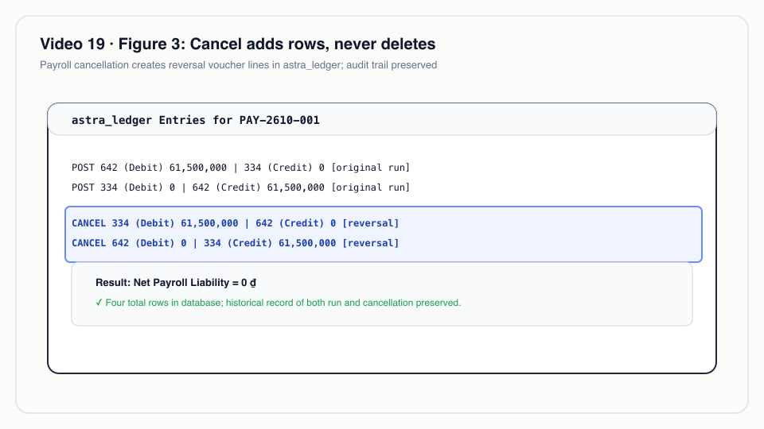
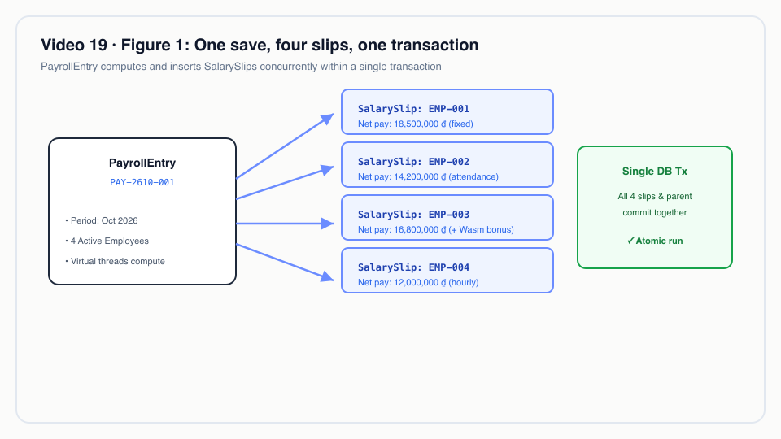
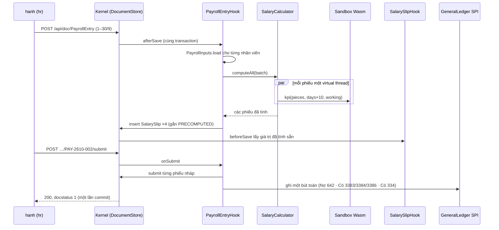
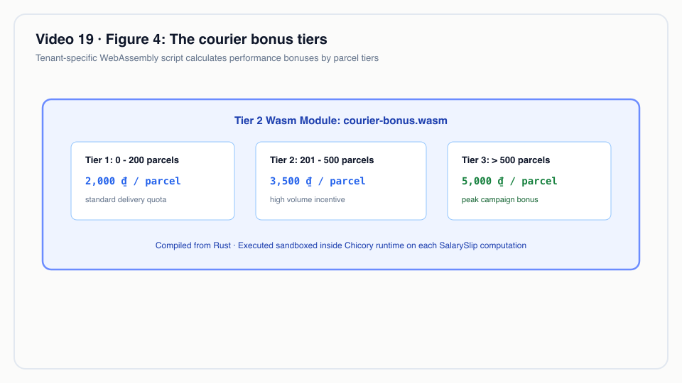
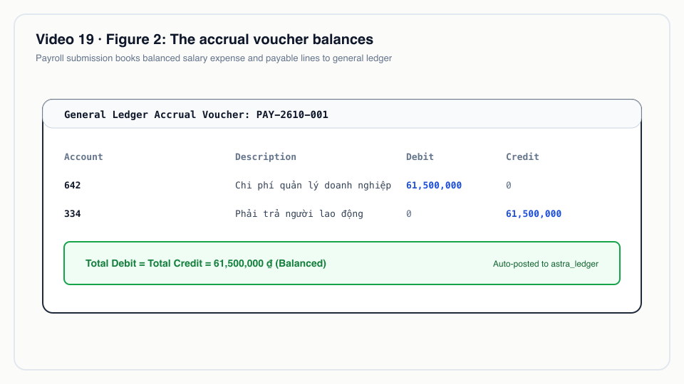

# Video 19 · HRM: nhân sự và tiền lương

<a href="https://media.zerohostcms.com/astra-cms/astra-video-19-hrm-vi.mp4"></a>

▶ [Tiếng Việt](https://media.zerohostcms.com/astra-cms/astra-video-19-hrm-vi.mp4) · [English](https://media.zerohostcms.com/astra-cms/astra-video-19-hrm-en.mp4) · 2:40 · Kịch bản: [demo-video-series.md](../demo-video-series.md#video-19-hrm-nhân-sự-và-tiền-lương) · [Bản tiếng Anh](./19-hrm.md)

> **Tóm tắt một câu:** Một app tính lương chỉ dùng SPI công khai của Astra và theo mô hình Frappe HRMS: chấm công quyết định ngày công, module Wasm của tenant tính thưởng bưu tá, một Payroll Entry tính song song mọi phiếu lương, và khi submit thì ghi đúng một bút toán dồn tích cân đối vào sổ cái append-only.
>
> **Nên đọc nếu:** bạn muốn xem một module nghiệp vụ thật (tám DocType, năm hook, một tool MCP) được xây trên SPI mà không đụng vào kernel (góc nhìn developer) / bạn đang đánh giá liệu một nền tảng metadata có gánh được việc xử lý theo lô nhạy cảm về tiền như tính lương cuối tháng, và còn thiếu gì trước khi nó trở thành phần mềm tính lương (góc nhìn tech lead).

## Vấn đề

Astra Express trả bưu tá lương cơ bản cộng thưởng theo mỗi kiện giao. Cuối tháng, bộ phận nhân sự ở tenant Sài Gòn
phải quy chấm công ra ngày công, áp biểu thưởng theo kiện, khấu trừ bảo hiểm xã hội, y tế và thất nghiệp phần người lao
động, rồi chuyển cho kế toán một bút toán khớp với phiếu lương đến từng đồng. Những kiểu hỏng quen thuộc:

- **Lương nằm trong bảng tính.** Ngày công gõ tay, công thức thưởng chép qua lại giữa các tab, kế toán nhập lại số tổng
  vào sổ cái. Không ai chỉ ra được dữ liệu đầu vào nào sinh ra dòng nào.
- **Quy tắc thưởng đổi theo vùng và theo quý.** Với ERP truyền thống, điều đó nghĩa là sửa code hoặc nhờ nhà cung cấp
  tuỳ biến. Mỗi tenant muốn biểu thưởng riêng mà không phải phát hành lại toàn bộ sản phẩm.
- **Phiếu lương và sổ cái lệch nhau.** Nếu phiếu lương lưu ở một bước và bút toán ghi ở bước khác, một sự cố giữa hai
  bước sẽ để lại một tháng mới dồn tích một nửa. Huỷ một lượt chạy về sau phải hoàn tác cả hai mà không xoá lịch sử.

Frappe HRMS (chạy trên ERPNext) giải bài này bằng một bộ khái niệm quen thuộc: Employee, Salary Component, Salary
Structure, Salary Structure Assignment, Attendance, Additional Salary, Payroll Entry và Salary Slip. Một Payroll Entry
tạo phiếu lương cho một kỳ và ghi một bút toán dồn tích. Công thức của salary component ở đó là biểu thức Python do
framework đánh giá.

App HRM của Astra **chỉ lấy tên khái niệm**. Kịch bản nói thẳng: không chép code, schema hay giao diện nào của ERPNext
hay HRMS. Khác biệt nằm ở chỗ mỗi phần chạy ở đâu: các công thức khác nhau theo tenant chạy trong sandbox Wasm Tier 2,
phiếu lương được tính trên virtual thread, và bút toán dồn tích đi qua cùng SPI `GeneralLedger` mà app Express dùng cho
doanh thu cước.

## Video cho thấy gì

Bản quay chạy `make demo-hrm` trên stack k3d sau `make demo-seed`; lệnh seed nạp tháng 9/2026 (26 ngày làm việc, Thứ 2
đến Thứ 7) cho `saigon-express`. Kịch bản đăng nhập bằng `hanh` (role `hr`).

1. **App** (cảnh 1). App `io.astra.hrm`, tám DocType trong module `hrm`, chỉ phụ thuộc `astra-spi`. Lời dẫn: "Tên khái
   niệm của Frappe HRMS, không có code."
2. **Thành phần lương** (cảnh 1). Tám Salary Component: lương cơ bản, phụ cấp ăn trưa và xăng xe, thưởng KPI, thưởng một
   lần, và bảo hiểm phần người lao động: BHXH 8 %, BHYT 1,5 %, BHTN 1 %, ghi vào các tài khoản 3383, 3384 và 3386. Tỷ lệ
   là giá trị seed cho demo.
3. **Thưởng bưu tá bằng Wasm** (cảnh 2). Mã Rust trong `astra-apps/hrm/wasm/courier-kpi`: 1.500 ₫ mỗi kiện đến kiện thứ
   600, 2.000 ₫ đến kiện thứ 1.000, 2.500 ₫ từ đó trở đi, cộng 500.000 ₫ chuyên cần nếu đủ công. Khi lưu, kernel chạy thử:
   `kpi(1000 pieces, 26/26 days) = 2200000 VND`. Một module lặp vô hạn bị dừng ở 50 ms và bị từ chối với mã 422.
4. **Chấm công** (cảnh 3). NV002 vắng ngày 15/9 và nghỉ nửa ngày 22/9, nên còn 24,5 ngày công. NV004 nghỉ không lương
   ngày 29/9. Ngày không có bản ghi được tính là có đi làm. `quang` (ops) submit được chấm công nhưng nhận 403 với Salary
   Slip; `tuan` (sales) nhận 403 với Payroll Entry.
5. **Một lần lưu, mọi phiếu lương** (cảnh 4). Lưu nháp một Payroll Entry cho ngày 1 đến 30 tháng 9 tạo ra bốn phiếu lương
   nháp, tính song song mỗi phiếu một virtual thread, trong cùng transaction với entry. Trong lần quay, entry là
   `PAY-2610-002` (series dùng tháng tạo) và các phiếu là `SAL-2610-00005` đến `SAL-2610-00008`.
6. **Một phiếu lương, từng dòng** (cảnh 5). NV002: `100% of 6500000 (base) × 24.5/26 days` = 6.125.000; KPI
   `Wasm kpi(1007 pieces, 24.5/26 days)` = 1.717.500; BHXH `8% of 6500000 (base)` = 520.000; gross 9.001.539, net
   8.319.039. NV003 vào làm ngày 14/9 nên có 15 ngày công, cộng một Additional Salary 500.000 ₫. Client gửi `net_pay`
   nhận 422 `field 'net_pay' is read-only`.
7. **Submit** (cảnh 6). Bốn nhân viên, gross 35.837.501, khấu trừ 3.517.500, net 32.320.001. Một bút toán dồn tích năm
   dòng: Nợ 642 35.837.501; Có 3383 2.680.000; Có 3384 502.500; Có 3386 335.000; Có 334 32.320.001. `accrual_voucher`
   của mỗi phiếu được gán bằng tên entry.
8. **Ba lần từ chối** (cảnh 6). Huỷ một phiếu của lượt chạy đã submit trả về 422 "cancel the payroll entry instead". Chạy
   lương tháng 9 lần thứ hai trả về 422 "NV001 already has submitted salary slip …". Việc client tự đặt số tiền đã bị từ
   chối ở cảnh 5.
9. **MCP** (cảnh 7). `payroll_summary` trả về tổng và các dòng phiếu với tên đã che (`N*** V*** A***`). `tuan` gọi cùng
   tool đó nhận `isError: true`, "not permitted: read PayrollEntry".
10. **Cancel** (cảnh 8). Các phiếu chuyển sang docstatus 2, bút toán có thêm năm dòng với `is_reversal: true`, và số dư
    thử của 334, 3383, 3384, 3386 và 642 về 0. Không dòng nào bị xoá.


*Cancel thêm dòng, không bao giờ xoá.*

## Cách hoạt động

### Hình dạng của app

`HrmApp` là một app Tier 0: một CDI bean liệt kê các file YAML DocType của nó. Mọi thứ còn lại là hook và một tool MCP.

*`astra-apps/hrm/src/main/java/io/astra/apps/hrm/HrmApp.java`*
```java
@ApplicationScoped
public class HrmApp implements AstraApp {

    @Override
    public String id() { return "io.astra.hrm"; }
    // …
    @Override
    public List<String> doctypeResources() {
        return List.of(
                "META-INF/astra/doctypes/employee.doctype.yaml",
                "META-INF/astra/doctypes/salary-component.doctype.yaml",
                "META-INF/astra/doctypes/salary-structure.doctype.yaml",
                "META-INF/astra/doctypes/salary-structure-assignment.doctype.yaml",
                "META-INF/astra/doctypes/attendance.doctype.yaml",
                "META-INF/astra/doctypes/additional-salary.doctype.yaml",
                "META-INF/astra/doctypes/payroll-entry.doctype.yaml",
                "META-INF/astra/doctypes/salary-slip.doctype.yaml");
    }
}
```

Payroll Entry là một DocType submittable bình thường. Các trường tổng là `read-only`, nên chỉ hook mới đặt được giá trị,
và bảng quyền là nơi sinh ra "sales nhận 403":

*`astra-apps/hrm/src/main/resources/META-INF/astra/doctypes/payroll-entry.doctype.yaml`*
```yaml
name: PayrollEntry
module: hrm
kind: transaction
submittable: true
naming: { series: "PAY-.YYMM.-.###" }
# …
fields:
  - { name: start_date,      type: Date,     required: true, in-list: true }
  # …
  - { name: total_net,       type: Currency, read-only: true, in-list: true }
# …
permissions:
  - { role: admin,      read: true, create: true, write: true, submit: true, cancel: true }
  - { role: hr,         read: true, create: true, write: true, submit: true, cancel: true }
  - { role: accountant, read: true }
```


*Một lần lưu, bốn phiếu lương, một transaction.*

### Lưu, submit, cancel



Lưu một entry nháp sẽ dựng lại các phiếu nháp. Hook đọc mọi dữ liệu đầu vào trong transaction của entry trước, rồi giao
phần tính toán thuần cho `SalaryCalculator`, rồi ghi các phiếu lại trong cùng transaction:

*`astra-apps/hrm/src/main/java/io/astra/apps/hrm/PayrollEntryHook.java`*
```java
    @Override
    public void afterSave(Document entry) {
        if (entry.docstatus() != 0) return;
        // …
        List<SalaryInput> batch = new ArrayList<>();
        List<String> unassigned = new ArrayList<>();
        for (Document e : employees) {
            Document slip = existing.get(e.name());
            if (slip != null && slip.docstatus() != 0) continue;   // submitted or cancelled on its own: leave it
            inputs.load(e, start, end).ifPresentOrElse(batch::add, () -> unassigned.add(e.name()));
        }
        // …
        List<Map<String, Object>> computed = calculator.computeAll(batch);
        // …
        ScopedValue.where(SalarySlipHook.PRECOMPUTED, byEmployee).run(() -> {
            for (SalaryInput in : batch) {
                // …
                    docs.insert("SalarySlip", period, entry.owner());
                // …
            }
        });
    }
```

**Vì sao tách đọc, tính và ghi.** Truy cập cơ sở dữ liệu nằm trên thread của request và trong transaction duy nhất của
nó. Phần tính toán không chạm vào lưu trữ, nên có thể toả ra song song một cách an toàn. Lời gọi KPI Wasm chiếm phần lớn
chi phí, vì thế `computeAll` dùng mỗi phiếu một virtual thread:

*`astra-apps/hrm/src/main/java/io/astra/apps/hrm/SalaryCalculator.java`*
```java
    List<Map<String, Object>> computeAll(List<SalaryInput> inputs) {
        try (ExecutorService threads = Executors.newVirtualThreadPerTaskExecutor()) {
            List<Future<Map<String, Object>>> futures = inputs.stream().map(in -> threads.submit(() -> compute(in))).toList();
            // …
        }
    }
```

**Vì sao dùng `ScopedValue` cho kết quả tính sẵn.** `SalarySlipHook.beforeSave` tính phiếu mỗi khi một phiếu nháp được
lưu. Khi entry tự ghi các phiếu của nó, entry gắn `PRECOMPUTED` để hook của phiếu dùng lại kết quả của cả lô thay vì
tính hai lần. Việc gắn này chỉ có hiệu lực trong tiến trình (xem `PRECOMPUTED` trong `SalarySlipHook`), nên một REST
client không thể lén đưa giá trị đã tính vào qua đường này.

### Ngày công và bốn kiểu tính

Ngày công được trả lương bằng số ngày làm việc trừ số ngày ngoài thời gian làm việc, trừ ngày Absent, trừ một nửa mỗi
ngày Half Day, trừ ngày Leave Without Pay. Ngày không chấm công được tính là có đi làm. Đây là quy tắc cho NV002 24,5 trên
26 ngày:

*`astra-apps/hrm/src/main/java/io/astra/apps/hrm/SalaryCalculator.java`*
```java
            lost += switch (att.getString("status")) {
                case "Absent" -> 1;
                case "Half Day" -> 0.5;
                case "On Leave" -> "Leave Without Pay".equals(att.getString("leave_type")) ? 1 : 0;
                default -> 0;
            };
        }
        double paymentDays = Math.max(0, working - outside - lost);
```

Mỗi thành phần lương có một trong bốn kiểu tính: Fixed, Percent of Base (có thể có mức trần), Percent of Gross (chỉ cho
khấu trừ) và Wasm. Mỗi dòng ghi lại một `basis` dễ đọc, chính là thứ video gọi là "truy vết từng dòng":

*`astra-apps/hrm/src/main/java/io/astra/apps/hrm/SalaryCalculator.java`*
```java
            case "Wasm" -> {
                long v;
                try {
                    v = kpi(scripts, c, ctx.pieces(), Math.round(ctx.paymentDays() * 10), ctx.workingDays());
                } catch (ScriptException e) {
                    throw new DocValidationException("component " + c.name() + ": formula failed (" + e.reason() + "): " + e.getMessage());
                }
                // …
                basis = "Wasm kpi(" + ctx.pieces() + " pieces, " + Values.plain(ctx.paymentDays()) + "/" + ctx.workingDays() + " days)";
            }
```

Ngày công được truyền vào Wasm dưới dạng `payment_days × 10`, một số nguyên, vì sandbox chỉ trao đổi giá trị `i64`.

### Công thức thưởng của tenant

*`astra-apps/hrm/wasm/courier-kpi/src/lib.rs`*
```rust
const TIERS: [(i64, i64); 3] = [(600, 1_500), (1_000, 2_000), (i64::MAX, 2_500)]; // (up to pieces, VND per piece)
const FULL_ATTENDANCE_BONUS: i64 = 500_000;

#[unsafe(no_mangle)]
pub extern "C" fn kpi(pieces: i64, payment_days_x10: i64, working_days: i64) -> i64 {
    let pieces = pieces.max(0);
    let mut bonus = 0;
    let mut floor = 0;
    for (ceiling, rate) in TIERS {
        if pieces <= floor {
            break;
        }
        bonus += (pieces.min(ceiling) - floor) * rate;
        floor = ceiling;
    }
    if working_days > 0 && payment_days_x10 >= working_days * 10 {
        bonus += FULL_ATTENDANCE_BONUS;
    }
    bonus
}
```

1.007 kiện của NV002: 600 × 1.500 + 400 × 2.000 + 7 × 2.500 = 1.717.500 ₫, không có thưởng chuyên cần vì 24,5 < 26.

Một module không thể đi vào bảng lương nếu không qua bài tự kiểm tra khi lưu. Module lặp vô hạn bị dừng ở deadline và
lần lưu bị từ chối:

*`astra-apps/hrm/src/main/java/io/astra/apps/hrm/SalaryComponentHook.java`*
```java
        try {
            bonus = SalaryCalculator.kpi(scripts, c, 1_000, 260, 26);
        } catch (ScriptException e) {
            throw new DocValidationException("module rejected (" + e.reason() + "): " + e.getMessage());
        }
        if (bonus < 0 || bonus > 1_000_000_000L) throw new DocValidationException("module rejected: kpi(1000 pieces, 26/26 days) returned " + bonus);
        // …
        c.set("self_test", "kpi(1000 pieces, 26/26 days) = " + bonus + " VND in " + micros + " µs");
```


*Các bậc thưởng bưu tá.*

### Mỗi lượt chạy một bút toán dồn tích

Khi submit, entry submit mọi phiếu nháp, cộng thu nhập và khấu trừ theo từng tài khoản sổ cái, rồi ghi một bút toán qua
SPI `GeneralLedger`, bên trong transaction của entry. Nếu bước nào lỗi, cả lượt chạy được rollback:

*`astra-apps/hrm/src/main/java/io/astra/apps/hrm/PayrollEntryHook.java`*
```java
        List<Entry> lines = new ArrayList<>();
        byAccount(submitted, "earnings").forEach((account, amount) -> lines.add(Entry.debit(account, null, amount)));
        byAccount(submitted, "deductions").forEach((account, amount) -> lines.add(Entry.credit(account, null, amount)));
        lines.add(Entry.credit(SALARY_PAYABLE, null, BigDecimal.valueOf(sum(submitted, "net_pay"))));
        ledger.post("PayrollEntry", entry.name(), Values.requireDate(entry, "posting_date"), lines,
                "Payroll accrual " + entry.getString("start_date") + " – " + entry.getString("end_date")
                        + " (" + submitted.size() + " slips)");
```

Bút toán cân đối theo cách dựng: gross (Nợ 642) bằng khấu trừ (Có 3383, 3384, 3386) cộng net (Có 334). Trong lần quay:
2.680.000 + 502.500 + 335.000 + 32.320.001 = 35.837.501.

**Vì sao phiếu lương không tự ghi sổ.** Mỗi lượt chạy một bút toán giúp sổ cái dễ đọc với kế toán và biến việc huỷ thành
một lần đảo duy nhất. Cái giá là 334 giữ một con số tổng, không phải số dư theo từng nhân viên (xem "Nói đúng").

Cancel là hình ảnh phản chiếu: entry huỷ các phiếu của chính nó (gắn `CANCELLING_ENTRY` để guard của phiếu cho chúng
đi qua) và yêu cầu sổ cái ghi một bút toán đảo. Bản thân bảng sổ cái từ chối UPDATE và DELETE (xem
[Video 12](./12-ledger.vi.md)).

*`astra-apps/hrm/src/main/java/io/astra/apps/hrm/PayrollEntryHook.java`*
```java
    @Override
    public void onCancel(Document entry) {
        ScopedValue.where(SalarySlipHook.CANCELLING_ENTRY, entry.name()).run(() -> {
            for (Document slip : slips(entry)) {
                if (slip.docstatus() == 1) docs.cancel("SalarySlip", slip.name());
            }
        });
        ledger.reverse("PayrollEntry", entry.name());
    }
```


*Bút toán dồn tích cân đối.*

### Góc nhìn của agent AI

`PayrollSummaryTool` (`payroll_summary`) là một tool MCP do app đóng góp. `reads()` của nó trả về `PayrollEntry` và
`SalarySlip`, nên MCP server kiểm tra quyền đọc của người gọi trên cả hai DocType trước khi gọi; đó là lý do `tuan` nhận
"not permitted: read PayrollEntry". `employee_name` được đánh dấu `pii: true` trong các DocType, nên tên đi ra ngoài đã
bị che qua cơ chế che dữ liệu MCP của kernel (xem [Video 15](./15-mcp.vi.md)).

## Ví dụ thực tế

Một công ty chuyển phát ở TP. Hồ Chí Minh tính lương cho nhân viên giao hàng theo cấu trúc COURIER có sẵn trong seed.
Lấy một bưu tá trong tháng 9/2026 (26 ngày làm việc) với lương cơ bản theo hợp đồng 7.000.000 ₫, vắng một ngày và giao
820 kiện. Các giá trị bên dưới được tính tay theo quy tắc của code và các thành phần lương trong seed; chúng mang tính
minh hoạ, không phải kết quả của một lần chạy.

**Đầu vào:** Chấm công: một bản ghi `Absent` vào một ngày làm việc. Số kiện nhập kèm chấm công: 820. Assignment: COURIER,
lương cơ bản 7.000.000.

**Astra làm gì:**

| Dòng | Quy tắc | Số tiền (₫) |
| --- | --- | --- |
| BASIC | 100 % của 7.000.000 × 25/26 ngày | 6.730.769 |
| LUNCH | 730.000 cố định × 25/26 ngày | 701.923 |
| FUEL | 500.000 cố định × 25/26 ngày | 480.769 |
| KPI (Wasm) | 600 × 1.500 + 220 × 2.000; không có thưởng chuyên cần (25 < 26) | 1.340.000 |
| **Gross** | | **9.253.461** |
| BHXH | 8 % của 7.000.000 (lương cơ bản, không chia theo ngày công) | 560.000 |
| BHYT | 1,5 % của 7.000.000 | 105.000 |
| BHTN | 1 % của 7.000.000 | 70.000 |
| **Net** | gross − 735.000 | **8.518.461** |

**Đầu ra:** phiếu lương mang mọi dòng kèm chuỗi `basis`, nên câu hỏi của nhân viên ("sao phụ cấp ăn trưa của tôi là
701.923?") được trả lời ngay từ chứng từ. Khi nhân sự submit Payroll Entry của tháng, các khoản của bưu tá này được gộp
vào một bút toán cho cả lượt chạy: 9.253.461 vào Nợ 642, 560.000 vào Có 3383, và cứ thế. Nếu quý sau quản lý vùng đổi
biểu thưởng theo kiện, tenant tải một module Wasm mới lên thành phần KPI; bài tự kiểm tra chạy khi lưu và không dòng code
Java nào thay đổi.

Một lượt chạy giới hạn ở 1.000 nhân viên (`MAX_EMPLOYEES` trong `PayrollEntryHook`). Công ty lớn hơn mức đó sẽ phải
chia lượt chạy, ví dụ theo `designation` (trường lọc của entry: All, Courier, Driver, Hub Staff, Office).

## Dành cho tech lead

- **Điều này chứng minh gì.** Một lô xử lý nhiều chứng từ, nhạy cảm về tiền, có thể viết thành app Tier 0 trên SPI
  công khai: entry, các phiếu lương và bút toán sổ cái của nó cùng commit hoặc cùng rollback, và sổ cái append-only giữ
  cho việc huỷ có thể kiểm toán được.
- **Điều này không chứng minh gì.** Đây là app tính lương cho demo, không phải phần mềm tính lương. Thuế thu nhập cá
  nhân, phần bảo hiểm doanh nghiệp đóng, chi trả lương và file ngân hàng đều chưa có (xem bên dưới). Đừng so từng tính
  năng với Frappe HRMS.
- **Công thức theo tenant mà không cần phát hành code.** Thành phần Wasm đưa việc đổi biểu thưởng ra khỏi chu kỳ phát
  hành. Đổi lại, công thức là module đã biên dịch chứ không phải trình soạn công thức; nhân sự không tự đổi được nếu
  không có developer.
- **Kích thước lượt chạy và độ trễ.** Lô chạy bên trong HTTP request lưu entry, tối đa 1.000 nhân viên. Hãy đo thời gian
  request và độ dài transaction ở quy mô nhân sự của bạn trước khi dựa vào nó; job nền cuối tháng có bầu leader nằm trong
  lộ trình, chưa được xây.
- **Độ chi tiết của sổ cái.** Mỗi lượt chạy một bút toán, tổng theo tài khoản. Nếu kiểm toán viên cần 334 theo từng
  nhân viên hay phân bổ theo trung tâm chi phí, phần đó chưa có.
- **Bảo vệ dữ liệu.** Tên nhân viên đến tay agent AI ở dạng đã che, và agent kế thừa quyền của người gọi. Nhân viên chưa
  tự đọc được phiếu lương của mình (`if-owner` chỉ áp cho ghi).
- **Khi nào chưa nên dùng.** Bất kỳ bảng lương thật nào phải khai thuế hay trả lương cho nhân viên. Hãy dùng nó để đánh
  giá hình dạng của nền tảng: SPI, hook, Wasm, sổ cái và MCP cùng làm việc trên một luồng nghiệp vụ thật.

## Tự chạy thử

Yêu cầu: JDK 25, Docker với khoảng 8 GB RAM, `kubectl`, `k3d`, `jq`, Bash 5 (`brew install bash` trên macOS). User `hanh`
phải có trong Keycloak; nếu realm đã đổi kể từ lúc tạo cluster, chạy `scripts/keycloak-sync-realm.sh`.

```bash
make k3d-up                          # cluster: kernel pods, PostgreSQL, Redis, Keycloak, Seata, CDC worker
make demo-seed                       # loads September 2026 for saigon-express (and hanoi-express)
make demo-hrm                        # all scenes, Enter between steps
make demo-hrm SCENES="4 5 6" PAUSE=0 # open, inspect and submit a payroll run without pausing
```

Kết quả mong đợi (số liệu từ lần quay; tên entry và tên phiếu phụ thuộc vào số lượt chạy bạn đã mở):

- Cảnh 4: `HTTP 201` với `"docstatus": 0`, rồi bốn phiếu nháp với `payment_days` 26.0, 24.5, 15.0 và 25.0.
- Cảnh 6: `"employees": 4`, `"gross": 35837501`, `"net": 32320001`, và năm dòng sổ cái cho bút toán.
- Cảnh 8: số dư thử hiện `"balance": 0.00` cho 334, 3383, 3384, 3386 và 642.

Sau đó mở Desk tại `http://localhost:8080/desk/` bằng `hanh` (mật khẩu `Astra@123`, chỉ dùng cho stack local) để xem form
Payroll Entry và Salary Slip. Test tích hợp là `astra-server/src/test/java/io/astra/server/HrmPayrollTest.java`.

## Nói đúng

Theo mục "Nói đúng" của kịch bản Video 19:

- **Không tính thuế thu nhập cá nhân**; net là gross trừ bảo hiểm phần người lao động. Phần doanh nghiệp đóng (BHXH,
  BHYT, BHTN, KPCĐ) không được tính. Tỷ lệ và mức trần bảo hiểm là cấu hình seed cho demo, chưa đối chiếu với quy định
  hiện hành; quy tắc nghỉ từ 14 ngày trở lên thì không đóng BHXH chưa được xử lý.
- **Chấm công tối giản:** không có lịch ngày lễ, ca làm, check-in hay đơn nghỉ phép có số dư phép. Tuần làm việc cố định
  Thứ 2 đến Thứ 7, và ngày không có bản ghi chấm công được tính là có đi làm. Số kiện do ops nhập kèm chấm công, chưa lấy
  từ Waybill hay STMS qua CDC như use case mô tả.
- **Chỉ có bốn kiểu tính** (Fixed, % lương cơ bản, % gross, Wasm), chưa có trình soạn công thức. Không có bút toán chi
  trả lương (Nợ 334 / Có 112) và không xuất file ngân hàng. Bút toán dồn tích ghi tổng theo tài khoản, không ghi theo
  từng nhân viên trên 334; toàn bộ chi phí vào 642, không phân bổ theo trung tâm chi phí.
- **Lô chạy ngay trong request** lưu entry (tối đa 1.000 nhân viên). Không có job nền cuối tháng hay bầu leader. Phiếu
  lương và sổ cái chung một transaction PostgreSQL, không dùng Seata.
- **Nhân viên chưa tự xem được phiếu lương của mình:** quyền `if-owner` chỉ áp cho ghi, chưa áp cho đọc.
- **Chưa có Desk riêng cho tính lương:** Desk chung hiển thị các dòng phiếu dưới dạng "N item(s)".
- Số liệu trong kịch bản được tính theo logic của hook; các con số ở mục "Video cho thấy gì" của bài này lấy từ lần quay,
  còn các giá trị ở "Ví dụ thực tế" được tính tay và mang tính minh hoạ.

## Hình minh hoạ

### Hình 1 · Một lần lưu, bốn phiếu lương, một transaction


### Hình 2 · Bút toán dồn tích cân đối


### Hình 3 · Cancel thêm dòng, không bao giờ xoá


### Hình 4 · Các bậc thưởng bưu tá


## Liên quan

- Trước: [Video 17 · Seata: một lần submit, ba tài nguyên](./17-seata.vi.md). Tiếp: [Video 20 · STMS: điều phối xe với Timefold + AI copilot](./20-stms.vi.md). Lộ trình: [Video 18](./18-roadmap.vi.md).
- Các cơ chế được dùng lại ở đây: [Video 4 · vòng đời chứng từ](./04-lifecycle.vi.md), [Video 11 · phân quyền](./11-keycloak.vi.md), [Video 12 · sổ cái append-only](./12-ledger.vi.md), [Video 14 · Wasm Tier 2](./14-wasm.vi.md), [Video 15 · MCP](./15-mcp.vi.md).
- Thiết kế: [use-case-01.md](../use-case-01.md) (module 4, `astra-app-hrm`, có ghi chú trạng thái về những điểm khác với lát cắt đang chạy).
- Mã nguồn: [`HrmApp`](../../astra-apps/hrm/src/main/java/io/astra/apps/hrm/HrmApp.java), [`PayrollEntryHook`](../../astra-apps/hrm/src/main/java/io/astra/apps/hrm/PayrollEntryHook.java), [`SalaryCalculator`](../../astra-apps/hrm/src/main/java/io/astra/apps/hrm/SalaryCalculator.java), [`SalarySlipHook`](../../astra-apps/hrm/src/main/java/io/astra/apps/hrm/SalarySlipHook.java), [`PayrollSummaryTool`](../../astra-apps/hrm/src/main/java/io/astra/apps/hrm/PayrollSummaryTool.java), [`courier-kpi`](../../astra-apps/hrm/wasm/courier-kpi/src/lib.rs), [`demo-hrm.sh`](../../scripts/demo-hrm.sh), test [`HrmPayrollTest`](../../astra-server/src/test/java/io/astra/server/HrmPayrollTest.java).
