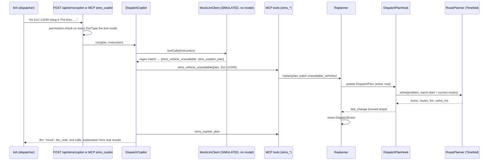
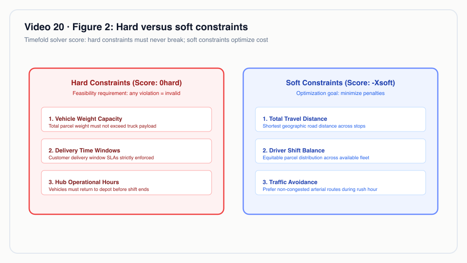
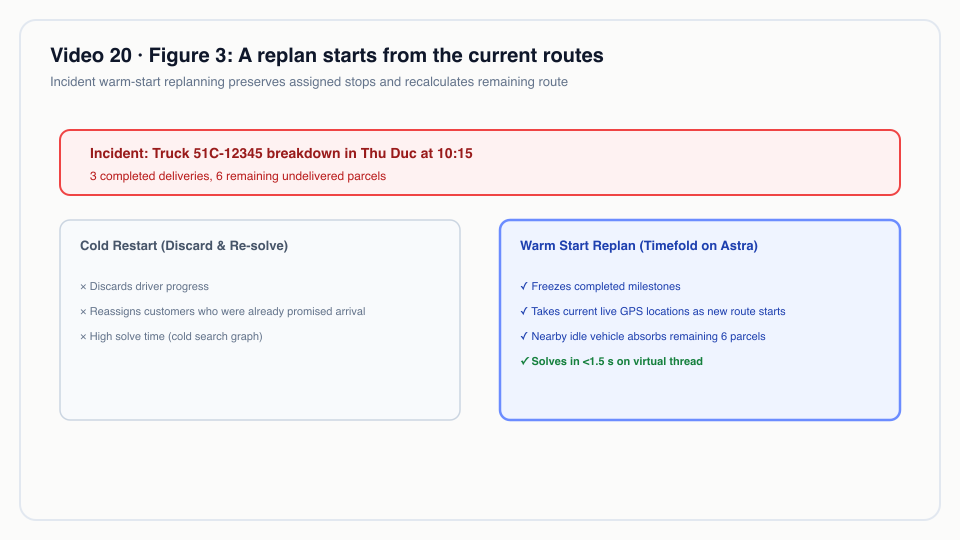
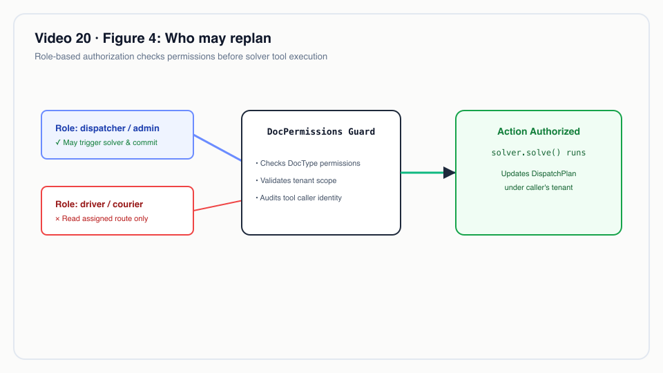
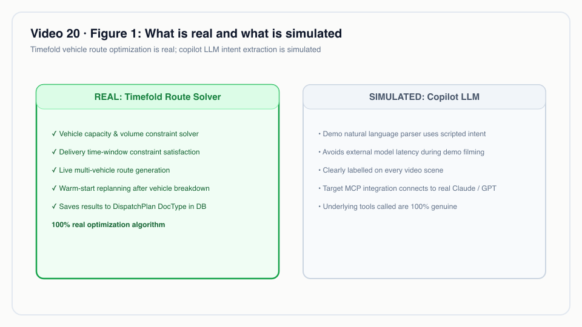

# Video 20 · STMS: vehicle dispatch with Timefold + AI copilot

<a href="https://media.zerohostcms.com/astra-cms/astra-video-20-stms-en.mp4"></a>

▶ [English](https://media.zerohostcms.com/astra-cms/astra-video-20-stms-en.mp4) · [Tiếng Việt](https://media.zerohostcms.com/astra-cms/astra-video-20-stms-vi.mp4) · 2:58 · Script: [demo-video-series.en.md](../demo-video-series.en.md#video-20-stms-vehicle-dispatch-with-timefold--ai-copilot)

> **In one sentence:** Timefold Solver plans delivery routes inside the Astra kernel and plans them again from the current routes when a vehicle breaks down, an urgent order arrives or traffic slows; a dispatch copilot turns Vietnamese commands into calls to those same MCP tools.
>
> **Read this if:** you want to see a constraint solver, live replanning and agent-callable tools built as an ordinary Tier 0 app on the SPI (developer angle) / you are weighing in-platform optimisation and an AI dispatch assistant, and need to know exactly which parts are real today (tech-lead angle).

> [!IMPORTANT]
> **The copilot's language model is simulated.** No LLM is called anywhere in this demo. `MockLlmClient` matches each
> command against fixed Vietnamese patterns and a small built-in list of place names, then returns pre-defined tool
> calls; anything outside the script produces no tool call. Every copilot response carries `llm: "mock"` and an
> `llm_note`, and every explanation starts with `[LLM giả lập – kịch bản demo]` ("simulated LLM, demo script"). What is
> real: the Timefold solver, the replanning, the MCP tools, permissions and the event log. The plug-in point for a real
> model is the `LlmClient` interface, which has no real implementation yet.

## The problem

Every morning, a dispatcher at Astra Express's Tân Bình hub has three trucks and twenty stops: shops in District 1, a
pharmacy in Thủ Đức, VIP customers who must be served before 10:00, and stops that only accept deliveries between 09:00
and 11:00. The trucks carry 300, 250 and 250 kg. A route that ignores capacity or a time window fails in the field; a
route that ignores distance burns fuel.

Then the day happens. A truck breaks down at 08:30. A customer calls with an urgent 30 kg order. A jam closes in around
Thủ Đức. In most small and mid-size logistics companies in Vietnam this is handled by phone and spreadsheet: the
dispatcher reshuffles stops by memory, and nobody can later say what changed and why.

Common alternatives:

- **A separate routing SaaS**, integrated by export/import. It solves well but lives outside the order, permission and
  audit model; every replan is another round trip of files or APIs.
- **A solver embedded in a custom service.** Flexible, but each team rebuilds tenancy, permissions and audit around it.
- **Frappe/ERPNext** has a Delivery Trip DocType that records one vehicle's stops for a trip; multi-vehicle routing
  with capacity and time-window constraints is not part of it, so teams add an external service.

Astra's STMS slice puts the solver behind a DocType hook and a set of MCP tools, so routing inherits the platform's
tenancy, permissions, lifecycle (a dispatched plan is frozen) and logging.

## What the video shows

The recording runs `make demo-stms` after `make demo-seed`, signed in as `linh` (role `dispatcher`). Every frame that
shows the copilot carries the label "LLM giả lập (kịch bản demo)". Numbers are from the recorded run.

1. **Master data** (scene 1). Five DocTypes: Hub, Vehicle, DeliveryStop, DispatchPlan, DispatchEvent. Hub HCM-TB (Kho Tân
   Bình), three vehicles (51C-12345 300 kg, 51C-67890 250 kg, 51D-24680 250 kg), 20 stops with time windows and Normal,
   VIP or Urgent priority. The video's map is illustrative and draws straight lines, not roads.
2. **Baseline solve** (scene 2). Saving `DP-2610-0001` with `solve: true` and a 5-second budget: `0hard/-106703soft`
   (zero hard penalty means feasible), 98.8 km, 2 vehicles, 1,782 ms.
3. **Breakdown, through the copilot** (scene 3). Command: "Xe 51C-12345 hỏng ở Thủ Đức, chuyển hết đơn sang xe khác"
   (vehicle 51C-12345 broke down in Thủ Đức, move all its orders). The simulated LLM returns two tool calls,
   `stms_vehicle_unavailable` then `stms_explain_plan`. The real solver moves 10 stops (9 to 51C-67890, 1 to
   51D-24680), still 0hard, 98.8 → 98.6 km, 1,019 ms; 3/3 VIP stops before 10:00.
4. **New weights, through the copilot** (scene 4). "Ưu tiên khách VIP trước 10h, cân bằng tải giữa các xe" (VIPs before
   10:00, balance load). The copilot calls `stms_set_weights` (priority 500, balance 10). 19 stops change vehicle, both
   vehicles carry 226 kg, distance grows to 111.6 km, 1,930 ms. Soft scores change scale when weights change, so only
   plans with the same weights are comparable.
5. **Urgent order, copilot over MCP** (scene 5). "Thêm đơn gấp 30kg ở Bến Thành trước 11h" sent to the `stms_copilot`
   MCP tool. Bến Thành's coordinates come from the simulation's fixed place list. `DS-2610-00021` is inserted into
   51D-24680; 4/4 VIP or urgent stops before 10:00; 111.6 → 112.1 km; 1,010 ms.
6. **Live events without the copilot** (scene 6). `stms_traffic_delay` (Thủ Đức, 4 km radius, 2.5× slower): 112.1 →
   117.5 km, 1,958 ms. `stms_change_time_window` (DS-2610-00015, Linh kiện Tân Tiến, now 08:00–09:00): 117.5 → 137.0
   km, 1,638 ms. Both stay 0hard and both log a DispatchEvent.
7. **Desk** (Desk scenes). The dispatch copilot page sends a command to `POST /api/stms/copilot`, the same copilot as the
   MCP tool; it shows the simulated LLM label before and after sending, the tool calls that ran, and the stops that
   changed vehicle.
8. **Permissions and tenancy** (scene 7). `quang` (ops) is refused: "not permitted: read DispatchEvent". `ha` (care)
   is refused: "not permitted: read DispatchPlan". The same plan name from `hanoi-express`: "not found".
9. **Dispatch** (scene 8). The DispatchEvent log lists each change with source, score before and after, moved stops and
   `solve_ms`. Submit sets docstatus 1 and status Dispatched. A later `PUT {solve: true}` returns 422 "submitted
   documents are immutable"; `stms_set_weights` returns "is dispatched and frozen; amend it to replan".

## How it works

### The flow of one copilot command



### The solver: hard and soft constraints

Timefold Solver (the continuation of OptaPlanner) searches for a plan that minimises a `HardSoftScore`. Hard
constraints must reach zero for a plan to be feasible; soft constraints rank the feasible plans.

*`astra-apps/stms/src/main/java/io/astra/apps/stms/solver/RoutingConstraints.java`*
```java
                // per kilogram over capacity
                factory.forEach(PlanVehicle.class)
                        .filter(v -> v.totalDemandGrams() > v.getCapacityGrams())
                        .penalize(HardSoftScore.ONE_HARD, v -> ceilDiv(v.totalDemandGrams() - v.getCapacityGrams(), 1000))
                        .asConstraint(CAPACITY),
                // per minute late
                factory.forEach(PlanVisit.class)
                        .filter(v -> v.lateSeconds() > 0)
                        .penalize(HardSoftScore.ONE_HARD, v -> ceilDiv(v.lateSeconds(), 60))
                        .asConstraint(TIME_WINDOW),
                // per road metre
                factory.forEach(PlanVehicle.class)
                        .filter(v -> !v.getVisits().isEmpty())
                        .penalize(HardSoftScore.ONE_SOFT, PlanVehicle::totalMeters)
                        .asConstraint(DISTANCE),
                // per minute between leaving the depot and starting service at a priority stop
                // …
                // squared load per vehicle: for a fixed total it is smallest when loads are equal
                factory.forEach(PlanVehicle.class)
                        .filter(v -> !v.getVisits().isEmpty())
                        .penalize(HardSoftScore.ONE_SOFT, v -> v.loadKg() * v.loadKg())
                        .asConstraint(BALANCE)
```

**Why the soft score is not "kilometres".** The soft score adds metres, minutes of priority waiting and squared
kilograms, each multiplied by a weight. The defaults are distance 1, priority 20, balance 0
(`RoutingProblem.Weights.DEFAULT`). When the copilot sets priority 500 and balance 10, the score jumps from about −0.1
million to about −1.26 million even though the plan is still feasible: the numbers are on a different scale. That is
why the script warns to compare only plans with the same weights.

The weights are applied per plan through Timefold's `ConstraintWeightOverrides`, so changing them needs no redeploy:

*`astra-apps/stms/src/main/java/io/astra/apps/stms/solver/RoutePlanner.java`*
```java
        RoutingProblem.Weights w = problem.weights();
        ConstraintWeightOverrides<HardSoftScore> weights = ConstraintWeightOverrides.of(Map.of(
                RoutingConstraints.DISTANCE, HardSoftScore.ofSoft(w.distance()),
                RoutingConstraints.PRIORITY, HardSoftScore.ofSoft(w.priority()),
                RoutingConstraints.BALANCE, HardSoftScore.ofSoft(w.balance())));
```


*Timefold solver constraints: hard constraints prevent capacity violations; soft constraints minimize total route travel time.*

### Distances without a map

There is no road network. Distance is the great-circle (haversine) distance multiplied by a road factor of 1.3, and
travel time assumes 25 km/h. A traffic event is a circle in which legs become slower by a factor:

*`astra-apps/stms/src/main/java/io/astra/apps/stms/solver/RoutePlanner.java`*
```java
                double metres = Location.haversineMeters(from.latitude(), from.longitude(), to.latitude(), to.longitude()) * roadFactor;
                from.metersTo[to.index()] = Math.round(metres);
                double factor = Math.max(slowdown[from.index()], slowdown[to.index()]);
                from.secondsTo[to.index()] = Math.round(metres / metresPerSecond * factor);
```

Speed, road factor and the default budget are configuration (`astra.stms.speed-kmh`, `astra.stms.road-factor`,
`astra.stms.solve-seconds`), with a hard cap of 30 seconds per solve.

### A bounded solve on a virtual thread

*`astra-apps/stms/src/main/java/io/astra/apps/stms/solver/RoutePlanner.java`*
```java
    /** Stops when the budget is spent, or earlier once the score has not improved for a fifth of it. */
    private RoutePlan solveOnVirtualThread(RoutePlan plan, int seconds) {
        Duration limit = Duration.ofSeconds(seconds);
        Duration unimproved = Duration.ofMillis(Math.max(500, limit.toMillis() / 5));
        Solver<RoutePlan> solver = solverFactory.buildSolver(new SolverConfigOverride()
                .withTerminationConfig(new TerminationConfig().withSpentLimit(limit).withUnimprovedSpentLimit(unimproved)));
        // …
    }
```

**Why the "unimproved" limit.** With a 5-second budget, the solver stops after 1 second without improvement. That is
why the recorded solves take 1.0 to 2.0 seconds rather than the full 5.

### Solving is a save, replanning is a save with a warm start

The solve action is a field. When a draft DispatchPlan is saved with `solve: true`, the hook solves it in the same save
and writes the result, plus a `last_change` record of what moved:

*`astra-apps/stms/src/main/java/io/astra/apps/stms/DispatchPlanHook.java`*
```java
    @Override
    public void beforeSave(Document doc) {
        // settings are validated on every save, not only when solving
        // …
        if (!Values.flag(doc.get("solve"))) return;
        doc.set("solve", false);
        solve(doc);
    }
```

The problem is built warm-started from the plan's current routes (`problem.warmStart()` in `RoutePlanner.build`), so a
replan begins from what the drivers already have and only moves what the event forces or what clearly improves the
score. Every live event goes through `Replanner`, which patches the plan, re-solves and logs:

*`astra-apps/stms/src/main/java/io/astra/apps/stms/Replanner.java`*
```java
    public Map<String, Object> replan(String planName, String eventType, Map<String, Object> detail, Map<String, Object> planPatch) {
        draftPlan(planName);
        Map<String, Object> patch = new LinkedHashMap<>(planPatch);
        patch.put("solve", true);
        Document after = docs.update("DispatchPlan", planName, patch)
                .orElseThrow(() -> new DocValidationException("dispatch plan " + planName + " not found"));
        // …
        Document logged = docs.insert("DispatchEvent", event, OWNER);
```

`draftPlan` is what makes a dispatched plan frozen for tools; the kernel's lifecycle makes it immutable for REST
(see [Video 4](./04-lifecycle.md)).


*Warm-start route replanning: unexpected incidents or vehicle breakdowns adjust routes dynamically from current vehicle locations.*

### Permissions through the tools' declared reads

Each replanning tool declares the DocTypes it reads. DispatchEvent is readable only by admin and dispatcher, so
including it in the list is what keeps ops and care from replanning, without a special permission system:

*`astra-apps/stms/src/main/java/io/astra/apps/stms/Replanner.java`*
```java
    /**
     * DocTypes a replanning tool declares it reads. DispatchEvent is readable only by roles that may replan
     * (admin, dispatcher), so the MCP server's read check is what keeps other roles from replanning.
     */
    public static final List<String> REPLAN_READS = List.of("DispatchPlan", "DispatchEvent", "Vehicle", "DeliveryStop", "Hub");
```


*Copilot permission boundaries: dispatchers and ops staff invoke route planning based on fine-grained DocType permissions.*

### The copilot, and why its LLM is simulated

The copilot depends on an interface, not on a model:

*`astra-apps/stms/src/main/java/io/astra/apps/stms/copilot/LlmClient.java`*
```java
/**
 * The language model behind the dispatch copilot: turns a dispatcher's instruction into tool calls. Implementations
 * are CDI beans; {@code astra.stms.llm} selects one by {@link #id()}. Only {@link MockLlmClient} exists today; a real
 * provider plugs in here with the same contract.
 */
public interface LlmClient {
    // …
    /** True when no model is called (scripted answers); the copilot then says so in every response. */
    boolean simulated();
```

The only implementation is a set of regular expressions:

*`astra-apps/stms/src/main/java/io/astra/apps/stms/copilot/MockLlmClient.java`*
```java
/**
 * NOT a language model. A deterministic stand-in for the demo: each clause of the instruction is matched against a
 * few Vietnamese patterns (breakdown, urgent order, congestion, time window, priorities) and mapped to the tool calls
 * a model would be expected to return. Places are looked up in a small built-in gazetteer instead of being geocoded.
 * Anything outside the script yields no tool call. The copilot labels every answer produced through this client.
 */
@ApplicationScoped
public class MockLlmClient implements LlmClient {
    // …
    static final Pattern BREAKDOWN = Pattern.compile(
            "xe\\s+(\\d{2}[a-z]{1,2}\\d?-?[\\d.]{4,6})\\b.*?(hỏng|hư|chết máy|nổ lốp|bể lốp|tai nạn|không chạy|nghỉ)", FLAGS);
    // …
    @Override public String id() { return "mock"; }

    @Override public boolean simulated() { return true; }
```

**Why the explanation is still trustworthy.** `DispatchCopilot` never shows text from the "model". It runs the tool
calls against the real solver, then writes the explanation from the actual results (score before and after, stops
moved, solve time). When the client is simulated, it adds the label and the note:

*`astra-apps/stms/src/main/java/io/astra/apps/stms/copilot/DispatchCopilot.java`*
```java
        Map<String, Object> out = new LinkedHashMap<>();
        out.put("llm", llm.id());
        if (llm.simulated()) out.put("llm_note", MOCK_NOTE);
        // …
    static String explain(LlmClient llm, List<ToolCall> calls, List<Map<String, Object>> results, Document before, Document after) {
        StringBuilder sb = new StringBuilder(llm.simulated() ? "[LLM giả lập – kịch bản demo] " : "");
```

The copilot may call only the seven STMS tools in its `TOOLS` set; it cannot call itself or any kernel tool. This
design is what would let a real model be added later without changing the trust boundary: a model would only choose
tool calls, and the tools would still enforce permissions and the solver would still produce the numbers. That is the
intended design; it has not been tested with a real model.


*Separating real optimization from simulation: Timefold route optimization runs live, while demo LLM intent extraction is scripted.*

## Real-world example

A regional parcel carrier in Ho Chi Minh City runs the morning wave from one hub. The scenario below is the recorded
demo run, read as a dispatcher's morning. The clock times in bold are narrative framing; the inputs and outputs are the
logged values.

**07:00, plan the day.** Inputs: hub HCM-TB, opens 07:00; 3 vehicles; 20 stops, 15.0 to 30.2 kg each, four with a
09:00–11:00 window, three VIP. The dispatcher saves a DispatchPlan with "Solve on save". Output: feasible, 98.8 km,
two vehicles used (the third stays at the hub), 226 kg on each, solved in 1.8 s.

**08:30, a truck breaks down.** Input: 51C-12345 is out. In the demo the dispatcher types a command and the simulated
copilot maps it to `stms_vehicle_unavailable`; a dispatcher could equally call the tool or edit the plan's
`unavailable_vehicles` field. Output: its 10 stops move (9 to 51C-67890, 1 to 51D-24680), still feasible, 98.6 km, and
a DispatchEvent records who changed what.

**09:15, an urgent order.** Input: 30 kg at Bến Thành, due before 11:00. Output: stop `DS-2610-00021` created and placed
on 51D-24680, served at 08:00 in the plan; every VIP or urgent stop still before 10:00; 112.1 km.

**09:40, a jam and a customer change.** Inputs: Thủ Đức 2.5× slower within 4 km; one shop narrows its window to
08:00–09:00. Outputs: two more feasible replans, 117.5 km then 137.0 km, each logged.

**10:00, dispatch.** Submit freezes the plan. Any later change requires an amendment, which keeps the dispatched version
as a record.

Caveat for a real carrier: in this slice time does not advance. The 09:15 urgent order was served "at 08:00" because the
solver does not know that stops before 09:15 are already done or that trucks are on the road. Locking delivered stops
is listed under "To be accurate".

## For technical leaders

- **Real versus simulated.** Solver, replanning, MCP tools, permissions, tenancy and the event log run for real. The
  copilot's language model does not exist yet; it is a regex script. Do not evaluate natural-language robustness from
  this demo.
- **Why a solver in the platform.** Routing becomes a document action with tenancy, permissions, lifecycle and audit
  for free. The cost is CPU in the kernel pods: each solve holds a virtual thread for up to its budget (default 5 s,
  capped at 30 s). Measure solve CPU per tenant and consider a dedicated pool or pod before scaling.
- **Scale is unmeasured.** The demo has about 20 stops and solves in 1 to 2 seconds. Larger problems have not been
  measured; benchmark your own stop counts before committing.
- **Model fidelity.** Straight-line distance × 1.3 at 25 km/h, one combined capacity per vehicle, one hub per plan. Good
  enough to prove the mechanism; not a substitute for a road-network routing engine. A production system would replace
  the distance matrix with a routing service.
- **The trust boundary for a future LLM.** The model only picks tool calls; tools re-check permissions; numbers come
  from the solver. This limits what a hallucinating model can do, but a real provider also needs PII handling, cost
  control and evaluation, none of which is built.
- **Audit gap.** DispatchEvents created by tools are owned by `stms-mcp` / `stms-copilot`; the real caller is in the MCP
  server log, not on the document.
- **When not to use it today.** Any live fleet. Use it to judge whether "solver behind a DocType, tools for agents" is
  the architecture you want.

## Try it yourself

Prerequisites: JDK 25, Docker with about 8 GB of RAM, `kubectl`, `k3d`, `jq`, Bash 5. Seed and demo must use the same
`STMS_DATE` (default: today in Vietnam time). Scenes 3 to 8 use the plan created by scene 2, so run them in order.

```bash
make k3d-up
make demo-seed                          # hub, 3 vehicles and 20 stops per tenant for STMS_DATE
make demo-stms                          # all scenes, Enter between steps
make demo-stms SCENES="2 3" PAUSE=0     # baseline solve, then the breakdown through the copilot
STMS_DATE=2026-10-22 make demo-stms     # pin the date if the seed ran on another day
```

Expected output, by scene:

- Scene 2: `HTTP 201`, `"status": "Solved"`, a score of the form `0hard/…soft`, `"feasible": true`, and the route
  table. Exact km and milliseconds vary between runs.
- Scene 3: `"llm": "mock"`, an `llm_note`, tool calls `stms_vehicle_unavailable` and `stms_explain_plan`, and an
  explanation that begins `[LLM giả lập – kịch bản demo]`.
- Scene 7: `not permitted: read DispatchEvent` for `quang` and `not found` from `hanoi-express`.

In Desk (`http://localhost:8080/desk/`, user `linh`, password `Astra@123`, local stack only), open the dispatch copilot
page and type one of the commands from scenes 3 to 5. A command outside the script produces no tool call and an
explanation saying, in Vietnamese, that no scenario matched and nothing changed: the simulated LLM showing its limit. Tests:
`astra-apps/stms/src/test/java/io/astra/apps/stms/solver/RoutePlannerTest.java`,
`astra-server/src/test/java/io/astra/server/StmsDispatchTest.java`, `astra-server/src/test/java/io/astra/server/StmsMcpTest.java`.

## To be accurate

From the script's "To be accurate" section for Video 20:

- **The copilot does not call any language model.** `MockLlmClient` matches commands against fixed Vietnamese patterns
  and a small list of place names; commands outside the script produce no tool call. The explanation is written from
  the solver's real results. The plug-in point for a real LLM provider is the `LlmClient` interface; there is no
  implementation yet.
- **No map, road network or live traffic.** Distance is straight-line × 1.3 at a fixed 25 km/h; a "traffic jam" is a
  slow zone declared by the dispatcher. No geocoding: stops come with coordinates.
- **Replanning is re-solving from the current routes**, without keeping the solver running all day. Time does not
  advance, so delivered stops and vehicles on the road are not locked. Adding an urgent order and re-solving are two
  transactions: if the re-solve fails, the new order is still saved.
- **Simplified capacity model:** one combined total per vehicle (deliveries and pickups added together); no
  pickup-before-delivery constraints, multiple trips, driver shifts and breaks, return-to-hub deadlines, vehicle types or
  vehicle costs. One hub per plan, no transfers between hubs.
- **Not built yet:** AI load forecasting (Tier 1), driver app, GPS, field ETA updates, a route map. Desk shows a text
  route table and JSON.
- **Small problem only:** about 20 stops, 1 to 2 seconds. Larger problems have not been measured. On-screen numbers come
  from the recording.
- **Ownership:** DispatchEvents and urgent orders created by tools have owner `stms-mcp` / `stms-copilot`; the real caller
  is recorded in the MCP server log.

## Figures

- [Figure 1 · What is real and what is simulated](#the-copilot-and-why-its-llm-is-simulated)
- [Figure 2 · Hard versus soft constraints](#the-solver-hard-and-soft-constraints)
- [Figure 3 · A replan starts from the current routes](#solving-is-a-save-replanning-is-a-save-with-a-warm-start)
- [Figure 4 · Who may replan](#permissions-through-the-tools-declared-reads)

## Related

- Previous: [Video 19 · HRM: attendance and payroll](./19-hrm.md). Next: [Video 21 · SAML SSO and SCIM](./21-sso.md). Roadmap: [Video 18](./18-roadmap.md).
- Mechanisms reused here: [Video 4 · lifecycle](./04-lifecycle.md), [Video 11 · permissions](./11-keycloak.md), [Video 7 · tenants](./07-tenants.md), [Video 15 · MCP](./15-mcp.md).
- Design: [use-case-01.md](../use-case-01.md) (module 6, `astra-app-stms`, with a status note on what differs from the running slice).
- Source: [`RoutingConstraints`](../../astra-apps/stms/src/main/java/io/astra/apps/stms/solver/RoutingConstraints.java), [`RoutePlanner`](../../astra-apps/stms/src/main/java/io/astra/apps/stms/solver/RoutePlanner.java), [`DispatchPlanHook`](../../astra-apps/stms/src/main/java/io/astra/apps/stms/DispatchPlanHook.java), [`Replanner`](../../astra-apps/stms/src/main/java/io/astra/apps/stms/Replanner.java), [`ReplanTools`](../../astra-apps/stms/src/main/java/io/astra/apps/stms/ReplanTools.java), [`DispatchCopilot`](../../astra-apps/stms/src/main/java/io/astra/apps/stms/copilot/DispatchCopilot.java), [`LlmClient`](../../astra-apps/stms/src/main/java/io/astra/apps/stms/copilot/LlmClient.java), [`MockLlmClient`](../../astra-apps/stms/src/main/java/io/astra/apps/stms/copilot/MockLlmClient.java), [`StmsCopilotResource`](../../astra-server/src/main/java/io/astra/server/StmsCopilotResource.java), [`demo-stms.sh`](../../scripts/demo-stms.sh).
