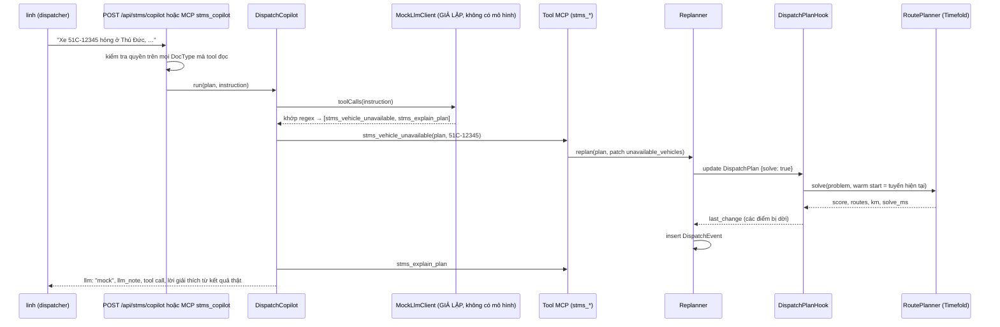

# Video 20 · STMS: điều phối xe với Timefold + AI copilot

<a href="https://media.zerohostcms.com/astra-cms/astra-video-20-stms-vi.mp4"></a>

▶ [Tiếng Việt](https://media.zerohostcms.com/astra-cms/astra-video-20-stms-vi.mp4) · [English](https://media.zerohostcms.com/astra-cms/astra-video-20-stms-en.mp4) · 2:58 · Kịch bản: [demo-video-series.md](../demo-video-series.md#video-20-stms-điều-phối-xe-với-timefold--ai-copilot) · [Bản tiếng Anh](./20-stms.md)

> **Tóm tắt một câu:** Timefold Solver lập tuyến giao hàng ngay trong kernel của Astra và lập lại từ các tuyến hiện tại khi một xe hỏng, một đơn gấp đến hay giao thông chậm lại; một copilot điều phối biến câu lệnh tiếng Việt thành lời gọi tới chính các tool MCP đó.
>
> **Nên đọc nếu:** bạn muốn xem một constraint solver, việc lập lại kế hoạch trực tiếp và các tool mà agent gọi được, tất cả xây như một app Tier 0 bình thường trên SPI (góc nhìn developer) / bạn đang cân nhắc tối ưu hoá ngay trong nền tảng và một trợ lý điều phối AI, và cần biết chính xác phần nào là thật hôm nay (góc nhìn tech lead).

> [!IMPORTANT]
> **Mô hình ngôn ngữ của copilot là LLM giả lập (kịch bản demo).** Không có LLM nào được gọi ở bất kỳ đâu trong demo
> này. `MockLlmClient` khớp từng câu lệnh với các mẫu tiếng Việt cố định và một danh sách địa danh nhỏ có sẵn, rồi trả
> về các tool call định sẵn; câu lệnh nằm ngoài kịch bản không sinh tool call nào. Mọi phản hồi của copilot đều mang
> `llm: "mock"` và một `llm_note`, và mọi lời giải thích đều bắt đầu bằng `[LLM giả lập – kịch bản demo]`. Phần thật gồm:
> Timefold solver, việc lập lại kế hoạch, các tool MCP, phân quyền và nhật ký sự kiện. Điểm cắm cho một mô hình thật là
> interface `LlmClient`, hiện chưa có bản hiện thực thật nào.

## Vấn đề

Mỗi sáng, người điều phối ở kho Tân Bình của Astra Express có ba xe tải và hai mươi điểm dừng: cửa hàng ở Quận 1, một
nhà thuốc ở Thủ Đức, khách VIP phải được phục vụ trước 10:00, và các điểm chỉ nhận hàng từ 09:00 đến 11:00. Các xe chở
được 300, 250 và 250 kg. Một tuyến bỏ qua tải trọng hay khung giờ sẽ hỏng ngoài hiện trường; một tuyến bỏ qua quãng
đường sẽ đốt xăng.

Rồi một ngày làm việc bắt đầu. Một xe hỏng lúc 08:30. Một khách gọi đặt đơn gấp 30 kg. Kẹt xe dồn quanh Thủ Đức. Ở phần
lớn công ty logistics vừa và nhỏ tại Việt Nam, việc này được xử lý bằng điện thoại và bảng tính: người điều phối xếp lại
điểm dừng theo trí nhớ, và về sau không ai nói được cái gì đã đổi và vì sao.

Các lựa chọn thường gặp:

- **Một SaaS định tuyến riêng**, tích hợp bằng xuất/nhập. Nó giải tốt nhưng nằm ngoài mô hình đơn hàng, phân quyền và
  audit; mỗi lần lập lại kế hoạch là thêm một vòng trao đổi file hoặc API.
- **Một solver nhúng trong service tự viết.** Linh hoạt, nhưng mỗi đội lại dựng lại đa thuê bao, phân quyền và audit
  quanh nó.
- **Frappe/ERPNext** có DocType Delivery Trip ghi các điểm dừng của một xe cho một chuyến; định tuyến nhiều xe với ràng
  buộc tải trọng và khung giờ không nằm trong đó, nên các đội phải thêm một service bên ngoài.

Lát cắt STMS của Astra đặt solver sau một hook của DocType và một bộ tool MCP, nhờ vậy việc định tuyến thừa hưởng đa thuê
bao, phân quyền, vòng đời (một kế hoạch đã điều phối thì bị đóng băng) và nhật ký của nền tảng.

## Video cho thấy gì

Bản quay chạy `make demo-stms` sau `make demo-seed`, đăng nhập bằng `linh` (role `dispatcher`). Mọi khung hình có copilot
đều mang nhãn "LLM giả lập (kịch bản demo)". Số liệu lấy từ lần quay.

1. **Dữ liệu gốc** (cảnh 1). Năm DocType: Hub, Vehicle, DeliveryStop, DispatchPlan, DispatchEvent. Hub HCM-TB (Kho Tân
   Bình), ba xe (51C-12345 300 kg, 51C-67890 250 kg, 51D-24680 250 kg), 20 điểm dừng có khung giờ và mức ưu tiên Normal,
   VIP hoặc Urgent. Bản đồ trong video chỉ để minh hoạ và vẽ đường thẳng, không phải đường thật.
2. **Lời giải gốc** (cảnh 2). Lưu `DP-2610-0001` với `solve: true` và ngân sách 5 giây: `0hard/-106703soft` (điểm phạt
   cứng bằng 0 nghĩa là khả thi), 98,8 km, 2 xe, 1.782 ms.
3. **Xe hỏng, qua copilot** (cảnh 3). Câu lệnh: "Xe 51C-12345 hỏng ở Thủ Đức, chuyển hết đơn sang xe khác". LLM giả lập
   trả về hai tool call, `stms_vehicle_unavailable` rồi `stms_explain_plan`. Solver thật chuyển 10 điểm (9 sang
   51C-67890, 1 sang 51D-24680), vẫn 0hard, 98,8 → 98,6 km, 1.019 ms; 3/3 điểm VIP được phục vụ trước 10:00.
4. **Trọng số mới, qua copilot** (cảnh 4). "Ưu tiên khách VIP trước 10h, cân bằng tải giữa các xe". Copilot gọi
   `stms_set_weights` (priority 500, balance 10). 19 điểm đổi xe, cả hai xe chở 226 kg, quãng đường tăng lên 111,6 km,
   1.930 ms. Điểm mềm đổi thang đo khi đổi trọng số, nên chỉ so sánh được các plan có cùng trọng số.
5. **Đơn gấp, copilot qua MCP** (cảnh 5). "Thêm đơn gấp 30kg ở Bến Thành trước 11h" gửi tới tool MCP `stms_copilot`.
   Toạ độ Bến Thành lấy từ danh sách địa danh cố định của bản giả lập. `DS-2610-00021` được chèn vào 51D-24680; 4/4 điểm
   VIP hoặc gấp được phục vụ trước 10:00; 111,6 → 112,1 km; 1.010 ms.
6. **Sự kiện trực tiếp không qua copilot** (cảnh 6). `stms_traffic_delay` (Thủ Đức, bán kính 4 km, chậm 2,5 lần): 112,1 →
   117,5 km, 1.958 ms. `stms_change_time_window` (DS-2610-00015, Linh kiện Tân Tiến, nay là 08:00–09:00): 117,5 → 137,0
   km, 1.638 ms. Cả hai vẫn 0hard và cả hai đều ghi một DispatchEvent.
7. **Desk** (các cảnh Desk). Trang copilot điều phối gửi câu lệnh tới `POST /api/stms/copilot`, cùng copilot với tool
   MCP; trang hiện nhãn LLM giả lập cả trước và sau khi gửi, các tool call đã chạy, và các điểm đã đổi xe.
8. **Phân quyền và đa thuê bao** (cảnh 7). `quang` (ops) bị từ chối: "not permitted: read DispatchEvent". `ha` (care)
   bị từ chối: "not permitted: read DispatchPlan". Cùng tên plan từ `hanoi-express`: "not found".
9. **Điều phối** (cảnh 8). Nhật ký DispatchEvent liệt kê từng thay đổi với nguồn, điểm số trước và sau, các điểm bị dời
   và `solve_ms`. Submit đặt docstatus 1 và trạng thái Dispatched. Một `PUT {solve: true}` sau đó trả về 422 "submitted
   documents are immutable"; `stms_set_weights` trả về "is dispatched and frozen; amend it to replan".

## Cách hoạt động

### Luồng của một câu lệnh copilot



### Solver: ràng buộc cứng và mềm

Timefold Solver (bản kế tục của OptaPlanner) tìm một kế hoạch tối thiểu hoá `HardSoftScore`. Ràng buộc cứng phải về 0
thì kế hoạch mới khả thi; ràng buộc mềm xếp hạng các kế hoạch khả thi.

*`astra-apps/stms/src/main/java/io/astra/apps/stms/solver/RoutingConstraints.java`*
```java
                // per kilogram over capacity
                factory.forEach(PlanVehicle.class)
                        .filter(v -> v.totalDemandGrams() > v.getCapacityGrams())
                        .penalize(HardSoftScore.ONE_HARD, v -> ceilDiv(v.totalDemandGrams() - v.getCapacityGrams(), 1000))
                        .asConstraint(CAPACITY),
                // per minute late
                factory.forEach(PlanVisit.class)
                        .filter(v -> v.lateSeconds() > 0)
                        .penalize(HardSoftScore.ONE_HARD, v -> ceilDiv(v.lateSeconds(), 60))
                        .asConstraint(TIME_WINDOW),
                // per road metre
                factory.forEach(PlanVehicle.class)
                        .filter(v -> !v.getVisits().isEmpty())
                        .penalize(HardSoftScore.ONE_SOFT, PlanVehicle::totalMeters)
                        .asConstraint(DISTANCE),
                // per minute between leaving the depot and starting service at a priority stop
                // …
                // squared load per vehicle: for a fixed total it is smallest when loads are equal
                factory.forEach(PlanVehicle.class)
                        .filter(v -> !v.getVisits().isEmpty())
                        .penalize(HardSoftScore.ONE_SOFT, v -> v.loadKg() * v.loadKg())
                        .asConstraint(BALANCE)
```

**Vì sao điểm mềm không phải là "kilômét".** Điểm mềm cộng số mét, số phút điểm ưu tiên phải chờ và bình phương số kg,
mỗi thứ nhân với một trọng số. Mặc định là distance 1, priority 20, balance 0 (`RoutingProblem.Weights.DEFAULT`). Khi
copilot đặt priority 500 và balance 10, điểm số nhảy từ khoảng −0,1 triệu xuống khoảng −1,26 triệu dù kế hoạch vẫn khả
thi: các con số đã ở thang đo khác. Đó là lý do kịch bản nhắc chỉ so sánh các plan có cùng trọng số.

Trọng số được áp theo từng plan qua `ConstraintWeightOverrides` của Timefold, nên đổi trọng số không cần deploy lại:

*`astra-apps/stms/src/main/java/io/astra/apps/stms/solver/RoutePlanner.java`*
```java
        RoutingProblem.Weights w = problem.weights();
        ConstraintWeightOverrides<HardSoftScore> weights = ConstraintWeightOverrides.of(Map.of(
                RoutingConstraints.DISTANCE, HardSoftScore.ofSoft(w.distance()),
                RoutingConstraints.PRIORITY, HardSoftScore.ofSoft(w.priority()),
                RoutingConstraints.BALANCE, HardSoftScore.ofSoft(w.balance())));
```


*Ràng buộc cứng và ràng buộc mềm.*

### Khoảng cách không cần bản đồ

Không có mạng lưới đường. Khoảng cách là khoảng cách đường tròn lớn (haversine) nhân với hệ số đường 1,3, và thời gian
di chuyển giả định 25 km/h. Một sự kiện giao thông là một vòng tròn mà trong đó các chặng chậm đi theo một hệ số:

*`astra-apps/stms/src/main/java/io/astra/apps/stms/solver/RoutePlanner.java`*
```java
                double metres = Location.haversineMeters(from.latitude(), from.longitude(), to.latitude(), to.longitude()) * roadFactor;
                from.metersTo[to.index()] = Math.round(metres);
                double factor = Math.max(slowdown[from.index()], slowdown[to.index()]);
                from.secondsTo[to.index()] = Math.round(metres / metresPerSecond * factor);
```

Tốc độ, hệ số đường và ngân sách mặc định là cấu hình (`astra.stms.speed-kmh`, `astra.stms.road-factor`,
`astra.stms.solve-seconds`), với mức trần cứng 30 giây cho mỗi lần giải.

### Một lần giải có giới hạn trên virtual thread

*`astra-apps/stms/src/main/java/io/astra/apps/stms/solver/RoutePlanner.java`*
```java
    /** Stops when the budget is spent, or earlier once the score has not improved for a fifth of it. */
    private RoutePlan solveOnVirtualThread(RoutePlan plan, int seconds) {
        Duration limit = Duration.ofSeconds(seconds);
        Duration unimproved = Duration.ofMillis(Math.max(500, limit.toMillis() / 5));
        Solver<RoutePlan> solver = solverFactory.buildSolver(new SolverConfigOverride()
                .withTerminationConfig(new TerminationConfig().withSpentLimit(limit).withUnimprovedSpentLimit(unimproved)));
        // …
    }
```

**Vì sao có giới hạn "không cải thiện".** Với ngân sách 5 giây, solver dừng sau 1 giây không cải thiện. Đó là lý do các
lần giải trong bản quay mất 1,0 đến 2,0 giây thay vì trọn 5 giây.

### Giải là một lần lưu, lập lại kế hoạch là một lần lưu có warm start

Hành động giải là một trường. Khi một DispatchPlan nháp được lưu với `solve: true`, hook giải nó ngay trong lần lưu đó và
ghi kết quả, kèm một bản ghi `last_change` về những gì đã dời:

*`astra-apps/stms/src/main/java/io/astra/apps/stms/DispatchPlanHook.java`*
```java
    @Override
    public void beforeSave(Document doc) {
        // settings are validated on every save, not only when solving
        // …
        if (!Values.flag(doc.get("solve"))) return;
        doc.set("solve", false);
        solve(doc);
    }
```

Bài toán được dựng với warm start từ các tuyến hiện tại của plan (`problem.warmStart()` trong `RoutePlanner.build`), nên
một lần lập lại kế hoạch bắt đầu từ những gì tài xế đang có và chỉ dời những gì sự kiện bắt buộc hoặc những gì rõ ràng
cải thiện điểm số. Mọi sự kiện trực tiếp đều đi qua `Replanner`, nơi vá plan, giải lại và ghi nhật ký:

*`astra-apps/stms/src/main/java/io/astra/apps/stms/Replanner.java`*
```java
    public Map<String, Object> replan(String planName, String eventType, Map<String, Object> detail, Map<String, Object> planPatch) {
        draftPlan(planName);
        Map<String, Object> patch = new LinkedHashMap<>(planPatch);
        patch.put("solve", true);
        Document after = docs.update("DispatchPlan", planName, patch)
                .orElseThrow(() -> new DocValidationException("dispatch plan " + planName + " not found"));
        // …
        Document logged = docs.insert("DispatchEvent", event, OWNER);
```

`draftPlan` là thứ khiến một plan đã điều phối bị đóng băng với các tool; vòng đời của kernel khiến nó bất biến với REST
(xem [Video 4](./04-lifecycle.vi.md)).


*Lập lại kế hoạch bắt đầu từ các tuyến hiện tại.*

### Phân quyền qua danh sách đọc mà tool khai báo

Mỗi tool lập lại kế hoạch khai báo các DocType nó đọc. DispatchEvent chỉ admin và dispatcher đọc được, nên đưa nó vào
danh sách chính là cách ngăn ops và care lập lại kế hoạch, không cần một hệ thống phân quyền riêng:

*`astra-apps/stms/src/main/java/io/astra/apps/stms/Replanner.java`*
```java
    /**
     * DocTypes a replanning tool declares it reads. DispatchEvent is readable only by roles that may replan
     * (admin, dispatcher), so the MCP server's read check is what keeps other roles from replanning.
     */
    public static final List<String> REPLAN_READS = List.of("DispatchPlan", "DispatchEvent", "Vehicle", "DeliveryStop", "Hub");
```


*Ai được lập lại kế hoạch.*

### Copilot, và vì sao LLM của nó là giả lập

Copilot phụ thuộc vào một interface, không phụ thuộc vào một mô hình:

*`astra-apps/stms/src/main/java/io/astra/apps/stms/copilot/LlmClient.java`*
```java
/**
 * The language model behind the dispatch copilot: turns a dispatcher's instruction into tool calls. Implementations
 * are CDI beans; {@code astra.stms.llm} selects one by {@link #id()}. Only {@link MockLlmClient} exists today; a real
 * provider plugs in here with the same contract.
 */
public interface LlmClient {
    // …
    /** True when no model is called (scripted answers); the copilot then says so in every response. */
    boolean simulated();
```

Bản hiện thực duy nhất là một tập biểu thức chính quy:

*`astra-apps/stms/src/main/java/io/astra/apps/stms/copilot/MockLlmClient.java`*
```java
/**
 * NOT a language model. A deterministic stand-in for the demo: each clause of the instruction is matched against a
 * few Vietnamese patterns (breakdown, urgent order, congestion, time window, priorities) and mapped to the tool calls
 * a model would be expected to return. Places are looked up in a small built-in gazetteer instead of being geocoded.
 * Anything outside the script yields no tool call. The copilot labels every answer produced through this client.
 */
@ApplicationScoped
public class MockLlmClient implements LlmClient {
    // …
    static final Pattern BREAKDOWN = Pattern.compile(
            "xe\\s+(\\d{2}[a-z]{1,2}\\d?-?[\\d.]{4,6})\\b.*?(hỏng|hư|chết máy|nổ lốp|bể lốp|tai nạn|không chạy|nghỉ)", FLAGS);
    // …
    @Override public String id() { return "mock"; }

    @Override public boolean simulated() { return true; }
```

**Vì sao lời giải thích vẫn đáng tin.** `DispatchCopilot` không bao giờ hiển thị văn bản từ "mô hình". Nó chạy các tool
call trên solver thật, rồi viết lời giải thích từ kết quả thực tế (điểm số trước và sau, các điểm bị dời, thời gian
giải). Khi client là giả lập, nó thêm nhãn và ghi chú:

*`astra-apps/stms/src/main/java/io/astra/apps/stms/copilot/DispatchCopilot.java`*
```java
        Map<String, Object> out = new LinkedHashMap<>();
        out.put("llm", llm.id());
        if (llm.simulated()) out.put("llm_note", MOCK_NOTE);
        // …
    static String explain(LlmClient llm, List<ToolCall> calls, List<Map<String, Object>> results, Document before, Document after) {
        StringBuilder sb = new StringBuilder(llm.simulated() ? "[LLM giả lập – kịch bản demo] " : "");
```

Copilot chỉ được gọi bảy tool STMS trong tập `TOOLS` của nó; nó không thể gọi chính mình hay bất kỳ tool nào của kernel.
Thiết kế này là thứ sẽ cho phép thêm một mô hình thật về sau mà không đổi ranh giới tin cậy: mô hình chỉ chọn tool call,
các tool vẫn thực thi phân quyền và solver vẫn tạo ra các con số. Đó là thiết kế dự định; nó chưa được thử với một mô
hình thật.


*Phần nào thật, phần nào giả lập.*

## Ví dụ thực tế

Một hãng chuyển phát khu vực ở TP. Hồ Chí Minh chạy đợt giao buổi sáng từ một kho. Kịch bản dưới đây là lần chạy demo đã
quay, đọc như buổi sáng của một người điều phối. Các mốc giờ in đậm chỉ là khung kể chuyện; đầu vào và đầu ra là các giá
trị đã ghi trong nhật ký.

**07:00, lập kế hoạch trong ngày.** Đầu vào: kho HCM-TB, mở cửa 07:00; 3 xe; 20 điểm dừng, mỗi điểm 15,0 đến 30,2 kg,
bốn điểm có khung giờ 09:00–11:00, ba điểm VIP. Người điều phối lưu một DispatchPlan với "Solve on save". Đầu ra: khả thi,
98,8 km, dùng hai xe (xe thứ ba ở lại kho), mỗi xe 226 kg, giải trong 1,8 giây.

**08:30, một xe hỏng.** Đầu vào: 51C-12345 ngừng chạy. Trong demo, người điều phối gõ một câu lệnh và copilot giả lập ánh
xạ nó thành `stms_vehicle_unavailable`; người điều phối cũng có thể gọi thẳng tool hoặc sửa trường `unavailable_vehicles`
của plan. Đầu ra: 10 điểm của xe đó được dời (9 sang 51C-67890, 1 sang 51D-24680), vẫn khả thi, 98,6 km, và một
DispatchEvent ghi lại ai đã đổi gì.

**09:15, một đơn gấp.** Đầu vào: 30 kg ở Bến Thành, cần giao trước 11:00. Đầu ra: điểm dừng `DS-2610-00021` được tạo và
xếp vào 51D-24680, được phục vụ lúc 08:00 theo kế hoạch; mọi điểm VIP hoặc gấp vẫn trước 10:00; 112,1 km.

**09:40, kẹt xe và khách đổi giờ.** Đầu vào: Thủ Đức chậm 2,5 lần trong bán kính 4 km; một cửa hàng thu hẹp khung giờ còn
08:00–09:00. Đầu ra: thêm hai lần lập lại kế hoạch khả thi, 117,5 km rồi 137,0 km, mỗi lần đều được ghi nhật ký.

**10:00, điều phối.** Submit đóng băng kế hoạch. Mọi thay đổi sau đó đều cần Amend, nhờ vậy phiên bản đã điều phối được
giữ lại làm hồ sơ.

Lưu ý cho một hãng chuyển phát thật: trong lát cắt này thời gian không trôi. Đơn gấp lúc 09:15 được phục vụ "lúc 08:00" vì
solver không biết các điểm trước 09:15 đã giao xong hay xe đang chạy trên đường. Việc khoá các điểm đã giao được liệt kê
ở mục "Nói đúng".

## Dành cho tech lead

- **Thật và giả lập.** Solver, việc lập lại kế hoạch, tool MCP, phân quyền, đa thuê bao và nhật ký sự kiện chạy thật. Mô
  hình ngôn ngữ của copilot chưa tồn tại; đó là LLM giả lập (kịch bản demo) dựa trên regex. Đừng đánh giá độ vững của
  ngôn ngữ tự nhiên từ demo này.
- **Vì sao đặt solver trong nền tảng.** Định tuyến trở thành một hành động trên chứng từ, có sẵn đa thuê bao, phân quyền,
  vòng đời và audit. Cái giá là CPU trong pod kernel: mỗi lần giải giữ một virtual thread tới hết ngân sách (mặc định 5
  giây, trần 30 giây). Hãy đo CPU của solver theo tenant và cân nhắc một pool hoặc pod riêng trước khi mở rộng.
- **Quy mô chưa được đo.** Demo có khoảng 20 điểm dừng và giải trong 1 đến 2 giây. Bài toán lớn hơn chưa được đo; hãy
  benchmark với số điểm dừng của chính bạn trước khi cam kết.
- **Độ trung thực của mô hình.** Đường chim bay × 1,3 ở 25 km/h, một tải trọng gộp cho mỗi xe, một kho cho mỗi plan. Đủ
  để chứng minh cơ chế; không thay được một engine định tuyến trên mạng lưới đường. Một hệ thống production sẽ thay ma
  trận khoảng cách bằng một dịch vụ định tuyến.
- **Ranh giới tin cậy cho một LLM tương lai.** Mô hình chỉ chọn tool call; tool kiểm tra lại quyền; con số đến từ solver.
  Điều này giới hạn những gì một mô hình "ảo giác" có thể làm, nhưng một nhà cung cấp thật còn cần xử lý PII, kiểm soát
  chi phí và đánh giá chất lượng, và chưa phần nào được xây.
- **Khoảng trống audit.** DispatchEvent do tool tạo thuộc sở hữu của `stms-mcp` / `stms-copilot`; người gọi thật nằm
  trong log của MCP server, không nằm trên chứng từ.
- **Khi nào chưa nên dùng.** Bất kỳ đội xe đang vận hành thật nào. Hãy dùng nó để đánh giá xem "solver đặt sau DocType,
  tool cho agent" có phải kiến trúc bạn muốn hay không.

## Tự chạy thử

Yêu cầu: JDK 25, Docker với khoảng 8 GB RAM, `kubectl`, `k3d`, `jq`, Bash 5. Seed và demo phải dùng cùng `STMS_DATE` (mặc
định: hôm nay theo giờ Việt Nam). Cảnh 3 đến 8 dùng plan do cảnh 2 tạo, nên hãy chạy theo thứ tự.

```bash
make k3d-up
make demo-seed                          # hub, 3 vehicles and 20 stops per tenant for STMS_DATE
make demo-stms                          # all scenes, Enter between steps
make demo-stms SCENES="2 3" PAUSE=0     # baseline solve, then the breakdown through the copilot
STMS_DATE=2026-10-22 make demo-stms     # pin the date if the seed ran on another day
```

Kết quả mong đợi theo từng cảnh:

- Cảnh 2: `HTTP 201`, `"status": "Solved"`, điểm số dạng `0hard/…soft`, `"feasible": true`, và bảng tuyến. Số km và mili
  giây chính xác thay đổi giữa các lần chạy.
- Cảnh 3: `"llm": "mock"`, một `llm_note`, các tool call `stms_vehicle_unavailable` và `stms_explain_plan`, và một lời
  giải thích bắt đầu bằng `[LLM giả lập – kịch bản demo]`.
- Cảnh 7: `not permitted: read DispatchEvent` với `quang` và `not found` từ `hanoi-express`.

Trong Desk (`http://localhost:8080/desk/`, user `linh`, mật khẩu `Astra@123`, chỉ dùng cho stack local), mở trang copilot
điều phối và gõ một trong các câu lệnh của cảnh 3 đến 5. Một câu lệnh ngoài kịch bản không sinh tool call nào và nhận lời
giải thích bằng tiếng Việt rằng không khớp kịch bản nào và không có gì thay đổi: LLM giả lập đang cho thấy giới hạn của
nó. Test: `astra-apps/stms/src/test/java/io/astra/apps/stms/solver/RoutePlannerTest.java`,
`astra-server/src/test/java/io/astra/server/StmsDispatchTest.java`, `astra-server/src/test/java/io/astra/server/StmsMcpTest.java`.

## Nói đúng

Theo mục "Nói đúng" của kịch bản Video 20:

- **Copilot không gọi mô hình ngôn ngữ nào.** `MockLlmClient` khớp câu lệnh với các mẫu tiếng Việt cố định và một danh
  sách địa danh nhỏ; câu lệnh ngoài kịch bản không sinh tool call. Lời giải thích được viết từ kết quả thật của solver.
  Điểm cắm cho một nhà cung cấp LLM thật là interface `LlmClient`; hiện chưa có bản hiện thực nào.
- **Không có bản đồ, mạng lưới đường hay giao thông trực tiếp.** Khoảng cách là đường chim bay × 1,3 ở tốc độ cố định
  25 km/h; "kẹt xe" là một vùng chậm do người điều phối khai báo. Không geocoding: các điểm dừng mang sẵn toạ độ.
- **Lập lại kế hoạch là giải lại từ các tuyến hiện tại**, không giữ solver chạy cả ngày. Thời gian không trôi, nên các
  điểm đã giao và xe đang chạy trên đường không bị khoá. Thêm đơn gấp và giải lại là hai transaction: nếu giải lại lỗi,
  đơn mới vẫn được lưu.
- **Mô hình tải trọng đơn giản hoá:** một tổng gộp cho mỗi xe (giao và nhận cộng lại); không có ràng buộc lấy-trước-giao,
  nhiều chuyến, ca và giờ nghỉ của tài xế, hạn quay về kho, loại xe hay chi phí xe. Mỗi plan một kho, không trung chuyển
  giữa các kho.
- **Chưa xây:** dự báo tải bằng AI (Tier 1), app tài xế, GPS, cập nhật ETA từ hiện trường, bản đồ tuyến. Desk hiển thị
  bảng tuyến dạng chữ và JSON.
- **Chỉ bài toán nhỏ:** khoảng 20 điểm dừng, 1 đến 2 giây. Bài toán lớn hơn chưa được đo. Số liệu trên màn hình lấy từ bản
  quay.
- **Quyền sở hữu:** DispatchEvent và đơn gấp do tool tạo có chủ sở hữu `stms-mcp` / `stms-copilot`; người gọi thật được
  ghi trong log của MCP server.

## Hình minh hoạ

- [Hình 1 · Phần nào thật, phần nào giả lập](#copilot-và-vì-sao-llm-của-nó-là-giả-lập)
- [Hình 2 · Ràng buộc cứng và ràng buộc mềm](#solver-ràng-buộc-cứng-và-mềm)
- [Hình 3 · Lập lại kế hoạch bắt đầu từ các tuyến hiện tại](#giải-là-một-lần-lưu-lập-lại-kế-hoạch-là-một-lần-lưu-có-warm-start)
- [Hình 4 · Ai được lập lại kế hoạch](#phân-quyền-qua-danh-sách-đọc-mà-tool-khai-báo)

## Liên quan

- Trước: [Video 19 · HRM: nhân sự và tiền lương](./19-hrm.vi.md). Tiếp: [Video 21 · SAML SSO và SCIM](./21-sso.vi.md). Lộ trình: [Video 18](./18-roadmap.vi.md).
- Các cơ chế được dùng lại ở đây: [Video 4 · vòng đời chứng từ](./04-lifecycle.vi.md), [Video 11 · phân quyền](./11-keycloak.vi.md), [Video 7 · đa thuê bao](./07-tenants.vi.md), [Video 15 · MCP](./15-mcp.vi.md).
- Thiết kế: [use-case-01.md](../use-case-01.md) (module 6, `astra-app-stms`, có ghi chú trạng thái về những điểm khác với lát cắt đang chạy).
- Mã nguồn: [`RoutingConstraints`](../../astra-apps/stms/src/main/java/io/astra/apps/stms/solver/RoutingConstraints.java), [`RoutePlanner`](../../astra-apps/stms/src/main/java/io/astra/apps/stms/solver/RoutePlanner.java), [`DispatchPlanHook`](../../astra-apps/stms/src/main/java/io/astra/apps/stms/DispatchPlanHook.java), [`Replanner`](../../astra-apps/stms/src/main/java/io/astra/apps/stms/Replanner.java), [`ReplanTools`](../../astra-apps/stms/src/main/java/io/astra/apps/stms/ReplanTools.java), [`DispatchCopilot`](../../astra-apps/stms/src/main/java/io/astra/apps/stms/copilot/DispatchCopilot.java), [`LlmClient`](../../astra-apps/stms/src/main/java/io/astra/apps/stms/copilot/LlmClient.java), [`MockLlmClient`](../../astra-apps/stms/src/main/java/io/astra/apps/stms/copilot/MockLlmClient.java), [`StmsCopilotResource`](../../astra-server/src/main/java/io/astra/server/StmsCopilotResource.java), [`demo-stms.sh`](../../scripts/demo-stms.sh).
