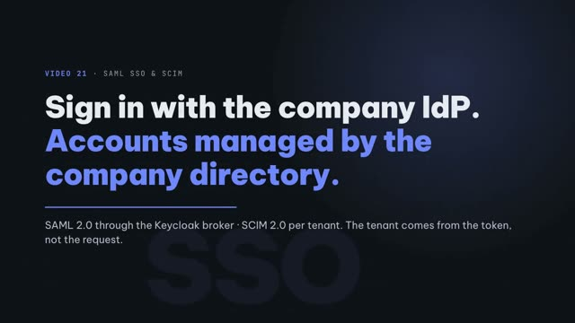
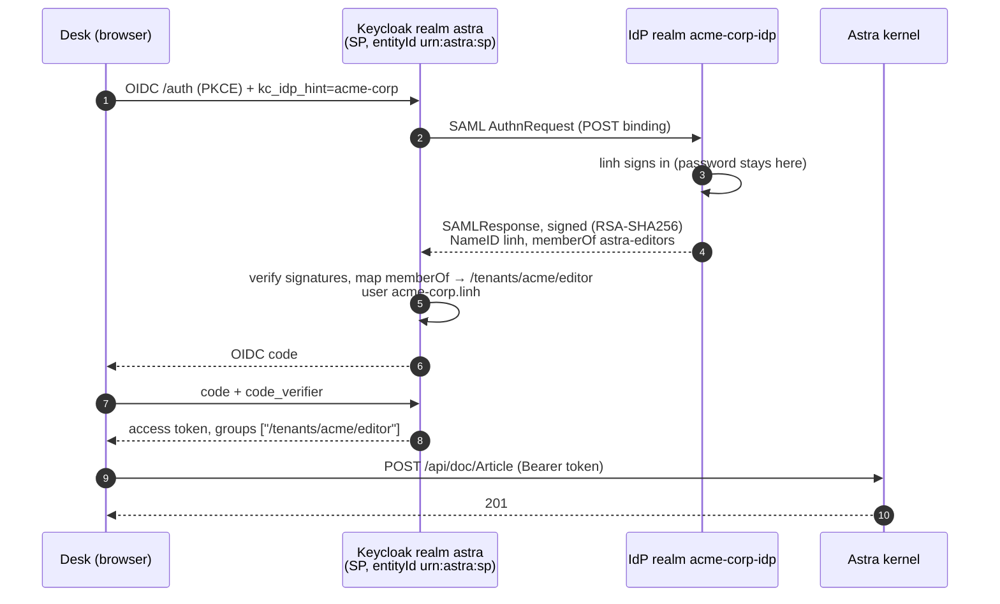
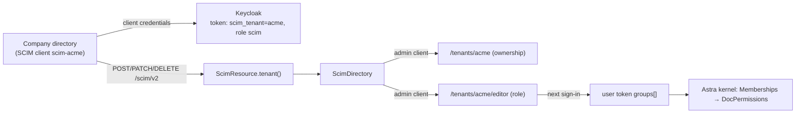

# Video 21 · SAML SSO and SCIM

<a href="https://media.zerohostcms.com/astra-cms/astra-video-21-sso-en.mp4"></a>

▶ [English](https://media.zerohostcms.com/astra-cms/astra-video-21-sso-en.mp4) · [Tiếng Việt](https://media.zerohostcms.com/astra-cms/astra-video-21-sso-vi.mp4) · 2:32 · Script: [demo-video-series.en.md](../demo-video-series.en.md#video-21-saml-sso-and-scim)

> **In one sentence:** a company's employees sign in to Astra through their own SAML 2.0 IdP brokered by Keycloak, IdP groups become tenant roles in the OIDC token, and the company's directory creates, assigns roles to, disables and deletes those accounts over SCIM 2.0, only inside its own tenant.
> **Read this if:** you need to know what `/scim/v2` accepts, how the tenant is bound to a SCIM token, and why the kernel has no SAML code (developer) / you are answering an enterprise customer's security questionnaire about SSO, joiner-mover-leaver and tenant isolation (tech lead).

## The problem

When Astra is sold to a company rather than used by one, the company's IT team asks two questions before anyone
signs in:

1. **"Can our staff use our IdP?"** They will not let employees keep a second password in a vendor's system. Their
   IdP (Entra ID, Okta, ADFS…) speaks SAML 2.0, sometimes OIDC.
2. **"Who creates and removes accounts?"** When someone joins, changes team or leaves, their HR-driven directory
   must push that change. Manual invitations do not pass an audit, and a forgotten leaver is a breach.

The usual answers are an SSO plugin inside the application (SAML parsing, certificate rotation and replay
protection written by the app team) and a CSV import for users. Frappe offers social login and LDAP out of the
box; SAML and SCIM usually come from third-party apps or a proxy.

Astra already delegates identity to Keycloak ([Video 11](./11-keycloak.md)). This video shows the consequence:
SAML lives entirely in Keycloak's identity brokering, and Astra adds only a SCIM endpoint that edits the same
`/tenants/<tenant>/<role>` groups the kernel already reads.

## What the video shows

The demo tenant is `acme`. The IdP is a separate Keycloak realm, `acme-corp-idp`, standing in for the company's
IdP. Its users `linh` and `bao` are not the dispatcher `linh` from [Video 20](./20-stms.md).

| Scene | What you see | What it proves |
| --- | --- | --- |
| Login | One button, "Acme Corp SSO". `linh` signs in at the IdP | The password stays at the IdP; Astra receives an OIDC code. |
| Flow | SP-initiated: Desk → Keycloak (`kc_idp_hint=acme-corp`) → AuthnRequest to the IdP → signed SAMLResponse → OIDC code | The realms speak real SAML 2.0; Desk speaks only OIDC with Keycloak. |
| Assertion | NameID `linh`, Audience `urn:astra:sp`, `memberOf astra-editors`, RSA-SHA256 signature on assertion and response. Token: `preferred_username: acme-corp.linh`, `groups: ["/tenants/acme/editor"]` | Keycloak maps IdP groups to tenant roles; Astra reads the role from the token. |
| Desk | Linh Vo signs in as acme editor and creates an Article (201) | No SSO code in the kernel; DocType permissions apply as for local users. |
| Tamper | `bao`'s SAMLResponse is altered in transit (`astra-readers` → `astra-admins`); Keycloak answers 400 for an invalid signature | No code is issued, so nobody signs in. |
| Discovery | `/scim/v2/ServiceProviderConfig`: `patch: true`, filter maximum 200, `bulk: false`, `etag: false` | The tenant comes only from the `scim_tenant` claim of the client's token, never from the request. |
| Create | `POST /scim/v2/Users` → 201; repeat `userName` → 409 `uniqueness`; the new user gets 403 on `/api/doc/Article` | New users have no role, so no rights yet. |
| Role | PATCH adds the user to group `editor`; after a new sign-in the token has `/tenants/acme/editor`; Article → 201 | Groups are roles. Changes apply at the next sign-in or refresh. |
| Deactivate | PATCH `{"op":"Replace","path":"active","value":"False"}` → password grant `invalid_grant` "Account disabled", refresh "Session not active" | Sign-in is blocked at once; an access token already issued stays valid until it expires. |
| Fail closed | globex's token: acme user → 404, filter → 0 results, `X-Astra-Tenant: acme` → 403, adding an acme user to a globex role → 400 `invalidValue`, filter `co` → 400 `invalidFilter` | Errors follow RFC 7644; another tenant's token sees nothing. |
| Delete | `DELETE` → 204, GET → 404 | Deleted users are gone. |

## How it works

### SAML: brokered by Keycloak, invisible to the kernel



The service-provider side is configuration in the `astra` realm. Signatures are required and verified; the
AuthnRequest is not signed and assertions are not encrypted, which the "To be accurate" section repeats.

*`deploy/keycloak/realm/astra-realm.json`* (identity provider `acme-corp`, trimmed)

```json
"alias": "acme-corp",
"displayName": "Acme Corp SSO",
"providerId": "saml",
"config": {
  "entityId": "urn:astra:sp",
  "postBindingAuthnRequest": "true",
  "postBindingResponse": "true",
  "wantAuthnRequestsSigned": "false",
  "validateSignature": "true",
  "wantAssertionsSigned": "true",
  "wantAssertionsEncrypted": "false",
  "signatureAlgorithm": "RSA_SHA256",
  "syncMode": "FORCE"
}
```

Group mapping is one Keycloak mapper per role. The IdP's `memberOf` value is matched exactly (no regex) and turned
into the tenant role group:

*`deploy/keycloak/realm/astra-realm.json`* (`identityProviderMappers`, one of four role mappers)

```json
{
  "name": "acme-corp editor",
  "identityProviderAlias": "acme-corp",
  "identityProviderMapper": "saml-advanced-group-idp-mapper",
  "config": {
    "syncMode": "INHERIT",
    "attributes": "[{\"key\":\"memberOf\",\"value\":\"astra-editors\"}]",
    "are.attribute.values.regex": "false",
    "group": "/tenants/acme/editor"
  }
}
```

A username mapper with template `${ALIAS}.${NAMEID}` produces `acme-corp.linh`, so a brokered user can never
collide with a local `linh`.

Why broker instead of embedding SAML in Astra: XML signature validation is a classic source of vulnerabilities,
and Keycloak already handles metadata, certificate rotation, clock skew (`allowedClockSkew: 30`) and account
linking. The kernel keeps a single trust path, an OIDC JWT, and the code in [Video 11](./11-keycloak.md) works
unchanged. The tamper scene is therefore a test of Keycloak's verification, which is the point: nothing in Astra
had to be written for it.

### SCIM: the tenant comes from the token, never from the request

SCIM clients authenticate with client credentials of a per-tenant Keycloak client, `scim-<tenant>`. A hardcoded
claim mapper on that client puts the tenant into the token:

*`deploy/keycloak/realm/astra-realm.json`* (client `scim-acme`, protocol mapper)

```json
{
  "name": "scim tenant",
  "protocolMapper": "oidc-hardcoded-claim-mapper",
  "config": {
    "claim.name": "scim_tenant",
    "claim.value": "acme",
    "jsonType.label": "String",
    "access.token.claim": "true"
  }
}
```

`ScimResource` resolves the tenant only from that claim, requires the realm role `scim`, and refuses a conflicting
tenant header:

*`astra-iam/src/main/java/io/astra/iam/ScimResource.java`*

```java
    private String tenant() {
        if (identity.isAnonymous()) {
            throw ScimException.unauthorized("a bearer token of the tenant's SCIM client is required");
        }
        if (!identity.hasRole(SCIM_ROLE)) throw ScimException.forbidden("the token lacks the " + SCIM_ROLE + " role");
        Object claim = jwt.getClaim(TENANT_CLAIM);
        String tenant = claim instanceof JsonString s ? s.getString() : claim == null ? null : claim.toString();
        if (tenant == null || !tenant.matches(TENANT_ID)) {
            throw ScimException.forbidden("the token is not bound to a tenant (claim " + TENANT_CLAIM + ")");
        }
        String requested = headers.getHeaderString(TenantResolverFilter.TENANT_HEADER);
        if (requested != null && !requested.isBlank() && !requested.trim().equals(tenant)) {
            throw ScimException.forbidden("this SCIM token is bound to tenant " + tenant + " and cannot act on " + requested.trim());
        }
        if (!scim.tenantExists(tenant)) throw ScimException.forbidden("tenant " + tenant + " does not exist");
        return tenant;
    }
```

Why a claim and not a path like `/scim/v2/acme/Users`: a path is chosen by the caller. A claim set by Keycloak for
one client cannot be changed by the caller, so a leaked `scim-globex` secret can never reach `acme`.

### SCIM users and groups are Keycloak users and groups

`ScimDirectory` stores nothing of its own. Its class comment states the two rules that make tenant isolation work:

*`astra-iam/src/main/java/io/astra/iam/ScimDirectory.java`*

```java
/**
 * SCIM users and groups of one tenant, stored in Keycloak through {@link KeycloakDirectory}'s admin client.
 *
 * <ul>
 *   <li>A tenant's SCIM users are the identities its provisioning client created: direct members of the
 *       tenant group {@code /tenants/<tenant>}. That membership grants no role; it marks ownership, so a
 *       tenant's SCIM client can neither see nor change local members or another tenant's users.</li>
 *   <li>A tenant's SCIM groups are its role groups {@code /tenants/<tenant>/<role>}. Group membership is
 *       the tenant role that reaches the user's token (claim {@code groups}) at the next sign-in.</li>
 * </ul>
 */
```

That explains the scenes: a new user is a member of `/tenants/acme` only, which `Memberships` ignores (it needs
`<tenant>/<role>`), so the kernel answers 403 "not a member of tenant acme". A user not owned by the caller's tenant
answers 404 rather than 403, so its existence is not revealed. Creating or deleting a group returns 501, because
roles are defined by Astra's DocTypes, not by the directory.

Deactivation also ends the user's Keycloak sessions:

*`astra-iam/src/main/java/io/astra/iam/ScimDirectory.java`*

```java
        if (in.password() != null) setPassword(user, in.password());
        if (wasActive && !Boolean.TRUE.equals(rep.isEnabled())) user.logout();
        return user(tenant, id);
```

The PATCH parser accepts what real clients send, including Entra's capitalised `"Replace"` and string booleans
such as `"False"`:

*`astra-iam/src/main/java/io/astra/iam/ScimPatch.java`*

```java
    static Boolean bool(JsonNode v, String attribute) {
        if (v == null || v.isNull()) return null;
        if (v.isBoolean()) return v.booleanValue();
        if (v.isTextual() && (v.asText().equalsIgnoreCase("true") || v.asText().equalsIgnoreCase("false"))) {
            return Boolean.parseBoolean(v.asText().toLowerCase(Locale.ROOT));
        }
        throw ScimException.invalidValue(attribute + " must be a boolean");
    }
```



## Real-world example

*Illustrative scenario: the company, people and values are made up; the mechanism and the rules it applies are the real ones shown above.*

A Vietnamese media group runs its newsroom CMS as tenant `acme` on Astra. Its IT team manages 300 staff in a
corporate directory that speaks SAML 2.0 and SCIM 2.0.

**Joiner.** HR hires Chi as an editor on Monday.

- The directory calls `POST /scim/v2/Users` with `userName: chi`, then PATCHes group `editor` to add her.
- Astra (through Keycloak) creates the account under `/tenants/acme` and adds it to `/tenants/acme/editor`.
- Chi signs in with the company's credentials; her token carries `/tenants/acme/editor`; she can create Articles
  (`editor: read, create, write` in `article.doctype.yaml`).

**Mover.** In June she becomes a section reader only.

- The directory PATCHes `editor` to remove her and `reader` to add her.
- Her current access token still says editor until it expires; the next refresh carries `reader`, and Article
  creation then returns 403.

**Leaver.** On her last day at 17:00, HR disables her.

- The directory sends `PATCH active=False`. Keycloak disables the account and ends her sessions.
- 17:00:01: password and refresh grants fail. An access token issued at 16:58 is still accepted by Astra until it
  expires: at most 5 minutes later for a regular client with the realm's 300-second lifespan.
- A month later the directory sends `DELETE`; GET returns 404.

**Isolation.** A sister company on tenant `globex` uses its own `scim-globex` client. Its directory cannot list,
read, or add Chi to a role; every attempt returns 404, 0 results, 403 or 400 as in the video.

What the company has to supply for this to work in production is in the "To be accurate" list: its own IdP entry
and group mappers in Keycloak, and a tested group naming convention.

## For technical leaders

- **One trust path.** The kernel trusts one thing, a Keycloak-signed JWT. SAML, local passwords and future
  brokers all end there, so security review of Astra's code does not grow with each IdP.
- **Revocation latency equals access-token lifetime.** Astra verifies JWTs offline. With 300 seconds, a disabled
  user can keep using a token for up to 5 minutes. If that is unacceptable, shorten the lifespan or add token
  introspection, at the cost of a Keycloak call per request.
- **Per-customer onboarding is configuration, not code.** Each company needs an identity provider entry and one
  group mapper per role in the realm, plus a `scim-<tenant>` client. That is work for an operator; automate it
  before you have dozens of enterprise tenants.
- **Scale limits.** Listing users reads group members from Keycloak and paginates in memory, with one extra group
  read per user. Fine for hundreds or a few thousand users per tenant, not hundreds of thousands.
- **Usernames are realm-wide.** `create` checks uniqueness across the whole Keycloak realm, so two tenants cannot
  provision the same `userName`. Prefer email-style usernames for SCIM.
- **What to measure.** SCIM error rate by `scimType` (`uniqueness`, `invalidFilter`, `invalidValue`), time from
  HR leaver event to `active=false`, broker login failures per IdP (expired certificates show up here first).
- **When not to use this.** If a customer requires IdP-initiated login, Single Logout, encrypted assertions or
  SCIM Bulk today, those are not built.
- **Compared with alternatives.** A commercial identity platform gives the same broker plus a managed SCIM
  connector catalogue; Keycloak keeps everything self-hosted and open source, with more operator work.

## Try it yourself

Prerequisites: the k3d or Docker Compose stack, plus `python3` and `openssl` (the scene script checks for both),
`jq` and Bash 5.

```bash
make k3d-up                       # or: make infra-up (runs scripts/keycloak-compose-dev.sh)
# If Keycloak was already running: scripts/keycloak-sync-realm.sh, then restart astra-server to get /scim/v2
make demo-sso PAUSE=0             # all eight scenes
make demo-sso SCENES="1 5"        # pick scenes
```

Expected, scene by scene (`scripts/demo-sso.sh`):

1. Decoded assertion for `linh`; token claims `preferred_username: acme-corp.linh`, `groups: ["/tenants/acme/editor"]`;
   `/api/iam/me` shows acme `[editor]`; `POST /api/doc/Article` → 201.
2. No authorization code for `bao` after his assertion is altered.
3. `ServiceProviderConfig` and `ResourceTypes`; SCIM token claims include `scim_tenant: acme`.
4. Create → 201, filter by `userName` → 1 result, duplicate → 409, Article → 403 for the role-less user.
5. Groups list (admin, editor, author, reader); PATCH editor; new token has `/tenants/acme/editor`; Article → 201.
6. `active=False`; password grant `invalid_grant`; refresh refused; old access token still answers, with its
   expiry printed.
7. globex token: 404, 0 results, 403, 400 `invalidValue`; `co` filter → 400 `invalidFilter`.
8. DELETE → 204, GET → 404.

The script deletes its SCIM user when it ends. The tests `astra-server/src/test/java/io/astra/server/SamlBrokerTest.java`
and `ScimTest.java`, plus `astra-iam/src/test/java/io/astra/iam/ScimFilterTest.java` and `ScimPatchTest.java`, pin
the behaviour; run `make test`.

The IdP passwords and the SCIM client secrets in the realm JSON files are for local environments only.

## To be accurate

- The IdP is a Keycloak realm (`acme-corp-idp`) in the same container, not Okta, Entra or ADFS; the SAML protocol
  between the two sides is real. The demo replays the browser steps with curl and does not follow the redirect
  back to Desk.
- Assertion and response are signed and verified; the assertion is not encrypted and the AuthnRequest is not
  signed. Only SP-initiated login; IdP-initiated is not configured; Single Logout is not wired up and not tested.
- On first login Keycloak creates the account `acme-corp.<username>`; if the email matches a local account,
  Keycloak asks to link them, which the demo does not show. The group → role mapping is fixed in the realm
  configuration and only for tenant `acme`; each other company needs its own IdP and mappers.
- SCIM has no Bulk, ETag/`meta.version`, sort, `/Me`, `meta.lastModified` or `attributes` parameter yet;
  `excludedAttributes` only applies to Groups `members`. Filters support only `userName eq` and `displayName eq`.
  `externalId` is ignored; only one email is kept; `userName` cannot be changed.
- Groups are fixed because they are the tenant roles: creating or deleting a group returns 501; only membership
  changes. A tenant's SCIM client only sees and edits users it provisioned. Deleting through SCIM also deletes the
  Keycloak account.
- Role changes take effect from the next login or refresh. After `active=false`, an access token already issued
  stays valid until it expires (5 minutes for regular clients, 1 hour for the demo client `astra-dev-cli`).
- Listing users paginates in memory with one extra group read per user: enough for the demo, not for hundreds of
  thousands of users.

## Visualize it: sketch prompts

### Figure 1 · SP-initiated SAML through a broker
*Where it goes:* How it works, SAML

```text
Hand-drawn whiteboard sketch, black ink line art on off-white paper, one accent color (#6b8cff blue) for the key path, simple boxes and arrows, short handwritten labels in English, generous white space, no logos, no photorealism, 16:9.
Four boxes left to right: "Desk (browser)", "Keycloak · realm astra (SP urn:astra:sp)", "IdP · acme-corp-idp", and far right "Astra kernel". Top arrows left to right: "OIDC + kc_idp_hint=acme-corp" from Desk to Keycloak, then "SAML AuthnRequest" from Keycloak to IdP. A stick figure "linh" next to the IdP with a padlock "password stays here". Return arrow from IdP to Keycloak labelled "signed SAMLResponse · memberOf astra-editors", with a small wax seal icon "RSA-SHA256". Inside Keycloak a small note "memberOf → /tenants/acme/editor". Arrow from Keycloak back to Desk "OIDC code → token". Final arrow from Desk to Astra kernel "Bearer JWT · groups[/tenants/acme/editor]". Highlight in blue the signed SAMLResponse arrow and the final JWT arrow. A dashed line around Astra kernel labelled "no SAML code here".
```

### Figure 2 · Tampered assertion
*Where it goes:* What the video shows

```text
Hand-drawn whiteboard sketch, black ink line art on off-white paper, one accent color (#6b8cff blue) for the key path, simple boxes and arrows, short handwritten labels in English, generous white space, no logos, no photorealism, 16:9.
Left: a sealed envelope labelled "SAMLResponse for bao" containing the text "memberOf astra-readers". In the middle, a hand with a pen crossing out "readers" and writing "admins". Right: a box "Keycloak signature check" with a broken seal icon and a large "400 · invalid signature". Below it, an empty slot labelled "OIDC code" with a cross. Highlight in blue the broken seal and the empty code slot.
```

### Figure 3 · SCIM joiner, mover, leaver inside one tenant
*Where it goes:* Real-world example

```text
Hand-drawn whiteboard sketch, black ink line art on off-white paper, one accent color (#6b8cff blue) for the key path, simple boxes and arrows, short handwritten labels in English, generous white space, no logos, no photorealism, 16:9.
Left: a box "Company directory · scim-acme" with a token tag "scim_tenant: acme". Three arrows to the right, stacked top to bottom, labelled "POST /Users → 201", "PATCH /Groups/editor → add member", "PATCH active=False". They enter a box "ScimResource" and then a Keycloak folder tree: "/tenants/acme" (with a small label "ownership") containing "editor", "reader". A person icon "chi" moves from the root folder into "editor", then gets a grey cross "disabled". On the far right, a box "globex token" with a dashed arrow towards chi ending in a wall "404". Highlight in blue the arrow "PATCH /Groups/editor" and chi's move into "editor".
```

## Related

- Previous: [Video 20 · STMS](./20-stms.md). Next: [Video 18 · Roadmap](./18-roadmap.md).
- [Video 11 · Keycloak](./11-keycloak.md) (tenant roles from group paths, DocType permissions) and
  [Video 7 · Multi-tenancy](./07-tenants.md).
- Docs: [demo-video-series.en.md, Video 21](../demo-video-series.en.md#video-21-saml-sso-and-scim),
  [iam-mobile-integration.md](../iam-mobile-integration.md).
- Source and configuration: `deploy/keycloak/realm/astra-realm.json`, `deploy/keycloak/realm/acme-corp-idp-realm.json`,
  `astra-iam/src/main/java/io/astra/iam/ScimResource.java`, `astra-iam/src/main/java/io/astra/iam/ScimDirectory.java`,
  `astra-iam/src/main/java/io/astra/iam/ScimPatch.java`, `astra-iam/src/main/java/io/astra/iam/ScimFilter.java`,
  `astra-kernel/src/main/java/io/astra/kernel/security/Memberships.java`, `scripts/demo-sso.sh`.
