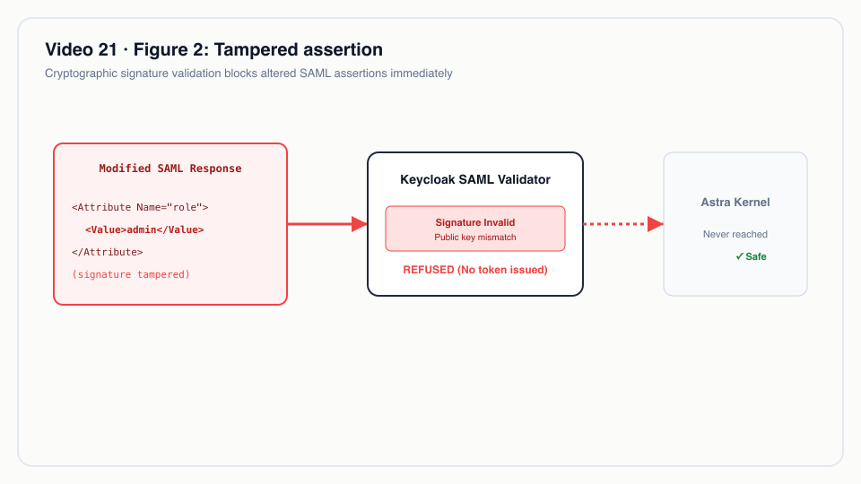
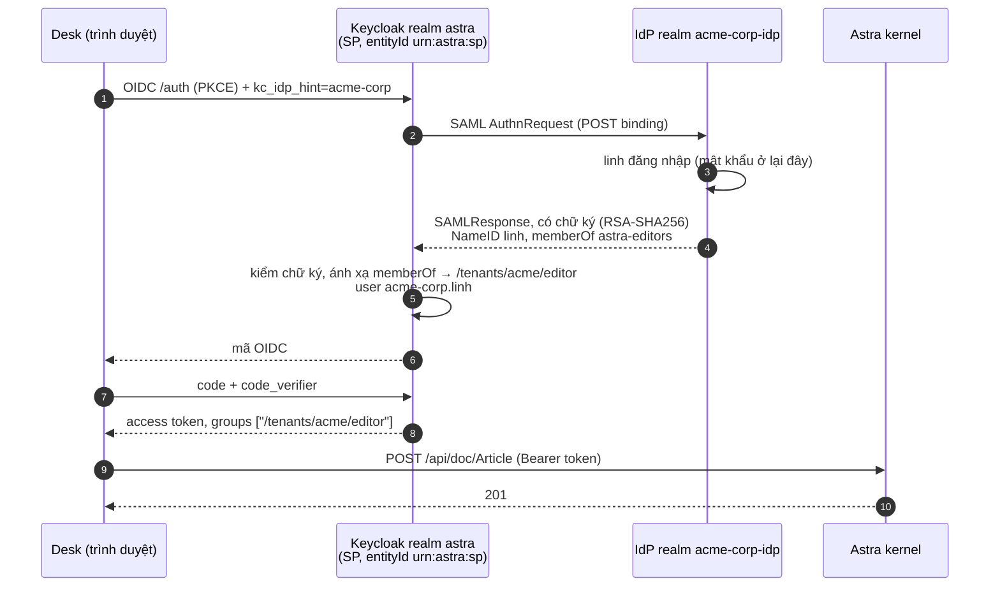
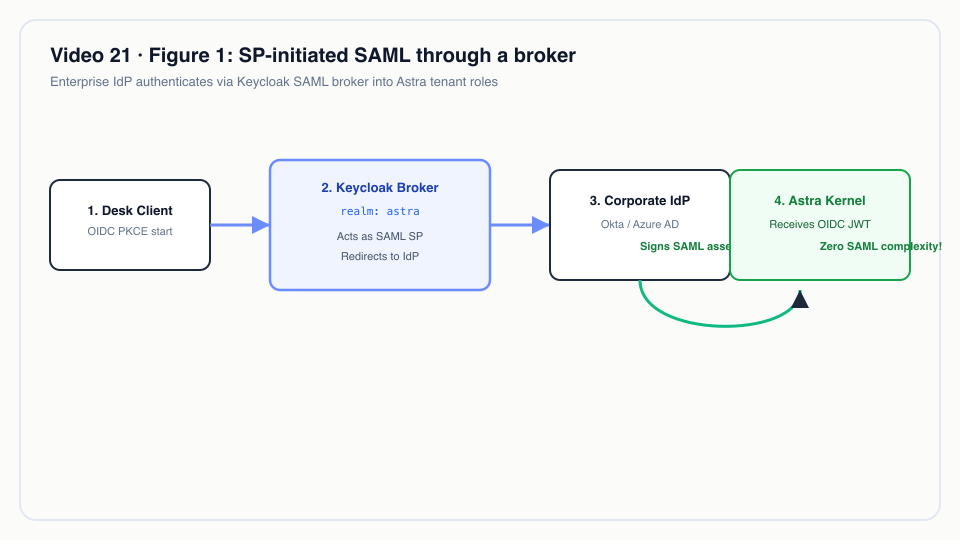
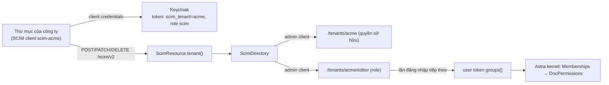
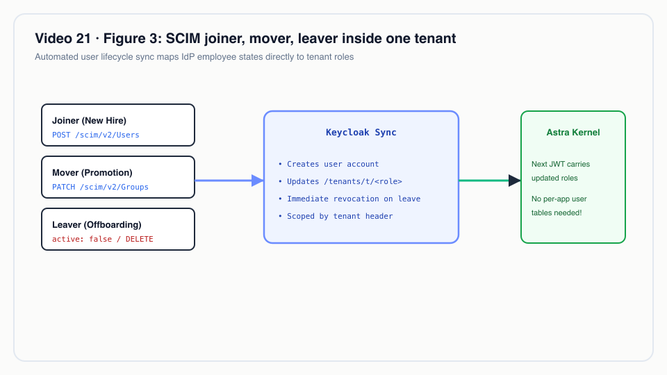

# Video 21 · SAML SSO và SCIM

<a href="https://media.zerohostcms.com/astra-cms/astra-video-21-sso-vi.mp4"></a>

▶ [Tiếng Việt](https://media.zerohostcms.com/astra-cms/astra-video-21-sso-vi.mp4) · [English](https://media.zerohostcms.com/astra-cms/astra-video-21-sso-en.mp4) · 2:32 · Kịch bản: [demo-video-series.md](../demo-video-series.md#video-21-saml-sso-và-scim) · [Bản tiếng Anh](./21-sso.md)

> **Tóm tắt một câu:** nhân viên của một doanh nghiệp đăng nhập Astra qua IdP SAML 2.0 của chính công ty mình, do Keycloak làm broker, nhóm bên IdP trở thành role của tenant trong token OIDC, còn hệ thống thư mục của công ty tạo, gán role, khoá và xoá các tài khoản đó qua SCIM 2.0, chỉ trong tenant của mình.
> **Nên đọc nếu:** bạn cần biết `/scim/v2` chấp nhận những gì, tenant được gắn với một token SCIM ra sao, và vì sao kernel không có code SAML (developer) / bạn đang trả lời bảng câu hỏi bảo mật của một khách hàng doanh nghiệp về SSO, vòng đời vào-chuyển-nghỉ (joiner-mover-leaver) và cô lập tenant (tech lead).

## Vấn đề

Khi Astra được bán cho một doanh nghiệp thay vì chỉ một người dùng, đội IT của họ hỏi hai câu trước khi có ai đăng
nhập:

1. **"Nhân viên của chúng tôi dùng IdP của công ty được không?"** Họ sẽ không để nhân viên giữ thêm một mật khẩu
   thứ hai trong hệ thống của nhà cung cấp. IdP của họ (Entra ID, Okta, ADFS…) nói SAML 2.0, đôi khi OIDC.
2. **"Ai tạo và xoá tài khoản?"** Khi có người vào làm, chuyển nhóm hay nghỉ việc, hệ thống thư mục do HR điều
   khiển phải đẩy thay đổi đó sang. Mời thủ công thì không qua được kiểm toán, và một người đã nghỉ mà bị quên là
   một sự cố rò rỉ.

Câu trả lời thường gặp là một plugin SSO bên trong ứng dụng (đội app tự viết phần phân tích SAML, xoay vòng chứng
chỉ và chống phát lại) cộng với import user bằng CSV. Frappe có sẵn đăng nhập mạng xã hội và LDAP; SAML và SCIM
thường đến từ app bên thứ ba hoặc một proxy.

Astra vốn đã giao danh tính cho Keycloak ([Video 11](./11-keycloak.vi.md)). Video này cho thấy hệ quả: SAML nằm
trọn trong tính năng identity brokering của Keycloak, còn Astra chỉ thêm một endpoint SCIM để sửa chính các nhóm
`/tenants/<tenant>/<role>` mà kernel vẫn đang đọc.

## Video cho thấy gì

Tenant demo là `acme`. IdP là một realm Keycloak riêng, `acme-corp-idp`, đóng vai IdP của công ty. Các user `linh`
và `bao` của nó không phải `linh` dispatcher trong [Video 20](./20-stms.vi.md).

| Cảnh | Bạn thấy gì | Điều đó chứng minh |
| --- | --- | --- |
| Đăng nhập | Một nút duy nhất, "Acme Corp SSO". `linh` đăng nhập ở IdP | Mật khẩu ở lại IdP; Astra nhận một mã OIDC. |
| Luồng | SP-initiated: Desk → Keycloak (`kc_idp_hint=acme-corp`) → AuthnRequest tới IdP → SAMLResponse có chữ ký → mã OIDC | Hai realm nói SAML 2.0 thật; Desk chỉ nói OIDC với Keycloak. |
| Assertion | NameID `linh`, Audience `urn:astra:sp`, `memberOf astra-editors`, chữ ký RSA-SHA256 trên cả assertion lẫn response. Token: `preferred_username: acme-corp.linh`, `groups: ["/tenants/acme/editor"]` | Keycloak ánh xạ nhóm của IdP thành role của tenant; Astra đọc role từ token. |
| Desk | Linh Vo đăng nhập với vai trò editor của acme và tạo một Article (201) | Kernel không có code SSO nào; quyền DocType áp dụng như với user local. |
| Giả mạo | SAMLResponse của `bao` bị sửa trên đường đi (`astra-readers` → `astra-admins`); Keycloak trả 400 vì chữ ký không hợp lệ | Không có mã nào được cấp, nên không ai đăng nhập được. |
| Discovery | `/scim/v2/ServiceProviderConfig`: `patch: true`, filter tối đa 200, `bulk: false`, `etag: false` | Tenant chỉ lấy từ claim `scim_tenant` trong token của client, không bao giờ từ request. |
| Tạo | `POST /scim/v2/Users` → 201; trùng `userName` → 409 `uniqueness`; user mới nhận 403 trên `/api/doc/Article` | User mới chưa có role, nên chưa có quyền gì. |
| Role | PATCH thêm user vào nhóm `editor`; sau lần đăng nhập mới token có `/tenants/acme/editor`; Article → 201 | Nhóm chính là role. Thay đổi áp dụng ở lần đăng nhập hoặc refresh tiếp theo. |
| Khoá | PATCH `{"op":"Replace","path":"active","value":"False"}` → password grant `invalid_grant` "Account disabled", refresh "Session not active" | Đăng nhập bị chặn ngay; access token đã cấp vẫn hợp lệ đến khi hết hạn. |
| Fail closed | Token của globex: user của acme → 404, filter → 0 kết quả, `X-Astra-Tenant: acme` → 403, thêm user acme vào role globex → 400 `invalidValue`, filter `co` → 400 `invalidFilter` | Lỗi theo RFC 7644; token của tenant khác không thấy gì. |
| Xoá | `DELETE` → 204, GET → 404 | User đã xoá là mất hẳn. |


*Assertion bị giả mạo.*

## Cách hoạt động

### SAML: Keycloak làm broker, kernel không nhìn thấy



Phía service provider là cấu hình trong realm `astra`. Chữ ký là bắt buộc và được kiểm; AuthnRequest không được ký
và assertion không được mã hoá, điều mà mục "Nói đúng" sẽ nhắc lại.

*`deploy/keycloak/realm/astra-realm.json`* (identity provider `acme-corp`, rút gọn)

```json
"alias": "acme-corp",
"displayName": "Acme Corp SSO",
"providerId": "saml",
"config": {
  "entityId": "urn:astra:sp",
  "postBindingAuthnRequest": "true",
  "postBindingResponse": "true",
  "wantAuthnRequestsSigned": "false",
  "validateSignature": "true",
  "wantAssertionsSigned": "true",
  "wantAssertionsEncrypted": "false",
  "signatureAlgorithm": "RSA_SHA256",
  "syncMode": "FORCE"
}
```

Ánh xạ nhóm là một mapper Keycloak cho mỗi role. Giá trị `memberOf` của IdP được so khớp chính xác (không dùng
regex) và chuyển thành nhóm role của tenant:

*`deploy/keycloak/realm/astra-realm.json`* (`identityProviderMappers`, một trong bốn mapper role)

```json
{
  "name": "acme-corp editor",
  "identityProviderAlias": "acme-corp",
  "identityProviderMapper": "saml-advanced-group-idp-mapper",
  "config": {
    "syncMode": "INHERIT",
    "attributes": "[{\"key\":\"memberOf\",\"value\":\"astra-editors\"}]",
    "are.attribute.values.regex": "false",
    "group": "/tenants/acme/editor"
  }
}
```

Một mapper username với template `${ALIAS}.${NAMEID}` tạo ra `acme-corp.linh`, nên một user đi qua broker không
bao giờ trùng với một `linh` local.

Vì sao dùng broker thay vì nhúng SAML vào Astra: kiểm chữ ký XML là nguồn lỗ hổng kinh điển, và Keycloak đã lo sẵn
metadata, xoay vòng chứng chỉ, lệch đồng hồ (`allowedClockSkew: 30`) và liên kết tài khoản. Kernel giữ một đường
tin cậy duy nhất là JWT OIDC, và code trong [Video 11](./11-keycloak.vi.md) chạy không cần sửa. Vì vậy cảnh giả mạo
là phép thử cho khâu kiểm tra của Keycloak, và đó chính là mục đích: Astra không phải viết gì cho nó.


*SAML SP-initiated qua broker.*

### SCIM: tenant lấy từ token, không bao giờ từ request

Client SCIM xác thực bằng client credentials của một client Keycloak riêng cho từng tenant, `scim-<tenant>`. Một
mapper claim cố định trên client đó đưa tenant vào token:

*`deploy/keycloak/realm/astra-realm.json`* (client `scim-acme`, protocol mapper)

```json
{
  "name": "scim tenant",
  "protocolMapper": "oidc-hardcoded-claim-mapper",
  "config": {
    "claim.name": "scim_tenant",
    "claim.value": "acme",
    "jsonType.label": "String",
    "access.token.claim": "true"
  }
}
```

`ScimResource` chỉ xác định tenant từ claim đó, yêu cầu realm role `scim`, và từ chối header tenant mâu thuẫn:

*`astra-iam/src/main/java/io/astra/iam/ScimResource.java`*

```java
    private String tenant() {
        if (identity.isAnonymous()) {
            throw ScimException.unauthorized("a bearer token of the tenant's SCIM client is required");
        }
        if (!identity.hasRole(SCIM_ROLE)) throw ScimException.forbidden("the token lacks the " + SCIM_ROLE + " role");
        Object claim = jwt.getClaim(TENANT_CLAIM);
        String tenant = claim instanceof JsonString s ? s.getString() : claim == null ? null : claim.toString();
        if (tenant == null || !tenant.matches(TENANT_ID)) {
            throw ScimException.forbidden("the token is not bound to a tenant (claim " + TENANT_CLAIM + ")");
        }
        String requested = headers.getHeaderString(TenantResolverFilter.TENANT_HEADER);
        if (requested != null && !requested.isBlank() && !requested.trim().equals(tenant)) {
            throw ScimException.forbidden("this SCIM token is bound to tenant " + tenant + " and cannot act on " + requested.trim());
        }
        if (!scim.tenantExists(tenant)) throw ScimException.forbidden("tenant " + tenant + " does not exist");
        return tenant;
    }
```

Vì sao dùng claim thay vì đường dẫn như `/scim/v2/acme/Users`: đường dẫn do bên gọi chọn. Một claim do Keycloak đặt
cho một client thì bên gọi không đổi được, nên một secret `scim-globex` bị lộ không bao giờ chạm tới được `acme`.

### User và group của SCIM chính là user và group của Keycloak

`ScimDirectory` không lưu gì của riêng nó. Comment của lớp nêu hai quy tắc làm cho việc cô lập tenant hoạt động:

*`astra-iam/src/main/java/io/astra/iam/ScimDirectory.java`*

```java
/**
 * SCIM users and groups of one tenant, stored in Keycloak through {@link KeycloakDirectory}'s admin client.
 *
 * <ul>
 *   <li>A tenant's SCIM users are the identities its provisioning client created: direct members of the
 *       tenant group {@code /tenants/<tenant>}. That membership grants no role; it marks ownership, so a
 *       tenant's SCIM client can neither see nor change local members or another tenant's users.</li>
 *   <li>A tenant's SCIM groups are its role groups {@code /tenants/<tenant>/<role>}. Group membership is
 *       the tenant role that reaches the user's token (claim {@code groups}) at the next sign-in.</li>
 * </ul>
 */
```

Điều đó giải thích các cảnh trong video: user mới chỉ là thành viên của `/tenants/acme`, thứ mà `Memberships` bỏ qua
(nó cần `<tenant>/<role>`), nên kernel trả 403 "not a member of tenant acme". Một user không thuộc tenant của bên gọi
trả về 404 thay vì 403, để không tiết lộ là user đó tồn tại. Tạo hoặc xoá một group trả 501, vì role được định nghĩa
bởi DocType của Astra, không phải bởi hệ thống thư mục.

Khoá tài khoản cũng kết thúc các phiên Keycloak của user:

*`astra-iam/src/main/java/io/astra/iam/ScimDirectory.java`*

```java
        if (in.password() != null) setPassword(user, in.password());
        if (wasActive && !Boolean.TRUE.equals(rep.isEnabled())) user.logout();
        return user(tenant, id);
```

Bộ phân tích PATCH chấp nhận những gì client thật gửi, kể cả `"Replace"` viết hoa của Entra và boolean dạng chuỗi
như `"False"`:

*`astra-iam/src/main/java/io/astra/iam/ScimPatch.java`*

```java
    static Boolean bool(JsonNode v, String attribute) {
        if (v == null || v.isNull()) return null;
        if (v.isBoolean()) return v.booleanValue();
        if (v.isTextual() && (v.asText().equalsIgnoreCase("true") || v.asText().equalsIgnoreCase("false"))) {
            return Boolean.parseBoolean(v.asText().toLowerCase(Locale.ROOT));
        }
        throw ScimException.invalidValue(attribute + " must be a boolean");
    }
```



## Ví dụ thực tế

*Tình huống minh hoạ: công ty, con người và số liệu là giả định; cơ chế và các quy tắc được áp dụng là thật, như đã trình bày ở trên.*

Một tập đoàn truyền thông Việt Nam chạy CMS toà soạn của mình dưới dạng tenant `acme` trên Astra. Đội IT quản lý
300 nhân sự trong một hệ thống thư mục doanh nghiệp nói SAML 2.0 và SCIM 2.0.

**Vào làm.** Thứ Hai, HR tuyển Chi làm biên tập viên.

- Hệ thống thư mục gọi `POST /scim/v2/Users` với `userName: chi`, rồi PATCH nhóm `editor` để thêm chị vào.
- Astra (thông qua Keycloak) tạo tài khoản dưới `/tenants/acme` và thêm vào `/tenants/acme/editor`.
- Chi đăng nhập bằng thông tin của công ty; token của chị mang `/tenants/acme/editor`; chị tạo được Article
  (`editor: read, create, write` trong `article.doctype.yaml`).

**Chuyển vị trí.** Tháng Sáu, chị chuyển sang chỉ đọc một chuyên mục.

- Hệ thống thư mục PATCH `editor` để gỡ chị và `reader` để thêm chị.
- Access token hiện tại của chị vẫn ghi editor cho tới khi hết hạn; lần refresh tiếp theo mang `reader`, và lúc đó
  việc tạo Article trả 403.

**Nghỉ việc.** Ngày làm việc cuối cùng, lúc 17:00, HR khoá tài khoản của chị.

- Hệ thống thư mục gửi `PATCH active=False`. Keycloak khoá tài khoản và kết thúc các phiên của chị.
- 17:00:01: password grant và refresh grant thất bại. Một access token cấp lúc 16:58 vẫn được Astra chấp nhận cho
  tới khi hết hạn: chậm nhất 5 phút sau với client thường, theo thời hạn 300 giây của realm.
- Một tháng sau, hệ thống thư mục gửi `DELETE`; GET trả 404.

**Cô lập.** Một công ty chị em ở tenant `globex` dùng client `scim-globex` của riêng họ. Hệ thống thư mục của họ
không thể liệt kê, đọc, hay thêm Chi vào một role; mọi lần thử đều trả 404, 0 kết quả, 403 hoặc 400 như trong video.

Những gì công ty phải tự cung cấp để chạy được trên production nằm trong danh sách "Nói đúng": mục IdP và các group
mapper của riêng họ trong Keycloak, cùng một quy ước đặt tên nhóm đã được kiểm thử.


*SCIM vào làm, chuyển vị trí, nghỉ việc trong một tenant.*

## Dành cho tech lead

- **Một đường tin cậy.** Kernel chỉ tin một thứ: JWT do Keycloak ký. SAML, mật khẩu local và các broker sau này đều
  kết thúc ở đó, nên việc review bảo mật code của Astra không phình ra theo mỗi IdP.
- **Độ trễ thu hồi bằng thời hạn access token.** Astra xác minh JWT offline. Với 300 giây, một user đã bị khoá vẫn
  có thể dùng token tối đa 5 phút. Nếu không chấp nhận được, hãy rút ngắn thời hạn hoặc thêm token introspection,
  đổi lại mỗi request tốn một lời gọi tới Keycloak.
- **Onboarding từng khách hàng là cấu hình, không phải code.** Mỗi công ty cần một mục identity provider và một
  group mapper cho mỗi role trong realm, cộng với một client `scim-<tenant>`. Đó là việc của người vận hành; hãy tự
  động hoá trước khi bạn có hàng chục tenant doanh nghiệp.
- **Giới hạn quy mô.** Liệt kê user đọc thành viên nhóm từ Keycloak và phân trang trong bộ nhớ, mỗi user thêm một
  lần đọc group. Ổn với vài trăm hoặc vài nghìn user mỗi tenant, không phải hàng trăm nghìn.
- **Username là duy nhất trên toàn realm.** `create` kiểm tra trùng trên toàn bộ realm Keycloak, nên hai tenant
  không thể cấp cùng một `userName`. Với SCIM, nên dùng username dạng email.
- **Nên đo gì.** Tỷ lệ lỗi SCIM theo `scimType` (`uniqueness`, `invalidFilter`, `invalidValue`), thời gian từ sự
  kiện nghỉ việc ở HR tới `active=false`, số lần đăng nhập qua broker thất bại theo từng IdP (chứng chỉ hết hạn sẽ
  lộ ra ở đây đầu tiên).
- **Khi nào không nên dùng.** Nếu khách hàng cần ngay hôm nay đăng nhập IdP-initiated, Single Logout, assertion mã
  hoá hoặc SCIM Bulk, thì những thứ đó chưa được xây.
- **So với các phương án khác.** Một nền tảng danh tính thương mại cho cùng một broker cộng với danh mục connector
  SCIM được quản lý sẵn; Keycloak giữ mọi thứ tự host và mã nguồn mở, đổi lại người vận hành phải làm nhiều hơn.

## Tự chạy thử

Yêu cầu: stack k3d hoặc Docker Compose, cộng thêm `python3` và `openssl` (script của cảnh kiểm tra cả hai), `jq` và
Bash 5.

```bash
make k3d-up                       # or: make infra-up (runs scripts/keycloak-compose-dev.sh)
# If Keycloak was already running: scripts/keycloak-sync-realm.sh, then restart astra-server to get /scim/v2
make demo-sso PAUSE=0             # all eight scenes
make demo-sso SCENES="1 5"        # pick scenes
```

Kết quả mong đợi theo từng cảnh (`scripts/demo-sso.sh`):

1. Assertion đã giải mã của `linh`; claim của token `preferred_username: acme-corp.linh`, `groups: ["/tenants/acme/editor"]`;
   `/api/iam/me` cho thấy acme `[editor]`; `POST /api/doc/Article` → 201.
2. Không có authorization code cho `bao` sau khi assertion của anh bị sửa.
3. `ServiceProviderConfig` và `ResourceTypes`; claim của token SCIM có `scim_tenant: acme`.
4. Tạo → 201, filter theo `userName` → 1 kết quả, trùng → 409, Article → 403 với user chưa có role.
5. Danh sách group (admin, editor, author, reader); PATCH editor; token mới có `/tenants/acme/editor`; Article → 201.
6. `active=False`; password grant `invalid_grant`; refresh bị từ chối; access token cũ vẫn được chấp nhận, kèm thời
   điểm hết hạn được in ra.
7. Token của globex: 404, 0 kết quả, 403, 400 `invalidValue`; filter `co` → 400 `invalidFilter`.
8. DELETE → 204, GET → 404.

Script xoá user SCIM của nó khi kết thúc. Các test `astra-server/src/test/java/io/astra/server/SamlBrokerTest.java`
và `ScimTest.java`, cùng `astra-iam/src/test/java/io/astra/iam/ScimFilterTest.java` và `ScimPatchTest.java`, giữ cố
định hành vi này; chạy `make test`.

Mật khẩu IdP và secret của các client SCIM trong các file realm JSON chỉ dành cho môi trường local.

## Nói đúng

- IdP là một realm Keycloak (`acme-corp-idp`) trong cùng container, không phải Okta, Entra hay ADFS; giao thức SAML
  giữa hai bên là thật. Demo phát lại các bước của trình duyệt bằng curl và không theo redirect quay về Desk.
- Assertion và response có chữ ký và được kiểm; assertion không được mã hoá và AuthnRequest không được ký. Chỉ có
  đăng nhập SP-initiated; IdP-initiated chưa được cấu hình; Single Logout chưa được nối và chưa được test.
- Ở lần đăng nhập đầu, Keycloak tạo tài khoản `acme-corp.<username>`; nếu email trùng với một tài khoản local,
  Keycloak sẽ hỏi có liên kết hai tài khoản không, bước mà demo không chiếu. Ánh xạ nhóm → role cố định trong cấu
  hình realm và chỉ cho tenant `acme`; mỗi công ty khác cần IdP và mapper riêng.
- SCIM chưa có Bulk, ETag/`meta.version`, sort, `/Me`, `meta.lastModified` hay tham số `attributes`;
  `excludedAttributes` chỉ áp cho `members` của Groups. Bộ lọc chỉ hỗ trợ `userName eq` và `displayName eq`.
  `externalId` bị bỏ qua; chỉ giữ một email; không đổi được `userName`.
- Groups cố định vì chúng chính là role của tenant: tạo hoặc xoá một group trả 501; chỉ đổi được thành viên. Client
  SCIM của một tenant chỉ thấy và sửa user do chính nó cấp. Xoá qua SCIM cũng xoá luôn tài khoản Keycloak.
- Thay đổi role có hiệu lực từ lần đăng nhập hoặc refresh tiếp theo. Sau `active=false`, access token đã cấp vẫn
  hợp lệ đến khi hết hạn (5 phút với client thường, 1 giờ với client demo `astra-dev-cli`).
- Liệt kê user phân trang trong bộ nhớ, mỗi user thêm một lần đọc group: đủ cho demo, chưa dành cho hàng trăm nghìn
  user.

## Hình minh hoạ

### Hình 1 · SAML SP-initiated qua broker


### Hình 2 · Assertion bị giả mạo


### Hình 3 · SCIM vào làm, chuyển vị trí, nghỉ việc trong một tenant


## Liên quan

- Trước: [Video 20 · STMS: điều phối xe với Timefold + AI copilot](./20-stms.vi.md). Tiếp: [Video 18 · Video lộ trình: phần còn lại của use-case-01](./18-roadmap.vi.md).
- [Video 11 · Keycloak](./11-keycloak.vi.md) (role theo tenant từ đường dẫn nhóm, quyền theo DocType) và
  [Video 7 · Đa thuê bao](./07-tenants.vi.md).
- Tài liệu: [demo-video-series.md, Video 21](../demo-video-series.md#video-21-saml-sso-và-scim),
  [iam-mobile-integration.md](../iam-mobile-integration.md).
- Mã nguồn và cấu hình: `deploy/keycloak/realm/astra-realm.json`, `deploy/keycloak/realm/acme-corp-idp-realm.json`,
  `astra-iam/src/main/java/io/astra/iam/ScimResource.java`, `astra-iam/src/main/java/io/astra/iam/ScimDirectory.java`,
  `astra-iam/src/main/java/io/astra/iam/ScimPatch.java`, `astra-iam/src/main/java/io/astra/iam/ScimFilter.java`,
  `astra-kernel/src/main/java/io/astra/kernel/security/Memberships.java`, `scripts/demo-sso.sh`.
