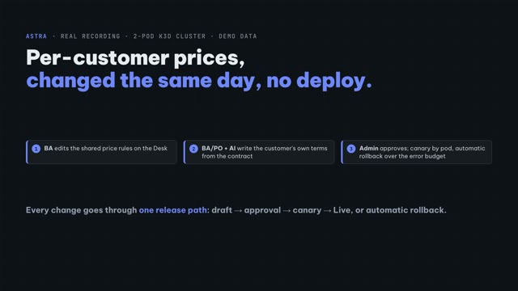
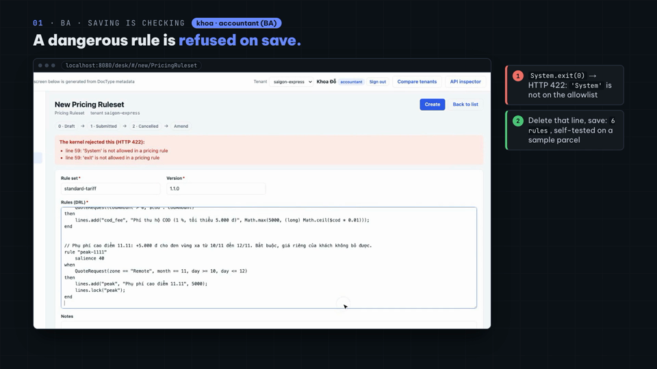
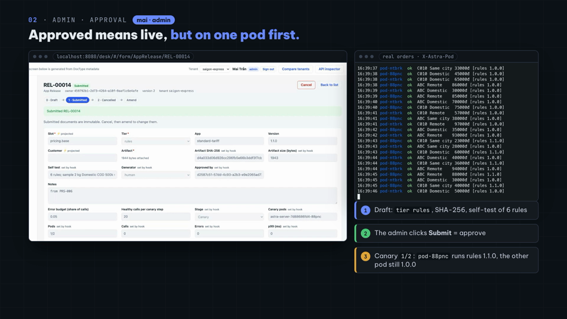
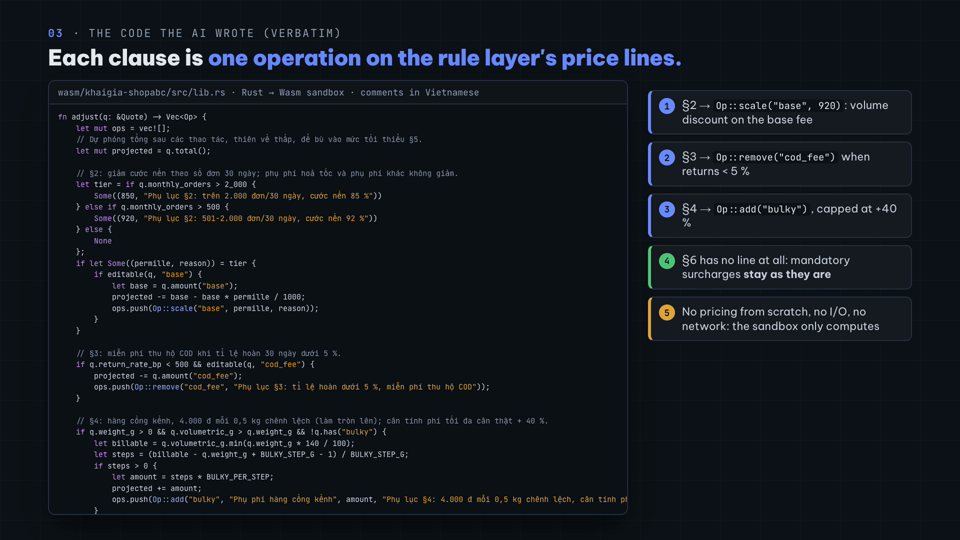
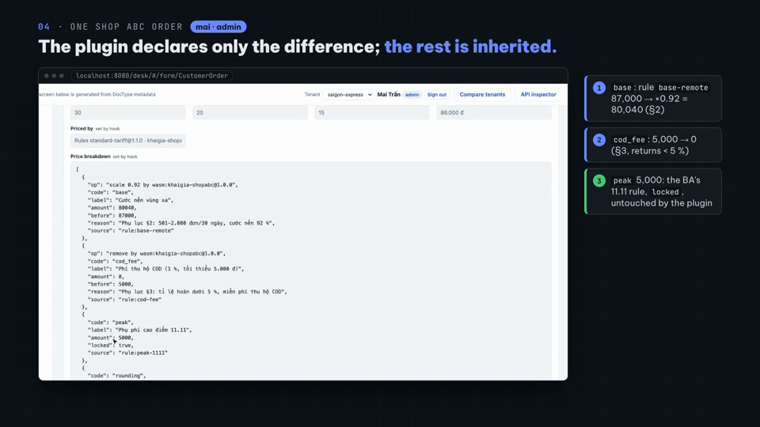
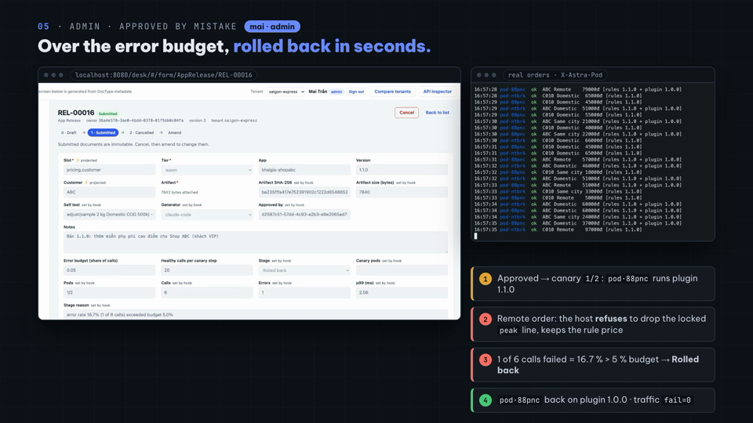

# Video 22 · Software that evolves: plugin tiers 0 · 1 · 2

<a href="https://media.zerohostcms.com/astra-cms/astra-video-22d-live-en.mp4"></a>

▶ Recorded live (22d): [English](https://media.zerohostcms.com/astra-cms/astra-video-22d-live-en.mp4) · [Tiếng Việt](https://media.zerohostcms.com/astra-cms/astra-video-22d-live-vi.mp4) · 4:34
▶ In Vietnamese: [Flagship](https://media.zerohostcms.com/astra-cms/astra-video-22-tiers-vi.mp4) 4:33 · clips [Tier 0](https://media.zerohostcms.com/astra-cms/astra-video-22a-tier0-vi.mp4) 1:05, [Tier 1](https://media.zerohostcms.com/astra-cms/astra-video-22b-tier1-vi.mp4) 0:49, [Tier 2](https://media.zerohostcms.com/astra-cms/astra-video-22c-tier2-vi.mp4) 1:49 · [Layered pricing](https://media.zerohostcms.com/astra-cms/astra-video-22-pricing-vi.mp4) 2:45
Script: [demo-video-series.en.md](../demo-video-series.en.md#video-22-software-that-evolves-plugin-tiers-0--1--2) · Code: [S13](../demo-code-snippets.md#s13-plugin-tiers-0-1-2)

> **In one sentence:** behaviour that changes often (prices, carriers, tax modules, a customer's contract terms) changes at run time in the tier with the fewest rights that can do the job, and every such change goes through one release path: anyone, including an AI, may propose a draft; only an admin approves; the new version reaches one pod first and rolls itself back when it fails.
> **Read this if:** you want to see how a class loader, a capability object, an allowlist and a Wasm sandbox fit one release model (developer) / you need to let analysts and AI customise per customer without opening a hole in the system or slowing delivery (tech lead).

## The problem

Business software is pulled two ways. Prices differ per customer and change every week; carriers and tax authorities
change their APIs; a new country needs a new e-invoice format. At the same time the books, the money and the customer
data must not break.

The usual answers pick one side. Hard-coding is safe but every change is a build and a deploy. Scripting inside the
application (Frappe's Server Scripts, a rules table evaluated with `eval`) is fast but trusts whoever writes the script.
With AI agents writing code, the second option gets riskier, not safer: there is now a fast, tireless author whose
output nobody has read yet.

Astra's answer is a rule of thumb: **the less a piece of code is trusted, the more dynamic it may be, and the tighter it
is confined.** Then one release path for everything dynamic, so control does not depend on which tier the change is in.

| How behaviour changes | Who writes it | Runs where | May do | Goes live by | Cost per call (p50) |
| --- | --- | --- | --- | --- | --- |
| Tier 0 · core compiled in | core developers | the core JVM | everything; **only Tier 0 posts to the ledger** | image + rolling update | 0.04 µs |
| Tier 0 · Drools rules as data | a BA on the Desk | engine in the core, rules allowlisted | add price lines, lock a line, set a floor | save → approve → canary, seconds | (in the core) |
| Tier 1 · isolated JVM plugin | partner / integration developers (trusted) | a class loader per version | the SPI it implements + the hosts it was granted | upload → approve → hot swap by pod | 5.0 µs |
| Tier 2 · Wasm sandbox | BA/PO with AI (untrusted) | sandbox, no host functions | compute only | upload → approve → hot reload | 10.5 µs |

Costs are dispatch overhead from `TierDispatchBench` (`./mvnw -pl astra-plugin-host test -Dtest=TierDispatchBench`).

## What the videos show

The flagship and its clips cover all three layers of the "Global future" slide on a 2-pod k3d cluster: the core and a
rolling update with no failed request; a carrier plugin (FastShip) swapped while running, with a per-pod canary, a
faulty build rolled back and a call to an ungranted host refused; one e-invoice module per country (Vietnam, then a new
Cambodian tenant without restarting anything); an AI-written anomaly detector whose alerts reach the right role.
*Layered pricing* explains the three pricing layers. Video 22d records the pricing story live, role by role:

| Scene | What you see | What it proves |
| --- | --- | --- |
| BA edits the rules | `khoa` (accountant) copies `standard-tariff 1.0.0` into 1.1.0 on the Desk and types a rule `peak-1111`: +5,000 ₫ for remote zones on 10–12 November, `lines.lock("peak")` | The tariff that used to be a Java map is data an analyst edits. |
| Refused on save | A stray `System.exit(0)`: HTTP 422, `line 59: 'System' is not allowed in a pricing rule` | Rules run in the core JVM, so every word is checked against an allowlist before anything compiles. |
| Saved, submitted | `6 rules; sample 2 kg Domestic COD 500k = …`; Submit creates an `AppRelease` draft, `generator: human` | Submitting is proposing; nothing is live yet. |
| Admin approves | `mai` reviews tier, SHA-256 and self-test, clicks Submit; `canary_pods` = one pod; the traffic panel shows `pod·88pnc` on rules 1.1.0, the other pod on 1.0.0 | The canary is per pod and visible on every response (`X-Astra-Pod`). |
| Live | After 45 healthy calls on every pod: 2/2, Live, 1.0.0 Retired; traffic `ok=129 fail=0` | No restart, no failed order. |
| BA/PO + AI | The PO types the request into Claude Code, signed in to Astra's MCP server as `aibot` (role `release-bot`). The AI reads the annex, the PDK docs and the customer profile, writes a Rust crate, compiles it, runs `quote_backtest` on 1,410 orders (revenue −13.39 %, 0 refused) and calls `release_propose` | The AI brings evidence, not just code. |
| The AI tries to approve | `POST /api/doc/AppRelease/REL-00015/submit` with the `aibot` token: 403 `not permitted: submit AppRelease` | Approval is a permission on the DocType, not an instruction in a prompt. |
| Admin approves the plugin | Draft shows `generator: claude-code`, `customer: ABC`, the backtest in the notes; first release for ABC goes straight Live | Per-customer behaviour without a branch in the code. |
| One Shop ABC order | `base` 87,000 → ×0.92 = 80,040 (§2), `cod_fee` 5,000 → 0 (§3), `peak` 5,000 `locked` from the BA's rule | The plugin declares only the difference; the rest, including later rule changes, is inherited. |
| Faulty 1.1.0 | A deliberately faulty build that also removes `peak` (against §6) is approved by mistake; the host refuses the operation on the locked line; 1 of 6 calls failed = 16.7 % > 5 % budget → `Rolled back`; the pod returns to 1.0.0 | A bad release costs a few seconds on one pod and never a wrong price below the rules. |

## How it works

### Tier 0: rules as data, an allowlist as the boundary

The tariff that was a `Map` in `ShippingFeeHook` is now `astra-apps/express/src/main/resources/META-INF/astra/rules/standard-tariff.drl`.
A rule does not return a fee; it adds price lines with stable codes that later layers agree on:

```drl
rule "peak-1111"
    salience 40
when
    QuoteRequest(zone == "Remote", month == 11, day >= 10, day <= 12)
then
    lines.add("peak", "Phụ phí cao điểm 11.11", 5000);
    lines.lock("peak");
end
```

`QuoteLines` is the only output. A rule can `add` a line (adding a code twice or a negative amount is an error), read
the lines added so far (`has`, `amount`, `total`), `lock` a line against later layers and raise a `floor` under the total.
It cannot change or remove a line: the class has no such method, and `lines()` returns a copy. The engine records which
rule produced each line (`rule:peak-1111`); a rule cannot claim another source.

The safety boundary is `astra-kernel/src/main/java/io/astra/kernel/rules/RuleValidator.java`. After blanking strings and
comments, every word must be on an allowlist: DRL keywords, the `QuoteRequest` properties (derived from its getters),
six `lines` methods and six `Math` functions.

```java
private static final Set<String> LINES_METHODS = Set.of("add", "has", "amount", "total", "lock", "floor");
private static final Set<String> MATH_METHODS = Set.of("ceil", "floor", "min", "max", "round", "abs");
```

An allowlist rules out by construction what a denylist would chase one spelling at a time: `System`, `Runtime`, `new`,
fully qualified names, reflection, `eval`, `from`, functions and queries, `insert`/`modify`, `drools`/`kcontext`,
`.class`, regular expressions (a backtracking regex would ignore the deadline) and loops. The security review of this
work found a real remote code execution here: a Java char literal `'"'` made the validator's string blanking and the
compiler disagree on where a string ended, so code could hide inside what looked like a string. The fix refuses the whole
class (single quotes, text blocks, backslashes), and the reviewer's payloads are regression tests in `RuleValidatorTest`.

At run time `RuleEngine` fires each quote in a fresh session on a virtual thread with a 50 ms deadline and at most 500
rule firings; compiled rule sets are cached by SHA-256. If the rule layer fails, `LayeredPricing` falls back to the
standard tariff and records why in `priced_by`; pricing never blocks an order.

### Tier 1: "only the SPI and the network it was granted"

A Tier 1 plugin is a jar with `META-INF/astra-app.yaml`:

```yaml
id: fastship
version: 1.1.0
tier: isolated-jvm
entrypoint: com.fastship.astra.FastShipAdapter
spi: io.astra.spi.integration.CarrierAdapter
capabilities:
  network: [ "http://partner-sandbox:8090" ]      # FastShip's sandbox, nothing else
runtime: { timeout: 300ms, max-concurrency: 32, circuit-breaker: { failure-rate: 0.5, window: 30s } }
```

Four things confine it:

- **Classes.** `PluginClassLoader` defines the plugin's classes from the jar bytes; its parent shows only the JDK and
  `io.astra.spi.*`. `io.astra.kernel.*`, Quarkus, Jackson or another plugin's classes give `ClassNotFoundException`, and
  two versions of the same plugin never share a class, so they run side by side.
- **Objects.** The plugin receives a `PluginContext` with exactly four things: `identity()`, `http()`, `config()`,
  `log()`. There is no `DocumentService` and no `GeneralLedger`; without a reference the plugin cannot write a document
  or post to the books.
- **Network.** `GrantedPartnerHttp` compares the origin (scheme, host, port) of every URL with `capabilities.network`
  and throws `CapabilityDeniedException` otherwise, logging `PartnerHttp denied <url> for <id@version>`.
- **Resources.** `LoadedPlugin` calls the `MethodHandle` bound at load through a bulkhead: a semaphore of
  `max-concurrency` permits that rejects instead of queueing, a circuit breaker on the failure rate, and a deadline on a
  virtual thread. The permit is released by the task, not the caller, so a timed-out call keeps its slot until its thread
  really stops.

A jar is only loaded after approval: saving the release reads the manifest and checks the SPI, nothing more, so a
static initializer in an uploaded jar never runs on save. Calls to partners happen in jobs (`CarrierBookingJob`,
`EInvoiceJob`), outside the transaction that submits the order.

Tier 1 is isolation, not a sandbox. Java 25 has no SecurityManager, so a plugin that wanted to could still open a socket
with JDK classes; `PartnerHttp` is the controlled, audited door, not a firewall. That is why untrusted code, including
AI-written code, goes to Tier 2.

### One release path for every tier

`AppRelease` (DocType in `astra-plugin-host`) holds the artifact, its SHA-256, the self-test result, `generator`
(`human` or `claude-code`, taken from the caller's token), `signed_by`, the stage and the health counters. Its
permissions are the control point:

```yaml
permissions:
  - { role: admin,       read: true, create: true, write: true, submit: true, cancel: true }
  - { role: release-bot, read: true, create: true }   # an AI token proposes a draft; it cannot edit it after (no swap before review) and cannot approve it
```

`release-bot` has no `write`: otherwise an AI could create a draft, wait for an admin to read it, then swap the artifact
before the admin clicks Submit.

`RolloutController.resolve(slot, customer)` chooses the release for each call on this pod: a pin for the customer, then
a pin for the tenant (`AppPin`), then the canary when this pod is one of its canary pods, otherwise Live. Pins give
per-tenant and per-customer behaviour without a branch in the code: one tenant stays on FastShip 1.0 until it has
reconciled, each tenant pins its country's e-invoice module, Shop ABC pins its own pricing plugin.

`RolloutJob` runs every 2 seconds on one pod, chosen by a PostgreSQL advisory lock, and judges each canary:

```java
if (calls >= MIN_CALLS_TO_JUDGE && (double) errors / calls > budget) {
    String reason = String.format("error rate %.1f%% (%d of %d calls) exceeded budget %.1f%%", 100.0 * errors / calls,
            errors, calls, 100 * budget);
    store.patch(r.name(), Map.of("stage", "Rolled back", "canary_pods", "", "stage_reason", reason));
```

Enough healthy calls on every canary pod add the next pod; on every pod the release becomes Live and the previous one
Retired. Pods do not talk to each other: each re-reads stages from PostgreSQL every 2 seconds and at boot, and loads
artifacts lazily by SHA-256. There is no message bus to lose a message, and a pod that starts late is right from its
first call.

### Tier 2: a customer's terms as operations, not a price

Pricing has three layers, always in this order (`LayeredPricing`): the Drools rules produce lines; an active
`PricingRule` (Video 14) replaces the `base` line if it matches the customer's segment; the customer's own Wasm plugin
(slot `pricing.customer`) receives the lines and answers with operations: `scale`, `set`, `remove`, `add`, each with the
contract clause it implements. Lines it does not mention stay as the rules computed them.

Answering with operations instead of a number is what makes the plugin safe and maintainable:

- **Inheritance.** When the BA adds the 11.11 surcharge, Shop ABC's orders get it without anyone touching the plugin.
- **Guards the host can check.** `CustomerPricingPlugin.apply` refuses an operation on a locked line, an unknown code, a
  scale outside 0–2000 ‰, a line above one billion đồng, or a total under the rules' floor. One refused operation drops
  the whole answer and the rule price stands.

```java
if (l == null) throw new Rejected(op + " " + code + ": no such line in the rule layer's price");
if (l.locked()) throw new Rejected(op + " " + code + ": the line is locked by " + l.source());
```

- **Explainable prices.** `price_breakdown` stores every line with its `source`, `op`, `before` and `reason`.

The module is called with `ScriptRuntime.callBytes`: the host calls the module's `alloc`, writes the input into its
linear memory, calls `adjust(ptr, len)` and reads the answer back, with bounds checks, a size cap, a memory ceiling and a
deadline, and still no host functions. The Rust PDK (`astra-apps/express/wasm/astra-pricing-pdk`) hides the wire format,
so a plugin is one function. This is the start of the one Claude Code wrote in video 22d, verbatim (comments in
Vietnamese):

```rust
fn adjust(q: &Quote) -> Vec<Op> {
    let mut ops = vec![];
    // Dự phóng tổng sau các thao tác, thiên về thấp, để bù vào mức tối thiểu §5.
    let mut projected = q.total();

    // §2: giảm cước nền theo số đơn 30 ngày; phụ phí hoả tốc và phụ phí khác không giảm.
    let tier = if q.monthly_orders > 2_000 {
        Some((850, "Phụ lục §2: trên 2.000 đơn/30 ngày, cước nền 85 %"))
    } else if q.monthly_orders > 500 {
        Some((920, "Phụ lục §2: 501-2.000 đơn/30 ngày, cước nền 92 %"))
    } else {
        None
    };
    // … §3 remove("cod_fee"), §4 add("bulky"), §5 add("min_fee"); §6 has no line, so mandatory surcharges stay
```

The same annex written as Drools rules takes 7 rules and 52 lines interleaved with the shared rules, and needs a larger
fact model (`docs/demo-data/shop-abc-as-rules.drl`); the plugin the repository ships is a 33-line function.

### The AI loop: propose with evidence, a person approves, the system measures

The AI works through MCP tools with its own token: `customer_pricing_profile` and `quote_backtest` for pricing,
`ops_snapshot` and `anomaly_backtest` for anomaly detection, `release_propose` and `release_status` for releases. The
kernel handles authentication, the tenant, DocType permissions and PII masking, as in [Video 15](./15-mcp.md). Nothing
here trusts the AI to be right: it cannot exceed its role, every proposal carries evidence a person can read, and a
wrong release is limited by the sandbox, the canary and the rollback.

## Real-world example

A new customer, Shop XYZ, signs an annex on Monday morning: 5 % off the base fee for same-city parcels and a 3,000 ₫
packing fee. The PO gives the annex to the AI. The AI reads XYZ's profile, writes a few lines with the PDK, backtests on
last month's orders and proposes a release scoped to `customer: XYZ`, with the revenue difference in its notes. The
approver reads the draft and approves. The release reaches one pod, then both; only XYZ's orders change, each line of
each order says which clause changed it. On Wednesday the BA raises the remote-zone base fee for everyone: XYZ's orders
follow, because the plugin only scales the line the rules produce. On Friday someone ships a version that waives a
mandatory surcharge; the host refuses it on the first order that carries the locked line, and the release rolls itself
back.

Nobody deployed the core all week, and nobody had to trust the AI.

## For technical leaders

- **Push each change to the tier with the fewest rights that can do the job.** A change that touches the ledger,
  transactions or permissions is Tier 0 and goes through code review. A rule every customer shares is Drools. A partner
  integration that needs a full JVM is Tier 1. A customer's terms, an experiment or anything AI writes is Tier 2. When a
  customer's clause starts needing new fact-model fields or rules that interleave with the shared ones, it belongs in
  that customer's plugin.
- **Control does not depend on the tier.** Approval, canary, rollback, pins, provenance and health counters are the
  same for a jar, a Wasm module and a rule set, so one review practice covers them all.
- **Costs are small and measured:** 5 µs per Tier 1 call and 10.5 µs per Wasm call against 0.04 µs for a direct call,
  next to a pricing or booking path that already does database and network work.
- **The weak points are named.** Tier 1 relies on trust for raw sockets; the rule validator is the main safety boundary
  for rules and had a real hole before review; the bulkhead and breaker of a Tier 1 plugin are shared across tenants that
  load the same jar.

## Try it yourself

```bash
make k3d-up                                   # 2 astra-server pods, partner sandbox, Keycloak users sophea and aibot
make demo-reset && make demo-seed
make demo-tiers PAUSE=0                       # scenes T0 T0b T1a T1b T2a T2b; SCENES="T0b" runs one scene
make demo-traffic MODE=orders RATE=4          # in another terminal: one line per order with the pod that priced it

./mvnw -pl astra-server -am test              # isolation, hot swap, leak, bulkhead, capability, rollout, pricing tests
./mvnw -pl astra-kernel test -Dtest=RuleValidatorTest

scripts/mcp-claude.sh aibot saigon-express    # then `claude`, and give it docs/demo-data/shop-abc-contract-v1.md
```

Video 22d was recorded with `docs/video/v22-live/record/take.sh` (Playwright for the Desk, asciinema for terminals, a
pseudo-terminal driver for the Claude Code session); that folder is a local video project and not part of the repository.

## To be accurate

- The carriers and the tax authorities are a sandbox (`tools/partner-sandbox`); invoice formats are not each country's
  legal format.
- The cluster has 2 pods, so a canary is 1/2 then 2/2. The canary is by pod, not by percentage of requests.
- The 30-day history and Shop ABC's annex are demo data. In video 22d, version 1.1.0 is faulty on purpose and was not
  written by the AI; the AI session is sped up 1.6× with its calls and results unchanged; the Desk data and the AI
  session are in Vietnamese; the rule editor on the Desk is enlarged to be readable.
- While a plugin is refused, the order keeps the rule price (without the contract discount) until the rollback.
- Tier 1 is isolation, not a sandbox (no SecurityManager on Java 25).
- No Sigstore signature, SBOM or OCI registry yet: a release pins a SHA-256 and records `generator` and `signed_by`.
- Alerts are routed by role and filtered by assignee; row-level permissions are still on the roadmap.
- Drools is pinned to 10.1.0, which runs on Java 25 although KIE does not officially support it yet.

## Figures

Frames from video 22d.

### Figure 1 · A dangerous rule refused on save



### Figure 2 · Canary by pod: one pod on the new rules, the other on the old



### Figure 3 · The pricing plugin Claude Code wrote, verbatim



### Figure 4 · One Shop ABC order: rule lines, plugin operations, an inherited locked line



### Figure 5 · Over the error budget: refused by the host, rolled back



## Related

- Previous: [Video 21 · SAML SSO and SCIM](./21-sso.md). Next: [Video 18 · Roadmap](./18-roadmap.md).
- [Video 14 · Tier 2 Wasm](./14-wasm.md) (the sandbox and `PricingRule`, now the middle pricing layer) and
  [Video 15 · MCP](./15-mcp.md) (how AI agents use Astra with the user's permissions).
- Docs: [demo-video-series.en.md, Video 22](../demo-video-series.en.md#video-22-software-that-evolves-plugin-tiers-0--1--2),
  [pricing-rules.md](../pricing-rules.md), [overlay-wasm.md](../overlay-wasm.md), [S13 in demo-code-snippets.md](../demo-code-snippets.md#s13-plugin-tiers-0-1-2).
- Source: `astra-plugin-host/src/main/java/io/astra/pluginhost/jvm/` (`PluginClassLoader`, `LoadedPlugin`,
  `GrantedPartnerHttp`, `IsolatedJvmHost`), `astra-plugin-host/src/main/java/io/astra/pluginhost/rollout/`
  (`RolloutController`, `RolloutJob`, `AppReleaseHook`), `astra-kernel/src/main/java/io/astra/kernel/rules/`
  (`RuleEngine`, `RuleValidator`), `astra-apps/express/src/main/java/io/astra/apps/express/` (`LayeredPricing`,
  `CustomerPricingPlugin`, `CarrierBookingJob`, `EInvoiceJob`), `astra-apps/express/wasm/astra-pricing-pdk/`,
  `astra-apps/express-integrations/`, `scripts/demo-tiers.sh`.
