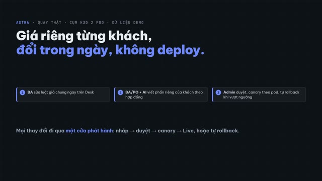
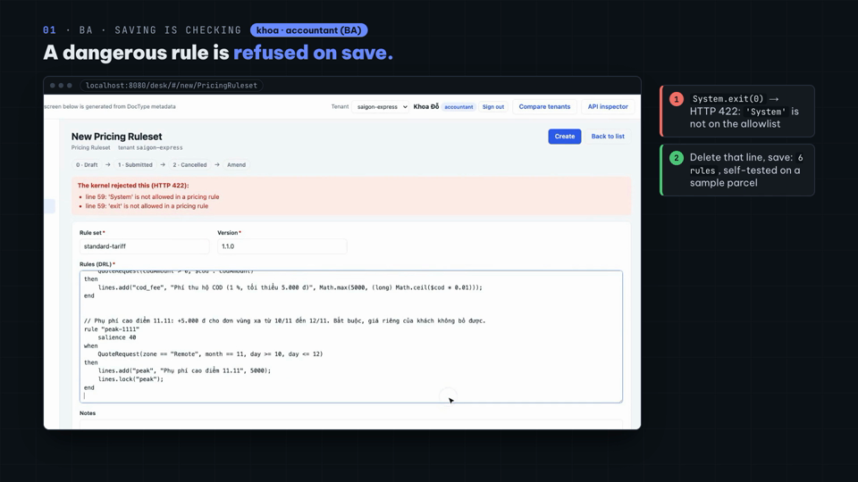
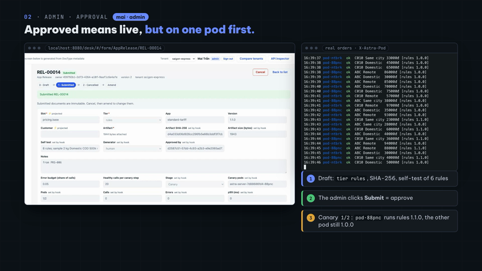
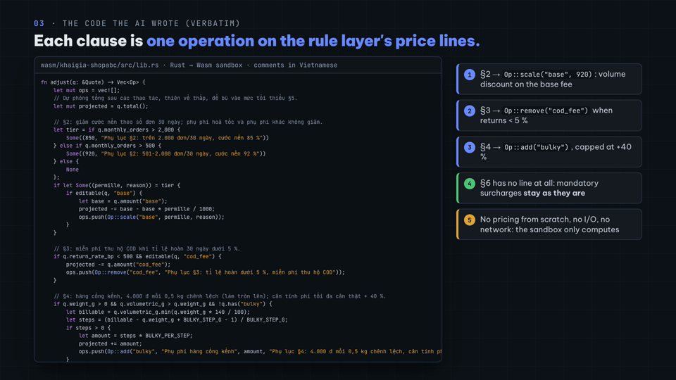
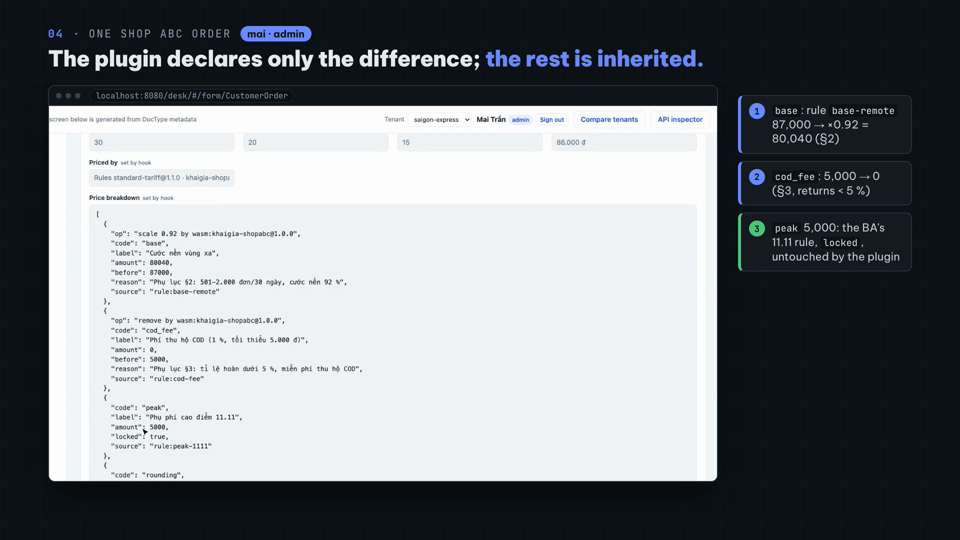
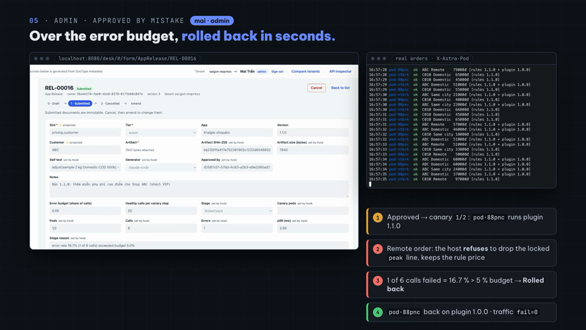

# Video 22 · Phần mềm tự tiến hoá: plugin Tier 0 · 1 · 2

<a href="https://media.zerohostcms.com/astra-cms/astra-video-22d-live-vi.mp4"></a>

▶ Quay thật (22d): [Tiếng Việt](https://media.zerohostcms.com/astra-cms/astra-video-22d-live-vi.mp4) · [English](https://media.zerohostcms.com/astra-cms/astra-video-22d-live-en.mp4) · 4:34
▶ [Bản chính](https://media.zerohostcms.com/astra-cms/astra-video-22-tiers-vi.mp4) 4:33 · clip [Tier 0](https://media.zerohostcms.com/astra-cms/astra-video-22a-tier0-vi.mp4) 1:05, [Tier 1](https://media.zerohostcms.com/astra-cms/astra-video-22b-tier1-vi.mp4) 0:49, [Tier 2](https://media.zerohostcms.com/astra-cms/astra-video-22c-tier2-vi.mp4) 1:49 · [Định giá xếp tầng](https://media.zerohostcms.com/astra-cms/astra-video-22-pricing-vi.mp4) 2:45
Kịch bản: [demo-video-series.md](../demo-video-series.md#video-22-phần-mềm-tự-tiến-hoá-plugin-tier-0--1--2) · Code: [S13](../demo-code-snippets.md#s13-plugin-tiers-0-1-2)

> **Một câu:** hành vi hay thay đổi (giá cước, hãng vận chuyển, mô-đun thuế, điều khoản hợp đồng của từng khách) được đổi khi đang chạy, ở tầng có ít quyền nhất mà vẫn làm được việc, và mọi thay đổi như vậy đi qua một đường phát hành duy nhất: ai cũng đề xuất được bản nháp, kể cả AI; chỉ admin được duyệt; bản mới lên một pod trước và tự rollback khi lỗi.
> **Đọc nếu:** bạn muốn thấy ClassLoader, đối tượng capability, allowlist và sandbox Wasm ghép vào cùng một mô hình phát hành thế nào (developer) / bạn cần cho BA và AI tuỳ biến theo từng khách mà không mở lỗ hổng, không chậm việc phát hành (tech lead).

## Vấn đề

Phần mềm doanh nghiệp bị kéo về hai phía. Giá khác nhau theo khách và đổi hằng tuần; hãng vận chuyển và cơ quan thuế
đổi API; thêm một nước là thêm một định dạng hoá đơn điện tử. Trong khi đó sổ cái, tiền và dữ liệu khách không được hỏng.

Cách thường gặp là chọn một phía. Hard code thì an toàn nhưng mỗi lần đổi là build và deploy. Cho script chạy trong ứng
dụng (Server Script của Frappe, bảng luật chạy bằng `eval`) thì nhanh nhưng phải tin người viết script. Khi AI agent viết
code, cách thứ hai còn rủi ro hơn: có thêm một tác giả viết rất nhanh mà chưa ai đọc kỹ những gì nó viết.

Astra dùng một nguyên tắc: **code càng ít được tin cậy thì càng được động, nhưng càng bị nhốt chặt.** Rồi một đường phát
hành duy nhất cho mọi thứ động, để việc kiểm soát không phụ thuộc thay đổi nằm ở tầng nào.

| Cách đổi hành vi | Ai viết | Chạy ở đâu | Được làm gì | Lên vận hành | Chi phí mỗi lời gọi (p50) |
| --- | --- | --- | --- | --- | --- |
| Tier 0 · lõi biên dịch vào image | dev lõi | JVM lõi | mọi thứ; **chỉ Tier 0 ghi sổ cái** | image mới + rolling update | 0,04 µs |
| Tier 0 · luật Drools là dữ liệu | BA trên Desk | engine trong lõi, luật bị allowlist | thêm dòng giá, khoá dòng, đặt sàn | lưu → duyệt → canary, vài giây | (trong lõi) |
| Tier 1 · plugin JVM cô lập | dev đối tác, tích hợp (tin cậy) | mỗi phiên bản một ClassLoader | SPI nó implement + host mạng được cấp | upload → duyệt → hot-swap theo pod | 5,0 µs |
| Tier 2 · sandbox Wasm | BA/PO cùng AI (không tin cậy) | sandbox, không host function | chỉ tính toán | upload → duyệt → hot-reload | 10,5 µs |

Chi phí là phần dispatch đo bằng `TierDispatchBench` (`./mvnw -pl astra-plugin-host test -Dtest=TierDispatchBench`).

## Video cho thấy gì

Bản chính và ba clip đi qua cả ba lớp của slide "Global future" trên cụm k3d 2 pod: lõi và rolling update không lỗi
request; plugin hãng vận chuyển FastShip thay khi đang chạy, canary theo pod, bản lỗi bị rollback, lời gọi tới host không
được cấp bị từ chối; mỗi nước một mô-đun hoá đơn điện tử (Việt Nam, rồi tenant Campuchia mới mà không khởi động lại gì);
bộ phát hiện bất thường do AI viết gửi cảnh báo tới đúng vai trò. *Định giá xếp tầng* giải thích ba tầng giá. Video 22d
quay thật câu chuyện định giá, theo từng vai:

| Cảnh | Trên màn hình | Chứng minh điều gì |
| --- | --- | --- |
| BA sửa luật | `khoa` (accountant) chép `standard-tariff 1.0.0` thành 1.1.0 trên Desk, gõ luật `peak-1111`: +5.000 ₫ vùng xa từ 10 đến 12/11, `lines.lock("peak")` | Bảng cước từng là một `Map` trong Java nay là dữ liệu BA sửa được. |
| Chặn khi lưu | Sót một `System.exit(0)`: HTTP 422, `line 59: 'System' is not allowed in a pricing rule` | Luật chạy trong JVM lõi nên mọi từ phải nằm trong allowlist trước khi biên dịch. |
| Lưu, Submit | `6 rules; sample 2 kg Domestic COD 500k = …`; Submit tạo bản nháp `AppRelease`, `generator: human` | Submit là đề xuất; chưa có gì có hiệu lực. |
| Admin duyệt | `mai` xem tier, SHA-256, kết quả tự kiểm, bấm Submit; `canary_pods` là một pod; bảng traffic thấy `pod·88pnc` chạy luật 1.1.0, pod kia vẫn 1.0.0 | Canary theo pod, thấy được trên từng response (`X-Astra-Pod`). |
| Live | Sau 45 lời gọi khoẻ trên mỗi pod: 2/2, Live, bản 1.0.0 Retired; traffic `ok=129 fail=0` | Không khởi động lại, không đơn nào lỗi. |
| BA/PO + AI | PO gõ yêu cầu vào Claude Code, đăng nhập MCP của Astra bằng `aibot` (role `release-bot`). AI đọc phụ lục, tài liệu PDK, hồ sơ khách, viết crate Rust, build, chạy `quote_backtest` trên 1.410 đơn (doanh thu −13,39 %, 0 đơn bị từ chối), rồi gọi `release_propose` | AI mang theo bằng chứng, không chỉ code. |
| AI thử tự duyệt | `POST /api/doc/AppRelease/REL-00015/submit` bằng token `aibot`: 403 `not permitted: submit AppRelease` | Quyền duyệt nằm trên DocType, không nằm trong lời dặn trong prompt. |
| Admin duyệt plugin | Bản nháp ghi `generator: claude-code`, `customer: ABC`, ghi chú có backtest; bản đầu tiên của ABC lên thẳng Live | Hành vi riêng theo khách mà không rẽ nhánh code. |
| Một đơn của Shop ABC | `base` 87.000 → ×0,92 = 80.040 (§2), `cod_fee` 5.000 → 0 (§3), `peak` 5.000 `locked` từ luật của BA | Plugin chỉ khai phần khác biệt; phần còn lại, kể cả luật BA đổi sau này, được kế thừa. |
| Bản 1.1.0 lỗi | Bản lỗi cố ý bỏ luôn `peak` (trái §6) bị duyệt nhầm; host từ chối thao tác lên dòng đã khoá; 1/6 lời gọi lỗi = 16,7 % > ngân sách 5 % → `Rolled back`; pod quay về 1.0.0 | Bản phát hành sai chỉ tốn vài giây trên một pod, không bao giờ cho ra giá dưới mức luật. |

## Cách hoạt động

### Tier 0: luật là dữ liệu, allowlist là ranh giới

Bảng cước từng là `Map` trong `ShippingFeeHook` nay là `astra-apps/express/src/main/resources/META-INF/astra/rules/standard-tariff.drl`.
Luật không trả về một con số mà thêm các dòng giá có `code` ổn định, là hợp đồng với các tầng sau:

```drl
rule "peak-1111"
    salience 40
when
    QuoteRequest(zone == "Remote", month == 11, day >= 10, day <= 12)
then
    lines.add("peak", "Phụ phí cao điểm 11.11", 5000);
    lines.lock("peak");
end
```

`QuoteLines` là đầu ra duy nhất. Luật được `add` một dòng (thêm trùng `code` hoặc số âm là lỗi), đọc các dòng đã thêm
(`has`, `amount`, `total`), `lock` một dòng để tầng sau không sửa được, và nâng `floor` cho tổng. Luật không sửa hay xoá
được dòng nào: lớp này không có method như vậy, và `lines()` trả về bản sao. Engine ghi luật nào sinh ra dòng nào
(`rule:peak-1111`); luật không tự khai nguồn khác được.

Ranh giới an toàn là `astra-kernel/src/main/java/io/astra/kernel/rules/RuleValidator.java`. Sau khi xoá chuỗi và comment,
mọi từ phải nằm trong allowlist: từ khoá DRL, thuộc tính của `QuoteRequest` (lấy từ getter), sáu method của `lines` và sáu
hàm `Math`.

```java
private static final Set<String> LINES_METHODS = Set.of("add", "has", "amount", "total", "lock", "floor");
private static final Set<String> MATH_METHODS = Set.of("ceil", "floor", "min", "max", "round", "abs");
```

Allowlist loại bỏ ngay từ cấu trúc những thứ mà denylist phải đuổi theo từng cách viết: `System`, `Runtime`, `new`, tên
đầy đủ, reflection, `eval`, `from`, function và query, `insert`/`modify`, `drools`/`kcontext`, `.class`, regex (regex
backtracking không dừng ở deadline) và vòng lặp. Review bảo mật của đợt này tìm ra một lỗi RCE thật: ký tự `'"'` làm bộ
xoá chuỗi của validator và trình biên dịch hiểu khác nhau chỗ chuỗi kết thúc, giấu được code trong thứ trông như chuỗi.
Bản sửa chặn cả lớp lỗi (nháy đơn, text block, backslash), và payload của reviewer thành test hồi quy trong `RuleValidatorTest`.

Lúc chạy, `RuleEngine` tính mỗi báo giá trong một session mới, trên virtual thread, deadline 50 ms, tối đa 500 lần fire
luật; bộ luật đã biên dịch được cache theo SHA-256. Nếu tầng luật lỗi, `LayeredPricing` lùi về bảng cước chuẩn và ghi lý
do vào `priced_by`; tính giá không bao giờ chặn đơn.

### Tier 1: "chỉ SPI và mạng được cấp"

Plugin Tier 1 là một jar có `META-INF/astra-app.yaml`:

```yaml
id: fastship
version: 1.1.0
tier: isolated-jvm
entrypoint: com.fastship.astra.FastShipAdapter
spi: io.astra.spi.integration.CarrierAdapter
capabilities:
  network: [ "http://partner-sandbox:8090" ]      # FastShip's sandbox, nothing else
runtime: { timeout: 300ms, max-concurrency: 32, circuit-breaker: { failure-rate: 0.5, window: 30s } }
```

Bốn thứ nhốt nó lại:

- **Class.** `PluginClassLoader` định nghĩa class của plugin từ bytes của jar; parent chỉ lộ JDK và `io.astra.spi.*`.
  `io.astra.kernel.*`, Quarkus, Jackson hay class của plugin khác đều cho `ClassNotFoundException`, và hai phiên bản của
  cùng một plugin không chung class nào nên chạy song song được.
- **Đối tượng.** Plugin nhận `PluginContext` với đúng bốn thứ: `identity()`, `http()`, `config()`, `log()`. Không có
  `DocumentService`, không có `GeneralLedger`; không có tham chiếu thì plugin không ghi chứng từ, không ghi sổ cái được.
- **Mạng.** `GrantedPartnerHttp` so origin (scheme, host, port) của từng URL với `capabilities.network`, ngoài danh sách
  thì ném `CapabilityDeniedException` và log `PartnerHttp denied <url> for <id@version>`.
- **Tài nguyên.** `LoadedPlugin` gọi `MethodHandle` đã bind lúc nạp qua một bulkhead: semaphore `max-concurrency` từ chối
  ngay thay vì xếp hàng, circuit breaker theo tỉ lệ lỗi, deadline trên virtual thread. Permit do tác vụ nhả chứ không do
  người gọi, nên lời gọi quá giờ vẫn giữ chỗ cho tới khi thread thật sự dừng.

Jar chỉ được nạp sau khi duyệt: lúc lưu release chỉ đọc manifest và kiểm SPI, nên static initializer trong một jar vừa
upload không chạy khi lưu. Lời gọi ra đối tác nằm trong job (`CarrierBookingJob`, `EInvoiceJob`), ngoài transaction submit đơn.

Tier 1 là cô lập, không phải sandbox. Java 25 không còn SecurityManager, nên plugin cố ý vẫn có thể mở socket bằng lớp
JDK; `PartnerHttp` là cửa có kiểm soát và audit, không phải tường lửa. Vì vậy code không tin cậy, kể cả code AI viết, đi Tier 2.

### Một đường phát hành cho mọi tier

`AppRelease` (DocType trong `astra-plugin-host`) giữ artifact, SHA-256, kết quả tự kiểm, `generator` (`human` hoặc
`claude-code`, lấy từ token người gọi), `signed_by`, stage và các bộ đếm sức khoẻ. Quyền trên DocType là điểm kiểm soát:

```yaml
permissions:
  - { role: admin,       read: true, create: true, write: true, submit: true, cancel: true }
  - { role: release-bot, read: true, create: true }   # an AI token proposes a draft; it cannot edit it after (no swap before review) and cannot approve it
```

`release-bot` không có `write`: nếu có, AI tạo nháp, chờ admin đọc xong rồi tráo artifact trước khi admin bấm Submit.

`RolloutController.resolve(slot, customer)` chọn bản phục vụ từng lời gọi trên pod này: ghim theo khách, rồi ghim theo
tenant (`AppPin`), rồi canary nếu pod này nằm trong danh sách canary, còn lại là Live. Ghim cho hành vi riêng theo tenant
và theo khách mà không rẽ nhánh code: một tenant giữ FastShip 1.0 tới khi đối soát xong, mỗi tenant ghim mô-đun hoá đơn
của nước mình, Shop ABC ghim plugin giá riêng.

`RolloutJob` chạy mỗi 2 giây trên một pod, chọn bằng advisory lock của PostgreSQL, và chấm từng bản canary:

```java
if (calls >= MIN_CALLS_TO_JUDGE && (double) errors / calls > budget) {
    String reason = String.format("error rate %.1f%% (%d of %d calls) exceeded budget %.1f%%", 100.0 * errors / calls,
            errors, calls, 100 * budget);
    store.patch(r.name(), Map.of("stage", "Rolled back", "canary_pods", "", "stage_reason", reason));
```

Đủ lời gọi khoẻ trên mọi pod canary thì thêm pod kế tiếp; đủ mọi pod thì bản mới thành Live và bản trước Retired. Các
pod không nói chuyện với nhau: mỗi pod đọc lại stage từ PostgreSQL mỗi 2 giây và lúc boot, nạp artifact lười theo SHA-256.
Không có message bus để mất thông điệp, và pod khởi động muộn đúng trạng thái ngay từ lời gọi đầu tiên.

### Tier 2: điều khoản của khách là thao tác, không phải một con số

Giá có ba tầng, luôn theo thứ tự này (`LayeredPricing`): luật Drools sinh các dòng; `PricingRule` đang bật (Video 14) thay
dòng `base` nếu khớp phân khúc của khách; plugin Wasm riêng của khách (slot `pricing.customer`) nhận các dòng và trả về
thao tác: `scale`, `set`, `remove`, `add`, mỗi thao tác kèm điều khoản hợp đồng. Dòng nào không được nhắc tới giữ nguyên
như luật đã tính.

Trả về thao tác thay vì một con số là điều làm plugin an toàn và dễ bảo trì:

- **Kế thừa.** BA thêm phụ phí 11.11 thì đơn của Shop ABC tự có, không ai phải sửa plugin.
- **Rào chắn host kiểm được.** `CustomerPricingPlugin.apply` từ chối thao tác lên dòng bị khoá, `code` không tồn tại,
  `scale` ngoài 0–2000 ‰, dòng trên một tỉ đồng, hoặc tổng dưới sàn của luật. Một thao tác bị từ chối là bỏ cả câu trả lời,
  giữ giá của luật.

```java
if (l == null) throw new Rejected(op + " " + code + ": no such line in the rule layer's price");
if (l.locked()) throw new Rejected(op + " " + code + ": the line is locked by " + l.source());
```

- **Giá giải thích được.** `price_breakdown` lưu từng dòng với `source`, `op`, `before` và `reason`.

Module được gọi bằng `ScriptRuntime.callBytes`: host gọi `alloc` của module, ghi đầu vào vào bộ nhớ tuyến tính, gọi
`adjust(ptr, len)` rồi đọc kết quả, có kiểm ptr/len, trần kích thước, trần bộ nhớ, deadline, và vẫn không có host function.
PDK Rust (`astra-apps/express/wasm/astra-pricing-pdk`) giấu định dạng dữ liệu, nên một plugin chỉ là một hàm. Đây là phần
đầu hàm Claude Code viết trong video 22d, nguyên văn:

```rust
fn adjust(q: &Quote) -> Vec<Op> {
    let mut ops = vec![];
    // Dự phóng tổng sau các thao tác, thiên về thấp, để bù vào mức tối thiểu §5.
    let mut projected = q.total();

    // §2: giảm cước nền theo số đơn 30 ngày; phụ phí hoả tốc và phụ phí khác không giảm.
    let tier = if q.monthly_orders > 2_000 {
        Some((850, "Phụ lục §2: trên 2.000 đơn/30 ngày, cước nền 85 %"))
    } else if q.monthly_orders > 500 {
        Some((920, "Phụ lục §2: 501-2.000 đơn/30 ngày, cước nền 92 %"))
    } else {
        None
    };
    // … §3 remove("cod_fee"), §4 add("bulky"), §5 add("min_fee"); §6 không có dòng nào nên phụ phí bắt buộc giữ nguyên
```

Cùng phụ lục đó viết bằng luật Drools cần 7 luật, 52 dòng đan với luật chung và phải mở rộng fact model
(`docs/demo-data/shop-abc-as-rules.drl`); plugin có sẵn trong repo là một hàm 33 dòng.

### Vòng AI: đề xuất có bằng chứng, người duyệt, hệ thống đo

AI làm việc qua MCP tool bằng token riêng: `customer_pricing_profile` và `quote_backtest` cho định giá, `ops_snapshot` và
`anomaly_backtest` cho phát hiện bất thường, `release_propose` và `release_status` cho phát hành. Kernel lo xác thực,
tenant, quyền DocType và che PII như ở [Video 15](./15-mcp.vi.md). Không chỗ nào phải tin AI đúng: AI không vượt được
role của mình, mọi đề xuất kèm bằng chứng người đọc được, và một bản phát hành sai bị giới hạn bởi sandbox, canary và rollback.

## Ví dụ thực tế

Khách mới Shop XYZ ký phụ lục sáng thứ Hai: giảm 5 % cước nền cho đơn nội thành, thêm phí đóng gói 3.000 ₫. PO đưa phụ lục
cho AI. AI đọc hồ sơ của XYZ, viết vài dòng bằng PDK, backtest trên đơn tháng trước và đề xuất một bản chỉ cho
`customer: XYZ`, ghi chênh lệch doanh thu vào ghi chú. Người duyệt đọc bản nháp và duyệt. Bản mới lên một pod rồi cả cụm;
chỉ đơn của XYZ đổi, từng dòng của từng đơn ghi điều khoản nào đã đổi nó. Thứ Tư, BA tăng cước nền vùng xa cho mọi khách:
đơn của XYZ đổi theo, vì plugin chỉ nhân trên dòng do luật sinh ra. Thứ Sáu, ai đó phát hành một bản miễn phụ phí bắt buộc;
host từ chối ngay ở đơn đầu tiên có dòng bị khoá, và bản đó tự rollback.

Cả tuần không ai deploy lõi, và không ai phải tin AI.

## Dành cho tech lead

- **Đẩy mỗi thay đổi về tầng có ít quyền nhất mà vẫn làm được việc.** Thay đổi chạm sổ cái, transaction hay quyền là
  Tier 0 và đi qua code review. Luật chung cho mọi khách là Drools. Tích hợp đối tác cần JVM đầy đủ là Tier 1. Điều khoản
  của một khách, một thử nghiệm, hay bất cứ thứ gì AI viết là Tier 2. Khi một điều khoản riêng bắt đầu cần thêm trường vào
  fact model hoặc luật đan với luật chung, nó thuộc về plugin của khách đó.
- **Kiểm soát không phụ thuộc tier.** Duyệt, canary, rollback, ghim, provenance và bộ đếm sức khoẻ giống nhau cho jar,
  module Wasm và bộ luật, nên một quy trình review áp cho tất cả.
- **Chi phí nhỏ và đo được:** 5 µs mỗi lời gọi Tier 1, 10,5 µs mỗi lời gọi Wasm so với 0,04 µs gọi trực tiếp, đặt cạnh
  một đường tính giá hay đặt vận đơn vốn đã có việc DB và mạng.
- **Điểm yếu được gọi tên.** Tier 1 dựa vào sự tin cậy với socket thô; validator là ranh giới an toàn chính của luật và đã
  có lỗ hổng thật trước khi review; bulkhead và breaker của plugin Tier 1 dùng chung giữa các tenant nạp cùng một jar.

## Tự chạy thử

```bash
make k3d-up                                   # 2 pod astra-server, partner sandbox, user Keycloak sophea và aibot
make demo-reset && make demo-seed
make demo-tiers PAUSE=0                       # cảnh T0 T0b T1a T1b T2a T2b; SCENES="T0b" chạy một cảnh
make demo-traffic MODE=orders RATE=4          # terminal khác: mỗi đơn một dòng, kèm pod đã tính giá

./mvnw -pl astra-server -am test              # test cô lập, hot-swap, rò, bulkhead, capability, rollout, định giá
./mvnw -pl astra-kernel test -Dtest=RuleValidatorTest

scripts/mcp-claude.sh aibot saigon-express    # rồi `claude`, đưa cho nó docs/demo-data/shop-abc-contract-v1.md
```

Video 22d được quay bằng `docs/video/v22-live/record/take.sh` (Playwright cho Desk, asciinema cho terminal, một driver
pseudo-terminal cho phiên Claude Code); thư mục đó là project video cục bộ, không nằm trong repo.

## Nói đúng

- Hãng vận chuyển và cơ quan thuế là sandbox (`tools/partner-sandbox`); định dạng hoá đơn không đúng chuẩn pháp lý từng nước.
- Cụm có 2 pod nên canary là 1/2 rồi 2/2. Canary chia theo pod, không theo % request.
- Lịch sử 30 ngày và phụ lục Shop ABC là dữ liệu demo. Trong video 22d, bản 1.1.0 lỗi là cố ý và không do AI viết; phiên AI
  được tăng tốc 1,6×, lời gọi và kết quả giữ nguyên; ô soạn luật trên Desk được phóng to khi quay để đọc được.
- Khi plugin bị từ chối, đơn dùng giá của luật (không có giảm giá hợp đồng) cho tới khi rollback.
- Tier 1 là cô lập, không phải sandbox (Java 25 không có SecurityManager).
- Chưa có chữ ký Sigstore, SBOM hay OCI registry: release ghim SHA-256 và ghi `generator`, `signed_by`.
- Cảnh báo giao theo vai trò và lọc theo người được giao; quyền theo dòng vẫn ở roadmap.
- Drools ghim 10.1.0, chạy được trên Java 25 dù KIE chưa công bố hỗ trợ chính thức.

## Hình minh hoạ

Khung hình từ video 22d (bản tiếng Anh, dùng chung cho cả hai bài).

### Hình 1 · Luật nguy hiểm bị chặn khi lưu



### Hình 2 · Canary theo pod: một pod chạy luật mới, pod kia luật cũ



### Hình 3 · Plugin giá Claude Code viết, nguyên văn



### Hình 4 · Một đơn của Shop ABC: dòng của luật, thao tác của plugin, dòng bị khoá được kế thừa



### Hình 5 · Vượt ngân sách lỗi: host từ chối, tự rollback



## Liên quan

- Bài trước: [Video 21 · SAML SSO và SCIM](./21-sso.vi.md). Bài sau: [Video 18 · Roadmap](./18-roadmap.vi.md).
- [Video 14 · Tier 2 Wasm](./14-wasm.vi.md) (sandbox và `PricingRule`, nay là tầng giá ở giữa) và
  [Video 15 · MCP](./15-mcp.vi.md) (AI agent dùng Astra với đúng quyền của người dùng).
- Tài liệu: [demo-video-series.md, Video 22](../demo-video-series.md#video-22-phần-mềm-tự-tiến-hoá-plugin-tier-0--1--2),
  [pricing-rules.md](../pricing-rules.md), [overlay-wasm.md](../overlay-wasm.md), [S13 trong demo-code-snippets.md](../demo-code-snippets.md#s13-plugin-tiers-0-1-2),
  guide chi tiết (tiếng Việt): [plans/261029-0017-plugin-tiers-flagship-video/guide.md](../../plans/261029-0017-plugin-tiers-flagship-video/guide.md).
- Mã nguồn: `astra-plugin-host/src/main/java/io/astra/pluginhost/jvm/` (`PluginClassLoader`, `LoadedPlugin`,
  `GrantedPartnerHttp`, `IsolatedJvmHost`), `astra-plugin-host/src/main/java/io/astra/pluginhost/rollout/`
  (`RolloutController`, `RolloutJob`, `AppReleaseHook`), `astra-kernel/src/main/java/io/astra/kernel/rules/`
  (`RuleEngine`, `RuleValidator`), `astra-apps/express/src/main/java/io/astra/apps/express/` (`LayeredPricing`,
  `CustomerPricingPlugin`, `CarrierBookingJob`, `EInvoiceJob`), `astra-apps/express/wasm/astra-pricing-pdk/`,
  `astra-apps/express-integrations/`, `scripts/demo-tiers.sh`.
