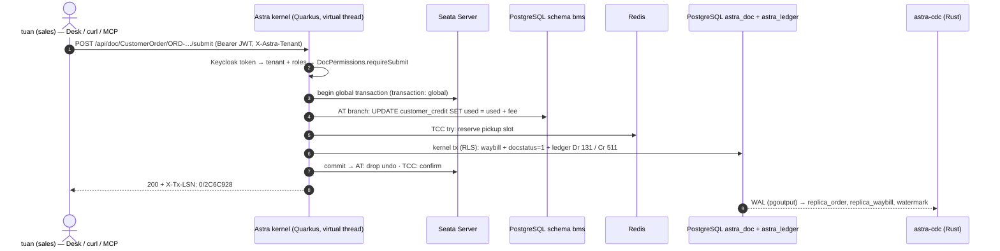
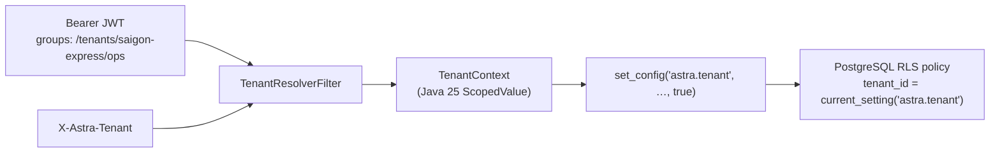
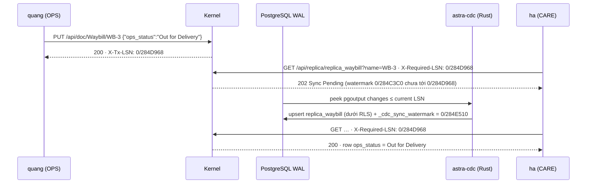
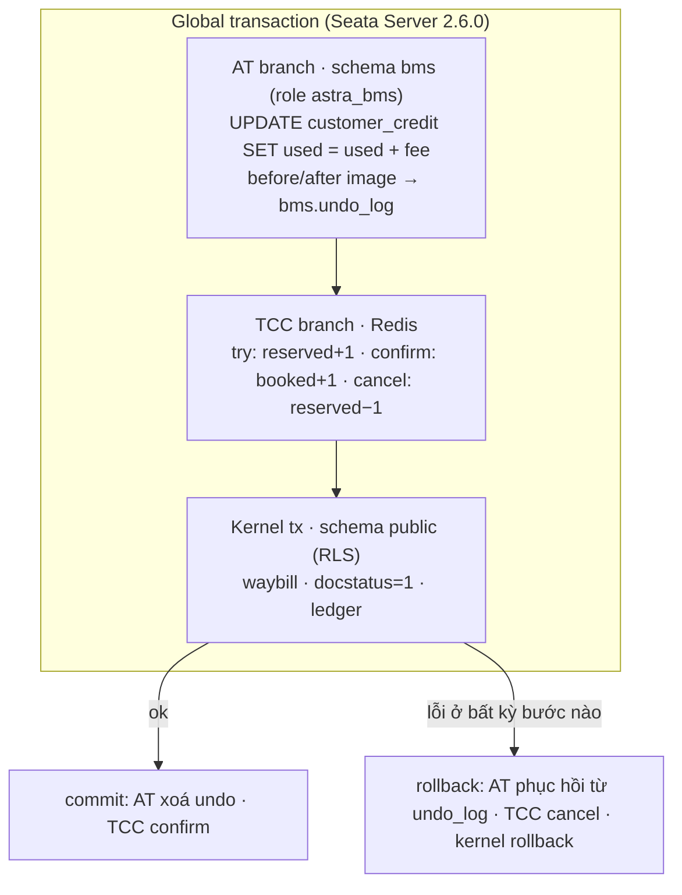

# Astra Express — Code snippet cho video (góc nhìn developer)

Đi kèm [`demo-video-series.md`](demo-video-series.md). Mỗi mục **S1…S12** là phần code để chiếu lên màn hình
(hoặc chèn làm overlay) trong video tương ứng. Code được **trích từ repository**, chỉ rút gọn: `…` là chỗ
lược bớt, comment `// ←` là chú thích thêm cho video. Đường dẫn file ghi ở đầu mỗi khối để người xem tự mở.

| Mục | Video | Ý chính |
| --- | --- | --- |
| [S0](#s0-big-picture) | 0, 1 | Bức tranh toàn cảnh: một lần Submit đi qua những gì |
| [S1](#s1-doctype-is-the-source-of-truth) | 2 | DocType YAML → API, Desk, index |
| [S2](#s2-an-app-and-a-hook) | 3, 9 | App Tier 0 và hook nghiệp vụ |
| [S3](#s3-lifecycle-in-one-transaction) | 4, 5 | Submit = một transaction, hook ghi chứng từ khác |
| [S4](#s4-tenants-and-row-level-security) | 7, 8 | Tenant: `ScopedValue` → `set_config` → RLS |
| [S5](#s5-keycloak-permissions-and-sod) | 11 | Quyền theo role, maker/checker |
| [S6](#s6-append-only-ledger) | 12 | Bút toán kép, trigger append-only |
| [S7](#s7-tenant-overlays) | 13 | Overlay YAML áp lúc chạy |
| [S8](#s8-wasm-tier-2) | 14 | Rust → Wasm → sandbox Chicory |
| [S9](#s9-mcp-for-ai-agents) | 15 | Tool MCP do app đóng góp, che PII |
| [S10](#s10-rust-cdc-and-sync-aware-lsn) | 16 | WAL → replica, `X-Tx-LSN` / `202 Sync Pending` |
| [S11](#s11-seata-at-and-tcc) | 17 | Global transaction: AT + TCC + kernel |
| [S12](#s12-desk-generated-from-metadata) | 2, 9 | Desk không biết trước DocType nào |

---

## S0 Big picture

Một lần bấm **Submit** đơn hàng chạm vào gần như mọi tính năng. Sơ đồ này nên chiếu đầu video 0 và 1.



---

## S1 DocType is the source of truth

`astra-apps/express/src/main/resources/META-INF/astra/doctypes/customer-order.doctype.yaml`

```yaml
name: CustomerOrder
module: oms
kind: transaction
submittable: true                 # Draft (0) -> Submitted (1) -> Cancelled (2) -> Amend
transaction: global               # submit/cancel span BMS credit (Seata AT) and pickup capacity (Seata TCC)
naming: { series: "ORD-.YYYYMMDD.-.#####" }

fields:
  - { name: customer,         type: Link,     options: Customer, required: true, in-list: true, projected: true }
  - { name: receiver_phone,   type: Data,     required: true, pii: true }
  - { name: zone,             type: Select,   options: [Same city, Domestic, Remote], default: Domestic, projected: true }
  - { name: weight_kg,        type: Float,    required: true, label: Weight (kg) }
  - { name: shipping_fee,     type: Currency, read-only: true, in-list: true }   # computed by ShippingFeeHook
  - { name: waybill,          type: Link,     options: Waybill, read-only: true }  # created on submit
  # …

permissions:
  - { role: sales,      read: true, create: true, write: true, if-owner: true, submit: true }
  - { role: accountant, read: true, cancel: true }
  # …
```

Từ file này, không cần viết thêm dòng nào:

| Dòng YAML | Kernel sinh ra |
| --- | --- |
| `name`, `fields` | `GET/POST/PUT /api/doc/CustomerOrder`, form + list trên Desk |
| `projected: true` | `CREATE INDEX CONCURRENTLY astra_doc_p_zone ON astra_doc (tenant_id, doctype, (data->>'zone'))` |
| `type: Link` | Kiểm tra `Customer` tồn tại **trong cùng tenant** |
| `read-only` | Client gửi `shipping_fee` → 422; chỉ hook được ghi |
| `naming.series` | `ORD-20261021-00001`, đếm riêng từng tenant |
| `pii: true` | Bị che khi dữ liệu đi qua MCP tới mô hình AI |

Lưu trữ là **một bảng** cho mọi DocType (`V1__astra_doc.sql`):

```sql
CREATE TABLE astra_doc (
    id uuid PRIMARY KEY, tenant_id text NOT NULL, doctype text NOT NULL, name text NOT NULL,
    docstatus smallint NOT NULL DEFAULT 0, owner text NOT NULL, version integer NOT NULL DEFAULT 1,
    data jsonb NOT NULL DEFAULT '{}'::jsonb,      -- ← mọi trường nghiệp vụ nằm ở đây: Zero-DDL
    …
);
```

---

## S2 An app and a hook

App chỉ khai báo DocType của mình — `ExpressApp.java`:

```java
@ApplicationScoped
public class ExpressApp implements AstraApp {            // ← chỉ phụ thuộc astra-spi
    public String id() { return "io.astra.express"; }
    public List<String> doctypeResources() {
        return List.of("META-INF/astra/doctypes/customer.doctype.yaml",
                       "META-INF/astra/doctypes/customer-order.doctype.yaml", /* … */);
    }
}
```

Quy tắc nghiệp vụ là một CDI bean — `ShippingFeeHook.java` (rút gọn):

```java
@ApplicationScoped
public class ShippingFeeHook implements DocLifecycleHook {

    public String doctype() { return "CustomerOrder"; }

    @Override
    public void beforeSave(Document doc) {                       // ← chạy trên mọi kênh: Desk, REST, MCP
        List<String> errors = new ArrayList<>();
        if (!doc.getString("receiver_phone").matches("0\\d{9}")) errors.add("receiver_phone must be 10 digits starting with 0");
        if (weight <= 0 || weight > MAX_WEIGHT_KG) errors.add("weight_kg must be between 0 and 30");
        if (!errors.isEmpty()) throw new DocValidationException(errors);   // ← HTTP 422, mọi lỗi cùng lúc

        doc.set("shipping_fee", fee(zone, service, weight, cod));
        doc.set("priced_by", "Standard tariff");
    }
}
```

Kết quả: `30.000 + 3 × 5.000 = 45.000 → × 1,5 (Express) = 67.500 → + 5.000 COD = 73.000 ₫`.

---

## S3 Lifecycle in one transaction

Kernel — `DocumentStore.submit` (rút gọn: bản thật trả `Optional.empty()` khi không tìm thấy):

```java
public Optional<Document> submit(String doctype, String name) {
    DocTypeDefinition def = requireSubmittable(doctype);
    return global(def, "submit " + doctype + " " + name, () -> inTenantTx(conn -> {   // ← Seata nếu transaction: global
        Document doc = get(doctype, name).orElseThrow();
        requireDraft(doc);                       // ← docstatus phải là 0
        hooks.onSubmit(doc);                     // ← mọi hook của app, cùng connection
        DocumentValidator.applyDefaultsAndValidate(def, doc);
        validateLinks(conn, def, doc);
        return Optional.of(write(conn, doc, 1)); // ← docstatus = 1, optimistic version check
    }));
}
```

App — hook ghi một chứng từ **khác** và cùng commit/rollback (`OrderWaybillHook.java`):

```java
@Inject DocumentService docs;

@Override
public void onSubmit(Document order) {
    Document waybill = docs.insert("Waybill", Map.of(        // ← tham gia transaction đang mở
            "order", order.name(),
            "receiver_name", order.getString("receiver_name")), order.owner());
    order.set("waybill", waybill.name());
}

@Override
public void onCancel(Document order) {
    Document waybill = docs.get("Waybill", order.getString("waybill")).orElseThrow();
    if (!Set.of("Created", "Picked Up").contains(waybill.getString("ops_status"))) {
        throw new DocValidationException("cannot cancel " + order.name() + ": waybill … is already '…'");
    }                                                         // ← veto: đơn và vận đơn không bao giờ lệch nhau
    docs.update("Waybill", waybill.name(), Map.of("ops_status", "Cancelled"));
}
```

Máy trạng thái bưu kiện là một bảng dữ liệu (`WaybillScanHook.java`):

```java
static final Map<String, Set<String>> NEXT = Map.of(
        "Created",          Set.of("Picked Up", "Cancelled"),
        "Picked Up",        Set.of("At Hub", "Cancelled"),
        "At Hub",           Set.of("At Hub", "Out for Delivery", "Returned"),
        "Out for Delivery", Set.of("Delivered", "Failed Delivery"),
        /* … */ "Delivered", Set.of());
```

---

## S4 Tenants and row-level security



`TenantTransactions.inTenantTx` — tenant không bao giờ là tham số của API nào:

```java
String tenant = TenantContext.require();                        // ← đọc từ ScopedValue, không từ caller
try (Connection conn = dataSource.getConnection()) {
    conn.setAutoCommit(false);
    conn.prepareStatement("SELECT set_config('astra.tenant', ?, true)") … ;   // ← chỉ sống trong transaction này
    T result = ScopedValue.where(TX, conn).call(() -> work.run(conn));         // ← hook lồng nhau dùng lại conn
    conn.commit();
    return result;
}
```

`V1__astra_doc.sql`:

```sql
ALTER TABLE astra_doc ENABLE ROW LEVEL SECURITY;
ALTER TABLE astra_doc FORCE ROW LEVEL SECURITY;      -- ← áp dụng cả cho chủ bảng
CREATE POLICY astra_doc_tenant_isolation ON astra_doc
    USING      (tenant_id = current_setting('astra.tenant', true))
    WITH CHECK (tenant_id = current_setting('astra.tenant', true));
```

Fail-closed — `RowLevelSecurityGuard.java`:

```java
if (superuser || bypass) {
    throw new IllegalStateException("Database role '" + role + "' is a SUPERUSER: row-level security would be ignored …");
}                                                    // ← kernel từ chối khởi động
```

---

## S5 Keycloak permissions and SoD

Role là nhóm Keycloak, quyền là YAML trên DocType (`cod-remittance.doctype.yaml`):

```yaml
submittable: true
segregation-of-duties: true        # maker/checker: whoever prepares a payout cannot approve it
permissions:
  - { role: accountant, read: true, create: true, write: true, submit: true, cancel: true }
```

`DocPermissions.requireSubmit` (nguyên văn):

```java
public void requireSubmit(String doctype, Set<String> roles, String userId, Document existing) {
    DocTypeDefinition def = registry.require(doctype);
    if (!allows(def, roles, Action.SUBMIT, false)) {
        throw new AccessDeniedException("submit " + doctype);
    }
    if (def.segregationOfDuties() && userId != null && userId.equals(existing.owner())) {
        throw new AccessDeniedException("submit " + doctype + "/" + existing.name()
                + ": segregation of duties, the creator cannot submit their own document");
    }
}
```

Desk đăng nhập bằng Authorization Code + PKCE ngay trong trình duyệt (`desk.js`, rút gọn):

```js
const verifier  = b64url(crypto.getRandomValues(new Uint8Array(32)));
const challenge = b64url(await crypto.subtle.digest('SHA-256', new TextEncoder().encode(verifier)));
location.assign(oidc('auth') + '?' + new URLSearchParams({
  client_id: 'astra-desk', response_type: 'code', scope: 'openid',
  code_challenge: challenge, code_challenge_method: 'S256', redirect_uri: location.origin + '/desk/' }));
```

---

## S6 Append-only ledger

App ghi sổ qua SPI, trong transaction của chứng từ (`OrderPostingHook.java`, nguyên văn):

```java
@Inject GeneralLedger ledger;

@Override
public void onSubmit(Document order) {
    BigDecimal fee = BigDecimal.valueOf(Numbers.toDouble(order.get("shipping_fee")));
    String customer = order.getString("customer");
    ledger.post("CustomerOrder", order.name(), LocalDate.now(), List.of(
            Entry.debit(Accounts.RECEIVABLE, customer, fee),      // ← Nợ 131 Phải thu khách hàng
            Entry.credit(Accounts.REVENUE, customer, fee)),       // ← Có 511 Doanh thu dịch vụ
            "Shipping fee " + order.name());
}

@Override
public void onCancel(Document order) {
    ledger.reverse("CustomerOrder", order.name());               // ← bút toán đảo, không sửa dòng cũ
}
```

Database tự bảo vệ lịch sử (`V3__ledger.sql`):

```sql
CREATE TABLE astra_ledger ( …, debit numeric(18,2), credit numeric(18,2), …,
    CONSTRAINT astra_ledger_one_side CHECK (debit >= 0 AND credit >= 0 AND (debit = 0) <> (credit = 0))
) PARTITION BY RANGE (posting_date);                       -- ← astra_ledger_2026_10, _11, _12, default

CREATE FUNCTION astra_ledger_append_only() RETURNS trigger LANGUAGE plpgsql AS $$
BEGIN
    RAISE EXCEPTION 'astra_ledger is append-only: post a reversal instead of %', TG_OP;
END $$;
CREATE TRIGGER astra_ledger_no_update_delete BEFORE UPDATE OR DELETE ON astra_ledger
    FOR EACH ROW EXECUTE FUNCTION astra_ledger_append_only();
```

`LedgerStore.post` từ chối voucher lệch: `debit 10 ≠ credit 9` → 422.

---

## S7 Tenant overlays

`tenants/hanoi-express/overlays/customer-order.overlay.yaml`:

```yaml
doctype: CustomerOrder
fields:
  add:
    - { name: vat_invoice,   type: Check, label: "Xuất hóa đơn VAT", in-list: true }
    - { name: tax_code,      type: Data,  label: "Mã số thuế" }
  modify:
    - { name: zone, options: [Same city, Domestic, Remote, Island] }
    - { name: note, label: "Ghi chú giao hàng", required: true }
```

```bash
curl -X PUT http://localhost:8080/api/overlay/CustomerOrder \
     -H "Authorization: Bearer $NAM" -H "X-Astra-Tenant: hanoi-express" \
     -H "Content-Type: application/yaml" --data-binary @customer-order.overlay.yaml   # ← có hiệu lực ngay
```

Kernel hỏi "DocType **của tenant này**" thay vì "DocType" (`DocTypeOverlays.effective`, rút gọn):

```java
public DocTypeDefinition effective(String doctype) {
    DocTypeDefinition base = registry.require(doctype);             // ← định nghĩa của app
    Optional<String> tenant = TenantContext.current();
    if (tenant.isEmpty()) return base;
    return get(doctype).map(o -> Overlays.apply(base, (String) o.get("yaml")))   // ← astra_overlay, dưới RLS
                       .orElse(base);                                          // (cache 2 s giữa các pod)
}
```

Luật an toàn trong `Overlays.apply`: chỉ thêm trường hoặc đổi `label / required / options / default / in-list`;
đổi `type` → `422 field property 'type' cannot be changed by an overlay`.

---

## S8 Wasm Tier 2

```mermaid
flowchart LR
    R["tet-promo/src/lib.rs"] -->|cargo build --target wasm32-unknown-unknown| W["tet-promo.wasm · 421 byte"]
    W -->|POST /api/doc/PricingRule (Attach, base64)| P["PricingRule document"]
    P -->|PricingRuleHook: self-test trong sandbox| S["Chicory 1.7.5<br/>≤16 trang bộ nhớ · deadline 50 ms · không host import"]
    S -->|fee(weight_g, zone, express, cod)| F["ShippingFeeHook → shipping_fee"]
```

Công thức của tenant, viết bằng Rust (`astra-apps/express/wasm/tet-promo/src/lib.rs`):

```rust
#[unsafe(no_mangle)]
pub extern "C" fn fee(weight_g: i64, zone: i64, express: i64, cod: i64) -> i64 {
    let z = zone.clamp(0, 3) as usize;
    if z == 0 && weight_g <= 2_000 && express == 0 {
        return cod_fee(cod);                                  // free same-city ≤ 2 kg
    }
    let extra_steps = ((weight_g - 1_000).max(0) + 499) / 500;
    let mut fee = ZONE_BASE[z] + extra_steps * ZONE_STEP[z];
    if z > 0 { fee = fee * 80 / 100; }                        // −20 % outside the city
    if express != 0 { fee = fee * 130 / 100; }                // Express +30 % instead of +50 %
    round_up_thousand(fee + cod_fee(cod))
}
```

Sandbox (`astra-plugin-host/…/WasmSandbox.java`, rút gọn):

```java
Future<long[]> call = threads.submit(() -> instantiate(wasm).export(function).apply(args)); // ← instance mới mỗi lần
try {
    return call.get(deadline, TimeUnit.MILLISECONDS)[0];
} catch (TimeoutException e) {
    call.cancel(true);                                       // ← ngắt luồng: interpreter dừng ở lần kiểm tra kế tiếp
    throw new ScriptException("timeout", "script exceeded its " + deadline + " ms deadline and was stopped", e);
}
```

Script độc (`runaway/src/lib.rs`): `loop { i = core::hint::black_box(i.wrapping_add(1)); }` →
`module rejected (timeout): script exceeded its 50 ms deadline and was stopped`.

---

## S9 MCP for AI agents

Một tool do **app** đóng góp — kernel lo xác thực, tenant, quyền, log, che PII (`TrackWaybillTool.java`):

```java
@ApplicationScoped
public class TrackWaybillTool implements McpTool {
    public String name() { return "track_waybill"; }
    public String description() { return "Track a parcel by waybill number (WB-…): status, scans, order, tickets."; }
    public List<String> reads() { return List.of("Waybill", "CustomerOrder", "SupportTicket"); }  // ← kernel kiểm quyền đọc

    public Object call(Map<String, Object> arguments) {
        Document waybill = docs.get("Waybill", String.valueOf(arguments.get("waybill"))).orElseThrow();
        return Map.of("waybill", doc(waybill),
                      "order",   doc(docs.get("CustomerOrder", waybill.getString("order")).orElseThrow()),
                      "tickets", docs.find("SupportTicket", Map.of("waybill", waybill.name()), 20));
    }
}
```

Một lời gọi JSON-RPC thật và kết quả:

```bash
curl -X POST http://localhost:8080/mcp -H "Authorization: Bearer $HA" -H "X-Astra-Tenant: saigon-express" \
  -d '{"jsonrpc":"2.0","id":1,"method":"tools/call",
       "params":{"name":"get_document","arguments":{"doctype":"CustomerOrder","name":"ORD-20261021-00001"}}}'
```

```json
{ "name": "ORD-20261021-00001",
  "data": { "receiver_name": "L*** M*** T***", "receiver_phone": "*******678",
            "receiver_address": "1*** T*** P*** H*** C*** Đ*** N***", "shipping_fee": 61000 } }
```

Kết nối Claude Code: `scripts/mcp-claude.sh ha saigon-express`, tức là
`claude mcp add --transport http astra http://localhost:8080/mcp --header "Authorization: Bearer …" --header "X-Astra-Tenant: saigon-express"`.

---

## S10 Rust CDC and Sync-Aware LSN



Định tuyến khai báo (`astra-cdc-rust/cdc-routes.yaml`):

```yaml
routes:
  - doctype: Waybill
    target: replica_waybill
    columns:
      - { name: ops_status,  from: ops_status }
      - { name: current_hub, from: current_hub }
      - { name: scans,       from: scan_log, transform: length, type: integer }
```

Vòng lặp worker (`astra-cdc-rust/src/main.rs`, rút gọn):

```rust
loop {
    let cur: String = client.query_one("SELECT pg_current_wal_lsn()::text", &[]).await?.get(0);
    let rows = client.query("SELECT lsn::text, data FROM pg_logical_slot_peek_binary_changes($1, $2::text::pg_lsn, NULL, \
                             'proto_version', '1', 'publication_names', $3)", &[&cfg.slot, &cur, &cfg.publication]).await?;
    let tx = client.transaction().await?;
    for row in &rows {
        match pgoutput::decode(&row.get::<_, Vec<u8>>(1))? {          // ← tự giải mã giao thức pgoutput v1
            Message::Insert { relation, new } | Message::Update { relation, new } =>
                apply(&tx, cfg, &upserts, &relations[&relation], &new, &lsn).await?,   // set_config(tenant) + upsert
            /* Relation, Begin, … */
        }
    }
    tx.execute("INSERT INTO _cdc_sync_watermark … last_lsn = $2", &[&cfg.slot, &cur]).await?;
    tx.commit().await?;
    client.execute("SELECT pg_replication_slot_advance($1, $2::text::pg_lsn)", &[&cfg.slot, &cur]).await?; // ← sau commit
    tokio::time::sleep(Duration::from_millis(cfg.poll_ms)).await;
}
```

Cổng LSN trong kernel (`SyncAwareLsnFilter.java`, rút gọn):

```java
// request: đọc replica nhưng worker chưa tới LSN client yêu cầu → không trả dữ liệu cũ
if (!watermark.reached(required)) req.abortWith(Response.status(202).entity(Map.of("status", "sync-pending", …)).build());

// response: mọi lệnh ghi thành công báo vị trí WAL sau commit
if (WRITES.contains(req.getMethod()) && res.getStatus() / 100 == 2) res.getHeaders().putSingle("X-Tx-LSN", watermark.currentLsn());
```

---

## S11 Seata AT and TCC



Một dòng YAML bật global transaction: `transaction: global`. Hook của app (`OrderCreditHook.java`, nguyên văn):

```java
@Override
public void onSubmit(Document order) {
    GlobalTransactions tx = coordinator();
    if (tx == null) return;                                           // ← không có Seata: chạy local như cũ
    CreditLimits.use(tx, order.getString("customer"), fee(order));    // ← AT: JDBC thường trên datasource đã proxy
    tx.tcc(PickupCapacity.NAME, LocalDate.now().toString(),           // ← TCC: participant của app
           Map.of("capacity", DAILY_PICKUP_CAPACITY, "order", order.name()));
}
```

Participant TCC — app không thấy một kiểu Seata nào (`PickupCapacity.java`, rút gọn):

```java
public void prepare(String branchId, String day, Map<String, Object> args) {
    counters.add("tcc-try:" + branchId, 1, KEEP);
    if (counters.add(reservedKey(day), 1, KEEP) + counters.get(bookedKey(day)) > capacity) {
        throw new DocValidationException("no pickup slot left for " + day);   // ← Seata sẽ gọi rollback
    }
}
public void commit(String branchId, String day, Map<String, Object> args) {
    if (!counters.markOnce("tcc-done:" + branchId, KEEP)) return;             // ← idempotent khi Seata retry
    counters.add(reservedKey(day), -1, KEEP);
    counters.add(bookedKey(day), 1, KEEP);
}
public void rollback(String branchId, String day, Map<String, Object> args) {
    if (!counters.markOnce("tcc-done:" + branchId, KEEP)) return;
    if (counters.get("tcc-try:" + branchId) > 0) counters.add(reservedKey(day), -1, KEEP);  // ← empty rollback an toàn
}
```

Điều phối (`astra-tx-seata/…/SeataTransactions.inGlobal`, rút gọn):

```java
GlobalTransaction gtx = GlobalTransactionContext.getCurrentOrCreate();
gtx.begin(timeoutMillis, name);
try {
    T result = work.get();          // ← AT + TCC + kernel tx (kernel commit cuối)
    gtx.commit();
    return result;
} catch (Throwable e) {             // ← cả Error: nhánh nào đã giữ global lock thì phải rollback
    gtx.rollback();
    throw e;
}
```

---

## S12 Desk generated from metadata

Desk không có một dòng code nào nhắc tới `CustomerOrder` hay `Waybill` (`desk.js`, rút gọn):

```js
const res = await api('GET', '/api/doctype');            // ← DocType hiệu lực của tenant (đã áp overlay)
for (const f of def.fields) {
  switch (f.type) {                                       // ← mỗi kiểu trường → một control
    case 'SELECT':   input = h('select', …, f.options.map((o) => h('option', null, o))); break;
    case 'LINK':     input = h('input', { list: 'opts-' + f.name }); /* gợi ý từ /api/doc/<target> */ break;
    case 'CURRENCY': input = h('input', { type: 'number' }); break;
    case 'ATTACH':   return attachControl(f, v, locked);   // ← upload .wasm cho PricingRule
    /* … */
  }
}
const perm = can(def.name);                               // ← /api/iam/me: quyền hiệu lực theo role
if (doc.docstatus === 0 && perm.submit) actions.append(button('Submit'));
if (doc.docstatus === 1 && perm.cancel) actions.append(button('Cancel'));
```

Thêm một trường vào YAML (hoặc overlay) → form, list, filter, validation, API và tool MCP cùng cập nhật.
